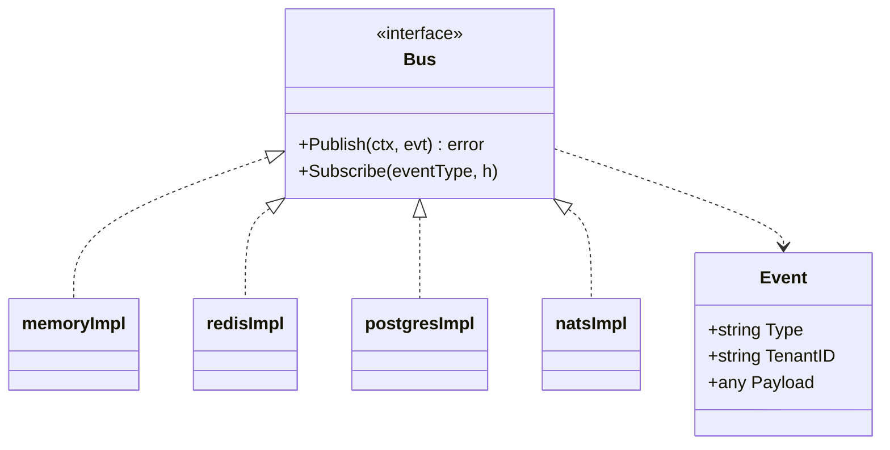
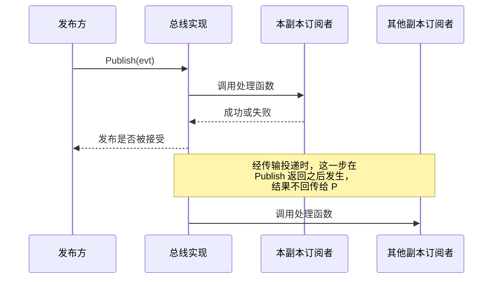

# event

## 职责

本模块交付**事件总线**：一个模块发布一个领域事实，另一个模块按类型订阅它，两者之间不需要相互认识。它是横切能力——审计与可观测性——取得领域事实的统一入口：这类能力订阅总线即可拿到全部事件，不必耦合每一个产生事件的模块（[ADR-event-scope-2026-09-21](../adr/adr-event-scope-2026-09-21.md)）。

实现有多个，绑定不同后端：进程内、Redis、PostgreSQL、NATS JetStream。**功能排他交付**：同一个进程里恰好一个实现生效。

订阅方通常不能 import 发布方的包——跨模块 import 一个具体类型会把依赖方向倒转。载荷因此以**结构化**方式读取：订阅方按字段名经序列化往返取它需要的字段，不做类型断言。

### 非职责

- **不校验事件类型名。** 类型名是发布方与订阅方之间的约定字符串，没有注册面，也不在启动期检查有没有对应的发布方。发布方可以在运行期任意时刻出现。
- **不承诺投递次数与顺序。** 跨副本恰好一次、按发布顺序投递，都是实现与其后端的事。需要顺序的调用方在载荷里携带序号自行处理。
- **不承诺订阅者失败回传发布方。** 承诺的下界见"错误与失败语义"。
- **不做事件的持久化与重放。** 某些实现的后端让已发布的事件跨重启留存，那是那个实现的性质，不是接口承诺，也不构成重放能力。
- **不按租户过滤。** 事件携带租户标识，按它分流归订阅方。
- **不校验载荷的结构。** 载荷是不透明的，读不出来时订阅方自行决定丢弃还是记录。
- **不做事件模式的版本管理。** 载荷的形状随发布方演进，兼容性由发布方与订阅方约定。
- **不认识租户模块。** 租户标识在本模块是字符串，不引用租户模块的类型。

## 外部接口契约

### 交付的功能

```go
// 功能标识为 (*Bus)(nil)。
type Bus interface {
    // Publish 把 evt 交给总线。返回 nil 表示发布已被接受，
    // 不表示任何订阅者已收到或已处理完成。
    Publish(ctx context.Context, evt Event) error

    // Subscribe 为类型名精确等于 eventType 的事件登记 h。
    Subscribe(eventType string, h Handler)
}

type Event struct {
    // Type 是路由键。匹配是精确字符串比较，不解释通配符与前缀。
    Type string

    // TenantID 是事件所属的租户。系统级事件留空。
    TenantID string

    // Payload 是事件数据。订阅方按约定读取，不做类型断言。
    Payload any
}

type Handler func(ctx context.Context, evt Event) error
```

**排他交付。** 多于一个实现表态启用即启动失败。

### 载荷的读取

订阅方拿到的载荷有两种形状，取决于投递路径：同进程投递是发布方自己的具体值，经传输投递是传输解出来的结构。两种形状下都按字段名读取：

| 辅助 | 用途 |
|---|---|
| 解码为字段表 | 读顶层字段，任一形状不可用时报 false，不 panic |
| 按候选名取字符串 | 依次尝试若干个拼写（序列化标签、结构体字段名），取第一个非空字符串 |
| 按候选名取布尔 | 同上，区别是 false 是一个有意义的值，只有缺失或非布尔才继续尝试 |
| 解码为具名类型 | 订阅方能命名自己的形状时直接解，且要向上报出失败时用它 |

**这一组辅助是容错的**：读不出来的载荷报 false 或返回解码错误，绝不 panic，绝不返回部分值。订阅方与发布方的契约是"读不出就丢弃并记录"，因此探询路径上没有可上报的错误。

### 稳定性承诺

- **投递下界（见"错误与失败语义"）** 是接口承诺，实现不得弱于它。
- **类型名的匹配规则是精确比较**，不是前缀，不是大小写不敏感。
- **`Subscribe` 只对调用之后发布的事件生效**，不补发此前已发布的事件。
- **一个订阅者失败不阻止同一事件的其余订阅者被调用。**

## 依赖

| 依赖 | 用途 |
|---|---|
| `pkg/core` | 注册描述符、交付功能 |
| `pkg/config` | 声明本模块的输入项 |
| 共享发布单元 | 仅 Redis 实现使用：客户端类型与连接构造 |

**不依赖任何业务模块，与键值模块同处依赖图底层。** 租户标识是字符串而非租户模块的类型：import 那个模块的接口包会让每一个使用本模块的宿主在构建图里带上数据库、GORM、SQLite 驱动、HTTP 入口与认证，而本模块只需要一个字符串（[ADR-event-scope-2026-09-21](../adr/adr-event-scope-2026-09-21.md)）。

## UML 图

图里是接口与它的实现，以及发布方与订阅方经由总线的关系。图看不出的约束：实现之间互斥；订阅方**不能**命名发布方的类型，因而只能结构化读取载荷；跨副本投递发生在 `Publish` 返回之后。



一次发布的路径，其分支由实现决定：



## 核心数据结构

| 概念 | 类型 | 说明 |
|---|---|---|
| 事件 | `Event` | 路由键、租户标识、不透明载荷 |
| 处理函数 | `Handler` | 收到一个事件，返回它自己处理是否成功 |
| 类型名 | `string` | 约定字符串，精确匹配 |

**`Event` 是值类型，按值传递。** 订阅者拿到的是一次投递的副本，改动它不影响发布方。

## 核心算法与流程

### 本模块的阶段行为

| 阶段 | 行为 |
|---|---|
| `Prepare` | 各实现 `Decode` 自己那份配置；读出部署前提输入项，与自身性质不符即表态禁用并给出理由 |
| `New` | 建立与后端的连接 |
| `Init` | 各模块在这一阶段订阅；此后订阅表冻结 |
| `Start` | 开始接受发布。经传输投递的实现在此启动读取协程 |
| `Stop` | 停止接受发布与投递 |
| `Close` | 关闭连接，释放读取协程 |

### 订阅的登记与生效

订阅由各模块在自己的 `Init` 中调用。所有 `Init` 完成之后订阅表冻结，此后不再接受新的订阅——一个在运行期才订阅的处理函数会漏掉它订阅之前发布的事件，而它无从知道自己漏了什么。

**每个订阅者都收到一份独立的投递。** 同一类型有多个订阅者时，一个处理函数的失败不影响其余的处理函数被调用，也不影响它们收到的载荷。

### 投递路径

进程内实现在发布方的协程上依次调用订阅者，因此它知道每一次调用的结果，但这不是接口承诺。

经传输投递的实现把事件写入其后端，并由每个副本自己的读取协程投递。**投递给本副本订阅者与投递给其他副本订阅者走的是同一条路径**，因此它们在时间上都不早于 `Publish` 返回；发布方无从得知任何一次调用的结果。

## 错误与失败语义

### 投递承诺的下界

接口承诺以下各条，全部实现都满足（[ADR-event-delivery-2026-09-21](../adr/adr-event-delivery-2026-09-21.md)）：

- `Publish` 返回 nil 表示这次发布已被总线接受。不表示任何订阅者已收到或已处理完成。
- `Publish` 返回非 nil 表示发布**没有被接受**，且失败发生在交给总线的那一步：载荷不可序列化、连接不可用、总线已关闭。不表示某个订阅者处理失败。
- 订阅者的失败不回传发布方。

**实现可以更强，且必须在自己的文档里写明强在哪。** 进程内实现同步调用每个订阅者并汇总它们的失败，这是它的性质；调用方不得依赖，因为换一个实现就没有了。

| 情形 | 表现 |
|---|---|
| 载荷不可序列化 | `Publish` 失败，事件不投递给任何人 |
| 连接不可用 | `Publish` 失败 |
| 总线已关闭 | `Publish` 失败 |
| 某订阅者返回错误 | 其余订阅者照常被调用；发布方看不到这个错误 |
| 某订阅者 panic | 由实现决定，且必须写在其文档里。接口不接住 panic |
| 订阅了无人发布的类型 | 不报错，也不产生任何信号 |

### 订阅方读取载荷

载荷读不出来时，订阅方丢弃并记录这条事件。它没有可上报的对象——发布方收不到订阅者的失败，而这条事件已经投递完毕。

**发布方改一个字段名会静默断开订阅。** 两者之间没有共享的静态类型，没有编译期检查，也没有运行期的模式校验。

## 并发与事务边界

- `Publish` 与 `Subscribe` 在 `Init` 完成之后不从同一处调用：`Publish` 进请求协程，`Subscribe` 只在 `Init` 内。
- 实现必须保证订阅表冻结之后的读取是并发安全的。
- 处理函数在实现自己的协程上被调用（进程内实现即发布方的协程），它不得假设自己与发布方在同一协程，也不得假设与其他处理函数在同一协程。
- 本模块不开事务。一次发布是独立的，不与调用方自己的事务绑定。

## 扩展点

**新增一种后端即新增一个实现子包。** 以下各条是准入条件的全部：

- 必须在 `Prepare` 中 `Decode` 自己那份配置，并在其中判断部署前提；前提不满足时表态禁用并给出理由。
- 必须排他交付：`Exclusive` 非空，且交付的功能标识为 `(*Bus)(nil)`。
- 必须挂在 `event.<后端>` 专属的配置命名空间下。
- 必须满足投递承诺的下界，且把超出下界的部分写进自己的文档——尤其是订阅者 panic 的处置，与跨副本投递的语义（广播到每个副本，还是消费者组式的负载均衡）。
- 必须通过共享的一致性套件。

## 实现状态

| 能力 | 状态 | 代码 |
|---|---|---|
| 接口与根包 | 未实现 | — |
| 内存实现 | 未实现 | — |
| Redis 实现 | 未实现 | — |
| PostgreSQL 实现 | 未实现 | — |
| NATS JetStream 实现 | 未实现 | — |
| 一致性套件 | 未实现 | — |
