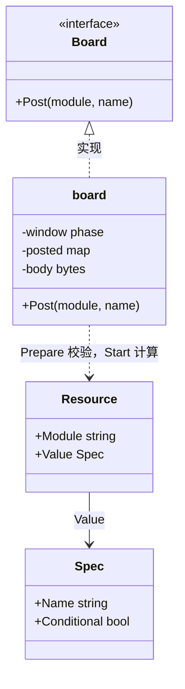
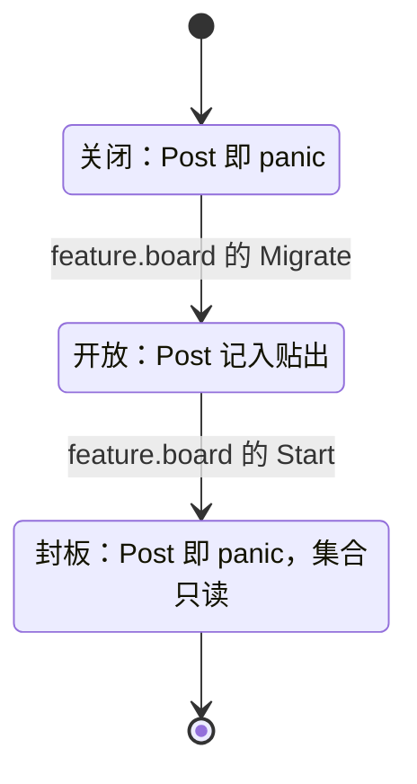
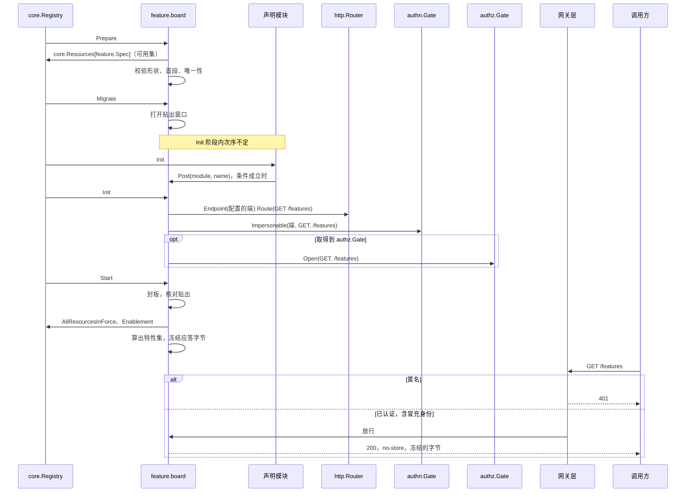

# feature

## 职责

`feature` 功能目录让前端按本进程的装配定制自己：声明模块报告自己服务哪些面向用户的面，本目录把它们汇成一份[特性文档](../../glossary.md)，只对已认证调用者发布。特性、静态特性、条件特性与特性文档的含义见项目术语表。

- **根包 `pkg/feature` 承载声明面**：资源类型 `Spec`、功能 `Board`、名字规则与哨兵错误。根包的非测试代码只 import 标准库，声明特性的模块 import 它不带进任何第三方库。
- **模块 `feature.board`（包 `pkg/feature/board`）承载发布**：在 `Prepare` 校验可用集里的全部声明，在 `Migrate` 打开贴出窗口，在 `Init` 挂出 `GET /features` 并向认证网关登记，在 `Start` 封板、算出本进程的特性集并冻结应答字节，请求期答出冻结的字节。
- **特性文档是进程级的**：取值由本进程的装配决定，在 `Start` 冻结，与调用者身份无关，冒充开始或结束都不改变它（[ADR-feature-document-2026-10-17](../../adr/adr-feature-document-2026-10-17.md)）。

### 特性文档承载的事实

**判据是存在性。** 特性文档只承载这样的事实：它回答「前端已带着代码的某个界面面——页面、区块或入口控件——在本进程是否成立」，取值是布尔，且只在登录后才需要（[ADR-feature-ownership-2026-10-17](../../adr/adr-feature-ownership-2026-10-17.md)）。例：手机号自助（`authn.phone`）、自助添加邮箱（`authn.identifiers.email`）、邮件渠道（`notification.channel.email`）、SSO 管理组（`authn.admin.sso`）。

不满足这条判据的事实按下面的判据归属；不发布的判据先于发现面的判据适用：

- **不发布**：满足任一即是——只是参数（时长、上限、预算），违反时服务端逐次拒绝；结果经流程应答送达；发布会暴露租户、IdP 或账户维度。例：`authn.account.auto-link`、`authn.sms.allowed-prefixes`、IdP 清单。
- **归拥有该事实的模块自己的发现面**：满足任一即是——不是布尔而是取值集合或渲染形状；登录前就要用；需要逐请求求值又不属于存在性。例：`GET /auth/methods` 的 `methods`、`signup.enabled` 与 `mfa.factors`（[authn-login](authn/design-authn-login.md)）。

**同一事实只有一个发布点。** 可登记的因素种类只在 `mfa.factors` 里；特性文档里只有 MFA 区块是否存在（`authn.mfa`），没有逐种类的特性名。

### 匿名档边界

特性文档不对匿名者发布：网关由网关模块构造时，匿名请求恒得网关的 401。登录前的事实不经特性文档，只经拥有该事实的模块自己的匿名发现面发布，准入判据见[架构的特性与前端定制](../architecture.md#特性与前端定制)。本模块不设匿名档。

### 非职责

- **不发布登录前的事实，也不发布取值、形状与参数。** 归属见「特性文档承载的事实」与「匿名档边界」。
- **不按权限过滤，也不按租户成员身份过滤。** 特性在场与授权是两件事：每个已认证调用者读到同一份集合，授权仍由各模块在服务端判定（[ADR-feature-document-2026-10-17](../../adr/adr-feature-document-2026-10-17.md)）。
- **不描述界面。** 特性名只承担「在不在」；页面路径、标签、图标与控件的形状都在前端产物里，本模块不发布渲染描述。前端只门控自己已带着代码的面。
- **不认识任何具体特性。** 名字由服务它的模块声明或贴出，本模块只按名字规则校验、按取材域计算。哪个模块声明哪些特性，由该模块的设计文档承载。
- **不核对特性与路由是否一致。** 一个静态特性的路由是否已登记、一份 `Spec` 与模块挂的路由是否对得上，本模块都不核对；声明模块受架构不变量 18 约束，各自以测试守住。
- **不门控前端。** 前端怎样持有特性文档、怎样据它收窄路由与控件，归 [web](web/design-web.md) 的 [auth-core](web/design-web-auth-core.md) 与 [route-kit](web/design-web-route-kit.md)。
- **不按租户收窄。** 本模块的集合是进程级的；租户级收窄的接入位置见[扩展点](#扩展点)。
- **`core` 不认识特性。** `Spec` 是普通资源，`core` 原样保存；集合计算只用 `core` 的 `Resources`、`Enablement` 与 `AllResourcesInForce`（架构不变量 2、15）。

## 术语表

以下术语的含义限于本文档；它们不进项目术语表。

| 术语 | 英文 | 定义 |
|---|---|---|
| 特性词表 | feature vocabulary | 可用集里全部 `feature.Spec` 声明的清单，每项带名字、声明模块与是否条件特性，按名字排序，写出为 `contracts/features.json`。任何一份特性文档都是它的子集。 |
| 贴出 | post | 声明模块在本次运行中经 `Board.Post` 报告它的一个条件特性成立。只在 `feature.board` 的 `Migrate` 到 `Start` 之间合法；声明模块在 `Init` 中、在决定该面是否成立的同一处判定里贴出。 |
| 封板 | seal | `feature.board` 在 `Start` 关闭贴出窗口、核对全部贴出并算出特性文档的那一步。封板之后特性集与应答字节不再变化。 |

## 外部接口契约

### 根包 `pkg/feature`

```go
package feature

// Spec 声明声明模块服务的一个特性。静态特性在声明模块进入启用集时即在场；
// 条件特性还要由声明模块在 Init 中经 Board 贴出。
type Spec struct {
    Name        string
    Conditional bool
}

// Board 收集运行中的模块贴出的条件特性。Post 只在 feature.board 的 Migrate
// 到 Start 之间合法，这段窗口含整个 Init 阶段；窗口之外调用 Post 即 panic。
type Board interface {
    Post(module, name string)
}

var (
    ErrInvalidName = errors.New("feature: ...") // 名字形状不合法
    ErrForeignName = errors.New("feature: ...") // 首段与声明模块名的首段不同
    ErrDuplicate   = errors.New("feature: ...") // 同一个名字由两个模块声明
    ErrUndeclared  = errors.New("feature: ...") // 贴出了贴出者没有声明为条件特性的名字
    ErrNoGate      = errors.New("feature: ...") // 进程里没有 authn.Gate 的提供者
)
```

**声明。** 模块把 `Spec` 放进自己描述符的 `Resources`，一个 `Spec` 声明一个特性。框架模块与宿主的应用模块以同一形态声明。

**贴出。** 条件特性的声明模块在 `Init` 中经 `core.Resolve` 取 `Board`，不把它列入 `Requires`；`module` 实参是贴出者自己的模块名：

```go
// 在 Init 中，写在决定该面是否成立的同一处判定里
if b, err := core.Resolve[feature.Board](reg); err == nil {
    b.Post(ModuleName, name)
}
```

`Board` 不在场时（例如没有纳入 `feature.board` 的 worker 进程）贴出静默跳过。`Post` 对并发调用安全。

**名字规则。** 下列规则是穷举的，`feature.board` 在 `Prepare` 逐条校验（见[核心算法与流程](#核心算法与流程)）：

- **形状**：`^[a-z][a-z0-9-]*(\.[a-z][a-z0-9-]*)+$`，至少两段。
- **首段**：等于声明模块名的首段。这条只约束命名空间，不承担防撞名：框架模块的首段即它的功能目录名，应用模块的首段可以与某个功能目录同名，例如示范宿主的应用模块 `notification.access`。
- **唯一**：一个名字在可用集里只由一个模块声明。防撞名靠这一条。

**只在 `Init` 中贴出。** 贴出窗口自 `feature.board` 的 `Migrate` 起：一个模块在自己的 `Migrate` 中贴出，可能早于 `feature.board` 的 `Migrate` 而 panic；在 `New` 中贴出必然落在窗口之外。

**接口面。** `Spec` 的字段、`Board` 的方法集、哨兵错误的集合与名字规则是声明模块与 `feature.board` 之间的对外接口面；改 `Spec` 的字段或 `Board` 的方法集是破坏性变更，放宽唯一性是兼容变更。

### 模块 `feature.board`

```go
// 描述符形状。
core.Module{
    Name: "feature.board",
    Requires: []core.Requirement{
        {Token: (*speedhttp.Router)(nil)},
        {Token: (*log.Logger)(nil), Optional: true},
    },
    Provides: []core.Provision{{Token: (*feature.Board)(nil), Exclusive: true}},
    Resources: []any{
        schema(), // feature.board.endpoint
        speedhttp.Spec{Endpoint: "account", Document: boardFragment},
    },
    Prepare: ..., Migrate: ..., Init: ..., Start: ...,
}
```

**`Requires` 约束的主体是把本模块纳入命令的每个宿主。** `(*speedhttp.Router)(nil)` 必需：本模块挂路由经它，「`feature.board` 在场」因而蕴含「本进程有路由器」。`(*log.Logger)(nil)` 可选：在场时 `Start` 写一行集合摘要。`authn.Gate` 与 `authz.Gate` 不列入 `Requires`，在 `Init` 经 `core.Resolve` 取用。`Board` 声明排他交付，依赖闭包不替宿主纳入本模块，宿主在命令树上点名它。

**配置。** `feature.board.endpoint`：单个端名，只从主配置源取值，必填，无缺省。缺席即 `Prepare` 以 `config.ErrMissingRequired` 失败，错误以完整路径点名这一项。

**片段。** `Resources` 里的 `Spec` 以 `openapi/board.json` 为文档，operation 是 `feature.board.list`。资源是 `init` 期的静态声明，写不进配置点名的端，片段因而按约定的端名 `account` 声明；挂载用配置点名的端，两者各自维护，与 [http](http/design-http.md) 对 `Spec` 的口径相同。

**路由。** 本模块在 `feature.board.endpoint` 点名的端上挂 `GET /features`，并在 `Init` 登记：

- `authn.Gate` 必须取得到，取不到时 `Init` 返回包装了 `feature.ErrNoGate` 的错误，进程不启动；
- 以 `Impersonable(endpoint, GET, "/features")` 登记该路由，冒充身份照常读到特性文档；
- 取得到 `authz.Gate` 时以 `Open(GET, "/features")` 登记该路由为开放。`Open` 按（方法，路径）登记、不带端名：所在端不受授权守卫时这条登记不改变任何判定，所在端受授权守卫、`authz.guard.undeclared` 为 `closed` 时这条登记使该路由不被答 403。

**应答。** 已认证的请求得到 `200 application/json`，带 `Cache-Control: no-store`：

```json
{
  "features": ["audit.admin", "authn.admin", "authn.mfa", "notification.inbox", "tenant.admin"]
}
```

- 名字升序排列，无重复。
- 外层是对象，在外层加字段是兼容变更。
- 契约片段的描述写明：内容对调用者与租户可能不同，不得跨会话缓存。
- 匿名请求得到网关的 401 problem+json，本模块不另定形状。
- 应答里只有名字，没有任何配置值、方法描述符或渲染描述。

**接口面。** 模块名 `feature.board`、配置键 `feature.board.endpoint`、路由 `GET /features`、operation `feature.board.list`、应答的形状与 `Cache-Control` 头，是宿主与前端写下来、读进去的东西；改动它们是宿主可见的破坏性变更。

### 对宿主的要求

- **服务前端的命令运行级纳入 `feature.board`。** 没有本模块的进程上前端读不到特性文档，按取回失败处理。
- **点名的端受认证网关守卫。** 违反即网关在 `Start` 以 `authn.ErrExemptionUnguarded` 终止启动。
- **点名的端不解析租户。** 本模块不核对这一条；端上装了租户解析时，读不出租户的请求在到达本模块之前被答 404，选定租户之前的前端读不到特性文档。
- **与该端共用一条监听的前端，页面路径不以 `/features` 开头。** `GET /features` 是单段静态路径，所在端据它认领前缀 `/features`（[http](http/design-http.md) 的监听级分派）；以它开头的深链接不再回退到前端入口文档。
- **同一个源背后的全部 serve 副本跑同一条命令、同一份配置。** 本模块不跨副本核对，见[错误与失败语义](#错误与失败语义)。
- **对外提供服务的装配不为网关预置外来的实例**（[authn](authn/design-authn.md#对宿主的要求)）。
- **以带 `AllResources` 的静态级纳入点名一个声明了特性的模块，即声明该模块的面由同一个源背后的另一进程服务。** 见[取材域](#取材域)。

## 依赖

| 依赖 | 使用者 | 用途 |
|---|---|---|
| 标准库 | 根包 | 根包的非测试代码只 import 标准库 |
| `pkg/core` | `feature.board` | 描述符、`Resources`、`Resolve`、`Enablement`、`AllResourcesInForce` |
| `pkg/config` | `feature.board` | 声明并读取 `feature.board.endpoint` |
| `pkg/http` | `feature.board` | `Router`、`Endpoint`、`Spec`；挂路由、声明片段 |
| gin | `feature.board` | 路由的 handler 是 `gin.HandlerFunc`；已在 `pkg/http` 的依赖闭包里 |
| `pkg/authn` 根包 | `feature.board` | `Gate`：登记可冒充；`ErrExemptionUnguarded` 由网关报出 |
| `pkg/authz` 根包 | `feature.board` | 可选：`Gate`，登记开放 |
| `pkg/log` | `feature.board` | 可选：`Start` 的集合摘要 |

**依赖方向自上而下。** 声明或贴出特性的模块 import 根包；根包只依赖标准库，因而不把任何第三方库带进它们的闭包，认证的子包 import 它也不违反架构不变量 17。`feature.board` 位于 `pkg/http`、认证根包与授权根包之上，它们都不 import 本目录；`pkg/feature/board` 不被任何模块 import。`core` 不 import `pkg/feature`（架构不变量 2）。

## UML 图

类图给出声明面与发布者的关系。图里的形状看不出下列约束：`Post` 只在窗口内合法，窗口之外即 panic；`Spec` 的取材域在校验与作答两处不同；贴出必须对应一条条件特性的声明。这些由正文承载。



贴出窗口有固定的生命周期。窗口自 `feature.board` 的 `Migrate` 打开，到它的 `Start` 关闭；`core` 先按依赖序执行全部 `New`，再从 `Migrate` 起按阶段推进，一个阶段逐个模块推进，因而全部 `Migrate` 回调都先于任何一个 `Init` 回调，窗口含整个 `Init` 阶段。



时序图给出各阶段与请求期的跨模块交互。`Init` 阶段内各模块的先后不定，声明模块的贴出可以在 `feature.board` 自己的 `Init` 之前或之后，都落在窗口内。



## 核心数据结构

| 概念 | 形状 | 说明 |
|---|---|---|
| 特性声明 | `feature.Spec` | 名字与是否条件特性；经 `core.Resources[feature.Spec]` 连同声明模块名读出 |
| 贴出记录 | （贴出者模块名，名字）的集合 | 窗口内写入，封板时逐条核对 |
| 特性集 | 名字的有序集合 | 封板时算出，此后只读 |
| 应答字节 | 预先序列化的 `{"features": [...]}` | 封板时冻结，请求期原样写出 |
| 特性词表条目 | `{name, module, conditional}` | 可用集里的一条声明 |

**特性词表**是可用集全部声明的清单：

```json
{ "features": [ { "name": "authn.phone", "module": "authn.login", "conditional": true } ] }
```

它与 `contracts/api.json` 的片段同源，都来自同一个二进制的 import 闭包。宿主的 `gen` 命令写出它（[starters](design-starters.md)），前端据它生成特性名类型（[api-sdk](web/design-web-api-sdk.md)）。静态特性都在词表里，贴出又必须对应一条条件特性的声明，所以任何一份特性文档都是词表的子集，前端对特性名的静态检查因此成立（[ADR-feature-vocabulary-2026-10-17](../../adr/adr-feature-vocabulary-2026-10-17.md)）。

## 核心算法与流程

### 声明校验

`Prepare` 读配置，表态 `StateEnabled`，再以 `core.Resources[feature.Spec](reg)` 取可用集里的全部声明，逐条校验：

1. 名字不合形状 → `ErrInvalidName`，点名声明模块与名字。
2. 首段与声明模块名的首段不同 → `ErrForeignName`，点名声明模块与名字。
3. 同一个名字由两个模块声明 → `ErrDuplicate`，点名两个模块与名字。

任一失败即启动失败。未被本次命令纳入的模块同样受校验：它的名字写错，同样让启动失败。

### 贴出窗口

`Migrate` 打开窗口。窗口内每次 `Post` 把（贴出者模块名，名字）记入贴出记录，同一对记两次与记一次相同。窗口之外的 `Post` 是声明模块的编码缺陷，即 panic，与入口模块登记面在窗口之外的处置相同。

### 封板与集合计算

`Start` 依次执行：

1. **封板**：关闭窗口，此后 `Post` 即 panic。
2. **核对贴出**：一条贴出的名字若没有被贴出者声明为条件特性——没有声明、由别的模块声明、或声明为静态特性——返回 `ErrUndeclared`，启动失败。
3. **算出特性集**，判定式与 `pkg/db/plugins.go` `collectPlugins`、`pkg/jobs/scheduler/scheduler.go` `inForce` 同形：

   ```
   inForce(m) = reg.AllResourcesInForce(m) || (e, ok := reg.Enablement(m); ok && e.State != core.StateDisabled)
   静态特性：inForce(声明模块) 即计入
   条件特性：inForce(声明模块)，且本次运行被该模块贴出，才计入
   ```

   驱动推进到 `Start` 时消解已经完成，`Enablement` 对已登记模块恒有答案；答不出时按启动失败处理。
4. **冻结**：名字升序、去重，序列化为应答字节。
5. **摘要**：日志功能在场时写一行 Info：`feature set frozen count=N digest=sha256:… names=[…]`。摘要取排序后的名字以 `\n` 连接后计算，只随名字集合变化。

### 取材域

本目录按类型收集 `feature.Spec` 的消费点各自裁定取材域（架构不变量 15）：

- **声明校验取可用集，不做减法。** 它只校验声明、不让声明生效，读的是这个二进制的静态事实：未被本次命令纳入、消解落选与只被静态级纳入的模块，其声明一律受校验。
- **作答取启用集，做减法。** 这份声明所描述之物是服务该面的路由或分支，由这次运行产生：消解落选的模块不在启用集里，它的特性不计入。判定不用 `Participating`：排他消解的落选者在参与集里，却没有实例、也没有路由，`Enablement` 对它报 `StateDisabled`。判定也不比对禁用原因的文本（[core](design-core.md)）。
- **作答尊重 `AllResources` 覆盖。** 宿主经带 `AllResources` 的静态级纳入点名一个声明了特性、本身不在本进程运行的模块时，特性文档计入它的静态特性，按架构不变量 15 处理，本消费点不设例外。这种装配表示宿主显式声明该面由同一个源背后的另一进程服务，该面在部署里是开启的。条件特性不受覆盖影响：模块不在本进程运行，就不会贴出。覆盖只对不在参与集里的静态级纳入模块生效，被运行级纳入或预置了实例的模块一律按启用结果判定。

### 请求

网关先判身份：匿名请求得到 401；已认证的请求与冒充身份放行到本模块。本模块的 handler 写出头与冻结的字节，请求期没有失败路径，不读注册表、不读配置、不访问任何后端。

## 错误与失败语义

| 情形 | 时机 | 表现 |
|---|---|---|
| `feature.board.endpoint` 缺席 | `Prepare` | `config.ErrMissingRequired`，启动失败 |
| 名字形状不合法 | `Prepare` | `feature.ErrInvalidName`，启动失败 |
| 首段与声明模块名的首段不同 | `Prepare` | `feature.ErrForeignName`，启动失败 |
| 同一个名字由两个模块声明 | `Prepare` | `feature.ErrDuplicate`，启动失败 |
| 点名的端未被声明 | `Init` | `speedhttp.ErrUnknownEndpoint`，启动失败 |
| 进程里没有 `authn.Gate` 的提供者 | `Init` | 包装了 `feature.ErrNoGate` 的错误，启动失败 |
| 点名的端不受网关守卫 | 网关的 `Start` | `authn.ErrExemptionUnguarded`，启动失败 |
| 贴出了贴出者没有声明为条件特性的名字 | `Start` | `feature.ErrUndeclared`，启动失败 |
| 窗口之外调用 `Post` | 调用当场 | panic |
| 匿名请求 | 请求期 | 网关的 401 |
| 已认证请求，含冒充身份 | 请求期 | 200 与冻结的字节 |

**本模块不降级、不重试。** 装配上的缺陷在启动期判出；封板之后应答是预计算的字节，请求期不产生本模块自己的失败。

### 非保证

- **宿主为网关预置的实例不是网关模块的产物时，「只有已认证者读得到」不成立。** 认证层与网关的封板核对都随之缺席，`GET /features` 所在的端无认证放行（[authn](authn/design-authn.md) 的错误与失败语义、对宿主的要求）。
- **宿主为声明模块预置的实例不是该模块的产物时，特性文档不反映那个实例实际服务什么。** 预置了实例的模块表态固定为启用，它的静态特性照启用结果计入；条件特性由该模块的回调贴出，回调对这样的实例不做事时条件特性不贴出，方向是失败即关。宿主为 `notification.delivery` 预置实例时，渠道特性不贴出（[notification-delivery](notification/design-notification-delivery.md)）。
- **合一拓扑下，匿名者能逐条探测模块路由是否挂载。** API 端与前端同在一条监听上时，请求按各端由已登记路由派生的前缀分派，没有端认领的路径落到前端、无扩展名的回退入口文档：一条路径的模块装了，答 401 problem+json；没装，答 200 入口文档。这条探测面来自入口模块的分派与 [webui](design-webui.md) 的回退，不经特性文档；特性文档对匿名者只答 401，不扩大它。收口归入口模块的分派，例如认领命名空间前缀（[ADR-feature-document-2026-10-17](../../adr/adr-feature-document-2026-10-17.md)）。
- **宿主经 `AllResources` 声明的面，若实际没有任何进程服务，前端显示的页面请求必然失败。** 这是宿主显式声明的后果，由宿主负责。
- **同一个源背后的副本装配不一致时，前端可能显示一个某些副本不服务的页面。** 本模块不跨副本核对，前端在一个会话内也不重取：某特性在一个副本上在场、在另一个上缺席时，打到缺席副本的请求得到 404（与前端共用监听时是入口文档，传输层以 `client.html` 拒答），落到页面的可重试错误；反向时页面不出现。各副本在服务端各自授权，不一致没有安全后果。运维逐副本比对 `Start` 写出的摘要；滚动发布期间的不一致，在下次登录或刷新时收敛。
- **不核对所在的端从前端的源能否访问到。**
- **不核对 `Spec` 与模块实际挂的路由是否一致。** 各声明模块以自己的契约测试守住。

## 并发与事务边界

- 贴出发生在生命周期回调内，`Post` 对并发调用安全；封板之后贴出记录、特性集与应答字节只读。
- 请求期只读冻结的字节，可被任意多协程并发服务，不加锁。
- 本模块不落存储、不开事务，没有后台协程。

## 扩展点

### 租户级收窄

本模块的特性集是进程级的，不含租户级收窄。租户级收窄按以下形状接入，约束是**只做减法**：

- **收窄集由一个可选功能给出**（`feature.Narrower`，形如 `Narrow(ctx, tenant) (absent []string, err error)`）。作答取「封板时冻结的进程集减去收窄集」，租户不能打开本进程没有服务的面。收窄出错时整份应答答 503，不给部分结果。
- **收窄的取值放在设置的租户层**（架构不变量 14，[ADR-settings-scope-2026-09-21](../../adr/adr-settings-scope-2026-09-21.md)）。
- **租户档的读面挂在租户解析端**：一个可选配置点名一个受 `tenant.resolve` 与 `tenant.admission` 守卫的端，在其上挂与 `GET /features` 同形的读面。
- **服务端强制由请求层承担**：按（端、方法、路径）登记特性名，对被收窄的特性答出与无匹配路由逐字节相同的 404。
- **应答形状不变。** 契约描述写明内容可能随调用者与租户不同，应答带 `no-store`，外层是对象。前端一侧只扩缓存键（[auth-core](web/design-web-auth-core.md)），route-kit、各能力 UI 包与路由声明的 `requires` 都不变。

authn 的登录前事实不按租户取值：登录不认识租户（[authn-login](authn/design-authn-login.md) 的非职责），放宽开关只取主配置源（[ADR-authn-settings-and-secrets-2026-10-10](../../adr/adr-authn-settings-and-secrets-2026-10-10.md)）。收窄因而只作用于特性文档。

### 应用模块的特性

应用模块以同一个 `Spec` 声明、经同一个 `Board` 贴出，受同一组名字规则约束，它的声明进同一份特性词表。前端特性名类型的增补见 [api-sdk](web/design-web-api-sdk.md)。

## 实现状态

| 能力 | 状态 | 代码 |
|---|---|---|
| 根包 `pkg/feature`：`Spec`、`Board`、哨兵错误 | 已实现 | `pkg/feature/feature.go` `Spec`、`Board`、`ValidName`、哨兵 |
| 名字规则与可用集上的声明校验 | 已实现 | `pkg/feature/feature.go` `ValidName`；`pkg/feature/board/board.go` `validate` |
| 贴出窗口与封板 | 已实现 | `pkg/feature/board/board.go` `board.Post`、`board.open`、`board.seal` |
| 按启用集与 `AllResources` 覆盖算出特性集 | 已实现 | `pkg/feature/board/board.go` `board.collect` |
| `GET /features`：网关可冒充登记、授权开放登记、`no-store` 应答 | 已实现 | `pkg/feature/board/board.go` `board.wire`；`pkg/feature/board/handler.go` `board.serve` |
| `Start` 的集合摘要日志 | 已实现 | `pkg/feature/board/board.go` `board.seal`；`pkg/feature/board/handler.go` `digestOf` |
