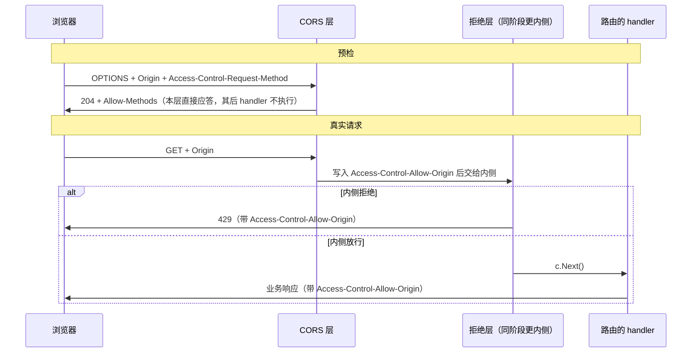

# cors

## 职责

桥接 gin-contrib/cors，在配置列举的每个监听端上登记一层中间件，按该端的策略决定哪些跨源请求可以发出。浏览器据响应上的 CORS 头判断一个跨源响应能否交给脚本，以及一次预检是否通过。

层落在防护阶段（`StageGuard`）的最外侧。**这个位置是承重的，不是风格偏好。** 预检由本层直接应答，因而在任何会拒绝请求的层之前得到结果——排在鉴别阶段之内的预检会被鉴权层拒成 401，浏览器随后根本不会发出真实请求；而任何内侧层的拒绝（来源限流的 429、网关的 401）都带着本层写入的 CORS 头抵达浏览器，浏览器因此读得到状态码而不是一个网络错误。桥接上游库、作为独立子包交付并按此定位的判据与代价见 [ADR-http-cors-2026-10-11](../../adr/adr-http-cors-2026-10-11.md)。

- 每个监听端一份策略，取自配置：端在配置里出现即被守，未出现即本模块在那个端上不登记任何层。
- 判定委托给 gin-contrib/cors：来源是否合法、预检暴露哪些头、预检用哪个状态码应答，都由该库决定，本模块只负责把配置译成该库的配置并校验。
- 不改写请求，也不改写入内层写出的响应体；放行的请求与没有本模块时逐字相同，区别只在本层写入的响应头。

### 非职责

- **不做来源限流。** 按来源地址计数的层是 limiter 的另一层（见 [ratelimit](design-ratelimit.md)）。本层只回答「这个来源能不能跨源访问」，不回答「这个来源是不是发得太快」。
- **不认证，不解析租户。** 跨源与身份无关：本层排在鉴别阶段之外，也不读身份或租户。
- **不是访问控制。** CORS 是浏览器施加的约束。非浏览器客户端——命令行工具、服务端 SDK——不发 `Origin`，因而不受本层约束。本层不能用作一道安全边界。
- **不按路由施加策略。** 入口模块的 `Use` 作用于该端的全部路由；只对一部分路由生效的 CORS 策略由登记那些路由的一方在 `Route` 的 handler 序列里自带（见 [http](design-http.md) 的外部接口契约）。
- **不接受以函数表达的策略。** gin-contrib/cors 的 `AllowOriginFunc` 与 `AllowOriginWithContextFunc` 接收一个函数判断来源；函数不是配置文件能承载的取值，本模块不把它们暴露为配置项。
- **不提供指标，也不写日志。** 判定不产生信号。层是否在位、在链的什么位置，读入口模块启动时写出的链清单。

## 外部接口契约

包名是 `cors`，模块名是 `http.cors`。模块名是命令树点名本模块的入口，也是配置命名空间；包导出 `ModuleName`、`ConfigNamespace`、`Module` 与配置类型。根包即实现，不拆接口包与实现子包。

**本模块不交付功能标识。** 链上没有别的层据本模块定序，本模块也不据别人定序：它的位置完全由阶段与阶段内的位置决定。因此登记的那一层 `Provides` 为空，链清单里只出现层名 `http.cors`（见 [http](design-http.md) 的中间件排序）。

模块自身也不交付任何能力，`Provides` 为空。它没有构造期依赖，入口模块在 `Init` 期经注册表取用。

### 稳定性承诺

- **模块名 `http.cors` 是契约。** 宿主的命令树按它把本模块纳入一条命令。
- **配置项的键名是契约，取值不是。** `http.cors.endpoints` 这个名字保持；它承载的端名与策略随部署而变。
- **策略的字段名是契约。** 宿主在配置文件里按这些名字写值，改名要连同已写入的配置一起迁移。
- **链上层的 `Name` 不是契约。** 它只用于诊断与启动时列出的链清单，本模块之外的任何东西都不该按它匹配。

### 配置面

本模块以 `config.Schema` 声明自己的输入项，挂在 `http.cors` 命名空间下：

```go
// Config 是逐监听端的 CORS 策略，键是端名。
type Config struct {
    Endpoints map[string]Policy
}

// Policy 是一个监听端的跨源策略。
type Policy struct {
    AllowAllOrigins           bool
    AllowOrigins              []string
    AllowMethods              []string
    AllowHeaders              []string
    ExposeHeaders             []string
    AllowCredentials          bool
    MaxAge                    *time.Duration
    OptionsResponseStatusCode int
    AllowPrivateNetwork       bool
    AllowWildcard             bool
    AllowBrowserExtensions    bool
    AllowWebSockets           bool
    CustomSchemas             []string
}
```

**策略逐端一份，不是全模块一份。** 一个宿主若在两个端上分别提供公开 API 与管理 API，两者的允许来源不同；一份全局策略无法表达这件事。端在 `Endpoints` 里出现即在那个端上登记一层，未出现即不登记——这是宿主在保留其它端的同时对某一个端关掉本层的方式。

**取值留空取库的默认值。** `AllowMethods`、`AllowHeaders` 与 `MaxAge` 三项留空时取 gin-contrib/cors 自己的默认（一组默认方法、一组默认请求头、12 小时）；其它各项留空即取该类型的零值。默认值只有一处，即该库的默认配置，本模块不另立一份。

**`AllowOrigins` 里唯一的 `"*"` 等价于 `AllowAllOrigins`。** 这是该库的读法：来源清单含 `"*"` 即允许全部来源。`AllowAllOrigins` 与一个非空的 `AllowOrigins` 不可同时给出，库会拒绝——「全部来源」与「这份清单」是对同一个问题给出的两个答案。

## 依赖

| 依赖 | 用途 | 取用时机 |
|---|---|---|
| `pkg/core` | 注册描述符、声明资源 | 编译期 |
| `pkg/config` | 声明并读取本模块的输入项 | 声明在编译期，读取在 `Prepare` 与 `New` |
| `pkg/http` | `Middleware` 登记面、`Stage`/`Position` 取值 | `Init` 期经注册表取用 |
| gin | 层是一个 `gin.HandlerFunc`；已在 `pkg/http` 的依赖闭包里，不为宿主另增依赖 | 编译期 |
| `github.com/gin-contrib/cors` | 判定与预检应答的实现 | 编译期 |

**本模块是 `pkg/http` 下的子包，而非根包的一部分。** 桥接引入一个第三方库，而入口模块的根包对每一层都要求「除 gin 与 config 的闭包之外不加自己的依赖」（见 [http](design-http.md) 的依赖）。把它放在子包里，宿主只有 import 这个子包才付这笔依赖；不 import 的宿主不受影响。

**入口模块在 `Init` 期取用。** 本模块不声明 `Requires`：端名的登记面在 `Init` 期已经存在，那里取用即可，没有可供定序的构造期依赖。取不到登记面即启动失败，错误点名缺的功能。

**配置在 `Prepare` 与 `New` 各读一次。** 两处都 `Decode` 自己那份配置，因而看到同一份内容：`Prepare` 校验，`New` 据此构造产物。

## UML 图

一次预检与一次真实请求经过本层，与同阶段更内侧的拒绝层的关系。图中画不出的约束：**位置由 `Stage` 与 `Position` 共同决定**，`PositionFirst` 让本层排在防护阶段里那些没声明位置的层之外，因而预检在拒绝层之前得到应答、拒绝层的响应带着本层写入的头；本层不读路由，匹配不到路由的请求与路由方法不允许的请求同样经过它。



## 核心数据结构

| 概念 | 类型 | 说明 |
|---|---|---|
| 策略 | `Policy` | 一个监听端的跨源策略，配置里的取值 |
| 库配置 | `cors.Config` | gin-contrib/cors 的配置，由策略译得 |
| 端层对 | `endpointLayer` | 端名与为它构造的 `gin.HandlerFunc` |

`endpointLayer` 是本模块产物的元素：`bridge` 持有按端名排序的一串，`Init` 期据此逐端登记。

## 核心算法与流程

### 一次请求的判定

判定完全委托给 gin-contrib/cors 的中间件，顺序如下，本模块不加分支：

1. 请求不带 `Origin` 头：不是跨源请求，本层直接返回，链继续。
2. `Origin` 等于请求自身的 host（`http://` 或 `https://` 加 host）：同源，本层返回，链继续。
3. `Origin` 不在策略允许的来源之内：库以 403 中止，链到此结束。
4. `Origin` 合法且方法是 `OPTIONS`：库写入预检响应头，以配置的状态码（默认 204）中止，链到此结束。
5. 其余：库写入普通响应头，把请求交给内侧。

**步骤 4 就是它在鉴别阶段之外的理由。** 预检在鉴权与租户解析之前得到应答，浏览器因此会继续发出真实请求。

### 配置的校验与译制

`Prepare` 调 `Config.validate`，逐端校验策略；`New` 调 `Config.build`，先校验再逐端构造层。两者都走 `Policy.libraryConfig` 把策略译成库配置。译制从库的默认配置起，只覆盖策略给出的字段，因而空字段取库的默认而非本模块另立的默认。

**校验先于构造，是因为库会对非法配置 panic。** `cors.New` 在库的 `Validate` 拒绝一份配置时 panic，其通配符解析在某个来源含多于一个 `"*"` 时 panic。`Init` 期的 panic 会带着栈把进程打断，而这一阶段的失败本该是干净地终止启动，所以这两种情形在配置期就被拦下，库拿到的永远是一份已知可用的配置。`Validate` 覆盖来源本身的规则，本模块在此之前另判它不覆盖的三件事：没有字段认领的键、响应承载不了的状态码或负的 `MaxAge`、含多于一个 `"*"` 的来源。

## 错误与失败语义

### 启动期

| 情形 | 表现 |
|---|---|
| 取不到配置读取面 | 缺提供者失败，点名 `config.Reader` |
| `endpoints` 一项都没有给出 | 终止启动，以 `http.cors.endpoints` 点名缺的这一项 |
| 某个端的策略没有给出任何来源（既非全部也非清单） | 终止启动，`ErrInvalidPolicy`，点名该端与该端的库错误 |
| 某个端的策略同时给出 `allow-all-origins` 与非空 `allow-origins` | 同上 |
| 策略里出现没有字段认领的键 | 终止启动，`ErrInvalidPolicy`，点名该端与那个键 |
| `max-age` 为负，或 `options-response-status-code` 不是可承载的状态码 | 终止启动，`ErrInvalidPolicy` |
| 开启了 `allow-wildcard` 而某个来源含多于一个 `"*"` | 终止启动，`ErrInvalidPolicy`，点名该来源 |
| 配置里的端名在入口模块的配置里不存在 | 终止启动，错误由登记面给出 |

本模块没有可降级的启动形态：一个端配了策略却配得不可用，构造不出比构造一个不做判定的层更诚实。

### 运行期

**本层的拒绝与预检应答由库写出，不经入口模块的 `Fail`。** 来源不在允许清单内时库以 `c.AbortWithStatus` 写出一个 403，预检上库用同一个调用写出配置的状态码。这偏离了入口模块「错误响应集中一处」的规则（见 [http](design-http.md) 的错误响应）——那一处写出 `problem+json` 或交付的 `ErrorResponder` 形状，而这里的 403 是空体。代价可接受：这个 403 只抵达那些带了不被允许的 `Origin` 的请求，而这类请求来自浏览器，浏览器在缺少 CORS 头时本就不会把响应交给脚本，响应体对它不可见；不带 `Origin` 的客户端不受本层约束，也不会走到这个分支。

**本层不捕获 panic。** 判定路径上是库自己的纯计算（头部生成、来源比对），本层不设 `recover`；漏出的那一次由入口模块内建的兜底层接住（见 [http](design-http.md) 的 panic 兜底）。

### 哨兵错误

| 哨兵 | 含义 |
|---|---|
| `core` 的缺能力失败 | 配置读取面或入口模块不在场 |
| `config` 的 `ErrMissingRequired` | `endpoints` 一项都没有给出 |
| `config` 的 `ErrInvalidSchema` | 本模块那份声明的形状有缺陷 |
| `http` 的 `ErrUnknownEndpoint` | 配置里的端名在入口模块的配置里不存在 |
| `ErrInvalidPolicy` | 某个端的策略被本模块或库拒绝 |

**`ErrInvalidPolicy` 由本模块自己判定。** 它的补救动作是改那个端的策略，与「端名清单为空」的补救动作不同，因而按架构的错误模型补一条自己的哨兵，而不并入别处的（见 [architecture](../architecture.md) 的错误模型）。

### 非保证

- **未被写进 `endpoints` 的监听端上没有任何 CORS 层。** 端名清单是本模块自己的输入项，本模块不拿登记面列出的已声明端名与它比对。觉察：把入口模块配置里声明的端集合与本模块 `endpoints` 里的端名相减。
- **本模块未被纳入这条命令、也没有预置实例时，链上没有 CORS 层。** 装配起于宿主写在命令树上的决定。觉察：读命令树与启动写出的链清单。
- **链上不保证没有能绕过本层的层。** 本模块登记的是一层普通中间件。一个在防护阶段里声明了 `PositionFirst` 的同类层与它并列，二者的先后由登记顺序决定（见 [http](design-http.md) 的中间件排序），启动诊断会点名这一并列；一个 `Stage` 更外（`StageObserve`）的层排在本层之外。觉察：读链清单与启动诊断。
- **策略允许的来源是一个静态清单，不随请求变化。** 本模块不接受以函数表达的策略，因而不支持按请求动态决定来源。

## 并发与事务边界

- 库层在 `Init` 期构造，此后只读：`Policy` 校验后译成 `cors.Config`，库把它编译成固定的响应头集合。
- 判定在请求协程上执行，不含共享可变的判定状态，也不发起 IO。
- 本模块不开事务，也不持有连接或派生的协程。

## 实现状态

| 能力 | 状态 | 代码 |
|---|---|---|
| 配置类型与声明、逐端策略 | 已实现 | `pkg/http/cors/cors.go` `Config`、`Policy`、`schema` |
| 策略校验与译制 | 已实现 | `pkg/http/cors/cors.go` `Config.validate`、`Policy.validate`、`Policy.libraryConfig` |
| 模块登记、产物与逐端登记层 | 已实现 | `pkg/http/cors/module.go` `Module`、`bridge`、`wire` |
| 哨兵错误 | 已实现 | `pkg/http/cors/errors.go` `ErrInvalidPolicy` |
