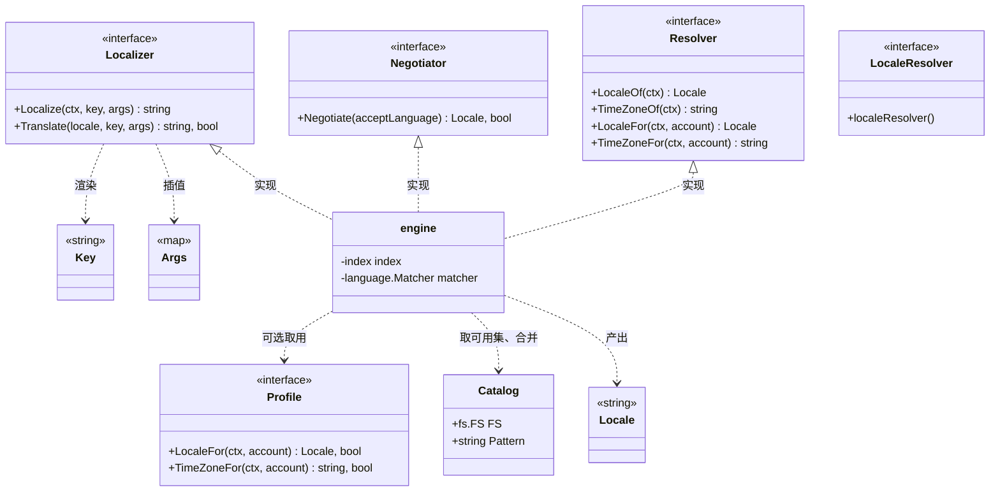
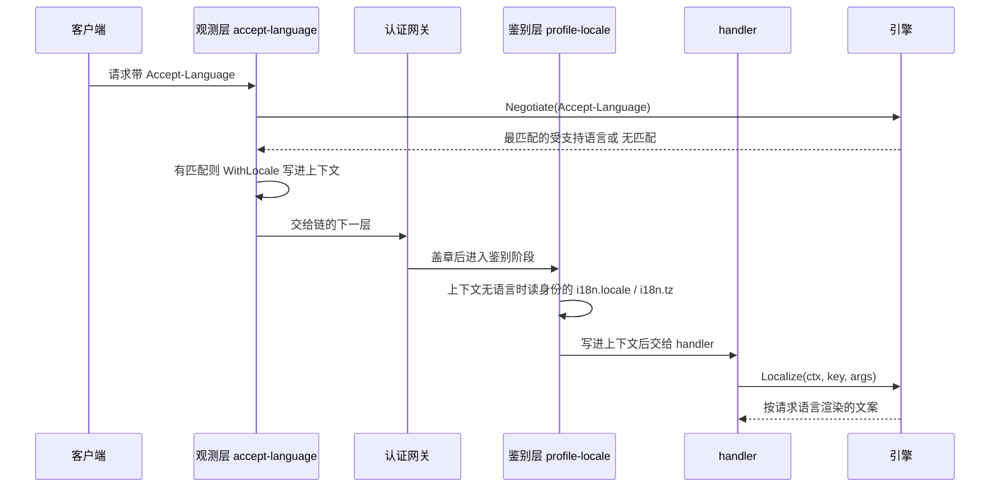

# i18n

## 职责

本功能目录交付**面向用户的文本的渲染，以及渲染它所用的语言偏好**：把带模块命名空间的消息键按一次请求的语言渲染成文案，按请求协商语言，按一条解析链定位语言与时区，并把错误响应里的用户可见文案交给一套可替换的渲染。渲染是纯读取，不做授权、不改机器码、不与任何外部通道交互（[ADR-i18n-scope-2026-10-13](../../adr/adr-i18n-scope-2026-10-13.md)）。

本功能目录按接口包加实现子包的方式拆分（[ADR-module-packaging-2026-09-22](../../adr/adr-module-packaging-2026-09-22.md)）。根包是接口包：它定义接口、值类型与资源类型，只依赖标准库，不登记任何模块。子包各自登记一个模块：

- `pkg/i18n/catalog/` 登记引擎模块 `i18n`：排他交付 `Localizer`、`Negotiator`、`Resolver`，收集全部已声明目录，非排他地取用可选的 `Profile`。
- `pkg/i18n/http/` 登记模块 `i18n.http`：经 `http.Router` 在每个端注册两层中间件，把协商出的语言与账户偏好的语言时区写进请求上下文。
- `pkg/i18n/respond/` 登记模块 `i18n.respond`：非排他交付 `http.ErrorResponder`，把错误响应渲染成本地化文案。
- `pkg/i18n/account/` 登记模块 `i18n.account`：非排他交付 `Profile`，并实现 `authn.Provisioner`，在首登开户时把请求语言写进待建账户的属性。

语言是偏好而不是授权事实（[ADR-i18n-locale-type-2026-10-13](../../adr/adr-i18n-locale-type-2026-10-13.md)）：写进与读出上下文的函数因此是导出的，与 `pkg/log` 的 `WithLogger` 同类，不采取 `pkg/authn` 把身份的写侧封进内部包的形态。谁能读到什么仍由 [authz](design-authz.md) 与 [authn](authn/design-authn.md) 判定，本功能目录不参与。

### 非职责

- **不做授权判定。** 语言与时区是偏好，任何判定都不以它们为依据；本功能目录不读身份，也不改变一次请求能到达的范围。
- **不承载账户存储。** 语言与时区存进 `Account.Attributes` 的 `i18n.locale` 与 `i18n.tz`，写账户归 [authn](authn/design-authn.md) 的账户模块，本功能目录只读它，不动认证的表结构（[ADR-i18n-preferences-storage-2026-10-13](../../adr/adr-i18n-preferences-storage-2026-10-13.md)）。
- **不做 HTTP 机制。** 路由、中间件的排序与阶段归 [http](http/design-http.md)；`i18n.http` 只是使用它的登记面在每个端挂层。
- **不改机器码与状态码。** 错误响应的 `Problem.Type`、`Problem.Status` 与 `Problem.Detail` 原样保留，渲染只填写用户可见的 `Title`（[ADR-i18n-error-rendering-2026-10-13](../../adr/adr-i18n-error-rendering-2026-10-13.md)）。
- **不做复数、数量与日期格式化。** 消息只写 `{{name}}` 插值，值的形态与格式由调用方在交给渲染之前定好。
- **不做热加载。** 目录是编译期静态事实，装配期装载一次后只读，运行期没有更换目录或增删消息的接口（[ADR-i18n-catalogs-2026-10-13](../../adr/adr-i18n-catalogs-2026-10-13.md)）。
- **不发送消息。** 短信与邮件的模板与发送归各自的模块；本功能目录渲染的是本进程写出的文本，不投递给任何外部通道。

## 术语表

以下术语的含义限于本模块，以及 i18n 主题的决策记录。

| 术语 | 英文 | 定义 |
|---|---|---|
| 语言 | locale | 一次渲染所用的语言，写作 BCP 47 标签，如 `zh-CN`、`en-US`；在本模块是一份偏好，不是任何判定依据。 |
| 目录 | catalog | 一个模块以 `//go:embed` 声明的一组消息文件，每个文件按它承载的语言命名；它是编译期静态事实，装配期装载一次。 |
| 键 | key | 一条消息在目录中的标识，扁平且带模块命名空间，如 `http.404`、`authn.login-failed`。 |
| 参数 | args | 一条参数化消息插值用的名值对；消息写 `{{name}}`，缺参时该处原样保留。 |
| 协商 | negotiation | 按请求的 `Accept-Language` 头，在本次支持的受语言集中选出最匹配的一个。 |
| 回落 | fallback | 请求语言在该键上没有条目时，改取默认语言、再不中则取键本身的次序。 |
| 偏好 | preference | 一项源自用户、用于本地化、不参与任何裁定的选择；与授权事实相对。 |

## 外部接口契约

### 登记单元与名字

| 登记单元 | 模块名 | 交付 |
|---|---|---|
| 根包 `pkg/i18n` | — | 接口、值类型与资源类型；不登记模块 |
| `pkg/i18n/catalog` | `i18n` | 排他交付 `Localizer`、`Negotiator`、`Resolver` |
| `pkg/i18n/http` | `i18n.http` | 在每个端注册两层中间件 |
| `pkg/i18n/respond` | `i18n.respond` | 非排他交付 `http.ErrorResponder` |
| `pkg/i18n/account` | `i18n.account` | 非排他交付 `i18n.Profile` 与 `authn.Provisioner` |

每个登记模块的模块名由它的包导出为 `ModuleName` 常量，命令树按这个名字纳入它。根包不登记模块，因而 import 它不把任何模块带进宿主的可用集；这与 [authn](authn/design-authn.md) 根包的处置同一条。

### 根包的类型与接口

功能标识的元素类型必须是接口，根包的功能取用写作 `core.Resolve[i18n.Localizer](reg)` 一类。

```go
// Locale 是一次渲染所用的语言，写作 BCP 47 标签。
// 它是一个字符串，以便不带语言匹配库就跨模块边界传递（上下文、接口、声明的目录）。
type Locale string

// 项目为它们发布了目录的语言，代码按名写出 LocaleEN 与 LocaleZH。
const (
    LocaleEN Locale = "en-US"
    LocaleZH Locale = "zh-CN"
)

// Default 是一次没有指名语言的请求解析到的语言，也是某条消息在请求语言无
// 该键时回落到的语言。
const Default Locale = LocaleEN

// Key 标识目录中的一条消息，扁平且按渲染它的模块命名空间化。
type Key string

// Args 承载一条参数化消息插值用的值：消息写 {{name}}，缺参时该处原样保留。
type Args map[string]string

// Localizer 按语言渲染一条消息。它由引擎排他交付。
type Localizer interface {
    // Localize 按 ctx 的语言渲染 key，回落 Default、再回落键本身，结果永不为空。
    Localize(ctx context.Context, key Key, args Args) string
    // Translate 按指名的语言渲染 key，并报告某个目录是否载有它。它不回落。
    Translate(locale Locale, key Key, args Args) (string, bool)
}

// Negotiator 在本次支持的受语言集中，选出最匹配一次请求语言偏好的一个。
// 它由引擎排他交付。
type Negotiator interface {
    // Negotiate 返回与 Accept-Language 头值最匹配的受支持语言，以及是否有匹配。
    // 只指名未受支持的语言、或没有指名任何语言的，报告无匹配。
    Negotiate(acceptLanguage string) (Locale, bool)
}

// Resolver 回答某个上下文与某个具名账户适用哪种语言与时区。它由引擎排他交付。
type Resolver interface {
    // LocaleOf 是 ctx 的语言：写进它的那个，或 Default。它从不失败。
    LocaleOf(ctx context.Context) Locale
    // TimeZoneOf 是 ctx 的 IANA 时区名，未设置时为空串，读作 UTC。
    TimeZoneOf(ctx context.Context) string
    // LocaleFor 是具名账户的语言，来自它存的偏好，未存时是 Default。
    LocaleFor(ctx context.Context, account string) Locale
    // TimeZoneFor 是具名账户的时区，未存时为空串。
    TimeZoneFor(ctx context.Context, account string) string
}

// Profile 是通往账户所存语言与时区的一条接缝。它非排他且可选：引擎用
// core.ResolveAll 取用每一个实现，一个都没有时回落到 Default。
type Profile interface {
    // LocaleFor 返回一个账户所存的语言，以及是否存过。
    LocaleFor(ctx context.Context, account string) (Locale, bool)
    // TimeZoneFor 返回一个账户所存的 IANA 时区名，以及是否存过。
    TimeZoneFor(ctx context.Context, account string) (string, bool)
}

// Catalog 是一个模块声明自己消息文件的资源类型。引擎是它的消费方：它取
// 可用集，读到每一份声明的目录，合并进一份索引。
type Catalog struct {
    FS      fs.FS  // 模块读取自己文件所用的文件系统，通常是 embed.FS
    Pattern string // 其下消息文件的通配，每个文件按它承载的语言命名，如 "locales/{tag}.json"
}

// LocaleResolver 标记定一次请求语言的中间件层，供另一层用 After 或 Before 排它。
// 它没有调用方使用的方法；一层在 Middleware.Provides 中写 (*LocaleResolver)(nil) 代表它。
type LocaleResolver interface{ localeResolver() }
```

### 上下文存取与账户属性

语言的写侧是导出的：宿主为某个已知账户启动一项没有请求、也没有头的作业时，在那里写它解析出的语言。请求路径由入口模块的链写它。

```go
// WithLocale 返回携带 locale 的上下文；空的语言不写入。
func WithLocale(ctx context.Context, locale Locale) context.Context

// FromContext 返回该上下文携带的语言，以及是否携带。它不回落。
func FromContext(ctx context.Context) (Locale, bool)

// WithTimeZone 返回携带 IANA 时区名的上下文；空的名不写入，读作 UTC。
func WithTimeZone(ctx context.Context, name string) context.Context

// TimeZoneFromContext 返回该上下文携带的 IANA 时区名，以及是否携带。
func TimeZoneFromContext(ctx context.Context) (string, bool)

// 账户属性中存放语言与时区的键；命名空间化，与宿主自己的属性不相撞。
const (
    LocaleAttributeKey   = "i18n.locale"
    TimeZoneAttributeKey = "i18n.tz"
)

// ValidLocaleTag 报告 name 的形状是否是一个 BCP 47 语言标签；空值合法。
func ValidLocaleTag(name string) bool

// ValidTimeZone 报告 name 是否是一个本进程能加载的时区；空值合法，读作 UTC。
func ValidTimeZone(name string) bool
```

**空值不是一种值。** `WithLocale` 与 `WithTimeZone` 收到空串时不写入，一个什么都没指名的上下文因此读作“未携带任何语言”，`FromContext` 与 `TimeZoneFromContext` 据实报告。回落发生在 `Resolver` 上：需要一种语言而上下文未携带它的调用方经 `Resolver.LocaleOf` 取，默认值只在那里。

**形状检查不等于受支持检查。** `ValidLocaleTag` 只判形状，不判这个标签在本次运行里受不受支持——受支持集是目录承载的语言集，只有引擎知道，一个形状合法而不受支持的标签因此在这里可被接受，落到渲染时回落（[ADR-i18n-locale-type-2026-10-13](../../adr/adr-i18n-locale-type-2026-10-13.md)）。`ValidTimeZone` 用一个 IANA 名去 `time.LoadLocation`，空值合法；固定偏移（如 `+08:00`）与缩写（如 `CST`）不是 IANA 名而被拒。这两个检查是写入侧执行的判据，由写偏好的那一方调用，本包不对任何既有值回头复检。

### 各模块交付与取用的能力

| 模块 | 提供者声明 | 取用 |
|---|---|---|
| `i18n` | `Provides: [(*i18n.Localizer)(nil), (*i18n.Negotiator)(nil), (*i18n.Resolver)(nil)]`，均排他；`Requires: [(*i18n.Profile)(nil)]` 标注 `Optional` | `core.Resolve[i18n.Localizer](reg)` 等；`Profile` 用 `core.ResolveAll` |
| `i18n.http` | 只注册中间件层，不声明功能 | 取用 `http.Router`、`i18n.Negotiator`；以 `(*authn.Gate)(nil)` 为 `After` 锚点 |
| `i18n.respond` | `Provides: [(*http.ErrorResponder)(nil)]`，非排他 | 取用 `i18n.Localizer`、`i18n.Resolver` |
| `i18n.account` | `Provides: [(*i18n.Profile)(nil), (*authn.Provisioner)(nil)]`，非排他 | 取用 `authn.Accounts`；语言经 `pkg/i18n` 的上下文存取函数与属性键读写 |

**引擎的这几件能力排他交付，一个进程至多一个语言集。** 语言集是目录承载的集合，两个引擎会各自持有不同的一份，`Resolve` 要求唯一，多于一个即装配期 `ErrExclusiveViolated`。**`Profile` 非排他可选取用**：引擎在 `New` 用 `core.ResolveAll[i18n.Profile]` 取用每一个实现，一个都没有是合法配置，账户语言随之缺失，解析链落到 Default。

### 对既有模块的改动

以下各条落在既有模块里，本功能目录借用它们的既有接缝，不新增跨目录的机制。

- **`http.Problem` 增加承载消息键与插值参数的字段**，默认写出形状不变：`Key string` 与 `Args map[string]string`。没有键的错误照旧按 `Type` 与 `Status` 写出，加了键的错误由交付的 `ErrorResponder` 渲染（[http](http/design-http.md) 的错误响应一节、[ADR-i18n-error-rendering-2026-10-13](../../adr/adr-i18n-error-rendering-2026-10-13.md)）。
- **`authn.LocaleOf` 的默认由 `zh-CN` 改为 `en-US`**，与 `i18n.Default` 对齐；它仍是登录引擎把请求语言映射进那个闭集所用的映射，签名不变（[ADR-i18n-default-locale-2026-10-13](../../adr/adr-i18n-default-locale-2026-10-13.md)）。登录引擎内部的 `localeOf` 先取 `i18n.FromContext` 已定的语言，再映射进那个闭集，请求路径上有 `i18n.http` 时它读到协商与偏好定下的语言。
- **认证自助面新增一条偏好路由** `PATCH B/me/preferences`，写在 [authn-login](authn/design-authn-login.md) 的账户自助面里：它把语言与时区写进账户的 `Account.Attributes`，经账户模块的 `AccountAdmin.SetAttributes` 落库，写前用 `ValidLocaleTag` 与 `ValidTimeZone` 判形状。它是 [authn](authn/design-authn.md) 的子包 `pkg/authn/login` 对 `pkg/i18n` 的取用——`pkg/authn` 根包不 import 它（见依赖）。
- **语言与时区存进 `Account.Attributes` 的 `i18n.locale` 与 `i18n.tz`**，不改认证的表结构，不新增列（[ADR-i18n-preferences-storage-2026-10-13](../../adr/adr-i18n-preferences-storage-2026-10-13.md)）。

### 稳定性承诺

`Locale`、`LocaleEN`、`LocaleZH`、`Default`、`Key`、`Args`、`Localizer`、`Negotiator`、`Resolver`、`Profile`、`Catalog`、`LocaleResolver`、上下文的存取函数、属性键常量与校验函数，以及各模块导出的 `ModuleName`，是本功能目录与其他模块之间的契约：接口的方法集、值类型与资源类型的字段，以及属性键的取值，改一个即破坏每一个实现方与消费方。属性键 `i18n.locale` 与 `i18n.tz` 同时是存储契约：账户属性里已经写下的值按这两个键读，改键会让既有偏好读不出来。模块名由各包导出为常量，改名会让命令树上的纳入静默失配。

## 依赖

| 依赖 | 用途 |
|---|---|
| `pkg/core` | 注册描述符、交付与取用功能、声明与收集资源 |
| `pkg/http` | `i18n.http` 取用 `Router` 登记层；`i18n.respond` 实现 `ErrorResponder`、读 `Problem` |
| `pkg/authn` | `i18n.http` 以 `(*authn.Gate)(nil)` 为锚点、读请求身份；`i18n.account` 经 `Accounts` 读账户属性、实现 `Provisioner` |

**依赖方向。** 根包 `pkg/i18n` 只依赖标准库，因而一个只读语言的模块 import 它不拉进任何第三方库；这与 [authn](authn/design-authn.md) 根包的位置同一条。子包各自 import 根包与 `pkg/core`，并按其用途 import `pkg/http` 或 `pkg/authn`。**`pkg/authn` 的任何包都不 import `pkg/i18n` 的根包以外的部分，且 `pkg/authn` 根包不 import `pkg/i18n`**（[authn](authn/design-authn.md) 的依赖方向）：认证根包只依赖标准库与自己的内部包，一个语言偏好不改变这一点。需要同时读身份与语言的层要么在 `i18n.http` 里，要么在 `pkg/authn/login` 这类子包里——子包 import `pkg/i18n` 是许可的，本功能目录不 import 认证的任何子包。`pkg/http` 不 import `pkg/i18n`，它不认识语言：错误响应的本地化由交付的 `ErrorResponder` 承担，`pkg/http` 只把 `Problem` 交给它。

**`golang.org/x/text` 只出现在引擎 `pkg/i18n/catalog`，别处不出现。** 语言匹配需要的 `language` 包只在引擎里出现：它用 `ParseAcceptLanguage` 解析 `Accept-Language` 头值、用 `language.Matcher` 在受支持语言集中匹配。根包与其余子包不拉它，`i18n.http` 经 `i18n.Negotiator` 取用协商结果，一个只读 `Locale` 的模块因而拿不到匹配库。

## UML 图

下图给出契约面上的类型与模块内部的结构。图中画不出的约束：目录在 `New` 装载一次，此后索引只读、无 IO、无热加载；`Locale` 是字符串，跨边界不携带匹配库；语言解析的回落只发生在 `Resolver` 上；`Catalog` 只由模块以 `//go:embed` 声明，引擎取可用集；`LocaleResolver` 无方法，只作一层的排序锚点。



请求路径上语言从协商到渲染的次序，以及它如何随链上的两层落定：



**两层各司其职。** `i18n:accept-language` 属于观测阶段、排在本阶段无约束各层的最外，它看到每个请求、从不拒绝，协商出的语言对匿名请求同样成立。`i18n:profile-locale` 属于鉴别阶段、排在认证网关之内，它只在网关已盖章、账户已知之后才有读账户属性的前提，因而以 `(*authn.Gate)(nil)` 为 `After` 锚点；上下文已被上一层写下的语言时它不覆盖。

## 核心数据结构

**索引**是全部已声明目录合并出的只读结构，按语言与键两级组织：语言到（键到模板）的映射，外加一份按模块名归类的键归属表，用于冲突点名与诊断。模板是消息原文，`{{name}}` 在渲染时按 `Args` 插值。

**匹配器**是 `golang.org/x/text/language` 的 `Matcher`，由索引建立时支持的语言集构造一次，此后只读。协商把 `Accept-Language` 的头值解析成一组带 q 值的偏好，交给匹配器选出一个受支持的语言。

**内置目录**由 `i18n.respond` 自带，承载 `http.<status>` 一类状态码的标准说明，作为它渲染无键错误的回落。它与别的模块的目录同形，只是由本功能目录自己声明。

## 核心算法与流程

### 目录的收集与装载

引擎在装配期依次做 `Prepare` 校验与 `New` 建立。

**取材域取可用集**（架构不变量 15）。来源是 `core.Resources[i18n.Catalog](reg)` 的全体；判据是**一组消息文件是不是这个二进制的一部分**是静态事实，比任何一次命令长寿，因而未运行、消解落选与只被静态级纳入的模块，其目录一律进索引。**这个消费点不做减法**：目录随二进制一起编译进来，一个本次不运行的模块，它的消息照常可被渲染——这正是“某个错误在某个装配下答得出键、在另一个装配下答不出”要避免的形态（[ADR-i18n-catalogs-2026-10-13](../../adr/adr-i18n-catalogs-2026-10-13.md)）。

`Prepare` 对收集到的每份目录逐项校验，任一不合格即启动失败：

- **每份目录指名了文件系统与通配**，通配合法且至少命中一个文件，每个文件按它承载的语言标签命名。
- **每个文件是一个 JSON 对象**，字符串到消息原文的映射。
- **跨模块的同名键不冲突**，冲突时点名该键与两个声明方——键带命名空间，冲突是命名空间被两个模块共用的信号。
- **`Default` 语言有覆盖**：索引非空时，默认语言至少有一份条目，使一个没有指名的请求总有一个语言可落。

`New` 把全部目录装载进内存索引、构造匹配器，并把取用到的 `Profile` 一并收进引擎，此后只读。

### 语言解析链

一次请求的语言按三级定位（[ADR-i18n-locale-resolution-2026-10-13](../../adr/adr-i18n-locale-resolution-2026-10-13.md)）：

| 次序 | 来源 | 何时命中 |
|---|---|---|
| 一 | 请求上下文 | `i18n.http` 的两层之一已写进语言 |
| 二 | 账户偏好 | 上下文无语言而身份的属性集带 `i18n.locale` |
| 三 | `Default` | 两者都没有 |

**解析链在 `Resolver` 上收口。** `LocaleOf` 读上下文，未携带时给 `Default`；`LocaleFor(ctx, account)` 在上下文无语言时，经取用的每一个 `Profile` 读该账户存储的语言。两级回落都归引擎，前两级都不报告失败——“没有指名”读作落到 Default，而不是一次错误。

### 协商

`Negotiate` 把 `Accept-Language` 的头值交给匹配器，在受支持的语言集中选出最匹配的一个，并报告是否有匹配。**无匹配是 `false`，不是 `Default`**：调用方把 `false` 读作“本次不给语言留痕”，与“用默认语言”是两回事，头里一个受支持语言都没有时那两层因而不写上下文，让解析链后面的级去定。

### 错误渲染

`i18n.respond` 交付的 `ErrorResponder` 渲染一次错误响应（[ADR-i18n-error-rendering-2026-10-13](../../adr/adr-i18n-error-rendering-2026-10-13.md)）：

- 取键的次序：`Problem.Key` 优先，带 `Args` 一并插值；`Key` 为空而 `Problem.Title` 非空时按原样采用那个标题；都为空时由 `Problem.Type` 推导——去 `urn:speed:` 前缀，把 `:` 换成 `.`——`Type` 为空或为 RFC 9457 的 `about:blank` 时改取状态码推出的键 `http.<status>`；两种键都拿去查目录。
- 查到的文案填进 `Title`；`Type`、`Status` 与 `Detail` 按 `Problem` 原样写出，机器码不变。
- 写出 `Content-Language` 头，标识这一次响应的语言。
- 保留调用方在 `Fail` 之前设过的响应头，但丢掉描述另一份正文的 `Content-Length` 与 `Content-Encoding`。
- 键在任何目录里都查不到时，回落到 `net/http` 的状态文本，结果永不为空。

### 阶段行为

| 阶段 | 行为 |
|---|---|
| `Prepare` | 引擎校验已声明的目录；其余模块无动作 |
| `New` | 引擎建立索引与匹配器、取用 `Profile`；`i18n.respond` 取用 `Localizer` 与 `Resolver`；`i18n.account` 取用 `authn.Accounts`；`i18n.http` 无动作 |
| `Init` | `i18n.http` 在每端注册两层中间件；其余模块无动作 |
| `Start` | 无动作 |
| `Serve` | 无动作 |
| `Stop` | 无动作 |
| `Close` | 无动作 |

`i18n.http` 的中间件注册跑在 `Init`，此时 `http.Router` 处在接受登记的窗口内（见 [http](http/design-http.md) 的模块形状）。`i18n.account` 的 `Provisioner` 在首登开户之前被引擎调用，调用时机在认证的登录路径上。

## 错误与失败语义

启动期的失败一律终止启动，不降级、不跳过。**引擎为自己判定出的每一类失败给出哨兵错误**，调用方以 `errors.Is` 判别，包裹一律用 `%w`。

| 哨兵错误 | 触发条件 | 修复动作 |
|---|---|---|
| `ErrInvalidCatalog` | 一份声明的目录不合格：未指名文件系统或通配、通配不合法或没有命中文件、文件不是按语言标签命名、文件不是一个字符串到字符串的 JSON 对象 | 点名声明它的模块与文件；修正目录声明或消息文件 |
| `ErrDuplicateKey` | 一个消息键被多于一个模块声明 | 点名该键与两个声明方；其中一方改键的命名空间 |
| `ErrNoCatalog` | 索引非空而 `Default` 语言没有任何条目 | 点名默认语言；补一份默认语言的目录，或改 `Default` |

**渲染期没有失败路径。** `Localize` 按请求语言、`Default`、键本身依次回落，结果永不为空；一个未受支持的语言只是落到 Default，一个目录里没有的键只是把键写回。`Translate` 不回落，它把“目录里有没有这个键”以第二个返回值交给调用方，缺键时返回空串而不是错误。

**协商的无匹配不是失败。** `Negotiate` 报告 `false` 是合法结果，调用方据此不写上下文；把它当成错误会在每个不接受任何受支持语言的请求上写出一次不存在的故障。

**`i18n.respond` 回落不为空。** 一个无 `Key` 的错误由 `Type` 推出的键、或由状态码推出的键 `http.<status>` 去查目录；键在任何目录里都查不到时回落到 `net/http` 的标准状态文本，不写出空 `Title`。

**取不到某个模块声明为构造期依赖的功能时，该模块把 `core` 的 `ErrMissingProvider` 原样外传**，不另立哨兵：`i18n.http` 要 `http.Router` 与 `i18n.Negotiator`，`i18n.respond` 要 `i18n.Localizer` 与 `i18n.Resolver`，`i18n.account` 要 `authn.Accounts`，其中任一缺失都在依赖解析处以它终止启动，补救动作是宿主纳入相应的提供者（见 [core](design-core.md)）。

### 非保证

以下各类性质本模块声明为不保证。

- **不保证目录穷举。** 一个模块没有为某个键声明任何语言的条目时，该键按回落规则渲染；本功能目录不检查键的覆盖面，只检查 `Default` 至少有一份。
- **不保证协商结果与账户偏好一致。** 协商只看请求头，账户偏好只在上下文尚无语言时补位；一个已带 `Accept-Language` 的已登录请求按头值渲染，不按账户偏好。
- **不保证账户偏好的即时生效。** 账户属性经账户快照读取，宿主经管理面改了属性，要等快照缓存过期才进身份与解析链（见 [authn](authn/design-authn.md) 的非保证）。
- **不保证 `i18n.http` 覆盖到一个端。** 它在遍历 `http.Endpoints` 得到的每个端注册；一个端不在那次遍历里、或那个端由宿主单独装配而不经本模块，就不带本地化，启动期不失败，也没有一行诊断指向它（与 [http](http/design-http.md) 的漏写同源）。
- **不保证错误响应的正文语言与请求语言始终相同。** 渲染发生在 `ErrorResponder` 里，它按 `Problem` 与请求上下文取语言；一个在认证之前就写出的错误没有身份，语言由协商这一级给。

## 并发与事务边界

**索引在 `New` 之后只读。** 装载发生在生命周期驱动的单协程里，此前没有任何请求路径可达它；装载完成后索引与匹配器不再变化，渲染与协商因此是无锁、零 IO 的内存读。这是本功能目录没有热加载接口的直接结果：一个要求运行期更换目录的功能会引入一把读路径上的锁，本功能目录以“目录随二进制走”免掉了它（[ADR-i18n-catalogs-2026-10-13](../../adr/adr-i18n-catalogs-2026-10-13.md)）。

**两层中间件不改共享状态。** 它们只把语言与时区写进本次请求的上下文，一次请求一份，请求之间不共享可写状态。引擎交付的那些接口方法的并发调用是安全的：它们只读索引与匹配器。

**本功能目录不发起事务。** 它不写数据库：`i18n.account` 读账户属性经既有账户接口，写偏好的路径（自助面的偏好路由、开户时的写入）落在 [authn](authn/design-authn.md) 的账户模块与它自己的事务里，本功能目录只交出一个字符串给它写。

## 扩展点

- **`Profile` 是非排他接缝。** 任何能读到账户语言与时区的模块实现它，引擎用 `core.ResolveAll` 取用每一个，一个都没有是合法配置。`i18n.account` 是内置的一个实现。
- **`Catalog` 是声明式的接缝。** 任何模块以 `//go:embed` 声明自己的目录，引擎取可用集合并进索引；新增一种语言的覆盖是加一份目录，不是接入一个模块。
- **`ErrorResponder` 是非排他接缝。** `i18n.respond` 是本地化的一个实现；一个拥有某套 API 错误形状的模块交付自己的实现替换它，替换的是全部形状。没有实现时，[http](http/design-http.md) 写出默认的 `application/problem+json`。
- **`Localizer`、`Negotiator`、`Resolver` 由引擎排他交付，不是可替换的后端。** 语言集是进程级的一份，多于一个引擎即启动失败；换一套语言匹配是改本功能目录的代码，不是接一块实现。

## 实现状态

| 能力 | 状态 | 代码 |
|---|---|---|
| 根包的类型与接口 | 已实现 | `pkg/i18n/i18n.go` `Locale`、`LocaleEN`、`LocaleZH`、`Default`、`Key`、`Args`、`Localizer`、`Negotiator`、`Resolver`、`Profile`、`Catalog`、`LocaleResolver` |
| 上下文的存取 | 已实现 | `pkg/i18n/context.go` `WithLocale`、`FromContext`、`WithTimeZone`、`TimeZoneFromContext` |
| 账户属性键与形状校验 | 已实现 | `pkg/i18n/attributes.go` `LocaleAttributeKey`、`TimeZoneAttributeKey`、`ValidLocaleTag`、`ValidTimeZone` |
| 目录的收集、校验与装载、语言解析与协商 | 已实现 | `pkg/i18n/catalog` `Module`、`ModuleName` |
| 每端两层的语言与时区中间件 | 已实现 | `pkg/i18n/http` `Module`、`ModuleName` |
| 错误响应的本地化渲染 | 已实现 | `pkg/i18n/respond` `Module`、`ModuleName` |
| 账户偏好的读桥与开户时写入 | 已实现 | `pkg/i18n/account` `Module`、`ModuleName` |
| `Problem` 的消息键与参数 | 已实现 | `pkg/http/problem.go` `Problem` |
| 认证默认语言与登录语言映射 | 已实现 | `pkg/authn/locale.go` `LocaleOf`；`pkg/authn/login/start.go` `localeOf` |
| 自助面的偏好路由 | 已实现 | `pkg/authn/login` 的账户自助路由 |
