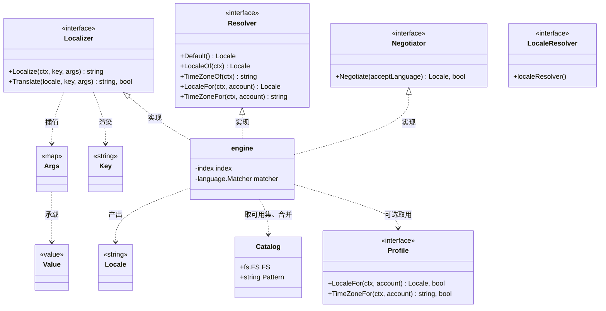
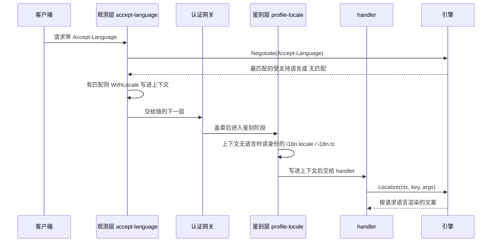

# i18n

`pkg/i18n` 交付面向用户的文本的渲染机制与语言偏好：根包只定义接口、值类型与资源类型，`i18n` 引擎在装配期合并各[模块](../../glossary.md)声明的目录，按一次请求的语言渲染带模块命名空间的消息，`i18n.http` 把协商出的语言与账户偏好写进请求上下文，`i18n.account` 读写账户上的语言与时区。它不做授权判定、不承载账户存储、不做 HTTP 机制、不集中渲染任何模块的文本：消息由产生它的模块自己渲染，账户属性归 [authn](authn/design-authn.md) 的账户模块。读职责清单前可以持有的心智模型是：语言是一条从请求上下文到账户偏好再到配置默认值的解析链，渲染只读装配期建好的索引，运行期没有失败路径，也没有热加载。

按正文次序，第一遍覆盖职责与非职责，划定本功能目录的边界，术语表界定目录、协商与回退；外部接口契约从登记单元与模块名走到根包的类型、上下文存取与账户属性；依赖、UML 图与核心数据结构是查阅用的；核心算法与流程开头的走查跟一次请求从协商到渲染；错误与失败语义、并发与事务边界留作最后自检，覆盖启动期校验与读路径上的时区缓存；扩展点说明哪些位置可以接入，实现状态只回答能力落在代码的哪里。

## 职责

本功能目录交付**面向用户的文本的渲染机制，以及渲染它所用的语言偏好**：它定义消息目录、按一次请求的语言把带模块命名空间的消息键渲染成文案、按请求协商语言、按一条解析链定位语言与时区。一段文本由产生它的模块渲染，本功能目录提供渲染所依据的引擎与偏好，不替使用方集中渲染（[ADR-i18n-scope](../../adr/adr-i18n-scope.md)、[ADR-i18n-rendering-ownership](../../adr/adr-i18n-rendering-ownership.md)）。渲染是纯读取，不做授权、不改机器码、不与任何外部通道交互。

本功能目录按接口包加实现子包的方式拆分（[ADR-module-layout](../../adr/adr-module-layout.md)）。根包是接口包：它定义接口、值类型与资源类型，只依赖标准库，不登记任何模块。子包各自登记一个模块：

- `pkg/i18n/catalog/` 登记引擎模块 `i18n`：排他交付 `Localizer`、`Negotiator`、`Resolver`，收集全部已声明目录并并入配置项 `i18n.catalogs-dir` 指定的覆盖目录，从配置项 `i18n.default-locale` 读默认语言，非排他地取用可选的 `Profile`。
- `pkg/i18n/http/` 登记模块 `i18n.http`：经 `http.Router` 在每个端注册两层中间件，把协商出的语言、账户偏好的语言与时区写进请求上下文。
- `pkg/i18n/account/` 登记模块 `i18n.account`：非排他交付 `Profile`，并实现 `authn.Provisioner`，在首登开户时把请求语言写进待建账户的属性。

语言是偏好而不是授权事实（[ADR-i18n-locale-type](../../adr/adr-i18n-locale-type.md)）：写进与读出上下文的函数因此是导出的，与 `pkg/log` 的 `WithLogger` 同类，不采取 `pkg/authn` 把身份的写侧封进内部包的形态。谁能读到什么仍由 [authz](design-authz.md) 与 [authn](authn/design-authn.md) 判定，本功能目录不参与。

### 非职责

- **不做授权判定。** 语言与时区是偏好，任何判定都不以它们为依据；本功能目录不读身份，也不改变一次请求能到达的范围。
- **不承载账户存储。** 语言与时区存进 `Account.Attributes` 的 `i18n.locale` 与 `i18n.tz`，写账户归 [authn](authn/design-authn.md) 的账户模块，本功能目录只读它，不动认证的表结构（[ADR-i18n-preferences-storage](../../adr/adr-i18n-preferences-storage.md)）。
- **不做 HTTP 机制。** 路由、中间件的排序与阶段归 [http](http/design-http.md)；`i18n.http` 只是使用它的登记接口在每个端挂层。
- **不改机器码与状态码。** 机器码 `Problem.Type`、`Problem.Status` 与 `Problem.Detail` 原样保留，不随语言变化；本功能目录渲染的是消息文本，不决定错误响应的结构（[ADR-i18n-error-rendering](../../adr/adr-i18n-error-rendering.md)）。
- **不替使用方渲染消息。** 一条消息由产生它的模块渲染：那个模块承载自己的目录、取用引擎、把成品文本写出；本功能目录只提供引擎与目录机制，不集中渲染任何模块的文本，也不认识某条消息的插值上下文（[ADR-i18n-rendering-ownership](../../adr/adr-i18n-rendering-ownership.md)）。
- **不决定返回形态。** 日期与时间的渲染归属由**返回形态**决定：一条消息里出现的日期与时间，与文本、计数（复数）、数字一样由引擎渲染，日期与时间另按账户时区（见核心算法与流程一节）；而**作为独立字段**返回给客户端的日期与时间走标准 ISO 格式（[REF-iso8601](../../references.md)）、由客户端渲染。后者是模块选择不发复合字符串的场合，不是本功能目录的职责。本功能目录交出账户的 IANA 时区（[REF-iana-tz](../../references.md)）（`Resolver.TimeZoneOf`、`Resolver.TimeZoneFor`）供两者使用（[ADR-i18n-message-rendering](../../adr/adr-i18n-message-rendering.md)）。
- **不做热加载。** 目录有内嵌声明与配置指定的覆盖目录两个来源，两者都在装配期读取，此后只读，运行期没有更换目录或增删消息的接口（[ADR-i18n-catalogs](../../adr/adr-i18n-catalogs.md)）。
- **不发送消息。** 短信与邮件的模板与发送归各自的模块；本功能目录渲染的是本进程写出的文本，不投递给任何外部通道。

## 术语表

以下术语的含义限于本模块，以及 i18n 主题的决策记录。

| 术语 | 英文 | 适用范围 | 定义 |
|---|---|---|---|
| 语言 | locale | 本模块与 i18n 主题的决策记录 | 一次渲染所用的语言，写作 BCP 47（[REF-bcp47](../../references.md)）标签，如 `zh-CN`、`en-US`；在本模块是一份偏好，不是任何判定依据。 |
| 目录 | catalog | 本模块与 i18n 主题的决策记录 | 一组消息文件，每个文件按它承载的语言命名，正文是键到消息的 JSON 对象。来源有二：一个模块以 `//go:embed` 声明的内嵌目录，以及配置项 `i18n.catalogs-dir` 指定的覆盖目录。两者都在装配期装载，运行期不再读。 |
| 覆盖目录 | overlay | 本模块与 i18n 主题的决策记录 | 配置项 `i18n.catalogs-dir` 指定的目录，与内嵌声明一致。装配期读取并并入同一索引，排在已声明目录之后：同一个键上胜过声明，只被它承载的语言因此进入受支持的语言集。 |
| 键 | key | 本模块与 i18n 主题的决策记录 | 一条消息在目录中的标识，扁平且带模块命名空间，如 `http.404`、`authn.login-failed`。 |
| 参数 | args | 本模块与 i18n 主题的决策记录 | 一条参数化消息插值用的名值对；消息写 `{{name}}`、一段复数或一段时间，缺参时该处原样保留。值带类型：字符串原样写入，整数与数字按消息的语言格式化，时间只有经一个时间段才渲染（按时间段自带的布局与渲染上下文的时区），裸 `{{name}}` 里的时间原样保留。 |
| 复数段 | plural segment | 本模块与 i18n 主题的决策记录 | 消息里按计数选择分支的一段，写作 `{{name, plural, <category>=<text>, ...}}`；类别是六个 CLDR（[REF-unicode-cldr](../../references.md)）类别 `zero`、`one`、`two`、`few`、`many`、`other`，`other` 必填，分支里的 `#` 是格式化后的计数。分支文本是一段字面文本与 `#`，不能再嵌一个占位符。 |
| 时间段 | time form | 本模块与 i18n 主题的决策记录 | 消息里按一个时间取值渲染的一段，写作 `{{name, time, <layout>}}`；`<layout>` 是一个 Go 布局，由消息文本自带，时间按渲染上下文的时区渲染成文本。参数缺失或不是时间时原样保留。 |
| 计数 | count | 本模块与 i18n 主题的决策记录 | 复数段据以选分支的整数值，也是分支里 `#` 展开成的数字。 |
| 协商 | negotiation | 本模块与 i18n 主题的决策记录 | 按请求的 `Accept-Language` 头，在本次受支持的语言集中选出最匹配的一个。 |
| 回退 | fallback | 本模块与 i18n 主题的决策记录 | 请求语言在该键上没有条目时，改取配置的默认语言、再不中则取键本身的次序。 |
| 受支持的语言集 | supported locale set | 本模块与 i18n 主题的决策记录 | 一次运行能渲染的语言集合，等于各模块声明的目录与配置指定的覆盖目录所覆盖语言的并集；代码不枚举它，它在装配期由目录派生。 |
| 默认语言 | default locale | 本模块与 i18n 主题的决策记录 | 一个什么都没指名的请求解析到的语言，也是每条回退所落到的语言；它是配置项 `i18n.default-locale`，未设置时为 `en-US`。 |
| 偏好 | preference | 本模块与 i18n 主题的决策记录 | 一项源自用户、用于本地化、不参与任何裁定的选择；与授权事实相对。 |

## 外部接口契约

### 登记单元与名字

| 登记单元 | 模块名 | 交付 |
|---|---|---|
| 根包 `pkg/i18n` | — | 接口、值类型与资源类型；不登记模块 |
| `pkg/i18n/catalog` | `i18n` | 排他交付 `Localizer`、`Negotiator`、`Resolver` |
| `pkg/i18n/http` | `i18n.http` | 在每个端注册两层中间件 |
| `pkg/i18n/account` | `i18n.account` | 非排他交付 `i18n.Profile` 与 `authn.Provisioner` |

每个登记模块的模块名由它的包导出为 `ModuleName` 常量，命令树按这个名字纳入它。根包不登记模块，因而 import 它不把任何模块带进宿主的可用集；这与 [authn](authn/design-authn.md) 根包的处置同一条。

### 根包的类型与接口

功能标识的元素类型必须是接口，根包的功能取用写作 `core.Resolve[i18n.Localizer](reg)` 一类。

```go
// Locale 是一次渲染所用的语言，写作 BCP 47 标签。
// 它是一个字符串，以便不带语言匹配库就跨模块边界传递（上下文、接口、声明的目录）。
type Locale string

// 本功能目录读取配置所用的两个名字。受支持的语言集是各模块声明的目录与配置
// 指定的覆盖目录所承载的语言集，代码不枚举任何语言表；在此之上唯一的额外选择
// ——一个什么都没指名的请求解析到哪一种语言——是配置项而非写进代码的值。
//
// 默认语言是短信模块也解析的那一个配置项，一处声明同时服务两个能力目录。因为
// 那个模块需要这两个名字，它们在此导出，而不是在两侧各写一遍字面量。
const (
    // ConfigNamespace 是本功能目录各项所挂的配置命名空间。
    ConfigNamespace = "i18n"
    // DefaultLocaleItem 是承载默认语言的配置项：一个什么都没指名的请求解析到
    // 的语言，也是某条消息在请求语言无该键时回退到的语言。取值是 BCP 47 标签，
    // 未设置时为 "en-US"。
    DefaultLocaleItem = "default-locale"
)

// Key 标识目录中的一条消息，扁平且按渲染它的模块命名空间化。
type Key string

// Args 承载一条参数化消息插值用的值：消息写 {{name}}、一段复数或一段时间，缺参时该处原样保留。
// 值带类型，用 String、Int、Float 或 Time 构造：字符串原样写入，整数与数字按消息的语言
// 格式化，一段复数按整数计数选分支，时间则按时间段自带的布局与渲染上下文的时区渲染。
type Args map[string]Value

// Value 是消息参数携带的类型化取值。ValueKind 是它的类型；String、Int、Float、Time 构造
// 四种取值，KindOf、StringOf、IntOf、FloatOf、TimeOf 读回。零值视为空串。
type Value struct { /* 一个类型标记与四种取值之一 */ }

type ValueKind uint8

const (
    KindString ValueKind = iota // 原样写入的文本
    KindInt                     // 按语言格式化、也供复数段选分支的整数
    KindFloat                   // 按语言格式化的数字
    KindTime                    // 按渲染上下文的时区渲染的时间
)

func String(s string) Value
func Int(n int) Value
func Float(f float64) Value
func Time(t time.Time) Value
func KindOf(v Value) ValueKind
func StringOf(v Value) string
func IntOf(v Value) int64
func FloatOf(v Value) float64
func TimeOf(v Value) time.Time

// Localizer 按语言渲染一条消息。它由引擎排他交付。
type Localizer interface {
    // Localize 按 ctx 的语言渲染 key，回退到配置的默认语言、再回退到键本身，结果永不为空。
    Localize(ctx context.Context, key Key, args Args) string
    // Translate 按指名的语言渲染 key，并报告某个目录是否载有它。它不回退。
    Translate(locale Locale, key Key, args Args) (string, bool)
}

// Negotiator 在本次受支持的语言集中，选出最匹配一次请求语言偏好的一个。
// 它由引擎排他交付。
type Negotiator interface {
    // Negotiate 返回与 Accept-Language 头值最匹配的受支持语言，以及是否有匹配。
    // 只指名未受支持的语言、或没有指名任何语言的，报告无匹配。
    Negotiate(acceptLanguage string) (Locale, bool)
}

// Resolver 回答某个上下文与某个具名账户适用哪种语言与时区。它由引擎排他交付。
type Resolver interface {
    // Default 是一个什么都没指名的请求解析到的语言，也是某条消息在请求语言无该
    // 键时回退到的语言；它是本次运行配置的默认语言。
    Default() Locale
    // LocaleOf 是 ctx 的语言：写进它的那个，或 Default 报告的那个。它从不失败。
    LocaleOf(ctx context.Context) Locale
    // TimeZoneOf 是 ctx 的 IANA 时区名，未设置时为空串，视为 UTC。
    TimeZoneOf(ctx context.Context) string
    // LocaleFor 是具名账户的语言：上下文无语言时来自它存的偏好，否则是 Default
    // 报告的那个。
    LocaleFor(ctx context.Context, account string) Locale
    // TimeZoneFor 是具名账户的时区，未存时为空串。
    TimeZoneFor(ctx context.Context, account string) string
}

// Profile 是通往账户所存语言与时区的一个扩展点。它非排他且可选：引擎用
// core.ResolveAll 取用每一个实现，一个都没有时回退到配置的默认语言。
type Profile interface {
    // LocaleFor 返回一个账户所存的语言，以及是否存过。
    LocaleFor(ctx context.Context, account string) (Locale, bool)
    // TimeZoneFor 返回一个账户所存的 IANA 时区名，以及是否存过。
    TimeZoneFor(ctx context.Context, account string) (string, bool)
}

// Catalog 是一个模块声明自己消息文件的资源类型。引擎是它的使用方：它取
// 可用集，读到每一份声明的目录，合并进一份索引。
type Catalog struct {
    FS      fs.FS  // 模块读取自己文件所用的文件系统，通常是 embed.FS
    Pattern string // 其下消息文件的通配，每个文件按它承载的语言命名，如 "locales/{tag}.json"
}

// LocaleResolver 标记定一次请求语言的中间件层，供另一层用 After 或 Before 排它。
// 它没有调用方使用的方法；一层在 Middleware.Provides 中写 (*LocaleResolver)(nil) 代表它。
type LocaleResolver interface{ localeResolver() }
```

### 上下文存取与账户属性

语言的写侧是导出的：宿主为某个已知账户启动一项没有请求、也没有头的作业时，在那里写它解析出的语言。请求路径由入口模块的链写它。

```go
// WithLocale 返回携带 locale 的上下文；空的语言不写入。
func WithLocale(ctx context.Context, locale Locale) context.Context

// FromContext 返回该上下文携带的语言，以及是否携带。它不回退。
func FromContext(ctx context.Context) (Locale, bool)

// WithTimeZone 返回携带 IANA 时区名的上下文；空的名不写入，视为 UTC。
func WithTimeZone(ctx context.Context, name string) context.Context

// TimeZoneFromContext 返回该上下文携带的 IANA 时区名，以及是否携带。
func TimeZoneFromContext(ctx context.Context) (string, bool)

// 账户属性中存放语言与时区的键；命名空间化，与宿主自己的属性不相撞。
const (
    LocaleAttributeKey   = "i18n.locale"
    TimeZoneAttributeKey = "i18n.tz"
)

// ValidLocaleTag 报告 name 是否符合 BCP 47 语言标签的格式；空值合法。
func ValidLocaleTag(name string) bool

// ValidTimeZone 报告 name 是否是一个可作偏好的时区名：一个本进程能加载、且不是
// Go 的特殊名 "Local" 的 IANA 名；空值合法，视为 UTC。
func ValidTimeZone(name string) bool
```

**空值不是一种值。** `WithLocale` 与 `WithTimeZone` 收到空串时不写入，一个什么都没指名的上下文因此视为「未携带任何语言」，`FromContext` 与 `TimeZoneFromContext` 据实报告。回退发生在 `Resolver` 上：需要一种语言而上下文未携带它的调用方经 `Resolver.LocaleOf` 取，默认值只在那里。

**格式检查不等于受支持检查。** `ValidLocaleTag` 只判格式，不判这个标签在本次运行里受不受支持——受支持集是目录承载的语言集，只有引擎知道，一个格式合法而不受支持的标签因此在这里可被接受，落到渲染时回退（[ADR-i18n-locale-type](../../adr/adr-i18n-locale-type.md)）。`ValidTimeZone` 用一个 IANA 名去 `time.LoadLocation`，空值合法；固定偏移（如 `+08:00`）与缩写（如 `CST`）不是 IANA 名而被拒，Go 的特殊名 `Local` 同样被拒——它不是 IANA 名，解析到的是宿主自己的时区，存进去会把用户可见文本渲染成服务器所在时区。**读取路径另有一道同样的守卫**：`engine.location` 把 `Local` 与空值、加载不出的名字一样视为 UTC，因为上下文存取函数是导出的、不对传进来的值复检。这两个检查是写入侧执行的判据，由写偏好的那一方调用，本包不对任何既有值回头复检。

### 各模块交付与取用的能力

| 模块 | 提供者声明 | 取用 |
|---|---|---|
| `i18n` | `Provides: [(*i18n.Localizer)(nil), (*i18n.Negotiator)(nil), (*i18n.Resolver)(nil)]`，均排他；`Requires: [(*i18n.Profile)(nil)]` 标注 `Optional` | `core.Resolve[i18n.Localizer](reg)` 等；`Profile` 用 `core.ResolveAll` |
| `i18n.http` | 只注册中间件层，不声明功能 | 取用 `http.Router`、`i18n.Negotiator`；以 `(*authn.Gate)(nil)` 为 `After` 锚点 |
| `i18n.account` | `Provides: [(*i18n.Profile)(nil), (*authn.Provisioner)(nil)]`，非排他 | 取用 `authn.Accounts`；语言经 `pkg/i18n` 的上下文存取函数与属性键读写 |

**引擎的这几件能力排他交付，一个进程至多一个语言集。** 语言集是目录承载的集合，两个引擎会各自持有不同的一份，`Resolve` 要求唯一，多于一个即装配期 `ErrExclusiveViolated`。**`Profile` 非排他可选取用**：引擎在 `New` 用 `core.ResolveAll[i18n.Profile]` 取用每一个实现，一个都没有是合法配置，账户语言随之缺失，解析链落到配置的默认语言。

### 对外接口

`Locale`、`ConfigNamespace`、`DefaultLocaleItem`、`Key`、`Args`、`Value`、`ValueKind`、`KindString`／`KindInt`／`KindFloat`／`KindTime`、构造与读回函数 `String`／`Int`／`Float`／`Time`／`KindOf`／`StringOf`／`IntOf`／`FloatOf`／`TimeOf`、`Localizer`、`Negotiator`、`Resolver`、`Profile`、`Catalog`、`LocaleResolver`、上下文的存取函数、属性键常量与校验函数，以及各模块导出的 `ModuleName`，是本功能目录与其他模块之间的接口：接口的方法集、值类型与资源类型的字段，以及属性键的取值，改一个即破坏每一个实现方与使用方。`Args` 的取值类型是 `map[string]Value`，插值字符串的调用方经 `i18n.String` 构造。消息的语法同属接口：六个 CLDR 类别、`other` 必填、`#` 与分支边界的含义，以及时间段的关键字与布局，是每个目录文件写消息时依据的规则，改它会让既有消息不再按原样渲染。属性键 `i18n.locale` 与 `i18n.tz` 同时是存储接口：账户属性里已经写下的值按这两个键读，改键会让既有偏好读不出来。配置命名空间 `i18n` 与配置项名 `default-locale`、`catalogs-dir` 是配置接口：短信模块按命名空间与 `default-locale` 两个名字读同一个默认语言，改名会让两个能力在无声中各读一份；`catalogs-dir` 是运维写入覆盖目录的入口，改名会让既有配置静默地视为没有额外文案。模块名由各包导出为常量，改名会让命令树上的纳入静默失配。

## 依赖

| 依赖 | 用途 |
|---|---|
| `pkg/core` | 注册描述符、交付与取用功能、声明与收集资源 |
| `pkg/http` | `i18n.http` 取用 `Router` 登记层 |
| `pkg/authn` | `i18n.http` 以 `(*authn.Gate)(nil)` 为锚点、读请求身份；`i18n.account` 经 `Accounts` 读账户属性、实现 `Provisioner` |

**依赖方向。** 根包 `pkg/i18n` 只依赖标准库，因而一个只读语言的模块 import 它不拉进任何第三方库；这与 [authn](authn/design-authn.md) 根包的位置同一条。子包各自 import 根包与 `pkg/core`，并按其用途 import `pkg/http` 或 `pkg/authn`。**`pkg/authn` 的任何包都不 import `pkg/i18n` 的根包以外的部分，且 `pkg/authn` 根包不 import `pkg/i18n`**（[authn](authn/design-authn.md) 的依赖方向）：认证根包只依赖标准库与自己的内部包，一个语言偏好不改变这一点。需要同时读身份与语言的层要么在 `i18n.http` 里，要么在 `pkg/authn/login` 这类子包里——子包 import `pkg/i18n` 是许可的，本功能目录不 import 认证的任何子包。**`pkg/http` import `pkg/i18n` 的根包**：它渲染自己写出的四类拒绝（无匹配路由的 404、方法不允许的 405、请求体超限的 413、接住 panic 的 500），把 `i18n.Localizer` 作为可选依赖取用（[ADR-i18n-error-rendering](../../adr/adr-i18n-error-rendering.md)）。方向是本功能目录的根包被入口模块取用；根包只依赖标准库，因而不使入口模块的依赖预算增长（[ADR-i18n-locale-type](../../adr/adr-i18n-locale-type.md)）。

**在本功能目录里，`golang.org/x/text`（[REF-golang-x-text](../../references.md)）只出现在引擎 `pkg/i18n/catalog`。** 它在本功能目录有三处用途：`language` 用 `ParseAcceptLanguage` 解析 `Accept-Language` 头值、用 `language.Matcher` 在受支持语言集中匹配；`feature/plural` 按语言标签判定计数的 CLDR 类别；`message` 与 `number` 按语言把整数与数字格式化成十进制，分组与分隔取该语言的 CLDR 数据。三者都只在引擎里出现。根包与其余子包不拉它，`i18n.http` 经 `i18n.Negotiator` 取用协商结果，一个只读 `Locale` 的模块因而拿不到匹配或数字格式化库。

## UML 图

下图给出契约中的类型与模块内部的结构。图中画不出的约束：目录在装配期装载，此后索引只读、无热加载；一条消息在装配期解析成结点并校验，渲染只走结点、不再解析、没有失败路径；`Args` 的取值带类型，字符串原样写入、整数与数字按消息的语言格式化，一段复数按整数计数选分支，一段时间按渲染上下文的时区渲染；渲染文本、计数、复数与数字不读文件系统，一个时间段在读路径上读一次时区（见并发与事务边界）；`Locale` 是字符串，跨边界不携带匹配库；语言解析的回退只发生在 `Resolver` 上；`Catalog` 只由模块以 `//go:embed` 声明，引擎取可用集，配置指定的覆盖目录与它一致、经同一条装载路径并入其后；`LocaleResolver` 无方法，只作一层的排序锚点。



请求路径上语言从协商到渲染的次序，以及它如何随链上的两层落定：



**两层各司其职。** `i18n:accept-language` 属于观测阶段、取 `Order: -100`：它落在本阶段里把 `Order` 留在零值的各层之外，好让更内阶段的任何拒绝（防护层的 429、鉴别阶段的 401）带上请求方要求的语言；会拒绝请求的层都落在观测阶段之内的更内阶段，它因而不必置身本阶段最外，最外让给取 `OrderOutermost` 的观测采集层。它看到每个请求、从不拒绝，协商出的语言对匿名请求同样成立。`i18n:profile-locale` 属于鉴别阶段、排在认证网关之内，它只在网关已盖章、账户已知之后才有读账户属性的前提，因而以 `(*authn.Gate)(nil)` 为 `After` 锚点；上下文已被上一层写下的语言时它不覆盖。

## 核心数据结构

**索引**是全部已声明目录与配置指定的覆盖目录合并出的只读结构，按语言与键两级组织：语言到（键到模板）的映射，外加一份按模块名归类的键归属表，用于冲突点名与诊断。模板是消息在装配期解析出的结点序列——一段字面文本后至多跟一个占位符，占位符是一个 `{{name}}`、一段复数或一段时间；解析与校验都在装配期完成，渲染只走结点，不再扫一遍文本。

**匹配器**是 `golang.org/x/text/language` 的 `Matcher`，由索引建立时支持的语言集构造一次，此后只读。协商把 `Accept-Language` 的头值解析成一组带 q 值的偏好，交给匹配器选出一个受支持的语言。

**格式化器**是按语言建的 `golang.org/x/text/message` 的 `Printer`，每个受支持语言一个，装配期建好后只读。它按该语言的 CLDR 数据分组与分隔数字，供 `{{name}}` 的整数与数字取值以及一段复数里的 `#` 使用；它不读目录，格式数据随语言标签而来。

## 核心算法与流程

### 走查

设本次运行受支持的语言集含 `ru-RU` 与 `zh-CN`，一次请求只带 `Accept-Language: fr-FR`。`i18n:accept-language` 调 `Negotiate`，受支持集里没有匹配，`false` 使这一层不写上下文。认证网关盖章后，`i18n:profile-locale` 见上下文没有语言，读账户存的 `i18n.locale`（`ru-RU`）与 `i18n.tz`（`Asia/Shanghai`），把语言与时区写进上下文。handler 以 `Localize(ctx, key, Args{"n": Int(3), "at": Time(t)})` 渲染：引擎按 `ru-RU` 取该键的模板，复数段按 CLDR 基数类别选 `few` 分支，`#` 展开成按 `ru-RU` 格式化后的 `3`；时间段按消息自带的布局与 `Asia/Shanghai` 渲染。账户没有存过语言时，解析链落到配置的默认语言；请求语言在该键上没有条目时，`Localize` 回退到默认语言、再回退到键本身，结果永不为空。

### 目录的收集与装载

引擎在装配期依次做 `Prepare` 校验与 `New` 建立。默认语言是配置项 `i18n.default-locale`，未设置时为 `en-US`，取值须符合 BCP 47 标签的格式（`ValidLocaleTag`），否则启动失败；它在 `Prepare` 与 `New` 各读一次，两次读的是同一份快照。它归配置而非设置：入口模块自己写出的拒绝应答（`pkg/http` 的 `refusalTitle` 覆盖的 404、405、413、500）与鉴别阶段各模块的 503 problem 在数据库可用之前就要按它渲染，按 [ADR-config-scope](../../adr/adr-config-scope.md) 的判据 (a) 落在配置。

**取材域取可用集**（架构不变量 15）。来源是 `core.Resources[i18n.Catalog](reg)` 的全体；判据是**一组消息文件是不是这个二进制的一部分**这一静态事实，比任何一次命令长寿，因而未运行、消解落选与只被静态级纳入的模块，其目录一律进索引。**这个消费点不做减法**：声明的目录随二进制一起编译进来，一个本次不运行的模块，它的消息照常可被渲染——这正是「某个错误在某个装配下答得出键、在另一个装配下答不出」要避免的形态（[ADR-i18n-catalogs](../../adr/adr-i18n-catalogs.md)）。

**覆盖目录是第二个来源，不是模块声明。** 配置项 `i18n.catalogs-dir` 指定一个目录，与声明一致：一个语言一个 `{tag}.json`，文件名是语言，正文是键到消息的 JSON 对象；引擎用声明目录同一条装载路径读它（`i18n.Catalog{FS: os.DirFS(dir), Pattern: "*.json"}`）。它未设定、指名的路径不是一个存在的目录、或目录里没有 `*.json` 文件时，都视为「没有额外文案」，是合法配置，不失败。读出的条目并入同一索引，排在全部已声明目录之后：同名键上覆盖目录胜过声明，一个声明没有承载的语言因此进入索引、受支持的语言集与协商匹配器。这一读取只发生在装配期，此后不再读、不被监视。

`Prepare` 对收集到的每份目录逐项校验，任一不合格即启动失败：

- **每份声明目录指名了文件系统与通配**，通配合法且至少命中一个文件，每个文件按它承载的语言标签命名。
- **每个声明文件是一个 JSON 对象**，字符串到消息原文的映射。
- **每条消息是一个合法模板**：一个参数化段只指名 `plural` 与 `time` 之一；一段复数只写六个 CLDR 类别之一、含 `other` 分支、不重复类别；一个时间段带一个非空的布局；不合格时以 `ErrInvalidMessage` 终止启动并点名该键与它来自的来源。
- **跨模块的同名键不冲突**，冲突时点名该键与两个声明方——键带命名空间，冲突是命名空间被两个模块共用的信号。覆盖目录不参与这一项：它不声明归属，只在同名键上取胜。
- **配置的默认语言有覆盖**：索引非空时，`i18n.default-locale` 所指的语言至少有一份条目，使一个没有指名的请求与每一条回退都落到一个目录承载的语言。这一项在并入覆盖目录之后判，因而覆盖目录可以补上默认语言。
- **覆盖目录里每份文件是一个合法目录**：文件名是一个语言标签，正文是一个字符串到字符串的 JSON 对象，其中每条消息是一个合法模板；文件这一层不合格时以 `ErrInvalidOverlay` 终止启动并点名该目录与该文件，文件里某条消息不合格时以 `ErrInvalidMessage` 点名该键与该目录。

`New` 把全部声明目录与配置指定的覆盖目录装载进内存索引、构造匹配器，并把取用到的 `Profile` 与配置的默认语言一并收进引擎，此后只读。受支持的语言集由此确定：它是索引里出现的语言的并集——含只由覆盖目录承载的语言——代码不枚举它。

### 语言解析链

一次请求的语言按三级定位（[ADR-i18n-locale-resolution](../../adr/adr-i18n-locale-resolution.md)）：

| 次序 | 来源 | 何时命中 |
|---|---|---|
| 一 | 请求上下文 | `i18n.http` 的两层之一已写进语言 |
| 二 | 账户偏好 | 上下文无语言而身份的属性集带 `i18n.locale` |
| 三 | 配置的默认语言 | 两者都没有 |

**解析链在 `Resolver` 上收口。** `Default` 报告配置的默认语言；`LocaleOf` 读上下文，未携带时给 `Default`；`LocaleFor(ctx, account)` 在上下文无语言时，经取用的每一个 `Profile` 读该账户存储的语言。两级回退都归引擎，前两级都不报告失败——「没有指名」视为落到 `Default`，而不是一次错误。

### 协商

`Negotiate` 把 `Accept-Language` 的头值交给匹配器，在受支持的语言集中选出最匹配的一个，并报告是否有匹配。**无匹配是 `false`，不是配置的默认语言**：调用方把 `false` 视为「本次不给语言留痕」，与「用配置的默认语言」是两回事，头里一个受支持语言都没有时那两层因而不写上下文，让解析链后面的级去定。

### 渲染

引擎在装配期把每条消息解析成结点并校验（见目录的收集与装载），渲染因此只走结点、不再解析，也没有失败路径。渲染一次按下列规则展开（[ADR-i18n-message-rendering](../../adr/adr-i18n-message-rendering.md)）：

- **字面文本原样写出。**
- **一个 `{{name}}` 占位符**按 `Args` 的取值展开：值是字符串时原样写入，值是整数或数字时按消息的语言格式化；名字在 `Args` 里没有条目时该处连同 `{{}}` 原样保留，值是时间时同样原样保留——一个 `{{name}}` 写不出时间，时间只经时间段渲染。
- **一段 `{{name, plural, <category>=<text>, ...}}`**：参数必须是整数，缺失或类型不符时整段原样保留；否则取计数在该语言的 CLDR 基数类别，选同名的分支，没有该类别时回退到 `other`；分支文本里的 `#` 展开成按语言格式化后的计数。分支文本是一段字面文本与 `#`，不能再嵌一个占位符——嵌套的占位符在装配期以 `ErrInvalidMessage` 报出。
- **一段 `{{name, time, <layout>}}`**：参数必须是一个时间，缺失或类型不符时整段原样保留；否则取出该时间，按段里第二个逗号之后的内容——去掉分隔用的首尾空白后的一个 Go 布局（可自带逗号、空格与冒号）——与渲染上下文的时区渲染成文本。布局由消息文本自带，是一个 Go 布局——月份与星期的名字随布局取自 Go 的固定英文，一种语言要用自己的名字就在自己的消息文本里写出它们。时区取自 `i18n.TimeZoneFromContext`，请求路径上由 `i18n.http` 的鉴别层从账户偏好 `i18n.tz` 写入；上下文未指定、或指了一个本进程加载不出的时区名时，都视为 UTC。**归属由返回形态决定**：作为独立字段返回的时间戳不在此列，它走标准 ISO 格式、由客户端渲染。

**计数与数字都按消息的语言格式化**，而不是 `fmt` 的默认格式：同一个整数在 en-US 写作 `1,234,567`、在 de-DE 写作 `1.234.567`。复数类别由 `golang.org/x/text/feature/plural` 按语言标签判定，六个类别对应 CLDR 的 `zero`、`one`、`two`、`few`、`many`、`other`。

### 阶段行为

| 阶段 | 行为 |
|---|---|
| `Prepare` | 引擎校验已声明的目录与配置指定的覆盖目录；其余模块无动作 |
| `New` | 引擎建立索引（并入配置指定的覆盖目录）与匹配器、取用 `Profile`；`i18n.account` 取用 `authn.Accounts`；`i18n.http` 无动作 |
| `Init` | `i18n.http` 在每端注册两层中间件；其余模块无动作 |
| `Start` | 无动作 |
| `Serve` | 无动作 |
| `Stop` | 无动作 |
| `Close` | 无动作 |

`i18n.http` 的中间件注册跑在 `Init`，此时 `http.Router` 处在接受登记的窗口内（见 [http](http/design-http.md) 的模块结构）。`i18n.account` 的 `Provisioner` 在首登开户之前被引擎调用，调用时机在认证的登录路径上。

## 错误与失败语义

启动期的失败一律终止启动，不降级、不跳过。**引擎为自己判定出的每一类失败给出哨兵错误**，调用方以 `errors.Is` 判别，包裹一律用 `%w`。

| 哨兵错误 | 触发条件 | 修复动作 |
|---|---|---|
| `ErrInvalidCatalog` | 一份声明的目录不合格：未指名文件系统或通配、通配不合法或没有命中文件、文件不是按语言标签命名、文件不是一个字符串到字符串的 JSON 对象 | 点名声明它的模块与文件；修正目录声明或消息文件 |
| `ErrDuplicateKey` | 一个消息键被多于一个模块声明 | 点名该键与两个声明方；其中一方改键的命名空间 |
| `ErrNoCatalog` | 索引非空而配置的默认语言没有任何条目 | 点名那个语言；补一份该语言的目录，或改 `i18n.default-locale` |
| `ErrInvalidOverlay` | 配置的覆盖目录里某份文件不合格：文件名不是一个语言标签，或正文不是一个字符串到字符串的 JSON 对象 | 点名该目录与该文件；修正覆盖文件，或去掉该配置项 |
| `ErrInvalidMessage` | 一条消息不是一个合法模板：一个参数化段指名了 `plural` 与 `time` 之外的词、一段复数指名了六个 CLDR 类别之外的类别、缺少 `other` 分支或重复了一个类别、或一个时间段带一个空布局 | 点名该键与它来自的来源（声明它的模块，或配置目录）；修正消息文本 |

**渲染期没有失败路径。** 每条消息在装配期解析并校验，渲染只走已解析的结点；`Localize` 按请求语言、配置的默认语言、键本身依次回退，结果永不为空；一个未受支持的语言只是落到配置的默认语言，一个目录里没有的键只是把键写回。缺参（名字不在 `Args` 里）与类型不符（复数段的参数不是整数）都让该处原样保留，不是一次失败。`Translate` 不回退，它把「目录里有没有这个键」以第二个返回值交给调用方，缺键时返回空串而不是错误。

**协商的无匹配不是失败。** `Negotiate` 报告 `false` 是合法结果，调用方据此不写上下文；把它当成错误会在每个不接受任何受支持语言的请求上写出一次不存在的故障。

**取不到某个模块声明为构造期依赖的功能时，该模块把 `core` 的 `ErrMissingProvider` 原样外传**，不另立哨兵：`i18n.http` 要 `http.Router` 与 `i18n.Negotiator`，`i18n.account` 要 `authn.Accounts`，其中任一缺失都在依赖解析处以它终止启动，补救动作是宿主纳入相应的提供者（见 [core](design-core.md)）。

### 非保证

以下各类性质本模块声明为不保证。

- **不保证目录穷举。** 一个模块没有为某个键声明任何语言的条目时，该键按回退规则渲染；本功能目录不检查键的覆盖面，只检查配置的默认语言至少有一份。
- **不保证发现指向不存在路径的覆盖目录。** `i18n.catalogs-dir` 指名的路径不是一个存在的目录、或目录里没有消息文件时，引擎视为没有额外文案，不失败、不记诊断；宿主以为覆盖已生效而实际按声明的文案渲染，两处都不报错。
- **不保证协商结果与账户偏好一致。** 协商只看请求头，账户偏好只在上下文尚无语言时补位；一个已带 `Accept-Language` 的已登录请求按头值渲染，不按账户偏好。
- **不保证账户偏好的即时生效。** 账户属性经账户快照读取，宿主经管理面改了属性，要等快照缓存过期才进身份与解析链（见 [authn](authn/design-authn.md) 的非保证）。
- **不保证 `i18n.http` 覆盖到一个端。** 它在遍历 `http.Endpoints` 得到的每个端注册；一个端不在那次遍历里、或那个端由宿主单独装配而不经本模块，就不带本地化，启动期不失败，也没有一行诊断指向它（与 [http](http/design-http.md) 的漏写同源）。
- **不保证一次拒绝的正文语言与请求语言始终相同。** 解析链给的是上下文里已经定下的语言；一个在认证之前就写出的拒绝没有身份，语言只到协商这一级，渲染它的模块据此取文案。
- **不保证一个无法加载的时区名会失败或被报告。** 时间段按渲染上下文的时区渲染，一个本进程加载不出的时区名视为 UTC：拼错的名字、或 zoneinfo 里没有的名字，静默地按 UTC 渲染，没有一行诊断。写侧以 `ValidTimeZone` 在写入时判格式，本功能目录不对上下文里既有的名字回头复检。
- **不保证时间段的月份名与星期名随语言。** 时间段按消息文本自带的 Go 布局渲染，月份与星期的名字取自 Go 的固定英文；一种语言要用自己的名字，须在自己的消息文本里写出它们。

## 并发与事务边界

**索引在装配之后只读。** 装载发生在生命周期驱动的单协程里，此前没有任何请求路径可达它；装载完成后索引与匹配器不再变化，渲染一段文本、计数、复数与数字，以及协商，因此是无锁、零 IO 的内存读。这是本功能目录没有热加载接口的直接结果：内嵌声明与配置指定的覆盖目录都在装配期读取，一个要求运行期更换目录的功能会引入一把读路径上的锁，本功能目录以「装配期读取后只读」免掉了它（[ADR-i18n-catalogs](../../adr/adr-i18n-catalogs.md)）。

**时间段是唯一一处读文件系统的渲染。** 一个 `{{name, time, <layout>}}` 段取渲染上下文的时区，`time.LoadLocation` 每次调用都重读 zoneinfo 文件、标准库不跨调用缓存，引擎为此持一份按名缓存的 `*time.Location`（`engine.location`），置于一把 `sync.RWMutex` 之后。**独占写锁**只在渲染一条带时间段的消息、且该时区名第一次出现（缓存未命中）时取一次；此后每渲染一次该名仍取一次**读锁**，只有完全不渲染时间段的运行才一次锁也不取。缓存是懒建的，只渲染文本、计数与数字的运行从不取锁、也从不读文件系统。写入侧的名字先经 `ValidTimeZone` 判格式，一个加载不出的名字视为 UTC 并同样缓存，因而它不会每渲染一次就重读一遍文件系统。

**两层中间件不改共享状态。** 它们只把语言与时区写进本次请求的上下文，一次请求一份，请求之间不共享可写状态。引擎交付的那些接口方法的并发调用是安全的：它们读取索引与匹配器；一份按名缓存的时区另经互斥锁读写，锁由读路径自身持有并由构造期初始化的空缓存接住，方法的并发调用仍然安全。

**本功能目录不发起事务。** 它不写数据库：`i18n.account` 读账户属性经既有账户接口，写偏好的路径（自助服务的偏好路由、开户时的写入）落在 [authn](authn/design-authn.md) 的账户模块与它自己的事务里，本功能目录只交出一个字符串给它写。

## 扩展点

- **`Profile` 是非排他扩展点。** 任何能读到账户语言与时区的模块实现它，引擎用 `core.ResolveAll` 取用每一个，一个都没有是合法配置。`i18n.account` 是内置的一个实现。
- **`Catalog` 是声明式的扩展点。** 任何模块以 `//go:embed` 声明自己的目录，引擎取可用集合并进索引；新增一种语言的覆盖是加一份目录，不是接入一个模块。
- **配置项 `i18n.catalogs-dir` 指定的覆盖目录是第二个文案来源。** 运维经它不改二进制、不接入模块地覆盖或补一条文案、补一种语言；与声明目录一致，装配期读取并入索引，同名键上胜过声明目录。
- **`ErrorResponder` 是非排他扩展点，归入口模块。** 一个拥有某套 API 错误结构的模块交付自己的实现替换默认结构；它只决定结构，不承载语言。没有实现时，[http](http/design-http.md) 写出默认的 `application/problem+json`（[REF-rfc9457](../../references.md)）。
- **`Localizer`、`Negotiator`、`Resolver` 由引擎排他交付，不是可替换的后端。** 语言集是进程级的一份，多于一个引擎即启动失败；换一套语言匹配是改本功能目录的代码，不是接一块实现。

## 实现状态

| 能力 | 状态 | 代码 |
|---|---|---|
| 根包的类型与接口 | 已实现 | `pkg/i18n/i18n.go` `Locale`、`ConfigNamespace`、`DefaultLocaleItem`、`Key`、`Args`、`Value`、`ValueKind`、`KindString`、`KindInt`、`KindFloat`、`KindTime`、`String`、`Int`、`Float`、`Time`、`KindOf`、`StringOf`、`IntOf`、`FloatOf`、`TimeOf`、`Localizer`、`Negotiator`、`Resolver`、`Profile`、`Catalog`、`LocaleResolver` |
| 上下文的存取 | 已实现 | `pkg/i18n/context.go` `WithLocale`、`FromContext`、`WithTimeZone`、`TimeZoneFromContext` |
| 账户属性键与格式校验 | 已实现 | `pkg/i18n/attributes.go` `LocaleAttributeKey`、`TimeZoneAttributeKey`、`ValidLocaleTag`、`ValidTimeZone` |
| 目录的收集、校验与装载、默认语言的配置项、语言解析与协商 | 已实现 | `pkg/i18n/catalog` `Module`、`ModuleName`；`pkg/i18n/catalog/config.go` `moduleConfig`、`readConfig` |
| 配置指定的覆盖目录的读取与并入 | 已实现 | `pkg/i18n/catalog/engine.go` `readOverlay`、`newEngine`、`ErrInvalidOverlay` |
| 参数的类型化取值与按语言格式化 | 已实现 | `pkg/i18n/catalog/engine.go` `renderArg`、`formatInt`、`formatFloat`、`printer` |
| 参数化段的解析与校验 | 已实现 | `pkg/i18n/catalog/engine.go` `parseMessage`、`parseSegment`、`parseBranches`、`ErrInvalidMessage` |
| 复数段的选择渲染 | 已实现 | `pkg/i18n/catalog/engine.go` `renderPlural`、`pluralForm` |
| 时间段的渲染与时区缓存 | 已实现 | `pkg/i18n/catalog/engine.go` `renderTime`、`location`、`timeForm` |
| 每端两层的语言与时区中间件 | 已实现 | `pkg/i18n/http` `Module`、`ModuleName` |
| 账户偏好的读桥与开户时写入 | 已实现 | `pkg/i18n/account` `Module`、`ModuleName` |
| 登录语言的原样传递 | 已实现 | `pkg/authn/login/start.go` `localeOf`；`pkg/authn/login/internal/selfservice/phone.go` `smsLocale` |
| 自助服务的偏好路由 | 已实现 | `pkg/authn/login` 的账户自助路由 |
