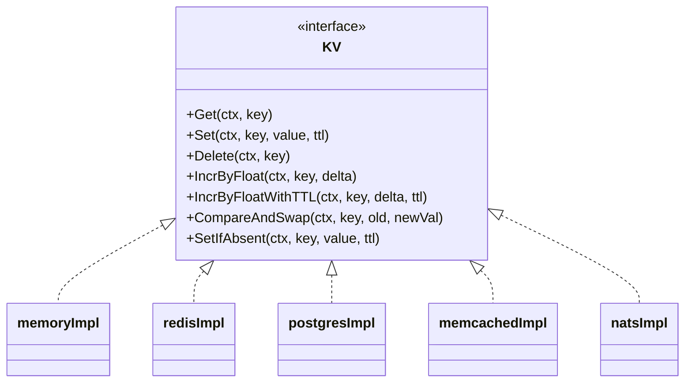

# kv

## 职责

本模块交付**键值原语**：以不透明的键存取不透明的值，附带过期时间与原子操作。键与值都是字节，模块不解释其中任何一个，唯一的例外是自增操作读写的数值编码。

实现有多个，绑定不同后端：进程内映射、Redis、PostgreSQL、Memcached、NATS JetStream。**功能排他交付**：同一个进程里恰好一个实现生效，多于一个表态启用即启动失败（[ADR-kv-implementations](../../adr/adr-kv-implementations.md)）。

接口面按**最弱后端**设计，这是接口包与实现子包之间那条分界的核心约束：不暴露服务端脚本、管道、有序结构或超出不透明字节之外的数据类型。凡是接口承诺的，每一个实现都能实现；需要更强能力的调用方得不到它，而不是在一个后端上得到、在另一个上失效（[ADR-kv-scope](../../adr/adr-kv-scope.md)）。

### 非职责

- **不提供缓存策略。** 过期时间由调用方给定，本模块不自行决定何时过期、不淘汰、不分层，也不区分"缓存"与"持久存储"——同一个接口既承载缓存也承载持久存储，取舍归调用方。后端丢键的方向不由本模块保证：键丢失会无界放宽安全校验的状态不放在这里；放在这里的是丢失只让一次流程失败的状态，例如登录流程记录与一次性占位，以及权威状态在别处、丢失只造成有界放宽的计数，例如按来源地址的粗粒度洪泛计数（判据见 [authn](authn/design-authn.md) 的状态放置）。
- **不做序列化。** 值是不透明字节，结构约定完全归调用方。同一个键在不同调用方之间没有共享的类型约定，模式演进不在本模块范围内。
- **不管理键的命名空间。** 键是不透明字符串，接口不划分前缀、不分区、不做配额；个别实现为避免与同一后端上的其他使用者撞键，在物理存放处自带一段前缀（例如 Redis 实现的键都以 `speed:kv:` 起头），前缀由实现加上、去掉，对调用方不可见，也不在调用方之间隔离。两个调用方用同一个键即互相覆盖，而本模块看不见这件事；调用方因此在自己的键里带上自己的名字，例如登录流程记录的键以 `authn:` 起头。
- **不保证租户隔离。** 键名是否含租户标识、如何含，由调用方决定。本模块不认识租户，也不读请求上下文。
- **不提供发布订阅。** 事件的分发是 [event](event/design-event.md) 的职责。
- **不提供有序结构、脚本与管道。** 需要它们的算法在本模块之外表达不了，这是接口以最弱后端为准的直接结果。

## 外部接口契约

### 交付的功能

```go
// 功能标识为 (*KV)(nil)。
type KV interface {
    // 键不存在或已过期时报 present 为 false，且 err 为 nil。
    Get(ctx context.Context, key string) (value []byte, present bool, err error)

    // ttl 大于零时到期失效；零或负值表示不过期。
    Set(ctx context.Context, key string, value []byte, ttl time.Duration) error

    // 删除不存在的键不是错误。
    Delete(ctx context.Context, key string) error

    // 键不存在或已过期时从零起算，且新键不带过期时间。
    IncrByFloat(ctx context.Context, key string, delta float64) (float64, error)

    // 与上一条同义，差别是新建的键原子地带上 ttl。已存在的键保持它原有的过期时间。
    IncrByFloatWithTTL(ctx context.Context, key string, delta float64, ttl time.Duration) (float64, error)

    // 只在当前值等于 old 时写入 newVal。键不存在或已过期时以空值匹配。
    CompareAndSwap(ctx context.Context, key string, old, newVal []byte) (bool, error)

    // 只在键不存在或已过期时写入 value 并附上 ttl，报是否写入。存活的键保持原值与原有过期时间。
    SetIfAbsent(ctx context.Context, key string, value []byte, ttl time.Duration) (bool, error)
}
```

**排他交付。** 一个进程里恰好一个实现生效。各实现都声明排他，依赖闭包展开键值功能时因而不替宿主挑，只取命令树上已经写下的那些：宿主在运行级纳入里点名哪个实现，参与的就是哪个；未点名的实现不进参与集，宿主为它预置了实例的除外，预置了实例的实现与点名的实现之间按消解的普通规则处置（见 [core](design-core.md)）；参与集里一个实现都没有而又有模块依赖键值功能时，该功能缺提供者，启动失败。列举多于一个实现并都表态启用时，消解阶段判为冲突，启动终止，错误文本点名冲突双方（[ADR-dependency-resolution](../../adr/adr-dependency-resolution.md)）。

### 对外接口面

- **新增方法是兼容扩展，改签名或删除方法是不兼容变更。** 新增后端实现不改变接口，且每一个既有实现都要能实现新增方法——这是"以最弱后端为准"这条约束对接口演进的约束。
- **值是不透明的。** 一个实现不得解释值的内部结构，即便它的后端本来能解释（例如把值当 JSON 存并支持路径查询）。调用方因此可以把任意字节放进去。
- **原子操作的语义属于接口面，位级结果不是。** 自增在 delta 无法用二进制浮点精确表示时（例如 `0.1`），不同实现可能落在相邻的两个合法结果上：有的每次累加后舍入，有的以更宽的精度累加只在最后舍入一次。需要跨实现一致的调用方应只使用整数值的 delta。

### 哨兵错误

| 哨兵 | 含义 |
|---|---|
| `ErrNotNumeric` | 自增操作的键上已有一个不是合法浮点编码的值。该值保持原样，不被改写 |

错误文本不携带那个既有值，因为键值存储可能持有敏感数据。

## 依赖

| 依赖 | 用途 |
|---|---|
| `pkg/core` | 注册描述符、交付功能、声明资源 |
| `pkg/config` | 声明本模块的输入项 |
| `pkg/log` | 可选：工厂在 `New` 里把配置里承载凭据的值登记为日志的字面量匹配器 |
| `pkg/internal/literal` | 构造并登记字面量匹配器（见下） |
| 共享单元（见下） | Redis 实现与 PostgreSQL 实现各自的使用：客户端的类型与连接构造、连接池的构造 |

**运行期不依赖任何其他功能模块，也不写日志。** 本模块位于依赖图的底层：它不认识租户、不认识请求上下文，也不在任何回调里记录一行日志。日志功能是一条只为登记凭据而存在的可选依赖，取用只发生在构造期（见下）。[db](design-db.md) 同样不认识租户，但它对日志功能声明可选依赖，语句的记录经日志模块写出；本模块对日志功能的唯一取用是构造期的那一次登记。

**凭据在构造期登记为字面量匹配器。** 本模块的配置里有承载凭据的值：`kv.nats` 的 `url`（连接地址的 authority 里带凭据），以及经共享单元挂载的 `kv.redis` 的 `password` 与 `kv.postgres` 的 `dsn`。按 [architecture](../architecture.md) 的安全边界，这些值由持有它的模块登记为日志的字面量匹配器（[ADR-log-secret-redaction](../../adr/adr-log-secret-redaction.md)）。工厂在自己的 `New` 里照 [log](design-log.md) 的取用顺序做这件事：先取日志功能，再登记，最后才 `Named`——`Named` 返回的 logger 绑着模块名属性，那已经是一次绑定，规则只对此后的绑定生效。实现交出自己那份承载凭据的配置值（与 [sms](design-sms.md) 的 `Secrets` 钩子同形），工厂经 `pkg/internal/literal` 登记，实现因而不 import 它。登记之后本模块不再取用日志功能，也不持有 logger；日志模块不在参与集里时登记不发生，本模块照常启动。

**标记 `Sensitive` 不代为登记。** `config` 的 `Sensitive` 只约束它自己的输出面——错误文本不复述值、帮助输出不回显默认值、必须带说明——不向日志登记脱敏规则（[config](design-config.md)）。本模块漏掉登记时不报错：启动照常成功，记录照常写出，那个值在日志里以明文出现。察觉途径是把值以字符串形态写进一条记录，断言目的地上出现 `MaskedText`（[log](design-log.md) 的可观察字面量）——只断言原值不出现不算数，值可能根本没有到达记录。

Redis 实现与事件模块的 Redis 实现共用一个封装该客户端的共享单元，PostgreSQL 实现与事件模块的 PostgreSQL 实现共用一个封装连接池构造的共享单元。`pkg/internal/redis` 与 `pkg/internal/pgpool` 都不登记模块、不交付功能、不参与生命周期（[ADR-shared-backend-unit](../../adr/adr-shared-backend-unit.md)）。

**共享单元的凭据在挂载它的实现里登记。** 共享单元不登记模块，因而没有可以登记的地方：它们的配置由挂载它们的实现挂在自己的命名空间下，凭据也就在挂载处登记——`kv.redis` 登记 `password`，`kv.postgres` 登记 `dsn`。同一个共享单元在别的挂载模块里的凭据由那一侧登记（`event.redis`、`event.postgres`，见 [event](event/design-event.md)）。

各实现子包的集成用例跑在真服务器上。与其他模块共用同一种服务器的夹具同属共享单元，落在 `pkg/internal/` 下：PostgreSQL 用 `pkg/internal/pgpool/pgtest`，NATS 用 `pkg/internal/natstest`，Redis 用 `pkg/internal/redis/redistest`；夹具的共享理由写在同一条记录里——两份副本会各自演进到行为不同的服务器上，而失配最难归因。Memcached 的夹具只服务本模块的 Memcached 实现，没有第二个引用方，因而不是共享单元，落在本模块自己的 `pkg/kv/internal/memcachetest` 下。

这台 Memcached 由一个检出的所有测试二进制共用，而 Memcached 没有逻辑库，隔离因此按键空间而不按服务器：每个用例从夹具领一个任何其他调用方都领不到的前缀（`memcachetest.Space`），实现把它写在每个键的拼写之前，拼写的长度上限相应扣去前缀的长度；宿主打开的存储不带前缀。没有任何用例清空这台服务器——清空会把同一时刻别处正在跑的用例的条目一并拿走，那个用例表现为键在用例中途消失。这台服务器与其余三个外部后端同源：由仓库根的 `compose.yaml` 起停，夹具只连接，不管理它的生命周期；每个检出的栈各用自己的端口与 compose 项目（[ADR-test-tiers](../../adr/adr-test-tiers.md)）。

## UML 图

本模块的结构是一条接口与多个实现的关系。图里的约束不在图中：实现之间是**互斥**的，而不是可用的一种选择；图上看不出这一点，因为排他性由描述符声明、由消解阶段裁定，不是类型之间的关系。



**每个实现各自登记为一个模块**，模块名形如 `kv.memory`、`kv.redis`。根包是接口包，不登记模块。

## 核心数据结构

| 概念 | 类型 | 说明 |
|---|---|---|
| 键 | `string` | 不透明。模块不解析；接口不划分前缀，实现自带的物理前缀不属于键 |
| 值 | `[]byte` | 不透明。模块不解释，除自增读写的数值编码。nil 与零长切片同义，每个实现都把它存为空值 |
| 过期时间 | `time.Duration` | 零或负值表示不过期 |
| 原子自增的数值编码 | 文本 | 最短精确十进制，调用方应以浮点解析而非按文本比较。计数值是有限数 |

**计数值是有限的浮点数。** 增量不是有限数（NaN 或无穷），或者相加之和超出 float64 的表示范围时，自增失败，错误不是 `ErrNotNumeric`，且不写入任何东西：键不存在时不被创建，键存在时保持原值。判定发生在写入之前，调用方因此不会拿到一个"其实已经写入"的失败，也就不会因重试而把同一次自增计两次。

由 `Set` 写入、再由自增读取的值，只有普通十进制写法——可选的符号、数字、可选的小数部分与指数，即自增自己写出的形式——在每个实现上都被读作数。其他写法（十六进制、数字分隔符、首尾空白、NaN 与无穷）是否被读作数随实现而异，有的实现把它读作数，有的以 `ErrNotNumeric` 拒绝；需要跨实现一致的调用方只经由自增写计数。

**键的内容与长度都不受限制。** 空键、含零字节或非法 UTF-8 的键、任意长度的键都是合法的键，每个实现都接受。某些后端对键有要求——不接受冒号或空白、不接受空键、键长有上限、文本列拒收零字节——这些差异由那一个实现自己把键改写成后端能接受的拼写来消除，不上升为接口对键的约束，调用方不需要知道任何一个后端的上限。

改写不得让两个键落到同一个条目上：

- 能原样或以单射编码（Memcached 用 base64url，NATS 用十六进制）存放的键，存放在这一拼写下。
- 这一拼写为空或超出后端上限的键，改以键的 SHA-256 摘要拼写。摘要拼写在形式上与普通拼写互不相交（Memcached 与 NATS 的摘要拼写带有编码字母表之外的前缀；PostgreSQL 的摘要拼写是键的前若干字节接上摘要，长度超过任何普通拼写），摘要拼写之间的区分力即 SHA-256 的抗碰撞性。
- 不以截断缩短键：共享同一前缀的两个长键截断后会共用一个条目。

**值的长度受后端上限约束。** 值可以是任意字节，但单个值能有多长由后端决定：Memcached 的单条目上限与 NATS 的单条消息上限都由服务端配置给出，默认约 1 MB，NATS 的桶还可以设得更小；Redis 与 PostgreSQL 的上限在数百 MB 以上。超出上限的写入失败，返回实现自己的错误，不截断也不静默丢弃。失败之后键上是什么随实现而异：Memcached 的服务端在一次因值过大而失败的 `Set` 之后删去该键原有的值，键读作不存在，这落在它"可丢失"的部署前提之内；其他实现以及 Memcached 上的其他写入保持原值。

## 核心算法与流程

### 本模块的阶段行为

| 阶段 | 行为 |
|---|---|
| `Prepare` | 各实现 `Decode` 自己那份配置；读出部署前提输入项，与自身性质不符即启动失败，错误点名缺的是哪一项（见下） |
| `New` | 取可选的日志功能并把配置里承载凭据的值登记为字面量匹配器，再建立与后端的连接。构造失败即启动失败 |
| `Close` | 关闭连接。由本模块持有的连接由本模块关闭 |

宿主为某个实现预置了实例时，该实现的 `Prepare` 与 `New` 不执行；`Close` 照常对预置实例执行：实例实现了 `Close(ctx)` 的由它关闭，没有实现的不做任何事，它持有而 `Close(ctx)` 不释放的资源由预置的一方释放（[ADR-supplied-instance](../../adr/adr-supplied-instance.md)）。

需要在后端建立存储结构的实现在 `New` 中建立它，且建立过程与同一后端上的其他副本互斥：PostgreSQL 实现在数据库级的咨询锁下建表，多个副本同时对一个空库启动时依次完成，后到者见到表已存在即跳过，而不是在系统目录的唯一约束上失败、让启动失败。

**PostgreSQL 实现只建缺的那部分，建之前先查系统目录。** 表与它的过期索引都在时，启动不发出任何建立语句，连接所用的角色只需要对这张表的读写权限（`SELECT`、`INSERT`、`UPDATE`、`DELETE`），不需要在模式上建对象的权限，也不需要是表的所有者：以有建表权限的角色运行一次构造本实现的命令把表建好，此后服务以只能读写行的角色运行，这样的部署照常启动。缺表的那次启动要建它，需要模式上的 `CREATE` 权限；缺过期索引、或者键列仍是文本而要就地转换的那次启动，需要是表的所有者。权限不够时启动失败，错误点名正在建立的对象，并带着服务端的拒绝。

### 部署前提的判断

每个实现可以在自己的配置命名空间下声明描述其部署前提的输入项。前提不满足即启动失败，错误点名缺的是哪一项。

| 实现 | 前提 | 不满足时 |
|---|---|---|
| 内存 | 单副本：值存在本进程内存里，多副本下各持一份、互不可见，且每次读写都成功返回 | 启动失败，错误点名副本数这一项 |
| Memcached | 可丢失：服务端不持久化，进程重启、滚动升级与内存压力下的正常淘汰都会无声丢失全部数据 | 声明需要跨重启存活的部署下启动失败，错误点名跨重启存活这一项 |
| Redis、PostgreSQL、NATS | 无前提 | — |

前提输入项落在各实现自己的命名空间下，没有统一的键名，也没有一处把各实现的前提汇成一张对照表。同一次部署要让两个实现都知道"这是多副本部署"，得在各自的命名空间下分别声明；前提不满足由持有它的那一个实现自己报出启动失败（[ADR-kv-implementations](../../adr/adr-kv-implementations.md)）。

### 带过期时间的自增

`IncrByFloatWithTTL` 把"不存在则从零起算"、"附着过期时间"与"自增"合并为一次调用，实现必须以单次原子操作完成它，而不是在内部走两步；调用方侧的任何调用序列都不会丢失自增（[ADR-kv-scope](../../adr/adr-kv-scope.md)）。

**已存在的键保持其原有过期时间**，传入的 ttl 对它无效。这条不变量让滚动窗口下的计数键在被持续自增时仍按原定时刻过期，而不是每次自增都续命。

### 带过期时间的不存在则写入

幂等键、租约锁与去重标记要的是同一件事：键不存在时写下一个值，让它到期自行失效，且多个调用方同时争这个键时只有一个写成。`SetIfAbsent` 把"判定键不存在"、"写入值"与"附着过期时间"合并为一次调用，实现必须以单次原子操作完成它（[ADR-kv-scope](../../adr/adr-kv-scope.md)）。

**存活的键保持原值与原有过期时间**，传入的值与 ttl 对它无效，调用报未写入，错误为 nil。已过期的键按不存在处理：后端里仍留着它的条目时，写入替换那个条目，多个调用方争一个已过期的键时同样只有一个写成。

### 带过期时间的键的读

过期是懒惰的或主动的，取决于后端；接口不规定哪一种。懒惰过期与主动过期对调用方等价：一个过期时刻已过的键，读它报不存在，自增它从零起算，比较并交换它以空值匹配，不存在则写入把它当作不存在。

**过期的条目最终离开后端，即便此后再没有人读写它的键。** 限流的窗口键、幂等守卫的请求键、缓存条目过期之后都不会再被写，一个只把过期条目藏起来的后端，存储会随写过的每一个键增长。各实现的回收方式如下，这张表是完整的：

| 实现 | 过期条目如何离开 |
|---|---|
| 内存 | 每次带过期时间的写入顺带抽查一批条目，删去其中已过期的 |
| Redis | 服务端自己的过期机制 |
| PostgreSQL | 带过期时间的写入在后台触发一次清扫，每次删去一批已过期的行；两次清扫至少相隔一秒，上一次删满一批时下一次不等。清扫沿过期时刻上的部分索引找行，跳过正被写入锁住的行，多个副本同时清扫时各删各的 |
| Memcached | 过期时刻不交给服务端，已过期的条目与未过期的一样留在服务端，由服务端在它的内存上限内按最近最少使用淘汰；占用以服务端的内存上限为界 |
| NATS | 每条带过期时间的消息同时带上服务端的消息生存期，比过期时刻晚一秒，到时由服务端移除；删除以带生存期的清除标记完成，标记一秒后自行消失 |

NATS 的这条回收要求桶的流允许按消息设生存期，这需要 NATS Server 2.11 或更新的版本。本实现新建的桶允许它；打开一个既有的桶而它不允许时，本实现只把这一项打开，桶的其余配置不动——服务端不许再把它关上，它对不带生存期的消息也没有影响。这一项打不开时启动失败，错误说明缺的是它。

**过期时刻由判定它的那个时钟写下。** 一个时钟写下过期时刻、另一个时钟判定它是否已过，两者的偏差会原样改变键的有效期：写入方快于判定方，键活得过久；慢于判定方，键一写下就已过期。各实现的时钟来源如下，这张表是完整的：

| 实现 | 写下过期时刻 | 判定过期 |
|---|---|---|
| 内存 | 本进程时钟 | 本进程时钟 |
| Redis | 服务端时钟 | 服务端时钟 |
| PostgreSQL | 数据库时钟（语句内的 `now()` 加 ttl） | 数据库时钟 |
| Memcached、NATS | 写入副本的时钟（过期时刻写在值前面） | 读取副本的时钟 |

Memcached 与 NATS 的后端不提供能按键保持过期时刻的服务端时钟，过期时刻因此跨副本传递：部署这两个实现的各副本时钟必须同步，偏差要远小于调用方使用的最短 ttl，否则副本之间对同一个键是否存在给出不同回答。

## 错误与失败语义

| 情形 | 表现 |
|---|---|
| 键不存在 | 不是错误。`Get` 报 present 为 false，`Delete`、`CompareAndSwap` 与 `SetIfAbsent` 的正常路径 |
| 不存在则写入遇到存活的键 | 不写入，报未写入，错误为 nil；键的值与过期时间不变 |
| 比较并交换不匹配 | 交换未发生，错误为 nil。只有见到一个与 old 不相等的当前值才答不匹配：写入因另一个写入者抢先而被后端拒绝时，实现重新读取并重新判定，另一个写入者留下的值仍然匹配时交换照常发生 |
| 自增遇到非数值 | `ErrNotNumeric`，值保持原样 |
| 自增的增量或和不是有限数 | 实现自己的错误，不是 `ErrNotNumeric`；不写入，值保持原样 |
| 上下文已取消 | 返回上下文的错误，不执行操作 |
| 后端不可达 | 实现自己的错误，原样外传。本模块不重试。断开期间的一次操作失败，客户端不把它排队待发、重连后也不补发；后端恢复后操作随之恢复，不需要重启进程：各实现的连接在断开期间持续重连，不设放弃的上限 |
| 连接建立失败 | `New` 阶段失败即启动失败 |
| 缺表或缺索引，而连接所用的角色无权建立（PostgreSQL 实现） | `New` 阶段失败即启动失败，错误点名正在建立的对象并带着服务端的权限拒绝；表与索引都在时不需要这项权限，见本模块的阶段行为 |

**本模块不降级。** 后端不可达即操作失败，不回落到内存、不返回过期值、不返回空值。调用方拿到的错误是它自己的失败，不是一次静默的降级。

**本模块不重试。** 重试策略归调用方，因为是否需要重试取决于那次操作是否幂等，而只有调用方知道。这条也约束各实现所用的客户端库：回复丢失的命令可能已在后端执行，客户端库自行重发会让一次自增计两次、让赢得比较并交换的调用方被告知落败，因此客户端库在回复丢失后重发命令的行为一律关闭，回复丢失以错误交还调用方。写入确定未发生时的重来不在此列：后端没有原生算术与原生条件写入时，自增、比较并交换与不存在则写入的读改写循环只在竞争失败后重来，客户端库在请求无人接收时把这次请求再发一遍、而调用方仍在等这次调用的结果，同样不在此列。

**调用已经带着失败交还给调用方之后，客户端库不得再发出这次操作的任何字节**：断开期间积攒待发的写一律关闭。此类写在调用方按"这次写没有发生"作出处置之后才落地，对一次自增就是把同一笔计数记两次，对一次比较并交换就是一次已经宣布落败的交换事后生效。

## 并发与事务边界

- 每个实现都必须可被多个协程并发使用。
- 实现不得持有调用方传入的切片，也不得把它自己持有的切片交出去。
- 原子操作的原子性由后端提供，不由本模块的加锁提供：多副本部署下，同一个键上的两次自增必须由后端仲裁，本地锁达不到这个效果。
- 本模块不开事务。需要多个操作一起生效的调用方做不到，接口也不提供。

## 扩展点

**新增一种后端即新增一个实现子包。** 以下各条是准入条件的全部：

- 必须在 `Prepare` 中 `Decode` 自己那份配置，并在其中判断部署前提；前提不满足即启动失败，错误要能认出是哪个实现缺了哪一项。
- 必须排他交付：`Exclusive` 非空，且交付的功能标识为 `(*KV)(nil)`。
- 必须挂在 `kv.<后端>` 专属的配置命名空间下——两个实现在同一个命名空间下声明输入项，只要都被 import 就是冲突，进程起不来（[ADR-config-parsing](../../adr/adr-config-parsing.md)）。
- 必须通过共享的一致性套件。套件覆盖接口的每一条语义，包括并发下的不丢更新，以及比较并交换与不存在则写入的恰好一个赢家；恰好一个赢家对从未写过的键成立，对已过期却仍留存在后端里的键同样成立——自己判定过期的后端在这里走的是替换既有条目而非新建的路径。套件不把慢当作错：要求键在 ttl 之内被操作的用例按这一次往返的实测时长判定，往返超出 ttl 的一次尝试不下结论，换一个键、以加倍的 ttl 重来。
- 必须声明自己的部署前提。一个不持久、不跨副本的实现不得省略前提输入项。
- 必须经工厂交出自己那份承载凭据的配置值，使它在构造期先于任何 logger 绑定被登记为日志的字面量匹配器；不承载凭据的实现交回空。

## 实现状态

| 能力 | 状态 | 代码 |
|---|---|---|
| 接口与根包 | 已实现 | `pkg/kv/kv.go` `KV`；`pkg/kv/module.go` `Spec`、`NewModule` |
| 凭据的脱敏登记 | 已实现 | `pkg/kv/module.go` `(Spec).registerSecrets`；各实现的 `Secrets` 钩子与各自的 `secrecy_test.go` |
| 内存实现 | 已实现 | `pkg/kv/memory/memory.go` `Module`、`stance` |
| 一致性套件 | 已实现 | `pkg/kv/internal/kvsuite/kvsuite.go` `AssertConforms`、`AssertUnderLatency` |
| Redis 实现 | 已实现 | `pkg/kv/redis/redis.go` `Module`、`store` |
| PostgreSQL 实现 | 已实现 | `pkg/kv/postgres/postgres.go` `Module`、`store` |
| Memcached 实现 | 已实现 | `pkg/kv/memcached/memcached.go` `Module`、`store` |
| NATS JetStream 实现 | 已实现 | `pkg/kv/nats/nats.go` `Module`、`store` |
