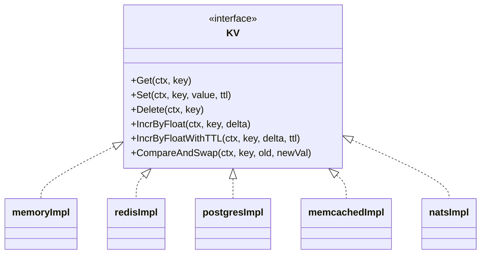

# kv

## 职责

本模块交付**键值原语**：以不透明的键存取不透明的值，附带过期时间与原子操作。键与值都是字节，模块不解释其中任何一个，唯一的例外是自增操作读写的数值编码。

实现有多个，绑定不同后端：进程内映射、Redis、PostgreSQL、Memcached、NATS JetStream。**功能排他交付**：同一个进程里恰好一个实现生效，多于一个表态启用即启动失败（[ADR-kv-implementations-2026-09-21](../../adr/adr-kv-implementations-2026-09-21.md)）。

接口面按**最弱后端**设计，这是模块边界的核心约束：不暴露服务端脚本、管道、有序结构或超出不透明字节之外的数据类型。凡是接口承诺的，每一个实现都能实现；需要更强能力的调用方得不到它，而不是在一个后端上得到、在另一个上失效（[ADR-kv-scope-2026-09-21](../../adr/adr-kv-scope-2026-09-21.md)）。

### 非职责

- **不提供缓存策略。** 过期时间由调用方给定，本模块不自行决定何时过期、不淘汰、不分层，也不区分"缓存"与"持久存储"——同一个接口既承载缓存也承载持久存储，取舍归调用方。
- **不做序列化。** 值是不透明字节，结构约定完全归调用方。同一个键在不同调用方之间没有共享的类型约定，模式演进不在本模块范围内。
- **不管理键的命名空间。** 键是不透明字符串，本模块不划分前缀、不分区、不做配额。两个调用方用同一个键即互相覆盖，而本模块看不见这件事。
- **不保证租户隔离。** 键名是否含租户标识、如何含，由调用方决定。本模块不认识租户，也不读请求上下文。
- **不提供发布订阅。** 事件的分发是 [event](design-event.md) 的职责。
- **不提供有序结构、脚本与管道。** 需要它们的算法在本模块之外表达不了，这是接口以最弱后端为准的直接结果。

## 外部接口契约

### 交付的功能

```go
// 功能标识为 (*KV)(nil)。
type KV interface {
    // 键不存在或已过期时报 present 为 false，且 err 为 nil。
    Get(ctx context.Context, key string) (value []byte, present bool, err error)

    // ttl 大于零时到期失效；零或负值表示不过期。
    Set(ctx context.Context, key string, value []byte, ttl time.Duration) error

    // 删除不存在的键不是错误。
    Delete(ctx context.Context, key string) error

    // 键不存在或已过期时从零起算，且新键不带过期时间。
    IncrByFloat(ctx context.Context, key string, delta float64) (float64, error)

    // 与上一条同义，差别是新建的键原子地带上 ttl。已存在的键保持它原有的过期时间。
    IncrByFloatWithTTL(ctx context.Context, key string, delta float64, ttl time.Duration) (float64, error)

    // 只在当前值等于 old 时写入 newVal。键不存在或已过期时以空值匹配。
    CompareAndSwap(ctx context.Context, key string, old, newVal []byte) (bool, error)
}
```

**排他交付。** 一个进程里恰好一个实现生效。宿主在命令树上列举多于一个实现并都表态启用时，消解阶段判为冲突，启动终止，错误文本点名冲突双方（[ADR-dependency-resolution-2026-09-13](../../adr/adr-dependency-resolution-2026-09-13.md)）。

### 稳定性承诺

- **接口面在版本之间保持。** 新增后端实现不改变接口，接口的扩展只走新增方法，且每一个既有实现都要能实现它——这是"以最弱后端为准"这条约束对接口演进的约束。
- **值的不透明性是承诺。** 一个实现不得解释值的内部结构，即便它的后端本来能解释（例如把值当 JSON 存并支持路径查询）。调用方因此可以把任意字节放进去。
- **原子操作的语义是承诺，位级结果不是。** 自增在 delta 无法用二进制浮点精确表示时（例如 `0.1`），不同实现可能落在相邻的两个合法结果上：有的每次累加后舍入，有的以更宽的精度累加只在最后舍入一次。需要跨实现一致的调用方应只使用整数值的 delta。

### 哨兵错误

| 哨兵 | 含义 |
|---|---|
| `ErrNotNumeric` | 自增操作的键上已有一个不是合法浮点编码的值。该值保持原样，不被改写 |

错误文本不携带那个既有值，因为键值存储可能持有敏感数据。

## 依赖

| 依赖 | 用途 |
|---|---|
| `pkg/core` | 注册描述符、交付功能、声明资源 |
| `pkg/config` | 声明本模块的输入项 |
| 共享发布单元（见下） | Redis 实现与 PostgreSQL 实现各自的使用：客户端的类型与连接构造、连接池的构造 |

**不依赖任何其他功能模块。** 本模块位于依赖图的底层，与 [db](design-db.md) 同层：它不认识租户、不认识日志、不认识请求上下文。

Redis 实现与事件模块的 Redis 实现共用一个封装该客户端的发布单元，PostgreSQL 实现与事件模块的 PostgreSQL 实现共用一个封装连接池构造的发布单元。两个发布单元都不登记模块、不交付功能、不参与生命周期（[ADR-shared-backend-unit-2026-09-21](../../adr/adr-shared-backend-unit-2026-09-21.md)）。

各实现子包的集成用例所需的服务器夹具同样来自共享单元：PostgreSQL 用 `pgpool/pgtest`，NATS 用 `natstest`，Redis 用 `redis/redistest`；夹具的共享理由写在同一条记录里——两份副本会各自演进到行为不同的服务器上，而失配最难归因。

## UML 图

本模块的结构是一条接口与多个实现的关系。图里的约束不在图中：实现之间是**互斥**的，而不是可用的一种选择；图上看不出这一点，因为排他性由描述符声明、由消解阶段裁定，不是类型之间的关系。



**每个实现各自登记为一个模块**，模块名形如 `kv.memory`、`kv.redis`。根包是接口包，不登记模块。

## 核心数据结构

| 概念 | 类型 | 说明 |
|---|---|---|
| 键 | `string` | 不透明。模块不解析、不划分前缀 |
| 值 | `[]byte` | 不透明。模块不解释，除自增读写的数值编码 |
| 过期时间 | `time.Duration` | 零或负值表示不过期 |
| 原子自增的数值编码 | 文本 | 最短精确十进制，调用方应以浮点解析而非按文本比较 |

**键的字符集不受限制。** 某些后端对键的字符集有要求（例如某一种不接受冒号），这些差异由那一个实现自己编码消除，不上升为接口对键的约束。

## 核心算法与流程

### 本模块的阶段行为

| 阶段 | 行为 |
|---|---|
| `Prepare` | 各实现 `Decode` 自己那份配置；读出部署前提输入项，与自身性质不符即表态禁用并给出理由（见下） |
| `New` | 建立与后端的连接。构造失败即启动失败 |
| `Close` | 关闭连接。由本模块持有的连接由本模块关闭 |

### 部署前提的判断

每个实现可以在自己的配置命名空间下声明描述其部署前提的输入项。前提不满足时，该实现以带理由的方式表态禁用，进程照常启动，理由进启动诊断。

| 实现 | 前提 | 不满足时 |
|---|---|---|
| 内存 | 单副本：值存在本进程内存里，多副本下各持一份、互不可见，且每次读写都成功返回 | 表态禁用 |
| Memcached | 可丢失：服务端不持久化，进程重启、滚动升级与内存压力下的正常淘汰都会无声丢失全部数据 | 声明需要跨重启存活的部署下表态禁用 |
| Redis、PostgreSQL、NATS | 无前提 | — |

前提输入项落在各实现自己的命名空间下，没有统一的键名，也没有一处能替宿主汇总当前装配缺了哪一档保证（[ADR-kv-implementations-2026-09-21](../../adr/adr-kv-implementations-2026-09-21.md)）。

### 带过期时间的自增

给一个新键附上过期时间，若拆成"自增"再"补写过期时间"两步，落在两步之间的并发自增会被那次补写覆盖，计数少算一次。`IncrByFloatWithTTL` 把"不存在则从零起算"、"附着过期时间"与"自增"合并为一次调用，实现必须以单次原子操作完成它，而不是在内部走两步。

**已存在的键保持其原有过期时间**，传入的 ttl 对它无效。这条不变量让滚动窗口下的计数键在被持续自增时仍按原定时刻过期，而不是每次自增都续命。

### 带过期时间的键的读

过期是懒惰的或主动的，取决于后端；接口不规定哪一种。两种行为对调用方等价：一个过期时刻已过的键，读它报不存在，自增它从零起算，比较并交换它以空值匹配。

## 错误与失败语义

| 情形 | 表现 |
|---|---|
| 键不存在 | 不是错误。`Get` 报 present 为 false，`Delete` 与 `CompareAndSwap` 的正常路径 |
| 比较并交换不匹配 | 交换未发生，错误为 nil |
| 自增遇到非数值 | `ErrNotNumeric`，值保持原样 |
| 上下文已取消 | 返回上下文的错误，不执行操作 |
| 后端不可达 | 实现自己的错误，原样外传。本模块不重试 |
| 连接建立失败 | `New` 阶段失败即启动失败 |

**本模块不降级。** 后端不可达即操作失败，不回落到内存、不返回过期值、不返回空值。调用方拿到的错误是它自己的失败，不是一次静默的降级。

**本模块不重试。** 重试策略归调用方，因为是否需要重试取决于那次操作是否幂等，而只有调用方知道。

## 并发与事务边界

- 每个实现都必须可被多个协程并发使用。
- 实现不得持有调用方传入的切片，也不得把它自己持有的切片交出去。
- 原子操作的原子性由后端提供，不由本模块的加锁提供：多副本部署下，同一个键上的两次自增必须由后端仲裁，本地锁达不到这个效果。
- 本模块不开事务。需要多个操作一起生效的调用方做不到，接口也不提供。

## 扩展点

**新增一种后端即新增一个实现子包。** 以下各条是准入条件的全部：

- 必须在 `Prepare` 中 `Decode` 自己那份配置，并在其中判断部署前提；前提不满足时表态禁用并给出理由，理由要能认出是哪个实现缺了什么。
- 必须排他交付：`Exclusive` 非空，且交付的功能标识为 `(*KV)(nil)`。
- 必须挂在 `kv.<后端>` 专属的配置命名空间下——两个实现在同一个命名空间下声明输入项，只要都被 import 就是冲突，进程起不来（[ADR-config-source-2026-09-13](../../adr/adr-config-source-2026-09-13.md)）。
- 必须通过共享的一致性套件。套件覆盖接口的每一条语义，包括并发下的不丢更新与比较并交换的恰好一个赢家。
- 必须诚实地声明自己的部署前提。一个不持久、不跨副本的实现不得省略前提输入项。

## 实现状态

| 能力 | 状态 | 代码 |
|---|---|---|
| 接口与根包 | 已实现 | `pkg/kv/kv.go` `KV`；`pkg/kv/module.go` `Spec`、`NewModule` |
| 内存实现 | 已实现 | `pkg/kv/memory/memory.go` `Module`、`stance` |
| 一致性套件 | 已实现 | `pkg/kv/internal/kvsuite/kvsuite.go` `AssertConforms` |
| Redis 实现 | 已实现 | `pkg/kv/redis/redis.go` `Module`、`store` |
| PostgreSQL 实现 | 已实现 | `pkg/kv/postgres/postgres.go` `Module`、`store` |
| Memcached 实现 | 已实现 | `pkg/kv/memcached/memcached.go` `Module`、`store` |
| NATS JetStream 实现 | 已实现 | `pkg/kv/nats/nats.go` `Module`、`store` |
