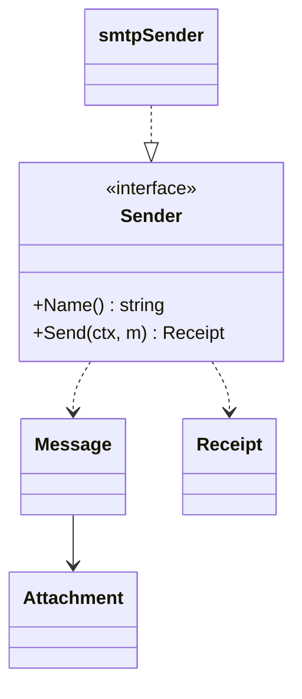

# mail

## 职责

本模块交付**发出一条已经渲染好的邮件**的能力：调用方给出收件人、发件人、主题、两份可选正文与附件，模块经一个可插拔的载体把请求交给厂商一次，把厂商的回应归入封闭的几个哨兵。载体只构造请求、调用、归类，不解释这封邮件的用途，也不渲染它的内容。

邮件的内容是**自由文本**，不是模板：正文（纯文本与 HTML 两份可选）与主题都由调用方渲染好，模块只把它们送出去。

载体**排他交付**：一个进程里恰好一个载体生效，多于一个表态启用即启动失败。根包是接口包与工厂，不登记模块；实现子包绑定各自的库并登记模块（[ADR-mail-capability](../../adr/adr-mail-capability.md)）。

### 非职责

- **不排队，不做工作池。** 发送是一次同步调用，`Send` 在厂商调用返回后才返回。异步投递、有界队列、队列满时的丢弃策略归调用方。
- **不持预算，不做节流记账，不计尝试次数。** 本模块不认识「这封邮件该不该发」。发送预算、重发间隔、每收件人与每账户的上限都在调用方，本模块对每个 `Send` 都尝试发出去。
- **不重试。** 厂商的发送接口不幂等，超时之后调用方无从知道邮件是否已发出，重试会重复投递。载体在超时、网络错误与上下文结束时把结果归入 `ErrUncertain`，从不自行重发。是否重发归调用方。
- **不做投递跟踪。** 本模块只回答这一次调用被厂商接受与否，不追踪邮件是否到达、何时打开、是否退信。
- **不渲染，不翻译。** 正文是调用方渲染好的自由文本，语言与格式由调用方负责；本模块不认识语言，也不持模板。
- **不设附件体积上限。** 附件以 `io.Reader` 交出，读取由厂商库在发送时完成，本模块不度量、不截断、不拒绝大附件。
- **不认识租户，不读请求上下文。** 本模块不 import 任何上层功能目录，也不 import `pkg/tenant` 或 `pkg/authn`。
- **不落任何存储。** 本模块不写库、不写事件，除排他性去重的一项进程内有界记录外不持状态（见 `Message.DedupeID`）。
- **不透传任意头。** 接口点名的字段（发件人、收件人三类、回复地址、主题、两份正文、附件）要么被每个载体忠实交付，要么被拒绝；一个接口没有点名的头没有传出的通道（见[非保证](#非保证)）。

## 外部接口契约

### 交付的功能

```go
// 功能标识为 (*Sender)(nil)。
type Sender interface {
    Name() string
    Send(ctx context.Context, m Message) (Receipt, error)
}

type Message struct {
    From        string       // 可选；空值取载体配置的缺省发件人
    To          []string     // 每个条目是 RFC 5322 地址：裸 addr-spec 或「显示名 <addr>」
    Cc          []string
    Bcc         []string     // 只作信封收件人，不写进任何头
    ReplyTo     []string
    Subject     string       // 可为空；不含控制字符（制表符除外）
    Text        string       // 纯文本正文；与 HTML 至少一项非空
    HTML        string       // HTML 正文；与 Text 至少一项非空
    Attachments []Attachment
    DedupeID    string       // 稳定标识；载体至多对同一标识调厂商一次
}

type Attachment struct {
    Name        string     // 非空；不含控制字符（制表符除外）
    ContentType string     // 空值取 application/octet-stream；不含控制字符（制表符除外）
    Data        io.Reader  // 非 nil；Send 把它读到结尾
}

type Receipt struct{ ProviderID string }
```

### 校验规则

`Message.Validate` 是**无状态**的，只判消息本身、不判将要发送它的载体。约束的主体是每一条交给 `Send` 的消息；每一条拒绝都包裹 `ErrRejected` 并**点名出错的字段，从不重复字段里的值**——地址、主题或正文是调用方写的东西，一个写得出头行的值就写得出头块，不许进错误文本。

| 规则 | 落空即 `ErrRejected` |
|---|---|
| `To`、`Cc`、`Bcc` 至少一项非空 | 三项皆空 |
| `From`（非空时）、`To`、`Cc`、`Bcc`、`ReplyTo` 的每个条目都是单个 RFC 5322（[REF-rfc5322](../../references.md)）地址（`net/mail` 判形） | 某条目不是一个地址，点名该字段 |
| `Subject` 不含控制字符（制表符除外） | 含控制字符 |
| `Text` 与 `HTML` 至少一项非空 | 两项皆空 |
| 每个附件的 `Name` 非空、不含控制字符（制表符除外） | `Name` 为空或含控制字符 |
| 每个附件的 `ContentType` 不含控制字符（制表符除外） | 含控制字符 |
| 每个附件的 `Data` 非 nil | `Data` 为 nil |

「至少一个收件人」按 `To`、`Cc`、`Bcc` 三项合并计算，只有密送的邮件合法；空的 `From` 与空的 `Subject` 合法。

`Subject`、`Name` 与 `ContentType` 的值都会成为头行，所以三者按同一条规则判：不含控制字符，制表符除外——它是头值里合法的空白。

这条规则不按某个载体库的行为定，因为那正是不一致的地方：有的库把值照原样写进头行，一个回车或换行就写出了头块；有的改写它，交出调用方没写过的东西；有的把它编码成另一种形式。`Validate` 判的是消息而不是载体，所以它在这里拒绝，不把这件事交给扩展点后面的某一家库。

### 发送契约

约束的主体是每个交付 `Sender` 的模块：

- 响应 `ctx`；任何一次调用都不在载体层内重试。
- 对同一个 `DedupeID` 至多调用厂商一次：载体记住它已发过的标识（有界），重复者返回首次的结果，不作第二次厂商调用。空 `DedupeID` 没有可据以去重的标识，消息直接发出去。
- 把厂商的回应与错误归入 `ErrThrottled`、`ErrRejected`、`ErrUncertain` 之一；没有明确归入 `ErrThrottled` 或 `ErrRejected` 的错误，与全部超时、网络错误、上下文结束，一律归 `ErrUncertain`。
- `Message` 的正文、地址与厂商凭据不写日志、不进错误文本、不进指标属性。

`Message.Validate` 判出的拒绝与「发件人不在载体配置的允许集里」都是调用方缺陷，都在厂商被触达之前判出，都是 `ErrRejected`。

### 对外接口

- `Sender`、`Message`、`Attachment`、`Receipt` 的字段与方法集，以及哨兵 `ErrThrottled`、`ErrRejected`、`ErrUncertain`、`ErrInvalidConfig`，是本模块对调用方的接口。加方法、改签名或改字段名对实现了 `Sender` 的载体与取用它的调用方都是不兼容变更。
- `Message` 的字段语义：`To`、`Cc`、`Bcc`、`ReplyTo` 的每个条目是 RFC 5322 地址；`Bcc` 的条目只作信封收件人、不被写进头；`Text` 与 `HTML` 是调用方渲染好的正文；`DedupeID` 使载体至多对同一标识调厂商一次。
- **正文的形态属于接口**：`Text` 与 `HTML` 是两份可替代的正文，两份同时在时以纯文本在前、HTML 在后的次序铺成一份 multipart/alternative，附件在场时再在外层铺成 multipart/mixed。
- 单个载体叶子包可替换、可撤掉，不改变调用方的代码。

### 哨兵错误

| 哨兵 | 含义 |
|---|---|
| `ErrThrottled` | 厂商限流（暂态失败） |
| `ErrRejected` | 厂商拒绝（永久失败）；或调用方的消息或发件人不符合载体的要求 |
| `ErrUncertain` | 发送后超时，不知是否送达；不得盲目重发 |
| `ErrInvalidConfig` | 配置里的值跑不起来：载体的配置自洽校验失败 |

调用方以 `errors.Is` 判别，包裹一律用 `%w`。错误文本不携带正文、地址或厂商凭据。

## 依赖

| 依赖 | 用途 |
|---|---|
| `pkg/core` | 登记描述符、交付功能 |
| `pkg/config` | 声明本模块的输入项（载体各自声明） |
| `pkg/log` | 可选：工厂在 `New` 里登记凭据的日志字面量脱敏匹配器 |
| `pkg/internal/literal` | 与短信的载体共用的脱敏字面量登记构造 |
| `pkg/internal/dedupe` | 与短信的载体共用的有界去重表 |
| SMTP 库 `github.com/wneessen/go-mail`（[REF-go-mail](../../references.md)） | 只被 SMTP 载体叶子包 `pkg/mail/smtp` import |

**本模块不 import 任何上层功能目录，也不 import `pkg/authn`。** 判据是发送与用途无关：`pkg/mail` 位于依赖图的底层之一，与 `pkg/kv`、`pkg/event`、`pkg/sms` 同级，任何要发通知的模块都能单独引入它（[ADR-mail-capability](../../adr/adr-mail-capability.md)）。

**根包不 import 任何厂商库。** SMTP 库落在绑定它的载体叶子包 `pkg/mail/smtp` 里，只有 import 该子包的宿主的 `go.mod` 才背负它。这一条没有编译期强制（同一 `pkg` 模块内每个客户端都在一份依赖清单里），顶上它的是 `pkg/mail/deps_test.go` 的守卫：根包的传递闭包只含 `pkg/config`、`pkg/core`、`pkg/internal/literal`、`pkg/log`，不含任何厂商库，也不含 `pkg/authn` 或其他功能目录。SMTP 库在 `pkg/go.mod` 里精确固定版本 `v0.8.1`，同样由该守卫守住。

**`pkg/internal/literal` 与 `pkg/internal/dedupe` 是共享单元。** 两个能力的根包工厂都在 `New` 里 import `literal`，替自己的载体登记凭据的字面量脱敏匹配器；两个能力的载体也都持一张 `dedupe.Table`。`pkg/sms` 下的包不能 import `pkg/mail` 的 `internal` 包，所以这两个单元落在 `pkg/internal/` 下（[ADR-shared-backend-unit](../../adr/adr-shared-backend-unit.md)）。它们不登记模块，不交付功能，不参与生命周期。本模块的载体只经工厂取用它们，见「工厂的构造次序」。

## UML 图

本模块的结构是一个接口、一个消息结构与一个实现的关系。图里的约束不在图中：载体是**互斥**的，而不是可用的一种选择——图上看不出这一点，因为排他性由描述符声明、由消解阶段裁定，不是类型之间的关系。消息的校验由 `Message.Validate` 在调用方一侧判形，载体对发件人另有一道按自己配置的允许集的核对，两者都不在类型的结构里。



**SMTP 载体登记为一个模块**，模块名 `mail.smtp`。根包是接口包与工厂，不登记模块。

## 核心数据结构

| 概念 | 类型 | 说明 |
|---|---|---|
| 消息 | `Message` | 发件人、收件人三类、回复地址、主题、两份正文、附件、去重标识 |
| 附件 | `Attachment` | 文件名、媒体类型、内容读取器 |
| 回执 | `Receipt` | 载体为这次发送给出的标识；本模块不解释它 |
| 工厂规格 | `Spec[C]` | 载体交给工厂的全部：模块名、配置命名空间、配置原型、输入项、表态、凭据、打开函数 |

**`Receipt.ProviderID` 的来源由载体决定。** 它是载体为这次发送给出的标识，不是任何一方保证会有的东西：SMTP 中继只答「已接收」、不返回标识，所以 `mail.smtp` 填的是载体库写进报文的那枚 `Message-ID`，调用方据它到收件方一侧对账。

**`Attachment.Data` 是一次性读取器。** `Send` 在设计上把它读到结尾（由载体库在发送时完成），所以一个 `Message` 值只能被发送一次；重试用一个新的 `DedupeID` 时要重建这个读取器，否则发出去的是一份空附件而没有错误可看（见[非保证](#非保证)）。

**`Message.From` 是可选字段。** 空值取载体配置的缺省发件人；非空值须落在载体配置的允许集里，否则 `ErrRejected`。发件人的核对需要载体的配置状态，因而落在载体、不落在无状态的 `Validate`。

## 核心算法与流程

### 一次发送

1. 载体调 `Message.Validate`；不合规则即 `ErrRejected`，不调厂商。
2. 载体把消息的发件人（或配置的缺省发件人）对照自己配置的允许集；不在集里即 `ErrRejected`，不调厂商。
3. 载体按 `DedupeID` 查自己的去重表；命中即返回首次的结果，不调厂商。空 `DedupeID` 跳过这一步，直接发。
4. 载体按接口字段构造一次厂商调用：把两份正文铺成一份 multipart/alternative（或在只有一份时铺成单份正文），把附件读进消息，把收件人铺进信封。
5. 调用返回后把厂商的回应与错误归入哨兵，把结果连同 `Receipt` 记进去重表，返回调用方。

### 工厂的构造次序

`Spec[C]` 与 `NewModule[C]`（仿 `pkg/sms` 的 `Spec` 与 `NewModule`）把载体的公共接线收进工厂，载体只提供自己的类型参数、配置原型、输入项、表态、凭据与打开函数：

```go
type Spec[C any] struct {
    ModuleName        string
    CarrierName       string        // mail.carrier 里的选择名，也是 Sender.Name 的答案
    Fallback          bool          // 没有其它显式启用的载体时由 core 留下它
    DeclaresSelection bool          // 由日志载体声明 mail.carrier
    ConfigNamespace   string
    Config            *C
    Items             map[string]config.Item
    Stance            func(cfg *C) (core.Enablement, error)
    Secrets           func(cfg *C) []string      // 凭据：登记为日志的字面量脱敏匹配器
    Open              func(ctx context.Context, cfg *C) (Sender, error)
}
```

交付排他：`Provides` 排他 `(*Sender)(nil)`；`Requires` 可选 `log.Logger`。阶段行为如下：

| 阶段 | 行为 |
|---|---|
| `Prepare` | 读 `mail.carrier` 并核对其中名字是否在已编入的载体里；按选择项决定关闭、启用或保底，再 `Decode` 自己那份配置并调 `Stance` |
| `New` | `Decode` 配置 → 调 `Secrets` 并经 `literal.Register` 登记字面量脱敏匹配器 → 把已构造的 logger 注入上下文 → 调 `Open` 建立载体 |

### 载体的选择与保底

**一次运行恰好一个载体。** 选择项 `mail.carrier` 的取值是一个载体的选择名、`none` 或空；每个载体把自己的选择名作为 `CarrierName` 资源声明，`Prepare` 因此知道这次二进制里编入了哪些载体（[ADR-carrier-selection](../../adr/adr-carrier-selection.md)）。

| 情形 | 表现 |
|---|---|
| 选择项点名本载体的名字且配置齐全 | `StateEnabled` |
| 选择项点名另一个已编入的载体 | `StateDisabled`，原因点名被选中的载体 |
| 选择项是 `none` | 所有载体 `StateDisabled`；能力没有提供者，依赖它的模块自行关闭 |
| 选择项点名一个没有编入的名字 | `ErrInvalidConfig`，点名该名字、能力与这次二进制携带的载体 |
| 选择项为空、本载体的身份项全空 | `StateDisabled`，原因是未配置 |
| 选择项为空、身份项只给了一部分 | `ErrInvalidConfig`，点名缺的项 |
| 选择项为空、身份项齐全 | `StateEnabled`；两个载体同时如此即排他冲突，错误点名两个模块 |
| 选择项为空、本载体是保底载体 | `StateAuto`；core 在任一载体显式启用时把它搁下，否则它运行 |

**日志载体 `mail.log` 是保底。** 它把一条消息的正文写进进程日志并答成功，不触任何中继；它编入所有构建，声明 `mail.carrier`，并在 `Open` 时写一条警告，说明这条通道会把正文与验证码写进日志。选择项点名它时照常运行；选择项为空且没有其它载体启用时它运行；选择项是 `none` 时它也不运行。

**次序固定：先登记脱敏字面量，再绑定任何带属性的 logger，最后 `Open`。** 日志脱敏规则只对它注册之后写出的记录起作用，所以凭据的登记必须发生在载体把任何属性绑到 logger 之前（[ADR-log-secret-redaction](../../adr/adr-log-secret-redaction.md)）。`Secrets` 钩子把「凭据先登记」这一步收进工厂，载体因此不 import `literal`，只交出凭据字符串。

**工厂在装配期校验 `Spec`。** 一份缺模块名、缺配置命名空间、缺配置原型、缺表态或缺打开函数的 `Spec` 让 `NewModule` panic：载体在 `init` 里填这份 `Spec`，缺陷因此在本仓库自己的代码里，在任何 import 它的宿主的第一次运行时确定性地现形，不留给宿主处理。

**载体自洽落在 `Prepare`。** 载体在 `Stance` 里判自己那份配置（例如连接姿态在封闭集内、用户名与口令一并给出、发件人能判形），不满足即 `ErrInvalidConfig`。`Prepare` 早于 `New`、早于服务，所以漏配在启动期被点名，不拖到第一次发送。

### 厂商适配

适配只做下列事：构造一次 SMTP 会话（一条连接、`MAIL FROM`、`RCPT TO`、`DATA`）、调用、把响应与错误归入哨兵。没有真实中继也能验证：适配层测试用手写的假 SMTP 服务器（`pkg/mail/smtp/fake_test.go`）驱动真实客户端，以标准库的解析器（`net/mail`、`mime`）判定落地的报文。

**投递中继的载体集合是 SMTP 一家**（[ADR-mail-capability](../../adr/adr-mail-capability.md)）。`pkg/mail/smtp` 只认识提交协议、不认识任何厂商，所以一家厂商只要开放 SMTP 端点就经它接入，不另写厂商专属适配。另有一个不触中继的载体 `pkg/mail/log`，把消息写进进程日志，作为没有配置其它载体时的通道（[ADR-carrier-selection](../../adr/adr-carrier-selection.md)）。

| 项 | SMTP 载体 `mail.smtp` |
|---|---|
| 库 | `github.com/wneessen/go-mail` v0.8.1 |
| 调用 | `DialAndSendWithContext`（一条连接，自带 `MAIL FROM`/`RCPT TO`/`DATA`） |
| 连接姿态 | `tls` 取 `starttls`（缺省，强制 STARTTLS）、`implicit`（SMTPS）或 `none` |
| 归 `ErrThrottled` | 中继答 4xx（暂态失败） |
| 归 `ErrRejected` | 中继答 5xx（永久失败） |
| 归 `ErrUncertain` | 连接中断、超时、网络错误、上下文结束，以及类别表未覆盖的码与库自身抛出的无码失败 |

SMTP 事务同样不幂等：重复一次会投递并计费第二封，所以适配层不配置任何重试，超时与未完成的调用一律归 `ErrUncertain`。

## 错误与失败语义

| 情形 | 表现 |
|---|---|
| 消息不合 `Validate` 的任一规则 | `ErrRejected`，点名出错的字段，不调厂商 |
| 发件人不在载体配置的允许集里 | `ErrRejected`，不调厂商 |
| 厂商限流（中继答 4xx） | `ErrThrottled` |
| 厂商拒绝（中继答 5xx） | `ErrRejected` |
| 超时、网络错误、上下文结束、未归类的码 | `ErrUncertain`；不得盲目重发 |
| 重复的 `DedupeID` | 返回首次的结果，不调厂商 |
| 载体配置自洽校验失败 | `ErrInvalidConfig`，`Prepare` 阶段终止启动 |

**本模块不降级，不重试。** 厂商不可达即那次调用失败，不排队待发、不重连后补发；是否重发归调用方。

### 假设与守住它们的测试

以下是本模块**不能自行确立**的前提：它们依赖本模块之外的事实，所以写作假设，对应的测试失败即视为该前提不成立。列在此处的原因是这个，而不是它们未经核实——有几条已被构建检查逐次核实。

- **回复码的分类。** 假设中继所答的每个 4xx 都是暂态失败（限流），每个 5xx 都是永久失败（拒绝），按其类别定义。适配层测试用假服务器驱动真实客户端，断言在 `RCPT TO` 与 `DATA` 之后答 4xx 归 `ErrThrottled`、答 5xx 归 `ErrRejected`，库自身抛出的无码失败、连接中断、拨号被拒、超时与已结束的上下文都归 `ErrUncertain`；类别表的边界与表外取值的缺省由归类辅助函数自己的用例断言。
- **假服务器与真实中继一致。** 假设真实 SMTP 中继在传输层的行为落在假服务器覆盖的协议子集内（问候、`EHLO`/`STARTTLS`、`AUTH`、`MAIL FROM`/`RCPT TO`/`DATA`、点填充与 `CRLF-dot-CRLF` 终结符）。适配层测试以假服务器为独立对端；真实中继在这一子集之外的偏差不在测试覆盖内。
- **编译兼容。** 假设 SMTP 库与同一个 `pkg` 模块内其余实现所绑的库编译兼容。构建检查把全部模块一起编译，这一条因此每次 `make check` 都被核实；本模块无法自行确立它，这是它列在这里的原因。

### 非保证

以下各类性质本模块声明为不保证。

- **不保证一个 `Message` 值能被发送两次。** 附件的 `Data` 是一个 `io.Reader`，`Send` 把它读到结尾；`DedupeID` 命中时不再读一次这个读取器，所以重试用一个新的 `DedupeID` 时要重建读取器，否则发出去的是一份空附件，且没有错误可看。这一条是「附件以 `io.Reader` 交出」这一决定的代价。
- **不保证厂商专有接口可达。** 载体集合只有 SMTP；SMTP 之外的厂商专有接口（例如只存在于某家 OpenAPI 的功能）没有通道。
- **不设头字段的长度上界。** 主题、附件名与附件媒体类型的长度都不度量。载体库按空白把长值折成多行，所以带空白的取值会散成几个短行；不带空白的取值则成为一整条长行，可能超出 SMTP 的 998 字节行限，怎么处置由中继决定。要控制它的长度是调用方的事。
- **不保证附件名按原样到达收件人。** 载体库对文件名做校验，把控制字符与 `/ : < > ? \\ |` 一类字符换成下划线，非 ASCII 的名字另编成编码字。本模块拒绝的是调用方缺陷信号（控制字符），不代为规定库把它写成什么。

## 并发与事务边界

- 载体必须可被多个协程并发使用。
- 一次发送开一条连接；不做连接池，不跨调用复用连接。
- 去重表（`pkg/internal/dedupe`）按键有界，可被并发读写；同进程内共享，不跨副本。
- 本模块不开事务，不写任何存储。

## 扩展点

**新增一种载体即新增一个载体子包。** 以下各条是准入条件的全部：

- 必须排他交付：`Provides` 里声明 `(*Sender)(nil)`，并实现 `Name`、`Send`。
- 必须给出自己的 `CarrierName`，它与 `Name` 的答案一致，且不与其它载体重复；`log` 是日志载体的选择名。
- 必须挂在 `mail.<载体名>` 专属的配置命名空间下；两个载体在同一个命名空间下声明输入项，只要都被 import 就是冲突。
- 必须在 `Stance` 里判自己那份配置：全空即 `StateDisabled` 并给出原因，半空即 `ErrInvalidConfig` 并点名缺的项，齐全且值自洽即 `StateEnabled`。
- 不在 `Stance` 里判选择项；选择项由工厂处理，未被选中的载体不判自己的配置。
- 保底标记只给日志载体；第二个保底提供者没有判据让 core 选择，不应出现。
- 必须把厂商的回应与错误归入 `ErrThrottled`、`ErrRejected`、`ErrUncertain` 之一，未归入限流或拒绝的一律归 `ErrUncertain`。
- 必须经 `Secrets` 钩子交出凭据，使其先于 logger 绑定被登记为日志的字面量匹配器。

## 实现状态

| 能力 | 状态 | 代码 |
|---|---|---|
| 接口、消息与工厂 | 已实现 | `pkg/mail/mail.go` `Sender`、`Message`、`Attachment`、`Receipt`；`pkg/mail/module.go` `Spec`、`NewModule` |
| 消息校验 | 已实现 | `pkg/mail/validate.go` `Message.Validate` |
| 归类辅助函数（精确码表加缺省 `ErrUncertain`） | 已实现 | `pkg/mail/classify.go` `Classify`、`Unsettled`、`NoStatus` |
| SMTP 载体 `mail.smtp` | 已实现 | `pkg/mail/smtp/smtp.go` `Module`；`pkg/mail/smtp/config.go`、`pkg/mail/smtp/assemble.go`、`pkg/mail/smtp/classify.go` |
| 日志载体 `mail.log` | 已实现 | `pkg/mail/log/log.go` `Module`、`Sender` |
| 载体选择 `mail.carrier` 与保底 | 已实现 | `pkg/mail/selection.go` `SelectionSchema`、`ReadSelection`、`CarrierNames`、`OffBySelection` |
| 去重表 | 已实现 | `pkg/internal/dedupe` |
| 根包依赖守卫与库封边、固定版本 | 已实现 | `pkg/mail/deps_test.go` |
