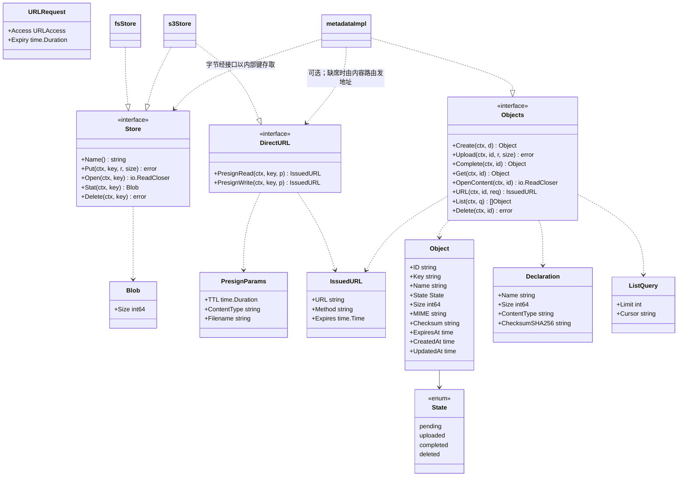
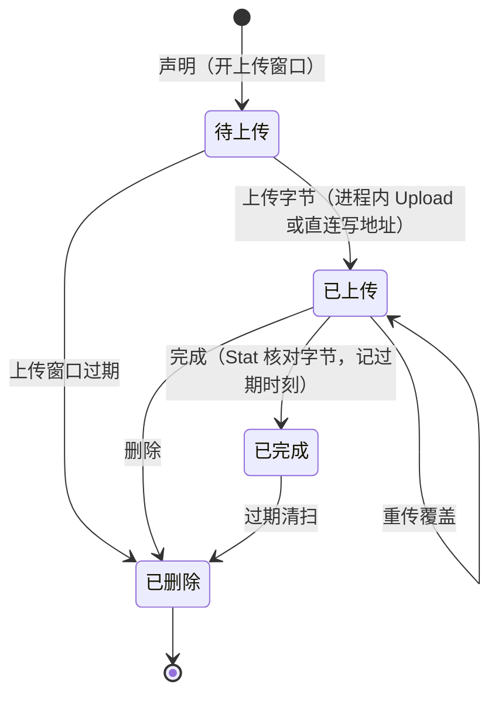

# objectstore

## 职责

本能力交付**对象的字节存取、元数据生命周期与直连地址**：一份字节连同它的元数据存下来，此后按标识读回、列举与删除，并可为业务前端铸出一条读写该字节的地址。字节的物理存放归一个**字节接口** `Store`，元数据、生命周期状态机与内容路由归一个**排他的模块** `objectstore.metadata`，它持有 `objects` 表与 `object_grants` 表，排他交付生命周期的接口 `Objects`。

本能力是给**业务后端**用的能力，不是给终端用户用的功能。业务后端在进程内经 `objectstore.Objects` 声明、上传、完成、取址、列举与删除；业务前端**从不**调用对象存储自己的结构化 API，只用一条直连地址读写字节（例如 ``）。一条直连地址在交给某个终端用户之前是否被允许，是**业务后端**的判断：本能力不拥有通用对象权限，只校验租户与对象状态。

一个对象经**声明**（落一行 `pending`，带上尺寸与内容类型的声明，开一个上传窗口）→ **上传**（字节经 `Store` 以内部键存下，状态转 `uploaded`；字节可以由业务后端经 `Upload` 送入，也可以由前端按直连写地址直传）→ **完成**（`Stat` 核对字节，状态转 `completed`）落地。字节与元数据分开存放：元数据在数据库里，字节在后端接口背后，两者各自由持有它的一方负责。

**字节与键是本模块自己的事。** 一份字节在后端里以一个**内部键**定位：键是**随机不透明串**，由本模块生成，不含租户标识与对象标识，**不出现在任何结构化应答、错误文本与日志**里。调用方拿到的是对象标识 `id`，不是键；`Store` 是字节进出的唯一通道，元数据模块不 import 任何后端 SDK。

**一条直连地址是后端铸出的不透明地址。** 调用方只能整体使用它，不得解析其内部结构；`s3` 的预签名地址必然在路径里带后端对象键，键本身随机不透明，地址因此不携带任何内部标识。既有对象的旧键保持有效，`fs` 的路径映射与 `s3` 的对象键都能处理两种键。

**一条地址是持有即可用的能力凭证**，到它的到期时刻为止：本能力不记录签发对象是谁，不做二次校验，不做单次使用限制，也没有撤销 API；轮换是再要一条。

**`Store` 的每个实现都排他交付**：一个进程里恰好一个生效，多于一个表态启用即启动失败（照 `pkg/sms` 的载体形态）。`fs` 落在本地目录，`s3` 落在 S3（[REF-amazon-s3](../../references.md)）兼容的对象存储；`s3` 另交付可选能力 `DirectURL`，`fs` 不交付。不装 `s3` 的装配不背那个 SDK（[architecture](../architecture.md) 不变量 11）。根包是接口包与公共类型，不登记模块（[ADR-objectstore-packaging](../../adr/adr-objectstore-packaging.md)）。

**HTTP 接口只有内容路由**：`metadata` 只挂 `/content`（GET/HEAD/PUT），且只在装配的字节后端不交付 `DirectURL` 时挂出（见「内容路由」与「装配契约」）。业务前端没有别的对象存储接口可调。

### 非职责

- **内容复验与净化流水线刻意后置。** 本模块**不做格式化解析、病毒扫描、重编码一类的净化**。刻意后置，不是漏项（[ADR-objectstore-scope](../../adr/adr-objectstore-scope.md)）。
- **缩略图派生刻意后置。** 本模块不从一个对象的字节派生缩略图或任何投影。刻意后置，不是漏项（[ADR-objectstore-scope](../../adr/adr-objectstore-scope.md)）。
- **不做终端用户授权判定，也不提供撤销。** 一条直连地址可以交给谁归业务后端判断；本模块只校验租户与对象状态，不声明权限点，不记录签发对象，也没有撤销 API。一条地址只因到期而死，删对象与清扫使既有地址立即读不到字节，那是生命周期的效应。
- **不解释对象的内容与用途。** `Object.MIME` 是不透明值，`Declaration.Name` 是调用方给的标签，本模块只把它规整后存下、不读它的含义；本模块不知道一份字节是票据、头像还是日志归档。
- **不认识内部键之外的存储布局。** 键的语法是本模块的私有约定；`fs` 与 `s3` 各自把它映射到自己的后端拼写（相对路径、对象键），映射细节不进接口，也不出现在任何应答里。
- **不写审计行。** 本模块在根包声明审计动作的类型名常量，由宿主在不可逆的迁移点显式把事件发上总线（见「审计动作」）；本模块只声明动作的名字，不写审计行，也不点审计模块为依赖。
- **不提供供终端用户调用的对象 CRUD 接口。** 本模块挂出的路由只有内容路由，它服务签名地址，不进 OpenAPI（[REF-openapi](../../references.md)）；声明、列举与删除都只在进程内经 `Objects` 调用。
- **不排队、不重试。** 一次上传与一次读取都是同步调用，`Store` 的方法在后端调用返回后才返回；后端不可达即那次调用失败，是否重试归调用方。
- **不保证多副本下的字节可见性。** `fs` 的字节只在本进程能到达的目录里；多副本共享一份字节要用 `s3`（见「后端适配」与「错误与失败语义」的非保证）。

## 外部接口契约

### 交付的功能

```go
// Store 是字节存取的接口：对象的字节经它进出。内部键由交付 Objects 的模块生成，
// 本接口不承诺它的语法，实现只按自身后端把它映射到位。
type Store interface {
    // Name 报告实现名，供诊断。
    Name() string
    // Put 在 key 下存入从 r 读到的 size 字节。实现可以拒绝长度与 size 不符的流：
    // 本地目录后端拒绝，S3 后端把 size 作为对象的 Content-Length。
    Put(ctx context.Context, key string, r io.Reader, size int64) error
    Open(ctx context.Context, key string) (io.ReadCloser, error)
    // Stat 在不读正文的前提下报告后端在 key 下持有的字节。后端在该键下没有字节
    // 时报一个包裹 ErrContentMissing 的错误；其它失败保留后端自己的错误。
    Stat(ctx context.Context, key string) (Blob, error)
    Delete(ctx context.Context, key string) error
}

// Blob 是后端对一个键下字节的观测。
type Blob struct {
    // Size 是后端持有的字节数。
    Size int64
}

// DirectURL 是「浏览器无需经过本进程即可取到字节」的能力。它是独立能力而不是
// Store 上的一个方法：字节落在哪里是每个后端的答案，浏览器从哪里取到它们是
// 一部分后端才有的答案。实现可声明交付它（Spec.Direct）。
type DirectURL interface {
    // PresignRead 给出一个地址，按给定的媒体类型与文件名提供 key 下的字节。
    // 不发网络调用：地址在本地签出。
    PresignRead(ctx context.Context, key string, p PresignParams) (IssuedURL, error)
    // PresignWrite 给出一个地址，客户端可以把 key 下的字节 PUT 上去。
    PresignWrite(ctx context.Context, key string, p PresignParams) (IssuedURL, error)
}

// PresignParams 是一条直连地址绑定的条件。ContentType 与 Filename 只对读地址
// 生效。
type PresignParams struct {
    // TTL 是请求的寿命。后端按它兑现的上限封顶，并在 IssuedURL.Expires 里
    // 报告实际授予的时刻。
    TTL         time.Duration
    ContentType string
    Filename    string
}

// URLAccess 是一条铸造出的地址允许持有者做的事。
type URLAccess string

const (
    URLAccessRead  URLAccess = "read"
    URLAccessWrite URLAccess = "write"
)

// URLRequest 是调用方要一条地址时陈述的条件。
type URLRequest struct {
    // Access 是这条地址移动字节的方向。
    Access URLAccess
    // Expiry 是调用方想要的寿命。为零取配置的寿命（objectstore.metadata.url-ttl）。
    // 正值只能缩短：交付模块把它夹到配置值、上传窗口或对象的剩余寿命、以及后端
    // 自身的上限。
    Expiry time.Duration
}

// IssuedURL 是一条直连地址与它被授予的条件。
type IssuedURL struct {
    // URL 是交给客户端的地址。
    URL string
    // Method 是持有者使用的 HTTP 方法：读地址是 "GET"，写地址是 "PUT"。
    Method string
    // Expires 是地址失效的时刻。
    Expires time.Time
}

type State string

const (
    StatePending   State = "pending"   // 已声明、上传窗口未关
    StateUploaded  State = "uploaded"  // 字节已到、待完成
    StateCompleted State = "completed" // 可用于读取
    StateDeleted   State = "deleted"
)

type Object struct {
    ID        string
    Key       string // 内部键，从不经 API 暴露
    Name      string // 调用方声明的标签，存入前已规整，可为空串
    State     State
    Size      int64
    MIME      string
    Checksum  string
    ExpiresAt *time.Time
    CreatedAt time.Time
    UpdatedAt time.Time
    // 租户列由内嵌的 tenant.Model 提供。
}

// Objects 是元数据与生命周期的接口，由 metadata 模块排他交付。
type Objects interface {
    Create(ctx context.Context, d Declaration) (Object, error)
    Upload(ctx context.Context, id string, r io.Reader, size int64) error
    Complete(ctx context.Context, id string) (Object, error)
    Get(ctx context.Context, id string) (Object, error)
    OpenContent(ctx context.Context, id string) (io.ReadCloser, error)
    // URL 为这个对象的字节铸一条直连地址。
    //
    // URLAccessRead 要求一个已完成且未过期的对象；URLAccessWrite 要求一个
    // pending 或 uploaded 且上传窗口仍开着的对象。
    //
    // 某个终端用户是否可以拿到这条地址是调用方的判断，在调用之前做出：本方法
    // 校验租户与对象状态，不涉及任何终端用户。铸出的地址在到期之前是持有即可用
    // 的凭证；本能力不为它保留签发对象的记录，也不提供撤销。
    URL(ctx context.Context, id string, req URLRequest) (IssuedURL, error)
    List(ctx context.Context, q ListQuery) ([]Object, error)
    Delete(ctx context.Context, id string) error
}

type Declaration struct {
    Name           string // 可省；存入前规整，从不使 Create 失败
    Size           int64
    ContentType    string
    ChecksumSHA256 string
}

type ListQuery struct {
    Limit  int
    Cursor string // 键集游标：上一页最后一行的 (created_at, id)
}

var (
    ErrObjectNotFound   error // 本租户看不见的对象：未知 id、他人租户、已删除，一律相同，不泄露存在性
    ErrStateConflict    error // 当前状态不允许这个动作
    ErrContentMissing   error // 后端在这个键下没有字节：行说完成而字节不在，或字节从未到达
    ErrStoreUnavailable error // 字节接口缺席或后端不可达
    ErrInvalidConfig    error // 配置跑不起来
    ErrInvalidRequest   error // 请求格式不合法；Complete 发现的字节长度不符也用它表达
    ErrURLUnavailable   error // 本进程铸不出地址：装配的后端不铸址，且本进程不服务内容路由
)
```

`Object.Checksum` 记录的是上传时算出的 SHA-256；`s3` 直连上传完成的对象在此为空串（字节不经过进程），`fs` 直连上传与进程内 `Upload` 会记录它。

`Objects` 由 `objectstore.metadata` **排他**交付，`Store` 由 `objectstore.fs` 或 `objectstore.s3` **各自排他**交付，`DirectURL` 由 `s3` 在交付 `Store` 的同时以同实例交付。租户一律取自 `ctx`（`tenant.FromContext`），`Objects` 的每个方法在无租户时以租户侧的错误拒绝，对象行内嵌 `tenant.Model`，语句过滤由名册模块交付的 GORM（[REF-gorm](../../references.md)）插件完成。

`Objects` 各方法的语义，约束的主体是交付 `Objects` 的模块：

- `Create` 校验 `Declaration`（`Size` 大于零、`ContentType` 非空、`ChecksumSHA256` 为空或 64 位十六进制），生成对象标识与随机内部键，落一行 `pending`，写 `name`、`declared_size`、`declared_type`、`declared_checksum` 与 `upload_expires_at = now + upload-window`，返回该对象。`Name` 不参与校验，按下文「名字的规整」存入。校验不过即 `ErrInvalidRequest`，不落行。
- `Upload` 取该行，要求状态为 `pending` 或 `uploaded`、上传窗口未关、`size` 参数等于 `declared_size`；字节经 `Store.Put(内部键, r, size)` 存下，同时以流式读出实际字节数与 SHA-256；声明了校验和而不符即拒绝；写 `size`、`checksum_sha256`、`mime`（取 `declared_type`），状态转 `uploaded`。前置不符答 `ErrStateConflict`（状态不符或窗口已关）或 `ErrInvalidRequest`（字节数与声明不符），均在写字节之前拦下。
- `Complete` 接受 `pending` 与 `uploaded`：先经 `Store.Stat(内部键)` 核对后端持有的字节数，不符即 `ErrInvalidRequest` 并尽力删掉字节、行保持原状态；字节不在后端即 `ErrContentMissing`；核对通过后条件 UPDATE 转 `completed`，写观测尺寸、`mime` 与按 `object-ttl` 算出的 `expires_at`。`completed` 原样返回该行、不改状态，也不再 `Stat`；`deleted` 与未知 id 答 `ErrObjectNotFound`。
- `Get` 返回该对象；`deleted` 与不存在相同，答 `ErrObjectNotFound`。
- `OpenContent` 只对 `completed` 开放（`pending`／`uploaded` 答 `ErrStateConflict`，`deleted` 答 `ErrObjectNotFound`），经 `Store.Open(内部键)` 返回字节的只读流，读取方负责关闭它；`Store` 里找不到该行的字节即 `ErrContentMissing`。
- `URL` 为一个对象铸一条直连地址：装配了 `DirectURL` 的后端直接给出预签名地址，本地目录后端给出本进程内容路由上的一条带令牌地址（见「直连地址的铸造」）。读地址要求状态 `completed` 且未过期；写地址要求 `pending` 或 `uploaded` 且上传窗口未关；状态不符答 `ErrStateConflict`，对象不可见答 `ErrObjectNotFound`，本进程铸不出地址答 `ErrURLUnavailable`。
- `List` 返回本租户**未删除**的对象，按 `(created_at, id)` 升序，取 `Limit` 行，游标见「列表的键集游标」。
- `Delete` 取该行，条件 `WHERE id = ? AND state <> 'deleted'`：任何未删除状态先经 `Store.Delete(内部键)` 删字节（`Delete` 幂等）、再把状态置 `deleted`；`deleted` 上重复调用匹配不到行、成功返回，不再删字节。

### 登记单元与名字

| 包 | 模块名 | 交付 | 排他 |
|---|---|---|---|
| `pkg/objectstore` | 不登记 | `Store`、`DirectURL`、`Objects` 接口与 `Blob`、`URLAccess`、`URLRequest`、`IssuedURL`、`PresignParams`、`State`、`Object`、`Declaration`、`ListQuery` 公共类型、审计动作类型名常量、工厂与哨兵 | — |
| `pkg/objectstore/metadata` | `objectstore.metadata` | `Objects`（元数据与生命周期接口）、直连地址的铸造、内容路由与 `object_grants` 表 | 排他 |
| `pkg/objectstore/fs` | `objectstore.fs` | `Store`（本地目录后端） | 排他 |
| `pkg/objectstore/s3` | `objectstore.s3` | `Store` 与 `DirectURL`（S3 兼容后端） | 排他 |

模块名照顶层能力：裸名 `objectstore`，叶子 `objectstore.<名>`，配置命名空间取同一取值（对照 `sms`/`sms.registry`、`kv`/`kv.redis`）。每个登记模块的包导出自己的 `ModuleName` 常量。

**`DirectURL` 是可声明的可选能力，不是 `Store` 的必选方法，也不是裸类型断言。** 一个后端在它的 `Spec` 里把 `Direct` 置真，工厂便把 `DirectURL` 与 `Store` 一并声明为交付；实例仍是 `Open` 返回的同一个值，同时实现两个接口（与 `pkg/sms`、`pkg/authz/policy`、`pkg/audit/journal` 的「一模块一实例多 token」一致），`core.assertDelivered` 在构造时逐一校验。

**`fs` 不 import 任何对象存储 SDK，也不认识 URL。** 它的依赖只有标准库与根包，因此一个只用本地目录的装配不背任何 SDK；它不 import `pkg/http`、不持有任何密钥、不交付 `DirectURL`。**`s3` 绑它自己的 SDK**（`github.com/minio/minio-go/v7` v7.3.0 及其 `pkg/credentials` 子包，[REF-minio-go](../../references.md)），SDK 只被 `pkg/objectstore/s3` 这一个实现子包 import，不进根包、不进 `fs`，也不进 `metadata`。

`fs` 与 `s3` 都排他：一个进程里恰好一个 `Store` 生效，多于一个表态启用即在消解阶段以排他冲突失败，宿主在命令树上点名其一。`metadata` 排他交付 `Objects`，它对 `Store` 的依赖是**必需**的——一个 `Store` 都没纳入的装配里，该功能缺提供者、启动失败；`DirectURL` 是可选依赖，缺席时地址改由内容路由发出。

### 审计动作

本模块在根包声明审计动作的**事件类型名常量**：

```go
const (
    EventObjectCreated   = "objectstore.object.created"
    EventObjectCompleted = "objectstore.object.completed"
    EventObjectDeleted   = "objectstore.object.deleted"
)
```

审计动作**不是资源**。发布方在自己包里声明类型名常量并把事件发上总线；审计模块用配置项（`events []string`）点名它要看的类型名，**从不推断、不支持通配**。**本模块不发布这些事件，也不写审计行**：它只声明动作的名字，由**宿主**在自己的代码里、在不可逆的迁移点显式把对应事件发上总线——一个对象已落下 `pending` 行、一个对象已可读、一个对象已不可恢复。点了名而发布方不发即静默不审计，没有任何一层会报错。因此本模块不点 `pkg/event`、不点 `pkg/audit` 为依赖。

### 内容路由

内容路由是本进程为本地目录后端发出的直连地址所服务的接口：一条地址就是 `/content` 加查询串里的一个令牌。

| 方法 路径 | 处理器 | 用途 |
|---|---|---|
| `GET /content?t=<token>` | `serveRead` | 读一个已完成对象的字节 |
| `HEAD /content?t=<token>` | `serveRead` | 同 `GET`，无正文 |
| `PUT /content?t=<token>` | `serveWrite` | 把一个前端直传的字节写进待完成的对象 |

**令牌固定在查询串。** `pkg/http` 的访问日志无条件记录 `r.URL.Path`（`pkg/http/accesslog.go`），路径里的凭据会进日志，查询串不会。路径常量是 `contentPath = "/content"`，参数名是 `contentTokenParam = "t"`。

内容路由挂在 `objectstore.metadata.content-endpoints` 点名的端点上，端点名按既有规则校验（具体名、不收 `*`、不重复、空清单在有路由器且后端不交付 `DirectURL` 的装配里失败）。这个端点**必须匿名**：浏览器 `` 既带不了 Authorization 也带不了租户头，令牌本身就是凭据。

读应答的响应头：`Content-Type` 取对象行里的 `mime`（空则 `application/octet-stream`）；有名字时 `Content-Disposition` 取 `mime.FormatMediaType("inline", map[string]string{"filename": row.Name})`（RFC 6266／5987 的 `filename*` 由标准库生成，绝不裸拼，[REF-rfc6266](../../references.md)、[REF-rfc5987](../../references.md)）；`Cache-Control: private, max-age=<剩余秒>`；`X-Content-Type-Options: nosniff`；`Content-Security-Policy: sandbox`；`Referrer-Policy: no-referrer`。写应答成功为 204，并带 `Cache-Control: no-store`，所有应答都带这一条。

**内容路由不进 OpenAPI。** 它服务签名地址，不是客户端 API；发布进契约只会生成让调用方自己造 URL 的 SDK 操作。

### 宿主可见的接口

以下是宿主写进配置文件或设置存储、或在命令树上点名的接口。

- **模块名**：`objectstore.metadata`、`objectstore.fs`、`objectstore.s3`。宿主的命令树点模块名纳入，配置与设置的命名空间取同一取值；`fs` 与 `s3` 二选一纳入（都排他）。
- **配置命名空间与输入项**：`objectstore.metadata` 下的 `content-endpoints`（字符串列表，只收具体端名、不收 `*`、不重复；有路由器且装配的后端不交付 `DirectURL` 时必填，空清单即 `Init` 启动失败；后端交付 `DirectURL` 时不被读取）、`public-url`（字符串，铸造地址时拼在前面的外部源，无尾斜杠，空则产出根相对地址）、`sweep-interval`（时长，缺省 `1m`，`≤0` 即关闭清扫，取主配置源）；`objectstore.fs` 下的 `root`（字符串，必填，本地目录，取主配置源）；`objectstore.s3` 下的 `endpoint`、`region`、`bucket`、`access-key`、`secret-key`、`use-path-style`（布尔）。
- **设置命名空间与输入项**：`objectstore.metadata` 下的 `upload-window`（时长，缺省 `15m`，须至少 1 毫秒，每次 `Create` 读取）、`object-ttl`（时长，缺省 `0` 即完成后的对象不过期，须为 0 或至少 1 毫秒，每次 `Complete` 读取）与 `url-ttl`（时长，缺省 `5m`，取值域 `1s ≤ d ≤ 168h`，每次 `URL()` 读取）。各项以毫秒存读，更短的正值会截断为零。设置缺席时取声明默认值；读取失败或取值越出取值域时取声明默认值并记一行 `Error`。这些设置是普通调参，没有放宽监视。
- **内容路由**：`/content` 下的 `GET`、`HEAD`、`PUT`，令牌在查询串。
- **审计动作的类型名**：`objectstore.object.created`、`objectstore.object.completed`、`objectstore.object.deleted`，由宿主发上总线、由审计模块的 `events` 配置项点名。
- **装配约束**：`metadata` 对 `(*objectstore.Store)(nil)` 的依赖是必需的，装配里恰好一个 `Store` 实现；`(*objectstore.DirectURL)(nil)` 是可选依赖。

### 装配契约

宿主装配一个能发出直连地址的进程时，下列各条都是必需的。没有编译期护栏，正确性由启动诊断与这份清单承载。

1. `http.endpoints` 新增一个**专用**端点（示范叫 `content`），前缀覆盖 `/content`，`max-body-bytes: 0`（缺省的 1 MiB 会把大文件直传一律 413）：

```yaml
http:
  endpoints:
    content:
      listener: backend
      prefixes: ["/content"]
      max-body-bytes: 0
```

2. `objectstore.metadata.content-endpoints: [content]`。装配的后端交付 `DirectURL` 时这一项不被读取。
3. 该端点**必须不出现在** `authn.gate.endpoints`、`tenant.resolve.endpoints`、`tenant.admission.endpoints`、`authz.guard.endpoints`、`ratelimit.endpoints`、`audit.journal.endpoints` 里：写进认证、租户解析、租户准入或授权守卫会阻断匿名请求，写进限流会按图片计数，写进审计会给每张图片记一行。这些层都是端点级、没有按路由豁免。
4. 跨源部署：设 `objectstore.metadata.public-url`，把该端点加进 `http.cors.endpoints`；`s3` 部署给桶配 CORS（[REF-whatwg-fetch](../../references.md)）（允许前端来源的 `GET`、`HEAD`、`PUT`，暴露 `ETag`）。
5. 端点前缀必须覆盖 `/content`：没被任何 claim 覆盖时入口模块以 `ErrUnclaimedRoute` 启动失败。它与 `web` 的 `"/"` 冲突由最长前缀胜出解决，宿主自定前缀时要保证比 `"/"` 更具体。

`Init` 写一条启动诊断：挂了哪些端点，或「后端直接铸址，内容路由未挂载」。

### 对外接口

- `Store`、`DirectURL`、`Objects`、`Blob`、`PresignParams`、`URLAccess`、`URLRequest`、`IssuedURL`、`State`、`Object`、`Declaration`、`ListQuery` 的字段与方法集，以及本能力的全部哨兵，是与调用方之间的接口。加方法、改签名或改字段名对实现了接口的后端、对取用它们的调用方都是不兼容变更；`Store` 的 `Stat` 是新增的必需方法，本仓之外的自定义实现编译期即失败。
- `Object` 的字段语义：`ID` 是对象标识、`Key` 是内部键、`State` 取 `pending`／`uploaded`／`completed`／`deleted` 之一、`Size` 与 `Checksum` 是上传后记录的实际值（`s3` 直连上传的 `Checksum` 为空串）、`MIME` 是内容类型、`ExpiresAt` 可空。
- **内部键从不经 API 暴露。** `Object.Key` 是模块的内部字段（导出，但不进任何对外接口）：它不进任何外部可见的接口，不进错误文本，日志里也不记它（日志以对象标识或该键的截断摘要指认对象）。改键的语法是内部变更，不影响调用方。`Store` 的 `key` 参数同样是内部键，接口不规定它的语法，实现只按自身后端把它映射到位。
- **一条直连地址是一个不透明值。** 调用方只能把 `IssuedURL.URL` 与 `IssuedURL.Method` 整体交给客户端，不得解析、拼接或改写地址的内部结构；`s3` 的地址在路径里带对象键，`fs` 的地址在查询串里带令牌，两处都是本能力自己的约定。
- 单个 `Store` 实现、`metadata` 模块各自可替换、可撤掉，不改变调用方的代码。

### 哨兵错误

| 哨兵 | 定义处 | 含义 |
|---|---|---|
| `ErrObjectNotFound` | `pkg/objectstore` | 本租户看不见的对象：未知 id、他人租户、已删除，一律相同，不泄露存在性 |
| `ErrStateConflict` | `pkg/objectstore` | 当前状态不允许这个动作：未上传就取读址、已完成就取写址、上传窗口已关 |
| `ErrContentMissing` | `pkg/objectstore` | 后端在该键下没有字节：行说完成而字节不在，或 `Complete` 与 `Stat` 遇到字节从未到达 |
| `ErrStoreUnavailable` | `pkg/objectstore` | 字节接口缺席或后端不可达 |
| `ErrInvalidConfig` | `pkg/objectstore` | 配置跑不起来：输入项缺失、取值不可用，或模块与自身性质不符 |
| `ErrInvalidRequest` | `pkg/objectstore` | 请求格式不合法：`Declaration` 的格式不合法、一次上传的字节数与声明不符，或 `Complete` 发现的字节长度不符 |
| `ErrURLUnavailable` | `pkg/objectstore` | 装配铸不出地址：装配的后端不铸址，且本进程不服务内容路由 |

调用方以 `errors.Is` 判别，包裹一律用 `%w`。一次字节操作失败若带后端自家的错误，`metadata` 把它连同 `ErrStoreUnavailable` 一并收口成 503。错误文本不携带内部键与令牌，也不复述凭据。

## 依赖

| 依赖 | 用途 |
|---|---|
| `pkg/core` | 登记描述符、交付功能、声明资源 |
| `pkg/config` | 声明各模块的输入项 |
| `pkg/settings` | `objectstore.metadata`：可选，声明并读取设置项 `upload-window`、`object-ttl` 与 `url-ttl` |
| `pkg/db` | `objectstore.metadata`：`objects` 与 `object_grants` 表及其迁移 |
| `pkg/tenant` | `objectstore.metadata`：租户上下文、内嵌的 `tenant.Model`、语句过滤插件与 `Enter` |
| `pkg/log` | `objectstore.s3` 直接 import；工厂取可选 `log.Logger`、以模块名绑定后交给 `Open`，实现持有它并记录每一次出站调用；工厂在 `New` 里登记各后端凭据的字面量脱敏匹配器；`metadata` 记诊断 |
| `pkg/internal/literal` | 构造并登记字面量匹配器（各后端的凭据） |
| `pkg/http` | `objectstore.metadata`：可选，入口模块的端点与路由接口，挂内容路由 |
| `github.com/gin-gonic/gin`（[REF-gin](../../references.md)） | `objectstore.metadata`：处理器签名 |
| S3 SDK | 只被 `pkg/objectstore/s3` import |

**根包依赖 `pkg/core`、`pkg/config`、`pkg/internal/literal` 与可选的 `pkg/log`，不 import 任何对象存储 SDK，也不 import `pkg/http`、`pkg/db`、`pkg/tenant` 或 `pkg/authz`。** 工厂与公共类型都在根包，它经 `pkg/internal/literal` 登记字面量脱敏匹配器、取可选 `pkg/log` 的 logger（照 `pkg/sms/module.go` 的先例）；对象存储 SDK 只落在 `s3` 实现子包。方向是 `metadata` import `pkg/db`、`pkg/tenant`、`pkg/http` 的接口包与 gin，`fs` 只 import 标准库与根包，`s3` import 根包、`pkg/log` 与它自己的 SDK；根包不 import `metadata`、`fs`、`s3` 中的任何一个。

**`s3` 的 SDK 落在绑定它的实现子包。** 根包与 `fs` 的传递闭包不含任何对象存储 SDK，也不含 `pkg/db`、`pkg/authz` 这类上层功能目录；这条由 `pkg/objectstore/deps_test.go` 的守卫守住（照 `pkg/sms/deps_test.go` 的形态），并守住 `fs` 不引入 SDK 与 `pkg/http`。

**`pkg/internal/literal` 是共享单元。** `s3` 经工厂的 `Secrets` 钩子交出凭据，工厂经 `pkg/internal/literal` 登记为日志的字面量脱敏匹配器；它与 SMS 载体、认证的登录叶子共用这一单元（[ADR-shared-backend-unit](../../adr/adr-shared-backend-unit.md)）。`s3` 因而不 import `literal`，只交出凭据字符串。

## UML 图

本能力的结构是一个字节接口、一项可选的直连能力与一个生命周期接口，以及它们各自的实现。图里的约束不在图中：`fs` 与 `s3` 之间是**互斥**的，`metadata` 排他交付 `Objects`——图上看不出这一点，因为排他性由描述符声明、由消解阶段裁定，不是类型之间的关系。`metadata` **不 import 任何后端实现子包**，只经根包的 `Store` 与 `DirectURL` 接口触达字节；`DirectURL` 缺席时由 `metadata` 自己的内容路由发地址。



有生命周期的实体是对象本身，它的状态机如下。上传的两个入口——业务后端的 `Upload` 与前端对直连写地址的 `PUT`——落到同一行状态；上传窗口过期与过期清扫都由 `metadata` 模块自己的清扫 ticker 驱动。删除是一条从任何未删除状态通向 `deleted` 的边，图中只画出自 `已上传` 出发的一条代表它，不重复画出。`deleted` 是墓碑：元数据行保留 `state = deleted`，字节已从后端删去。



## 核心数据结构

**`objects` 表**，一行一个对象，租户作用域，内嵌 `tenant.Model`（约定列名 `tenant_id`）。行的读与写都在数据库自己的事务里；语句的租户过滤由名册模块交付的 GORM 插件完成。

| 列 | 含义 |
|---|---|
| `id` | 对象标识，主键，应用生成 |
| `tenant_id` | 租户列，由内嵌的 `tenant.Model` 落地 |
| `key` | 内部键，模块生成的随机不透明串；从不经 API 暴露 |
| `name` | 调用方声明的标签，规整后存入，可为空串；不唯一，不用于查找 |
| `state` | `pending`／`uploaded`／`completed`／`deleted` 的闭集 |
| `declared_size` | 声明里的大小 |
| `declared_type` | 声明里的内容类型 |
| `declared_checksum` | 声明里的 SHA-256，可空 |
| `size` | 上传后读出的实际字节数 |
| `mime` | 上传后记下的内容类型，取 `declared_type` |
| `checksum_sha256` | 上传时流式计算出的 SHA-256；`s3` 直连上传的为空串 |
| `upload_expires_at` | 上传窗口的关闭时刻，声明时写下 |
| `expires_at` | 对象的过期时刻，完成时按 `object-ttl` 写下，无 TTL 时为空 |
| `created_at`、`updated_at` | 行的时间戳 |

本模块在 `objects` 表上建索引：`(tenant_id, created_at)` 服务 `List` 的键集游标；`upload_expires_at` 与 `expires_at` 各一条服务过期清扫。

**内部键是两段随机十六进制：`<8 hex>/<32 hex>`，128 位随机。** 它只由 `metadata` 生成、只交给字节接口，受 `checkSegment`／`keyMaxLen` 的可映射检查约束。键不含租户标识与对象标识，一条外泄的预签名地址因此不携带任何内部标识；既有行的旧键保持有效，两种键 `fs` 的路径映射与 `s3` 的对象键都能处理，无需回填。

**`object_grants` 表**，一行一条内容路由的令牌授权，租户作用域，内嵌 `tenant.Model`。模型的主键一部分是 `token_hash`，跨租户按 `token_hash` 查询走该列上的唯一索引。

| 列 | 含义 |
|---|---|
| `tenant_id` | 租户列，由内嵌的 `tenant.Model` 落地 |
| `token_hash` | 明文令牌的 SHA-256，小写十六进制；主键一部分，另有唯一索引 |
| `object_id` | 对象标识 |
| `use` | `read`／`write` 的闭集 |
| `expires_at` | 令牌的到期时刻 |
| `created_at` | 令牌的签发时刻 |

另有 `expires_at` 上的索引服务清扫。**令牌是 `crypto/rand` 的 32 字节，`base64.RawURLEncoding` 编码为 43 个字符；库里只存它的 SHA-256 小写十六进制，明文令牌从不落库。** 不签名，只存行：没有密钥，因此没有首启造钥、没有轮换、没有多副本共享密钥，也没有「换密钥作废在途地址」这件事。

**首次读表不得早于 `Init`。** `New` 早于 `Migrate`，`New` 里这些表还不存在，本模块因此不在 `New` 读表；路由在 `Init` 里只登记、不读表。第一次读表落在 `Start`：清扫的第一次 pass。清扫关闭（`sweep-interval ≤ 0`）时，第一次读表是 `Serve` 阶段的第一条请求。

**名字在入口规整一次。** `Create` 把声明的 `Name` 规整后写入 `name`，之后的每个读取方拿到的都是同一个值。存入的值满足：合法 UTF-8；不含 Unicode 类别（[REF-unicode-uax44](../../references.md)）为 Cc、Cf、Zl、Zp 的字符（控制字符、格式字符含方向控制与零宽字符、行分隔符与段分隔符），这些字符被丢弃；不含 `/` 与 `\`，它们被替换为 `_`；首尾无空白；至多 255 字节且不在字符中间截断，截断之后再去一次首尾空白；不是只由 `.` 组成，那样的名字存为空串。省略、空串与规整后为空同义，都存为空串。规整不去掉引号与分号，不检查扩展名，不保留末尾的扩展名。`name` 没有观测值一侧，`Object` 交出的就是存入的值；既有行的 `name` 为空串。

**声明里的值与上传后记下的值并存。** `declared_size`、`declared_type`、`declared_checksum` 是调用方在声明时给的；`size`、`mime`、`checksum_sha256` 是上传时模块自己读出的。两者分列存放，本模块因此能在完成时看出后端持有的字节数与声明不符，又不把声明值改写成观测值。`Object` 交出的是观测值一侧。

## 核心算法与流程

### 对象生命周期（直传）

1. **声明**：业务后端 `Create(Declaration{Name, Size, ContentType, ChecksumSHA256})` → `pending` 行、随机内部键、上传窗口。
2. **取写址**：业务后端鉴权通过后 `URL(id, URLRequest{Access: URLAccessWrite})`。地址绑定到**对象标识**（因而绑定它的租户、`declared_size`、`declared_type`）与到期时刻，不绑定一次内容哈希。
3. **前端直传**：浏览器对该地址发一次普通 `PUT`，body 就是文件。`fs` 走 `/content?t=…`，按声明尺寸精确限流，超或欠都是 400 且不留半份字节，`Content-Type` 请求头被忽略、MIME 一律取声明值；`s3` 走预签名 PUT，字节不经本进程，长度在服务端不可约束。
4. **完成**：`Complete(id)` 先 `Stat` 再看状态，见「Complete 的字节核对」。
5. **取读址**：业务后端判定某个终端用户可读后 `URL(id, URLRequest{Access: URLAccessRead})`；只对 `completed` 且未过期的对象发得出。
6. **前端直读**：浏览器 `GET`（`` 或 `fetch`）。
7. **删除与过期**：`Delete` 先删字节再墓碑；清扫按 `upload_expires_at`／`expires_at` 处置，并顺手删过期授权行。删对象使既有地址立即 404（内容路由每次都重读对象状态），这是生命周期的效应，不是撤销 API。

**校验和的界限**：`fs` 直传与进程内 `Upload` 的字节经过进程，边写边算 SHA-256，声明了校验和就比对；`s3` 直传没有字节流，`checksum_sha256` 留空，声明的校验和无法核对。需要内容级保证的业务走进程内 `Upload`，或自己下载复算。任何路径都不为核对而整份重读。

### 直连地址的铸造

`URL()` 的输入是对象标识与 `URLRequest`，输出是一条 `IssuedURL`。读址与写址共用同一条路径，只在状态判定与地址来源上不同：

1. `Access` 只接受 `read`／`write`，否则 `ErrInvalidRequest`；`Expiry < 0` 同理。
2. 按租户取行；未知、他人租户、已删除 → `ErrObjectNotFound`。
3. 有效期取 `Expiry`（为零取设置 `url-ttl`）、对象剩余寿命或上传窗口剩余、后端上限三者的最小值：一个正值只能缩短，不能放大配置值；`s3` 与 `fs` 的上限都是 7 天（`minio-go` 的预签名边界是 600 秒到 604800 秒，`fs` 守同一边界，过期语义因此一致）。
4. **读**：状态必须 `completed`，否则 `ErrStateConflict`；有 `expires_at` 时剩余寿命不足 1 秒即 `ErrObjectNotFound`（等同已过期）。
5. **写**：状态必须 `pending` 或 `uploaded`，否则 `ErrStateConflict`；上传窗口剩余不足 1 秒即 `ErrStateConflict`。
6. 装配了 `DirectURL`：读地址调 `PresignRead`，带上 `mime` 与 `Name`；写地址调 `PresignWrite`。后端直接返回它的 `IssuedURL`；后端失败包装为 `ErrURLUnavailable`。
7. 否则由内容路由发地址：内容路由没有挂载 → `ErrURLUnavailable`；挂载了就铸一个令牌，插入一行 `object_grants`（`use` 取这次铸址的方向，`expires_at` 取当前时刻加有效期，插入失败 → `ErrStoreUnavailable`），返回 `IssuedURL{URL: publicURL + "/content?t=" + token, Method: "GET" 或 "PUT", Expires: 到期时刻}`。`publicURL` 去掉尾斜杠；为空时得到根相对地址 `/content?t=…`，同源部署直接可用。

### 内容路由的处理顺序

读与写共用令牌校验与租户进入，之后按方向分开。令牌缺失或不是 43 个 base64url 字符即 404，不说明原因。

1. 在 `tenant.CrossTenant(ctx)` 下按 `token_hash` 查授权行，同一条语句用数据库时钟算出 `live = expires_at > now`；无行 → 404。
2. 方法 ↔ `use` 不符（GET／HEAD 只认 `read`，PUT 只认 `write`）→ 404。
3. 令牌已过期 → 410 Gone。
4. `catalog.Enter(ctx, row.TenantID)`：未知或停用租户 → 404；名册读失败 → 503。
5. 在进入后的上下文里按租户作用域加载对象行：无行或 `deleted` → 404。

**读**：状态不是 `completed` → 404（读路径不泄露状态机）。经 `Store.Open` 打开字节：`ErrContentMissing` → 404，其它失败 → 503。流实现 `io.ReadSeeker` 时（`fs` 的 `*os.File` 是）用 `http.ServeContent` 应答，自带 Range、HEAD 与 `Content-Length`；否则写出 `Content-Length` 全量拷贝并标 `Accept-Ranges: none`。响应头见「内容路由」。

**写**：状态 `completed` → 409，`pending`／`uploaded` 继续；上传窗口已关（`upload_expires_at` 已过）→ 410。`Content-Length` 缺失（分块传输）→ 411；不等于 `declared_size` → 400。与进程内 `Upload` 共用同一条流式写入：经一个边读边算 SHA-256 的读取器写入 `Store.Put`，条件推进到 `uploaded`（记观测尺寸与 SHA-256，`mime` 取 `declared_type`）；声明了校验和而不符即尽力 `Store.Delete` 并答 400。成功 204。

后端失败 → 503；错误体一律为空或最小 problem，不写内部键、不写令牌。

### Complete 的字节核对

`Complete` 接受 `pending` 与 `uploaded`；`completed` 原样返回该行（幂等，不 `Stat`）；`deleted` 与未知 id 答 `ErrObjectNotFound`。

```text
blob, err := Store.Stat(ctx, row.Key)
  ErrContentMissing → ErrContentMissing（字节从未到达）
  其它 err          → ErrStoreUnavailable
blob.Size != row.DeclaredSize
  → 尽力 Store.Delete（失败只记 Warn，留给清扫）；ErrInvalidRequest；行保持原状态
通过 → 条件 UPDATE state='completed', size=blob.Size, mime=declared_type,
        expires_at = now + object-ttl（0 则空）, updated_at
        WHERE id = ? AND state IN ('pending','uploaded')
       RowsAffected == 0 → ErrStateConflict
```

`checksum_sha256` 不在这里改动：进程内 `Upload` 与 `fs` 直传已写入，`s3` 直传留空。

### 列表的键集游标

`List` 按 `(created_at, id)` 升序返回本租户未删除的对象。`ListQuery.Cursor` 是上一页最后一行的 `(created_at, id)` 的编码，空游标即首页。一次查询取 `Limit` 行（缺省 50、上限 200，超出上限即拒绝、不静默截断），谓词与排序都走 `(tenant_id, created_at)` 索引。键集游标在并发写下稳定：新行按 `created_at` 排在已翻过的页之后，不会挤进更早的页；一个对象被删除后从后续页里消失，不需要重排。`Cursor` 对调用方是不透明字符串，它的编码是本模块的内部约定。

### 过期清扫的 ticker

`metadata` 模块在 `Start` 起一个 ticker、`Stop` 停，间隔取 `objectstore.metadata.sweep-interval`，**`≤0` 即关闭**（与既有各模块自起的 ticker 一致：间隔 `≤0` 关掉，失败只 `Warn`，各自持有停机制约）。每 tick 跑一次清扫 pass：

- `pending` 且 `upload_expires_at < now`：窗口已关。**不能假定后端没有字节**——一次 `Put` 成功而置行失败的上传会让字节暂留在后端——所以先经 `Store.Delete(内部键)` 删字节（`Delete` 幂等），再把行置 `deleted` 墓碑。
- `completed` 且 `expires_at` 非空且 `< now`：先经 `Store.Delete(内部键)` 删字节（`Delete` 幂等），再把行置 `deleted` 墓碑。
- 删掉 `expires_at < now` 的授权行。正确性不依赖这一条（每次使用都比对到期），它只负责让表不无限增长。

一次 pass 的读与写都在数据库自己的事务里，`Store.Delete` 在数据库事务之外发出（后端不在数据库事务里）。删除字节失败只记 `Warn`、行不动，下一个 pass 重试。时间判定取**数据库的时钟**。同一行上的两次清扫、清扫与并发的 `Delete` 之间以行的状态为条件（`WHERE id = ? AND state <> 'deleted'`），因此幂等。清扫与授权行查找是跨租户的读，二者都不接受请求方指定的租户。

### 工厂的构造次序

`fs` 与 `s3` 各自的工厂收编一份公共接线（照 `pkg/sms` 的 `Spec` 与 `NewModule` 形态），实现只提供自己的类型参数、配置原型、输入项、表态、凭据与打开函数：

```go
type Spec[C any] struct {
    ModuleName      string
    ConfigNamespace string
    Config          *C
    Items           map[string]config.Item
    Stance          func(cfg *C) (core.Enablement, error)
    Secrets         func(cfg *C) []string      // 凭据：登记为日志的字面量脱敏匹配器
    Open            func(ctx context.Context, cfg *C, logger *slog.Logger) (Store, error)
    // Direct 表示 Open 返回的值也实现 DirectURL。工厂据此把这条能力与字节接口
    // 一并声明，装配能解析到它，交付校验也覆盖它。
    Direct bool
}
```

交付排他：`Provides` 排他 `(*Store)(nil)`；`Direct` 为真时追加 `{Token: (*DirectURL)(nil), Exclusive: true}`，实例仍是 `Open` 返回的同一个值。`Requires` 可选 `log.Logger`。阶段行为如下：

| 阶段 | 行为 |
|---|---|
| `Prepare` | `Decode` 自己那份配置；读出后调 `Stance`，与自身性质不符即启动失败，错误点名缺的是哪一项 |
| `New` | `Decode` 配置 → 调 `Secrets` 并经 `pkg/internal/literal` 登记字面量脱敏匹配器 → 取可选 `log.Logger` 并以模块名绑定 → 把该 logger 交给 `Open` 建立后端 |

**次序固定：先登记脱敏字面量，再绑定任何带属性的 logger，最后 `Open`。** 日志脱敏规则只对它注册之后写出的记录起作用，所以凭据的登记必须发生在实现把任何属性绑到 logger 之前。`Secrets` 钩子把「凭据先登记」这一步收进工厂，实现因此不 import `literal`，只交出凭据字符串。`fs` 不承载凭据，`Secrets` 交回空。

**实现把外部调用记在工厂交给它的 logger 上，不从操作的 context 取。** 工厂的后台清扫用自己创建的 context 调 `Delete`，那个 context 没有注入 logger；`log.FromContext` 会把这条路径的记录落到进程默认链上，配置的目的地看不到。模块 logger 还使每条记录带上模块属性，无论调用由哪个 context 驱动。

### 后端适配

**`fs` 落在本地目录。** 根路径来自 `objectstore.fs.root`。内部键当相对路径拼到根下，映射经 `os.Root`，路径越界由它兜底。

- `Put` 是**精确尺寸加原子替换**，进程内 `Upload` 与内容路由的直传共用它，直传因此天然不会留下半份字节：先在目标同目录写临时名 `<name>.part-<random>`；`io.CopyN` 读恰好 `size` 字节，计数不符（源提前结束）即删临时文件并答 `objectstore.ErrInvalidRequest`；`root.Rename` 原子替换目标名；任何失败删临时文件并原样外传。
- `Stat` 报出键映射到的文件大小，文件不存在答一个包裹 `objectstore.ErrContentMissing` 的错误。
- `Open` 打开该路径只读并返回正文流；`Delete` 删除该路径，幂等。
- `Name()` 报告实现名，供诊断。`fs` 不 import 任何对象存储 SDK，依赖只有标准库的 `os`、`io`；不认识 URL、不持有任何密钥，`Direct` 为假。

**`s3` 绑 S3 兼容的对象存储。** 配置项：`endpoint`、`region`、`bucket`、`access-key`、`secret-key`、`use-path-style`。SDK 是 `github.com/minio/minio-go/v7` v7.3.0 及其 `pkg/credentials` 子包，只被这个实现子包 import。`Put` 以内部键为对象键调用 `PutObject`（`size` 作为对象的 `Content-Length`），`Open` 用 `GetObject` 返回对象正文的只读流，`Delete` 用 `RemoveObject`（S3 的 `DeleteObject`）。`endpoint` 与 `use-path-style` 一起把客户端指向自建或云上的 S3 兼容服务，`region` 由 SDK 用于签名。`access-key` 与 `secret-key` 是凭据，由 `Secrets` 钩子交出、在 `New` 里先于 logger 绑定登记为日志的字面量脱敏匹配器（见「工厂的构造次序」）。

`s3` 用 `Spec.Direct` 声明交付 `DirectURL`，`Open` 返回的 `*store` 同时实现 `Store` 与 `DirectURL`：

- `Stat` 调 `StatObject`；服务答 `NoSuchKey`／`NoSuchObject` 或状态 404 时包装 `objectstore.ErrContentMissing`，其余错误原样外传。
- `PresignRead` 调 `PresignedGetObject`，把 `ContentType` 与 `Filename` 作为 `response-content-type` 与 `response-content-disposition` 签进地址；名字为空时整条响应头不带。`contentDisposition` 用 `mime.FormatMediaType("inline", …)`。
- `PresignWrite` 调 `PresignedPutObject`；不签任何请求头（`Content-Length` 无法用预签名 PUT 表达，尺寸由 `Complete` 的 `Stat` 兜住）。
- `TTL` 超出 `[1s, 7d]` 时答 `objectstore.ErrURLUnavailable`，不让 SDK 的错误原样逃逸。
- 地址在本地签出，不发网络调用。

### 出站调用的记录

**每一次向外部服务发出的调用写一条记录，成功与失败各一条。** `objectstore.s3` 的 `Put`、`Open`、`Stat`、`PresignRead`、`PresignWrite` 与 `Delete` 在调用前后取时间，经**模块自己的 logger** 写出记录：工厂在 `New` 里取可选 `log.Logger`、以模块名绑定后交给 `Open`，实现持有它。操作的 context 不参与——工厂的后台清扫用自己创建的 context 调 `Delete`，那个 context 没有注入 logger，`log.FromContext` 会把这条路径落到进程默认链上，配置的目的地看不到。`Open` 的请求在交回字节流之前以一次 `Stat` 落地，该次调用的成功与失败各有一条记录。`objectstore.fs` 只访问本地目录，没有出站调用，不写这类记录。

| 字段 | 取值 |
|---|---|
| `operation` | `put`、`open`、`stat`、`presign-read`、`presign-write`、`delete`，或 `Open` 之后正文读取失败时的 `read` |
| `bucket` | 配置的桶 |
| `key_hash` | 内部键 SHA-256 的前十二位十六进制 |
| `size` | `put` 的声明长度、`open` 读到的对象长度；`stat`、`presign-read`、`presign-write`、`delete` 与 `read` 没有这一项 |
| `duration_ms` | 从发出调用到它返回的毫秒数；`read` 行从第一次读取起算，到读取失败为止 |
| `outcome` | 成功 `ok`，失败 `failed` |
| `cause` | 失败时的分类：服务应答的错误码，或无应答时剥去内部键的传输错误文本 |
| `http_status` | 失败且服务有应答时的状态码 |

**内部键本身、对象的字节、凭据与返回的地址都不进记录。** 一条预签名地址带着对象键与 access-key 标识，记下它等于记下一条能力凭证。`key_hash` 足以把指向同一对象的多次调用关联起来，不能用来寻址该对象。服务应答按错误码记录而不按消息记录——服务可能把键回显进消息；其余错误文本在写出之前把内部键及其 URL 转义形式（路径转义与查询转义）替换掉，因为 SDK 会在服务消息与传输错误的 URL 里重复这个键。

**`Open` 之后的正文读取失败另有记录。** `Open` 的成功记录在对象头到手时写出，正文尚未读取；返回的流在读取出错时写一条同 `key_hash` 的 `read` 失败记录，`EOF` 不算失败。一条断掉的流只写一条这样的记录，无论读取方把同一个错误报多少次。`read` 记录的 `duration_ms` 是这次正文读取自身的耗时：从第一次读取——SDK 由它发出请求——算到失败发生，`Open` 的调用（另有自己的记录）与交回流之后的等待都不计入。

**流式交付的失败另有一行。** `metadata` 把 `OpenContent` 的字节流或内容路由的读应答写给 HTTP 调用方时，`io.Copy` 失败写一条 `Error`，带对象标识与成因；这一行不涉及内部键，与后端的出站调用记录相互独立。

**上下文在调用发出之前已结束时不写记录**：没有请求离开进程，`Put`、`Open`、`Stat`、`PresignRead`、`PresignWrite` 与 `Delete` 直接交回上下文的错误。

## 错误与失败语义

| 情形 | 表现 |
|---|---|
| `Declaration` 格式不合法 | `ErrInvalidRequest`，不落行 |
| 一次上传的字节数不等于声明的 `declared_size`（进程内或直传） | `ErrInvalidRequest`，不写字节、不推进状态；直传路径尽力删掉已写的字节 |
| 声明的校验和与流式算出的 SHA-256 不符（字节经过进程的路径） | `ErrInvalidRequest` 语义，尽力删字节，状态不推进 |
| 上传窗口已过，或对象状态不允许该操作 | `ErrStateConflict`，未写字节前拦下 |
| 点名了本租户看不见的对象（未知 id、他人租户、已删除） | `ErrObjectNotFound`，一律相同 |
| 对一个已删除的行调用除 `Delete` 之外的任何操作 | `ErrObjectNotFound`，与未知 id 相同；`Delete` 对已删除的行幂等成功 |
| 行已完成、字节却不在后端；或 `Complete` 时字节从未到达 | `ErrContentMissing` |
| 字节接口缺席或后端不可达、一次字节操作失败 | `ErrStoreUnavailable`（后端自家的错误原样包裹其中）；`metadata` 收口成 503 |
| 装配的后端不铸址，且本进程不服务内容路由 | `ErrURLUnavailable` |
| `URL()` 的读址请求落在非 `completed` 的对象上，或写址请求落在 `completed` 的对象上 | `ErrStateConflict` |
| `URL()` 的读址请求遇到剩余寿命不足 1 秒 | `ErrObjectNotFound` |
| `URL()` 的写址请求遇到上传窗口剩余不足 1 秒 | `ErrStateConflict` |
| 清扫时删字节失败 | 记 `Warn`，行不动，下一个 pass 重试 |
| 缺配置项（`fs.root`、`s3.bucket` 等）、配置跑不起来 | `ErrInvalidConfig`，`Prepare` 或 `New` 阶段失败即启动失败，错误点名缺的是哪一项 |
| 有路由器、后端不交付 `DirectURL`，而内容路由的端名清单为空 | `ErrInvalidConfig`，`Init` 阶段失败即启动失败，错误点名 `objectstore.metadata.content-endpoints` |
| 内容路由的令牌缺失、畸形、未知、方法与用途不符，或对象不可见、未完成、字节不在 | 404，不说明原因 |
| 内容路由的令牌已过期，或直传时上传窗口已关 | 410 Gone |
| 直传时 `Content-Length` 缺失 | 411 |
| 直传时对象已 `completed` | 409 |
| 读取 `upload-window`、`object-ttl` 或 `url-ttl` 失败，或取值越出取值域 | 取声明默认值，记一行 `Error` 点名声明的键，该次调用照常进行 |

`URL()` 的错误语义按下表收口：

| 情形 | 读 | 写 |
|---|---|---|
| 未知／他人租户／已删除 | `ErrObjectNotFound` | `ErrObjectNotFound` |
| 状态不允许（`pending`／`uploaded` 求读；`completed` 求写） | `ErrStateConflict` | `ErrStateConflict` |
| 剩余寿命或窗口不足 1 秒 | `ErrObjectNotFound` | `ErrStateConflict` |
| 后端不能铸址（无 `DirectURL` 且内容路由未挂） | `ErrURLUnavailable` | `ErrURLUnavailable` |
| 预签名失败 | `ErrURLUnavailable` | `ErrURLUnavailable` |
| 写授权行失败 | `ErrStoreUnavailable` | `ErrStoreUnavailable` |

**本模块不重试、不降级。** 后端不可达即那次调用失败，不回退到本地、不返回上一份字节；是否重试归调用方。

### 非保证

- **一条地址即一项能力。** 泄露一条地址即在到期前获得对该对象的读或写，转发即授权，没有撤销 API。缓解：有效期短（缺省 5 分钟）且被上传窗口、对象寿命与后端上限夹紧；业务在铸址之前判定终端用户是否该拿到它。
- **上游代理可能记下令牌。** 令牌在查询串里，绕开了本进程的访问日志，但反向代理或负载均衡若记录完整请求行仍会记下它。部署前提：不记查询串，或接受该窗口（即有效期）。
- **`s3` 预签名 PUT 不能约束长度。** 预签名 PUT 只能签方法、键与过期。过量的上传会花掉带宽，`Complete` 的 `Stat` 发现长度不符后删字节，中间存在一段占用（窗口缺省 15 分钟）。需要严格约束时用进程内 `Upload`。
- **`s3` 直传没有校验和。** `checksum_sha256` 为空，声明的校验和无法核对。
- **`fs` 的媒体热路径依赖数据库。** 每次字节请求一次授权行查询加一次对象行读取；数据库不可用时图片不可用。这是「令牌无状态且删除即失效」的代价。
- **每次铸一条 `fs` 地址写一行授权行。** 写入放大与签发率同阶。业务应缓存已铸的地址直到临近到期。
- **`fs` 多副本不成立。** 共享卷能勉强工作但不在承诺内；内容地址指向的进程必须能读到字节。多副本用 `s3`。
- **装配是配置正确性依赖。** 内容端点必须匿名且 `max-body-bytes: 0`，没有编译期护栏。缓解：启动诊断、这份文档与迁移清单；没有路由器时 `URL()` 明确答 `ErrURLUnavailable`，不会发出不可用地址。
- **`public-url` 留空只适合同源部署。** 跨源忘了配会得到根相对地址，运行期表现为前端请求打到自己的源。
- **不保证上传的字节与声明的校验和一致。** 校验和只在字节经过进程的路径上才有观测值；两种值分列存放，不一致时本模块不阻止完成。
- **一次 `Delete` 有一个窗口。** 字节删成功、行尚未置 `deleted` 的窗口内，行仍是 `completed` 而字节已无，此间一次读取答 `ErrContentMissing`；重试 `Delete` 会再次尝试删字节（删不存在的字节不是错误）并置行，窗口随重试闭合。
- **不做内容复验与净化。** 复验与净化刻意后置（见「非职责」）。

## 并发与事务边界

- `Objects`、`Store` 与 `DirectURL` 都必须可被多个协程并发使用；实现不得持有调用方传入的 `io.Reader`，也不得把自己持有的切片交出去。SDK 的客户端安全并发使用，一个后端值服务全部调用方。
- **一次上传的字节操作与状态推进不在同一个事务里。** `Store.Put` 在数据库事务之外发出，行状态的推进是一条条件语句（`WHERE id = ? AND state IN ('pending','uploaded')`）；两个并发上传同一对象时，两次 `Store.Put` 都写到同一个内部键，最后落库的那次决定 `size` 与 `checksum_sha256`。`fs` 的原子替换使直传路径不会留下半份字节。
- `Complete` 的 `Stat` 在数据库事务之外发出，随后的状态推进是一条条件语句 `WHERE id = ? AND state IN ('pending','uploaded')`；`RowsAffected == 0` 即 `ErrStateConflict`。`Delete` 的条件是 `WHERE id = ? AND state <> 'deleted'`。
- 清扫 pass 与并发写以行的状态为条件，同一行上的两次清扫、清扫与并发的 `Delete` 都幂等。
- **内容路由的每次请求都重读对象状态。** 令牌授权行与对象行各读一次，二者都不缓存；删对象或清扫使既有地址在下一次请求即失效。授权行的写入是一条独立语句，与对象状态推进不在同一个事务里。
- **授权行的清扫只控制表的增长。** 令牌是否可用每次按到期比对，删掉一行过期行不影响正确性，也不会让一条仍在有效期内的地址提前失效。
- `metadata` 不开跨后端的事务：数据库的写与后端的字节操作各自成事，其间没有事务把它们绑在一起；这一点是生命周期把字节与状态分开的直接结果。

## 扩展点

**新增一种字节后端即新增一个实现子包。** 以下各条是准入条件的全部：

- 必须排他交付：`Provides` 里声明 `(*Store)(nil)`，`Exclusive: true`。
- 必须挂在 `objectstore.<后端>` 专属的配置命名空间下，声明自己的输入项；不得占用 `objectstore.metadata` 的命名空间。
- 必须实现 `Store` 的 `Name`、`Put`、`Open`、`Stat`、`Delete`，按内部键存取字节；`Stat` 对没有字节的键答一个包裹 `ErrContentMissing` 的错误；实现不得解释键的语法中超出自身后端映射所需的部分，也不得把键留进任何对外输出。
- 必须把后端自己的错误原样外传，不发明本能力的哨兵；字节的完整性交由 `metadata` 侧记下的 `size`、`checksum_sha256` 与 `Complete` 的 `Stat` 承载。
- 承载凭据的实现必须经 `Secrets` 钩子交出凭据，使其先于任何 logger 绑定被登记为日志的字面量脱敏匹配器；不承载凭据的实现交回空。
- 承载出站请求的实现必须为每一次调用写一条记录，成功与失败各一条，字段含操作、目标、内部键的截断摘要、耗时与 `outcome`，失败另带成因与对端状态；内部键本身、对象的字节、凭据与返回的地址不进记录。只访问本地目录的实现没有出站调用，没有可记的调用。

**一条直连地址的能力是可选交付。** 浏览器能直接到达其字节的后端，在 `Spec` 里把 `Direct` 置真并让 `Open` 返回的值同时实现 `PresignRead` 与 `PresignWrite`；工厂把 `DirectURL` 声明为排他交付，`metadata` 解析到它即以预签名地址应答，内容路由不挂载。不交付它的后端由内容路由发地址，内容路由因此是 `metadata` 的一部分，不是后端的一部分。

**`Store` 与 `DirectURL` 都是排他的扩展点**：另一个实现若要点名同一个 token，两者同时纳入即在消解阶段以排他冲突失败（[authz](design-authz.md) 同一条消解规则）。

## 实现状态

| 能力 | 状态 | 代码 |
|---|---|---|
| 接口与根包类型（`Store` 的 `Stat`、`Blob`、`DirectURL`、`PresignParams`、`URLAccess`、`URLRequest`、`IssuedURL`、`Objects.URL`、审计动作常量） | 已实现 | `pkg/objectstore/objectstore.go` `Store`、`Blob`、`DirectURL`、`PresignParams`、`URLAccess`、`URLRequest`、`IssuedURL`、`Objects`、`EventObjectCreated`、`EventObjectCompleted`、`EventObjectDeleted` |
| 工厂与 `Spec.Direct` | 已实现 | `pkg/objectstore/module.go` `Spec`、`NewModule` |
| 哨兵错误 | 已实现 | `pkg/objectstore/objectstore.go` `ErrObjectNotFound`、`ErrStateConflict`、`ErrContentMissing`、`ErrStoreUnavailable`、`ErrInvalidConfig`、`ErrInvalidRequest`、`ErrURLUnavailable` |
| 元数据与生命周期接口 `objectstore.metadata`（`objects` 表与迁移、上传、完成、列举、删除、过期清扫） | 已实现 | `pkg/objectstore/metadata/metadata.go` `Module`、`ModuleName`；`pkg/objectstore/metadata/store.go` `Create`、`Upload`、`Complete`、`Get`、`OpenContent`、`List`、`Delete`；`pkg/objectstore/metadata/objects.go` `internalKey`、`encodeCursor`、`decodeCursor`；`pkg/objectstore/metadata/sweep.go` `startSweep`、`sweepOnce` |
| 直连地址的铸造与授权表 | 已实现 | `pkg/objectstore/metadata/store.go` `URL`；`pkg/objectstore/metadata/grants.go` `grant`、`mintToken`；`pkg/objectstore/metadata/migrations/postgres/0003_object_grants.sql`、`pkg/objectstore/metadata/migrations/sqlite/0003_object_grants.sql` |
| 内容路由（`/content` 的 GET/HEAD/PUT，令牌在查询串） | 已实现 | `pkg/objectstore/metadata/content.go` `contentURL`、`storeUpload`；`pkg/objectstore/metadata/content_handlers.go` `serveRead`、`serveWrite` |
| 配置与设置（`content-endpoints`、`public-url`、`url-ttl`） | 已实现 | `pkg/objectstore/metadata/config.go`；`pkg/objectstore/metadata/settings.go` `urlTTL`、`settingsSchema` |
| 对象的名字（`name` 列与迁移、入口规整、`Object.Name`） | 已实现 | `pkg/objectstore/objectstore.go` `Object`、`Declaration`；`pkg/objectstore/metadata/store.go` `Create`；`pkg/objectstore/metadata/names.go` `normalizeName`；`pkg/objectstore/metadata/migrations/postgres/0002_object_name.sql`、`pkg/objectstore/metadata/migrations/sqlite/0002_object_name.sql` |
| 本地目录后端 `objectstore.fs` | 已实现 | `pkg/objectstore/fs/fs.go` `Module`、`ModuleName`、`Put`、`Open`、`Stat`、`Delete`；`pkg/objectstore/fs/keys.go` `relativePath`、`splitKey`；`pkg/objectstore/fs/config.go` `items` |
| S3 兼容后端 `objectstore.s3` | 已实现 | `pkg/objectstore/s3/s3.go` `Module`、`ModuleName`、`Put`、`Open`、`Stat`、`PresignRead`、`PresignWrite`、`Delete`；`pkg/objectstore/s3/config.go` `items` |
