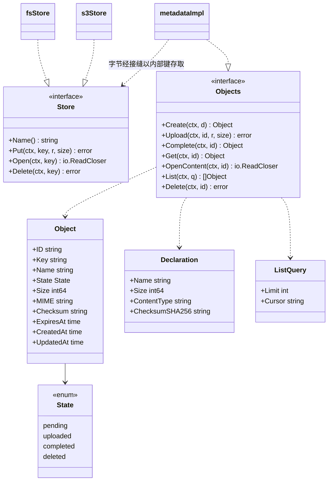
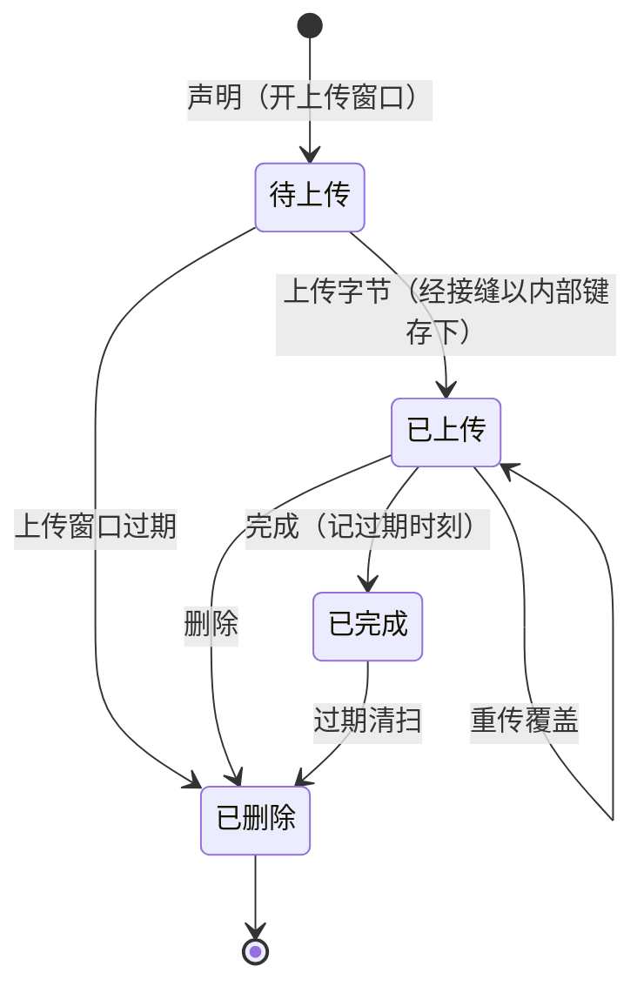

# objectstore

## 职责

本能力交付**对象的字节存取与元数据生命周期**：一份字节连同它的元数据被存下来，此后按标识读回、列举与删除。字节的物理存放归一条**字节接缝** `Store`，元数据、生命周期状态机与 HTTP 面归一个**排他的模块** `objectstore.metadata`，它持有 `objects` 表并排他交付生命周期的接缝 `Objects`。

一个对象经三步落地：**声明**（落一行 `pending`，带上尺寸与内容类型的声明，开一个上传窗口）→ **上传**（字节经 `Store` 以内部键存下，状态转 `uploaded`）→ **完成**（状态转 `completed`，此后可读）。字节与元数据分开存放：元数据在数据库里，字节在后端接缝背后，两者各自由持有它的一方负责。

**字节与键是本模块自己的事。** 一份字节在后端里以一个**内部键**定位：键的语法由本模块决定、由本模块生成，**从不经 API 暴露**。调用方拿到的是对象标识 `id`，不是键；`Store` 是字节进出的唯一通道，元数据模块不 import 任何后端 SDK。

**`Store` 的每个实现都排他交付**：一个进程里恰好一个生效，多于一个表态启用即启动失败（照 `pkg/sms` 的载体形态）。`fs` 落在本地目录，`s3` 落在 S3 兼容的对象存储；不装 `s3` 的装配不背那个 SDK（[architecture](../architecture.md) 不变量 11）。根包是接口包与公共类型，不登记模块（[ADR-objectstore-packaging-2026-10-15](../../adr/adr-objectstore-packaging-2026-10-15.md)）。

### 非职责

- **内容复验与净化流水线刻意后置。** 本模块**不重算声明的校验和与字节比对，也不做格式化解析、病毒扫描、重编码一类的净化**。刻意后置，不是漏项（[ADR-objectstore-scope-2026-10-15](../../adr/adr-objectstore-scope-2026-10-15.md)）。
- **缩略图派生刻意后置。** 本模块不从一个对象的字节派生缩略图或任何投影。刻意后置，不是漏项（[ADR-objectstore-scope-2026-10-15](../../adr/adr-objectstore-scope-2026-10-15.md)）。
- **不做授权判定。** 谁能对哪个对象做什么归 [authz](design-authz.md)：本模块在 `Resources` 里声明权限点、在路由上声明所需权限，判定由入口模块的中间件与路由声明面做出，本模块不给自己授予任何权限。
- **不解释对象的内容与用途。** `Object.MIME` 是不透明值，`Declaration.Name` 是调用方给的标签，本模块只把它规整后存下、不读它的含义；本模块不知道一份字节是票据、头像还是日志归档。
- **不认识内部键之外的存储布局。** 键的语法是本模块的私有约定；`fs` 与 `s3` 各自把它映射到自己的后端拼写（相对路径、对象键），映射细节不进接口，也不出现在任何应答里。
- **不写审计行。** 本模块在根包声明审计动作的类型名常量，由宿主在不可逆的迁移点显式把事件发上总线（见「审计动作」）；本模块只声明动作的名字，不写审计行，也不点审计模块为依赖。
- **不排队、不重试。** 一次上传与一次读取都是同步调用，`Store` 的方法在后端调用返回后才返回；后端不可达即那次调用失败，是否重试归调用方。
- **不保证多副本下的字节可见性。** `fs` 的字节只在本进程能到达的目录里；多副本共享一份字节要用 `s3`（见「后端适配」与「错误与失败语义」的非保证）。

## 外部接口契约

### 交付的功能

```go
// Store 是字节存取的接缝：对象的字节经它进出。内部键由交付 Objects 的模块生成，
// 本接缝不承诺它的语法，实现只按自身后端把它映射到位。
type Store interface {
    // Name 报告实现名，供诊断。
    Name() string
    Put(ctx context.Context, key string, r io.Reader, size int64) error
    Open(ctx context.Context, key string) (io.ReadCloser, error)
    Delete(ctx context.Context, key string) error
}

type State string

const (
    StatePending   State = "pending"   // 已声明、上传窗口未关
    StateUploaded  State = "uploaded"  // 字节已到、待完成
    StateCompleted State = "completed" // 可用于读取
    StateDeleted   State = "deleted"
)

type Object struct {
    ID        string
    Key       string // 内部键，从不经 API 暴露
    Name      string // 调用方声明的标签，存入前已规整，可为空串
    State     State
    Size      int64
    MIME      string
    Checksum  string
    ExpiresAt *time.Time
    CreatedAt time.Time
    UpdatedAt time.Time
    // 租户列由内嵌的 tenant.Model 提供。
}

// Objects 是元数据与生命周期的接缝，由 metadata 模块排他交付。
type Objects interface {
    Create(ctx context.Context, d Declaration) (Object, error)
    Upload(ctx context.Context, id string, r io.Reader, size int64) error
    Complete(ctx context.Context, id string) (Object, error)
    Get(ctx context.Context, id string) (Object, error)
    OpenContent(ctx context.Context, id string) (io.ReadCloser, error)
    List(ctx context.Context, q ListQuery) ([]Object, error)
    Delete(ctx context.Context, id string) error
}

type Declaration struct {
    Name           string // 可省；存入前规整，从不使 Create 失败
    Size           int64
    ContentType    string
    ChecksumSHA256 string
}

type ListQuery struct {
    Limit  int
    Cursor string // 键集游标：上一页最后一行的 (created_at, id)
}

var (
    ErrObjectNotFound   error // 本租户看不见的对象：未知 id、他人租户、已删除，一律同形，不泄露存在性
    ErrStateConflict    error // 当前状态不允许这个动作
    ErrContentMissing   error // 行说已完成，字节却不在后端
    ErrStoreUnavailable error // 字节接缝缺席
    ErrInvalidConfig    error // 配置跑不起来
    ErrInvalidRequest   error // 请求形状不可读
)
```

`Objects` 由 `objectstore.metadata` **排他**交付，`Store` 由 `objectstore.fs` 或 `objectstore.s3` **各自排他**交付。租户一律取自 `ctx`（`tenant.FromContext`），`Objects` 的每个方法在无租户时以租户侧的错误拒绝，对象行内嵌 `tenant.Model`，语句过滤由名册模块交付的 GORM 插件完成。

`Objects` 各方法的语义，约束的主体是交付 `Objects` 的模块：

- `Create` 校验 `Declaration`（`Size` 大于零、`ContentType` 非空、`ChecksumSHA256` 为空或 64 位十六进制），生成对象标识与内部键，落一行 `pending`，写 `name`、`declared_size`、`declared_type`、`declared_checksum` 与 `upload_expires_at = now + upload-window`，返回该行的视图。`Name` 不参与校验，按下文「名字的规整」存入。校验不过即 `ErrInvalidRequest`，不落行。
- `Upload` 取该行，要求状态为 `pending` 或 `uploaded`、上传窗口未关、`size` 参数等于 `declared_size`；字节经 `Store.Put(内部键, r, size)` 存下，同时以流式读出实际字节数与 SHA-256；写 `size`、`checksum_sha256`、`mime`（取 `declared_type`），状态转 `uploaded`。前置不符答 `ErrStateConflict`（状态不符或窗口已关）或 `ErrInvalidRequest`（字节数与声明不符），均在写字节之前拦下。
- `Complete` 取该行，条件 `WHERE id = ? AND state IN ('uploaded','completed')`：`uploaded` 直接转 `completed`，`expires_at` 在 `object-ttl` 大于零时取 `now + object-ttl`、否则为空，返回视图；`completed` 原样返回该行、不改状态；`pending` 答 `ErrStateConflict`，`deleted` 答 `ErrObjectNotFound`。
- `Get` 返回该行的视图；`deleted` 与不存在同形，答 `ErrObjectNotFound`。
- `OpenContent` 只对 `completed` 开放（`pending`／`uploaded` 答 `ErrStateConflict`，`deleted` 答 `ErrObjectNotFound`），经 `Store.Open(内部键)` 返回字节的只读流，读取方负责关闭它；`Store` 里找不到该行的字节即 `ErrContentMissing`。
- `List` 返回本租户**未删除**的对象，按 `(created_at, id)` 升序，取 `Limit` 行，游标见「列表的键集游标」。
- `Delete` 取该行，条件 `WHERE id = ? AND state <> 'deleted'`：任何未删除状态先经 `Store.Delete(内部键)` 删字节（`Delete` 幂等）、再把状态置 `deleted`；`deleted` 上重复调用匹配不到行、成功返回，不再删字节。

### 登记单元与名字

| 包 | 模块名 | 交付 | 排他 |
|---|---|---|---|
| `pkg/objectstore` | 不登记 | `Store`、`Objects` 接口与 `State`、`Object`、`Declaration`、`ListQuery` 公共类型、审计动作类型名常量、工厂与哨兵 | — |
| `pkg/objectstore/metadata` | `objectstore.metadata` | `Objects`（元数据与生命周期面）；挂 HTTP 面 | 排他 |
| `pkg/objectstore/fs` | `objectstore.fs` | `Store`（本地目录后端） | 排他 |
| `pkg/objectstore/s3` | `objectstore.s3` | `Store`（S3 兼容后端） | 排他 |

模块名照顶层能力：裸名 `objectstore`，叶子 `objectstore.<名>`，配置命名空间取同一取值（对照 `sms`/`sms.registry`、`kv`/`kv.redis`）。每个登记模块的包导出自己的 `ModuleName` 常量。

**`fs` 不 import 任何对象存储 SDK。** 它的依赖只有标准库与根包，因此一个只用本地目录的装配不背任何 SDK。**`s3` 绑它自己的 SDK**（`github.com/minio/minio-go/v7` v7.3.0 及其 `pkg/credentials` 子包，照各载体把 SDK 版本钉在 `pkg/go.mod` 里的形态），**不装 `s3` 的装配不背那个 SDK**：SDK 只被 `pkg/objectstore/s3` 这一个实现子包 import，不进根包、不进 `fs`，也不进 `metadata`。

`fs` 与 `s3` 都排他：一个进程里恰好一个 `Store` 生效，多于一个表态启用即在消解阶段以排他冲突失败，宿主在命令树上点名其一。`metadata` 排他交付 `Objects`，它对 `Store` 的依赖是**必需**的——一个 `Store` 都没纳入的装配里，该功能缺提供者、启动失败。

### 权限点声明

本模块拥有业务权限 `objectstore.object.read` 与 `objectstore.object.write`，以 `authz.PermissionSpec` 声明清单、以 `authz.TranslationSpec` 声明每个权限的（资源，动作）行，两者随模块的 `Resources` 登记进注册表：

```go
const (
    PermissionObjectRead  authz.Permission = "objectstore.object.read"
    PermissionObjectWrite authz.Permission = "objectstore.object.write"
)

// 放进 Resources 的两份声明。
authz.PermissionSpec{
    Permissions:     []authz.Permission{PermissionObjectRead, PermissionObjectWrite},
    DescriptionKeys: map[authz.Permission]string{ /* 每个权限一条 i18n 键 */ },
}
authz.TranslationSpec{
    Rows: map[authz.Permission]authz.Translation{
        PermissionObjectRead:  {Object: "object", Action: "read"},
        PermissionObjectWrite: {Object: "object", Action: "write"},
    },
}
```

本模块声明 `authz.PermissionSpec` 与 `authz.TranslationSpec`，由 [authz](design-authz.md) 消费。每条挂出的路由经路由声明面声明它所需的权限：读路由要 `objectstore.object.read`，写路由要 `objectstore.object.write`（见「路由全表」）。路由点名一个没有任何模块声明的权限，或该权限在翻译并集里没有行，都在启动期失败（[authz](design-authz.md)）。

### 审计动作

本模块在根包声明审计动作的**事件类型名常量**：

```go
const (
    EventObjectCreated   = "objectstore.object.created"
    EventObjectCompleted = "objectstore.object.completed"
    EventObjectDeleted   = "objectstore.object.deleted"
)
```

审计动作**不是资源**。发布方在自己包里声明类型名常量并把事件发上总线；审计模块用配置项（`events []string`）点名它要看的类型名，**从不推断、不支持通配**。**本模块不发布这些事件，也不写审计行**：它只声明动作的名字，由**宿主**在自己的代码里、在不可逆的迁移点显式把对应事件发上总线——一个对象已落下 `pending` 行、一个对象已可读、一个对象已不可恢复。点了名而发布方不发即静默不审计，没有任何一层会报错。因此本模块不点 `pkg/event`、不点 `pkg/audit` 为依赖。

### 路由全表

基路径 `/api/v1/objects`，全部挂在入口模块的登记面上。下表是路由的全集（封闭集）：方法、路径、应答形状与每条需要的权限。

| 方法 路径 | 应答 | 权限 |
|---|---|---|
| `POST /api/v1/objects` | 201，对象视图 | `objectstore.object.write` |
| `PUT /api/v1/objects/:id/content` | 204，无正文 | `objectstore.object.write` |
| `POST /api/v1/objects/:id/complete` | 200，对象视图 | `objectstore.object.write` |
| `GET /api/v1/objects` | 200，对象视图列表 | `objectstore.object.read` |
| `GET /api/v1/objects/:id` | 200，对象视图 | `objectstore.object.read` |
| `GET /api/v1/objects/:id/content` | 200，字节正文 | `objectstore.object.read` |
| `DELETE /api/v1/objects/:id` | 204，无正文 | `objectstore.object.write` |

端点与权限由路由声明面绑定：中间件按 `(方法, c.FullPath())` 找到该路由声明的权限再做判定（[authz](design-authz.md)）。

**对象视图逐字段从根包的 `Object` 构造，不带 `Key`。** 视图字段：`id`、`name`、`state`、`size`、`mime`、`checksum_sha256`、`expires_at`、`created_at`、`updated_at`，时间按 UTC 写出。内部键是模块的私有记账，从不进应答、也不进错误文本。`GET /api/v1/objects/:id/content` 只对 `completed` 的对象返回字节，正文的 `Content-Type` 取 `mime`。视图的 `name` 总在场，没有名字时是空串；声明请求体的 `name` 可省，省略与空串同义。应答不设 `Content-Disposition`，下载文件名由客户端取视图的 `name`。`POST /api/v1/objects` 命中 `metadata` 的 `upload-window` 打开上传窗口；`PUT .../content` 只接受 `pending` 或 `uploaded` 的对象。

**回绝映射是封闭的、fail-closed 的。** 400（`Problem.Type` 为 `urn:speed:objectstore:bad-request`）：`ErrInvalidRequest`——声明形状不可读，或一次上传的字节数与声明不符。403：路由声明的权限判定未通过，由 guard 写出。404（`urn:speed:objectstore:not-found`）：`ErrObjectNotFound`——未知 id、他人租户、已删除三合同形，不做泄露存在性的区分；**已删除的行在除 `Delete` 之外的每个操作上都答这个码**，它已经不在了、不是状态冲突，而 `Delete` 对已删除的行幂等成功。409（`urn:speed:objectstore:conflict`）：`ErrStateConflict`。503（无 `Problem.Type`）：`ErrStoreUnavailable`、`ErrContentMissing` 与其余失败，成因只进日志。`Title` 与 `Detail` 是渲染好的成品文本，由本模块从自己的消息目录渲染。

### 特性声明

`objectstore.metadata` 以资源 `feature.Spec{Name: "objectstore.objects"}` 声明静态[特性](../../glossary.md) `objectstore.objects`：它在场，表示本进程挂出「路由全表」里的对象路由（[feature](design-feature.md)）。路由能力在场时 `objectstore.metadata.endpoints` 必填、空清单即启动失败，所以模块进入启用集、进程有路由器时这组路由无条件挂出，声明为静态特性符合架构不变量 18（[architecture](../architecture.md#架构不变量)）。纳入的是哪一个字节后端不影响这个特性：`metadata` 对 `Store` 的依赖是必需的，没有后端的装配不启动。

上传窗口、对象有效期与清扫间隔是参数，不经特性文档发布：前两项是设置，清扫间隔是配置（[ADR-config-scope-2026-09-13](../../adr/adr-config-scope-2026-09-13.md)）；超出上传窗口的上传由服务端逐次以 `ErrStateConflict` 拒绝（[ADR-feature-ownership-2026-10-17](../../adr/adr-feature-ownership-2026-10-17.md)）。

### 宿主可见面

以下是宿主写进配置文件或设置存储、或在命令树上点名的面。

- **模块名**：`objectstore.metadata`、`objectstore.fs`、`objectstore.s3`。宿主的命令树点模块名纳入，配置与设置的命名空间取同一取值；`fs` 与 `s3` 二选一纳入（都排他）。
- **配置命名空间与输入项**：`objectstore.metadata` 下的 `endpoints`（字符串列表，只收具体端名、不收 `*`，取主配置源；**路由能力在场时必填**——`Init` 见到路由能力在场而这份清单为空即以启动失败拒绝，不静默不挂路由；**路由能力缺席时这份清单不被读取**）、`sweep-interval`（时长，缺省 `1m`，`≤0` 即关闭清扫，取主配置源；它设定 `Start` 起的清扫 ticker 的间隔，改变要重启）；`objectstore.fs` 下的 `root`（字符串，必填，本地目录，取主配置源）；`objectstore.s3` 下的 `endpoint`、`region`、`bucket`、`access-key`、`secret-key`、`use-path-style`（布尔）。
- **设置命名空间与输入项**：`objectstore.metadata` 下的 `upload-window`（时长，缺省 `15m`，须至少 1 毫秒）与 `object-ttl`（时长，缺省 `0` 即完成后的对象不过期，须为 0 或至少 1 毫秒），由本模块声明。两项以毫秒存读，更短的正值会截断为零。`upload-window` 在每次 `Create` 读取，`object-ttl` 在每次 `Complete` 读取。设置缺席时取声明默认值；读取失败或取值越出取值域时取声明默认值并记一行 `Error`。两项是普通调参，没有放宽监视。配置不再承载这两项：旧配置里仍写着它们的宿主在启动时按未知键失败。
- **路由与权限**：基路径 `/api/v1/objects` 下的路由（见「路由全表」），读路由要 `objectstore.object.read`、写路由要 `objectstore.object.write`。
- **审计动作的类型名**：`objectstore.object.created`、`objectstore.object.completed`、`objectstore.object.deleted`，由宿主发上总线、由审计模块的 `events` 配置项点名。
- **装配约束**：`metadata` 对 `(*objectstore.Store)(nil)` 的依赖是必需的，装配里恰好一个 `Store` 实现。

### 对外接口面

- `Store`、`Objects`、`State`、`Object`、`Declaration`、`ListQuery` 的字段与方法集，以及本能力的全部哨兵，是与调用方之间的接口面。加方法、改签名或改字段名对实现了接缝的后端、对取用它们的调用方都是不兼容变更。
- `Object` 的字段语义：`ID` 是对象标识、`Key` 是内部键、`State` 取 `pending`／`uploaded`／`completed`／`deleted` 之一、`Size` 与 `Checksum` 是上传后记录的实际值、`MIME` 是内容类型、`ExpiresAt` 可空。
- **内部键从不经 API 暴露。** `Object.Key` 是模块的内部字段（导出，但不进任何对外面）：它不进任何 HTTP 视图，不进错误文本，日志里也不记它（日志以对象标识或该键的截断摘要指认对象）。改键的语法是内部变更，不影响调用方。`Store` 的 `key` 参数同样是内部键，接口不规定它的语法，实现只按自身后端把它映射到位。
- **宿主可见面**：模块名 `objectstore.metadata`、`objectstore.fs`、`objectstore.s3`；配置键 `objectstore.metadata.{endpoints,sweep-interval}`、`objectstore.fs.root`、`objectstore.s3.{endpoint,region,bucket,access-key,secret-key,use-path-style}`；设置键 `objectstore.metadata.{upload-window,object-ttl}`；路由的路径与每条路由的权限；权限常量 `objectstore.object.read`、`objectstore.object.write`；`Problem.Type` 前缀 `urn:speed:objectstore:` 及其下的码（`bad-request`、`not-found`、`conflict`）；审计动作的类型名。改动它们是宿主可见的破坏性变更。
- 特性名 `objectstore.objects`。前端经生成的特性名类型引用它，改名或撤去是宿主可见的破坏性变更。
- 单个 `Store` 实现、`metadata` 模块各自可替换、可撤掉，不改变调用方的代码。

### 哨兵错误

| 哨兵 | 定义处 | 含义 |
|---|---|---|
| `ErrObjectNotFound` | `pkg/objectstore` | 本租户看不见的对象：未知 id、他人租户、已删除，一律同形，不泄露存在性 |
| `ErrStateConflict` | `pkg/objectstore` | 当前状态不允许这个动作：未上传就完成、未完成就读取、上传窗口已关 |
| `ErrContentMissing` | `pkg/objectstore` | 行说已完成，字节却不在后端 |
| `ErrStoreUnavailable` | `pkg/objectstore` | 字节接缝缺席或后端不可达 |
| `ErrInvalidConfig` | `pkg/objectstore` | 配置跑不起来：输入项缺失、取值不可用，或模块与自身性质不符 |
| `ErrInvalidRequest` | `pkg/objectstore` | 请求形状不可读：`Declaration` 的形状不合法，或一次上传的字节数与声明不符 |

调用方以 `errors.Is` 判别，包裹一律用 `%w`。一次字节操作失败若带后端自家的错误，`metadata` 把它连同 `ErrStoreUnavailable` 一并收口成 503。错误文本不携带内部键，也不复述凭据。

## 依赖

| 依赖 | 用途 |
|---|---|
| `pkg/core` | 登记描述符、交付功能、声明资源 |
| `pkg/config` | 声明各模块的输入项 |
| `pkg/settings` | `objectstore.metadata`：可选，声明并读取设置项 `upload-window` 与 `object-ttl` |
| `pkg/db` | `objectstore.metadata`：`objects` 表与迁移 |
| `pkg/tenant` | `objectstore.metadata`：租户上下文、内嵌的 `tenant.Model` 与语句过滤插件 |
| `pkg/log` | `objectstore.s3` 直接 import；工厂取可选 `log.Logger`、以模块名绑定后交给 `Open`，实现持有它并记录每一次出站调用；工厂在 `New` 里登记各后端凭据的字面量脱敏匹配器；`metadata` 记诊断。装配层面 `log.Logger` 可选：缺席时出站记录落在 `Default()` 的引导链上 |
| `pkg/internal/literal` | 构造并登记字面量匹配器（各后端的凭据） |
| `pkg/authz` | `objectstore.metadata`：`PermissionSpec`、`TranslationSpec` 与路由声明面 |
| `pkg/http` | `objectstore.metadata`：入口模块的登记面，挂路由 |
| `pkg/feature` 根包 | `objectstore.metadata`：声明静态特性（`feature.Spec`）；根包只依赖标准库 |
| S3 SDK | 只被 `pkg/objectstore/s3` import |

**根包依赖 `pkg/core`、`pkg/config`、`pkg/internal/literal` 与可选的 `pkg/log`，不 import 任何对象存储 SDK。** 工厂与公共类型都在根包，它经 `pkg/internal/literal` 登记字面量脱敏匹配器、取可选 `pkg/log` 的 logger（照 `pkg/sms/module.go` 的先例）；对象存储 SDK 只落在 `s3` 实现子包。方向是 `metadata` import `pkg/db`、`pkg/tenant`、`pkg/authz`、`pkg/http`、`pkg/feature` 的接口包，`fs` 只 import 标准库与根包，`s3` import 根包、`pkg/log` 与它自己的 SDK；根包不 import `metadata`、`fs`、`s3` 中的任何一个。

**`s3` 的 SDK 落在绑定它的实现子包。** 根包与 `fs` 的传递闭包不含任何对象存储 SDK，也不含 `pkg/db`、`pkg/authz` 这类上层功能目录；这条由 `pkg/objectstore/deps_test.go` 的守卫守住（照 `pkg/sms/deps_test.go` 的形态），并守住 `fs` 不引入 SDK。

**`pkg/internal/literal` 是共享单元。** `s3` 经工厂的 `Secrets` 钩子交出凭据，工厂经 `pkg/internal/literal` 登记为日志的字面量脱敏匹配器；它与 SMS 载体、认证的登录叶子共用这一单元（[ADR-shared-backend-unit-2026-09-21](../../adr/adr-shared-backend-unit-2026-09-21.md)）。`s3` 因而不 import `literal`，只交出凭据字符串。

## UML 图

本能力的结构是一条字节接缝与一条生命周期接缝，以及它们各自的实现。图里的约束不在图中：`fs` 与 `s3` 之间是**互斥**的，`metadata` 排他交付 `Objects`——图上看不出这一点，因为排他性由描述符声明、由消解阶段裁定，不是类型之间的关系。`metadata` **不 import 任何后端实现子包**，只经根包的 `Store` 接缝触达字节。



有生命周期的实体是对象本身，它的状态机如下。上传窗口过期与过期清扫都由 `metadata` 模块自己的清扫 ticker 驱动；删除是一条从任何未删除状态通向 `deleted` 的边，图中只画出自 `已上传` 出发的一条代表它，不重复画出。`deleted` 是墓碑：元数据行保留 `state = deleted`，字节已从后端删去。



## 核心数据结构

**`objects` 表**，一行一个对象，租户作用域，内嵌 `tenant.Model`（约定列名 `tenant_id`）。行的读与写都在数据库自己的事务里；语句的租户过滤由名册模块交付的 GORM 插件完成。

| 列 | 含义 |
|---|---|
| `id` | 对象标识，主键，应用生成 |
| `tenant_id` | 租户列，由内嵌的 `tenant.Model` 落地 |
| `key` | 内部键，模块生成；从不经 API 暴露 |
| `name` | 调用方声明的标签，规整后存入，可为空串；不唯一，不用于查找 |
| `state` | `pending`／`uploaded`／`completed`／`deleted` 的闭集 |
| `declared_size` | 声明里的大小 |
| `declared_type` | 声明里的内容类型 |
| `declared_checksum` | 声明里的 SHA-256，可空 |
| `size` | 上传后读出的实际字节数 |
| `mime` | 上传后记下的内容类型，取 `declared_type` |
| `checksum_sha256` | 上传时流式计算出的 SHA-256 |
| `upload_expires_at` | 上传窗口的关闭时刻，声明时写下 |
| `expires_at` | 对象的过期时刻，完成时按 `object-ttl` 写下，无 TTL 时为空 |
| `created_at`、`updated_at` | 行的时间戳 |

本模块在 `objects` 表上建索引：`(tenant_id, created_at)` 服务 `List` 的键集游标；`upload_expires_at` 与 `expires_at` 各一条服务过期清扫。

**首次读表不得早于 `Init`。** `New` 早于 `Migrate`，`New` 里 `objects` 还不存在，本模块因此不在 `New` 读表；路由在 `Init` 里只登记、不读表。第一次读表落在 `Start`：清扫的第一次 pass 读 `objects`。清扫被关掉（`sweep-interval ≤ 0`）时，第一次读表是 `Serve` 阶段的第一条请求。

**名字在入口规整一次。** `Create` 把声明的 `Name` 规整后写入 `name`，之后的每个读取方拿到的都是同一个值。存入的值满足：合法 UTF-8；不含 Unicode 类别为 Cc、Cf、Zl、Zp 的字符（控制字符、格式字符含方向控制与零宽字符、行分隔符与段分隔符），这些字符被丢弃；不含 `/` 与 `\`，它们被替换为 `_`；首尾无空白；至多 255 字节且不在字符中间截断，截断之后再去一次首尾空白；不是只由 `.` 组成，那样的名字存为空串。省略、空串与规整后为空同义，都存为空串。规整不去掉引号与分号，不检查扩展名，不保留末尾的扩展名。`name` 没有观测值一侧，视图交出的就是存入的值；既有行的 `name` 为空串。

**声明里的值与上传后记下的值并存。** `declared_size`、`declared_type`、`declared_checksum` 是调用方在声明时给的；`size`、`mime`、`checksum_sha256` 是上传时模块自己读出的。两者分列存放，本模块因此能在上传时看出字节数与声明不符，又不把声明值改写成观测值。`Object` 视图交出的是观测值一侧。

## 核心算法与流程

### 上传三步

1. **声明**：`Create` 校验 `Declaration`，生成对象标识与内部键，落一行 `pending`，写 `declared_*` 与 `upload_expires_at = now + upload-window`。内部键的语法是本模块自己的约定（含租户维度与对象标识的分段），生成之后不经任何 API 交出。
2. **上传**：`Upload` 取该行，要求状态为 `pending` 或 `uploaded`、窗口未关、`size` 等于 `declared_size`；字节经 `Store.Put(内部键, r, size)` 以内部键存下，同时流式读出实际字节数与 SHA-256；写 `size`、`checksum_sha256`、`mime`，状态转 `uploaded`。前置不满足一律在**写字节之前**拦下，不落半份字节、不推进状态。
3. **完成**：`Complete` 取该行，`uploaded` 转 `completed`（`completed` 上重复调用原样返回该行、不改状态），`expires_at` 按 `object-ttl` 写下（`object-ttl ≤ 0` 时为空），此后 `OpenContent` 可读。

字节存下与状态推进是两件事：`Store.Put` 在数据库事务之外发出，行状态的推进是一条条件语句。一次 `Store.Put` 成功而置行失败的上传，字节暂留在后端，状态仍是 `pending`，下一次上传以同一个内部键覆盖它。

### 列表的键集游标

`List` 按 `(created_at, id)` 升序返回本租户未删除的对象。`ListQuery.Cursor` 是上一页最后一行的 `(created_at, id)` 的编码，空游标即首页。一次查询取 `Limit` 行（缺省 50、上限 200，超出上限即拒绝、不静默截断），谓词与排序都走 `(tenant_id, created_at)` 索引。键集游标在并发写下稳定：新行按 `created_at` 排在已翻过的页之后，不会挤进更早的页；一个对象被删除后从后续页里消失，不需要重排。`Cursor` 对调用方是不透明字符串，它的编码是本模块的内部约定。

### 过期清扫的 ticker

`metadata` 模块在 `Start` 起一个 ticker、`Stop` 停，间隔取 `objectstore.metadata.sweep-interval`，**`≤0` 即关闭**（与既有各模块自起的 ticker 同形：间隔 `≤0` 关掉、失败只 `Warn`、各自持有停机制约）。每 tick 跑一次清扫 pass，处置下列边：

- `pending` 且 `upload_expires_at < now`：窗口已关。**不能假定后端没有字节**——一次 `Put` 成功而置行失败的上传会让字节暂留在后端——所以先经 `Store.Delete(内部键)` 删字节（`Delete` 幂等），再把行置 `deleted` 墓碑。
- `completed` 且 `expires_at` 非空且 `< now`：先经 `Store.Delete(内部键)` 删字节（`Delete` 幂等），再把行置 `deleted` 墓碑。

一条 pass 的读与写都在数据库自己的事务里，`Store.Delete` 在数据库事务之外发出（后端不在数据库事务里）。删除字节失败只记 `Warn`、行不动，下一个 pass 重试。时间判定取**数据库的时钟**。同一行上的两次清扫、清扫与并发的 `Delete` 之间以行的状态为条件（`WHERE id = ? AND state <> 'deleted'`），因此幂等。

### 工厂的构造次序

`fs` 与 `s3` 各自的工厂收编一份公共接线（照 `pkg/sms` 的 `Spec` 与 `NewModule` 形态），实现只提供自己的类型参数、配置原型、输入项、表态、凭据与打开函数：

```go
type Spec[C any] struct {
    ModuleName      string
    ConfigNamespace string
    Config          *C
    Items           map[string]config.Item
    Stance          func(cfg *C) (core.Enablement, error)
    Secrets         func(cfg *C) []string      // 凭据：登记为日志的字面量脱敏匹配器
    Open            func(ctx context.Context, cfg *C, logger *slog.Logger) (Store, error)
}
```

交付排他：`Provides` 排他 `(*Store)(nil)`；`Requires` 可选 `log.Logger`。阶段行为如下：

| 阶段 | 行为 |
|---|---|
| `Prepare` | `Decode` 自己那份配置；读出后调 `Stance`，与自身性质不符即启动失败，错误点名缺的是哪一项 |
| `New` | `Decode` 配置 → 调 `Secrets` 并经 `pkg/internal/literal` 登记字面量脱敏匹配器 → 取可选 `log.Logger` 并以模块名绑定 → 把该 logger 交给 `Open` 建立后端 |

**次序固定：先登记脱敏字面量，再绑定任何带属性的 logger，最后 `Open`。** 日志脱敏规则只对它注册之后写出的记录起作用，所以凭据的登记必须发生在实现把任何属性绑到 logger 之前。`Secrets` 钩子把「凭据先登记」这一步收进工厂，实现因此不 import `literal`，只交出凭据字符串。`fs` 不承载凭据，`Secrets` 交回空。

**实现把外部调用记在工厂交给它的 logger 上，不从操作的 context 取。** 工厂的后台清扫用自己创建的 context 调 `Delete`，那个 context 没有注入 logger；`log.FromContext` 会把这条路径的记录落到进程默认链上，配置的目的地看不到。模块 logger 还使每条记录带上模块属性，无论调用由哪个 context 驱动。

### 后端适配

**`fs` 落在本地目录。** 根路径来自 `objectstore.fs.root`。`Put` 把内部键当相对路径拼到根下，缺父目录即建、以流写字节；`Open` 打开该路径只读并返回它的正文流；`Delete` 删除该路径。`Name()` 报告实现名，供诊断。字节按内部键存取，键的语法（分段、路径分隔）是本模块自己的约定，本实现把它当文件路径拼到根下，映射细节不进接口。`fs` 不 import 任何对象存储 SDK，它的依赖只有标准库的 `os`、`io`。

**`s3` 绑 S3 兼容的对象存储。** 配置项：`endpoint`、`region`、`bucket`、`access-key`、`secret-key`、`use-path-style`。SDK 是 `github.com/minio/minio-go/v7` v7.3.0 及其 `pkg/credentials` 子包，只被这个实现子包 import。`Put` 以内部键为对象键调用 `PutObject`，`Open` 用 `GetObject` 返回对象正文的只读流，`Delete` 用 `RemoveObject`（S3 的 `DeleteObject`）。`endpoint` 与 `use-path-style` 一起把客户端指向自建或云上的 S3 兼容服务，`region` 由 SDK 用于签名。`access-key` 与 `secret-key` 是凭据，由 `Secrets` 钩子交出、在 `New` 里先于 logger 绑定登记为日志的字面量脱敏匹配器（见「工厂的构造次序」）。字节同样按内部键存取，**键不出 API**。

### 出站调用的记录

**每一次向外部服务发出的调用写一条记录，成功与失败各一条。** `objectstore.s3` 的 `Put`、`Open` 与 `Delete` 在调用前后取时间，经**模块自己的 logger** 写出记录：工厂在 `New` 里取可选 `log.Logger`、以模块名绑定后交给 `Open`，实现持有它。操作的 context 不参与——工厂的后台清扫用自己创建的 context 调 `Delete`，那个 context 没有注入 logger，`log.FromContext` 会把这条路径落到进程默认链上，配置的目的地看不到。`Open` 的请求在交回字节流之前以一次 `Stat` 落地，该次调用的成功与失败各有一条记录。`objectstore.fs` 只访问本地目录，没有出站调用，不写这类记录。

| 字段 | 取值 |
|---|---|
| `operation` | `put`、`open`、`delete`，或 `Open` 之后正文读取失败时的 `read` |
| `bucket` | 配置的桶 |
| `key_hash` | 内部键 SHA-256 的前十二位十六进制 |
| `size` | `put` 的声明长度、`open` 读到的对象长度；`delete` 与 `read` 没有这一项 |
| `duration_ms` | 从发出调用到它返回的毫秒数；`read` 行从第一次读取起算，到读取失败为止 |
| `outcome` | 成功 `ok`，失败 `failed` |
| `cause` | 失败时的分类：服务应答的错误码，或无应答时剥去内部键的传输错误文本 |
| `http_status` | 失败且服务有应答时的状态码 |

**内部键本身、对象的字节与凭据都不进记录。** `key_hash` 足以把指向同一对象的多次调用关联起来，不能用来寻址该对象。服务应答按错误码记录而不按消息记录——服务可能把键回显进消息；其余错误文本在写出之前把内部键及其 URL 转义形式（路径转义与查询转义）替换掉，因为 SDK 会在服务消息与传输错误的 URL 里重复这个键。

**`Open` 之后的正文读取失败另有记录。** `Open` 的成功记录在对象头到手时写出，正文尚未读取；返回的流在读取出错时写一条同 `key_hash` 的 `read` 失败记录，`EOF` 不算失败。一条断掉的流只写一条这样的记录，无论读取方把同一个错误报多少次。`read` 记录的 `duration_ms` 是这次正文读取自身的耗时：从第一次读取——SDK 由它发出请求——算到失败发生，`Open` 的调用（另有自己的记录）与交回流之后的等待都不计入。

**流式交付的失败另有一行。** `metadata` 把 `OpenContent` 的字节流写给 HTTP 调用方时，`io.Copy` 失败写一条 `Error`，带对象标识与成因；这一行不涉内部键，与后端的出站调用记录相互独立。

**上下文在调用发出之前已结束时不写记录**：没有请求离开进程，`Put`、`Open`、`Delete` 直接交回上下文的错误。

## 错误与失败语义

| 情形 | 表现 |
|---|---|
| `Declaration` 形状不合法 | `ErrInvalidRequest`，不落行 |
| 一次上传的字节数不等于声明的 `declared_size` | `ErrInvalidRequest`，不写字节、不推进状态 |
| 上传窗口已过，或对象状态不允许该操作（未上传就完成、未完成就读取） | `ErrStateConflict`，未写字节前拦下 |
| 点名了本租户看不见的对象（未知 id、他人租户、已删除） | `ErrObjectNotFound`，三合同形 |
| 对一个已删除的行调用除 `Delete` 之外的任何操作 | `ErrObjectNotFound`，与未知 id 同形；`Delete` 对已删除的行幂等成功 |
| 行已完成、字节却不在后端 | `ErrContentMissing` |
| 字节接缝缺席或后端不可达、一次字节操作失败 | `ErrStoreUnavailable`（后端自家的错误原样包裹其中）；`metadata` 收口成 503 |
| 清扫时删字节失败 | 记 `Warn`，行不动，下一个 pass 重试 |
| 缺配置项（`fs.root`、`s3.bucket` 等）、配置跑不起来 | `ErrInvalidConfig`，`Prepare` 或 `New` 阶段失败即启动失败，错误点名缺的是哪一项 |
| 路由能力在场而端名清单为空 | `ErrInvalidConfig`，`Init` 阶段失败即启动失败，错误点名 `objectstore.metadata.endpoints` |
| 读取 `upload-window` 或 `object-ttl` 失败，或取值越出取值域 | 取声明默认值，记一行 `Error` 点名声明的键，本次 `Create` 或 `Complete` 照常进行 |

**本模块不重试、不降级。** 后端不可达即那次调用失败，不回落到本地、不返回上一份字节；是否重试归调用方。

### 非保证

- **不保证 `fs` 的多副本可见性。** `fs` 的字节只在本进程能到达的目录里；多副本装配要让各副本共享一份字节，须用 `s3`。这与 [kv](design-kv.md) 里内存实现的部署前提同源：前提由持有它的那一个实现自己承担，本模块不代它判断。
- **不做内容复验。** 声明的大小与校验和是调用方给的，本模块按大小拦一次明显不符的上传、并记下实际校验和，但不重算声明的校验和与字节比对，也不做净化。复验与净化刻意后置（见「非职责」）。
- **不保证上传的字节与声明的校验和一致。** `checksum_sha256` 是上传时算出的实际值，与 `declared_checksum` 分列存放，两者不一致时本模块不报错、不阻止完成。
- **一次 `Delete` 有一个窗口。** 字节删成功、行尚未置 `deleted` 的窗口内，行仍是 `completed` 而字节已无，此间一次读取答 `ErrContentMissing`；重试 `Delete` 会再次尝试删字节（删不存在的字节不是错误）并置行，窗口随重试闭合。

## 并发与事务边界

- `Objects` 与 `Store` 都必须可被多个协程并发使用；实现不得持有调用方传入的 `io.Reader`，也不得把自己持有的切片交出去。
- **一次上传的字节操作与状态推进不在同一个事务里。** `Store.Put` 在数据库事务之外发出，行状态的推进是一条条件语句（`WHERE id = ? AND state IN ('pending','uploaded')`）；两个并发上传同一对象时，两次 `Store.Put` 都写到同一个内部键，最后落库的那次决定 `size` 与 `checksum_sha256`。
- `Complete` 与 `Delete` 各是一条条件语句：`Complete` 的条件是 `WHERE id = ? AND state IN ('uploaded','completed')`，`Delete` 的条件是 `WHERE id = ? AND state <> 'deleted'`。`uploaded` 上 `Complete` 推进状态、`completed` 上重复 `Complete` 原样返回，`pending` 上 `Complete` 答 `ErrStateConflict`、`deleted` 上答 `ErrObjectNotFound`；任何未删除状态上 `Delete` 删字节并置 `deleted`，`deleted` 上重复 `Delete` 匹配不到行、幂等成功。
- 清扫 pass 与并发写以行的状态为条件，同一行上的两次清扫、清扫与并发的 `Delete` 都幂等。
- `metadata` 不开跨后端的事务：数据库的写与后端的字节操作各自成事，其间没有事务把它们绑在一起；这一点是「上传三步」把字节与状态分开的直接结果。

## 扩展点

**新增一种字节后端即新增一个实现子包。** 以下各条是准入条件的全部：

- 必须排他交付：`Provides` 里声明 `(*Store)(nil)`，`Exclusive: true`。
- 必须挂在 `objectstore.<后端>` 专属的配置命名空间下，声明自己的输入项；不得占用 `objectstore.metadata` 的命名空间。
- 必须实现 `Store` 的 `Name`、`Put`、`Open`、`Delete`，按内部键存取字节；实现不得解释键的语法超出自身后端映射所需的部分，也不得把键留进任何对外输出。
- 必须把后端自己的错误原样外传，不发明本能力的哨兵；字节的完整性交由 `metadata` 侧记下的 `size`、`checksum_sha256` 承载。
- 承载凭据的实现必须经 `Secrets` 钩子交出凭据，使其先于任何 logger 绑定被登记为日志的字面量脱敏匹配器；不承载凭据的实现交回空。
- 承载出站请求的实现必须为每一次调用写一条记录，成功与失败各一条，字段含操作、目标、内部键的截断摘要、耗时与 `outcome`，失败另带成因与对端状态；内部键本身、对象的字节与凭据不进记录。只访问本地目录的实现没有出站调用，没有可记的调用。

**`Store` 本身与 `Objects` 一样是排他的扩展点**：另一个实现若要点名同一个 `(*Store)(nil)`，两者同时纳入即在消解阶段以排他冲突失败（[authz](design-authz.md) 同一条消解规则）。

## 实现状态

| 能力 | 状态 | 代码 |
|---|---|---|
| 接缝与根包类型、审计动作常量、工厂 | 已实现 | `pkg/objectstore/objectstore.go` `Store`、`State`、`Object`、`Objects`、`Declaration`、`ListQuery`、`EventObjectCreated`、`EventObjectCompleted`、`EventObjectDeleted`；`pkg/objectstore/module.go` `Spec`、`NewModule` |
| 哨兵错误 | 已实现 | `pkg/objectstore/objectstore.go` `ErrObjectNotFound`、`ErrStateConflict`、`ErrContentMissing`、`ErrStoreUnavailable`、`ErrInvalidConfig`、`ErrInvalidRequest` |
| 元数据与生命周期面 `objectstore.metadata`（`objects` 表与迁移、上传三步、键集游标列表、过期清扫、HTTP 面、权限与审计动作声明） | 已实现 | `pkg/objectstore/metadata/metadata.go` `Module`、`ModuleName`；`pkg/objectstore/metadata/store.go` `Create`、`Upload`、`Complete`、`Get`、`OpenContent`、`List`、`Delete`；`pkg/objectstore/metadata/objects.go` `tableName`、`internalKey`、`encodeCursor`、`decodeCursor`；`pkg/objectstore/metadata/sweep.go` `startSweep`、`sweepOnce`；`pkg/objectstore/metadata/handlers.go` `handleCreate`、`handleUpload`、`handleComplete`、`handleGet`、`handleList`、`handleContent`、`handleDelete`；`pkg/objectstore/metadata/permissions.go` `PermissionObjectRead`、`PermissionObjectWrite`、`permissionSpec`、`translationSpec`；`pkg/objectstore/metadata/migrations` |
| 对象的名字（`name` 列与迁移、入口规整、视图字段、声明请求体的 `name` 可省） | 已实现 | `pkg/objectstore/objectstore.go` `Object`、`Declaration`；`pkg/objectstore/metadata/store.go` `Create`；`pkg/objectstore/metadata/names.go` `normalizeName`；`pkg/objectstore/metadata/views.go` `objectViewOf`；`pkg/objectstore/metadata/migrations/postgres/0002_object_name.sql`、`pkg/objectstore/metadata/migrations/sqlite/0002_object_name.sql` |
| 本地目录后端 `objectstore.fs` | 已实现 | `pkg/objectstore/fs/fs.go` `Module`、`ModuleName`、`Put`、`Open`、`Delete`；`pkg/objectstore/fs/keys.go` `relativePath`、`splitKey`；`pkg/objectstore/fs/config.go` `items` |
| S3 兼容后端 `objectstore.s3` | 已实现 | `pkg/objectstore/s3/s3.go` `Module`、`ModuleName`、`Put`、`Open`、`Delete`；`pkg/objectstore/s3/config.go` `items` |
| operation 声明与 OpenAPI 片段生成 | 已实现 | `pkg/objectstore/metadata/operations.go`；`pkg/objectstore/metadata/openapi_generated_test.go`；片段 `pkg/objectstore/metadata/openapi/metadata.json` |
| 静态特性 `objectstore.objects` 的 `feature.Spec` 声明 | 已实现 | `pkg/objectstore/metadata/metadata.go` `Module`；`pkg/objectstore/metadata/feature_test.go` `TestTheModuleDeclaresTheObjectsFeature` |
