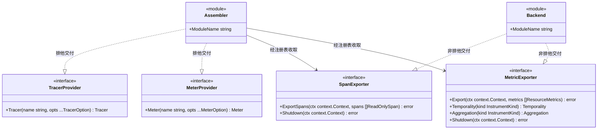
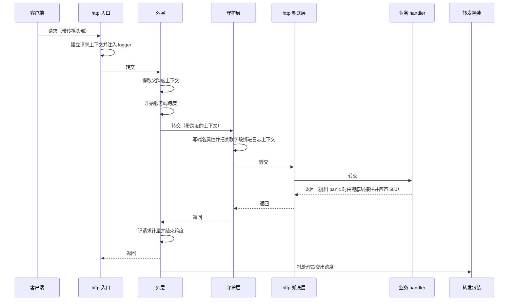

# observability

本模块是进程的运行期信号面：把上游 SDK 的追踪与指标 provider 装进[注册表](../../glossary.md)，在请求路径上挂采集层，并给出站请求注入传播上下文。它拥有信号的产生与导出接线，不拥有日志、启动诊断、健康判定与任何信号消费侧；看板、告警与查询接口都不在它的职责内。读职责清单前应持有的一句话心智模型是：本模块只负责把信号送出去，信号的含义、属性集合与目的地分别由上游库与导出后端决定。

第一遍的次序是职责、术语表、外部接口契约、依赖、UML 图、核心数据结构与核心算法与流程：职责与术语表给出信号面的边界与词汇，外部接口契约与依赖给出可交付与可取用的功能，UML 图给出功能与交付方以及一次入站请求的层序，核心数据结构与核心算法与流程说明配置、构造次序、采集层与关停刷出。错误与失败语义、并发与事务边界与扩展点属查阅用；实现状态放在最后，用代码锚点核对声称已实现的部分。竞态与边界情形——停机截断、导出器释放、上游变量被忽略——是最后的自检项，与错误与失败语义一并核对。

## 职责

`pkg/observability` 承载运行期的遥测：追踪与指标两种信号。产品是上游遥测 SDK 的 provider，加上请求路径的采集与一个出站注入工具。

- **交付上游 SDK 的 provider**，追踪与指标各是一个功能，两者由同一个装配器模块排他交付。
- **请求路径的采集**：以上游 gin（[REF-gin](../../references.md)）采集库为基座，由它提取父跨度上下文、开始与结束服务端跨度、记请求计量；本模块只补它没有的日志关联字段与端名属性（[ADR-observability-request-layer](../../adr/adr-observability-request-layer.md)、[ADR-observability-instruments](../../adr/adr-observability-instruments.md)）。
- **出站注入**：把当前跨度上下文按上游的传播格式写进 `net/http` 客户端的出站头部（[ADR-observability-propagation](../../adr/adr-observability-propagation.md)）。
- **把导出目的地开放为扩展点**：一个导出目的地登记为一个模块，交付一个导出器功能（[ADR-observability-packaging](../../adr/adr-observability-packaging.md)）。

**与 [architecture](../architecture.md) 的「可观测性」一节的分界。** 那一节讲的是**装配期**的启动诊断：启用消解的结果、未启用模块及其原因，固定写 `os.Stderr`，由 `core` 与 `config` 产出。本模块承载的是**运行期**的信号，也就是[术语表](../../glossary.md)登记的「遥测」。两者没有代码、配置或时序上的交叠。

### 非职责

- **不提供日志这一种信号。** 结构化日志归 [log](design-log.md)。本模块只往日志上下文里绑关联字段，并为自己的失败与配置上的隐患写日志行；不定义日志字段的语义，不拥有日志的装配。
- **不接管启动诊断。** 它发生在本模块构造之前，固定写标准错误。
- **不提供请求路径的 panic 兜底。** 兜底归 [http](http/design-http.md) 内建。本模块的守护层不接住任何 panic：接住它会吞掉 `http.ErrAbortHandler`，而入口模块的兜底层有意放行那个值，见[采集层的跨度](#采集层的跨度)。
- **不判定健康。** 就绪与否是装配决策，本模块不提供探活路由，也不定义健康的含义。
- **不提供拉取式指标端点。** 指标只经配置的导出后端推出（[ADR-observability-scope](../../adr/adr-observability-scope.md)）。
- **不提供性能剖析。**
- **不提供查询接口、看板与告警。** 本模块只产生信号。
- **不定义信号的语义本体。** 跨度、属性、仪器、采样器与传播格式由上游库定义，本模块不包装、不另造等价抽象（[ADR-observability-library](../../adr/adr-observability-library.md)）。
- **不提供指标目录与命名词表。** 业务指标归产生该信号的模块自己上报；请求计量的仪器与属性由上游采集库定义，本模块不持有一份自己的。
- **不为自己的信号属性登记脱敏规则。** 请求计量与服务端跨度的属性取自上游采集库，含请求的路径、`Host` 头给出的主机、客户端地址与 `User-Agent`，不含查询串与其余请求头；请求带有错误时跨度状态描述是错误列表的文本。跨度与指标属性都不经日志的处理链，本来就在脱敏层的判定范围之外。**导出后端持有的凭据不在此列**：`observability.otlp` 的 `headers` 承载导出后端的凭据，由它在自己的 `New` 里登记为日志的字面量匹配器（见[核心数据结构](#核心数据结构)里导出后端的配置）。
- **不提供数据库语句级跨度。**
- **不订阅事件总线。** 本模块不把领域事件转成跨度，不取总线的功能；订阅者是否收到并处理了一条事件由[事件模块](event/design-event.md)在分发层记下，不由本模块回答（[ADR-observability-events](../../adr/adr-observability-events.md)、[ADR-event-tracing](../../adr/adr-event-tracing.md)）。

## 术语表

以下术语的含义限于本模块。

| 术语 | 英文 | 适用范围 | 定义 |
|---|---|---|---|
| 装配器 | assembler | 本模块 | 构造两个 provider、收取导出器、登记采集层的那个模块（`observability.otel`）。 |
| 导出后端 | export backend | 本模块 | 交付一个导出器的模块，把信号交给一种目的地（`observability.otlp`、`observability.stdout`）。 |
| 导出器 | exporter | 本模块 | 上游 SDK 的导出接口的一个实现，由导出后端在 `New` 中构造并交出。 |
| 采集层 | instrumentation layer | 本模块 | 装配器登记到端点上的中间件层的合称，由外层与守护层构成：跨度与计量由上游采集库产出，守护层补上它没有的日志关联字段与端名。 |
| 外层 | outer layer | 本模块 | 采集层中位于外侧的那一层：上游采集库的中间件；在链上代表追踪与指标两个功能。 |
| 守护层 | guard layer | 本模块 | 采集层中位于外层之内的那一层：把跨度的标识绑进日志上下文，给跨度写端名；不代表任何功能。 |
| 上游采集库 | upstream gin instrumentation | 本模块 | `go.opentelemetry.io/contrib/instrumentation/github.com/gin-gonic/gin/otelgin`（[REF-opentelemetry-go-contrib](../../references.md)）：为 gin 提供服务端跨度与请求计量的中间件，外层以它为基座。 |
| 转发包装 | forwarding wrapper | 本模块 | 装配器套在导出器外的装饰器：除关闭之外逐方法转发到内层，并在导出失败时写日志行。 |

## 外部接口契约

根包 `pkg/observability` 是接口包，**不登记任何模块**。它的对外接口由类型别名、字段名常量与工具函数构成。

```go
// 上游类型的别名。交付与依赖都以它们为功能标识。
type TracerProvider = trace.TracerProvider          // go.opentelemetry.io/otel/trace
type MeterProvider  = metric.MeterProvider          // go.opentelemetry.io/otel/metric
type SpanExporter   = sdktrace.SpanExporter         // go.opentelemetry.io/otel/sdk/trace
type MetricExporter = sdkmetric.Exporter            // go.opentelemetry.io/otel/sdk/metric

// 绑进日志上下文的关联字段名。
const TraceIDKey = "trace_id"
const SpanIDKey  = "span_id"

// Propagator 返回本模块使用的传播器。它是一个本地值，不写上游的全局。
func Propagator() propagation.TextMapPropagator

// Transport 包住一个 RoundTripper，把当前跨度上下文写进出站头部。
func Transport(base nethttp.RoundTripper) nethttp.RoundTripper

// Exporters 是一个同时满足两个导出接口的值：导出后端在 New 中把自己的两个
// 导出器装进它交回，注册表的交付校验要求一个产物满足描述符声明的每一个功能。
type Exporters struct {
    Span   SpanExporter
    Metric MetricExporter
}
```

`Exporters` 由接口包提供，因为它组合的正是接口包自己定义的那两个接口，而写一个新的导出后端的人要先有它。两个导出接口各自声明一个 `Shutdown`，合到一个产物上就只有一次：它一次释放两个导出器。装配器在两种功能下各收到这个产物一次，关停时对收到的每一个导出器各调一次关闭——第二次是空操作，上游没有对「同一个导出器被释放两次」承诺过任何事。一次关闭释放两半，也决定了这次调用不能交给 provider 去做，见[关停时的刷出](#关停时的刷出)。它在接口包而不在 `pkg/internal/`：共享单元装的是第三方客户端与测试夹具，它两者都不是。

接口包暴露的上游类型限于上表所列的别名。**这是本模块唯一被允许引入第三方类型的位置**：别名必须写出被别名的包，因而根包的依赖闭包含上游的追踪 API、指标 API 与 SDK 导出接口所在的包。SDK 导出接口做成接口的理由与 API 侧相同——本模块就是那个库的封装，导出器是本模块的扩展点，另造一层等价抽象只会让后端实现方在两套类型之间来回转换（[ADR-observability-library](../../adr/adr-observability-library.md)）。

**传播器只承载 W3C 追踪上下文（[REF-w3c-trace-context](../../references.md)），不承载 baggage（[REF-w3c-baggage](../../references.md)）**（[ADR-observability-propagation](../../adr/adr-observability-propagation.md)）。采集层的提取发生在认证之前，入站的 baggage 是任何调用方都能写下的内容；它若被提取，就会留在请求上下文里，再由 `Transport` 以本服务的身份转发给这次请求调用的每一个第三方。入站的 `baggage` 头部因而不进上下文，出站请求也不带它。

`Transport` 与 `Propagator` 都只用标准库与上游 API，不 import `pkg/http`、不经注册表、不参与装配。`Transport` 是否被调用由调用点决定。

**生效的时机由构造顺序决定，不由声明决定。** `Transport` 从 `context.Context` 里取当前的跨度上下文；取不到就原样交出 `base`，不写任何头部、不报错。跨度不在上下文的调用点（后台任务、启动期）因而只是不注入，不是失败。

功能标识与交付方：

| 功能标识 | 交付方 | 排他 |
|---|---|---|
| `(*observability.TracerProvider)(nil)` | `observability.otel` | 是 |
| `(*observability.MeterProvider)(nil)` | `observability.otel` | 是 |
| `(*observability.SpanExporter)(nil)` | 各导出后端 | 否 |
| `(*observability.MetricExporter)(nil)` | 各导出后端 | 否 |

导出器功能的非排他性正是多目的地并存的机制：装配器把它们全部收下，转发包装逐个套上，一个目的地一个处理器。

**链上锚点用本层实际交付的功能标识**：外层的 `Provides` 取 `[]core.Token{(*observability.TracerProvider)(nil), (*observability.MeterProvider)(nil)}`，不另立一个只在这一层出现的标识；守护层的 `Provides` 为空，以 `After` 指向追踪 provider 的功能标识；两者同属观测阶段，这条 `After` 因而是阶段内的约束（[ADR-observability-anchor](../../adr/adr-observability-anchor.md)）。

各实现子包导出自己的模块名常量，配置命名空间的取值与它相同：

```go
const ModuleName = "observability.otel"     // pkg/observability/otel
const ModuleName = "observability.otlp"     // pkg/observability/otlp
const ModuleName = "observability.stdout"   // pkg/observability/stdout
```

命令树按名纳入模块，宿主写的是这些常量。这些命名空间互不相交。

## 依赖

根包只 import 上游的追踪 API、指标 API、两个 SDK 导出接口所在的包。它不 import 本仓库的任何模块：类型别名不需要 `core`，两条工具函数不收也不交任何模块产物（功能标识由写 `Provides` 的那一方构造，`(*TracerProvider)(nil)` 指向的就是别名本身）。它同样不 import `pkg/config`（不声明配置）与 `pkg/log`（只给出字段名常量，不取 logger、不写记录）。

各实现子包 import `pkg/core`（`init` 中登记）、`pkg/config`（声明并读取自己的配置）、根包，以及自己所绑的后端。`otlp` 另 import `pkg/log` 与 `pkg/internal/literal`（取 logger 用于明文头部与被忽略的标准变量的告警，并在 `New` 里把 `headers` 的每个值登记为日志的字面量匹配器）。装配器另 import `pkg/log`（取 logger 用于导出失败的日志行）、`pkg/http`（在端点上登记采集层）、gin 与上游采集库（外层与守护层都是 `gin.HandlerFunc`，外层的中间件由上游采集库给出）。gin 已在 `pkg/http` 的依赖闭包里；上游采集库的闭包不在，随装配器进入宿主，它对 OpenTelemetry（[REF-opentelemetry-go](../../references.md)）各模块给出最低版本，宿主的 `go.mod` 按此对齐（[ADR-observability-request-layer](../../adr/adr-observability-request-layer.md)）。

**装配器对日志功能的依赖是必需的。** 日志模块排他交付它的功能，而排他交付的提供者不被依赖闭包展开，因此运行级纳入装配器的命令都必须在命令树上点名日志模块或为它预置实例，否则启动以缺提供者失败。代价是命令树上多一行；换来的是一次能定位的启动失败，而不是日志静默落到进程根 logger 那条只写标准输出的链上。

**`otlp` 后端对日志功能的依赖是可选的。** 它为明文头部的告警、被忽略的标准变量的告警，以及把 `headers` 的每个值登记为字面量匹配器取 logger，导出不需要它。声明这条依赖，是为了日志模块在场时排在本后端之前构造；标注 `Optional`，是因为日志模块缺席是合法的配置：纳入本后端而没有日志模块的命令照常装配，不以缺提供者失败。取不到 logger 时这些登记与告警都不做，不回退到进程根 logger，理由同装配器对日志功能的必需依赖：进程根 logger 那条链只写标准输出。装配器对日志功能的依赖是必需的，运行级纳入装配器的命令里日志功能因而总在场；只纳入导出后端而不纳入装配器的命令没有任何一方驱动导出器，登记与告警的缺席不改变它送出的东西。

**依赖预算按包分档判定，按包级 import 清单比对。** 根包的预算是标准库、本仓库的模块，加上上游追踪 API、指标 API 与 SDK 导出接口所在的包；实现子包的预算另加自己所绑的库，装配器另含 gin 与上游采集库的当前闭包。判定不区分别名与普通使用——那不是依赖扫描能判的性质。分档与[打包](#打包)一节所列的目录结构一致。

### 打包

```
pkg/observability            接口包，不登记模块
pkg/observability/otel       装配器，登记 observability.otel
pkg/observability/otlp       导出后端，登记 observability.otlp
pkg/observability/stdout     导出后端，登记 observability.stdout
```

实现子包的非测试代码之间互不 import，跨子包的引用一律指向根包；装配器的外部测试可以导入 `otlp`，用真实的导出器验证停机行为。本模块不设共享单元：抽取判据是两个实现子包共用同一份第三方客户端构造或测试夹具，而各导出后端各绑各的库、装配器独占 provider 的构造，判据不触发。两个导出后端唯一共用的东西是产物类型 `Exporters`，它住在接口包——判据同样不触发，因为它既不是第三方客户端也不是夹具，而是一个由该包自己定义的两个接口组合出来的值。

`observability/otlp` 与 `observability/stdout` 各自绑定自己的传输库（前者含 gRPC 与 protobuf，[REF-grpc](../../references.md)、[REF-protobuf](../../references.md)）。只 import 接口包或装配器的宿主，其 `go.mod` 不带这些库。

方向满足架构不变量：本功能目录位于 `core`、`config`、`log` 之上，不 import 其中任何一个模块的实例。

## UML 图

功能与交付方。两个 provider 功能由同一个模块排他交付；导出器功能由多个模块非排他交付，装配器全部收下，每个套一层转发包装。



一次入站请求的处理次序。采集层由外层与守护层构成，两者都在观测阶段：外层取 `OrderOutermost`，是观测阶段最外侧的一层，守护层以 `After` 指向追踪 provider 的功能标识（阶段内的约束）放在它之内。观测阶段是链上各阶段中最外的一个，排在其余各阶段之外，采集层因而包在它们之外；采集层位于请求上下文建立那一层之内、由 `http` 内建的兜底层之外，跨度覆盖外层之内的每一层与 handler。handler 的 panic 由兜底层接住：兜底层位于观测阶段之内、其后的各阶段之外，在采集层看到之前应答 `500`，采集层把它记成一次正常返回、响应是 `500`。



## 核心数据结构

装配器的配置：

```go
type Config struct {
    ServiceName string   `config:"service-name"`   // 上游的 service.name；没配时由上游决定
    SampleRatio float64  `config:"sample-ratio"`   // 一个 [0,1] 内的有限数

    Batch struct {
        MaxQueueSize       int           `config:"max-queue-size"`
        MaxExportBatchSize int           `config:"max-export-batch-size"`
        BatchTimeout       time.Duration `config:"batch-timeout"`
        ExportTimeout      time.Duration `config:"export-timeout"`
    } `config:"batch"`

    Metric struct {
        Interval time.Duration `config:"interval"`
        Timeout  time.Duration `config:"timeout"`
    } `config:"metric"`

    ShutdownTimeout time.Duration `config:"shutdown-timeout"`
    Endpoints       []string       `config:"endpoints"`   // 在哪些端点登记采集层；默认 ["*"]，即入口模块声明的每一个端
}
```

`service-name`、`sample-ratio` 与 `endpoints` 在 provider 构造之前就需要，批处理、导出周期与停机上界是 provider 的构造选项，因此都属于配置（[ADR-observability-config](../../adr/adr-observability-config.md)）。本模块不声明任何设置项。

**默认值由承载结构体承载，不由指针区分。** 解码器对一个没有任何来源给出取值的字段留它原样，而承载结构体已经预填了默认值；`batch` 与 `metric` 是单个结构体而不是容器，主配置源给出其中一个叶子不会把其余叶子打回零值。字段因此是值类型：键缺席时它保持承载结构体里的默认值，显式写 `0` 时它真的是零，下表两种情形由此分开。需要指针的是容器叶子（结构体列表与映射），那里主源是整体替换——本模块没有那种叶子。

| 字段 | 默认 | 显式 `0` 的含义 |
|---|---|---|
| `batch.max-queue-size` | 上游的默认值 | 同缺席，交回上游 |
| `batch.max-export-batch-size` | 上游的默认值 | 同缺席，交回上游 |
| `batch.batch-timeout` | 5s | 拒绝，启动失败 |
| `batch.export-timeout` | 30s | 拒绝，启动失败 |
| `metric.interval` | 60s | 拒绝，启动失败 |
| `metric.timeout` | 30s | 拒绝，启动失败 |
| `shutdown-timeout` | 10s | 拒绝，启动失败 |

时长为零使该处失去意义而不是关闭它：批处理的超时为零意味着每一批都立即失败，导出周期为零意味着读数的间隔不存在。两个整型项的零留给「取上游默认」，而本模块不写下那个默认：上游把零读成容量为零的队列，不是读成默认，因此装配器把上游自己导出的默认常量代入，本模块里没有第二份 2048 与 512。

**`endpoints` 默认是单个星号，指入口模块声明的每一个端。** 星号是入口模块保留的端名（见 [http](http/design-http.md)，[ADR-http-enumeration](../../adr/adr-http-enumeration.md)），在这份清单里只能是整份清单：写具体端名就只在这些端登记，写成空清单就一个都不登记，星号与清单里的任何别的条目并列（包括再写一次星号）则 `Prepare` 以 `ErrWildcardBesideEndpointNames` 失败，错误点名 `observability.otel.endpoints` 并给出正确写法（星号单写，或只写端名）。空清单是一个给定的值而不是缺席：文件里的空数组与值为空的环境变量都解码为空清单，不回到默认的星号。值为 null（YAML 里键后面留空或写 `~`，JSON 里写 `null`）按缺席处理，保留默认的星号；要清空须写空数组。清单决定的取用见[装配器的各阶段](#装配器的各阶段)；默认覆盖而对入口模块不设必需依赖的取舍见 [ADR-observability-coverage](../../adr/adr-observability-coverage.md)。

**`service-name` 不是必填项，没配时服务名交给上游。** 键缺席与显式写成空串解码到同一个值，两者都按没配处理，都不是故障。没配时本模块不给出 `service.name`，服务名由上游按[provider 的构造次序](#provider-的构造次序)一节写明的次序定下；该次序里的「环境变量」指 `OTEL_SERVICE_NAME`（[REF-opentelemetry-specification](../../references.md)）与 `OTEL_RESOURCE_ATTRIBUTES` 两个变量，不只是 `OTEL_SERVICE_NAME`。留空的后果由[非保证](#非保证)一节的「服务名」一条承接。

导出后端的配置，`observability.otlp`：

```go
type Config struct {
    Endpoint       string        `config:"endpoint"`         // 必填，不含凭据；主机加可选端口，不带 scheme 与路径
    Protocol       string        `config:"protocol"`         // grpc / http / http/protobuf，http/protobuf 视为 http
    Insecure       bool          `config:"insecure"`         // 默认 true
    Headers        []string      `config:"headers"`          // 每个元素形如 k=v
    CAFile         string        `config:"ca-file"`          // PEM 根证书文件，代替主机的根证书；默认空
    ClientCertFile string        `config:"client-cert-file"` // PEM 客户端证书文件，与私钥成对给出；默认空
    ClientKeyFile  string        `config:"client-key-file"`  // PEM 私钥文件；默认空
    ProbeAtStartup bool          `config:"probe-at-startup"`
    ProbeTimeout   time.Duration `config:"probe-timeout"`
}
```

`headers` 的元素承载凭据，因此它只接受主配置源与环境变量两个来源，不进命令行——命令行参数会出现在进程列表里。这一条适用于配置里承载凭据的每一项（[ADR-observability-config](../../adr/adr-observability-config.md)）。

**`headers` 的每个值在构造期登记为日志的字面量匹配器。** 元素按 `k=v` 拆开后，取值一侧是凭据。头部没有可识别的值格式，可登记的只有值本身。登记发生在导出后端的 `New` 里，取到日志功能之后、`Named` 之前（[ADR-log-secret-redaction](../../adr/adr-log-secret-redaction.md)）：先取日志功能、再登记、最后 `Named`——`Named` 绑定的模块名属性是一次绑定，规则只对此后的绑定生效（[log](design-log.md) 的取用顺序）。标记 `Sensitive` 不代为登记：`config` 只约束它自己的输出（[config](design-config.md)），漏登记则这些值在日志里以明文出现而不报错。

**`endpoint` 写成主机加可选端口**，即 `host:port`，IPv6 地址写成方括号形式（`[::1]:4317`）。gRPC 导出器把它原样交给客户端作为连接目标：写成 `http://` 或 `https://` 开头的 URL 时，客户端没有对应这个 scheme 的解析器，回退到默认解析器把整个 URL 当主机名查找，导出器构造得出，却永远投递不出；http 导出器由带 scheme 或路径的写法拼出的 URL 解析不了，构造在 `New` 里以上游自己的文本失败，那段文本既不点名输入项，也不给写法。`Prepare` 因而拒绝空串、含 `://`、含斜杠、含空白的写法，以 `ErrInvalidEndpoint` 失败，错误点名 `observability.otlp.endpoint`，说明不接受 scheme 与路径，并给出正确写法 `host:port`；错误文本不复述取值，写成 URL 的端点可能带着用户信息。代价是 gRPC 自己的连接目标写法（`dns:///`、`passthrough:///`、经 unix 套接字的 `unix://`）上游能投递，本模块一并拒绝：同一个输入项在两种协议下只认一种写法。端口不强制：省略时上游取 443，明文的 http 取 80；TLS 下省略端口即连到 443，负载均衡之后的采集端可以这样写。采集端默认在 4317 上收 gRPC、在 4318 上收 http，端口要与 `protocol` 成对。输入项的说明与占位符写明这一点，但本模块的输入项不声明命令行来源，说明与占位符因而不进任何帮助输出；错误文本只给出一个 gRPC 端口的示例 `collector.example:4317` 并要求端口与 `protocol` 成对，操作者看得到的输出里只有这个示例，完整的配对关系写在本文与输入项的说明里。

形态校验只拒绝空串、含 scheme、含路径、含空白这几种写法，下列错误不在校验之内：端口与协议不成对；端口不是数字或为空、未加方括号又带端口的 IPv6 地址这类别的畸形写法，它们交给上游，在 `New` 里以上游的文本失败，或在导出时投递不出；主机写错，那是探测的事（见[端点不可达](#端点不可达)）。

**`protocol` 另接受 `http/protobuf`**，即 OTLP 规范（[REF-otlp](../../references.md)）给 http 传输起的名字。解码之后它视为 `http`，此后只认 `grpc` 与 `http`。其余取值以 `ErrUnknownProtocol` 失败，文本列出全部合法取值。

**`headers` 的每个元素形如 `k=v`。** 元素、键与值两端的空白都去掉：环境变量里的字符串列表以逗号分隔（见 [config](design-config.md)），切出的元素保留两端的空白，`a=1, b=2` 的第二个元素带着前导空格，原样读入就成了一个带前导空格的头部名。没有 `=`、键为空、键去掉两端空白之后仍含空白的元素，`Prepare` 以 `ErrInvalidHeader` 失败。错误按位置点名元素，不复述元素的任何部分：没有分隔符的元素无键可点，整串照抄就带出了凭据，键也不能当作一定无害的那一半。错误文本另说明元素以逗号分隔，值里含逗号的头部要写在主配置源里——逗号分隔的写法不支持转义。

**头部经明文发往非回环的主机时，导出后端在 `New` 里写一行告警。** 下列条件同时成立时写：`headers` 非空，`insecure` 为真，`endpoint` 的主机不是回环地址（`localhost`、`127.0.0.0/8`、`::1`）。回环只认这几个写法：主机为空的写法（`:4317`）与未指定地址（`0.0.0.0`）不算，形似回环的主机名（`localhost.collector.example`）也不算，比对的是整个主机。这一行说明头部将经明文发送、应把 `insecure` 设为 `false`，不含任何头部的名字或取值，也不含端点。它是告警而不是失败，`insecure` 默认为真（[ADR-observability-config](../../adr/adr-observability-config.md)）。告警经日志功能写出，导出后端对它的依赖是可选的（见[依赖](#依赖)）。

**`ca-file`、`client-cert-file`、`client-key-file` 给出私有证书机构与客户端证书。** 这些证书项都是文件路径，默认为空，语义取上游对 `OTEL_EXPORTER_OTLP_CERTIFICATE`、`OTEL_EXPORTER_OTLP_CLIENT_CERTIFICATE`、`OTEL_EXPORTER_OTLP_CLIENT_KEY` 的处理：`ca-file` 是 PEM（[REF-rfc7468](../../references.md)）证书文件，读入后自成一个根证书池，校验采集端的证书时用它代替主机的根证书，不追加在主机的根证书之上；`client-cert-file` 与 `client-key-file` 是一对 PEM 证书与私钥，按 `tls.X509KeyPair` 的规则配对，采集端要求客户端证书时出示，校验采集端用的仍是 `ca-file` 或主机的根证书。两种协议下，追踪与指标两个导出器带同一份 TLS 配置。失败的处理与上游不同：上游对读不进或解析不了的文件经它自己的内部日志器写一行，然后当作没给，对只给了一半的证书与私钥不作任何提示、直接当作没给；本模块在 `Prepare` 里校验——文件读不进、`ca-file` 里没有一张能解析的 PEM 证书、证书与私钥配不成一对，以 `ErrUnreadableCertificate` 失败；只给了证书或只给了私钥，以 `ErrUnpairedClientCertificate` 失败；`insecure` 为真而证书项中任一项有取值，两者互相矛盾，以 `ErrCertificateOverPlaintext` 失败。错误点名涉及的输入项与原因，不复述文件内容，读不进时的原因里带着文件路径。校验在 `Prepare` 里读文件，代价是纳入本后端的每条命令——连只取表态的浅深度命令在内——都要求证书项给出的文件可读、能解析，文件缺席的环境里一条只打印版本的命令也会失败。证书文件在装配时读入，进程运行期间不再读：文件内容的变更，证书轮换在内，要到进程重启才生效，与上游对证书变量的处理相同。证书项承载的是路径而不是凭据，不标注敏感；私钥文件本身的保护归部署。

**上游的环境变量不是这些输入项的第二个来源。** 上游的 OTLP 导出器对没有显式给出的设置读取标准的 `OTEL_EXPORTER_OTLP_*` 变量，并且先应用变量、后应用选项。导出后端因而把配置声明的每一项以及本文写明的线上形态逐项显式交给上游——端点与它的路径（`/v1/traces`、`/v1/metrics`）、明文与 TLS 的开关及其证书、头部、编码（protobuf）、指标的时间性与聚合——即便显式的取值就是上游的默认值。少给一项，那个变量就成了本模块前缀之外、诊断之外、敏感标记之外的又一个来源：一个头部变量能注入配置从未给出的凭据，一个 insecure 变量能在要求 TLS 的配置下把它关掉，一个证书变量能让明文配置的导出器在构造时就失败。TLS 一侧的根证书与客户端证书只来自 `ca-file`、`client-cert-file` 与 `client-key-file`：证书项都没给时用主机的根证书、不出示客户端证书，与上游什么都不给时相同；上游的证书变量（`OTEL_EXPORTER_OTLP_CERTIFICATE`、`OTEL_EXPORTER_OTLP_CLIENT_CERTIFICATE`、`OTEL_EXPORTER_OTLP_CLIENT_KEY` 及其按信号区分的变体）既不替换配置给出的证书，也不补上配置没给的那一项。配置交给库的传输细节——压缩、单次请求的超时、重试与退避——仍归上游，连同设置它们的变量。

**设置了不起作用的变量，OTLP 导出后端在 `New` 里写一行告警。** 这些变量是上游导出器对上面逐项给出的设置读取的那些：端点、头部、协议、insecure、根证书、客户端证书与私钥，各连同按信号区分的 `TRACES` 与 `METRICS` 变体（指标导出器不读协议变量；协议变量在 HTTP 一侧由编码选项盖过，在 gRPC 一侧上游读入后不使用），以及指标的时间性偏好与直方图聚合；清单在 `pkg/observability/otlp/variables.go` 的 `overriddenVariables`，依据是上游 `otlptracegrpc`、`otlptracehttp` 的 `internal/otlpconfig/envconfig.go` 与 `otlpmetricgrpc`、`otlpmetrichttp` 的 `internal/oconf/envconfig.go`，`pkg/observability/otlp/upstream_variables_test.go` 的 `TestNoUpstreamVariableIsLeftOffTheOverriddenList` 把两者对齐。这一行点名每个已设置的变量与该改用的输入项，时间性与聚合两个变量没有对应的输入项，写明由本模块定死；证书变量的条目在证书项之外同时点名 `insecure` 须为 `false`：上游把这些变量视为 TLS 设置，而本模块的 `insecure` 默认为真，只设证书项会以 `ErrCertificateOverPlaintext` 启动失败；只写变量名，不复述取值——头部变量承载凭据。取值去掉两端空白之后为空的变量按没有设置处理，与上游导出器的读法相同；一个都没设置时不写。超时与压缩的变量仍然起作用，不在其中。它与明文头部的告警一样经可选的日志依赖写出（见[依赖](#依赖)）。

`observability.stdout` 的配置只有一个布尔项 `pretty`，默认 `false`。它写的是进程的 `os.Stdout`，与日志模块标准输出的写入者是同一个文件对象；一个跨度、一批指标各是一次写入，而标准库对同一个文件对象的每次写入整体加锁，管道上分段写出的一次也不会被另一次插进来，两者因而不在字节层面交错。这是标准库的实现性质，不是它文档里的承诺；fd 1 上另开文件对象的写入方不受它保护。

各命名空间的输入项一律**只接受主配置源与环境变量**，不声明命令行来源。取值描述的是部署形态（身份、目的地、凭据），环境变量正是部署工具使用的层；而命令行名在配置库里是全局平铺的命名空间，声明它就要为每一项起一个带前缀的长名，换不来这一侧用得上的东西。

**环境变量这一来源要求宿主声明前缀。** 各输入项的环境变量名由宿主身份的前缀与输入项的路径派生（`observability.otlp.endpoint` 在前缀 `MYAPP` 下是 `MYAPP_OBSERVABILITY__OTLP__ENDPOINT`），派生规则与前缀缺席时的处理见 [config](design-config.md) 的名字的派生与映射一节与配置定位符一节。宿主没有声明 `HostIdentity.Prefix` 时，这些输入项没有环境变量名，只能来自主配置源：不带前缀的 `OBSERVABILITY__OTEL__SERVICE_NAME` 这类变量不被读取，未认领变量的诊断只扫前缀之下，也不列出它们；上游的标准变量又对本模块给出的设置不起作用，这样的宿主里这些输入项在环境变量一侧没有入口；`OTEL_SERVICE_NAME`、`OTEL_RESOURCE_ATTRIBUTES` 与导出器的超时、压缩变量不在此列，它们照常起作用。

## 核心算法与流程

### 装配器的各阶段

| 阶段 | 行为 |
|---|---|
| `Prepare` | 取配置读取接口（取不到即以包裹 `core.ErrMissingProvider` 的错误返回），解码自己的命名空间，校验取值，表态 `StateEnabled` |
| `New` | 取 logger；经注册表收全部导出器；没有导出后端、采样率为零、设置了不起作用的标准变量时各写一行告警；按[构造次序](#provider-的构造次序)建两个 provider；返回同时实现两个 provider 接口的产物 |
| `Migrate`、`Start`、`Serve`、`Stop` | 无动作 |
| `Init` | `endpoints` 为星号时取路由登记接口，对它列出的每个端登记采集层，本次运行没有入口模块时什么也不登记；写了具体端名时取路由登记接口并逐名登记，取不到或端名未声明即启动失败；为空时不取。清单里的重名只生效一次，见下 |
| `Close` | 以 `shutdown-timeout` 为上界依次关停两个 provider，其间的导出在截断点截断，再以自己的上界释放导出器，失败聚合后返回 |

`Prepare` 只经读取接口（`config` 模块的预置实例）读自己那份配置，不读任何别的模块的 `Prepare` 结果。`New` 取到的 logger 长期持有，用于导出失败的日志行；它写的是配置的目的地，不是进程根 logger 那条只写标准输出的链。

**清单里的重名只生效一次。** 入口模块的登记接口按调用逐次追加、不去重，所以照清单逐个调用会把同一层装两遍：那个端的每条请求因此开两个服务端跨度、在直方图里记两次，从外面看是流量翻倍。重名的意图是那一个名字，重复的条目因而被丢掉，并写一行说明——一份与自述不符的配置没有别的途径能被宿主发现。

`Init` 里的取用**由清单决定**：`endpoints` 为空时不取路由登记接口。

`endpoints` 为星号时取路由登记接口，取不到的原因若是本次运行没有入口模块（`core.ErrMissingProvider`），本模块什么也不登记、也不失败：一个不暴露任何端点的后台进程在默认配置下照常装配本模块，不要求入口模块在场。区分靠 `errors.Is` 对这一个哨兵；别的取用失败照常返回，例如两个都不声明排他的 `Router` 提供者并存、让取用无从选择（`core.ErrAmbiguousProvider`），吞掉它会让进程在没有任何一个端挂着采集层的情况下开始服务。入口模块交付 `Router` 是排他的，任何别的提供者与它并存都由注册表在解析阶段判成独占冲突，到不了这里。`endpoints` 写了具体端名时，取不到入口模块与端名未声明都是启动失败：写下端名就是要求那个端被采集。

这些启动失败都包一层再返回，包装保留原哨兵（`core.ErrMissingProvider`、`http.ErrUnknownEndpoint`、`core.ErrAmbiguousProvider` 仍可用 `errors.Is` 判别），文本点名 `observability.otel.endpoints`，并给出修复动作：清空这份清单，端名未声明时另可在入口模块的配置里声明该端；失败的原因是没有提供者时，另给出在命令树上纳入入口模块这一条。本模块不另造哨兵，包装的文本则是它自己的。

转发的排序：`pkg/log` 的 logger 与导出器都要在装配器之前构造完成。前者的顺序由描述符上的必需依赖给出，后者由标注 `Optional` 的导出器依赖给出——它们在场时照常参与构造定序，缺席时不构成错误。

### provider 的构造次序

次序是承重的：

1. 经注册表收全部导出器，逐个套上转发包装。
2. 以已包装的指标导出器构造指标 provider 的读数器。
3. 以已包装的追踪导出器构造追踪 provider。
4. 返回同时实现两个 provider 接口的产物。

包装必须先于 provider 构造：provider 在构造时持有导出器，构造之后再包一层，那一层不在导出路径上，转发包装的日志行永远不会写。第 2 步与第 3 步之间没有次序要求。

**provider 的构造选项同样逐项显式给出。** 采样器、批处理的各参数（`batch` 下的每一项）、导出周期与它的超时都由配置给定，上游对应的标准变量（`OTEL_TRACES_SAMPLER` 与 `OTEL_TRACES_SAMPLER_ARG`、`OTEL_BSP_*`、`OTEL_METRIC_EXPORT_*`）因此不起作用；本模块不配置的那些——跨度的属性与事件上限、指标的样例筛选与基数上限——留给上游 SDK，连同它们的标准变量。设置了不起作用的变量，装配器在 `New` 里写一行告警，点名每个已设置的变量与该改用的输入项，不复述取值；判定已设置的规则与导出后端的同一行告警相同（见[核心数据结构](#核心数据结构)里导出后端告警一段），上游 SDK 对空白取值的读法因变量而异，不改变配置给出的取值生效。清单在 `pkg/observability/otel/variables.go` 的 `overriddenVariables`，依据是上游 `go.opentelemetry.io/otel/sdk` 的 `trace/sampler_env.go`、`trace/internal/env/env.go` 与 `go.opentelemetry.io/otel/sdk/metric` 的 `env.go`；`pkg/observability/otel/upstream_variables_test.go` 的 `TestNoUpstreamVariableIsLeftOffTheOverriddenList` 读取这些文件，另读 `sdk` 的 `resource/env.go` 与 `sdk/metric` 的 `config.go` 以对照其中仍然起作用的变量，把清单与上游对齐，`TestNoUpstreamVariableOverridesTheProviderConfiguration` 与 `TestNoUpstreamVariableOverridesTheMetricTimeout` 钉住这些变量确实不起作用。`OTEL_SERVICE_NAME` 与 `OTEL_RESOURCE_ATTRIBUTES` 不在其中：它们在没有配置 `service-name` 时决定服务名，并给出本模块属性之外的资源属性（见下表）；与本模块给出的属性同名的那些——`service.instance.id`，以及配置了 `service-name` 时的服务名——被覆盖，这一种不告警。

**两个 provider 共用一份资源，由下表的各层自下而上叠成，后一层覆盖前一层。**

| 层 | 内容 |
|---|---|
| 上游的默认资源 | `telemetry.sdk.name`、`telemetry.sdk.language` 与 `telemetry.sdk.version`；没有任何一层给出服务名时的兜底名 `unknown_service:<可执行文件名>` |
| 当前的环境变量 | `OTEL_RESOURCE_ATTRIBUTES` 给出的属性，平台借它写下副本运行在哪里；`OTEL_SERVICE_NAME`，在服务名上优先于 `OTEL_RESOURCE_ATTRIBUTES` 里的 `service.name` |
| 本模块的属性 | `service.instance.id`，总是给出；`service.name`，只在配置了 `service-name` 时给出 |

`telemetry.sdk.*` 与兜底名都由最底下的默认资源带来。服务名按下列次序定：配置的 `service-name`、`OTEL_SERVICE_NAME`、`OTEL_RESOURCE_ATTRIBUTES` 里的 `service.name`、`unknown_service:<可执行文件名>`。配置给了服务名就以配置为准，环境变量改不动它；配置没给，服务名由上游的变量与兜底名决定，本模块不替上游再定一个默认。

**环境变量这一层由本模块自己叠入，尽管上游的默认资源已经含有环境变量。** 上游的默认资源每个进程只算一次，保留的是第一次计算时的环境。环境只有在默认资源算出之后才发生变化时，才需要本模块再读一次：之后才设置的变量重新读一次才看得到；之后被删的变量则不然，其值仍残留在默认资源里，重新读也去不掉它。生产里环境在进程内恒定，这一层与默认资源重合，上述差异主要出现在测试里。

叠合遇到两个不同的模式地址（`schema URL`）时，上游返回错误，并附一份可能混着另一版语义约定（[REF-opentelemetry-semconv](../../references.md)）的属性的资源，是否采用交给调用方；本模块不采用，装配以失败结束。环境与本模块的属性不带模式地址，上游的默认资源内部一致，现有的上游版本因此触发不到它。

**`service.instance.id` 是这一次装配在 `New` 中生成的随机 UUID**（版本 4，上游语义约定推荐的形式，[REF-rfc9562](../../references.md)）。同一服务的多个副本导出的指标流名字与属性都相同，资源只带服务名时，两个副本的累计流在采集端或指标存储里是同一条序列，取值在两个副本之间来回跳；实例标识把它们分开。它每次启动都变，这正是「实例」的含义；它由本模块生成而不来自配置，因为副本之间的配置没有可以区分彼此的地方。它在最上一层，`OTEL_RESOURCE_ATTRIBUTES` 里的同名属性因而不能让两个副本共用一个实例标识。

**转发包装以内嵌的方式转发到内层，只截下两个调用。** 包装内嵌导出器接口，导出与关闭之外的每一个方法——包括与导出数据无关的那些：指标的时间性、聚合选择、强制刷出——都原样传到内层。截下的一个是导出调用，为的是下面那两行日志与停机时的截断；另一个是关闭调用：provider 关停时对它持有的导出器发出的关闭不传到后端，后端由装配器在两个 provider 都关停之后释放，理由见[关停时的刷出](#关停时的刷出)。

转发包装在导出调用返回错误时写日志行：**连续失败的首次**写一行，恢复之后再写一行，中间的重复失败不再写。状态是该包装自己持有的一个标志，受一把互斥量保护。写出的行经 `New` 中持有的 logger 进配置的目的地。

**写完这一行，包装就把错误吸收，不交回上游。** 上游的批处理器与读数器把每一次失败的导出交给进程级的错误处理器，本模块不安装处理器（[ADR-observability-provider](../../adr/adr-observability-provider.md)），上游默认的那一个于是逐批往标准错误写一行：绕开日志链与它的脱敏层，也绕开「首次与恢复」的节制，一个宕掉的目的地在每个批处理超时与每个导出周期各写一行。上游拿到错误之后别无动作——那一批照样丢弃，重试是导出器自己的事——吸收它只少了这些行。读数器在关停时的最后一次导出是唯一一处会把错误带出去的调用：它会成为 `Close` 的错误。吸收之后，读数器末次导出的失败与运行期的任何一次失败一样只写那一行，不使停机失败。`Close` 里被截断的导出同样如此：转发包装把截断点上仍在进行与此后开始的每一次导出截断，被截断的导出以错误返回，按同一规则写行并吸收，见[关停时的刷出](#关停时的刷出)。

### 采集层的跨度

采集层在被登记的端点上由外层与守护层构成，外层位于外侧（[ADR-observability-request-layer](../../adr/adr-observability-request-layer.md)）。两者都在观测阶段，观测阶段是链上各阶段中最外的一个，排在其余各阶段之外，采集层因而包在它们之外，位于请求上下文建立那一层之内、由 `http` 内建的兜底层之外；它因此看得到该端每一条请求，也看得到它之内每一层的耗时。外层取 `OrderOutermost`，是观测阶段最外侧的一层；外层在链上代表追踪与指标两个功能，守护层不代表任何功能，以 `After` 指向追踪 provider 的功能标识放在外层之内，不靠与外层相邻——这条约束是阶段内的（[ADR-observability-anchor](../../adr/adr-observability-anchor.md)）。阶段之间的先后由阶段次序给出，阶段内的先后由 `After`、`Before` 与 `Order` 给出：`After` 或 `Before` 指向另一阶段的层时只有与阶段次序一致才成立，不一致由 `pkg/http` 在启动时以 `ErrStageConflict` 拒绝。别的观测层可以落在外层与守护层之间：这样的层在观测阶段之内、位于兜底层之外，它之内抛出的 panic 不被兜底层接住，见[非保证](#非保证)的「位置」一条。

**外层是上游采集库的中间件**，配置的是本模块的 tracer provider、meter provider 与传播器，服务端名留空，上游视为取自请求的 `Host`。它在观测阶段内取 `OrderOutermost`，位于该阶段最外侧。它的动作按序如下：

1. **提取**：用本模块的传播器从入站头部取出父跨度上下文。取不到就当作没有父跨度，请求照常处理。
2. **开始跨度**：以提取结果（或空上下文）为父，开始一个服务端跨度，名称与开始时带上的属性由上游采集库定，见下。采样器只读父跨度上下文与追踪标识，不读名称与属性。
3. **转交**：把带跨度的上下文放进请求，调用 `c.Next` 交给其后各层；`c.Next` 返回后，上游采集库把请求的上下文换回进入时的那一个。
4. **记录与结束**：`c.Next` 返回后，上游采集库按写出者持有的状态码与错误列表定跨度状态与属性，记录[请求计量](#请求计量)的各个直方图，随后结束跨度。

**守护层**的动作按序如下：

1. **写端名**：跨度写属性 `speed.endpoint.name`，取值是请求到达的端的端名，配置里的端名，集合随配置而定、不随流量。
2. **绑定关联字段**：把跨度的标识经 `log.WithAttrs` 写回上下文，键名是本模块导出的两个常量。这一步只做绑定，不做注入——日志上下文里的 logger 由产生上下文的那一方注入（见 [log](design-log.md) 的首次注入归属）。
3. **转交**：把绑好字段的上下文放进请求，调用 `c.Next` 交给其后各层与 handler。

守护层不接住任何 panic：接住它会吞掉 `http.ErrAbortHandler`——兜底层有意放行的那个值——连接将无从关闭。

**handler 的 panic 由 `http` 内建的兜底层接住，采集层把它记成一次错误。** 兜底层位于观测阶段之内、其后的各阶段之外，panic 在采集层看到之前被它接住：它给请求登记一个定型的错误（入口模块的 handler 缺陷类型），应答 `500`，并中止其后的链。采集层把这次请求当一次正常返回记：跨度状态为错误，带那个类型的 `error.type` 与 `http.response.status_code` `500`，请求按 `500` 记进时长直方图（[ADR-http-recovery](../../adr/adr-http-recovery.md)、[ADR-observability-request-layer](../../adr/adr-observability-request-layer.md)）。跨度不带 `exception` 事件——panic 没有穿过跨度的结束；panic 值与堆栈留在兜底层写出的日志记录里。

**链停下而没有返回、也没有 panic 值，由兜底层按失败处理。** `recover` 对 `runtime.Goexit` 的展开与 `GODEBUG=panicnil=1` 下的 `panic(nil)` 都返回 `nil`，两者无法区分；兜底层以「`c.Next` 已经返回」的标记认出这一档，不把它读成正常返回：`panic(nil)` 照 panic 那一档处理，采集层随之把跨度标错、按 `500` 记；`Goexit` 的展开越过采集层而不回到上游采集库，上游采集库只结束跨度，跨度以未标记结束、该请求不在任何直方图里（见[非保证](#非保证)）。

**状态与错误按上游采集库的规则记在跨度上。** 状态码取调用返回时写出者持有的值，原样，不对任何状态码折叠：处理器只设了 1xx（101 除外）就写出响应体时，调用方收到的最终状态是 `200`，写出者持有的仍是那个 1xx，跨度与计量记 1xx，见[非保证](#非保证)。状态码为服务端错误（`5xx`）时跨度标为错误，与 handler 是否抛 panic 无关，有意写出的 `500` 与兜底层写出的一样是本端的失败；客户端错误（`4xx`）是调用方的错，跨度状态不设，这也是上游对服务端跨度的约定。请求的错误列表非空时跨度同样标为错误，状态描述是错误列表的文本，`error.type` 在恰有一个错误时取它的类型、有多个时取 `_OTHER`。错误列表为空而请求的原上下文在处理结束时已被取消（调用方断开）时，跨度标为错误并带该上下文错误的 `error.type`，响应状态码仍是写出者持有的值。

服务端跨度携带的属性。下表列出当前上游采集库带上的属性，是说明而不是对属性集合的承诺：属性集合由上游采集库决定，它换版可以增删（[ADR-observability-instruments](../../adr/adr-observability-instruments.md)）。

| 属性 | 取值 |
|---|---|
| `http.request.method` | 标准方法之一，其余写作 `_OTHER`；非标准方法的原值在 `http.request.method_original` |
| `http.response.status_code` | 写出者持有的状态码 |
| `http.response.body.size` | 写出的字节数；没有写出响应体时不带 |
| `http.route` | 已匹配的路由模板；没有匹配的路由时为空串 |
| `url.path` | 请求的路径，调用方写下的值 |
| `url.scheme`、`server.address`、`server.port` | 请求的 scheme，`Host` 头给出的主机，以及 `Host` 头给出的端口（scheme 的默认端口不带） |
| `client.address`、`network.peer.address`、`network.peer.port`、`user_agent.original`、`network.protocol.version` | 客户端地址、对端地址与端口、`User-Agent` 头、协议版本 |
| `error.type` | 请求带有错误，或请求的原上下文已被取消时 |
| `speed.endpoint.name` | 请求到达的端的端名，守护层写入 |

**跨度名取上游采集库的形式，端名记在属性里，不在名称里。** `c.FullPath()` 非空时名称为「方法 路由模板」（如 `GET /orders/:id`）；为空时（没有匹配的路由，含 `404` 与 `405`）名称只取方法，`http.route` 为空串，`url.path` 是调用方写下的路径，路径不进名称。名称在跨度开始时定下，已匹配的路由在链上已经可读。方法不在标准方法（`GET`、`HEAD`、`POST`、`PUT`、`PATCH`、`DELETE`、`CONNECT`、`OPTIONS`、`TRACE`）之内时，名称里写作 `HTTP`，而 `http.request.method` 属性写作 `_OTHER`；上游语义约定列为开发中取值的 `QUERY` 同样如此。请求到达哪个端由 `speed.endpoint.name` 承载；同一路由模板登记在两个端上时，两端的跨度同名，靠它分开（[ADR-observability-instruments](../../adr/adr-observability-instruments.md)）。路由进跨度名而不是端名，理由见该记录。

**采样跟随父跨度。** 采样器以父跨度的决定为先，没有父跨度时才按 `sample-ratio` 判定：带着父跨度的请求照入站头部里的采样标志走，两个方向都是——调用方标记已采样的，采样率为零也记录；标记未采样的，采样率为一也不记录。各进程各按自己的采样率判定，同一条追踪就会在一部分节点上有跨度、另一部分没有，从哪一侧看都是断的。代价落在信任上：本层包在认证之外，入站头部可以由任何调用方写下，调用方因而能让自己的请求被记录或不被记录；`sample-ratio` 约束的只是本进程开始的追踪。

**兜底层落在观测阶段之内，判据是观测层要看得到这一次失败。** 兜底层在采集层之内，被接住的 panic 因而以一次正常返回、响应是 `500` 的形式回到采集层，采集层据以记状态码、`error.type` 与时长直方图；它若在采集层之外，panic 会先穿过采集层，一个 `c.Next` 不返回的追踪层的跨度会以无状态结束，并跳过它在调用之后度量的一切（[ADR-http-recovery](../../adr/adr-http-recovery.md)、[ADR-observability-request-layer](../../adr/adr-observability-request-layer.md)）。

**崩溃的堆栈在兜底层接住的那一帧取得，跨度不带 `exception` 事件。** 兜底层就在那一步取堆栈，崩溃处及其穿过的各帧仍在栈上，崩溃的位置就在它写出的日志记录里；跨度不带 `exception` 事件，因为 panic 在跨度结束之前已被接住，没有穿过跨度的结束（[ADR-observability-request-layer](../../adr/adr-observability-request-layer.md)）。

**本层不包住响应写出者，也不替换 `c.Writer`。** 响应的状态与已写出的字节数从 `c.Writer` 的 `Status` 与 `Size` 读，已写出与否从 `Written` 读；写出者携带的 `Flusher`、`Hijacker` 与 `Unwrap` 原样留在链上，不需要本层转发（见 [http](http/design-http.md) 的中间件一节）。状态因此是写出者此刻持有的值，本层不改它。

### 请求计量

请求计量由上游采集库产出，本模块不增删仪器、不改属性、不装 View（[ADR-observability-request-layer](../../adr/adr-observability-request-layer.md)）。每个请求在下列直方图各记一次，仪器作用域名是上游采集库自己的 `go.opentelemetry.io/contrib/instrumentation/github.com/gin-gonic/gin/otelgin`，不是本模块的名字；服务端跨度的作用域名与它相同。

| 仪器 | 单位 | 记录的值 |
|---|---|---|
| `http.server.request.duration` | `s` | 请求时长，自上游采集库开始处理起 |
| `http.server.request.body.size` | `By` | 请求的 `ContentLength`，长度未知时为 `-1` |
| `http.server.response.body.size` | `By` | 写出者的 `Size`，没有写出响应体时为 `-1` |

属性集合是上游采集库的，各仪器相同，当前如下表；它是说明而不是对集合的承诺，上游采集库换版可以增删（[ADR-observability-instruments](../../adr/adr-observability-instruments.md)）：

| 属性 | 取值 |
|---|---|
| `http.request.method` | 标准方法之一，其余一律写作 `_OTHER`；原值不进计量 |
| `http.response.status_code` | 写出者持有的状态码 |
| `http.route` | 已匹配的路由模板；没有匹配的路由时不带 |
| `url.scheme`、`server.address`、`server.port` | 请求的 scheme、`Host` 头给出的主机与端口（scheme 的默认端口不带） |
| `network.protocol.name`、`network.protocol.version` | 请求的协议名与版本 |
| `error.type` | 请求带有错误，或请求的原上下文已被取消时 |

**属性集合不是闭集。** `http.route` 的取值个数以登记的路由数为上界，随宿主登记的路由而变，不随流量增长；宿主改动路由，看板与告警里引用它的地方随之改动。`server.address` 取自请求的 `Host` 头，调用方可写，序列数随调用方写下的主机名增长；宿主在反向代理之后固定 `Host` 时，它的取值才有界。

**不携带租户。** 租户标识的取值个数与租户数同阶，不进这个最热的信号（[ADR-observability-instruments](../../adr/adr-observability-instruments.md)）。

方法折叠把方法维度限制在标准方法与一个固定值之内；状态码本身就是闭集。除此之外本模块不限制任何属性的基数，业务模块自报的属性也不在它的管辖内。

**桶边界以秒计，由上游采集库为请求时长给出**：`0.005`、`0.01`、`0.025`、`0.05`、`0.075`、`0.1`、`0.25`、`0.5`、`0.75`、`1`、`2.5`、`5`、`7.5`、`10`。上游 SDK 的默认边界是为毫秒准备的，第一个有限桶止于 `5`，以秒记录时五秒以下的请求会全部落进同一个桶；上游采集库显式给出这一组边界。仪器的名称、单位与这一组边界由测试钉住（`pkg/observability/otel/layer_test.go` 的 `TestTheRequestDurationBucketsAreInSeconds`、`TestTheRequestDurationInstrumentKeepsItsNameUnitAndSeconds`），上游采集库换版改动它们时测试失败；`http.server.request.body.size`、`http.server.response.body.size` 与属性集合不在测试钉住之列。

上游采集库在响应体大小、路由属性、方法与作用域名上的行为见[非保证](#非保证)的「请求计量与服务端跨度的行为是上游采集库的，本模块不修补」一条。

### 业务指标与运维

**业务指标不在本模块的目录里。** 每一类信号由产生它的能力自行上报；本模块只提供 meter provider 与请求计量，不持有第二份仪器或属性清单。[design-authn-events](authn/design-authn-events.md) 与 [design-notification-delivery](notification/design-notification-delivery.md) 各自登记它的仪器，`authn.sms.budget.utilization` 是其中两个能力共用的一个：`pkg/authn/sms` 与 `pkg/notification/delivery` 以同一个名字上报，属性 `channel` 取 `authn` 或 `notification`，`purpose` 与 `dimension` 标出是哪一条预算。它的值是已用量与上限之比，所以同一个阈值对每个窗口都成立。

**本模块不提供看板、查询接口或告警规则。** 指标只经配置的导出后端推出，消费端自己决定看哪些点、在哪里画图。一个部署若要为短信预算告警，读 `authn.sms.budget.utilization` 并自建规则；建议的告警线是 `0.8`，即一个窗口用到上限的八成时告警。没有随仓库交付的看板是这条信号的既有形态，不是本模块的缺口：它产生信号，不消费信号。

### 关停时的刷出

`Stop` 无动作。`Close` 以 `shutdown-timeout` 为上界依次关停追踪 provider 与指标 provider：关停一个 provider 会先把批处理器与读数器里的在途数据刷出——读数器在关停时做最后一次收集并导出——再释放 provider 自己的资源。两个 provider 都关停之后，`Close` 逐个释放收到的导出器，释放另有自己的上界，见**导出器的释放有自己的上界**一段。追踪 provider 的关停超出上界，则 `Close` 不再等待，剩余记录丢失：`Close` 以超时错误返回，驱动因此以失败结束，宿主看得到这一次停机没有在上界内完成，但丢了哪些记录没有信号。指标 provider 逐个关停它的读数器，各读数器共用刷出的那份上下文。读数器轮到时上下文尚未过期，就在关停里同步做末次导出，等到那次导出返回为止，不因上界到期而返回；导出的成败已被转发包装吸收，它随后返回成功。读数器轮到时上下文已经过期——追踪 provider 或排在前面的读数器用满了上界——它不做末次导出，以超时错误返回，`Close` 随之失败（见**`Close` 开始之后，导出也受 `shutdown-timeout` 约束**一段）。

**刷出排在全部 `Stop` 之后。** 注册表在每个 `Stop` 都返回之后才推进 `Close`，而入口的 `Stop` 要等它放进来的请求排空结束才返回（见 [core](design-core.md) 的入口单独成一个阶段、[http](http/design-http.md) 的排空的界；宿主为入口模块预置的实例不是它的产物时，排空不随之而来，那个实例放进来的请求不在此列）：入口在排空时限之内走完的请求，以及订阅者在事件总线的 `Stop` 里处理条目时产生的跨度与指标，都产生在刷出之前。刷出落在关闭拍而不是停止拍，正是为了接住后一种：排在本模块之后停止的模块在 `Stop` 里还在产生跨度（[ADR-observability-shutdown](../../adr/adr-observability-shutdown.md)）。

**导出器的释放不交给 provider。** 上游的批处理器与读数器在自己关停的最后一步关闭它持有的导出器；而一个导出后端的两个导出器合在一个产物上、共用一次关闭（见[外部接口契约](#外部接口契约)），先关停的那个 provider 会连带释放另一个 provider 的导出器，后者最后一次导出便落进一个已经关闭的导出器：自上一个导出周期以来的指标全部丢失，`Close` 以错误返回，宿主的每一次正常停机都以非零状态退出。转发包装因而截下 provider 发出的关闭，装配器在两个 provider 都关停之后才逐个释放导出器，两个 provider 的关停先后与末批数据是否送达从此无关。

**导出器的释放有自己的上界，不用刷出剩下的那一份。** 上游的导出器在已经结束的上下文上照常关闭连接，并把该上下文的错误作为结果返回。导出拖到截断点时，刷出那一份上下文到释放时至多还剩截断余量（见**`Close` 开始之后，导出也受 `shutdown-timeout` 约束**一段）；一个 provider 的关停用满上界时，它已经过期；释放若沿用它，会因这一点而返回错误，`Close` 失败。释放因此从收到的上下文派生一个只保留值、不带取消的上下文，再给它一个固定的上界（`pkg/observability/otel/providers.go` 的 `releaseTimeout`，3 秒），全部导出器共用这一份。上界不是设置项：没有部署事实可据以取值（[ADR-observability-shutdown](../../adr/adr-observability-shutdown.md)）。这个上界约束的是等待上下文结束的关闭：到期时释放以超时错误返回，`Close` 随之失败；排在它后面的导出器拿到的是已经过期的上下文，照常关闭，但同样返回该上下文的错误。无视上下文的关闭不受它约束：释放逐个同步调用各导出器的关闭。`otlp` 后端 gRPC 协议的追踪导出器关闭时要等它在途的导出，上界到期就截断那次导出。

**`Close` 开始之后，导出也受 `shutdown-timeout` 约束。** 批处理器的每一次导出跑在它自己的上下文上，以 `batch.export-timeout`（默认 30 秒）为界，关停时的末批也是如此，不随关停的上界取消；读数器关停时的末次导出用的是刷出的那份上下文。gRPC 导出器对 `Unavailable` 默认重试，一次导出在重试里等到它的上下文结束、导出器自身的超时（上游默认 10 秒，`otlp` 后端不改它）与重试的总时长（上游默认 1 分钟）中先到的一个，默认值下它们都不短于 `shutdown-timeout`。http 导出器只对拨号超时这类暂时性错误重试，连接被拒、主机名解析失败这类错误立即放弃；拨号超时或采集端只接受连接、不应答时，一次导出同样等到它的上下文结束。`Close` 在开始时布置一个截断点（[ADR-observability-shutdown](../../adr/adr-observability-shutdown.md)），落在截止时刻之前 `shutdown-timeout` 的十分之一处（`pkg/observability/otel/providers.go` 的 `exportCutoff`）。截断点一到，转发包装转发的每一次导出——`Close` 开始时仍在途的，以及关停时的末批与末次导出——上下文随之结束。被截断的导出照常以错误返回，转发包装按首次与恢复的规则写行并吸收，provider 的关停因而在上界之内返回成功，释放随后在自己的上界下完成，`Close` 成功。截断余量是留给 provider 在导出被截断之后返回的时间，随上界成比例，不是设置项。指标一侧有多个读数器时，截断是 `Close` 成功的前提：没有它，一次等待上下文结束的末次导出会用满上界，排在它后面的读数器以超时错误返回。在截断点之前结束的导出按 `batch.export-timeout`、`metric.timeout` 与导出器自己的重试和超时进行，截断点不影响它们。代价是采集端不可达时，关停对导出的等待至多到截断点，本模块的 `Close` 耗时至多 `shutdown-timeout` 加释放上界；http 导出器遇到连接被拒、主机名解析失败这类不重试的错误时立即放弃，不经这段等待。截断只对遵从上下文的导出有效：导出器无视上下文时，追踪 provider 的关停在上界到期时以超时错误返回，`Close` 失败；读数器的末次导出在它的关停里同步进行，这样的导出把指标 provider 的关停拖到导出自己返回为止，这一档停机的耗时不受上界约束；它是最后一个读数器时，关停随后返回成功，`Close` 不因此失败，排在它后面的读数器则拿到已经过期的上下文，不做末次导出，以超时错误使 `Close` 失败。

刷出的上界只能来自配置：`Stop` 与 `Close` 收到的上下文已被剥掉取消（见 [core](design-core.md) 的阶段一节），排空的界在上下文里表达不出来；而注册表不对停机施加超时。

**这一份上界由两个 provider 与它们各自的导出器共用，先到先得。** 装配器的 `Close` 在同一个截止时刻与同一个截断点下依次关停两个 provider，释放导出器不在这一份上界之内（见**导出器的释放有自己的上界**一段），而每个 provider 里的导出器又共用它那一次的窗口：一个目的地刷得慢，就把其余几个的排空窗口一起用光：排在它后面的末批与末次导出落在截断点之后，一开始就被截断，这些数据不再导出。那个慢的导出无视上下文而拖过截止时刻时，排在它后面的批处理器根本不再被关停，读数器拿到已经过期的上下文而不做末次导出，指标 provider 以超时错误返回；那次导出在刷出之后仍在进行，释放导出器时可能还要等它，它的关闭遵从上下文时最长一份释放上界，进程退出时它随之中断。这是「以 `shutdown-timeout` 为上界」的直接后果，配置改不动它——把它调长只延长总预算，不改变谁先到。

`Close` 必须在从未执行过 `Init` 或 `Start` 的实例上可用；对遵从上下文的导出器，它也必须自身有界——回滚路径会在这样的实例上调用它。指标导出器的导出或任一导出器的关闭无视上下文时，这一界不成立，见**`Close` 开始之后，导出也受 `shutdown-timeout` 约束**一段与**导出器的释放有自己的上界**一段。宿主为装配器预置的实例不是本模块的产物时，`Init` 与 `Close` 都不对它做任何事：不登记采集层，也不关停它；它持有的资源由预置的一方释放（[ADR-supplied-instance](../../adr/adr-supplied-instance.md)）。装配器被预置了实例时，无论那个实例是什么，它的 `New` 都不执行，也就不经注册表收取导出器：同一次运行里导出后端构造出的导出器没有任何一方释放，宿主为导出后端预置的实例由宿主释放。

### 导出后端的各阶段

| 阶段 | 行为 |
|---|---|
| `Prepare` | 取配置读取接口，解码自己的命名空间，校验端点的形态、协议名、头部元素的格式与证书项的文件，表态 `StateEnabled` |
| `New` | 把 `headers` 的每个值登记为日志的字面量匹配器；头部经明文发往非回环的主机时写一行告警；设置了不起作用的标准变量时写一行告警；按协议构造两个导出器并交出；`probe-at-startup` 为真时先做一次有界连通性探测 |
| `Init`、`Start`、`Serve`、`Stop` | 无动作 |
| `Close` | 无动作 |

**`Close` 无动作**：导出器的生命周期归装配器，装配器在两个 provider 都刷出之后释放它收到的每一个导出器（见[关停时的刷出](#关停时的刷出)、[ADR-observability-shutdown](../../adr/adr-observability-shutdown.md)）。**接受的代价**：装配在导出后端构造之后、装配器收取导出器之前失败时，没有任何一方关闭它们。导出器是无状态的客户端，代价止于一次未被释放的连接。

**宿主为导出后端预置的实例同样由装配器释放**，装配器自己被预置时除外（见[关停时的刷出](#关停时的刷出)）。它自预置起就在注册表里，装配器在 `New` 中经注册表收取导出器时一并收到，关停时同样释放；导出后端的 `Close` 无动作，对预置实例也一样。同一项代价对它也成立：驱动在装配器收取之前就结束时，没有任何一方释放它，宿主从外面也分辨不出它是否已被收取（[ADR-supplied-instance](../../adr/adr-supplied-instance.md)）。

**探测落在 `New` 而不是 `Prepare`。** `Prepare` 对本次命令纳入的每个模块执行（预置了实例的模块除外），包括那些只取表态、不构造任何东西的浅深度命令；把一次网络往返放进去，会让一条只打印版本、不装配运行时的命令也去拨那个端点，端点暂时不可达就使它失败。`New` 只在真正构造时执行，探测因而跟着「这次运行确实要用它」走。探测的界由 `probe-timeout` 给出。

## 错误与失败语义

装配期的错误一律终止启动。哨兵如下，未列出的失败保留原哨兵向外传，不另造名字。

| 哨兵错误 | 所在模块 | 触发条件 |
|---|---|---|
| `ErrInvalidSampleRatio` | `observability.otel` | `sample-ratio` 不是 `[0,1]` 内的有限数 |
| `ErrInvalidBatchParam` | `observability.otel` | 批处理的两个整型项为负 |
| `ErrInvalidDuration` | `observability.otel` | 上表规定「拒绝零」的时长为零或负 |
| `ErrWildcardBesideEndpointNames` | `observability.otel` | `endpoints` 里的星号与别的条目并列 |
| `ErrInvalidEndpoint` | `observability.otlp` | `endpoint` 为空，或含 scheme、路径、空白 |
| `ErrUnknownProtocol` | `observability.otlp` | `protocol` 不是 `grpc`、`http` 或 `http/protobuf` |
| `ErrInvalidHeader` | `observability.otlp` | `headers` 的元素不是 `k=v`，或键为空、键内含空白 |
| `ErrUnreadableCertificate` | `observability.otlp` | 证书项的文件读不进，`ca-file` 里没有能解析的 PEM 证书，或客户端证书与私钥配不成一对 |
| `ErrUnpairedClientCertificate` | `observability.otlp` | `client-cert-file` 与 `client-key-file` 只给了其中一项 |
| `ErrCertificateOverPlaintext` | `observability.otlp` | `insecure` 为真而证书项中任一项有取值 |
| `ErrInvalidDuration` | `observability.otlp` | `probe-timeout` 为零或负 |
| `ErrExporterUnreachable` | `observability.otlp` | 启用了启动探测而端点不可达 |

`ErrInvalidSampleRatio`、`ErrUnknownProtocol` 与 `ErrInvalidHeader` 的文本要列出合法取值或格式，取值都在闭集内，列出它即给出修复动作；`ErrInvalidHeader` 另按位置点名元素、说明逗号分隔的写法，不复述元素的内容。`ErrWildcardBesideEndpointNames` 与 `ErrInvalidEndpoint` 的文本点名键并给出正确写法，`ErrInvalidEndpoint` 不复述取值。`ErrUnreadableCertificate`、`ErrUnpairedClientCertificate` 与 `ErrCertificateOverPlaintext` 的文本点名涉及的输入项与原因，不复述文件内容；`ErrCertificateOverPlaintext` 另点名 `observability.otlp.insecure` 并给出修复动作：把它设为 `false`，或去掉证书项。`service-name` 没有对应的哨兵：它不是必填项，缺席与空串都不是故障。

不另造哨兵的失败：配置读取接口缺席（`core.ErrMissingProvider`）、入口模块取不到（`core.ErrMissingProvider`，或取用无从选择的 `core.ErrAmbiguousProvider`）、端名未在配置里声明（`http.ErrUnknownEndpoint`）、资源叠合时上游报出的模式地址冲突（`resource.ErrSchemaURLConflict`）。哨兵都是别处的，包装保留它们，`errors.Is` 照常判别。入口模块与端名的包装文本点名 `observability.otel.endpoints` 并给出修复动作，读到启动失败的人不必从别的模块的哨兵文本反推该改本模块的哪一项配置。

排他冲突不由本模块判定：第二个仍然启用的 provider 提供者出现时，由注册表在消解中判冲突并点名双方。

### 端点不可达

**默认不是启动失败。** 导出器是惰性连接，构造成功即认为装配成功；端点不可达与投递失败都在运行期由上游 SDK 自行重试与缓冲，缓冲溢出即丢弃；采集端不可达对停机耗时的影响见[关停时的刷出](#关停时的刷出)。启动期不降级判的是模块在启动期能确定的失败，而惰性连接是上游库自己的契约，探测它等于发明一个库没有的语义，并会拒掉采集端后起的正常部署。

**探测是一个配置开关。** `probe-at-startup` 为真时，导出后端在 `New` 中做一次有界连通性探测，不可达即返回 `ErrExporterUnreachable` 终止启动。端点省略端口时，探测拨的是导出器回退到的那个端口。这把「端点不可达算部署前提不具备还是运行期偶发」的判据交回配置作者。配置里 `endpoint` 是必填项，它挡住的是「忘了配」；形态校验挡住的是带 scheme、路径这类写法上的错，主机或端口写错不在其内。

### 不产出数据与不完整

这些情形都不失败：

- **一个导出后端都没有。** 装配器照常启动，两个 provider 照常交出，跨度与指标不落到任何目的地。本模块向日志写一行说明：一个不产出任何数据的观测装配与一个故障的观测装配从外部看无从分辨，而这一行是唯一把它们分开的东西。
- **采样率为零。** 本进程不再开始任何一条追踪，指标照常上报；带着已采样父跨度的请求仍被记录（见[采集层的跨度](#采集层的跨度)的采样一段）。本模块向日志写一行说明，理由与上一条相同。
- **`endpoints` 写了具体端名而没有点某个端。** 默认的星号覆盖入口模块声明的每一个端，不会漏；一份写了端名的清单只覆盖这些，没点名的那个端上没有采集层，该端的请求不产生跨度与计量，启动期不失败、诊断里也没有一行。
- **`endpoints` 为空，或为星号而本次运行没有入口模块。** 本模块不登记采集层，不失败，也没有一行说明。空清单是配置写下的，星号而无入口模块是后台进程的正常形态；信号缺席只能从采集端看出。

**以上任一情形的察觉途径都不是启动诊断**：诊断覆盖的是启用集之外的模块，而这里每一个都是「模块在场，由配置或由本次运行的装配使然」。

### 非保证

以下性质是装配、配置与上游库共同的结果，不是本模块的承诺。列出的察觉途径是现有机制能给的全部；没有察觉途径的那些，也就是写不出判据的那些。

- **存在。** 本模块未被本次命令纳入、也没有预置实例时，两种信号都不存在，没有一层会拦下，也不进启动诊断——诊断不覆盖「已登记而未被本次命令纳入、也没有预置实例」这一档。察觉途径是注册表的按名查询：它对这样的名字给出禁用，原因写明它不在这条命令的参与集里。
- **宿主为本模块预置的实例不是本模块的产物时，采集层不存在，而注册表答本模块在场。** `Init` 对这样的实例不做任何事（见[关停时的刷出](#关停时的刷出)）：不登记采集层；信号是否还经那个实例产生，由预置的一方决定。按名查询答启用，查不出这一档。察觉途径是各端组装时写出的链清单里没有采集层。
- **覆盖面。** 默认的星号覆盖入口模块声明的每一个端，本次运行没有入口模块时它什么也不登记，不失败也不进诊断。清单写了具体端名时，受采集的端点由名单点名，漏写一个端不失败、不进诊断。察觉途径是各端组装时写出的链清单：漏挂的那一行少一个层名。按名查询的启用结果在这一档上没有判别力——它答的是模块的状态，不是某份声明挂在哪个端上。
- **位置。** 阶段之间的先后是框架的保证，阶段内的先后是偏好。外层不是链上最外层：`http` 内建的请求上下文、`holdAllow` 与访问日志都排在它之外，那一段的耗时与其中抛出的 panic 都不进跨度。守护层按 `After` 放置，不按相邻放置：别的观测层可以落在外层与守护层之间，这样的层在观测阶段之内、位于兜底层之外，它之内抛出的 panic 不被兜底层接住；它直接穿过上游采集库与引擎抵达 `net/http`，连接被关闭，跨度带一个不含堆栈的 `exception` 事件而状态不设，请求不进任何直方图。察觉途径同上，链清单给出组装后的次序。
- **采样。** `sample-ratio` 只决定本进程开始的追踪；带父跨度的请求由调用方的采样标志决定，而调用方不经认证即可写下它。一次请求有没有跨度因而不只取决于配置，这一档没有察觉途径。
- **服务名。** 没有配置 `service-name`，环境变量（`OTEL_SERVICE_NAME`，以及 `OTEL_RESOURCE_ATTRIBUTES` 里的 `service.name`）也没有给出服务名时，服务名是 `unknown_service:<可执行文件名>`：这是上游表示「没有命名」的约定值，同一个可执行文件承载的不同服务在采集端同名。本模块不为这一档写启动说明；察觉途径是采集端看到的服务名带 `unknown_service:` 前缀。
- **导出。** 零导出后端与零采样率各写一行说明；端点写错主机名在默认配置下不产生任何信号；导出失败只有转发包装写出的首次与恢复两行日志，关停时读数器最后一次导出的失败与 `Close` 里被截断的导出也不例外，而那两行经日志模块的链写出——链本身可以被配置成不输出任何记录。
- **头部经明文发送。** 察觉途径只有导出后端在 `New` 里写的那一行告警，它在下列情形缺席：取不到 logger，即命令没有纳入日志模块、也没有为它预置实例；日志模块的链被配置成不输出告警级的记录。判定只看 `endpoint` 的主机是否为回环地址，不解析主机名：经私网发往采集端的明文头部同样告警。
- **被忽略的标准变量。** 察觉途径只有装配器与 OTLP 导出后端各自在 `New` 里写的那一行告警，它在下列情形缺席：OTLP 导出后端取不到 logger；日志模块的链被配置成不输出告警级的记录；上游升级后新读的变量还不在清单里——在钉住测试读取的上游文件（两个包各自的 `upstreamSources`）里新读的，由 `pkg/observability/otel/upstream_variables_test.go` 与 `pkg/observability/otlp/upstream_variables_test.go` 各自的 `TestNoUpstreamVariableIsLeftOffTheOverriddenList` 在升级时判出，不在运行期判，在这些文件之外新读的判不出；`OTEL_SERVICE_NAME` 与 `OTEL_RESOURCE_ATTRIBUTES` 给出的属性被本模块给出的同名属性覆盖。仍然起作用的上游变量不告警，它们对本模块留给上游的设置有效（见[provider 的构造次序](#provider-的构造次序)与[核心数据结构](#核心数据结构)）。宿主没有声明前缀时，不带前缀的写法（`OBSERVABILITY__OTEL__SERVICE_NAME` 这类）既不被读取，也没有任何一行提示（见[核心数据结构](#核心数据结构)里环境变量来源一段）。
- **停机。** 刷出排在全部 `Stop` 之后，覆盖不到的是更晚的记录：在本模块之后关闭的模块在自己的 `Close` 里记下的跨度与指标，入口排空超时之后仍在运行的处理函数此后产生的跨度，以及宿主为入口模块预置的、不是它的产物的实例放进来的请求在刷出之后产生的跨度，都不被导出。刷出的上界是两个 provider 与它们各自的导出器共用的一份，一个目的地刷得慢就让其余几个的末批数据一并被取消；采集端不可达时，关停对导出的等待至多到截断点，截断点上仍未送达的跨度与指标被丢弃；导出器无视上下文时，截断够不着它：跨度一侧 `Close` 以超时错误返回，指标一侧关停等到那次导出返回，排在它后面的读数器以超时错误返回，见[关停时的刷出](#关停时的刷出)。
- **出站传播。** `Transport` 不被任何一层自动接管，未使用它的调用点会让跨进程的链路从客户端一侧断开，不产生信号。
- **属性不在脱敏覆盖内。** 跨度与指标属性不经日志的处理链；请求计量与服务端跨度的属性取自上游采集库，含请求的路径、`Host` 头给出的主机、客户端地址与 `User-Agent`；请求带有错误时跨度状态描述是错误列表的文本。panic 的值与堆栈只进兜底层的日志记录，不进跨度。
- **handler 调用 `runtime.Goexit` 的请求不在任何直方图里，跨度以未标记结束。** `Goexit` 的展开越过采集层而不回到上游采集库，上游采集库只结束跨度，不记录响应与计量；跨度不带本模块设的状态、不带 `http.response.status_code`，连接被丢弃，兜底层记一行说明。这是一条真缺陷，跨度不显示它。察觉途径是兜底层的那一行记录；计量侧没有。
- **panic 请求的状态码取兜底层应答的状态。** 兜底层在响应尚未写出时以状态码 `500` 应答，上游采集库按写出者的状态记 `500`；响应已经写出时，记的是已提交的状态码，兜底层不改动它。交付了 `ErrorResponder` 的模块须按 `Problem.Status` 写出状态码（见 [http](http/design-http.md) 的错误响应），交付者写出了别的状态码时，计量与跨度里是写出者实际持有的值，与兜底层应答的不一致，且这一档没有察觉途径。
- **handler 有意放弃的连接不被记成一次缺陷。** handler 用 `net/http` 的 `ErrAbortHandler` 放弃连接时，兜底层认得那个值、原样放行，既不写响应也不记一行（见 [http](http/design-http.md) 的兜底层）；展开越过采集层而不回到上游采集库，跨度以未标记结束、该请求不在任何直方图里，与 handler 调用 `runtime.Goexit` 的那一档相同。客户端主动断开时如此是应当的。
- **请求计量与服务端跨度的行为是上游采集库的，本模块不修补。** 不加 View，不包装 `c.Writer`，不覆盖跨度名的格式化，因此：没有写出响应体的请求（空 `200`、`204`）在响应体大小直方图里记 `-1`，该直方图的总和可以为负，长度未知的请求在请求体大小直方图里同样记 `-1`，服务端跨度此时不带 `http.response.body.size`；没有匹配路由的请求，服务端跨度带取值为空串的 `http.route`，计量不带该属性；非标准方法在跨度名里写作 `HTTP`，在 `http.request.method` 属性里写作 `_OTHER`；请求体大小与响应体大小的直方图与请求时长的直方图一并导出；跨度与计量的仪器作用域名是上游采集库的，不是本模块的；处理器只设了 1xx（101 除外）就写出响应体时，计量与跨度记那个 1xx，而调用方收到的是 `200`；`server.address` 取自调用方可写的 `Host` 头。察觉途径只有读上游采集库的源码与它的发布说明，上游采集库换版可以改变其中任何一项（[ADR-observability-request-layer](../../adr/adr-observability-request-layer.md)）。
- **锚点的一致性。** 链上某一层声称代表的功能，与它所属模块真交付的功能之间没有校验：`pkg/http` 不校验，注册表看的是描述符自己的交付声明。两者不一致时没有任何一层会报。

## 并发与事务边界

两个 provider 与它们持有的处理器、读数器在上游 SDK 的契约下可被多协程并发使用，本模块不为它们加锁。

装配完成后本模块自身没有可变的共享状态，例外只有下列几处：

- **转发包装的失败标志**，由该包装自己的一把互斥量保护，只在导出调用返回错误时写。
- **停机的截断点**，一个由各转发包装共享的上下文，只在 `Close` 里结束；各次导出经上下文自身的同步读到它是否结束，不另加锁。
- **传播器**。`Propagator` 返回的值在包初始化时构造一次，此后只读。

采集层的每次请求状态都在该请求自己的上下文与跨度里，不跨请求共享。

## 扩展点

**新增一种导出目的地**是新增一个实现子包：它登记一个模块，`Provides` 交出 `(*observability.SpanExporter)(nil)` 与 `(*observability.MetricExporter)(nil)`，在 `New` 中按自己的配置构造导出器。装配器经注册表收全部导出器，不需要认识任何后端。宿主在命令树上点名要哪些后端，或为某个后端预置实例。

## 实现状态

| 功能 | 状态 | 代码 |
|---|---|---|
| 接口包的类型别名与字段名常量 | 已实现 | `pkg/observability/observability.go` `TracerProvider`、`MeterProvider`、`SpanExporter`、`MetricExporter`、`TraceIDKey`、`SpanIDKey` |
| 传播器与出站注入工具 | 已实现 | `pkg/observability/observability.go` `Propagator`、`pkg/observability/transport.go` `Transport` |
| 装配器的描述符与各阶段行为 | 已实现 | `pkg/observability/otel/module.go` `Module`、`prepare`、`wire`、`wireEndpoints`、`routerFailure`、`shutdown` |
| provider 的构造、资源与导出器的释放 | 已实现 | `pkg/observability/otel/providers.go` `newProviders`、`newResource`、`layered`、`newInstanceID`、`queueSize`、`releaseExporters`、`releaseTimeout`、`exportCutoff`、`cutoffMarginDivisor` |
| 被忽略的标准变量的告警 | 已实现 | `pkg/observability/otel/variables.go` `overriddenVariables`、`ignoredVariables`、`warnIgnoredVariables`、`pkg/observability/otlp/variables.go` `overriddenVariables`、`ignoredVariables`、`warnIgnoredVariables` |
| 转发包装、导出失败的上报、停机时的截断与关闭的截留 | 已实现 | `pkg/observability/otel/wrapper.go` `spanExporter`、`metricExporter`、`cutoff`、`notifier` |
| 请求路径的采集层 | 已实现 | `pkg/observability/otel/layer.go` `(*providers).layers`、`attach`、`instrumentation`、`guard`、`attrEndpointName` |
| 请求计量 | 已实现 | 由上游采集库产出，`pkg/observability/otel/layer.go` `(*providers).instrumentation` 交给它 tracer provider、meter provider 与传播器；名称、单位与桶边界的钉住见 `pkg/observability/otel/layer_test.go` `TestTheRequestDurationBucketsAreInSeconds`、`TestTheRequestDurationInstrumentKeepsItsNameUnitAndSeconds` |
| 配置声明与解读 | 已实现 | `pkg/observability/otel/config.go` `Config`、`schema`、`pkg/observability/otlp/otlp.go` `Config`、`read`、`validateEndpoint`、`headerMap`、`loadTLS`、`tlsMaterial`、`pkg/observability/stdout/stdout.go` `Config` |
| OTLP 导出后端 | 已实现 | `pkg/observability/otlp/exporters.go` `newExporters`、`warnPlaintextHeaders`、`loopbackHost`、`build`、`clientTLS`、`probe`、`dialAddress` |
| `otlp` 的 `headers` 脱敏登记 | 已实现 | `pkg/observability/otlp/exporters.go` `registerHeaderSecrets` |
| 标准输出导出后端 | 已实现 | `pkg/observability/stdout/exporters.go` `newExporters` |
| 哨兵错误 | 已实现 | `pkg/observability/otel/errors.go`、`pkg/observability/otlp/otlp.go` `ErrInvalidEndpoint`、`ErrUnknownProtocol`、`ErrInvalidHeader`、`ErrUnreadableCertificate`、`ErrUnpairedClientCertificate`、`ErrCertificateOverPlaintext`、`ErrExporterUnreachable`、`ErrInvalidDuration` |
| 依赖预算的判定 | 已实现 | `pkg/observability/deps_test.go` `TestTheInterfacePackageReachesNoBackendLibrary`、`TestTheAssemblerStaysInsideItsDependencyBudget`、`TestTheAssemblerReachesNoBackendTransport` |
| 被忽略变量的清单与上游源码的对齐 | 已实现 | `pkg/observability/otel/upstream_variables_test.go` `TestNoUpstreamVariableIsLeftOffTheOverriddenList`、`pkg/observability/otlp/upstream_variables_test.go` `TestNoUpstreamVariableIsLeftOffTheOverriddenList` |
| 被覆盖的 SDK 变量不起作用的判定 | 已实现 | `pkg/observability/otel/variables_test.go` `TestNoUpstreamVariableOverridesTheProviderConfiguration`、`TestNoUpstreamVariableOverridesTheMetricTimeout` |
