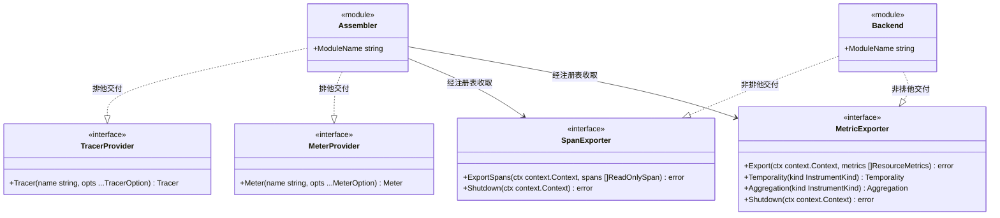
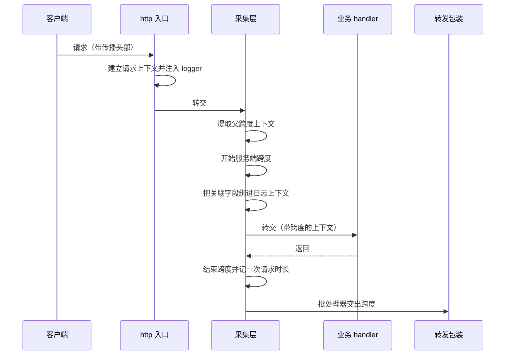

# observability

## 职责

`pkg/observability` 承载运行期的遥测：追踪与指标两种信号。产品是上游遥测 SDK 的 provider，加上请求路径的一层采集、一条出站注入工具与一条事件订阅。

- **交付上游 SDK 的 provider**，追踪与指标各是一个功能，两者由同一个装配器模块排他交付。
- **请求路径的采集**：从入站头部提取父跨度上下文、开始一个服务端跨度、把关联字段绑进日志上下文、结束跨度，并记一次请求时长（[ADR-observability-instruments-2026-09-22](../../adr/adr-observability-instruments-2026-09-22.md)）。
- **出站注入**：把当前跨度上下文按上游的传播格式写进 `net/http` 客户端的出站头部（[ADR-observability-propagation-2026-09-22](../../adr/adr-observability-propagation-2026-09-22.md)）。
- **事件订阅**：把配置点名的领域事件转成短跨度（[ADR-observability-events-2026-09-22](../../adr/adr-observability-events-2026-09-22.md)）。
- **导出后端的扩展点**：一个导出目的地是一个模块，交付一个导出器功能（[ADR-observability-packaging-2026-09-22](../../adr/adr-observability-packaging-2026-09-22.md)）。

**与 [architecture](../architecture.md) 的「可观测性」一节的分界。** 那一节讲的是**装配期**的启动诊断：启用消解的结果、未启用模块及其原因，固定写 `os.Stderr`，由 `core` 与 `config` 产出。本模块承载的是**运行期**的信号，也就是[术语表](../../glossary.md)登记的「遥测」。两者没有代码、配置或时序上的交叠。

### 非职责

- **不提供日志这一种信号。** 结构化日志归 [log](design-log.md)。本模块只往日志上下文里绑关联字段，并为自己的一处失败写日志行；不定义日志字段的语义，不拥有日志的装配面。
- **不接管启动诊断。** 它发生在本模块构造之前，固定写标准错误。
- **不提供请求路径的 panic 兜底。** 兜底归 [http](design-http.md) 内建。本模块的采集层自带一次 `recover` 只为给跨度记错，记完原样抛出，见[采集层的跨度](#采集层的跨度)。
- **不判定健康。** 就绪与否是装配决策，本模块不提供探活路由，也不定义健康的含义。
- **不提供拉取式指标端点。** 指标只经配置的导出后端推出，见扩展点。
- **不提供性能剖析。**
- **不提供查询面、看板与告警。** 本模块只产生信号。
- **不定义信号的语义本体。** 跨度、属性、仪表、采样器与传播格式由上游库定义，本模块不包装、不另造等价抽象（[ADR-observability-library-2026-09-22](../../adr/adr-observability-library-2026-09-22.md)）。
- **不提供指标目录与命名词表。** 业务指标归产生该信号的模块自己上报，本模块只拥有自己采集层产出的那一个计量。
- **不登记脱敏规则。** 本模块写出的属性是一个闭集且不含敏感值；跨度与指标属性不经日志的处理链，本来就在脱敏层的判定面之外。
- **不提供数据库语句级跨度。** 列为扩展点。

## 术语表

以下术语的含义限于本模块。

| 术语 | 英文 | 定义 |
|---|---|---|
| 装配器 | assembler | 构造两个 provider、收取导出器、登记采集层与订阅的那个模块（`observability.otel`）。 |
| 导出后端 | export backend | 交付一个导出器的模块，把信号交给一种目的地（`observability.otlp`、`observability.stdout`）。 |
| 导出器 | exporter | 上游 SDK 的导出接口的一个实现，由导出后端在 `New` 中构造并交出。 |
| 采集层 | instrumentation layer | 装配器登记到监听端上的那个中间件层：提取、开始跨度、绑定关联字段、结束跨度。 |
| 转发包装 | forwarding wrapper | 装配器套在导出器外的装饰器：逐方法转发到内层，并在导出失败时写日志行。 |

## 外部接口契约

根包 `pkg/observability` 是接口包，**不登记任何模块**。它的对外面由类型别名、字段名常量与工具函数构成。

```go
// 上游类型的别名。交付与依赖都以它们为功能标识。
type TracerProvider = trace.TracerProvider          // go.opentelemetry.io/otel/trace
type MeterProvider  = metric.MeterProvider          // go.opentelemetry.io/otel/metric
type SpanExporter   = sdktrace.SpanExporter         // go.opentelemetry.io/otel/sdk/trace
type MetricExporter = sdkmetric.Exporter            // go.opentelemetry.io/otel/sdk/metric

// 绑进日志上下文的关联字段名。
const TraceIDKey = "trace_id"
const SpanIDKey  = "span_id"

// Propagator 返回本模块使用的传播器。它是一个本地值，不写上游的全局。
func Propagator() propagation.TextMapPropagator

// Transport 包住一个 RoundTripper，把当前跨度上下文写进出站头部。
func Transport(base nethttp.RoundTripper) nethttp.RoundTripper

// Exporters 是一个同时满足两个导出接口的值：导出后端在 New 中把自己的两个
// 导出器装进它交回，注册表的交付校验要求一个产物满足描述符声明的每一个功能。
type Exporters struct {
    Span   SpanExporter
    Metric MetricExporter
}
```

`Exporters` 由接口包提供，因为它组合的正是接口包自己定义的那两个接口，而写一个新的导出后端的人要先有它。两个导出接口各自声明一个 `Shutdown`，合到一个产物上就只有一次：它一次释放两个导出器，而装配器建的两个 provider 各自会调它一次——第二次是空操作，上游没有对「同一个导出器被释放两次」承诺过任何事。它在接口包而不在 `pkg/internal/`：共享单元装的是第三方客户端与测试夹具，它两者都不是。

接口包暴露的上游类型限于上表所列的别名。**这是本模块唯一被允许引入第三方类型的位置**：别名必须写出被别名的包，因而根包的依赖闭包含上游的追踪 API、指标 API 与 SDK 导出接口所在的包。SDK 导出接口上接口面的理由与 API 侧相同——本模块就是那个库的封装，导出器是本模块的扩展点，另造一层等价抽象只会让后端实现方在两套类型之间来回转换（[ADR-observability-library-2026-09-22](../../adr/adr-observability-library-2026-09-22.md)）。

`Transport` 与 `Propagator` 都只用标准库与上游 API，不 import `pkg/http`、不经注册表、不参与装配。`Transport` 是否被调用由调用点决定。

**生效的时机由构造顺序决定，不由声明决定。** `Transport` 从 `context.Context` 里取当前的跨度上下文；取不到就原样交出 `base`，不写任何头部、不报错。跨度不在上下文的调用点（后台任务、启动期）因而只是不注入，不是失败。

功能标识与交付方：

| 功能标识 | 交付方 | 排他 |
|---|---|---|
| `(*observability.TracerProvider)(nil)` | `observability.otel` | 是 |
| `(*observability.MeterProvider)(nil)` | `observability.otel` | 是 |
| `(*observability.SpanExporter)(nil)` | 各导出后端 | 否 |
| `(*observability.MetricExporter)(nil)` | 各导出后端 | 否 |

导出器功能的非排他性正是多目的地并存的机制：装配器把它们全部收下，转发包装逐个套上，一个目的地一个处理器。

**链上锚点用本层实际交付的功能标识**：采集层的 `Provides` 取 `[]core.Token{(*observability.TracerProvider)(nil), (*observability.MeterProvider)(nil)}`，不另立一个只在这一层出现的标识。理由是 `pkg/http` 不校验 `Middleware.Provides` 与登记方描述符的一致性，也不提供登记方身份（见 [http](design-http.md) 的中间件一节）；用交付标识时，链上出现的名字与模块真交付的东西同源（[ADR-observability-anchor-2026-09-22](../../adr/adr-observability-anchor-2026-09-22.md)）。

各实现子包导出自己的模块名常量，配置命名空间的取值与它相同：

```go
const ModuleName = "observability.otel"     // pkg/observability/otel
const ModuleName = "observability.otlp"     // pkg/observability/otlp
const ModuleName = "observability.stdout"   // pkg/observability/stdout
```

命令树按名纳入模块，宿主写的是这些常量。这些命名空间互不相交。

## 依赖

根包只 import 上游的追踪 API、指标 API、两个 SDK 导出接口所在的包。它不 import 本仓库的任何模块：类型别名不需要 `core`，两条工具函数不收也不交任何模块产物（功能标识由写 `Provides` 的那一方构造，`(*TracerProvider)(nil)` 指向的就是别名本身）。它同样不 import `pkg/config`（不声明配置）与 `pkg/log`（只给出字段名常量，不取 logger、不写记录）。

各实现子包 import `pkg/core`（`init` 中登记）、`pkg/config`（声明并读取自己的配置）、根包，以及自己所绑的后端。装配器另 import `pkg/log`（取 logger 用于导出失败的日志行）。

**装配器对日志功能的依赖是必需的。** 日志模块排他交付它的功能，而排他交付的提供者不被依赖闭包展开，因此运行级纳入装配器的命令都必须在命令树上点名日志模块，否则启动以缺提供者失败。代价是命令树上多一行；换来的是一条能定位的启动失败，而不是日志静默落到进程根 logger 那条只写标准输出的链上。

**依赖预算按包分档判定，按包级 import 清单比对。** 根包的预算是标准库、本仓库的模块，加上上游追踪 API、指标 API 与 SDK 导出接口所在的包；实现子包的预算另加自己所绑的库。判定不区分别名与普通使用——那不是依赖扫描能判的性质。分档与[打包](#打包)一节所列的目录结构一致。

### 打包

```
pkg/observability            接口包，不登记模块
pkg/observability/otel       装配器，登记 observability.otel
pkg/observability/otlp       导出后端，登记 observability.otlp
pkg/observability/stdout     导出后端，登记 observability.stdout
```

实现子包之间互不 import，跨子包的引用一律指向根包。本模块不设共享单元：抽取判据是两个实现子包共用同一份第三方客户端构造或测试夹具，而各导出后端各绑各的库、装配器独占 provider 的构造，判据不触发。两个导出后端唯一共用的东西是产物类型 `Exporters`，它住在接口包——判据同样不触发，因为它既不是第三方客户端也不是夹具，而是一个由该包自己定义的两个接口组合出来的值。

`observability/otlp` 与 `observability/stdout` 各自绑定自己的传输库（前者含 gRPC 与 protobuf）。只 import 接口包或装配器的宿主，其 `go.mod` 不带这些库。

方向满足架构不变量：本功能目录位于 `core`、`config`、`log` 之上，不 import 其中任何一个模块的实例。

## UML 图

功能与交付方。两个 provider 功能由同一个模块排他交付；导出器功能由多个模块非排他交付，装配器全部收下，每个套一层转发包装。



一次入站请求的处理次序。采集层位于请求上下文建立那一层之内、全部登记层之外由 `http` 内建的兜底层之内；跨度覆盖它之内的每一层与 handler。



## 核心数据结构

装配器的配置：

```go
type Config struct {
    ServiceName string   `config:"service-name"`   // 上游的 service.name，必填
    SampleRatio float64  `config:"sample-ratio"`   // [0,1]

    Batch struct {
        MaxQueueSize       int           `config:"max-queue-size"`
        MaxExportBatchSize int           `config:"max-export-batch-size"`
        BatchTimeout       time.Duration `config:"batch-timeout"`
        ExportTimeout      time.Duration `config:"export-timeout"`
    } `config:"batch"`

    Metric struct {
        Interval time.Duration `config:"interval"`
        Timeout  time.Duration `config:"timeout"`
    } `config:"metric"`

    ShutdownTimeout time.Duration `config:"shutdown-timeout"`
    Endpoints       []string       `config:"endpoints"`   // 在哪些监听端登记采集层
    Events          []string       `config:"events"`      // 订阅哪些事件类型
}
```

`service-name`、`sample-ratio` 与两个清单在 provider 构造之前就被需要，批处理、导出周期与停机上界是 provider 的构造选项，因此都属于配置（[ADR-observability-config-2026-09-22](../../adr/adr-observability-config-2026-09-22.md)）。本模块不声明任何设置项。

**默认值由承载结构体承载，不由指针区分。** 解码器对一个没有任何来源给出取值的字段留它原样，而承载结构体已经预填了默认值；`batch` 与 `metric` 是单个结构体而不是容器，主配置源给出其中一个叶子不会把其余叶子打回零值。字段因此是值类型：键缺席时它保持承载结构体里的默认值，显式写 `0` 时它真的是零，下表两种情形由此分开。需要指针的是容器叶子（结构体列表与映射），那里主源是整体替换——本模块没有那种叶子。

| 字段 | 默认 | 显式 `0` 的含义 |
|---|---|---|
| `batch.max-queue-size` | 上游的默认值 | 同缺席，交回上游 |
| `batch.max-export-batch-size` | 上游的默认值 | 同缺席，交回上游 |
| `batch.batch-timeout` | 5s | 拒绝，启动失败 |
| `batch.export-timeout` | 30s | 拒绝，启动失败 |
| `metric.interval` | 60s | 拒绝，启动失败 |
| `metric.timeout` | 30s | 拒绝，启动失败 |
| `shutdown-timeout` | 10s | 拒绝，启动失败 |

时长为零使该处失去意义而不是关闭它：批处理的超时为零意味着每一批都立即失败，导出周期为零意味着读数的间隔不存在。两个整型项的零留给「取上游默认」，而本模块不写下那个默认：上游把零读成容量为零的队列，不是读成默认，因此装配器把上游自己导出的默认常量代入，本模块里没有第二份 2048 与 512。

导出后端的配置，`observability.otlp`：

```go
type Config struct {
    Endpoint       string        `config:"endpoint"`        // 必填，不含凭据
    Protocol       string        `config:"protocol"`        // grpc / http
    Insecure       bool          `config:"insecure"`
    Headers        []string      `config:"headers"`         // 形如 k=v
    ProbeAtStartup bool          `config:"probe-at-startup"`
    ProbeTimeout   time.Duration `config:"probe-timeout"`
}
```

`headers` 的元素承载凭据，因此它只接受主配置源与环境变量两个来源，不进命令行——命令行参数会出现在进程列表里。这一条适用于配置里承载凭据的每一项（[ADR-observability-config-2026-09-22](../../adr/adr-observability-config-2026-09-22.md)）。

`observability.stdout` 的配置只有一个布尔项 `pretty`，默认 `false`。

各命名空间的输入项一律**只接受主配置源与环境变量**，不声明命令行来源。取值描述的是部署形态（身份、目的地、凭据），环境变量正是部署工具使用的层；而命令行名在配置库里是全局平铺的命名空间，声明它就要为每一项起一个带前缀的长名，换不来这一侧用得上的东西。

## 核心算法与流程

### 装配器的各阶段

| 阶段 | 行为 |
|---|---|
| `Prepare` | 取配置读取面（取不到即以包裹 `core.ErrMissingProvider` 的错误返回），解码自己的命名空间，校验取值，表态 `StateEnabled` |
| `New` | 取 logger；经注册表收全部导出器；按[构造次序](#provider-的构造次序)建两个 provider；返回同时实现两个 provider 接口的产物 |
| `Migrate`、`Start`、`Serve`、`Stop` | 无动作 |
| `Init` | 配置点名了监听端时取路由登记面并逐端登记采集层；点名了事件类型时取总线的功能并逐类型订阅。两份清单里的重名各只生效一次，见下 |
| `Close` | 以 `shutdown-timeout` 为上界依次关停两个 provider，失败聚合后返回 |

`Prepare` 只读自己那份配置与预置产物，不读任何别的模块的 `Prepare` 结果。`New` 取到的 logger 长期持有，用于导出失败的日志行；它写的是配置的目的地，不是进程根 logger 那条只写标准输出的链。

**两份清单里的重名各只生效一次。** 入口模块的登记面按调用逐次追加、不去重，总线也一样，所以照清单逐个调用会把同一层装两遍：那个端的每条请求因此开两个服务端跨度、在直方图里记两次，从外面看是流量翻倍；同一个事件类型订两遍则每个事实派两个跨度。重名的意图是那一个名字，重复的条目因而被丢掉，并写一行说明——一份与自述不符的配置没有别的途径能被宿主发现。

`Init` 里的取用**只在配置点名了对象时才发生**：`endpoints` 为空时不取路由登记面，`events` 为空时不取总线的功能。一个不暴露任何监听端的后台进程因此不会因为装配了本模块而要求一个入口模块在场。点名了而该功能在本次运行取不到，即启动失败，错误原样外传，本模块不为它另造名字。

转发的排序：`pkg/log` 的 logger 与导出器都要在装配器之前构造完成。前者的顺序由描述符上的必需依赖给出，后者由标注 `Optional` 的导出器依赖给出——它们在场时照常参与构造定序，缺席时不构成错误。

### provider 的构造次序

次序是承重的：

1. 经注册表收全部导出器，逐个套上转发包装。
2. 以已包装的指标导出器构造指标 provider 的读数器。
3. 以已包装的追踪导出器构造追踪 provider。
4. 返回同时实现两个 provider 接口的产物。

包装必须先于 provider 构造：provider 在构造时持有导出器，构造之后再包一层，那一层不在导出路径上，转发包装的日志行永远不会写。第 2 步与第 3 步之间没有次序要求。

**转发包装以内嵌的方式转发到内层。** 包装内嵌导出器接口，它的每一个方法——包括与导出数据无关的那些：指标的时间性、聚合选择、强制刷出、两者的关闭——都原样传到内层。手写的转发要维护一份与上游接口对齐的清单：漏掉一个，指标的时间性与聚合会静默回到上游默认值，而关闭漏转发会让末批数据在停机时丢失（[ADR-observability-anchor-2026-09-22](../../adr/adr-observability-anchor-2026-09-22.md)）；上游在这两个接口上新增方法时，那份清单还要跟着改。内嵌没有这份清单可漏。

转发包装在导出调用返回错误时写日志行：**连续失败的首次**写一行，恢复之后再写一行，中间的重复失败不再写。状态是该包装自己持有的一个标志，受一把互斥量保护。写出的行经 `New` 中持有的 logger 进配置的目的地。

### 采集层的跨度

采集层在被登记的监听端上包在全部登记层之外、请求上下文建立那一层的内侧，因此它看得到该端每一条请求，也看得到它之内每一层的耗时。它的动作按序如下：

1. **提取**：用本模块的传播器从入站头部取出父跨度上下文。取不到就当作没有父跨度，请求照常处理。
2. **开始跨度**：以提取结果（或空上下文）为父，开始一个服务端跨度，名称取该端与方法。方法按与计量同一个折叠规则处理，理由也相同：跨度名与指标维度一样被后端索引，只在指标一侧收窄基数，等于把基数从一个信号挪到另一个。
3. **绑定关联字段**：把跨度与跨度的标识经 `log.WithAttrs` 写回上下文，键名是本模块导出的两个常量。这一步只做绑定，不做注入——日志上下文里的 logger 由产生上下文的那一方注入（见 [log](design-log.md) 的首次注入归属）。
4. **转交**：把带跨度的请求交给内层。
5. **结束与计时**：内层返回后结束跨度，并记一次请求时长，属性取自下表。状态码取 handler **第一次**写下的那个：第二次 `WriteHeader` 被服务端忽略，记最后一次会报出一个调用方从未见过的码。handler 抛 panic 而一个字节都没写时，记的是入口模块的兜底层会给出的那个内部错误——记 recorder 未被动过的初值，等于把每一条 panic 请求都放进成功那一档。

**本层自带一次 `recover`。** 它位于 `http` 内建的兜底层之内，内层抛出的 panic 因此先穿过本层。采集层接住它、给跨度记下错误与状态、原样再抛出去：吞掉它等于取消入口模块的兜底承诺，而写出响应不是本层的职责。少了这一次 `recover`，panic 请求的跨度仍是结束并导出的（终止动作会执行），只是不带错误标记与状态。

**重抛之所以安全，靠的是入口模块那一层确实在场。** 它的落地状态见 [http](design-http.md) 的实现状态表：在兜底层落地之前，从本层抛出去的 panic 落到 `net/http` 的默认处置，连接被丢弃、调用方拿不到任何响应——那时直方图里报出的内部错误是一个预测，而不是已经发生的事。

**包住响应写出者的层必须把可选接口转发出去。** `Flusher`、`Hijacker` 这类接口在包装之后不再直接可见，本层要么显式转发，要么提供 `Unwrap`，否则对它们做类型断言的处理器在该端点上静默失效（见 [http](design-http.md) 的中间件一节）。

### 请求时长的计量

一个直方图，名字与单位、以及它携带的属性，构成一张固定的对外面（[ADR-observability-instruments-2026-09-22](../../adr/adr-observability-instruments-2026-09-22.md)）：

| 属性 | 取值 |
|---|---|
| `http.request.method` | 九种标准方法之一，其余一律折叠为 `_OTHER` |
| `http.response.status_code` | 响应状态码 |

**不携带路由。** 采集层在路由引擎之外，请求尚未分发，链上的层拿不到「这次请求会派发给哪条模式」；引擎接缝只暴露 `ServeHTTP` 与 `Handle`，已挂载的清单是实现的内部细节。为一个取不到的属性发明来源，会让同一个值在不同引擎下含义不同。

**不携带租户。** 租户标识只出现在事件派生的跨度上，见[事件订阅](#事件订阅)。

方法折叠把基数限制在一个闭集内；状态码本身就是闭集。除此之外本模块不限制任何属性的基数，业务模块自报的属性也不在它的管辖内。

### 事件订阅

`events` 点名的每一个类型名，装配器在 `Init` 中向总线订阅一次。订阅回调把该事件转成一个**短跨度**：名称为事件类型，属性含租户标识与载荷的字段。**不转成计数**：计数目录归产生信号的模块，本模块不替它们决定指标的形态与命名。

**载荷按字段名结构化读取**，不做类型断言、也不期待与发布方共享静态类型；读不出的字段跳过，整条读不出的事件丢弃。**租户取自总线自带的那个字段**，不另立来源。

**跨度的起止时间是订阅回调收到它的时刻，不是事实发生的时刻。** 总线的事件不带时间戳，因此事件派生的跨度只能落在消费时间轴上，不能与产生它的业务跨度对齐。

总线投递的承诺是下界：发布返回成功不等于订阅者收到，不承诺次数与顺序，「某条事件丢了」不可判定。以它为来源的观测面因此可能缺样，见[非保证](#非保证)。

### 关停时的刷出

`Stop` 无动作。`Close` 以 `shutdown-timeout` 为上界，依次关停追踪 provider 与指标 provider：关停会先把批处理器与读数器里的在途数据刷出，再释放资源。超时则切断在途导出，剩余记录丢失且不产生信号。

上界只能来自配置：`Stop` 与 `Close` 收到的上下文已被剥掉取消（见 [core](design-core.md) 的阶段一节），排空的界在上下文里表达不出来；而注册表不对停机施加超时。

**这一份上界由两个 provider 与它们各自的导出器共用，先到先得。** 装配器的 `Close` 在同一个截止时刻下依次关停两个 provider，而每个 provider 里的导出器又共用它那一次的窗口：一个目的地刷得慢，就把其余几个的排空窗口一起用光，它们拿到的是一个已经过期的上下文，末批数据被立刻取消。这是「以 `shutdown-timeout` 为上界」的直接后果，配置改不动它——把它调长只延长总预算，不改变谁先到。

`Close` 必须在从未执行过 `Init` 或 `Start` 的实例上可用，也必须自身有界——回滚路径会在这样的实例上调用它。

### 导出后端的各阶段

| 阶段 | 行为 |
|---|---|
| `Prepare` | 取配置读取面，解码自己的命名空间，校验协议名与头部元素的形状，表态 `StateEnabled` |
| `New` | 按协议构造两个导出器并交出；`probe-at-startup` 为真时先做一次有界连通性探测 |
| `Init`、`Start`、`Serve`、`Stop` | 无动作 |
| `Close` | 无动作 |

**`Close` 无动作是因为导出器的生命周期归 provider**：provider 在关停时回调它持有的导出器的关闭方法。导出后端交出导出器之后不再持有它，重复关停会与 provider 的那一次相撞。**接受的代价**：装配在收取导出器之后、provider 构造之前失败时，没有任何一方关闭它们。导出器是无状态的客户端，代价止于一次未被释放的连接。

**探测落在 `New` 而不是 `Prepare`。** `Prepare` 对本次命令纳入的每个模块执行，包括那些只取表态、不构造任何东西的浅深度命令；把一次网络往返放进去，会让一条只打印版本、不装配运行时的命令也去拨那个端点，端点暂时不可达就使它失败。`New` 只在真正构造时执行，探测因而跟着「这次运行确实要用它」走。探测的界由 `probe-timeout` 给出。

## 错误与失败语义

装配期的错误一律终止启动。哨兵如下，未列出的失败原样外传、不另造名字。

| 哨兵错误 | 所在模块 | 触发条件 |
|---|---|---|
| `ErrEmptyServiceName` | `observability.otel` | `service-name` 有值但为空串 |
| `ErrInvalidSampleRatio` | `observability.otel` | `sample-ratio` 不在 `[0,1]` |
| `ErrInvalidBatchParam` | `observability.otel` | 批处理的两个整型项为负 |
| `ErrInvalidDuration` | `observability.otel` | 上表规定「拒绝零」的时长为零或负 |
| `ErrUnknownProtocol` | `observability.otlp` | `protocol` 不是 `grpc` 或 `http` |
| `ErrInvalidHeader` | `observability.otlp` | `headers` 的元素不是 `k=v` |
| `ErrInvalidDuration` | `observability.otlp` | `probe-timeout` 为零或负 |
| `ErrExporterUnreachable` | `observability.otlp` | 启用了启动探测而端点不可达 |

`ErrInvalidSampleRatio`、`ErrUnknownProtocol` 与 `ErrInvalidHeader` 的文本要列出合法取值或形状，取值都在闭集内，列出它即给出修复动作。`service-name` 缺值走配置的必填判定，本模块不另立名字；有值而为空串是另一种输入，由本模块自己的哨兵承接。

原样外传的失败：配置读取面缺席（`core.ErrMissingProvider`）、端名未在配置里声明（`http` 的哨兵）、事件点名而总线功能取不到（`core.ErrMissingProvider`）。

排他冲突不由本模块判定：第二个仍然启用的 provider 提供者出现时，由注册表在消解中判冲突并点名双方。

### 端点不可达

**默认不是启动失败。** 导出器是惰性连接，构造成功即认为装配成功；端点不可达与投递失败都在运行期由上游 SDK 自行重试与缓冲，缓冲溢出即丢弃。启动期不降级判的是模块在启动期能确定的失败，而惰性连接是上游库自己的契约，探测它等于发明一个库没有的语义，并会拒掉采集端后起的正常部署。

**探测是一个配置开关。** `probe-at-startup` 为真时，导出后端在 `New` 中做一次有界连通性探测，不可达即返回 `ErrExporterUnreachable` 终止启动。这把「端点不可达算部署前提不具备还是运行期偶发」的判据交回配置作者。配置里 `endpoint` 是必填项，它挡住的是「忘了配」，不是「配错了」。

### 不产出数据与不完整

这些情形都不失败：

- **一个导出后端都没有。** 装配器照常启动，两个 provider 照常交出，跨度与指标不落到任何目的地。本模块向日志写一行说明：一个不产出任何数据的观测装配与一个故障的观测装配从外部看无从分辨，而这一行是唯一把它们分开的东西。
- **采样率为零。** 采样器把全部跨度采空，指标照常上报。本模块向日志写一行说明，理由与上一条相同。
- **某个监听端没被点名。** 那个端上没有采集层，该端的请求不产生跨度与计量，启动期不失败、诊断里也没有一行。
- **事件类型名写错。** 订阅静默不中，类型名与发布方之间的对应没有编译期联系。

**以上任一情形的察觉途径都不是启动诊断**：诊断覆盖的是启用集之外的模块，而这里每一个都是「模块在场、配置使然」。

### 非保证

以下性质是装配、配置与上游库共同的结果，不是本模块的承诺。列出的察觉途径是现有机制能给的全部；没有察觉途径的那些，也就是写不出判据的那些。

- **存在。** 本模块未被本次命令纳入时，两种信号都不存在，没有一层会拦下，也不进启动诊断——诊断不覆盖「已登记而未被纳入」这一档。察觉途径是注册表的按名查询：它对未纳入的名字给出禁用，原因写明它不在这条命令的参与集里。
- **覆盖面。** 受采集的监听端由配置点名。漏写一个端不失败、不进诊断。察觉途径是各端组装时写出的链清单：漏挂的那一行少一个层名。按名查询的启用结果在这一档上没有判别力——它答的是模块的状态，不是某份声明挂在哪个端上。
- **位置。** 采集层不是链上最外层：任何 `Order` 更小、或不指向本功能的层都排在它之外，那一段的耗时与其中抛出的 panic 都不进跨度。察觉途径同上，链清单给出组装后的次序。
- **事件流完整。** 经总线取得的领域事实可能缺样，且缺样不可判定。事件派生的跨度还落在消费时间轴上，不与产生它的业务跨度对齐。
- **导出。** 零导出后端与零采样率各写一行说明；端点写错主机名在默认配置下不产生任何信号；导出失败只有转发包装写出的首次与恢复两行日志，而那两行经日志模块的链写出——链本身可以被配置成不输出任何记录。
- **停机。** 装配器的关停早于入口模块的在途排空结束：排空窗口里落在装配器关停之后的那一段，其跨度不被导出。刷出的上界是两个 provider 与它们各自的导出器共用的一份，一个目的地刷得慢就让其余几个的末批数据一并被取消，见[关停时的刷出](#关停时的刷出)。
- **出站传播。** `Transport` 不被任何一层自动接管，未使用它的调用点会让跨进程的链路从客户端一侧断开，不产生信号。
- **属性不在脱敏覆盖内。** 跨度与指标属性不经日志的处理链，调用点自己负责不把凭据写进属性。
- **写出者的可选接口。** 采集层包住响应写出者，除显式转发与 `Unwrap` 之外的可选接口在该端点上静默失效。
- **锚点的一致性。** 链上某一层声称代表的功能，与它所属模块真交付的功能之间没有校验：`pkg/http` 不校验，注册表看的是描述符自己的交付声明。两者不一致时没有任何一层会报。

## 并发与事务边界

两个 provider 与它们持有的处理器、读数器在上游 SDK 的契约下可被多协程并发使用，本模块不为它们加锁。

装配完成后本模块自身没有可变的共享状态，例外只有下列几处：

- **转发包装的失败标志**，由该包装自己的一把互斥量保护，只在导出调用返回错误时写。
- **传播器**。`Propagator` 返回的值在包初始化时构造一次，此后只读。

采集层的每次请求状态都在该请求自己的上下文与跨度里，不跨请求共享。

## 扩展点

**新增一种导出目的地**是新增一个实现子包：它登记一个模块，`Provides` 交出 `(*observability.SpanExporter)(nil)` 与 `(*observability.MetricExporter)(nil)`，在 `New` 中按自己的配置构造导出器。装配器经注册表收全部导出器，不需要认识任何后端。宿主在命令树上点名要哪些后端。

**拉取式指标**（一个由宿主挂到路由上的处理器）列为将来的扩展点：它交付一个非排他的功能，方法返回一个 `net/http` 的处理器，由宿主在自己的路由上挂载。本模块不自己挂：监听端的集合来自配置，模块枚举不出端名，猜一个端名即静默不生效。

**数据库语句级跨度**列为将来的扩展点：走一个包装 `database/sql` 驱动接口的实现子包，那里拿得到真实耗时，也不必让本模块声明对数据库功能的构造期依赖。

## 实现状态

| 功能 | 状态 | 代码 |
|---|---|---|
| 接口包的类型别名与字段名常量 | 已实现 | `pkg/observability/observability.go` `TracerProvider`、`MeterProvider`、`SpanExporter`、`MetricExporter`、`TraceIDKey`、`SpanIDKey` |
| 传播器与出站注入工具 | 已实现 | `pkg/observability/observability.go` `Propagator`、`pkg/observability/transport.go` `Transport` |
| 装配器的描述符与各阶段行为 | 已实现 | `pkg/observability/otel/module.go` `Module`、`prepare`、`wire`、`shutdown` |
| provider 的构造 | 已实现 | `pkg/observability/otel/providers.go` `newProviders`、`queueSize` |
| 转发包装与导出失败的上报 | 已实现 | `pkg/observability/otel/wrapper.go` `spanExporter`、`metricExporter`、`notifier` |
| 请求路径的采集层 | 已实现 | `pkg/observability/otel/layer.go` `instrument`、`recorder` |
| 请求时长的计量 | 已实现 | `pkg/observability/otel/layer.go` `newRequestDuration` |
| 事件订阅 | 已实现 | `pkg/observability/otel/events.go` `spanFor` |
| 配置声明与解读 | 已实现 | `pkg/observability/otel/config.go` `Config`、`schema`、`pkg/observability/otlp/otlp.go` `Config`、`pkg/observability/stdout/stdout.go` `Config` |
| OTLP 导出后端 | 已实现 | `pkg/observability/otlp/exporters.go` `newExporters`、`build`、`probe` |
| 标准输出导出后端 | 已实现 | `pkg/observability/stdout/exporters.go` `newExporters` |
| 哨兵错误 | 已实现 | `pkg/observability/otel/errors.go`、`pkg/observability/otlp/otlp.go` `ErrUnknownProtocol`、`ErrInvalidHeader`、`ErrExporterUnreachable`、`ErrInvalidDuration` |
| 依赖预算的两种判定 | 已实现 | `pkg/observability/deps_test.go` `TestTheInterfacePackageReachesNoBackendLibrary`、`TestTheAssemblerReachesNoBackendTransport` |
