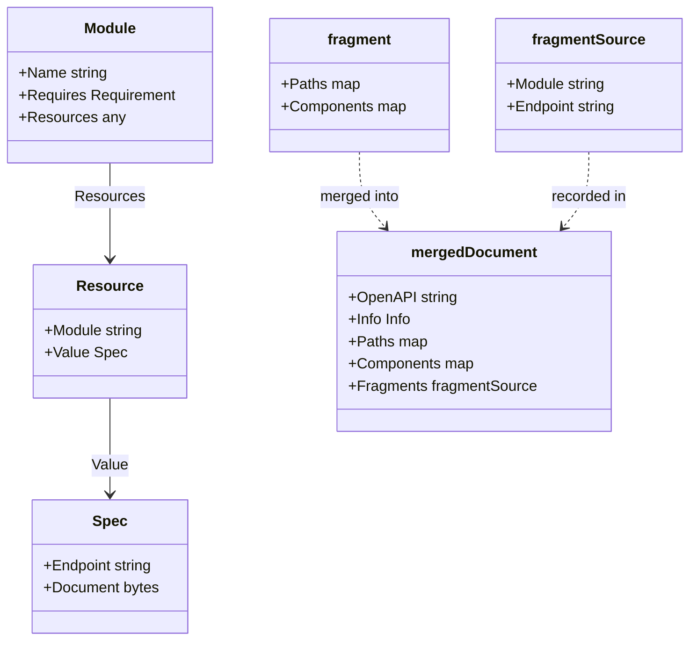
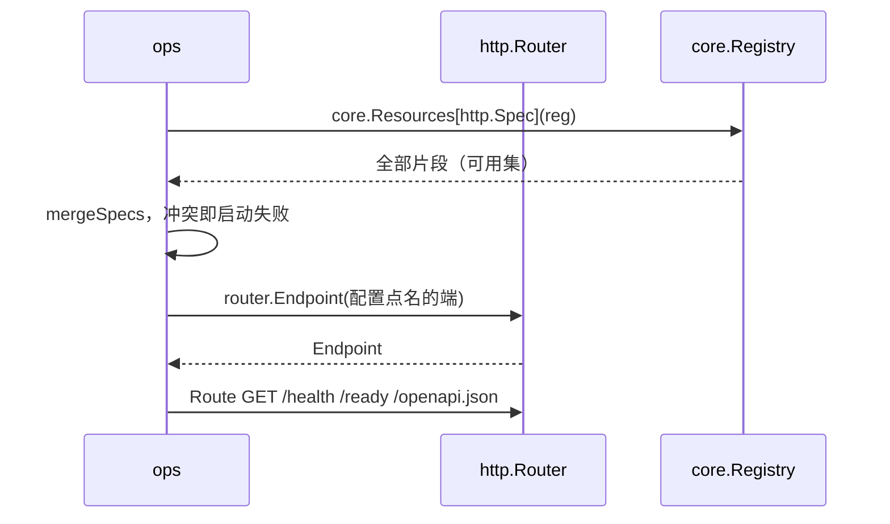

# ops

## 职责

`ops` 是进程的运行面：把探针路由与一份合并后的 API 规格挂到配置点名的端点上。它不交付任何功能——描述符里没有 `Provides`，它成为一个模块靠的是生命周期回调与它自己声明的 `speedhttp.Spec` 资源。

路由是 `GET /health`、`GET /ready`、`GET /openapi.json`：`/health` 答进程存活，`/ready` 答进程可否服务，`/openapi.json` 答这个二进制提供哪些 API。它们挂在**不设防的端**上——探针不带凭据、不指名租户，因而不经过认证、租户解析或授权层，本模块也不在 handler 内判定权限。

把各模块声明的 OpenAPI 片段合并成一份文档是本模块的核心：取材域、冲突的判定时机与点名的对象都在本模块，见「核心算法与流程」。

### 非职责

- **不交付任何功能。** 本模块不 `Provides` 任何接口，别的模块取不到它交出的东西；它只登记一段生命周期与一份资源声明。
- **不做业务健康检查。** `/ready` 报告的是进程层可服务——各端点在接受请求、数据库应答——不表示任何租户、任何业务已就绪，也不读业务状态。
- **不设防，不判定权限。** 与 [sms](design-sms.md) 的管理面相反，本模块的路由挂在探针端上，不做 handler 内判定：这里无对象可判——探针不带身份、不指名租户。
- **不校验片段与模块实际登记的路由是否一致。** 两者是各自维护的事实，允许漂移，不一致不产生任何失败信号，与 `pkg/http` 的 `validateSpec` 同口径（见 [http](http/design-http.md)）。
- **不重算合并结果。** 片段是静态声明，随二进制固定，`Init` 合并一次后不再重算，不订阅任何变更。

## 外部接口契约

### 交付的功能

本模块不 `Provides` 任何功能。它登记为一个模块，靠的是描述符里的名称与各阶段回调，以及它自己声明的 `speedhttp.Spec` 资源；描述符的形状由 [core](design-core.md) 定义。

```go
// 描述符形状。
core.Module{
    Name: "ops",
    Requires: []core.Requirement{
        {Token: (*speedhttp.Router)(nil)},
        {Token: (*log.Logger)(nil), Optional: true},
        {Token: (*db.Database)(nil), Optional: true},
    },
    Resources: []any{
        // Prefix 与 Version 留空：三条探针路由在 ops 监听的根上。
        speedhttp.Spec{Endpoint: /* 配置点名的端，缺省 ops */, Document: opsOpenAPI},
    },
    New:   ...,
    Init:  ...,
    Stop:  ...,
    Close: ...,
}
```

**`Requires` 约束的主体是把本模块纳入命令的每个宿主。** `(*speedhttp.Router)(nil)` 必需：本模块挂路由、读端名都经它。[http](http/design-http.md) 排他交付 `Router`，纳入本模块因而也把 `http` 拉进装配。`(*log.Logger)(nil)` 与 `(*db.Database)(nil)` 可选：有数据库时就绪探针一并探它一次，没有数据库时 `/ready` 只报各端可服务。

**`Resources` 里是本模块自己的 `Spec`。** `Document` 是本模块以 `//go:embed` 读进来的 `openapi/ops.json`；它是本模块对外的声明面，供别的读取方按类型收集——`pkg/http` 交出的片段、别的消费者读到的输入，都在同一份可用集里。

**这份声明里的 `Endpoint` 是缺省端，不是配置点名的那个。** 资源是 `init` 期的静态声明，那一刻配置还没读，**声明里写不进一个当时还不存在的值**——这条约束来自 [core](design-core.md) 的资源模型，不是本模块的选择。配置点名的端在 `Init` 里取到：本模块在那时把**自己这份片段**的 `Endpoint` 改写成配置端，再交给 `Merge`，使合并文档把本模块三条 operation 的 `x-endpoint` 标成它真正服务的端。**声明资源上的那个字段因此停在缺省值**，读它的一方（例如一个只遍历资源、不跑生命周期的消费者）看到的是 `ops`。本模块自身的 `Requires` 与构造都不依赖它，运行时行为不受影响。

### 导出包 `pkg/ops/openapi`

合并不只被模块用到。命令树的 `gen` 命令要**离线**把同一份合并结果写进制品，而它**不构造任何模块**（[starters](design-starters.md)）——模块的 `Init` 在那条命令下根本不会跑。因此合并是一个**导出的纯函数**，模块与命令各自调它：

```go
// Merge 把若干片段合成一份文档。它不读注册表、不取能力、不碰生命周期。
func Merge(specs []core.Resource[speedhttp.Spec], opts Options) ([]byte, error)
```

`Options` 载 `Title`、`Version`、`Description` 与 `Servers`（分别对应 `ops.title`、`ops.version`、`ops.description` 与 `ops.servers`，模块从配置取，`gen` 命令从命令行取）。空值对应的顶层成员不写出。

**它是纯函数**：输入是片段与选项，输出是文档或错误，没有别的输入。同一个二进制、同一组片段，模块在 `Init` 里合并的结果与 `gen` 写出的结果逐字节相同——两者的差别只在谁调用、把结果交付到哪里（一个挂在 `/openapi.json` 上，一个写进制品）。

**片段里的 path 是相对写法**：合并时按声明它的 `Spec.Prefix`、`Spec.Version` 与 `Spec.Scope` 拼成完整路径，冲突也按拼出的路径判定（[ADR-http-spec-path](../../adr/adr-http-spec-path.md)、[ADR-http-api-path-scopes](../../adr/adr-http-api-path-scopes.md)）。本模块自己的片段三者皆空，三条探针路由因而保持根路径。

`pkg/ops/openapi` **不登记模块**：它没有生命周期、不交付功能、不声明资源。它是这一能力目录下供两个调用方共用的实现，也是本能力唯一需要被模块之外调用的面。

### 路由

| 组 | 方法 路径 |
|---|---|
| 探针 | `GET /health` |
| 探针 | `GET /ready` |
| 文档 | `GET /openapi.json` |

路由挂在配置点名的端上，该端由宿主装配为不设防。`/health` 不读任何东西，只答进程存活。`/ready` 检查本进程声明的每个端点都在接受请求，并在有数据库时探它一次；任一失败在应答里逐项点名，好让探针的日志说得出是哪一半塌了。`/openapi.json` 答合并后的文档。

### 宿主可见面

- **模块名**：`ops`。宿主的命令树点模块名纳入，配置命名空间取同一取值。
- **配置命名空间与输入项**：`ops` 下的 `endpoint`（字符串，缺省 `ops`，取主配置源）——本模块挂路由、并写进自己 `Spec` 的端名；`title` 与 `version`（字符串，取主配置源）——写进合并文档 `info` 的标题与版本，与各片段的模块无关，`version` 缺省为空串；`description`（字符串）与 `servers`（字符串列表）——写进合并文档的 `info.description` 与顶层 `servers`，空值不写出。
- **探针端点**：`ops.endpoint` 点名的端上的 `/health`、`/ready`、`/openapi.json`。
- **合并文档的形状**：顶层 `openapi`、`info`（标题、版本与描述取自 `ops.title`、`ops.version` 与 `ops.description`）、`servers`（取自 `ops.servers`）、`paths`、`components`、`tags`（每个声明了片段的模块一条，按名字排序），以及扩展键 `x-fragments`（逐份片段的来源：模块与端）。每个 operation 带三个由合并写出的成员：`x-endpoint`（这条 operation 服务在哪个端上）、`tags`（声明它的模块名）与 `security`（它的访问级别；片段没写的一律补成受保护），`components.securitySchemes` 则由合并统一写出 `bearerAuth` 与 `sessionCookie` 两个载体。

### 对外接口面

- 模块名 `ops`、配置键 `ops.endpoint`、`ops.title`、`ops.version`、`ops.description`、`ops.servers`、路由的方法与路径、合并文档的扩展键 `x-fragments` 与 `x-endpoint`、operation 上的 `tags` 与 `security`、`components.securitySchemes` 的两个名字，是宿主与网关写下来、读进去的东西，改动它们是宿主可见的破坏性变更。
- `Spec.Endpoint` 的语义：它是声明模块写下的端名，一个未被声明的端不是错误——资源是静态声明，`http` 只保存它（见 [http](http/design-http.md)）。

### 非保证

- **合并结果在一次运行内不变。** 片段是静态声明，随二进制固定；`Init` 合并一次后不再重算，一次请求读到的就是那一份。
- **`/ready` 不表示任何业务已就绪。** 它报告进程层可服务：各端在接受请求、数据库应答。业务健康不在它的判据里。
- **不检测片段与实际登记路由的漂移。** 一份片段声明了一条没有登记的路由，或一条登记的路由没有片段，都不报错。

## 依赖

| 依赖 | 用途 |
|---|---|
| `pkg/core` | 模块描述符、生命周期回调、`Resources` 资源查询 |
| `pkg/http` | `Router`、`Endpoint`、`Spec`；挂路由、取片段 |
| `pkg/log` | 可选：停止与就绪的诊断 |
| `pkg/db` | 可选：就绪探针探它 |

**依赖方向自上而下。** `ops` 依赖 [http](http/design-http.md)、[core](design-core.md) 与可选的 `log`、`db`，不 import 任何更上层的能力目录，也不 import `authn`、`authz`——探针端不设防，本模块没有判定可做，因而落在这些之上而非之中。

## UML 图

本模块的结构是「一段没有交付物的描述符，读一组片段、产出一份文档」的关系。图里的形状看不出下列约束：本模块不 `Provides` 任何功能，图上只看得到它声明了一份 `Spec`；合并的取材域是可用集，冲突在 `Init` 期判、失败即启动失败，都不在类型的形状里。这些由「核心算法与流程」的正文承载。



`Init` 期的接线与合并的次序由时序图给出；路由与服务在它之后。



## 核心数据结构

| 概念 | 类型 | 说明 |
|---|---|---|
| 片段来源 | `fragmentSource` | 一份片段由哪个模块声明、为哪个端声明：`Module` 与 `Endpoint` |
| 片段 | `fragment` | 从一份 `Spec.Document` 读出的部分：`Paths`（路径到方法）与 `Components`（段到名字） |
| 合并文档 | `mergedDocument` | 本模块交出的规格：`OpenAPI` 版本、`Info`、`Servers`、`Paths`、`Components`、`Tags`、`Fragments` |
| 存活应答 | `health` | `{status}`；`/health` 的正文 |
| 就绪应答 | `readiness` | `{status, failures}`；`failures` 逐项点名失败的那一半 |

**合并文档带扩展键 `x-fragments` 与 `x-endpoint`。** `x-fragments` 列出参与合并的每份片段的来源（模块与端）；每个 operation 上的 `x-endpoint` 记下这条 operation 服务在哪个端上——一份文档描述多个端点，光凭路径说不出它由哪个端应答。

**分组与鉴权也由合并写出。** 每个 operation 的 `tags` 带上声明它的模块名，顶层 `tags` 汇总这些名字并按序排列，读者因而按 `x-fragments` 用的同一套词汇分组。宿主写制品时可以把一个 operation 的模块标签换成它自己的所有者标签（`gen` 对应用所有的操作这么做，并从顶层 `tags` 里摘掉该模块名）：一个 operation 只带一个标签，按标签分组的读者不会把它列两次。`security` 来自 operation 自己的访问级别；片段没写 `security` 的 operation 被补成受保护要求，公开必须显式声明为 `[]`。`components.securitySchemes` 由合并统一写出 `bearerAuth`（`Authorization: Bearer`）与 `sessionCookie`（`sid` cookie 及其带前缀的写法），片段只引用名字、不自定义载体（[ADR-http-contract-metadata](../../adr/adr-http-contract-metadata.md)）。

## 核心算法与流程

### `Init` 期的接线与合并

`New` 只取可选的 logger 与数据库，把产物建起来；`Init` 才解析 Router、合并、挂路由。次序如下：

1. `core.Resolve[speedhttp.Router](reg)` 取 Router，`router.Endpoint(<配置点名的端>)` 取到该端；端名未被声明即以 `ErrUnknownEndpoint` 失败。
2. `core.Resources[speedhttp.Spec](reg)` 取全部片段（可用集，见「取材域」）。
3. `mergeSpecs` 把片段合并成一份 `mergedDocument`；冲突即返回错误，启动失败。
4. 把路由 `/health`、`/ready`、`/openapi.json` 挂到该端上。

**判定在 `Init`，不在首个请求。** 片段是声明，随二进制固定；声明撞车是装配缺陷，`Init` 判出就应在这里失败，首个请求返回 500 会把一个装配缺陷伪装成一次运行故障。`Init` 落在 `http` 的登记窗口内——`Endpoint.Route` 的写窗口由 `http` 的 `Migrate` 打开、`Start` 关闭，`Init` 整段落在窗口里（见 [http](http/design-http.md)）。

### 合并与冲突

合并逐份读片段：一份 `Spec.Document` 解成 `fragment`，它声明的每个 `path` 与 `method` 并进文档，`components` 按段与名字并进文档。

**冲突即启动失败，点名的对象是来源**（[ADR-ops-spec-reader](../../adr/adr-ops-spec-reader.md)）：

- **operation 撞车。** 同一个 `path` 的同一个 `method` 被不同的模块声明，报错并同时点名两个模块与各自的端——这是唯一能把两份片段连回来源的地方。冲突跨端判：一份文档只持一条 operation，一条挂在两个端上的相同路由是文档分不开的两条 operation。
- **components 同名不同内容。** 两份片段声明同一段下同一个名字、内容不等，报错点名声明它的模块与那个名字。内容相等则并成一条，多份片段共用一个错误体 schema 是寻常情形。

**合并读的是声明，不是登记。** 一份片段声明了一条没有登记的路由，或一条登记的路由没有片段，都不报错——两份事实各自维护，允许漂移（与 [http](http/design-http.md) 的 `validateSpec` 同）。

### 取材域

**合并 OpenAPI 片段取可用集**（架构不变量 15，[ADR-ops-spec-reader](../../adr/adr-ops-spec-reader.md)）。来源是 `core.Resources[speedhttp.Spec](reg)` 的全体，与 `pkg/http` 里 `validateSpecs` 同口径。判据是「这个二进制提供哪些 API」是静态事实，比任何一次命令长寿：未运行、消解落选与只被静态级纳入的模块，其片段一律进合并。**这个消费点不做减法**：问的是这个二进制提供哪些 API，不是此刻在服务哪些；减法会让同一个二进制在两条命令下发布两份不同的规格，而声明本身没变。这条裁定是 [http](http/design-http.md) 交给读取方的——它交出全部片段、不让它们生效，`Spec` 文档明说合并与发布归读者，`ops` 就是那个读者。

### 就绪判定

`/ready` 每次请求现读本进程声明的每个端点（`Router.Endpoints` 逐个取 `Endpoint`，`Accepting` 为假即算一个 failure），以及有数据库时的数据库（取连接池，`PingContext` 失败即算一个 failure）。任一 failure 即答 `503` 加逐项清单，全通过即答 `200`。

## 错误与失败语义

| 情形 | 表现 |
|---|---|
| 配置点名的端未被声明 | `Init` 里 `router.Endpoint` 返回 `ErrUnknownEndpoint`，启动失败 |
| 片段不能被读成 JSON 对象 | `mergeSpecs` 报错并点名声明它的模块，启动失败 |
| 同一 path 同一 method 被不同模块的片段声明 | 报错同时点名两个模块与各自的端，启动失败 |
| components 同名不同内容 | 报错点名声明它的模块与那个名字，启动失败 |
| 某个端点不在接受请求 | `/ready` 答 `503`，`failures` 逐项点名 |
| 数据库不应答 | `/ready` 答 `503`，`failures` 逐项点名 |
| `/health` | 恒答 `200`，不读任何东西 |

**本模块不降级、不重试。** 合并失败即启动失败；`/ready` 每次请求现读各端与数据库，不缓存判定、不后台轮询。

## 并发与事务边界

- 合并结果在 `Init` 之后只读；路由只读不可变值，可被任意多协程并发调用。
- `/ready` 每次请求现探各端与数据库，不持状态。
- 本模块不落存储、不开事务、不预置实例。

## 实现状态

| 能力 | 状态 | 代码 |
|---|---|---|
| `ops` 模块（探针路由、OpenAPI 合并、就绪判定） | 已实现 | `pkg/ops/ops.go` `Module` |
| 探针路由的 operation 声明与片段生成 | 已实现 | `pkg/ops/operations.go`；`pkg/ops/openapi_generated_test.go` |
| `pkg/ops/openapi` 的 `Merge`（供模块与 `gen` 命令共用的纯函数） | 已实现 | `pkg/ops/openapi/openapi.go` `Merge` |
