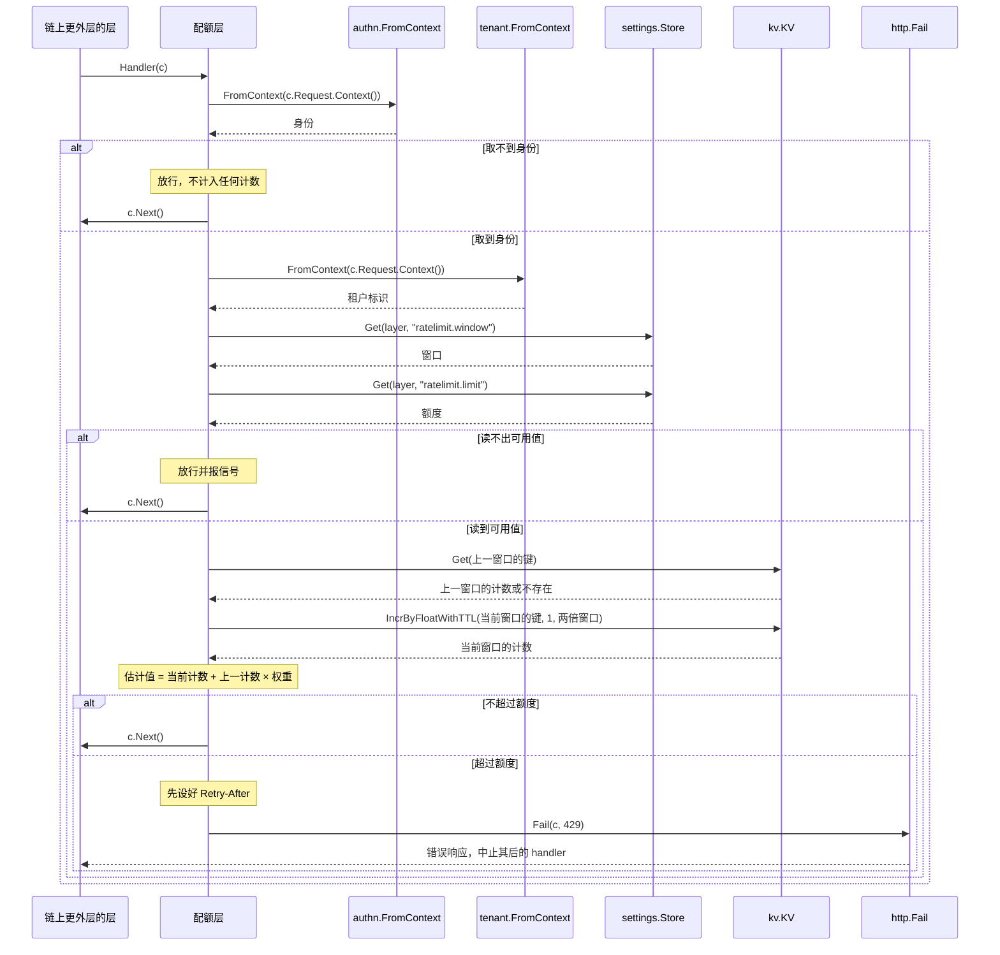
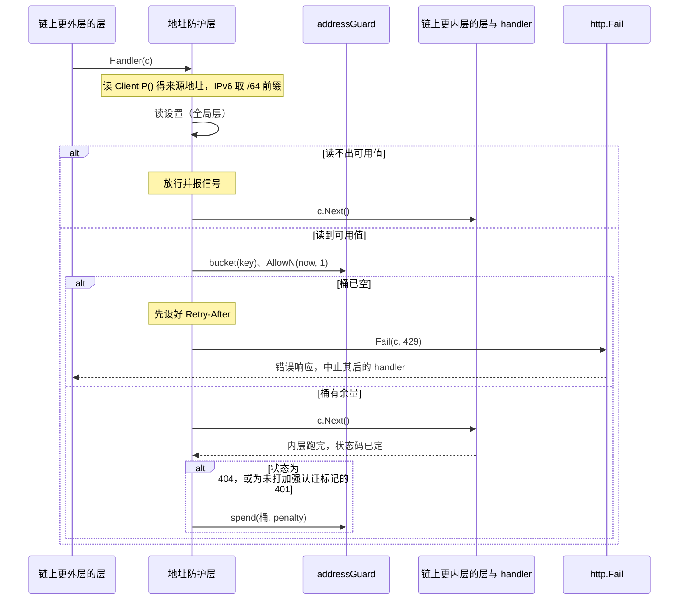

# ratelimit

本[模块](../../glossary.md)是请求链上的速率控制：配额层在身份确定之后按责任键计一个窗口内的额度，地址防护层在身份确定之前按来源地址粗筛。它拥有配额层与地址防护层的判定与计数，不拥有认证、租户解析、配额与计费、指标与路由级限流。读职责清单前应持有的一句话心智模型是：先按地址挡掉尚未表明身份的来源，再按身份给出公平额度；判不出可用值时放行，并把这件事单独报出。

第一遍的次序是职责、术语表、外部接口契约、依赖、UML 图、核心数据结构与核心算法与流程：职责与术语表给出两层控制的分工与词汇，外部接口契约与依赖给出交付标识、配置项与取用时机，UML 图给出两层各自的一次判定路径，核心数据结构与核心算法与流程说明窗口、权重、计数键与地址防护层，核心算法与流程的走查先跟两个请求的计数变化。错误与失败语义与并发与事务边界属查阅用；实现状态放在最后，用代码锚点核对声称已实现的部分。竞态与边界情形（两次读取夹进一次快照替换、窗口长度改动、后端不可达）是最后的自检项，与错误与失败语义一并核对。

## 职责

按主体限制请求速率，并按来源地址屏蔽攻击来源。本模块登记两层中间件，职责与链上位置各不相同：

- **配额层**在配置列举的每个端点上，对每一个带身份的请求取一次计数，超过该主体在本租户内当前窗口的额度即以 429 收口。它落在限流阶段（`StageThrottle`），排在身份确定之后。
- **地址防护层**在它自己的端名清单上，按来源地址在进程内存里计数，对反复被拒的来源以 429 收口。它落在防护阶段（`StageGuard`），排在身份确定之前，见地址防护层一节。
- 判定发生在链上，放行的请求与没有本模块时逐字相同：本模块不改写请求，也不改写入内的响应。
- 配额层的额度与窗口经设置声明并读取，按租户回退；地址防护层的数值一律取自全局层。
- 配额层的计数经键值原语，本模块不持有跨副本的状态；地址防护层的计数在进程内存里，代价见地址防护层一节。
- 计数后端不可达，或设置读不出可用值时放行，并把这件事单独报出。

### 非职责

- **不做配额与计费**（[ADR-ratelimit-scope](../../adr/adr-ratelimit-scope.md)）。速率是单位时间内的频次，配额是一段时间内的总量；配额要读受约束表里每个租户的数据量，那是应用自己的领域动作（见 [tenant](tenant/design-tenant.md) 的非职责）。本模块只回答一个主体此刻是不是发得太快。
- **不定义错误响应的结构。** 结构由入口模块决定：默认是 `application/problem+json`（[REF-rfc9457](../../references.md)），交付了 `ErrorResponder` 的模块整体替换它（见 [http](http/design-http.md) 的错误响应）。本模块先设好 `Retry-After`，再经入口模块的写出入口 `Fail` 写出 429，不自己写状态码与响应体。
- **不认证，不解析租户。** 身份由认证模块交付、租户由租户模块交付，两者都不在本模块内产生。
- **不提供路由级限流，也没有让别的模块按路由限流的途径。** 入口模块的 `Use` 作用于该端的全部路由，本层因此对配置列举的端上的每一条路由生效。只对一部分路由生效的层，入口模块的约定是由登记那些路由的一方在 `Route` 的 handler 序列里自己带上（见 [http](http/design-http.md) 的外部接口契约），而本模块的层与判定都不导出，`Limiter` 也不是可调用的接口，登记路由的一方拿不到可以放进那个序列的 handler。只限一部分路由的需求，由宿主自己写那一层。
- **不提供指标。** 失败信号是那一行标准错误，它不依赖日志链，也不依赖装配里可以缺席的指标功能（[ADR-ratelimit-failure](../../adr/adr-ratelimit-failure.md)）；本模块不取 `observability.MeterProvider`。日志模块不承接指标（见 [log](design-log.md)），指标功能归 [observability](design-observability.md)。
- **配额层不重试，也不降级到进程内计数。** 计数后端不可达即放行；降级到进程内计数会让每个副本各算一份，与“计数经共享原语”相悖，且失效形态是无声的。地址防护层不在此列：它的计数本来就在进程内存里，代价见地址防护层一节。
- **不挡来自大量地址的分布式洪水。** 地址防护层按来源地址计数，一个地址一个桶；分散在大量地址上的洪水它看不见，那类攻击的防线在边缘（CDN、WAF），不在应用层。
- **不维护可用性策略。** 一个主体被持续拒绝之后要不要升级处置，不在本模块内决定。
- **不做认证前的限流与失败退避。** 本层排在认证之内，取不到身份的请求一律放行，凭据尝试的失败退避与枚举防护由认证模块自备，状态在它自己的存储里，不借本模块，本模块也不为它增设维度（见 [design-authn-login](authn/design-authn-login.md) 的失败退避，口令表的退避见 [authn-gate](authn/design-authn-gate.md)，判据见 [ADR-authn-throttling](../../adr/adr-authn-throttling.md)）。

## 术语表

以下术语的含义限于本文档。

| 术语 | 英文 | 适用范围 | 定义 |
|---|---|---|---|
| 窗口 | window | 本文档 | 计数的记账周期，长度取自设置。键按窗口切分，一个窗口一个键。这个词指那个周期本身，不指“滑动窗口”这类算法的名字。 |
| 额度 | limit | 本文档 | 一个窗口内允许的请求数，取自设置。 |
| 来源地址 | address | 本文档 | 地址防护层计数的键，取入口模块经 `c.ClientIP()` 报出的客户端地址；IPv6 按 /64 前缀计数，其余按地址本身。 |

本模块据认证模块交付的身份上的责任键计数，把它当不透明的字符串：不解析它的内部结构，也不假定它的字符集。责任键的定义见 [authn](authn/design-authn.md) 的身份一节。本仓把“按主体限流”用作这类层的通称，本模块实际的取值维度是责任键。

## 外部接口契约

本模块的包名与模块名同为 `ratelimit`，包导出 `ModuleName` 常量供命令树点名，配置与设置也挂在同名命名空间下。根包即实现，接口与实现在同一个包里，不拆接口包与实现子包（[ADR-ratelimit-packaging](../../adr/adr-ratelimit-packaging.md)）。它交付一个功能，并声明自己的配置输入项与设置项。

### 交付的功能

功能标识的元素类型必须是接口。**这个标识的用途是在链上定序，不是一个可调用的判定接口**：同一限流阶段里的别的层在自己的 `After` 或 `Before` 里写下它，把自己排在限流之内或之外；跨阶段的这类边是冗余的（见依赖一节）。租户准入层声明授权阶段，该阶段在限流阶段之内，被准入层拒绝的请求因此已经计入额度（见 [tenant-admission](tenant/design-tenant-admission.md)）。

```go
// Limiter 是限流功能的标识。链上的层在自己的 After 或 Before 里写下它，
// 把自己排在限流之内或之外。
type Limiter interface {
    limit()
}
```

**产物实现它，但没有任何调用方用得上它。** 注册表要求模块构造出的实例实现它声明的每一个能力，本模块因此让 `New` 返回一个包内类型，那个类型带一个 `limit` 方法（见 [core](design-core.md) 对交付声明的校验）。方法不导出，本包之外没有类型能满足这个接口，别的模块即便经注册表取到实例也调不动它，判定只发生在中间件里。

交付声明写作 `Provides: []core.Provision{{Token: (*Limiter)(nil), Exclusive: true}}`。限流是进程级的一份判定，多于一个提供者表态启用即启动失败。

**地址防护层不交付任何功能标识，`Provides` 为空。** 没有别的层据它定序；配额层的 `(*Limiter)(nil)` 只代表配额层，不代表地址防护层。

### 对外接口

- **交付的标识按类型同一性定序。** `(*Limiter)(nil)` 是别的层据以定序的名字，那些约束按类型同一性匹配。改名会让每一处写下它的代码编译不过，那个名字不复存在。把它改成非接口类型则连编译都不拦：`core.Token` 是 `any`，真暴露的地方是登记，指向非接口的空指针在那里当场 panic（见 [core](design-core.md) 与 [http](http/design-http.md) 对功能标识的判定）。
- **链上层的 `Name` 不在接口内。** 它只出现在 panic 文本与启动时列出的链清单里，本模块之外的任何东西都不该按它匹配。
- **设置的键名属于接口。** `ratelimit.window`、`ratelimit.limit`、`ratelimit.address-rate`、`ratelimit.address-burst` 与 `ratelimit.address-penalty` 是宿主与运维写值时的入口，改名要连同已写入的行一起迁移。
- **拒绝的问题类型属于接口。** 两层写出的 429 都带 `Problem.Type` `urn:speed:ratelimit:throttled`，客户端据它分支；改前缀或码是宿主可见的破坏性变更。
- **配置项的键名属于接口，取值不是。** `ratelimit.endpoints` 与 `ratelimit.address-endpoints` 是这两个键的名字，改名是破坏性变更；它们承载的端名清单由宿主的配置决定，随部署而变。
- **计数键的格式不在接口内。** 键名是本模块与计数后端之间的事，别的模块读不读得到它都不在接口内。改键名会让计数重新开始，而滚动发布期间新旧两版的键并存，那段时间的实际额度高于配置值。

### 配置项

本模块以 `config.Schema` 声明自己的输入项，挂在 `ratelimit` 命名空间下：

```go
// Config 列出本模块两组端名，端名取自入口模块的配置。
type Config struct {
    // Endpoints 列出配额层要守的端点。
    Endpoints []string
    // AddressEndpoints 列出地址防护层要守的端点。
    AddressEndpoints []string
}
```

**这两份输入项在 `Prepare` 中读取。** 本模块在那里 `Decode` 自己那份配置，拿到缺项即报故障终止启动，错误点名缺的是哪一项（见 [config](design-config.md)）。

**端的清单是本模块自己的输入项，没有缺省。** 入口模块的登记接口能列出已声明的全部端名，本模块不取这份名单替配置选端，要守哪些端由这两份清单点名；去读入口模块的配置来自动跟随，会把本模块的配置项耦合到别人的配置结构上。限流只在自己的配置点名的端上登记，管理端不经过它（[ADR-http-endpoints](../../adr/adr-http-endpoints.md)）。这与认证网关不同：网关的 `endpoints` 缺省为 `*`，展开成全部已声明的端（见 [authn-gate](authn/design-authn-gate.md)）；保留端名 `*` 在本模块的清单里不展开，它不是一个已声明的端，按未知端名处置（`ErrUnknownEndpoint`）。

**两组端名分开，两层因而分别开关。** `endpoints` 管配额层，`address-endpoints` 管地址防护层；一个端在两组里都出现即两层都装，只在其中一组里出现即只装那一层，两组都没出现即在这个端上不装任何一层。

**配置给出了配额层要守的端点即表态启用。** `endpoints` 一个都没有给出即本模块没有可守的端，`Prepare` 报故障终止启动，错误以完整路径 `ratelimit.endpoints` 点名缺的这一项，并说明端名取自入口模块的配置。本模块的表态只能是启用，不写 `StateAuto`：一条既没配端也不打算限流的命令，纳入本模块没有意义。**`address-endpoints` 为空不是失败**：一个只要配额、不要地址防护的宿主在这里什么都不写，地址防护层在这个装配里就是不装。

**同一个端名在同一组里出现两次是配置错误，终止启动。** 两组各自判重。端名是本模块据以取登记接口的键，重复会让同一层登记两次，而两次登记各自成层，那个端上于是有两层同样的中间件按先后各判一次，额度实际减半，而链清单上看得出这件事，却看不出它是一次配置错误。

端名在本模块的配置里存在，而在入口模块的配置里不存在时（保留端名 `*` 属于这一档），登记接口返回错误，启动失败。这三份清单各自独立维护，入口模块声明了而本模块清单里没有的端，本模块不比对。

### 设置项

本模块以 `settings.Schema` 声明自己那份运行期参数，挂在 `ratelimit` 命名空间下：

| 键 | 类型 | 默认值 | 取值域 |
|---|---|---|---|
| `window` | 时长 | 一分钟 | 必须为正，且两倍窗口仍能由时长类型表示 |
| `limit` | 整数 | 100 | 必须为正 |
| `address-rate` | 整数 | 4 | 必须为正 |
| `address-burst` | 整数 | 80 | 必须为正 |
| `address-penalty` | 整数 | 20 | 必须为非负；零关掉按结果计费，留一个纯按地址的速率上限 |

默认值写在承载这些项的结构体上，未写入任何一行的键取它。读取按三级回退，即租户行、全局行、声明默认值（[ADR-settings-layer](../../adr/adr-settings-layer.md)），层选取自请求本身：请求带租户时取 `settings.ForTenant(id)`，不带租户时取 `settings.Global()`。

**地址防护层的缺省值按一次普通客户端的连续动作定。** 每秒四个令牌高于一页并行请求的量，也高于人工点击的速率。突发取八十，覆盖一次令牌续期及其触发的重放，以及一个人连续走完若干步；更小的突发容纳不下这些动作，一次普通续期就能抽空整桶，把合法客户端挡在它必须通过的认证端之外。每次拒绝的罚分取二十，是一桶的四分之一：404 或拒绝凭据的 401 一次扣二十一个令牌（含每个请求都扣的那一个），四次拒绝抽空一桶。罚分抬高的是来源一次能花掉的突发额度，不是稳态速率：桶空之后，持续被拒的来源按补充速率被放行，每秒四个，即每 250 毫秒一个，因为每个请求只花掉已经补回的令牌，罚分随即把余量清空。要压低稳态速率是另一个设计决定，应改 `address-rate`，不在罚分里，也不在本批。加强认证握手的 401 不计罚，原因见地址防护层一节。

**地址防护层的数值一律读自全局层。** 它排在租户确定之前运行，没有租户行可读，因而 `address-rate`、`address-burst` 与 `address-penalty` 不走上面那条按租户回退，永远取 `settings.Global()`。

**取值域随这些项一起声明，写入时由设置模块判，读取时由本模块再判一次。** 声明给每一项带上它的取值域（`settings.DomainOf`，见 [settings](settings/design-settings.md) 的声明接口），设置模块在落库之前拒绝越域的写入，以 `ErrInvalidValue` 点名键与规则，那一行照旧（[ADR-settings-domain](../../adr/adr-settings-domain.md)）。设置的读取照原样交出库里的行，取值域声明之前写下的行、绕过设置模块写进表的行都可能越域，本模块因而对读到的值仍按取值域判。两处判定共用同一对谓词，取值域只陈述一次：写入时被拒绝的值，与读取时按越域处置的值，是同一批。**取值域排除零**：额度为零会让该端每一条带身份的请求都被拒，自增发生在判定之前，当前计数至少为一，估计值必然大于零；窗口为零则窗口编号无从算起。地址防护层的取值域同理：rate 与 burst 为零会让每个来源地址的桶都填不满，从而每一条请求都被拒；penalty 为负则会为一次拒绝退还令牌，奖励它要堵的那种流量。penalty 取零在域内，它把按结果计费关掉。

**窗口另有一条上界，取“两倍窗口仍能由时长类型表示”这条性质，不另定一个具体年数。** 计数键的存活时间取两倍窗口长度，而时长的取值有上限：两倍窗口溢出时那次写入的存活时间落成非正数，键值原语按“不设过期”处置，那个键从此不消失，本模块又不扫描也不清理过期键。落出取值域的读取结果按读不出可用值处置，见错误与失败语义。

**额度在每一条请求的路径上被读，读的是内存快照。** 每请求一次查库会把一份几乎不变的数据按请求频率反复搬运（[ADR-settings-propagation](../../adr/adr-settings-propagation.md)）。`Store.Get` 不收上下文，正是因为它不发起 IO。

## 依赖

| 依赖 | 用途 | 取用时机 |
|---|---|---|
| `pkg/core` | 注册描述符、交付功能、声明资源 | 编译期 |
| `pkg/config` | 声明并读取本模块的输入项 | 声明在编译期，读取在 `Prepare` |
| `pkg/http` | 登记中间件、`Stage` 取值 | `Init` 期经注册表取用 |
| gin（[REF-gin](../../references.md)） | 层是一个 `gin.HandlerFunc`，读写 `*gin.Context`；已在 `pkg/http` 的依赖闭包里，不为宿主另增依赖 | 编译期 |
| `golang.org/x/time/rate`（[REF-golang-x-time](../../references.md)） | 地址防护层的令牌桶 | 编译期 |
| `pkg/settings` | 读取额度与窗口、地址防护层的数值 | `Init` 期经注册表取用 |
| `pkg/kv` | 配额层的计数 | `Init` 期经注册表取用 |
| `pkg/authn` | 读请求的责任键 | 上下文读取 |
| `pkg/tenant` | 读请求的租户 | 上下文读取 |

**输入项在 `Prepare` 中读取。** 本模块先 `core.Resolve[config.Reader](reg)` 取配置读取接口，再 `Decode` 自己那份配置：取不到读取接口时把 `core` 的缺提供者失败原样外传，拿到缺项时按 `config` 的 `ErrMissingRequired` 报故障终止启动、错误点名缺的是哪一项。判据与[认证网关](authn/design-authn-gate.md)的 `Prepare` 同一条（见 [config](design-config.md)）。

**认证与租户两行不发生取用。** `authn.FromContext` 与 `tenant.FromContext` 只读上下文，不查询实例；本模块与它们之间也没有 `Requires` 声明。把它们写成构造期取用，会让一个没有认证层的宿主启动失败，而那种装配是合法的，本模块在其中对取不到身份的请求放行。判据与 [audit](audit/design-audit.md) 的那一条相同。

**本模块的链上位置由两层各自声明的阶段建立。** 配额层的登记：

```go
speedhttp.Middleware{
    Name:     "ratelimit",                    // 只用于诊断
    Provides: []core.Token{(*Limiter)(nil)},  // 别的层据它定序
    Stage:    speedhttp.StageThrottle,        // 限流阶段
    Handler:  limit,                          // gin.HandlerFunc
}
```

- `Provides` 与描述符里的交付标识取同一个值，这是别的层能指向本层的前提：链上哪一层代表哪个功能，只能由那一层自己声明（见 [http](http/design-http.md)）。
- **`Stage` 取限流阶段，本层不带 `After`。** 阶段顺序本身就把这一层放在该放的位置：鉴别阶段（`StageIdentify`）在它之外，因而它运行时身份与租户都已确定；记录阶段（`StageRecord`）在它之内，因而本层写出的 429 不产生审计行（见 [http](http/design-http.md) 的各阶段的契约）。跨阶段的 `After` 是冗余的，方向与阶段顺序相反时更是启动失败（[ADR-http-stages](../../adr/adr-http-stages.md)）。

地址防护层另有一份登记，写在一个不同的阶段上：

```go
speedhttp.Middleware{
    Name:    "ratelimit.address",            // 只用于诊断
    Stage:   speedhttp.StageGuard,           // 防护阶段
    Handler: addressLimit,                   // gin.HandlerFunc
}
```

- **地址防护层不带 `Provides`，也不带 `After`。** 没有别的层相对它定序，配额层的 `(*Limiter)(nil)` 不代表它；它的位置完全由阶段给出，落在防护阶段，排在鉴别阶段之外，因而它运行时身份还不存在，能用的键只有来源地址。
- **两层都不声明 `Order`。** 配额层在本阶段内没有偏好；地址防护层把 `Order` 留在零值，好让本阶段里取 `OrderOutermost` 的层（跨源层就是这样一层）排在它之外，本层写出的 429 才带得上那个层写入的响应头。

**入口模块的登记接口本身就是一条取用**：本模块在 `Init` 里 `core.Resolve[http.Router](reg)`，按配置里的端名逐个取得登记接口。

**对宿主的要求**：本模块排他交付，宿主必须在命令树上点名它或为它预置实例，依赖闭包不替宿主挑。**本模块描述符里的 `Requires` 为空**：它没有任何构造期依赖，入口模块、设置与键值三项都在 `Init` 期经注册表取用，认证与租户则连取用都不发生（判据与[认证网关](authn/design-authn-gate.md)同一条，见 [ADR-authn-wiring](../../adr/adr-authn-wiring.md)）。宿主要让本模块装得起来，必须让入口模块、设置与键值都在参与集里：在命令树上把它们列进去，或为它们预置实例，没有别的修法；缺任何一项都是启动失败，错误点名缺的那个功能。

方向满足架构不变量：本功能目录位于 `core`、`config`、`http`、`settings` 与 `kv` 之上，不被其中任何一个 import；它 import `authn` 与 `tenant` 只是为了读它们的上下文，而 `authn` 的任何包与 `tenant` 的根包都不 import 它。`tenant` 目录下的准入层 `tenant/admission` 也不例外：它声明授权阶段，落在限流阶段之内，位置由阶段给出，因而不为定序 import 本包（见 [tenant-admission](tenant/design-tenant-admission.md)）。

## UML 图

一次请求经过配额层的判定路径。图中画不到的约束：**额度与窗口读自设置的内存快照**，本层不发起查库，而两次读取各自取一次快照，中间可以夹进一次替换；**计数走一次读加一次原子自增**，两次调用之间后端可以并发变化，图上的顺序不表示后端持有什么锁；**取不到租户时判定照常进行**，只是读全局层且键的租户段为空。



一次请求经过地址防护层的判定路径。图中画不到的约束：**计数全在进程内存里**，不发起任何网络调用；**地址在 `c.Next` 之前读出并定键**，内层即便改写了请求，这一层计数用的键也不随之变；**每个来源地址一个桶**，桶表带空闲剔除与容量上限；**加强认证握手的 401 带标记，不触发加罚**。



## 核心数据结构

| 概念 | 类型 | 说明 |
|---|---|---|
| 责任键 | `string` | 认证交付的身份上的责任键，取自 `Identity.Key()`，即实际操作者的账户标识 |
| 租户段 | `string` | 租户标识；请求不带租户时为空。租户标识的取值域不允许空，因而空段只表示“没有租户” |
| 窗口编号 | `int64` | `now.UnixNano()` 整除窗口长度的纳秒数 |
| 计数 | `float64` | 键值原语原子自增的结果 |
| 权重 | `float64` | 上一窗口在估计值里的折算比例，落在零与一之间 |
| 来源地址 | `string` | 地址防护层计数的键，取 `c.ClientIP()`；IPv6 按 /64 前缀截取，其余按地址本身 |
| 令牌桶 | `*rate.Limiter` | 一个来源地址的额度，补充速率与容量取自设置 |
| 桶表 | `addressGuard` | 进程内存里的“地址 → 桶”映射，带空闲剔除与容量上限；只存于本进程 |

## 核心算法与流程

### 走查

一个主体在窗口内连发两个请求。初始的持久状态是：计数后端里没有该主体在当前窗口与上一窗口的键。窗口取一分钟，额度取一百。

1. 第一个请求带着身份与租户到达。配额层读设置快照，得到窗口与额度；由当前时刻算出窗口编号与权重，上一窗口的键不存在，按零计。
2. 配额层自增当前窗口的键，过期时间取两倍窗口，后端给出计数 `1`。估计值是 `1 + 0 × 权重 = 1`，不超过额度，请求放行。持久状态是当前窗口的一个键，值为 `1`，两个窗口后过期。
3. 第二个请求到达。上一窗口的键仍不存在；自增当前窗口的键，后端给出 `2`。估计值是 `2`，仍在额度内，请求放行。持久状态是同一个键，值为 `2`，过期时刻不因这次自增而延长。
4. 同一窗口内继续到达的请求重复上一次自增与比较；计数超过一百的那一次先设 `Retry-After`，再经入口模块的 `Fail` 写出 429。被判超限的请求也已计入当前窗口，持久状态多一次自增。

窗口边界处，当前窗口换成新的编号，上一窗口的键仍读得到；估计值改成“当前计数 + 上一计数 × 权重”。权重随窗口内已走过的比例从一降到零，上一窗口的影响因此随权重降到零而消失。

### 一次请求的判定

1. 从上下文取身份，读它的责任键。取不到身份即放行，本请求不计入任何计数。
2. 从上下文取租户。取不到时租户段为空，且读设置取全局层。
3. 从设置读额度与窗口，判它们落在取值域内。读不出可用值即按失败处置，见错误与失败语义。
4. 由当前时刻算出当前窗口与上一窗口的编号，以及当前时刻在窗口内的权重。
5. 读上一窗口的计数。键不存在是正常情形，按零计；读失败不是，按失败处置。
6. 自增当前窗口的计数，过期时间取两倍窗口长度。
7. 估计值取“当前窗口计数 ＋ 上一窗口计数 × 权重”，与额度比较。
8. 超过额度即先设好 `Retry-After`，再经入口模块的写出入口 `Fail` 写出 429，一个问题类型为 `urn:speed:ratelimit:throttled`，`Fail` 同时中止其后的 handler，本请求到此结束；不超过则 `c.Next()` 交给链上更内层的层。

**`Retry-After` 取当前窗口的剩余秒数，向上取整且不小于一。** 剩余不足一秒时也给一，一个零会让调用方立即重试。它不指示调用方何时一定能通过，判据与代价见 [ADR-ratelimit-verdict](../../adr/adr-ratelimit-verdict.md)。它由本层在调用 `Fail` 之前设好；`Fail` 之前设置的响应头保留（见 [http](http/design-http.md) 的错误响应）。

**自增发生在判定之前**：被判超限的请求也计入当前窗口。判据见 [ADR-ratelimit-algorithm](../../adr/adr-ratelimit-algorithm.md)。

**自增用带过期时间的那个原语。** 把“自增”与“补写过期时间”拆成两步，落在两步之间的并发自增会被那次补写覆盖，计数少算一次，而这条路径不报任何错（见 [kv](design-kv.md) 的带过期时间的自增）。

### 窗口与权重

窗口编号取 `now.UnixNano()` 整除窗口长度的纳秒数。**时刻取 Unix 纪元这一个绝对原点**，不取进程启动时刻：同一个计数键要在不同副本上落到同一个编号，否则共享计数这件事本身不成立。编号用纳秒算，窗口因而可以短于一秒。

权重是上一窗口对本次判定的折算比例，为“窗口内尚未走过的那一段”占窗口长度的比例，落在零与一之间，窗口起点处为一，接近窗口终点时趋于零。

复杂度 O(1)，含两次后端调用（一次读、一次原子自增）。

### 计数键的存活时间取两倍窗口

**过期时间取两倍窗口**，使上一窗口的键在当前窗口内仍读得到；只取一个窗口时它已过期，加权退化成单个固定窗口。判据与代价见 [ADR-ratelimit-algorithm](../../adr/adr-ratelimit-algorithm.md)。

**键的过期时间不因持续自增而延长**，因而一个不再有请求的主体，它的计数键在最后一次写入之后两个窗口内消失，本模块不扫描也不清理。

### 键的构造

键形如 `ratelimit:{租户段}:{责任键}:{窗口编号}`。租户段与责任键各自先按百分号编码转义，段里的 `:` 与 `%` 分别写成 `%3A` 与 `%25`。

**各段都由本模块写进键名。** 键值原语不划分前缀、不划分命名空间，两个调用方用同一个键即互相覆盖而它看不见（见 [kv](design-kv.md) 的非职责）；它也不保证租户隔离，键名含不含租户标识由调用方决定。本模块的键以自己的模块名起头。

**转义不能省，理由不依赖任何一段的字符集。** 租户标识的取值域只排除空白与控制字符，冒号在其中；责任键的字符集由认证模块决定，本模块不把“不含冒号”当前提。不转义时，只要两段之中有一段含冒号，租户 `a:b` 配责任键 `c` 与租户 `a` 配责任键 `b:c` 这样的两对就会拼出同一个键，两个不同的判定对象于是共用一份计数，跨租户、跨主体，而没有任何信号。转义使键能被无歧义地拆回各段，认证模块放宽责任键的字符集时本模块不必同步改动。

估计值是近似而非精确的窗口计数，它受限于键值原语不提供有序结构这一点（[ADR-kv-scope](../../adr/adr-kv-scope.md)）；判据与代价见 [ADR-ratelimit-algorithm](../../adr/adr-ratelimit-algorithm.md)。

### 地址防护层

地址防护层是配额层之外的第二层，按来源地址计数。它与配额层不是同一个东西的两半：**这一层是盾，配额层是额度，互相都不替代对方。**

**它挡的是一个尚未表明身份的来源，位置就是它存在的理由。** 它落在防护阶段，排在鉴别阶段之外，此时能用的键只有请求来自哪个地址。一个连认证都过不去的来源，在它打到认证后端之前就被挡在外面，认证后端要验签、查库或派生口令，是这条路径上进程付得最贵的一段。分工因此清楚：配额层是对一个已知身份的公平，落在身份确定之后，可以宽松；地址防护层是对一个尚未识别的来源的粗筛，落在身份确定之前，只针对攻击者产生的流量。

**它在进程内存里计数，不发起任何网络调用。** 每次请求都去读一个共享计数器，会让这一层自己成为它要堵上的那个放大点，所以计数在进程内、各副本各算一份。计数用一个现成的令牌桶（`golang.org/x/time/rate`）：一个来源地址一个桶，桶的补充速率与容量取自设置。

**它按结果计费。** 请求被放行前先占一个令牌；请求被应答之后再读状态码，404 与拒绝凭据的 401 额外扣一笔重罚，放行的请求不再加扣。404 是有人在枚举租户，拒绝凭据的 401 是有人在撞凭据，枚举与撞凭据正是这一层要挡在认证后端之前的流量；把别的状态也算进去，会花掉客户端在服务端自身故障上的额度。**加强认证握手的 401 例外只覆盖 `insufficient_user_authentication`。** 它问的是一个已经通过认证的调用方用本地因素再证明一次，客户端会随会话老化反复触发；按攻击计费会用合法客户端自己的额度把它锁在它必须完成的握手之外。`sso_required` 不在豁免之列：它问的是这个租户是否强制企业 SSO，反复吃到它等同于在探测该租户的准入策略，与反复吃到 404 探测租户是否存在同类；正常用户只会碰到它一次，随即被引导去身份提供方，合法客户端不会因此被反复计费。这个应答按问题类型识别：`pkg/http` 的 `Fail` 在写出任何 `TypeStepUp` 的 401 时打上标记，而所有写这个类型的路径，即认证能力的挂载辅助函数、加强认证守卫（`pkg/authn/guard`）、租户准入层与 typed handler 的故障，都汇到 `Fail`；本层经 `IsStepUp` 读标记，只有未标记的 401 才加罚。网关（`pkg/authn/gate`）对无凭据请求写出的 401 不带类型，照旧加罚；加强认证守卫对无身份请求写出的 401 也不带类型，只有已认证但等级不足的请求才写 `TypeStepUp`。加罚只扣桶里现有的令牌（`rate.Limiter` 不能透支），一次重罚因而抽空一个将满的桶，而不是按一个它付不起的数目原地不动。

**端名与数值都由它自己的项给出。** 它守哪些端由配置项 `address-endpoints` 给出，与配额层的 `endpoints` 分开，两层因而分别开关，一个端在两组里都出现即两层都装。它的数值是 `address-rate`、`address-burst` 与 `address-penalty`，一律读自设置的全局层，从不读租户层，它排在租户确定之前运行，没有租户行可读。这些项的取值域与配额层的走同一条路径：写入时由设置模块拒，读取时由本层再判一次（见设置项）。

**取键用入口模块报出的客户端地址。** 地址取自 `c.ClientIP()`，本层不自己解析任何转发头；端未配置可信代理、也没有从模块级默认继承到可信代理时，它是连接的对端地址。IPv6 地址按 /64 前缀计数，一个主机常被分到整个 /64，按整地址计数会让一个主机走遍自己前缀里的地址而永远填不满一个桶；IPv4 地址按它本身计数。

**它的失败语义与配额层同类。** 设置的读取失败，或一个数值落在取值域之外，本层一律放行并把这件事单独报出；读取失败与取值越域各有一个标志，与配额层的类别分开，两层读的是不同的项、不同的路径，合成一行说不清是哪一层让开的。这两类不点名租户，因为它的数值读自全局层。

**桶表是有界的，这不是优化。** 一个来源地址一个桶，而本层挡不住的那些分散地址会把这张表撑大，所以空闲超过一段时间的桶在扫描时被剔除，表到一个容量上限之后无论新旧一律剔除。剔掉一个桶只重置一个地址的额度，一个静默够久到被扫掉的地址早已回满多次，本层依赖的东西不会丢。

**代价如下。** 计数在进程内存里，因而**每个副本各算一份，实际额度是单副本额度乘以副本数**；这是把计数留在进程内的代价，作为粗筛可以接受。**分散在大量地址上的洪水，这一层完全挡不住**：一个按地址计数的层看不见一个分布式的来源，那类攻击的防线在边缘（CDN、WAF），不在应用层（见非职责）。

### 本模块的阶段行为

| 阶段 | 行为 |
|---|---|
| `Prepare` | 取配置读取接口并 `Decode` 自己那份输入项；`endpoints` 为空，或任一组端名重名，即报故障终止启动 |
| `New` | 交出一个实现 `Limiter` 的实例 |
| `Migrate` | 无动作 |
| `Init` | 取入口模块的登记接口、设置与键值；在 `endpoints` 列举的每个端上登记配额层，在 `address-endpoints` 列举的每个端上登记地址防护层 |
| `Start` | 无动作 |
| `Serve` | 无动作 |
| `Stop`、`Close` | 本模块没有要停止或排空的东西：它不持有连接，也不派生协程 |

宿主为本模块预置的实例不是本模块的产物时，`Init` 不对它做任何事，两层中间件都不登记；本模块不声明 `Stop` 与 `Close`，预置实例持有的资源由预置的一方释放（[ADR-supplied-instance](../../adr/adr-supplied-instance.md)）。

## 错误与失败语义

### 启动期

| 情形 | 表现 |
|---|---|
| 取不到配置读取接口 | 缺提供者失败，点名 `config.Reader` |
| 配置里 `endpoints` 一项都没有给出 | 终止启动，以 `ratelimit.endpoints` 点名缺的这一项 |
| 同一个端名在 `endpoints` 或 `address-endpoints` 里出现两次 | 终止启动，点名那个端名与它所在的那一组 |
| 取不到入口模块、设置或键值功能 | 缺提供者失败，点名那个功能 |
| 配置里的端名在入口模块的配置里不存在 | 终止启动，错误由登记接口给出 |

本模块没有可降级的启动形态：判定要的设置与计数后端缺任何一项，限流就无从谈起，构造不出来比构造出一个不限流的层更诚实。

### 运行期

**判不出可用值时放行。** 计数后端不可达、设置读不出可用值，两类都按这一条处置，判据与代价见 [ADR-ratelimit-failure](../../adr/adr-ratelimit-failure.md)。**这与拒绝是对立的取舍**：拒绝会把一次后端或一行坏数据的故障放大成全端拒绝，而限流在本仓是防滥用一侧，不是数据越权一侧（[ADR-ratelimit-boundary](../../adr/adr-ratelimit-boundary.md)）。

**失败的信号不进日志链。** 每一类放行原因各有一个标志与一份计数：这一类第一次失败与它随后的恢复各写一行到标准错误，不经日志模块（[ADR-ratelimit-failure](../../adr/adr-ratelimit-failure.md)）。**“恢复”判据有两条，缺一不可：这一类被一次判定问到且没有出现，并且它上一次失败已过去一分钟的静默期。** 前一条是因为判定在第一个失败的类别处返回，排在它后面的类别那一次没有被问到，因而不因那次判定被清掉，否则一次取值域的失败会替一类从未观测到的计数故障宣布恢复。后一条是因为许多故障只落在一部分判定上：某个租户的一行取值越域、某个键上存着不是本模块写的东西、后端时答时不答。这类故障与通过的判定交替出现，一次通过即算恢复的话，故障持续多久，每交替一次就写一对失败与恢复。有了静默期，它开始时写一行，真正停下一分钟之后再写一行。此后这一类再失败时按第一次处理，再写一行。两次之间的失败只累计在进程内计数里，不写行，避免一次持续故障刷满输出，无论它落在每一次判定上还是只落在一部分上。

**配额层设置的取值越域与读取失败，首行点名首次出现时请求所在的租户。** 额度与窗口按请求的租户选层读取，越域的值多半是某一个租户的一行，只报原因会让运维知道有一行坏了却不知道是谁的。点名的是在哪里看到，不断言那一行属于这个租户，读取会回退到全局行与声明默认值。计数那几类不点名：它们的键里嵌着责任键，那一行不该转述它。**地址防护层的两类也不点名**：它的数值读自全局层，没有租户可言。

**标志按原因分开，不共用一个。** 它们互不蕴含：后端不可达未恢复的那段时间里，取值域那一档仍须能报出自己，共用一个标志会让它一行都写不出来。

| 情形 | 表现 |
|---|---|
| 计数后端不可达或超时 | 放行；报信号 |
| 读上一窗口的键时后端报错 | 放行；报信号 |
| 上一窗口的键上不是合法数值 | 放行；报信号 |
| 自增失败而读已成功 | 放行；报信号 |
| 设置读取返回错误 | 放行；报信号 |
| 地址防护层的设置读取返回错误 | 放行；报信号 |
| 窗口不为正、两倍窗口超出时长类型的取值范围，或额度不为正 | 放行；报信号 |
| 地址防护层的数值越域（rate 或 burst 不为正，penalty 为负） | 放行；报信号 |
| 上一窗口的键不存在或已过期 | 按上一窗口计数为零算，本次判定照常进行 |
| 请求的上下文已结束 | 放行，不报信号 |
| 取不到身份 | 放行，不计；地址防护层照常按地址计数 |
| 取不到租户 | 键的租户段为空，且按全局层读额度 |
| 估计值超过额度 | 429（`urn:speed:ratelimit:throttled`）与 `Retry-After` |
| 来源地址的桶已空 | 429（`urn:speed:ratelimit:throttled`）与 `Retry-After` |

**“键上不是合法数值”与“后端报错”分开处置，两者都报信号。** 键上有一个非数值说明那个键被谁写坏了，按这件事处置比按“上一窗口没有计数”安静放行更诚实；后端报错是这次读根本没成功。

**上下文的取消不报信号。** 它的触发者来自调用方一侧（客户端断开、请求超时），不是后端故障；并进那一档会让一次断开写出一行失败，还把共享的故障标志置起，使随后的真故障不再单独报出。**那一次判定也没有问到计数这两类**，因而同样不清它们的标志：一次被中途打断的读没有得出后端可用与否的结论。

**判据是请求自己的上下文是否已经结束，不是错误里带没带取消或超时。** 后端的客户端库以自己设的时限截断一次调用时，返回的同样是上下文的超时错误，而这时请求仍然活着：那是后端答不上来，照常按计数的那一档放行并报信号。按错误判，计数后端整段不可达期间的每一次判定都会被读成调用方的取消，请求全部放行而一行信号都没有。

### 哨兵错误

**本模块不为运行期的失败定义哨兵。** 判定过程中的每一类失败都由本层自己处置，不向调用方返回错误，因而没有可判的名字。

启动期的失败里，复用的与自有的各占一部分：

| 哨兵 | 含义 |
|---|---|
| `core` 的缺能力失败 | 配置读取接口、入口模块、设置或键值功能不在场 |
| `config` 的 `ErrMissingRequired` | `endpoints` 一项都没有给出 |
| `config` 的 `ErrInvalidSchema` | 本模块那份声明的结构有缺陷 |
| `http` 的 `ErrUnknownEndpoint` | 配置里的端名在入口模块的配置里不存在 |
| `ErrDuplicateEndpoint` | 同一个端名在 `endpoints` 或 `address-endpoints` 里出现两次 |

**`ErrDuplicateEndpoint` 由本模块自己判定。** 它的补救动作是改掉那个端名，与配置缺项的补救动作不同，因而按架构的错误模型补一条自己的哨兵，而不并入别处的（见 [architecture](../architecture.md) 的错误模型一节）。

### 非保证

以下各类性质本模块声明为不保证。

**装配级的事实**（成立与否取决于这次运行纳入了什么、链上还有谁、后端是哪一个），按 [ADR-ratelimit-guarantees](../../adr/adr-ratelimit-guarantees.md) 的判据进来：

- **本模块未被纳入这条命令、也没有预置实例时，链上没有本模块的层。** 全部请求照常通过，本模块不产生任何信号；装配起于宿主写在命令树上的决定，不是意外。察觉：读命令树。
- **宿主为本模块预置的实例不是本模块的产物时，链上没有本模块的层，而注册表答本模块在场。** `Init` 对这样的实例不做任何事（见本模块的阶段行为），两层中间件都不登记；启用结果与参与结果都答本模块在场，读命令树看不出这一档。察觉：各端组装时写出的链清单里没有本模块的层。
- **驱动深度止于 `Prepare`、也没有预置实例时，本模块从未被构造。** `StagePrepare` 是 `Stage` 的零值，一条忘了写深度的命令落在那里：本模块的表态被读、配置被 `Decode`，而实例没有构造，也没有要关闭的东西。宿主为本模块预置了实例时 `Prepare` 不执行，实例自驱动开始即视为已构造，而中间件要到 `Init` 才登记，链上同样没有本模块的层。察觉：读命令的驱动深度。
- **驱动深度浅于 `Init` 时，中间件从未登记。** 本模块被构造、在驱动结束时被关闭，但那个端上没有本模块的层，也没有诊断。察觉：读命令的驱动深度。
- **未被写进 `endpoints` 的端点上没有配额层，未被写进 `address-endpoints` 的没有地址防护层。** 两份清单都是本模块自己的输入项，本模块不拿登记接口列出的已声明端名与它们比对。察觉：把入口模块配置里声明的端集合与本模块两份清单里的端名相减，差集就是漏写的端；漏写不产生失败，也不产生诊断。
- **链上不保证没有能绕过限流的层。** 本模块登记的是普通中间件。一个运行在本模块某层之外的层，会把它应答的请求从那层手里拿走：配额层之外是整个鉴别阶段与更外的阶段；地址防护层之外是观测阶段，或同一防护阶段里取 `OrderOutermost` 的层。一个层还可以在自己的 `Provides` 里声称代表限流功能，而入口模块不校验这条声称与登记方描述符的一致性。察觉：要回去读各层登记的阶段与阶段内的 `Order`，本模块报不出这件事。
- **取不到身份的请求，配额层不限**（[ADR-ratelimit-dimension](../../adr/adr-ratelimit-dimension.md)）。成因例举如下，不是封闭集：认证网关登记为免认证的路由（`Exempt`），带着正确凭据也取不到身份；登记为可选认证的路由（`Optional`）上不带凭据的请求，即匿名请求，带凭据的请求经认证后取得到身份，凭据错误的请求在认证层即收口 401、到不了本层；这个端的链上没有认证网关登记的那一层，例如宿主既没有纳入认证模块、也没有为它预置实例，认证模块在场而那个端被网关收窄后的 `endpoints` 清单排除在外，或宿主为网关预置的实例不是网关模块的产物，这时注册表答网关在场（见 [authn](authn/design-authn.md) 的非保证）。认证前的凭据尝试同样不在本层的计数之内，它们的退避归认证模块（见非职责）。察觉：认证层不在那个端上时，配额层运行时取不到身份，一律放行；阶段顺序不因它缺席而变，配额层永远落在鉴别阶段之内，只是那个阶段里没有产出身份的层，这一档没有信号（见 [http](http/design-http.md) 的中间件的排序）。**地址防护层不受这一档影响**：它按地址计数，排在鉴别阶段之外，一个没有认证层的端上它照常运行。免认证与可选认证两档另要读网关启动诊断里冻结后的各类登记（见 [authn-gate](authn/design-authn-gate.md)）。
- **取不到租户的请求，配额层按全局层读。** 租户解析层不在这个端上时，配额层读不到租户，键的租户段为空，且按全局层读额度与窗口。察觉：阶段顺序不变，配额层永远落在鉴别阶段之内；这一档没有信号，只能读各端的链清单看租户解析层在不在。
- **计数后端不可达期间，限流不生效。** 那段时间的请求全部放行，与“这些请求都在额度之内”在外部不可区分。察觉：那行标准错误。
- **额度或窗口落在取值域之外时，那一次判定放行。** 经设置模块写入的越域值在写入时即被拒绝，到不了这里；落到这一档的是取值域声明之前写下的行与绕过设置模块写进表的行。一行坏数据不终止任何东西；落在同一层选下的读取每次都读到同一个坏值，那一档请求因而全部放行。察觉：这一类自己的那行标准错误，行内点名这一类原因与它首次出现时请求所在的租户；越域的行不止一行时，后来的那些不另写行。
- **地址防护层的数值落在取值域之外时，那一次判定放行。** 与配额层同理：经设置模块写入的越域值在写入时即被拒，落到这一档的是取值域声明之前写下的行与绕过设置模块写进表的行。察觉：地址防护层自己那一类的那行标准错误，它不点名租户。
- **计数键不含端名，同一主体在多个受守端上共用一份额度。** 键由租户段、责任键与窗口编号构成，端不在其中；把两个端写进 `endpoints` 时，那个主体在两处的调用累加到同一个计数上。察觉：看 `endpoints` 清单，多列一个端不会多出一份额度。
- **多副本部署下，配额层的相位由各副本自己的时钟决定。** 窗口编号取同一个绝对时间轴，但由各副本按自己的钟算出，各副本的钟可能不同。计数键的过期时刻由哪个钟写下、由哪个钟判定，随所选的键值实现而定：Redis 与 PostgreSQL 由后端自己的钟写下并判定，与副本的钟无关；Memcached 与 NATS（[REF-nats](../../references.md)）由最先创建这个键的副本按自己的钟写下，由读取它的副本按自己的钟判定（见 [kv](design-kv.md) 的带过期时间的键的读）。计数后端是进程内实现时，各副本各算一份，限制的实际额度随副本数放大。察觉：时钟那一条靠比对各副本的钟，计数后端是 Memcached 或 NATS 时，同一次比对也说明计数键在各副本上的有效期偏了多少；进程内计数那一条靠核对所选的键值实现是哪一个，以及宿主的配置里有没有写下那份部署前提，前提项由宿主自己声明，没写等于没告诉那个实现任何事，它不会替宿主拒绝。**地址防护层不在此列**：它的计数无条件在进程内，实际额度是单副本额度乘以副本数，这一条不随所选的键值实现而变，见地址防护层一节。
- **地址防护层的取键取决于该端生效的可信代理配置。** 端及其继承的模块级默认都没有列出可信代理，而部署在反向代理之后时，`c.ClientIP()` 是代理的地址，全部来源共用一个桶，正常流量互相挤占，攻击流量与正常流量也分不开。察觉：读该端的可信代理配置，以及它省略时继承到的模块级默认（见 [http](http/design-http.md)）。

**本层或算法自身的性质**（本模块不承诺它们，那条装配级的判据管不到）：

- **估计值是近似，不是精确的窗口计数。** 边界附近的判定可能比精确滑动窗口更宽松或更严格。这是算法的数学性质，不是一种可观测的偏离。
- **额度读到的是快照值。** 两次刷新之间读到的是同一个值，刚写入的改动要等下一次装载才生效；各副本装载的时刻不同。察觉：设置模块在快照换上一批不同的行时记一行日志，那一行的时刻就是那次生效的时刻（见 [settings](settings/design-settings.md) 的装载与刷新）。
- **本层不捕获 panic。** 本层不设 recover：判定路径上的调用只有设置读取、两次键值调用与一次比较，其中 `settings.ForTenant` 对落在租户标识取值域之外的标识当场 panic，而这里传给它的标识取自 `tenant.FromContext`，名册不收越域的标识，因而打不到这一处。漏出去的那一次由入口模块内建的兜底层接住，它每端唯一、落在观测阶段之内并排在所有会拒绝请求的层之外（[ADR-http-recovery](../../adr/adr-http-recovery.md)）；本层不因此改变自己的行为。察觉：兜底层写出的响应不带归因，定位靠它记下的那一行。地址防护层同样不设 recover：它的判定路径是设置读取与令牌桶上的调用，都不 panic。
- **窗口长度在运行期被改动时，计数键全部换名。** 窗口编号由窗口长度算出，除数一变，同一时刻算出的编号就变：当前窗口从零起算，上一窗口的键也读不到，每个主体立刻又拿到一整份额度。察觉：`settings.Store.List` 读得出那一层上的行与它们的写入时刻，因而改窗口这件事看得见；它造成的额度重置没有信号。
- **额度与窗口取自两次读取，可能来自不同的快照版本。** 读取接口一次只取一个键，快照的替换可以落在两次调用之间；同时改写这两项时，一次判定可能用旧窗口配新额度。察觉：这一档不产生信号，设置能说明改过什么，说不出哪一次判定用了哪个版本。
- **本模块不向任何记录通道写入。** 超限这件事不产生审计行，也不发布事件。审计模块的请求级捕获层在记录阶段，而配额层在限流阶段、地址防护层在防护阶段，两者都在记录阶段之外：本模块写出的 429 在那次捕获之前就终止了请求，捕获看不到它。察觉：直接读审计表与事件流。

## 并发与事务边界

- 中间件在 `Init` 期登记，登记之后不再变动。
- 判定在请求协程上执行，每次判定含两次后端调用。同一个责任键上的并发请求由计数后端仲裁，本模块不加锁：本地锁在多副本下达不到共享计数的效果。
- **地址防护层的桶表是请求协程之间共享的可变状态**，本模块在一把锁下读写它；判定的其余部分不含共享状态，也不发起 IO。
- **失败信号与失败计数是请求协程之间共享的可变状态**，本模块在一把锁下读写它：放行原因各有自己的标志、最近一次失败的时刻与计数，每一类的首次与恢复各写一行。
- 本模块不开启事务，也不与调用方的事务绑定。计数不是业务状态，它回滚不回去，也不需要回滚。
- 计数键的过期由后端施加。本模块不扫描、不清理过期键。

## 实现状态

| 能力 | 状态 | 代码 |
|---|---|---|
| 接口、配置与模块登记 | 已实现 | `pkg/ratelimit/ratelimit.go` `Limiter`、`Config`；`module.go` `Module` |
| 设置项与键表声明 | 已实现 | `pkg/ratelimit/ratelimit.go` `settingsSchema`、`defaults` |
| 取值域的声明与读时判定 | 已实现 | `pkg/ratelimit/ratelimit.go` `windowInDomain`、`limitInDomain`、`settingsSchema`；`pkg/ratelimit/limit.go` `thresholds` |
| 配额层的登记与链上位置声明，超限时写出 429 | 已实现 | `pkg/ratelimit/limit.go` `middleware`、`wire`、`handle`、`decide` |
| 窗口编号、权重与判定 | 已实现 | `pkg/ratelimit/limit.go` `count`、`retryAfterSeconds` |
| 键的构造与转义 | 已实现 | `pkg/ratelimit/key.go` `countKey`、`escape` |
| 地址防护层：来源地址取键、令牌桶判定与按结果计费，超限时写出 429 | 已实现 | `pkg/ratelimit/address.go` `addressMiddleware`、`shield`、`addressKey`、`addressGuard`、`spend`、`retryAfterFor` |
| 地址防护层的取值域与设置键表 | 已实现 | `pkg/ratelimit/address.go` `addressRateInDomain`、`addressBurstInDomain`、`addressPenaltyInDomain`、`shieldThresholds`；`pkg/ratelimit/ratelimit.go` `settingsSchema`、`defaults` |
| 地址防护层的失败类别 | 已实现 | `pkg/ratelimit/signal.go` `reasonShieldRead`、`reasonShieldDomain` |
| 计数的身份维度取责任键 `Key()`，冒充计在实际操作者名下，取不到身份的请求放行且不计数 | 已实现 | `pkg/ratelimit/limit.go` `handle`、`decide` |
| 失败信号与共享计数 | 已实现 | `pkg/ratelimit/signal.go` `signal`、`settle`、`recoveryQuiet`、`whereSeen` |
| 哨兵错误 | 已实现 | `pkg/ratelimit/errors.go` `ErrDuplicateEndpoint` |
