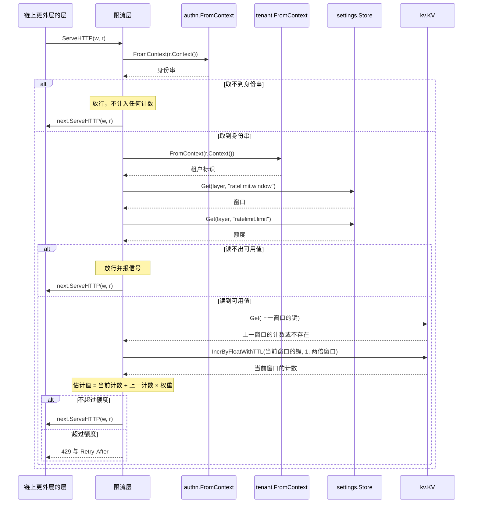

# ratelimit

## 职责

按主体限制请求速率。在配置列举的每个监听端上登记一层中间件，对每一个带身份的请求取一次计数，超过该主体在本租户内当前窗口的额度即以 429 收口。

- 判定发生在链上，放行的请求与没有本模块时逐字相同：本模块不改写请求，也不改写入内的响应。
- 额度与窗口经设置声明并读取，按租户回落。
- 计数经键值原语，本模块不持有跨副本的状态。
- 计数后端不可达、或设置读不出可用值时放行，并把这件事单独报出。

### 非职责

- **不做配额与计费**（[ADR-ratelimit-scope-2026-09-22](../../adr/adr-ratelimit-scope-2026-09-22.md)）。速率是单位时间内的频次，配额是一段时间内的总量；配额要读受约束表里每个租户的数据量，那是应用自己的领域动作（见 [tenant](design-tenant.md) 的非职责）。本模块只回答一个主体此刻是不是发得太快。
- **不定义错误响应体。** 响应的形状归提供该 API 的模块（见 [http](design-http.md) 的非职责）。本模块写出状态码与 `Retry-After`，不写响应体。
- **不认证，不解析租户。** 主体由认证模块交付、租户由租户模块交付，两者都不在本模块内产生。
- **不提供路由级限流。** 入口模块的 `Use` 作用于该端的全部路由；只对一部分路由生效的层由那些路由的 handler 自己包（见 [http](design-http.md) 的非职责）。
- **不提供指标。** 本仓没有指标机制，日志模块明文不承接（见 [log](design-log.md)）。本模块产生的信号只有那一行标准错误。
- **不重试，不降级到进程内计数。** 计数后端不可达即放行；回落到进程内计数会让每个副本各算一份，与「计数经共享原语」相悖，且失效形态是无声的。
- **不维护可用性策略。** 一个主体被持续拒绝之后要不要升级处置，不在本模块内决定。

## 术语表

以下术语的含义限于本文档。

| 术语 | 英文 | 定义 |
|---|---|---|
| 窗口 | window | 计数的记账周期，长度取自设置。键按窗口切分，一个窗口一个键。这个词指那个周期本身，不指「滑动窗口」这类算法的名字。 |
| 身份串 | identity key | 认证模块交付的身份的完整字符串形式，由归属、分隔符与主体依次拼接，形如 `local/bob`。本模块据它计数。 |
| 额度 | limit | 一个窗口内允许的请求数，取自设置。 |

**身份串与认证模块的「主体」不是同一个东西。** 那个词在认证模块里指不带归属的裸名字（见 [authn](design-authn.md) 的术语表），而本模块计数用的是 `Identity.Key()` 给出的完整形式。本仓把「按主体限流」用作这类层的通称，本模块的实际取值面是身份串。

## 外部接口契约

本模块的包名与模块名同为 `ratelimit`，包导出 `ModuleName` 常量供命令树点名，配置与设置也挂在同名命名空间下。根包即实现——接口面与实现在同一个包里，不拆接口包与实现子包（[ADR-ratelimit-packaging-2026-09-22](../../adr/adr-ratelimit-packaging-2026-09-22.md)）。它交付一个功能，并声明一份配置输入项与一份设置项。

### 交付的功能

功能标识的元素类型必须是接口。**这个标识的用途是在链上定序，不是一个可调用的判定面**：别的层在自己的 `After` 或 `Before` 里写下它，把自己排在限流之内或之外。

```go
// Limiter 是限流功能的标识。链上的层在自己的 After 或 Before 里写下它，
// 把自己排在限流之内或之外。
type Limiter interface {
    limit()
}
```

**产物实现它，但没有任何调用方用得上它。** 注册表要求模块构造出的实例实现它声明的每一个能力，本模块因此让 `New` 返回一个包内类型，那个类型带一个 `limit` 方法（见 [core](design-core.md) 对交付声明的校验）。方法不导出，本包之外没有类型能满足这个接口，别的模块即便经注册表取到实例也调不动它——判定只发生在中间件里。

交付声明写作 `Provides: []core.Provision{{Token: (*Limiter)(nil), Exclusive: true}}`。限流是进程级的一份判定面，多于一个提供者表态启用即启动失败。

### 稳定性承诺

- **交付的标识在版本之间保持。** `(*Limiter)(nil)` 是别的层据以定序的名字，那些约束按类型同一性匹配。改名会让每一处写下它的代码编译不过——那个名字不复存在。把它改成非接口类型则连编译都不拦：`core.Token` 是 `any`，真暴露的地方是登记，指向非接口的空指针在那里当场 panic（见 [core](design-core.md) 与 [http](design-http.md) 对功能标识的判定）。
- **链上层的 `Name` 不是契约。** 它只出现在 panic 文本与启动时列出的链清单里，本模块之外的任何东西都不该按它匹配。
- **设置的两个键名是契约。** `ratelimit.window` 与 `ratelimit.limit` 是宿主与运维写值时的入口，改名要连同已写入的行一起迁移。
- **配置项的键名是契约，取值不是。** `ratelimit.endpoints` 这个名字保持；它承载的端名清单由宿主的配置决定，随部署而变。
- **计数键的格式不进承诺。** 键名是本模块与计数后端之间的事，别的模块读不读得到它都不构成契约。改键名会让计数重新开始，而滚动发布期间新旧两版的键并存，那段时间的实际额度高于配置值。

### 配置面

本模块以 `config.Schema` 声明自己的输入项，挂在 `ratelimit` 命名空间下：

```go
// Endpoints 列出本模块要守的监听端，端名取自入口模块的配置。
type Config struct {
    Endpoints []string
}
```

**这份输入项在 `Prepare` 中读取。** 本模块在那里 `Decode` 自己那份配置，拿到缺项即报故障终止启动，错误点名缺的是哪一项（见 [config](design-config.md)）。

**端的清单只能是本模块自己的输入项。** 入口模块的登记面只有按名取端一个方法，枚举不出端的集合；去读入口模块的配置来自动跟随，会把本模块的配置面耦合到别人的配置形状上（见 [authn](design-authn.md) 的同一条）。

**配置给出了要守的监听端即表态启用。** 一个都没有给出即本模块没有可守的端，`Prepare` 报故障终止启动，错误点名缺的是 `endpoints` 这一项。本模块的表态只能是启用，不写 `StateAuto`：一条既没配端也不打算限流的命令，纳入本模块没有意义。

**同一个端名出现两次是配置错误，终止启动。** 端名是本模块据以取登记面的键，重复会让同一层登记两次，而两次登记各自成层，那个端上于是有两层限流按先后各判一次——额度实际减半，而链清单上看得出这件事，却看不出它是一次配置错误。

端名在本模块的配置里存在、而在入口模块的配置里不存在时，登记面返回错误，启动失败。这两个清单各自独立维护，本模块无法替宿主比对它们。

### 设置面

本模块以 `settings.Schema` 声明自己那份运行期参数，挂在 `ratelimit` 命名空间下：

| 键 | 类型 | 默认值 | 取值域 |
|---|---|---|---|
| `window` | 时长 | 一分钟 | 必须为正，且两倍窗口仍能由时长类型表示 |
| `limit` | 整数 | 100 | 必须为正 |

默认值写在承载这两项的结构体上，未写入任何一行的键取它。读取按三级回落——租户行、全局行、声明默认值（[ADR-settings-layer-2026-09-21](../../adr/adr-settings-layer-2026-09-21.md)），层选取自请求本身：请求带租户时取 `settings.ForTenant(id)`，不带租户时取 `settings.Global()`。

**取值域由本模块自己判，设置模块不判。** 设置只按声明的类型解码，不解释值的内容（见 [settings](design-settings.md)）。**取值域排除零**：额度为零会让该端每一条带身份的请求都被拒——自增发生在判定之前，当前计数至少为一，估计值必然大于零；窗口为零则窗口编号无从算起。

**窗口另有一条上界，取「两倍窗口仍能由时长类型表示」这条性质，不另定一个具体年数。** 计数键的存活时间取两倍窗口长度，而时长的取值有上限：两倍窗口溢出时那次写入的存活时间落成非正数，键值原语按「不设过期」处置，那个键从此不消失，本模块又不扫描也不清理过期键。落出取值域的读取结果按读不出可用值处置，见错误与失败语义。

**额度在每一条请求的路径上被读，读的是内存快照。** 每请求一次查库会把一份几乎不变的数据按请求频率反复搬运（[ADR-settings-propagation-2026-09-21](../../adr/adr-settings-propagation-2026-09-21.md)）。`Store.Get` 不收上下文，正是因为它不发起 IO。

## 依赖

| 依赖 | 用途 | 取用时机 |
|---|---|---|
| `pkg/core` | 注册描述符、交付功能、声明资源 | 编译期 |
| `pkg/config` | 声明并读取本模块的输入项 | 声明在编译期，读取在 `Prepare` |
| `pkg/http` | 登记中间件 | `Init` 期经注册表取用 |
| `pkg/settings` | 读取额度与窗口 | `Init` 期经注册表取用 |
| `pkg/kv` | 计数 | `Init` 期经注册表取用 |
| `pkg/audit` | 链上定序 | 标识类型 |
| `pkg/authn` | 读请求的身份串；链上定序 | 上下文读取与标识类型 |
| `pkg/tenant` | 读请求的租户；链上定序 | 上下文读取与标识类型 |

**输入项在 `Prepare` 中读取。** 本模块先 `core.Resolve[config.Reader](reg)` 取配置读取面，再 `Decode` 自己那份配置：取不到读取面时把 `core` 的缺提供者失败原样外传，拿到缺项时按 `config` 的 `ErrMissingRequired` 报故障终止启动、错误点名缺的是哪一项。判据与[认证](design-authn.md)的网关同一条（见 [config](design-config.md)）。

**认证与租户两行不发生取用。** `authn.FromContext` 与 `tenant.FromContext` 只读上下文，不查询实例；本模块与它们之间也没有 `Requires` 声明。把它们写成构造期取用，会让一个没有认证层的宿主启动失败，而那种装配是合法的——本模块在其中对取不到身份的请求放行。判据与 [audit](design-audit.md) 的同一条相同。

**本模块的链上位置由它自己的声明建立**，`Provides` 与 `After` 写在登记的那一层上：

```go
speedhttp.Middleware{
    Name:     "ratelimit",                    // 只用于诊断
    Provides: []core.Token{(*Limiter)(nil)},  // 别的层据它定序
    After: []core.Token{
        (*authn.Gate)(nil),                   // 取身份串
        (*tenant.Resolution)(nil),            // 取租户
        (*audit.Audit)(nil),                  // 排在审计的请求级捕获层之内
    },
    Order: 0,                                 // 约束全部由 After 承载
    Wrap:  limit,
}
```

- `Provides` 与描述符里的交付标识取同一个值，这是别的层能指向本层的前提：链上哪一层代表哪个功能，只能由那一层自己声明（见 [http](design-http.md)）。
- `After` 里的 `(*authn.Gate)(nil)` 指认证网关，authn 明写按主体限流的层用 `After` 指向它、落在认证之内。**缺这条边时本层可能落在认证之外，那时每一条请求都取不到身份而一律放行。**
- `After` 里的 `(*tenant.Resolution)(nil)` 指租户解析层，tenant 明写这是别的层把自己排在租户之内或之外的唯一锚点。缺这条边时租户读不到，每一条请求都按全局层读额度。
- `After` 里的 `(*audit.Audit)(nil)` 指审计的请求级捕获层。要相对审计排位的模块 import 它的接口包并写下这条边，这是审计为这件事定下的唯一做法（[ADR-audit-anchor-2026-09-21](../../adr/adr-audit-anchor-2026-09-21.md)）；本模块照它做，不靠 `Order` 的取值去碰审计的位置。缺这条边时本层的位置只由 `Order` 决定，审计的请求级捕获可能看不到本层写出的 429。
- `Order` 承载本层在硬约束留白处的偏好，本模块取零值。它只在 `After` 未定出次序的那几对层之间起作用，因而不保证本层排在链的最外或最内。

**入口模块的登记面本身就是一条取用**：本模块在 `Init` 里 `core.Resolve[http.Router](reg)`，按配置里的端名逐个取得登记面。

**对宿主的要求**：本模块排他交付，宿主必须在命令树上点名它，依赖闭包不替宿主挑。**本模块描述符里的 `Requires` 为空**：它没有任何构造期依赖，入口模块、设置与键值三项都在 `Init` 期经注册表取用，认证与租户则连取用都不发生（判据与[认证](design-authn.md)的网关同一条）。宿主要让本模块装得起来，必须自己在命令树上把入口模块、设置与键值列进去；缺任何一项都是启动失败，错误点名缺的那个功能，而修法只有列进命令树这一条。

方向满足架构不变量：本功能目录位于 `core`、`config`、`http`、`settings` 与 `kv` 之上，不被其中任何一个 import；它 import `audit`、`authn` 与 `tenant` 只是为了取它们的标识类型、读它们的上下文，而 `audit`、`authn` 与 `tenant` 都不 import 它。

## UML 图

一次请求经过限流层的判定路径。图中画不到的约束：**额度与窗口读自设置的内存快照**，本层不发起查库，而两次读取各自取一次快照，中间可以夹进一次替换；**计数走一次读加一次原子自增**，两次调用之间后端可以并发变化，图上的顺序不表示后端持有什么锁；**取不到租户时判定照常进行**，只是读全局层且键的租户段为空。



## 核心数据结构

| 概念 | 类型 | 说明 |
|---|---|---|
| 身份串 | `string` | 认证交付的完整身份形式，取自 `Identity.Key()` |
| 租户段 | `string` | 租户标识；请求不带租户时为空。租户标识的取值域不允许空，因而空段只表示「没有租户」 |
| 窗口编号 | `int64` | `now.UnixNano()` 整除窗口长度的纳秒数 |
| 计数 | `float64` | 键值原语原子自增的结果 |
| 权重 | `float64` | 上一窗口在估计值里的折算比例，落在零与一之间 |

## 核心算法与流程

### 一次请求的判定

1. 从上下文取身份串。取不到即放行，本请求不计入任何计数。
2. 从上下文取租户。取不到时租户段为空，且读设置取全局层。
3. 从设置读额度与窗口，判它们落在取值域内。读不出可用值即按失败处置，见错误与失败语义。
4. 由当前时刻算出当前窗口与上一窗口的编号，以及当前时刻在窗口内的权重。
5. 读上一窗口的计数。键不存在是正常情形，按零计；读失败不是，按失败处置。
6. 自增当前窗口的计数，过期时间取两倍窗口长度。
7. 估计值取「当前窗口计数 ＋ 上一窗口计数 × 权重」，与额度比较。
8. 超过额度即写出 429 与 `Retry-After`，本请求到此结束；不超过则交回链上更内层的层。

**`Retry-After` 取当前窗口的剩余秒数，向上取整且不小于一。** 剩余不足一秒时也给一，一个零会让调用方立即重试。它不指示调用方何时一定能通过，判据与代价见 [ADR-ratelimit-verdict-2026-09-22](../../adr/adr-ratelimit-verdict-2026-09-22.md)。

**自增发生在判定之前**：被判超限的请求也计入当前窗口。判据见 [ADR-ratelimit-algorithm-2026-09-22](../../adr/adr-ratelimit-algorithm-2026-09-22.md)。

**自增用带过期时间的那个原语。** 把「自增」与「补写过期时间」拆成两步，落在两步之间的并发自增会被那次补写覆盖，计数少算一次，而这条路径不报任何错（见 [kv](design-kv.md) 的带过期时间的自增）。

### 窗口与权重

窗口编号取 `now.UnixNano()` 整除窗口长度的纳秒数。**时刻取 Unix 纪元这一个绝对原点**，不取进程启动时刻：同一个计数键要在不同副本上落到同一个编号，否则共享计数这件事本身不成立。编号用纳秒算，窗口因而可以短于一秒。

权重是上一窗口对本次判定的折算比例，为「窗口内尚未走过的那一段」占窗口长度的比例，落在零与一之间——窗口起点处为一，接近窗口终点时趋于零。

复杂度 O(1)，含两次后端调用——一次读、一次原子自增。

### 计数键的存活时间取两倍窗口

**过期时间取两倍窗口**，使上一窗口的键在当前窗口内仍读得到；只取一个窗口时它已过期，加权退化成单个固定窗口。判据与代价见 [ADR-ratelimit-algorithm-2026-09-22](../../adr/adr-ratelimit-algorithm-2026-09-22.md)。

**键的过期时间不因持续自增而延长**，因而一个不再有请求的主体，它的计数键在最后一次写入之后两个窗口内消失，本模块不扫描也不清理。

### 键的构造

键形如 `ratelimit:{租户段}:{身份串}:{窗口编号}`。租户段与身份串各自先按百分号编码转义——段里的 `:` 与 `%` 分别写成 `%3A` 与 `%25`。

**各段都由本模块写进键名。** 键值原语不划分前缀、不划分命名空间，两个调用方用同一个键即互相覆盖而它看不见（见 [kv](design-kv.md) 的非职责）；它也不保证租户隔离，键名含不含租户标识由调用方决定。本模块的键以自己的模块名起头。

**转义不能省。** 租户标识的取值域只排除空白与控制字符，冒号在其中；身份串的两半由分隔符拼接，也不保证不含冒号。不转义时，租户 `a:b` 配身份串 `c` 与租户 `a` 配身份串 `b:c` 会拼出同一个键，两个不同的判定对象于是共用一份计数——跨租户、跨主体，而没有任何信号。

估计值是近似而非精确的窗口计数，它受限于键值原语不提供有序结构这一点（[ADR-kv-scope-2026-09-21](../../adr/adr-kv-scope-2026-09-21.md)）；判据与代价见 [ADR-ratelimit-algorithm-2026-09-22](../../adr/adr-ratelimit-algorithm-2026-09-22.md)。

### 本模块的阶段行为

| 阶段 | 行为 |
|---|---|
| `Prepare` | 取配置读取面并 `Decode` 自己那份输入项；端名清单为空或重名即报故障终止启动 |
| `New` | 交出一个实现 `Limiter` 的实例 |
| `Migrate` | 无动作 |
| `Init` | 取入口模块的登记面、设置与键值；在配置列举的每个端上登记中间件 |
| `Start` | 无动作 |
| `Serve` | 无动作 |
| `Stop`、`Close` | 本模块没有要停止或排空的东西：它不持有连接，也不派生协程 |

## 错误与失败语义

### 启动期

| 情形 | 表现 |
|---|---|
| 取不到配置读取面 | 缺提供者失败，点名 `config.Reader` |
| 配置里 `endpoints` 一项都没有给出 | 终止启动，点名缺的是这一项 |
| 同一个端名在 `endpoints` 里出现两次 | 终止启动，点名那个端名 |
| 取不到入口模块、设置或键值功能 | 缺提供者失败，点名那个功能 |
| 配置里的端名在入口模块的配置里不存在 | 终止启动，错误由登记面给出 |

本模块没有可降级的启动形态：判定要的额度、窗口与计数后端缺任何一项，限流就无从谈起，构造不出来比构造出一个不限流的层更诚实。

### 运行期

**判不出可用值时放行。** 计数后端不可达、设置读不出可用值，两类都按这一条处置，判据与代价见 [ADR-ratelimit-failure-2026-09-22](../../adr/adr-ratelimit-failure-2026-09-22.md)。**这与拒绝是对立的取舍**：拒绝会把一次后端或一行坏数据的故障放大成全端拒绝，而限流在本仓是防滥用面，不是数据越权面（[ADR-ratelimit-boundary-2026-09-22](../../adr/adr-ratelimit-boundary-2026-09-22.md)）。

**失败的信号不进日志链。** 每一类放行原因各有一个标志与一份计数：这一类第一次失败与它随后的恢复各写一行到标准错误，不经日志模块——理由与日志模块报告自身失败、审计模块报告写失败时相同：报告链自身可能缺席，也可能被整条关掉。**「恢复」判据有两条，缺一不可：这一类被一次判定问到且没有出现，并且它上一次失败已过去一分钟的静默期。** 前一条是因为判定在第一个失败的类别处返回，排在它后面的类别那一次没有被问到，因而不因那次判定被清掉——否则一次取值域的失败会替一类从未观测到的计数故障宣布恢复。后一条是因为许多故障只落在一部分判定上：某个租户的一行取值越域、某个键上存着不是本模块写的东西、后端时答时不答。这类故障与通过的判定交替出现，一次通过即算恢复的话，故障持续多久，每交替一次就写一对失败与恢复。有了静默期，它开始时写一行，真正停下一分钟之后再写一行。此后这一类再失败时按第一次处理，再写一行。两次之间的失败只累计在进程内计数里，不写行，避免一次持续故障刷满输出，无论它落在每一次判定上还是只落在一部分上。

**设置那两类的首行点名首次出现时请求所在的租户。** 额度与窗口按请求的租户选层读取，越域的值多半是某一个租户的一行，只报原因会让运维知道有一行坏了却不知道是谁的。点名的是在哪里看到，不断言那一行属于这个租户——读取会回落到全局行与声明默认值。计数那几类不点名：它们的键里嵌着身份串，那一行不该转述它。

**标志按原因分开，不共用一个。** 它们互不蕴含：后端不可达未恢复的那段时间里，取值域那一档仍须能报出自己，共用一个标志会让它一行都写不出来。

| 情形 | 表现 |
|---|---|
| 计数后端不可达或超时 | 放行；报信号 |
| 读上一窗口的键时后端报错 | 放行；报信号 |
| 上一窗口的键上不是合法数值 | 放行；报信号 |
| 自增失败而读已成功 | 放行；报信号 |
| 设置读取返回错误 | 放行；报信号 |
| 窗口不为正、两倍窗口超出时长类型的取值范围，或额度不为正 | 放行；报信号 |
| 上一窗口的键不存在或已过期 | 按上一窗口计数为零算，本次判定照常进行 |
| 请求的上下文已结束 | 放行，不报信号 |
| 取不到身份串 | 放行，不计 |
| 取不到租户 | 键的租户段为空，且按全局层读额度 |
| 估计值超过额度 | 429 与 `Retry-After` |

**「键上不是合法数值」与「后端报错」分开处置，两者都报信号。** 键上有一个非数值说明那个键被谁写坏了，按这件事处置比按「上一窗口没有计数」安静放行更诚实；后端报错是这次读根本没成功。

**上下文的取消不报信号。** 它的触发者来自调用方一侧——客户端断开、请求超时——不是后端故障；并进那一档会让一次断开写出一行失败，还把共享的故障标志置起，使随后的真故障不再单独报出。**那一次判定也没有问到计数这两类**，因而同样不清它们的标志：一次被中途打断的读没有得出后端可用与否的结论。

**判据是请求自己的上下文是否已经结束，不是错误里带没带取消或超时。** 后端的客户端库以自己设的时限截断一次调用时，返回的同样是上下文的超时错误，而这时请求仍然活着：那是后端答不上来，照常按计数的那一档放行并报信号。按错误判，计数后端整段不可达期间的每一次判定都会被读成调用方的取消，请求全部放行而一行信号都没有。

### 哨兵错误

**本模块不为运行期的失败定义哨兵。** 判定过程中的每一类失败都由本层自己处置，不向调用方返回错误，因而没有可判的名字。

启动期的失败里，复用的与自有的各占一部分：

| 哨兵 | 含义 |
|---|---|
| `core` 的缺能力失败 | 配置读取面、入口模块、设置或键值功能不在场 |
| `config` 的 `ErrMissingRequired` | `endpoints` 一项都没有给出 |
| `config` 的 `ErrInvalidSchema` | 本模块那份声明的形状有缺陷 |
| `http` 的 `ErrUnknownEndpoint` | 配置里的端名在入口模块的配置里不存在 |
| `ErrDuplicateEndpoint` | 同一个端名在 `endpoints` 里出现两次 |

**`ErrDuplicateEndpoint` 由本模块自己判定。** 它的补救动作是改掉那个端名，与配置缺项的补救动作不同，因而按架构的错误模型补一条自己的哨兵，而不并入别处的（见 [architecture](../architecture.md) 的错误模型一节）。

### 非保证

以下各类性质本模块声明为不保证。

**装配级的事实**——成立与否取决于这次运行纳入了什么、链上还有谁、后端是哪一个，按 [ADR-ratelimit-guarantees-2026-09-22](../../adr/adr-ratelimit-guarantees-2026-09-22.md) 的判据进来：

- **本模块未被纳入这条命令时，链上没有限流层。** 全部请求照常通过，本模块不产生任何信号；装配起于宿主写在命令树上的决定，不是意外。察觉：读命令树。
- **驱动深度止于 `Prepare` 时，本模块从未被构造。** `StagePrepare` 是 `Stage` 的零值，一条忘了写深度的命令落在那里：本模块的表态被读、配置被 `Decode`，而实例没有构造，也没有要关闭的东西。察觉：读命令的驱动深度。
- **驱动深度浅于 `Init` 时，中间件从未登记。** 本模块被构造、在驱动结束时被关闭，但那个端上没有限流层，也没有诊断。察觉：读命令的驱动深度。
- **未被写进 `endpoints` 的监听端上没有任何限流层。** 端名清单是本模块自己的输入项，本模块枚举不出入口模块还声明了哪些端。察觉：把入口模块配置里声明的端集合与本模块 `endpoints` 里的端名相减，差集就是漏写的端；漏写不产生失败，也不产生诊断。
- **链上不保证没有能绕过限流的层。** 本模块登记的是一层普通中间件。一个 `Order` 更小的层排在限流之外，它应答的请求从未经过限流；一个层还可以在自己的 `Provides` 里声称代表限流功能，而入口模块不校验这条声称与登记方描述符的一致性。察觉：要回去读各层登记的代码，本模块报不出这件事。
- **取不到身份串的请求不限**（[ADR-ratelimit-dimension-2026-09-22](../../adr/adr-ratelimit-dimension-2026-09-22.md)）。成因包括：认证模块豁免的路由、认证层不在这个端上——宿主没有纳入认证模块，或纳入了而那个端不在它自己的 `endpoints` 清单里。察觉：认证层不在那个端上时，本层指向认证的那条 `After` 边落空，入口模块把它列进启动诊断；豁免那一档另要读认证模块的豁免登记。
- **本层落在租户解析之外时，额度按全局层读。** `After` 指向的功能不在场时，入口模块丢弃那条边并把它列进启动诊断；本层照常运行，位置由 `Order` 决定。察觉：那行「未落到任何一层的约束」诊断会说某条边没落地，但它看不出本层是否因此读不到租户。
- **计数后端不可达期间，限流不生效。** 那段时间的请求全部放行，与「这些请求都在额度之内」在外部不可区分。察觉：那行标准错误。
- **额度或窗口落在取值域之外时，那一次判定放行。** 一行坏数据不终止任何东西；落在同一层选下的读取每次都读到同一个坏值，那一档请求因而全部放行。察觉：这一类自己的那行标准错误，行内点名这一类原因与它首次出现时请求所在的租户；越域的行不止一行时，后来的那些不另写行。
- **计数键不含端名，同一主体在多个受守端上共用一份额度。** 键由租户段、身份串与窗口编号构成，端不在其中；把两个端写进 `endpoints` 时，那个主体在两处的调用累加到同一个计数上。察觉：看 `endpoints` 清单——多列一个端不会多出一份额度。
- **多副本部署下的相位由各副本自己的时钟决定。** 窗口编号取同一个绝对时间轴，但各副本的钟可能不同；计数键的过期时刻由最先创建它的那个副本按自己的钟记下；计数后端是进程内实现时，各副本各算一份，限制的实际额度随副本数放大。察觉：时钟那一条靠比对各副本的钟；进程内计数那一条靠核对所选的键值实现是哪一个，以及宿主的配置里有没有写下那份部署前提——前提项由宿主自己声明，没写等于没告诉那个实现任何事，它不会替宿主拒绝。

**本层或算法自身的性质**——本模块不承诺它们，那条装配级的判据管不到：

- **估计值是近似，不是精确的窗口计数。** 边界附近的判定可能比精确滑动窗口更宽松或更严格。这是算法的数学性质，不是一种可观测的偏离。
- **额度读到的是快照值。** 两次刷新之间读到的是同一个值，刚写入的改动要等下一次装载才生效；各副本装载的时刻不同。察觉：设置模块在快照换上一批不同的行时记一行日志，那一行的时刻就是那次生效的时刻（见 [settings](design-settings.md) 的装载与刷新）。
- **本层不捕获 panic。** 本层不设 recover：判定路径上的调用只有设置读取、两次键值调用与一次比较，其中 `settings.ForTenant` 对落在租户标识取值域之外的标识当场 panic，而这里传给它的标识取自 `tenant.FromContext`，名册不收越域的标识，因而打不到这一处。漏出去的那一次由入口模块内建的兜底层接住，它每端唯一、包在全部登记层之外（[ADR-http-recovery-2026-09-22](../../adr/adr-http-recovery-2026-09-22.md)）；本层不因此改变自己的行为。察觉：兜底层写出的响应不带归因，定位靠它记下的那一行。
- **窗口长度在运行期被改动时，计数键全部换名。** 窗口编号由窗口长度算出，除数一变，同一时刻算出的编号就变：当前窗口从零起算，上一窗口的键也读不到，每个主体立刻又拿到一整份额度。察觉：`settings.Store.List` 读得出那一层上的行与它们的写入时刻，因而改窗口这件事看得见；它造成的额度重置没有信号。
- **额度与窗口取自两次读取，可能来自不同的快照版本。** 读取面一次只取一个键，快照的替换可以落在两次调用之间；同时改写这两项时，一次判定可能用旧窗口配新额度。察觉：这一档不产生信号，设置能说明改过什么，说不出哪一次判定用了哪个版本。
- **本模块不向任何记录面写入。** 超限这件事不产生审计行，也不发布事件。审计模块在场、且守这个端时，本层排在它的请求级捕获层之内，那次捕获看得见 429；记不记由审计的配置决定。察觉：直接读审计表与事件流。

## 并发与事务边界

- 中间件在 `Init` 期登记，此后只读。
- 判定在请求协程上执行，每次判定含两次后端调用。同一个身份串上的并发请求由计数后端仲裁，本模块不加锁：本地锁在多副本下达不到共享计数的效果。
- **失败信号与失败计数是请求协程之间共享的可变状态**，本模块在一把锁下读写它：放行原因各有自己的标志、最近一次失败的时刻与计数，每一类的首次与恢复各写一行。
- 本模块不开启事务，也不与调用方的事务绑定。计数不是业务状态，它回滚不回去，也不需要回滚。
- 计数键的过期由后端施加。本模块不扫描、不清理过期键。

## 实现状态

| 能力 | 状态 | 代码 |
|---|---|---|
| 接口、配置与模块登记 | 已实现 | `pkg/ratelimit/ratelimit.go` `Limiter`、`Config`；`module.go` `Module` |
| 设置面与键表声明 | 已实现 | `pkg/ratelimit/ratelimit.go` `settingsSchema`、`defaults` |
| 中间件的登记与链上位置声明 | 已实现 | `pkg/ratelimit/limit.go` `middleware`、`wire` |
| 窗口编号、权重与判定 | 已实现 | `pkg/ratelimit/limit.go` `count`、`retryAfterSeconds` |
| 键的构造与转义 | 已实现 | `pkg/ratelimit/key.go` `countKey`、`escape` |
| 失败信号与共享计数 | 已实现 | `pkg/ratelimit/signal.go` `signal`、`settle`、`recoveryQuiet`、`whereSeen` |
| 哨兵错误 | 已实现 | `pkg/ratelimit/errors.go` `ErrDuplicateEndpoint` |
