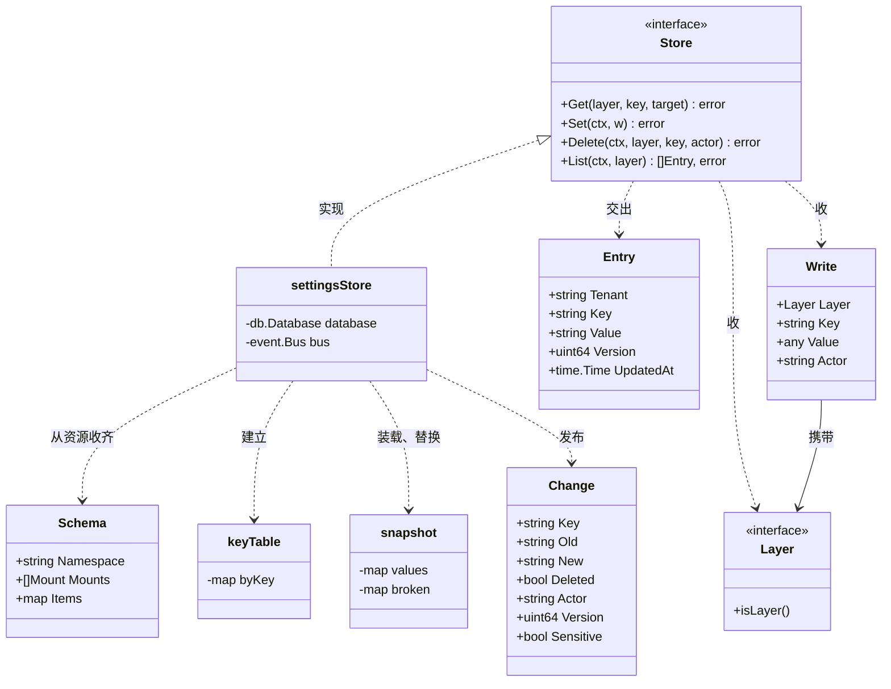
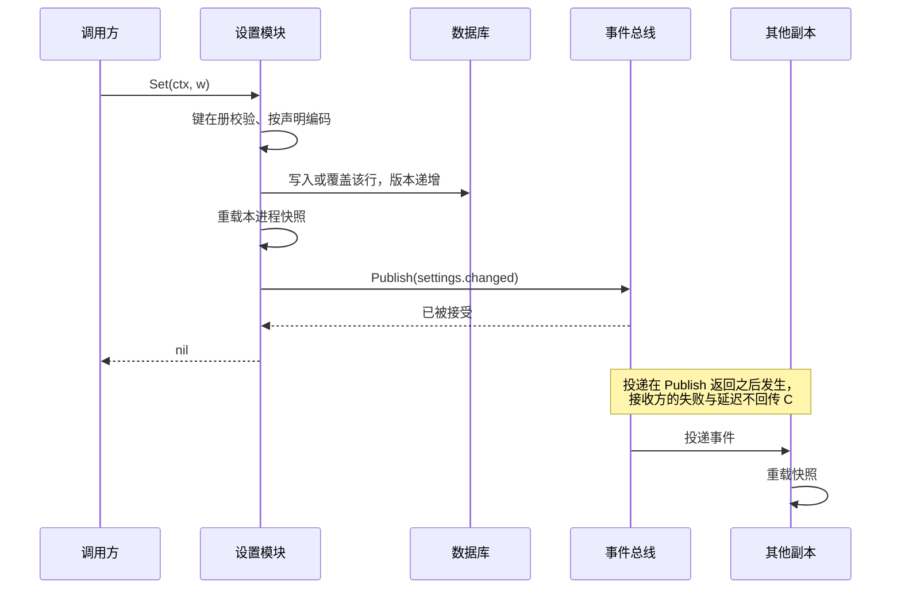
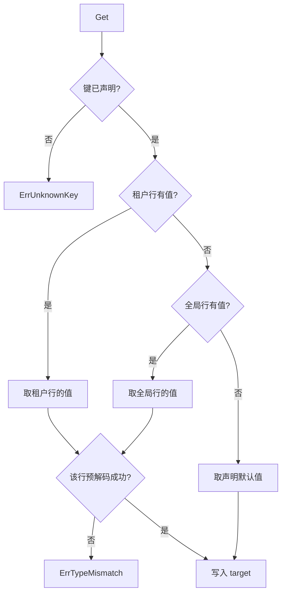

# settings

## 职责

本模块交付**运行期可变的参数**：模块声明自己的设置项，运维在运行期按租户或全局写入取值，消费方从内存快照按声明类型读取。存储是数据库，声明式类型化，取值按租户行、全局行、声明默认值三级回落。

配置与设置的划界由划界判据给出：一个值属于配置，当且仅当它在数据库可用之前就被需要（[ADR-config-scope-2026-09-13](../../adr/adr-config-scope-2026-09-13.md)）。本模块承载判据另一侧的全部参数——限流阈值、功能开关、通知模板是判据点名的用例。

本功能目录的根包同时是接口包与实现：它定义接口与数据类型并登记一个模块，排他交付设置功能（[ADR-settings-scope-2026-09-21](../../adr/adr-settings-scope-2026-09-21.md)）。存储只有数据库一种，不拆实现子包。本模块依赖数据库功能与事件总线功能，两者都是构造期依赖；不依赖租户模块——租户标识在接口上是字符串。

### 非职责

- **不承载启动必须项。** 判据见划界：够得到"数据库可用之前"的值全部落在配置一侧（[ADR-config-scope-2026-09-13](../../adr/adr-config-scope-2026-09-13.md)）。
- **不做权限判定。** 谁能改一项设置归权限模型；写面的调用点是宿主自己的代码或它写出的管理命令（[ADR-settings-scope-2026-09-21](../../adr/adr-settings-scope-2026-09-21.md)）。
- **不认识租户模块。** 租户标识是字符串，本模块不校验它在不在名册、不读请求上下文、不产生标识（[ADR-settings-scope-2026-09-21](../../adr/adr-settings-scope-2026-09-21.md)）。
- **不解释值的内容。** 通知模板在本模块是一段字符串；渲染、校验与转义归消费方。
- **不承载容器类型。** 映射与列表不在声明的类型集合里，需要它们的消费方把 JSON 文本存进字符串项自行解码（[ADR-settings-declaration-2026-09-21](../../adr/adr-settings-declaration-2026-09-21.md)）。
- **不保存变更历史。** 变更事实经事件发布，历史的记录归审计模块，而审计不提供查询面（见 [audit](design-audit.md)），检索与导出的承载单元要另立（[ADR-settings-audit-2026-09-21](../../adr/adr-settings-audit-2026-09-21.md)）。
- **不做事件总线。** 广播与投递由事件模块承担，本模块只发布与订阅（[ADR-settings-propagation-2026-09-21](../../adr/adr-settings-propagation-2026-09-21.md)）。
- **不提供无类型的键值存取。** 那是键值模块的能力；没有声明的键在本模块读写两侧都不可用（[ADR-settings-declaration-2026-09-21](../../adr/adr-settings-declaration-2026-09-21.md)）。

## 术语表

以下术语的含义限于本模块，以及设置主题的决策记录。

| 术语 | 英文 | 定义 |
|---|---|---|
| 设置项 | setting item | 一个有键、有类型、有默认值的运行期可变参数，由某个模块声明。 |
| 声明 | Schema | 本模块定义的资源类型，承载一个模块的全部设置项与它们的默认值。 |
| 键 | key | 设置项的路径标识，由命名空间与字段路径拼出，与配置键的规则同一条。 |
| 层选 | layer selector | 指名读写作用于哪一层的值，由 `Global()` 或 `ForTenant(id)` 构造；零值不是一个层。 |
| 全局行 | global row | 全局层对应的设置行，是全部租户共享的一层取值；存储上它的租户列为空。 |
| 回落 | fallback | 读取按租户行、全局行、声明默认值依次取值的过程；起点是调用方以层选指名的那一层。 |
| 键表 | key table | 装配期由全部声明聚合出的映射：键到声明类型、默认值与元信息。 |
| 快照 | snapshot | 全部已写入行在内存里的拷贝，装载时按声明预解码。 |
| 版本 | version | 一行的写入序号，每次写入递增，随变更事件发布。 |

## 外部接口契约

### 登记单元与名字

| 登记单元 | 模块名 | 交付 |
|---|---|---|
| 根包 | `settings` | 排他地交付设置功能 |

根包即实现，同时是接口包；模块名导出为 `ModuleName` 常量，配置命名空间取同一个取值。

### 交付的功能

功能标识的元素类型必须是接口，取用写作 `core.Resolve[settings.Store](reg)`。

```go
// Layer 指名读写作用于哪一层：全局层，或某个租户的租户层。
// 零值不是一个层，是调用点的编程错误。
type Layer interface {
    isLayer() // 未导出方法封住实现：Layer 只能由本模块的构造器产生
}

// Global 返回全局层。
func Global() Layer

// ForTenant 返回标识为 id 的租户层；id 落在租户标识取值域之外（为空、或含空白与控制字符）是调用点的编程错误，与层选为零值同一档：当场 panic，不返回错误。
func ForTenant(id string) Layer

// Store 是设置的读写面。功能标识为 (*Store)(nil)。
type Store interface {
    // Get 按声明的类型把设置值解码进 target。
    // 取值按 租户行 > 全局行 > 声明默认值 回落，从 layer 指名的层开始。
    // 键未声明时报 ErrUnknownKey；该键的已写入值解不成声明类型时报 ErrTypeMismatch；
    // 本模块的 Init 装载快照之前读取报 ErrNotLoaded。
    Get(layer Layer, key string, target any) error

    // Set 按声明的类型编码 w.Value 并写入 w.Layer 指名的那一层。
    // 写入成功后发布 settings.changed。
    Set(ctx context.Context, w Write) error

    // Delete 删除 layer 指名的那一层上的显式行；删除不存在的行不是错误。
    Delete(ctx context.Context, layer Layer, key, actor string) error

    // List 列出 layer 指名的那一层的显式行。结果按键的字节序排列，与数据库的排序规则无关。
    List(ctx context.Context, layer Layer) ([]Entry, error)
}

// Get 是 Store.Get 的泛型封装，像 core.Resolve 一样把断言收进函数里；
// 类型参数与声明类型不符时返回 ErrTypeMismatch。
func Get[T any](s Store, layer Layer, key string) (T, error)

type Write struct {
    Layer Layer  // Global() 或 ForTenant(id)
    Key   string
    Value any    // 按声明类型编码
    Actor string // 记入事件载荷，本模块不解释
}

type Entry struct {
    Tenant    string // 这一行的租户列：全局行为空
    Key       string
    Value     string
    Version   uint64
    UpdatedAt time.Time
}
```

**零值不是一个层。** 接口上不存在"空租户"这个值：指名全局层要经 `Global()`，指名租户层要经 `ForTenant(id)`，而 `ForTenant` 拒收任何落在租户标识取值域之外的标识——非空、且不含空白与控制字符（判据与名册对标识的要求同一条，见 [ADR-tenant-identifier-2026-09-21](../../adr/adr-tenant-identifier-2026-09-21.md)）。长度不在其中：本模块与名册一样不给标识定长度，那一列有多宽由声明方说了算。传一个 `nil` 的层选是调用点的编程错误，当场 panic 而不返回错误，判据与目标参数的非法形态同一条（见读取面）。

**读取不收上下文，写入收。** 读取只走内存快照，不发起任何 IO，因而没有可取消的点；写入与列举访问数据库，收上下文。同一种功能的两个方向取不同签名的判据是它们做什么，不是形态上的一致。

**排他交付**：`Provides: []core.Provision{{Token: (*Store)(nil), Exclusive: true}}`。设置是进程级的一份存取面，多于一个提供者表态启用即启动失败。

### 声明面

模块把 `Schema` 放进描述符的 `Resources` 中，声明自己的全部设置项（[ADR-settings-declaration-2026-09-21](../../adr/adr-settings-declaration-2026-09-21.md)）：

```go
type Schema struct {
    Namespace string          // 键的命名空间，空表示顶层
    Mounts    []Mount         // 承载结构体，字段的当前取值即默认值
    Items     map[string]Item // 路径 -> 元信息；未列出的取默认
}

type Mount struct {
    Path  string // 相对命名空间的路径前缀，空表示挂在命名空间根
    Value any    // 承载结构体的指针
}

type Item struct {
    Description string
    Sensitive   bool // 变更事件不携带该键的值
}
```

一个模块的声明：

```go
var defaults = options{Window: time.Minute, Limit: 100}

settings.Schema{
    Namespace: "ratelimit",
    Mounts:    []settings.Mount{{Value: &defaults}},
    Items: map[string]settings.Item{
        "limit": {Description: "窗口内允许的请求数"},
    },
}

// 读取
var opts options  // 零值即可：未写入的键取声明默认值
err := store.Get(settings.ForTenant(tenantID), "ratelimit.window", &opts.Window)
```

**键的路径派生与 `pkg/config` 是同一套规则**：优先 `config` tag，其次 `json` tag，都没有则字段名转小写短横线；匿名字段内联；tag 写作 `-` 的字段跳过；实现了 `encoding.TextUnmarshaler` 的类型按标量叶子处理；不可解码的字段自动跳过（判据与清单见 [config](design-config.md) 的名字的派生与映射一节，本模块不另立规则）。从配置迁往设置的一个参数，键名与承载结构体因此都不变。

**类型集合是封闭的**：字符串、布尔、整数、浮点、时长，以及实现 `encoding.TextUnmarshaler` 的类型。容器不在其中（见非职责）。取值纪律与配置相同，本模块不另立规则：实现 `TextUnmarshaler` 的类型按它自己的约定往返，`time.Duration` 只接受 `time.ParseDuration` 可解的文本，浮点写入整数字段要求可无损转换。

**声明的收集取自可用集**：来源是 `core.Resources[settings.Schema](reg)` 的全体；判据是键的有效性跟着二进制走，比任何一次命令长寿，因而未运行、消解落选与只被静态级纳入的模块，其声明一律在键表里。**取可用集的消费点不做减法**（架构不变量 15）：一份参数声明不是由哪一次运行产生的，减法会让同一个键在一条命令下合法、在另一条下非法，而声明本身没变。两个模块声明同一个键是收集期的冲突，终止启动并点名冲突双方；单个模块的声明自身的缺陷（判据：不涉及第二方，仅凭这个模块声明的内容即可判定不可用）同样是启动失败，判据与示例归 `ErrInvalidDeclaration`。

**声明的聚合发生在 `New`**，产出键表：键到声明类型、默认值与元信息的映射。键表在装配期一次性建立，此后只读。

### 读取面

读取按三级回落取值（[ADR-settings-precedence-2026-09-21](../../adr/adr-settings-precedence-2026-09-21.md)）：

| 次序 | 来源 | 何时命中 |
|---|---|---|
| 一 | 租户行 | 该租户有一个显式写入的行 |
| 二 | 全局行 | 租户行为空而全局行有值 |
| 三 | 声明默认值 | 两层都没有行 |

**读取从层选指名的那一层开始**：指名全局层时回落直接落在全局行上。层选由 `Global()` 或 `ForTenant(id)` 构造，接口上不存在"空租户"这个值（[ADR-settings-layer-2026-09-21](../../adr/adr-settings-layer-2026-09-21.md)）。

**快照装载之前的读取报 `ErrNotLoaded`**，不回落到声明默认值。快照在本模块的 `Init` 装载，此前没有从表里读过任何一行，回落到默认值就是不论表里写着什么都答默认值，而读取方会拿它当真值用下去、没有任何一处报出来。功能在 `New` 之后即可取用，在别的模块自己的 `Init` 里读设置因而取决于构造次序：没有声明依赖的模块按名字排序，名字排在 `settings` 之前就先于它初始化。修复动作是读取方声明 `Requires (*settings.Store)(nil)`，或者让驱动至少推进到 `Init`；写入不受此限——`Set` 与 `Delete` 直接作用于表，写后的重载会把快照装上。

**值在快照装载时按声明预解码**，读取路径上没有文本转换。解码失败的行单独记下（键与层到错误的映射），读取命中它时报 `ErrTypeMismatch` 并点名键；其余键照常可用。装载因此不因一行坏值而失败——坏值的作用面限于读它的代码路径，进程照常启动，其余设置照常可用。

**目标参数与层选的非法形态是调用点的编程错误，panic 而不返回错误**：目标传入非指针、传入 `nil`；层选传入 `nil`、`ForTenant` 收到落在租户标识取值域之外的标识（空、或含空白与控制字符）。判据与配置的取值面同一条（[config](design-config.md) 的取值与校验一节）；这一类不涉及第二方、与数据无关，调用点无从处理它。**这一判定先于键表**：`Get` 与 `Set` 先判层选与目标，再查键、编码值，同一个调用点因而无论键是否已声明、值能否编码都当场 panic，不会这一次返回错误、下一次才 panic。

### 写入面

写入只作用于显式的层：`Write.Layer` 指名写哪一层，`Global()` 写全局行，`ForTenant(id)` 写该租户的行。写入不改动其它层的任何行。

**写入的值按声明类型编码为文本**，编码规则是读取方向的逆：`TextUnmarshaler` 类型的文本表示、`Duration` 的 `ParseDuration` 格式、布尔与数值的常规文本。编码失败的形态是 `ErrTypeMismatch`，点名键与声明类型。

**写入收下的值先按配置的取值纪律归到声明类型**，本模块不另立规则。下列各步按配置的判定次序排列，先命中者定，清单是完整的：

- 已是声明类型的值原样接受。
- `time.Duration` 只收 `time.ParseDuration` 可解的文本，裸数字判 `ErrTypeMismatch`：它的单位是纳秒，`300` 在写的人眼里是五分钟，存下来是三百纳秒。
- 数值写入另一种 Go 类型的数值项：整数值的浮点可写进整数项，整数可写进目标类型能精确表示它的浮点项，浮点数写进 `float32` 项要求按 `float32` 最短写法读回仍是写入的那个数；带小数部分、超出目标类型范围或会被存成邻近值的判 `ErrTypeMismatch`，不做截断，也不做舍入。
- 文本写入实现 `TextUnmarshaler` 的类型，由该类型自己的 `UnmarshalText` 解析。
- 文本写入布尔与数值项，按常规文本解析。
- 字符串与布尔写入以同一底层种类定义的类型。

其余一律不转换，判 `ErrTypeMismatch`。管理端点把请求体按 JSON 或 YAML 解出的值原样交给 `Set` 是这条纪律的常规用法：那些值正是配置源对同一项会给出的值。落库的文本一律是声明类型自己的写法，与调用方交来的形式无关，以 `"300s"` 写入的时长存为 `5m0s`。

**两处陈述由同一张取值表约束**：配置模块不导出它的转换规则，本模块在 `pkg/settings/codec.go` 的 `coerce` 里复述了一遍；`pkg/settings/discipline_test.go` 的 `TestTheWriteDisciplineAgreesWithConfiguration` 把同一份 YAML 文档里的值分别送进配置的装载路径与本模块的编码路径，要求两侧同拒，或同收且得到同一个值。

**值的文本上限是 1 MiB**，超过即 `ErrInvalidValue`，不落库。上限服务的对象是快照：全部已写入行常驻内存，一个失控的写入不该把整个进程的内存拖垮。

**版本在数据库端递增**：`version = version + 1`，新行为 1。两个并发写入同一个键时结果是后到的那一个，版本号仍逐次递增——本模块不做比较并交换，丢更新写进非保证。

**写入的次序**：校验、落库、重载本进程快照、发布事件；发布失败不回滚、不改变返回值，见事件一节。**删除**只删指定的层，被删的键此后回落到下一级；**`Delete` 不过键表**——它是声明被删之后留在库中的旧行的清理路径，而读取与 `Set` 都被键表拦住；`List` 交出的是显式行，不是回落后的有效值。**`List` 的次序是键的字节序，由本模块排好**，不交给语句：数据库按排序规则比较文本，SQLite 逐字节比较，PostgreSQL 取建库时的排序规则，而常见的默认规则在第一级忽略标点，`a-b` 排在 `ab` 旁边而不是 `aa` 之前——交给语句，同一批行的次序就随命令所在的方言变化。

**敏感项的值不进入本模块的任何日志与错误文本**。本模块的日志只写键与租户，不写值；敏感标记的作用面是事件载荷（见下）。

### 事件

每次 `Set`，以及删掉了一行的 `Delete`，在落库成功后发布一条变更事件（[ADR-settings-audit-2026-09-21](../../adr/adr-settings-audit-2026-09-21.md)）。**没有删掉任何行的 `Delete` 不发布**：库里没有发生变更，一条事件会被订阅方记成一次从未发生的删除。它仍然不是错误。

```go
// ChangedEventType 是变更事件的类型名。
const ChangedEventType = "settings.changed"

// Change 是变更事件的载荷。变更作用的租户在事件信封的 TenantID 上
// （全局行留空，属系统级事件），载荷不重复携带它。
type Change struct {
    Key       string
    Old       string // 该层写入前的显式值，无行时为空
    New       string // 该层写入后的显式值，删除时为空
    Deleted   bool   // 为真时这是一次删除，New 为空
    Actor     string // 写入方给出，本模块不解释
    Version   uint64 // 写入后的版本号，删除时为 0
    Sensitive bool   // 为真时 Old 与 New 必为空
}
```

**`Old` 与 `New` 是写入所作用的那一层的显式值，不是回落后的有效值。** 事件描述的是这一次写入动作；"有效值因此变成什么"由订阅方按住回落的规则自行推出。**`Set` 的 `Old` 取自写入前本副本的快照**：它是发起写入的副本观察到的值，库中真实值可能更新——另一个副本刚写过而本副本尚未刷新，这一档写进非保证。**删除的 `Old` 由删除语句自己取回**，是被删那一行的文本：快照里没有声明已被删除的键的行，而那正是删除路径要清的行；快照也可能落后于库。

**发布时以事件信封携带变更作用的租户**：`Event.TenantID` 填写入所作用的租户，全局行留空（属系统级事件）；载荷因此不重复携带租户，订阅方从信封读取它。

**敏感项的载荷不携带值**：`Sensitive` 为真时 `Old` 与 `New` 为空。事件经传输可能到达消息后端并投递给每一个订阅方，一个凭据类的值不因为"要经审计"而获得传播到这些地方的资格。

**发布失败只有日志。** 值已经落库，回滚它会让一次成功的写入对调用方表现为失败；发布失败因而不改变 `Set` 的返回值，其余副本由周期刷新跟进；刷新间隔取零时它们要等下一次变更的事件或重启才看到这次改动，日志按本副本的刷新配置写明是哪一种。发布成功也不表示任何订阅方已收到（[event](design-event.md) 的投递下界）。

**本模块在 `Init` 订阅自己的事件类型**，用途是跨副本重载：变更事件被投递到本副本时重载快照。事件的跨副本投递语义由事件实现决定——广播到每个副本，或消费者组式的负载均衡（见 [event](design-event.md) 的扩展点）——本模块以收到为准，未投递到的那部分由周期刷新兜底。本副本发布的事件可能回到本副本，重载因而必须幂等——全量替换天然幂等。

### 配置

本模块的输入项挂在 `settings` 命名空间下：

| 键 | 作用 | 默认值 |
|---|---|---|
| `refresh-interval` | 快照的周期刷新间隔；取零表示不按周期刷新 | 5 分钟 |

周期刷新是变更事件的兜底（[ADR-settings-propagation-2026-09-21](../../adr/adr-settings-propagation-2026-09-21.md)）；取零表示接受"只靠事件"的收敛语义——未被投递到本副本的变更在进程重启前不再被它看到。**负值使启动失败并点名该输入项**——负的间隔在计时器上无从表达。

本模块不声明敏感输入项，也没有可缺的输入项：**被运行级纳入即启动**，不想要设置功能的命令不纳入它。

### 对宿主的要求

以下各条是宿主在命令树上要做的全部动作。**本模块既不能把它们声明出来，也没有检查它们的位置**，漏写不报错。

- **每条要用到设置读写的命令写出本模块的 `ModuleName`，并点名一个数据库实现与一个事件总线实现。** 这两者排他交付，依赖闭包不替宿主挑，本模块的构造期依赖因而不把它们拉进参与集——不点名即在依赖解析处以缺提供者终止启动，点名了则各自的配置还要在那条命令下配齐。
- **把本模块静态级纳入施加迁移的命令。** 设置表与本模块的迁移集一起建立，依赖闭包够不到不运行的模块；`IncludeAllDeclarations` 是这类命令的推荐写法（见 [db](design-db.md) 的迁移的应用）。
- **不要把本模块放进根命令。** 后果与租户、认证记下的同一条：它进入施加迁移那条命令的参与集并要在那里启动，而其表在该命令下的建立不受影响（迁移集按声明集取材，本模块在其中且不会被消解排除），真正的代价是它的输入项升格为全局参数、出现在每条命令的帮助里。
- **在自己的 `Init` 里读设置的模块声明 `Requires (*settings.Store)(nil)`。** 不声明，它的初始化次序由名字决定，排在本模块之前时读取报 `ErrNotLoaded`（见读取面）；在请求路径上读取的模块不受影响，那时每个模块的 `Init` 都已跑完。
- **写入面的访问控制由宿主负责。** 本模块不判权限，一个暴露到网络的写入口要由宿主自己鉴权。
- **租户标识由调用方从请求面取得**（`tenant.FromContext`），以 `ForTenant` 包成层选交给本模块；取不到租户时读全局层还是拒绝由调用方决定。写一个不在名册上的标识不会被本模块拒绝，读取它的行也不会——本模块不认识名册。

### 稳定性承诺

`Layer`、`Global`、`ForTenant`、`Store`、`Get`、`Write`、`Entry`、`Schema`、`Mount`、`Item`、`Change`、`ChangedEventType`、`ModuleName` 与哨兵错误是本模块与其他模块之间的契约。键的路径派生规则与配置共用一条，改它同时改变两个模块的键名。变更事件的类型名与载荷字段名是发布方与订阅方之间的约定，改一个字段名会静默断开订阅方的读取（[event](design-event.md) 记有同一条）。

表名、列名与迁移文件的组织是内部实现，不在契约面上。

## 依赖

| 依赖 | 用途 |
|---|---|
| `pkg/core` | 注册描述符、交付功能、声明资源、取用别的功能 |
| `pkg/config` | 声明本模块的输入项 |
| `pkg/db` | 设置表的建立与读写；`(*db.Database)(nil)` 是构造期依赖 |
| `pkg/event` | 变更事件的发布与订阅；`(*event.Bus)(nil)` 是构造期依赖 |
| `pkg/log` | 刷新失败与发布失败的记录；经取用获得，不声明依赖 |

**事件总线是构造期依赖**（[ADR-settings-propagation-2026-09-21](../../adr/adr-settings-propagation-2026-09-21.md)）：变更事件是设置的固有出口——跨副本的重载通知与审计的历史都经它——缺了它本模块的变更通道不成立；缺失在依赖解析处以 `ErrMissingProvider` 终止启动。

**日志不构成依赖**：取用的是 `log.Logger` 功能的可用则取、取不到则用进程根 logger 的形态（`Init` 里尝试一次，不写进 `Requires`）。日志记录只写键与租户，不写值。

**不依赖租户模块。** 租户标识是字符串（[ADR-settings-scope-2026-09-21](../../adr/adr-settings-scope-2026-09-21.md)）；设置的表承载全局行，不内嵌受租户约束的模型约定，不依赖名册与隔离插件（[ADR-settings-precedence-2026-09-21](../../adr/adr-settings-precedence-2026-09-21.md)）。

**`ForTenant` 的取值域是租户标识的取值域，本模块复述了它**：判据与名册对标识的要求同一条——非空，且不含空白与控制字符（见 [tenant](design-tenant.md)）。复述与本模块不 import 租户模块两件事并存，两处是否仍是同一条因而不由本模块独自保证：本模块的测试包 `pkg/settings/settings_test.go` 里，`TestForTenantAgreesWithTheTenantIdentifierDomain` 拿同一张标识形状表同时驱动本模块的 `ForTenant` 与租户模块根包的 `IsIdentifier`。**比对落在本模块的测试面**：`IsIdentifier` 由测试包 import，而测试包的 import 不进产品的 import 闭包，本模块的接口包因而不接上租户模块。这一处比对不是可有可无的：按租户取值的模块把从请求上下文读到的标识原样交给 `ForTenant`，落在取值域之外时它当场 panic，而那个 panic 由入口模块的兜底层收成 500——名册已经收下的标识，设置一侧收紧一格就答不出来。

方向满足架构不变量：本功能目录位于 `core`、`config`、`log`、`db` 与 `event` 之上，不被其中任何一个 import。按租户取值并消费设置的模块（限流、通知）位于本模块之上，它们取用 `Store` 而本模块不认识它们。

## UML 图

下图给出契约面上的类型与模块内部的两份结构。图中画不出的约束：键表在装配期建立后只读；快照在 `Init` 与 `Start` 各装载一次，此后由写入重载、事件重载与周期刷新替换，替换是对整份的原子指针交换；层选由 `Global` 与 `ForTenant` 两个构造器产生，零值不是一个层。



一次写入的路径，其分支由事件总线的投递决定：



读取的回落三级，键表的判定先于快照：



## 核心数据结构

**设置表**由本模块的迁移集建立，主键是租户列与键列的组合：

| 列 | 类型 | 说明 |
|---|---|---|
| `tenant_id` | 文本，非空，默认空串 | 这一行的层：全局层取空串，租户层取租户标识 |
| `key` | 文本，非空 | 完整路径 |
| `value` | 文本，非空 | 按声明类型编码 |
| `version` | 整数，非空 | 每次写入递增 |
| `updated_at` | 时间，非空 | 每次写入更新 |

表不内嵌受租户约束的模型约定，读写它的语句自带租户条件；全局行与租户行落在同一个键空间里，主键因此覆盖"一个键在某一层至多一行"。**空的租户列是存储侧的表达**：接口上不存在"空租户"这个值，指名一层由层选承担（[ADR-settings-layer-2026-09-21](../../adr/adr-settings-layer-2026-09-21.md)）。

**键表**是装配期由全部声明聚合出的只读映射：键到声明类型、默认值与元信息。它在 `New` 建立，装载快照与两个读写方向都读它。

**快照**是全部已写入行在内存里的拷贝，两份索引：键与层到预解码值的映射，以及键与层到解码错误的映射（装载时解码失败的行）。它在 `Init` 装载、在 `Start` 再装载一次，此后由写入重载、事件重载与周期刷新整体替换；替换经一个原子指针完成，请求路径读到的永远是一份自洽的快照。

**发布与订阅的接线**：本模块在 `Init` 以 `ChangedEventType` 订阅事件总线，处理函数只做一件事——重载快照。

## 核心算法与流程

### 阶段行为

| 阶段 | 行为 |
|---|---|
| `Prepare` | `Decode` 自己那份配置，不合格即启动失败；表态启用 |
| `New` | 取数据库与事件功能，收集声明、建立键表；不读写数据 |
| `Migrate` | 无动作。设置表由本模块声明的迁移集建立，由数据库模块统一施加 |
| `Init` | 取日志（可用则取）；订阅变更事件；装载快照 |
| `Start` | 再装载一次快照；启动周期刷新 |
| `Serve` | 无动作 |
| `Stop` | 取消周期刷新 |
| `Close` | 无动作 |

**未被推进到的阶段其回调不执行**（[ADR-lifecycle-drive-2026-09-20](../../adr/adr-lifecycle-drive-2026-09-20.md)）。深度浅于 `Init` 的驱动不装载快照、不订阅事件，其间的读取报 `ErrNotLoaded`；深度止于 `Migrate` 的驱动下设置表照建，与"表随二进制走"一致。

**取配置读取面的失败形态与租户名册同一条**：`core.Resolve[config.Reader](reg)` 得到 `ErrMissingProvider` 说明宿主漏了预置，是终止启动的失败，没有一档表态可以让启动带着缺席的配置读取面继续走。

### 声明的收集与键表的建立

收集在 `New` 内完成，来源是 `core.Resources[settings.Schema](reg)` 的全体；键的有效性跟着二进制走，比任何一次命令长寿，未运行与只被静态级纳入的模块，其声明因而一律在键表里。**取可用集的消费点不做减法**（架构不变量 15）。

每个声明贡献一组键：命名空间与挂载路径与字段路径逐段拼接，展开规则与配置的名字派生一致。聚合时逐键检查唯一性，两个模块的声明落在同一个键上即 `ErrDeclarationConflict`，终止启动并点名两个声明方；单个模块自身的缺陷即 `ErrInvalidDeclaration`，判据是不涉及第二方，下列是示例而非全集：键名违反字符集、挂载值不是结构体指针、展开出现类型环、`Items` 的键不对应任何叶子、声明的类型不在集合内、同一个模块的两处挂载落在同一个键上（无论两处挂载在一份声明里还是分属它的两份声明）。两类判据与配置的输入项清单一节所列的判据同源（[config](design-config.md)）。

**同一功能的互斥实现各自划分键的命名空间**，与配置对互斥实现的同一条要求：清单收集自全部已注册模块，两个实现即便不同时运行，声明仍然同时在册，同键即冲突、进程起不来。

### 快照的装载与刷新

装载与刷新是同一条路径：读设置表全量，逐行按声明的类型预解码，建一份新快照，原子替换。区别只在失败处置与触发来源。

| 触发 | 时机 | 失败处置 |
|---|---|---|
| 装载 | `Init` | 终止启动，`ErrTableMissing` 点名表与施加迁移的命令 |
| 启动重载 | `Start` | 终止启动 |
| 写入重载 | 本进程每次写入之后 | 保留上一份快照并记日志 |
| 事件重载 | `settings.changed` 投递到本副本 | 同上 |
| 周期刷新 | `refresh-interval` 的间隔 | 同上 |

**启动重载闭合总线开始投递之前的空档。** 传输型总线在自己的 `Start` 建立消费者，只把此后发布的事件交给它们，而首次装载在 `Init`，早于任何模块的 `Start`；其间另一个副本发布的变更不会投递到本副本，刷新间隔取零时本副本会一直服务那之前的值，直到重启。本模块依赖事件总线，因而在它之后启动：`Start` 时再读一次表，覆盖消费者建立之前写下的一切，此后的变更由消费者送达。它的失败与首次装载同样终止启动——装不上这一份，本副本服务的就可能是一个再没有事件会纠正的旧值。

**换上一批不同的行时记一行日志**，其时刻是这次生效的时刻。刷新路径由上表各类触发，逐次记行会变成每个写设置的请求一行，因而读到的行与当前快照相同时不记。这一行是「写进去的值没有被服务」这类排障里说出本副本落后多远的唯一落点：行自己的写入时刻在库里，快照读到的时刻只在这里（[ADR-settings-propagation-2026-09-21](../../adr/adr-settings-propagation-2026-09-21.md)）。

**解码失败的行不阻断装载**：键与错误记进快照的另一份索引，读取命中时报告，其余键不受影响。装载因此不会因为一行坏值终止进程启动，而坏值也不会被静默地当作未设置——判据与后果见 [ADR-settings-declaration-2026-09-21](../../adr/adr-settings-declaration-2026-09-21.md)。

**周期刷新取零时不启动刷新**，收敛语义落在广播上，代价写进配置一节。

### 写入路径

写入的步骤依次是：键在册校验、按声明类型编码、值上限检查、落库（插入或覆盖该层该键的行、版本递增、刷新 `updated_at`，并取回写入后的版本号）、重载本进程快照、发布变更事件。任一步在落库之前失败即返回错误，不触碰任何行。

**调用方的上下文只约束落库那条语句。** 语句提交之后的重载与发布是本模块为一行已在库里的值做的收尾，不是调用方的工作，它们在去掉了取消信号、保留了其余值（追踪信息在内）的上下文上跑完：请求恰在提交之后结束——客户端断开、截止时刻到了——这次写入照样在本副本生效、照样通知其余副本，而不是返回成功之后本副本继续服务旧值、其余副本也无从得知。`Delete` 同一条。

**返回值与落库结果一致**：`Set` 与 `Delete` 返回错误即这一行没有改动，返回 `nil` 即改动已提交、本副本已重载、事件已交给总线。写入语句要取回它写下的东西（版本号、被删那一行的值），结果在服务端执行完之后才到；单独执行时 PostgreSQL 此刻已经提交，调用方在取回结果途中取消，调用会对一次已经落库的改动报错，本副本不重载、其余副本也收不到事件。语句因此放在一个只含它自己的事务里：事务的开启与提交不随调用方取消，语句本身随调用方取消——结果取回之前取消，语句失败、事务回滚；之后取消，已够不着提交。唯一无法判定的是提交途中数据库连接断开，那一次的结果只有数据库知道。

**写入后的版本号随写入语句取回**：实现用方言的返回子句在同一条语句里取回它；另发一次查询会读到别的写入者后写的值，版本号与这次写入对不上。

`Set` 的 `Old` 取自写入前本副本的快照——覆盖携带该层原先的显式值，新增携带空串；`New` 是写入后的显式值。**删除以一条带返回子句的语句完成**，取回被删那一行的文本作为 `Old`，`New` 为空、载荷的删除标记为真；返回子句没有带回行即表示没有删掉任何行，此时不发布事件。

## 错误与失败语义

启动期的失败一律终止启动。本模块为自己判定出的每一类失败提供哨兵错误，调用方以 `errors.Is` 判别，包裹一律用 `%w`。经由本模块返回的其他失败不在此列——数据库与事件实现自己的错误由它们自己定义，本模块不为它们发明名字。

| 哨兵错误 | 触发条件 | 修复动作 |
|---|---|---|
| `ErrUnknownKey` | 读取或写入一个没有任何声明覆盖的键 | 点名该键；补一份声明，或改掉调用点的键 |
| `ErrTypeMismatch` | 值无法按声明类型往返：写入值编码失败，或该键的已写入值解码失败 | 点名键与声明类型；写入一个合法的值，或修正声明与旧值的错配 |
| `ErrInvalidValue` | 值不合格：写入的文本超过上限，或配置的刷新间隔为负 | 点名该键与不合格的原因 |
| `ErrDeclarationConflict` | 两个模块声明了同一个键 | 点名该键与两个声明方；其中一方改键或改命名空间 |
| `ErrInvalidDeclaration` | 单个模块的声明自身的缺陷：不涉及第二方，仅凭这个模块声明的内容即可判定不可用 | 点名声明方与缺陷；判据与示例见声明的收集与键表的建立 |
| `ErrTableMissing` | `Init` 装载时数据库报告设置表不存在 | 点名那张表与施加迁移的命令；把本模块写进那条命令的声明集 |
| `ErrNotLoaded` | 本模块的 `Init` 装载快照之前读取 | 点名该键；读取方声明 `Requires (*settings.Store)(nil)`，或让驱动至少推进到 `Init` |

**`ErrTableMissing` 只覆盖表不存在这一种读失败**：连接失败、权限不足这类由各自的实现命名并原样外传，不并入它——并进去，修复动作会指向错误的成因。

取不到配置读取面、数据库功能或事件总线功能时，本模块把 `core` 的 `ErrMissingProvider` 原样外传，不另立哨兵：补救动作是宿主补齐预置或纳入相应的提供者（见 [core](design-core.md)），与本模块自己判定出的缺陷不同类。"对方模块不在场"这一档同样由它承担：构造期依赖在任何模块构造之前解析，零个提供者与提供者被消解禁用都在那里终止启动。

**运行期的失败不改变已写入的状态**：重载失败保留旧快照，发布失败不回滚写入、不改变返回值，两者都记日志。**被触发方撤回的重载不算失败**：`Stop` 取消的周期刷新、总线停止时取消的投递，失败原因是那次取消而不是表，只记调试级日志——记成错误，每次正常停机都会留下一条；写入之后的重载跑在不会被取消的上下文上，它的失败总是错误级。**本模块不重试**：重试归刷新路径的下一轮触发，而写入被调用方重复执行时按覆盖语义收敛。

**本模块不降级。** 数据库不可达即读写失败，回落到内存或返回过期值都不存在；读取本就从内存取值，它读到的是最近一次成功装载的快照，不是"随便什么值"。

### 非保证

以下各类性质本模块声明为不保证。它们都是装配级或尽力而为的事实，本模块既不持有全部信息，也没有能拦住它们的接缝。补偿手段是刷新路径的日志，它让这些情形可被人察觉，不让它们被拦住。

- **不保证跨副本的生效窗口。** 一次写入在发起它的副本上立即生效，在其余副本上要等一次变更事件的投递或一个刷新周期，先到的那个界定延迟；事件的投递语义与可靠性由事件实现决定（[event](design-event.md) 的投递下界与扩展点），周期刷新是兜底。
- **不保证变更事件到达审计。** 记录的完整性由事件的投递决定，本模块在发布成功之后不再持有它（[ADR-settings-audit-2026-09-21](../../adr/adr-settings-audit-2026-09-21.md)）。
- **不保证并发写入的结果。** 两个写入同时作用于一个键时结果是后到的那一个，本模块不做比较并交换；需要在并发写入中确定赢家时，由调用方在一侧串行化写入。
- **不保证 `Set` 事件里的 `Old` 是库中的上一个值。** 它取自发起写入的副本的快照，可能落后于库——另一个副本刚写过而本副本尚未刷新。删除事件的 `Old` 由删除语句取回，不在此列。
- **不保证两层之间的一致性快照。** 读取按层取值，两次读取之间任何一层都可能改变；把多个键拼成一个自洽的观察不是本模块的承诺。
- **不保证租户标识在册。** 写入一个不在名册上的标识不会被拒绝，它留下的行没有租户读它；本模块不认识名册。
- **不保证写入面被鉴权。** 访问控制由宿主负责（[ADR-settings-scope-2026-09-21](../../adr/adr-settings-scope-2026-09-21.md)）。
- **不保证敏感项的值不外泄。** 事件载荷对敏感项遮蔽值，但值本身以文本存库、出现在 `Entry` 的返回里；保护库与调用方代码是宿主的责任。

### 接受的代价

**各条裁定本身带来的代价记在各自的记录里**：值模型的边界见 [ADR-settings-declaration-2026-09-21](../../adr/adr-settings-declaration-2026-09-21.md)；对事件总线的构造期依赖见 [ADR-settings-propagation-2026-09-21](../../adr/adr-settings-propagation-2026-09-21.md)；变更历史的存否与敏感项的记录见 [ADR-settings-audit-2026-09-21](../../adr/adr-settings-audit-2026-09-21.md)；全局行的共享性与读取的额外一级见 [ADR-settings-precedence-2026-09-21](../../adr/adr-settings-precedence-2026-09-21.md)；接口收层选与零值不可用见 [ADR-settings-layer-2026-09-21](../../adr/adr-settings-layer-2026-09-21.md)；消费方对"没有租户"一档的处理与裸字符串标识见 [ADR-settings-scope-2026-09-21](../../adr/adr-settings-scope-2026-09-21.md)。

设计本身带来的代价是两处：**每一条读取多一次映射查找**（租户行未命中时的全局行查找），装载时的一次预解码换来读取路径上的零转换；**快照常驻内存**，规模是全部已写入行——稀疏使用下可控，把设置当高频数据写会把这份内存放大。

## 并发与事务边界

**快照的替换与读取。** 装载发生在生命周期驱动的单协程或刷新协程里，发布与读取之间的同步由原子指针承担——裸指针赋值不构成同步点。读取拿到的快照在它被取到之后不再变化，替换不改写旧的那份。

**周期刷新在 `Stop` 取消，`Stop` 等它的协程退出才返回。** 进行中的那次重载是数据库句柄上的一次读，而数据库模块在本模块之后停止与关闭：放任它跑过 `Stop`，它会撞上正在关闭的句柄，在一次正常的停机里报出失败。读取跑在被取消的上下文上，等待的长度就是它察觉取消所用的时间。

**写入的并发由数据库仲裁**：两个并发写是两条独立语句，后提交的覆盖先提交的；版本递增在语句内完成，不经过读改写。**写入路径上另有一把进程内的锁**：每次写之后都要重载快照，而重载与事件重载、周期刷新、首次装载共用同一把互斥，写入因此与这三者排队——它保护的是快照替换与读取之间的一致性，不是数据本身的正确性。

**写入可能比调用方的截止时刻多占一段时间**：事务的提交与其后的重载、发布不随调用方取消（见写入路径），这段时间的上界由数据库与事件实现各自的超时给出，本模块不另设。

**本模块的事务只包一条写入语句。** 写入是单行语句，自身原子；它放进事务不是为了原子性，而是为了让返回值与落库结果一致（见写入路径）。变更事件在事务之外发布，与写入不在同一个事务里——这正是审计只能依靠事件投递的形态来源，代价已经记在 [ADR-settings-audit-2026-09-21](../../adr/adr-settings-audit-2026-09-21.md)。调用方要在自己的事务里读设置做不到：读取走快照，事务不作用于它。

## 扩展点

**本模块没有扩展点。** 存储唯一（数据库），类型集合封闭，两者都不是登记式的接缝：换一个存储或增加一种值类型是本模块的代码变更，与日志模块"格式与目的地都是内置闭集"的形态相同。声明面不是扩展点——模块声明自己的设置项是使用方式，不是接入方式。

## 实现状态

| 能力 | 状态 | 代码 |
|---|---|---|
| 接口与数据类型 | 已实现 | `pkg/settings/settings.go` `Layer`、`Global`、`ForTenant`、`Store`、`Write`、`Entry`、`Schema`、`Mount`、`Item`、`Change`、`ChangedEventType`、`Get` |
| 声明面与键表 | 已实现 | `pkg/settings/keys.go` `buildKeyTable`、`expandSchema`、`classifyLeaf`、`fieldName`、`camelToKebab` |
| 读取的三级回落与泛型封装 | 已实现 | `pkg/settings/store.go` `Get`；`pkg/settings/snapshot.go` `value`、`layer`；`pkg/settings/codec.go` `assignTarget` |
| 写入面与版本递增 | 已实现 | `pkg/settings/store.go` `Set`、`writeRow`、`commit`、`landed`、`Delete`、`List`；`pkg/settings/codec.go` `encodeValue`、`coerce` |
| 设置表与它的迁移集 | 已实现 | `pkg/settings/snapshot.go` `tableName`、`row`；`pkg/settings/migrations/<方言>/0001_settings.sql` |
| 快照的装载、刷新路径与原子替换 | 已实现 | `pkg/settings/snapshot.go` `loadSnapshot`、`snapshot`；`pkg/settings/store.go` `reload`、`swap`；`pkg/settings/refresh.go` `startRefresh`、`stopRefresh` |
| 变更事件的发布与订阅 | 已实现 | `pkg/settings/store.go` `publish`；`pkg/settings/module.go` `subscribe` |
| 敏感项的事件遮蔽 | 已实现 | `pkg/settings/store.go` `changeFor`、`deleteChange`；`pkg/settings/codec.go` `mismatch` |
| 配置 | 已实现 | `pkg/settings/config.go` `schema`、`readSettings`、`moduleConfig` |
| 模块登记 | 已实现 | `pkg/settings/module.go` `Module`；`pkg/settings/settings.go` `ModuleName` |
| 哨兵错误 | 已实现 | `pkg/settings/errors.go` `ErrUnknownKey`、`ErrTypeMismatch`、`ErrInvalidValue`、`ErrDeclarationConflict`、`ErrInvalidDeclaration`、`ErrTableMissing`、`ErrNotLoaded` |
