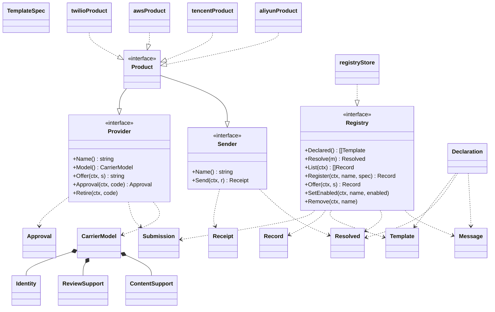

# sms

## 职责

本能力交付**按模板发出一条短信**：一个**模板注册表**持有在力的模板集，把调用方的一条消息解成载体直接可用的形状；一个**载体**把已解出的形状按厂商格式发出去。调用方先向注册表 `Resolve`，再把结果交给载体的 `Send`。

模板是**一等声明**，由注册表持有，不在载体一侧。模板有两族形态：**厂商模板编号**（载体按编号发送，编号来自厂商的逐模板审核，或来自厂商侧创建的内容资源）与**本地渲染正文**（注册表按声明把参数填进正文，载体把渲染结果作为正文发出）。一个语言可以同时声明两族，实际走哪一族由载体的能力声明决定。载体不认识模板，只按解出的形状构造请求。

载体**排他交付**：一个进程里恰好一个载体生效，多于一个表态启用即启动失败。载体由一个值交付发送与模板管理的接缝（`Sender` 与 `Provider`），并回答自己的能力声明（`Provider.Model`）。根包是接口包与工厂，不登记模块；实现子包绑定各自的厂商 SDK 并登记模块（[ADR-sms-capability-2026-10-13](../../adr/adr-sms-capability-2026-10-13.md)）。

### 非职责

- **不排队，不做工作池。** 发送是一次同步调用，`Send` 在厂商调用返回后才返回。异步投递、有界队列、队列满时的丢弃与重试策略归调用方：认证把发送交给自己的有界工作池，字段与队列容量都在认证一侧。
- **不持预算，不限流，不计尝试次数。** 本能力不认识「这条短信该不该发」。发送预算、重发间隔、每号码与每账户的上限、放行前缀都在调用方，本能力对每个 `Send` 都尝试发出去。
- **不持挑战状态，不生成也不校验验证码。** 验证码的生成、存放、比对与一次性消费归调用方；本能力不认识「验证码」这个概念，参数对它是不透明值。
- **不重试。** 厂商的发送接口不幂等，超时之后调用方无从知道短信是否已发出，重试会重复投递并重复计费。载体在超时、网络错误与上下文结束时把结果归入 `ErrUncertain`，从不自行重发。是否重发归调用方；重试次数不是本能力的配置项。
- **不管理登记。** 载体声明这个部署可用的发送身份（签名、发送方 ID、长号码、短号码、免费号码、号码池、消息服务）与这些身份覆盖的国家，但不登记、不跟踪、不声称任何身份在某个国家的登记或审核状态。美国 10DLC 的品牌与活动、印度 DLT、免费号码验证、短号码租用、逐国家发送方 ID 的申请都在厂商门户与合同里完成，本能力不读取也不缓存它们的状态（[ADR-sms-registration-out-of-scope-2026-10-22](../../adr/adr-sms-registration-out-of-scope-2026-10-22.md)）。
- **不做跨载体路由，不做故障转移。** 一条消息只交给一个载体；按目的地选路、多个厂商之间切换、失败后换一个厂商重发都不在本能力内。
- **不声明语言闭集。** `Locale` 是不透明的非空字符串，用来索引模板的语言到编号与语言到正文两个映射。本能力不认识 `zh-CN`、`en-US` 这类取值，也不解释 `Accept-Language`；语言取值的取得与归一归调用方。
- **不认识业务用途。** `Kind` 是模板的一个属性（`verification`／`notification`／`marketing`），载体把它映射到厂商自己的用途拼法；本能力不解释某个模板名属于哪种业务用途。
- **不认识租户，不读请求上下文。** 本能力不 import 任何上层功能目录，也不 import `pkg/tenant`。管理面模块在路由上判定时经 `authz.PlatformDomain` 显式落在平台域，不随请求解析出的租户走。
- **根包与载体不落存储。** 除排他性去重的一项进程内有界记录外，根包与载体不持状态（见 `Resolved.DedupeID`）。持有运行期模板与厂商审核状态的是注册表模块，它有自己的 `sms_templates` 表；管理面模块自己不持数据、不持规则，每个路由的动作都经 `sms.Registry` 调注册表。

## 外部接口契约

### 交付的功能

载体交付发送与模板管理的接缝（`Sender` 与 `Provider`），由同一个值回答；注册表交付接缝 `Registry`，由注册表模块回答。

```go
// 发送接缝：把一个已解出的消息交给厂商一次。
type Sender interface {
    Name() string
    Send(ctx context.Context, r Resolved) (Receipt, error)
}

// 模板管理接缝：只有厂商自己的 API 能做的事，也是厂商编号唯一的读写处。
type Provider interface {
    Name() string
    Model() CarrierModel
    Offer(ctx context.Context, s Submission) (code string, err error)
    Approval(ctx context.Context, code string) (Approval, error)
    Retire(ctx context.Context, code string) error
}

// Product 是载体交付的整个值：一个值同时是发送方与模板管理方。
type Product interface {
    Sender
    Provider
}
```

**`Model` 挂在 `Provider` 上。** 管理面持有的是一个 `Provider` 而不是一个 `Product`，载体能力声明因此必须经 `Provider` 到达；`Product` 仍是 `Sender` 加 `Provider`，传递地带有 `Model`。把 `Model` 只放到 `Product` 上，管理面就无法回答自己挂的是哪一种载体。

```go
// 载体对自身能力的声明，进程存活期不变。
type CarrierModel struct {
    Content       ContentSupport
    Review        ReviewSupport
    Identities    []Identity
    Countries     []string
    AttributeKeys []string
    MaxBodyRunes  int
    AsyncReceipt  bool
}

type ContentSupport struct {
    TemplateCode bool // 按厂商模板编号发送
    TextBody     bool // 按注册表渲染的正文发送
}

type ReviewSupport struct {
    PerTemplate bool // 厂商逐模板审核
    Originator  bool // 发送时可选择一个身份
}

type IdentityKind string // "sign-name"、"sender-id"、"long-code"、"short-code"、"toll-free"、"pool"、"messaging-service"

type Identity struct {
    Name       string
    Kind       IdentityKind
    Value      string
    Countries  []string
    Attributes map[string]string
}
```

`Content` 说明这个载体认不认厂商模板编号、认不认渲染正文；`Review` 说明厂商是否逐模板审核、发送时能否选择身份；`Identities` 是这个部署可用的发送身份，`Countries` 是载体可送达的国家，`AttributeKeys` 是模板 `Attributes` 允许出现的键（厂商登记标识，例如 AWS 印度 DLT 的 `IN_TEMPLATE_ID`），`MaxBodyRunes` 是正文的长度上界（零表示本能力不设自己的上界），`AsyncReceipt` 表示最终投递状态异步返回——同步答案只有厂商的消息标识，被受理不等于已送达。

```go
// 注册表接缝：持有在力的模板集，决定一条消息走哪个模板，管理本进程拥有的那些。
type Registry interface {
    Declared() []Template
    Resolve(m Message) (Resolved, error)
    List(ctx context.Context) ([]Record, error)
    Register(ctx context.Context, name string, spec TemplateSpec) (Record, error)
    Offer(ctx context.Context, s Submission) (Record, error)
    SetEnabled(ctx context.Context, name string, enabled bool) error
    Remove(ctx context.Context, name string) error
}

type Message struct {
    To         string            // E.164
    Template   string            // 逻辑模板名，调用方定（如 authn.code.login）
    Params     map[string]string // 键为模板声明的参数名
    Locale     string            // 非空；对 pkg/sms 不透明，只用来索引模板的语言映射
    Originator string            // 可选的发送身份名；空表示载体的缺省身份
    ValidFor   time.Duration     // 可选；零表示厂商的缺省有效期
    DedupeID   string            // 稳定标识；载体至多对同一标识调厂商一次
}

type Receipt struct{ ProviderID string }
```

**`Send` 收 `Resolved` 而不收 `Message`。** 一条消息走哪个模板，由注册表对着在力的模板集判定；载体不持模板集，只按已定下的编号、正文与参数次序构造请求。`Resolved` 因此还带号码、身份、登记标识、有效期与去重标识，让载体不必回看 `Message`。

`Send` 的契约，约束的主体是每个交付 `Sender` 的载体模块：

- 响应 `ctx`；任何一次调用都不在载体层内重试。
- 对同一个 `DedupeID` 至多调用厂商一次：载体记住它已发过的标识（有界），重复者返回首次的结果，不作第二次厂商调用；空 `DedupeID` 没有可守的标识，消息直接发出。
- 发送前校验 `Resolved.Originator`：为空时取载体的缺省身份；点名一个不存在的身份即 `ErrRejected`（调用方带了本部署没有的身份）；一个能从号码推出目的地国家的载体，身份覆盖不了该国即 `ErrUnroutable`（部署缺口），推不出的目的地留给厂商判定。这一项不由 `Resolve` 校验，因为一份 `Declaration` 不持有任何身份。
- 按 `Resolved` 构造一次厂商调用：按编号发送的载体取 `Code`，按正文发送的载体取 `Body`，位置参数厂商按有序值表铺参数数组。
- 把厂商的回应与错误归入 `ErrThrottled`、`ErrRejected`、`ErrUnroutable`、`ErrUncertain` 之一；没有明确归入前三个的错误，与全部超时、网络错误，一律归 `ErrUncertain`。归类不了的失败从不当作确定结果。
- `Resolved.Params` 里的值（例如验证码）与厂商凭据不写日志、不进错误文本、不进指标属性。

**`Locale` 为空是调用方缺陷。** 注册表把空 `Locale` 读作缺参，`Resolve` 以 `ErrRejected` 拒绝，与「语言不在模板的语言映射里」同形；归一（把空串填成某个缺省语言）只由调用方做，认证一侧的归一在 `pkg/authn/sms`，其缺省语言取自共享的 `i18n.default-locale` 项；认证根包不声明语言集，也不提供 `LocaleOf`（[ADR-i18n-language-set-2026-10-13](../../adr/adr-i18n-language-set-2026-10-13.md)）。

### 模板声明

一条模板的声明形状是 `TemplateSpec`：用途、有序参数名表、语言到厂商编号的映射、语言到本地正文的映射，以及厂商登记标识。它既是配置来源里一条模板的值，也是管理面 `Register` 请求的正文。

```go
type TemplateSpec struct {
    Kind       Kind              `config:"kind"`       // 缺省 notification
    Params     []string          `config:"params"`     // 可为空：正文可以不带占位符
    Codes      map[string]string `config:"codes"`      // 语言 → 厂商模板编号
    Bodies     map[string]string `config:"bodies"`     // 语言 → 本地渲染正文
    Attributes map[string]string `config:"attributes"` // 厂商登记标识，键受载体声明约束
}

// Template 是模板的只读视图，不含厂商编号与正文。
type Template struct {
    Name    string
    Kind    Kind
    Params  []string
    Locales []string // 有效语言集：codes ∪ bodies
}

// Declaration 是一份冻结、自洽的 TemplateSpec 集合。
type Declaration struct{ /* ... */ }

func NewDeclaration(spec map[string]TemplateSpec) (Declaration, error)
func (d Declaration) Declared() []Template
func (d Declaration) Resolve(m Message) (Resolved, error)

func RenderBody(body string, params map[string]string) (string, error)

type Resolved struct {
    To         string            // E.164
    Template   string            // 解出所用的逻辑模板名，留作诊断
    Locale     string            // 解出所在的语言
    Kind       Kind              // 模板的用途
    Code       string            // 厂商模板编号；按正文发送时为空
    Body       string            // 本地渲染后的正文；按编号发送时为空
    Params     map[string]string // 键为声明的参数名
    Ordered    []string          // 按 Params 的次序铺开的参数值
    Originator string            // 发送身份名；空表示缺省身份
    Attributes map[string]string // 厂商登记标识
    ValidFor   time.Duration     // 有效期；零表示厂商缺省
    DedupeID   string            // 载体至多对同一标识调厂商一次
}
```

**`Declaration` 是注册表内部冻结配置来源时用的形态。** 载体不再持有 `Declaration`，也不再有 `Declared()`；配置来源的模板集由注册表在启动期经 `NewDeclaration` 冻结成一份 `Declaration`，发送时把配置来源的消息交给它的 `Resolve`。

`Resolve` 把一条 `Message` 解成载体直接可用于构造请求的形状，四种落空的成因都是调用方缺陷，一律 `ErrRejected` 并点名缺的那一项：模板未声明、语言在该模板的编号表与正文表里都没有、声明所需的参数名缺失、消息带了模板未声明的参数名。正文存在时，`Resolve` 经 `RenderBody` 把参数填进正文并写进 `Resolved.Body`。`Originator` 不由 `Resolve` 校验——一份声明不持有身份，校验发生在载体的 `Send`。

**`RenderBody` 单趟替换。** 占位符写作 `${name}`：函数按一次扫描替换每个占位符，插入的值不再被扫描，因此一个参数值里的 `${...}` 保持字面。占位符点名一个未声明的参数，或出现没有闭合的 `${`，都是声明缺陷，在声明被构造时以 `ErrInvalidConfig` 报出，而不是留到发送时。

**两族形态源自同一份声明。** `Codes` 供按编号发送的载体使用；`Bodies` 供按正文发送的载体使用，也供在厂商侧创建内容资源的载体（Twilio Content API）在 `Offer` 时使用。`Resolved` 同时给出参数的键值表与有序值表：键参数厂商（阿里云）把 `Params` 序列化成 JSON 对象，次序无关；位置参数厂商（腾讯云）把 `Ordered` 按声明次序铺进请求，Twilio 把 `Ordered` 编号成 `ContentVariables` 的 `"1"`、`"2"`…。次序因此只有一处定义。

**声明自洽由 `NewDeclaration` 保证**，约束的主体是每个声明模板的来源：参数可以为零个，但不得重名；至少一种语言；每个语言至少带一个编号或一个正文；每个正文里的每个占位符都点名一个已声明的参数。不满足即 `ErrInvalidConfig`，在声明被构造时报出（注册表的 `Prepare`）；管理面 `Register` 也经同一条单模板校验路径，缺陷即 `ErrInvalidConfig` 点名该模板。一份声明只保证自己这份集合自洽，**不保证它覆盖某个消费方所需的组合**——覆盖由消费方在启动期核对自己所需（见「消费方的覆盖核对」）。

**载体形状校验在三处发生，失败在启动、装载或写入时到来，不在第一次发送时。** 注册表 `New` 校验配置来源的模板，`loadSnapshot` 校验运行期表的行，`Register` 与 `Offer` 校验写请求。`Register` 收到的是一条已带编号的模板，校验全部规则；`Offer` 收到的提交还没有编号，校验正文、参数与登记标识，厂商返回的编号补上该语言后再按同一规则复核。一条模板不能满足本进程挂载的载体的 `CarrierModel` 即 `ErrInvalidConfig`：

- 载体不按编号发送（`Content.TemplateCode` 为假）时，模板不得声明 `Codes`——声明了也没有一条发送路径会用到它。
- 载体逐模板审核（`Review.PerTemplate` 为真）时，每个语言必须带 `Code`——厂商审核的对象就是编号。
- `Attributes` 的每个键必须出现在 `AttributeKeys` 里。
- 每个正文的字符数不得超过 `MaxBodyRunes`（零表示不设本能力自己的上界）。

### 登记单元与名字

| 包 | 模块名 | 交付 | 排他 |
|---|---|---|---|
| `pkg/sms` | 不登记 | `Sender`、`Provider`、`Registry` 接口与 `Message`、`Receipt`、`Resolved`、`CarrierModel`、模板声明与工厂 | — |
| `pkg/sms/registry` | `sms.registry` | `Registry` | 排他 |
| `pkg/sms/admin` | `sms.admin` | 不交付功能接口，只挂管理面路由 | — |
| `pkg/sms/aliyun` | `sms.aliyun` | `Sender` + `Provider`（一个 `Product` 值） | 排他 |
| `pkg/sms/tencent` | `sms.tencent` | `Sender` + `Provider`（一个 `Product` 值） | 排他 |
| `pkg/sms/aws` | `sms.aws` | `Sender` + `Provider`（一个 `Product` 值） | 排他 |
| `pkg/sms/twilio` | `sms.twilio` | `Sender` + `Provider`（一个 `Product` 值） | 排他 |

模块名照顶层能力：裸名 `sms`，叶子 `sms.<名>`，配置命名空间取同一个取值（对照 `kv`/`kv.redis`、`event`/`event.nats`）。每个登记模块的包导出自己的 `ModuleName` 常量。载体是厂商适配的封闭集：`sms.aliyun`、`sms.tencent`、`sms.aws`、`sms.twilio`；任意两个同时纳入即在消解阶段以排他冲突失败，宿主选其一。每个载体叶子包整个撤掉而不影响其他模块。注册表模块与发送方模块互不依赖对方的具体实现：注册表只经 `sms.Provider` 接缝触达厂商，一个进程里恰好一个注册表、恰好一个载体。

### 注册表模块 sms.registry

`sms.registry` 持有在力的模板集，交付 `(*sms.Registry)(nil)`（排他）。它 `Requires` `(*sms.Provider)(nil)`（排他，由载体交付）与 `(*db.Database)(nil)`，可选取 `event.Bus` 与 `log.Logger`。它有自己的迁移树与 `sms_templates` 表，宿主不必再为它单独配置存储。它按 `Provider.Name()` 划分存储：一张数据库只服务一个载体。

**来源决定可变权限。** 一条模板从其中一个来源进入在力的集合：

- **配置来源**是本模块自己的 `templates` 配置项（`map[string]sms.TemplateSpec`），启动期读一次、冻结成一份 `sms.Declaration`。它对进程**完全只读**：运行期不可删、不可改、不可禁用，不轮询，也不记审核状态——写它的运维已经替它担保过审。管理面点名它的写调用是 `ErrImmutable`。
- **运行期来源**是本模块自己的 `sms_templates` 表，装的是进程在运行间注册、交给厂商审核、启停与删除的模板。每条带厂商的审核状态，**按语言分别记录**——厂商按语言审核，一个逻辑名在一个语言里过审、在另一个语言里仍在审，是寻常情形——由后台轮询读回。载体不逐模板审核（`Review.PerTemplate` 为假）时，它的运行期模板的每个语言是 `ApprovalNotRequired`：厂商没有这条审核，进程就不记一个它没有的状态。

**运行期状态的维度各自独立、互不推导。** 一条运行期模板由这几个维度描述：**来源**（配置或运行期）、**每个语言的审核状态**（`ApprovalUnknown`／`ApprovalPending`／`ApprovalApproved`／`ApprovalRejected`／`ApprovalWithdrawn`／`ApprovalNotRequired`，配置来源一律 `ApprovalUnknown`）、**是否启用**。启用与审核正交：`SetEnabled` 把一个模板开或关，与厂商的审核无关——一个模板可以在审核回来之前就被启用，一次发送仍然等审核；反过来，审核过的模板也可以被禁用。

`Resolve` 判定顺序固定，收口在一处：

1. 设置项 `sms.registry.sending-enabled` 为假即 `ErrNotSendable`（每次 `Resolve` 都读一次，运维不必重启即可停止发送）。
2. 空 `Locale` 即 `ErrRejected`（与 `Declaration.Resolve` 同形）。
3. 模板名在配置来源的名字集里：交给那份 `Declaration.Resolve`，它拥有结构性检查，一个读不到的模板、语言、参数都答 `ErrRejected`。
4. 否则取运行期快照：快照尚未装载即 `ErrNotLoaded`（状态不可用，绝不当作「没有」或「被拒」）；名字不在快照里即 `ErrRejected`；模板被禁用即 `ErrNotSendable`；模板的语言既没有编号也没有正文即 `ErrRejected`；**该消息所用语言**那一条审核既不是 `Approved` 也不是 `ApprovalNotRequired` 即 `ErrNotSendable`（审核按语言，一个语言过审、另一个仍在审，过审的那个照发）；参数缺项或多出即 `ErrRejected`。

`Declared` 报告在力的模板：配置来源的全部，加运行期来源里**启用且每个语言可发送**（`Approved` 或 `ApprovalNotRequired`）的那些，按名字稳定排序，不带厂商编号与正文。运行期模板要求每个语言都可发送才进 `Declared`，因为消费方的覆盖核对需要模板声明的每一种语言都在。`List` 报告全部：配置来源的标记 `SourceConfig` 且恒为启用、不记审核，运行期来源的带按语言的审核与记账。

管理调用（约束的主体是 `Registry` 的每个调用方）：`Register` 接纳一个运维已持有厂商编号的模板，它点名的每个语言起于 `Pending`——载体不逐模板审核时起于 `ApprovalNotRequired`——模板起于启用；`Offer` 把模板交给厂商并接纳厂商回给的编号（见「厂商适配」的按载体分流），每个语言同样起于 `Pending` 或 `ApprovalNotRequired`；`SetEnabled` 开关一个运行期模板；`Remove` 从本进程丢弃一个运行期模板（不删厂商的）。点名配置来源的名字即 `ErrImmutable`；名字不在运行期集合里即 `ErrNoTemplate`；名字已持有该语言即 `ErrTemplateExists`。一次写请求的模板形状不符本进程挂载的载体模型即 `ErrInvalidConfig`。

**`Offer` 的厂商侧动作按载体能力分流。** 载体按厂商编号发送（`Content.TemplateCode` 为真）时，`Offer` 在厂商侧创建内容资源或取得审核通过的编号，并返回该编号；载体只按正文发送（`Content.TemplateCode` 为假）时，`Offer` 只在本地记录正文，不调厂商，`Retire` 是空操作。`Review.PerTemplate` 为假时 `Approval` 答 `ApprovalNotRequired`；为真时按厂商逐语言读取，行为与今天一致。一个不存在的编号、缺权限或配额不足导致的厂商回绝归 `ErrUnroutable`。

### 管理面模块 sms.admin

`sms.admin` 是挂在固定基路径 `/api/v1/system/sms` 下的管理面模块，不交付任何功能接口，只把模板集与载体声明暴露成 HTTP 路由；每条模板路由的动作是经 `sms.Registry` 调注册表，载体路由的动作是读 `sms.Provider.Model()`，模块自己不持数据、不持规则——注册表拥有「一条模板是什么、哪些在力、厂商答了什么」，载体拥有「它能发什么」，本模块只决定谁可以问、答案长什么样。路由挂在配置 `sms.admin.endpoints` 列出的端上，基路径不做可配置。每条模板路由按自然键——模板名——寻址，路径里不出现任何不透明的行标识。

**访问控制由本模块在 handler 内做出，不经请求中间件的声明判定。** 管理面路由在中间件的声明表里全部登记为开放，好让中间件把请求放行到 handler；handler 先读调用方的身份，再经 `authz.guard` 的 handler 内判定 API 就这条路由的权限问一句，不足即回绝。模块不给自己授予任何权限。

**判定顺序固定，写与读在判定之后分叉。** handler 先读调用方：请求没有身份是 401，只有状态、没有 `Type`，并带与准入层、授权层同形的 realm 质询，不询问 guard 即返回。再向 guard 要本条路由的权限：不足即由 guard 写出它自己的拒绝——拒绝 403、故障 503——并返回。判定之后才分叉：写解析正文、跑本条路由的形状检查、落强制档审计、调注册表；读调注册表或读载体声明并应答。

**判定在平台域做出。** 模板集与载体都是进程自己的、不是某个租户的，所以一次管理操作是平台操作；handler 经 `RequirePermissionIn(c, perm, authz.PlatformDomain)` 显式指定平台域判定。若按请求解析出的租户判定，一个在某租户获授权的调用方就能靠请求头触到平台集。

**每次写强制档审计，落在动作之前、事务之外。** 写路由在调用注册表之前写一行强制档审计；审计写不进则应答 503 且动作不执行。注册表拒绝写时再尽力写一行 `failed` 行，与允许行以动作标识关联，它自己的失败只记 Error，不改变应答。模块不开自己的事务。

读路由的权限是 `sms.template.read`，写路由是 `sms.template.manage`。两条权限的说明文案由本模块自己承载：一份消息目录给出它们 `DescriptionKeys` 的条目连同文本，目录随本模块的资源声明进 i18n 引擎，管理面据此把它们显示成读得懂的话（[design-authz](design-authz.md) 的扩展点一节）。下表是路由的全集（封闭集）：组、方法、路径与每条需要的权限。

| 组 | 方法 路径 | 权限 |
|---|---|---|
| 模板 | `GET /api/v1/system/sms/templates` | `sms.template.read` |
| 模板 | `POST /api/v1/system/sms/templates` | `sms.template.manage` |
| 模板 | `POST /api/v1/system/sms/templates/submissions` | `sms.template.manage` |
| 模板 | `POST /api/v1/system/sms/templates/:name/enabled` | `sms.template.manage` |
| 模板 | `DELETE /api/v1/system/sms/templates/:name` | `sms.template.manage` |
| 载体 | `GET /api/v1/system/sms/carrier` | `sms.template.read` |

**读的应答是 200 加一份视图，新建写的应答是 201 加一条记录视图，其余落地的写是 204 无正文。** 视图逐字段从根包的 `sms.Record` 或 `sms.CarrierModel` 构造，从不把值原样交给客户端，记录日后新增一个字段不会因为它在就等于出现在应答里。模板视图的字段：`name`、`carrier`、`kind`、`source`、`params`、`locales`（有效语言集）、`bodies`、`attributes`、`approvals`（按语言）、`enabled`、`version`、`created_at`、`updated_at`，时间按 UTC 写出；它不带厂商编号——编号是注册表自己的记账，运维读「哪些模板在力」要知道的是在力与否，不是厂商把它编成几号。载体视图的字段：`name`、`content`、`review`、`identities`（名字、种类、值、国家、属性）、`countries`、`attribute_keys`、`max_body_runes`、`async_receipt`。列表分页按模板名，游标是上一页的最后一个名字。

**回绝映射是封闭的、fail-closed 的。** 400（`Problem.Type` 为 `urn:speed:sms:bad-request`）：请求在形状上不可读（路径参数或正文）、注册表以一个跑不起来的配置或一条不符的消息拒绝（`ErrInvalidConfig`／`ErrRejected`）。409：点名一条来自配置的模板（`Problem.Type` 为 `urn:speed:sms:config-template`，与名字冲突的 `urn:speed:sms:conflict` 分开），或名字已被持有（`urn:speed:sms:conflict`）。404：注册表不持有该名。503：其余失败，以及没落地的强制档审计；503 不带 `Problem.Type`，成因只进日志。`ErrNotSendable` 与 `ErrUnroutable` 不在映射里：它们是发送路径的哨兵，没有一条管理面路由会触到它们，注册表若在这里答它们就是答错了问题，落到与未知失败同一个 503。

**`sms.admin` 声明静态[特性](../../glossary.md) `sms.admin`。** 描述符的 `Resources` 带 `feature.Spec{Name: "sms.admin"}`；这个特性在场，表示本进程挂出上表的模板管理面路由与载体路由（[feature](design-feature.md)）。`sms.admin.endpoints` 必填、不接受空清单，挂路由而没有入口点是接线期故障，所以模块进入启用集、进程有路由器时这组路由无条件挂出，声明为静态特性符合架构不变量 18（[architecture](../architecture.md#架构不变量)）。

### 宿主可见面

以下是宿主写进配置文件、或在命令树与网关上点名的面。

- **模块名**：`sms.registry`、`sms.admin`、`sms.aliyun`、`sms.tencent`、`sms.aws`、`sms.twilio`。宿主的命令树点模块名纳入，配置命名空间取同一取值。
- **配置命名空间与输入项**：`sms.registry` 下的 `templates`（容器叶子，`map[string]sms.TemplateSpec`，取主配置源）与 `poll-interval`（时长，缺省 `1m`，取主配置源与环境变量）；`sms.admin` 下的 `endpoints`（字符串列表，必填，无缺省，只收具体端名、不收 `*`，取主配置源）；每个载体自己的命名空间下的凭据、`region`、`endpoint`、`configuration-set-name`、`identities` 与 `default-identity`（见「配置与设置的划分」）。
- **管理端点**：`sms.admin.endpoints` 列出的端，`/api/v1/system/sms/*` 下的模板读写路由与载体路由（路由见「管理面模块」一节）。

**配置与设置的划分。** 启动期需要、改动要重启的取值是配置；运行期可改、不需要重启的取值是设置（[ADR-config-scope-2026-09-13](../../adr/adr-config-scope-2026-09-13.md)）。凭据、`region`、`endpoint`、`configuration-set-name`、`identities`、`default-identity`、模板集、`poll-interval` 与 `sms.admin.endpoints` 都是配置。唯一的设置项是 `sms.registry.sending-enabled`（布尔，缺省 `true`），每次 `Resolve` 都读一次：置为 `false` 时 `Resolve` 答 `ErrNotSendable`，运维不必重启即可停止发送。重试次数不是配置项：载体从不重试，一次 `Send` 对应一次厂商调用。

`templates` 的形状是嵌套的：键是逻辑模板名，值是用途、有序参数名表、语言到编号的映射、语言到正文的映射与厂商登记标识。命名空间按 `.` 分段在配置数据里嵌套，所以 `sms.registry.templates` 写成：

```yaml
sms:
  registry:
    poll-interval: 1m
    templates:
      authn.code.login:
        kind: verification
        params: [code, ttl_minutes]
        codes:
          zh-CN: SMS_20375
          en-US: SMS_20376
        bodies:
          zh-CN: "你的验证码是 ${code}，${ttl_minutes} 分钟内有效。"
          en-US: "Your code is ${code}; it expires in ${ttl_minutes} minutes."
        attributes: {}
  admin:
    endpoints:
      - ops
```

### 对外接口面

- `Sender`、`Provider`、`Registry`、`Product`、`Message`、`Receipt`、`Resolved`、`Template`、`TemplateSpec`、`Declaration`、`Submission`、`Approval`、`ApprovalState`、`CarrierModel`、`Identity`、`IdentityKind`、`ContentSupport`、`ReviewSupport`、`Source`、`Kind`、`Record` 的字段与方法集，以及本能力的全部哨兵，是本能力对调用方的接口面。加方法、改签名或改字段名对实现了接缝的载体、注册表与取用它们的调用方都是不兼容变更。
- `Message` 的字段语义：`To` 是 E.164、`Template` 是调用方定义的逻辑名、`Params` 的键是模板声明的参数名、`Locale` 非空且对 `pkg/sms` 不透明、`Originator` 为空表示缺省身份、`ValidFor` 为零表示厂商缺省、`DedupeID` 使载体至多对同一标识调厂商一次。`Resolved` 的字段语义：`Kind` 是模板用途、`Code` 是厂商编号、`Body` 是本地渲染后的正文、`Ordered` 按模板声明的次序铺开、`Params` 是键值表、`Attributes` 是厂商登记标识。
- **模板声明的形状属于接口面**：`TemplateSpec` 的字段名与容器成形态（`params` 是列表，`codes`、`bodies`、`attributes` 是映射）是宿主写在配置文件里、也写在管理面 `Register` 正文里的东西，改它们使旧写法成为未知键或坏正文。
- **宿主可见面**：模块名 `sms.registry`、`sms.admin`、`sms.aliyun`、`sms.tencent`、`sms.aws`、`sms.twilio`，配置键 `sms.registry.templates`、`sms.registry.poll-interval`、`sms.admin.endpoints` 与各载体自己的输入项，设置项 `sms.registry.sending-enabled`，管理面路由的路径与每条路由询问的权限（读 `sms.template.read`、写 `sms.template.manage`），以及权限常量 `sms.template.read`、`sms.template.manage` 与 `Problem.Type` 前缀 `urn:speed:sms:` 及其下的码（`bad-request`、`conflict`、`config-template`）。改动它们是宿主可见的破坏性变更。
- 特性名 `sms.admin`。前端经生成的特性名类型引用它，改名或撤去是宿主可见的破坏性变更。
- 单个载体叶子包、注册表模块、管理面模块各自可替换、可撤掉，不改变调用方的代码。

### 哨兵错误

| 哨兵 | 定义处 | 含义 |
|---|---|---|
| `ErrThrottled` | `pkg/sms` | 厂商限流 |
| `ErrRejected` | `pkg/sms` | 厂商拒绝模板、身份或号码；或调用方的消息与模板不符（含点名一个不存在的身份） |
| `ErrUnroutable` | `pkg/sms` | 载体在当前部署下无法把这条消息送到这个目的地：缺权限、资源不存在、配额不足，或身份覆盖不了目的地国家。与 `ErrRejected` 分开，因为消息本身没有缺陷；与 `ErrUncertain` 分开，因为结果确定，换一个部署才可能改变 |
| `ErrUncertain` | `pkg/sms` | 发送后超时，不知是否送达；不得盲目重发 |
| `ErrInvalidConfig` | `pkg/sms` | 配置或一次写请求里的值跑不起来：声明自洽校验失败、模板不满足挂载载体的模型，或管理面写请求的模板形状不符 |
| `ErrNotSendable` | `pkg/sms` | 模板在本进程可以持有、但不可以在此刻此语言下发送：被禁用、发送总开关关闭，或该语言的厂商审核未过。与 `ErrRejected` 分开，因为补救不同——被拒的消息是调用方的，被禁用的模板是模板或部署的状态 |
| `ErrImmutable` | `pkg/sms` | 对一条来自配置来源的模板发起的改动：运维写它、进程只读，删它、禁它、占它的名字都只有改配置并重启才行 |
| `ErrNoTemplate` | `pkg/sms` | 管理调用点名了注册表不持有的一条模板 |
| `ErrTemplateExists` | `pkg/sms` | 调用点名了注册表已持有的一条模板 |
| `ErrNotLoaded` | `pkg/sms/registry` | 注册表的 `Init` 装载运行期快照之前发生的读：状态不可用，绝不当作「空集」或「被拒」 |

调用方以 `errors.Is` 判别，包裹一律用 `%w`。错误文本不携带参数值（例如验证码）或厂商凭据。

## 依赖

| 依赖 | 用途 |
|---|---|
| `pkg/core` | `pkg/sms`：登记描述符、交付功能；`sms.registry`/`sms.admin`：模块描述符与 `Resolve` |
| `pkg/config` | 声明各自模块的输入项 |
| `pkg/log` | 可选：载体工厂在 `New` 里登记凭据的脱敏匹配器；注册表与管理面记诊断 |
| `pkg/db` | `sms.registry`：`sms_templates` 表与迁移 |
| `pkg/event` | `sms.registry`（可选）：变更事件，加速多副本收敛 |
| `pkg/authz`、`pkg/authz/guard`、`pkg/audit`、`pkg/authn`、`pkg/http` | `sms.admin`：网关身份、handler 内判定、审计、问题应答 |
| `pkg/feature` 根包 | `sms.admin`：声明静态特性（`feature.Spec`）；根包只依赖标准库 |
| 各厂商 SDK | 只被对应的载体叶子包 import |
| `pkg/internal/literal` | 与认证的登录叶子共用的脱敏字面量登记构造 |

**本能力不 import 任何上层功能目录，也不 import `pkg/authn`。** 判据是发送无关用途：本能力位于依赖图的底层之一，与 `pkg/kv`、`pkg/event` 同级，任何要发通知的模块都能单独引入它，不必背上整套认证。方向是调用方（`pkg/authn/sms`）import `pkg/sms`，`pkg/sms` 不 import 它。`sms.admin` 是唯一例外的一层：它 import `pkg/authz`、`pkg/audit`、`pkg/authn`、`pkg/http` 来挂一条受保护的管理面，而它是可撤掉的一个叶子，发送能力本身不因它而背上这些依赖。

**根包与注册表不 import 任何厂商 SDK。** 每个 SDK 落在绑定它的载体叶子包里，只有 import 该子包的宿主的 `go.mod` 才背负它。这一条没有编译期强制（同一 `pkg` 模块内每个客户端都在一份依赖清单里），顶上它的是 `pkg/sms/deps_test.go` 的守卫：根包的传递闭包不含任何厂商 SDK，也不含 `pkg/authn`。注册表只经 `sms.Provider` 接缝触达厂商，不 import 任何载体叶子包（否则会经根包闭出环、破掉载体封边）。各 SDK 在 `pkg/go.mod` 里精确钉版，同样由该守卫守住：阿里云用 `github.com/alibabacloud-go/dysmsapi-20170525/v5` v5.6.0，腾讯云用 `github.com/tencentcloud/tencentcloud-sdk-go/tencentcloud/sms/v20210111` v1.3.172，AWS 用 `github.com/aws/aws-sdk-go-v2/service/pinpointsmsvoicev2`，Twilio 用 `github.com/twilio/twilio-go`（[ADR-sms-twilio-sdk-2026-10-22](../../adr/adr-sms-twilio-sdk-2026-10-22.md)）。

**阿里云 SDK 经 `github.com/tjfoc/gmsm` 拖回未经模块图修剪的 `google.golang.org/genproto` 单体**：那个版本的 `googleapis` 包与拆分后的 `google.golang.org/genproto/googleapis/*` 模块重名，工作区构建因此报歧义导入。`go.work` 用一行 `replace` 把单体钉到拆分之后的版本（[ADR-sms-capability-2026-10-13](../../adr/adr-sms-capability-2026-10-13.md)）。gmsm 已是最新发布版，而这个钉版放进任一模块的 `go.mod` 都会被 `tidy` 当作无人引用的依赖删掉，所以它落在工作区层。

**`pkg/internal/literal` 是共享单元。** SMS 载体各自 import 它来登记凭据的字面量脱敏匹配器，认证的登录叶子（`authn/login/{google,github,wechatweb,wechatmp}`）也用它，所以它是多个实现子包共用的单元，落在 `pkg/internal/` 下。它不登记模块，不交付功能，不参与生命周期，只导出登记字面量匹配器的构造（[ADR-shared-backend-unit-2026-09-21](../../adr/adr-shared-backend-unit-2026-09-21.md)）。载体只经工厂取用它，见「工厂的构造次序」。

## UML 图

本能力的结构是多条接缝、一份模板声明、一个载体能力声明与多个实现的关系。图里的约束不在图中：载体之间是**互斥**的，注册表本身也是**排他**的——图上看不出这一点，因为排他性由描述符声明、由消解阶段裁定，不是类型之间的关系。声明自洽由 `NewDeclaration` 保证，声明的覆盖由消费方在 `New` 核对，两者都不在类型的形状里。注册表与载体彼此不 import：注册表只经 `Provider` 接缝触达厂商。



**每个载体各自登记为一个模块**（模块名 `sms.aliyun`、`sms.tencent`、`sms.aws`、`sms.twilio`），注册表登记为 `sms.registry`。根包是接口包与工厂，不登记模块。

## 核心数据结构

| 概念 | 类型 | 说明 |
|---|---|---|
| 消息 | `Message` | 号码、模板名、参数、语言、身份、有效期、去重标识；调用方视角 |
| 回执 | `Receipt` | 厂商返回的标识；本能力不解释它 |
| 解出的形状 | `Resolved` | 号码、模板名、语言、用途、编号、正文、键值参数、有序参数值、身份、登记标识、有效期、去重标识；载体视角 |
| 模板声明 | `TemplateSpec` | 用途、有序参数名表、语言到编号、语言到正文、登记标识 |
| 模板视图 | `Template` | 只读视图：名字、用途、有序参数名、有效语言集；不含编号与正文 |
| 冻结的集合 | `Declaration` | 一份 `TemplateSpec` 的集合，构造期自洽校验后冻结 |
| 提交 | `Submission` | 交给厂商的一条模板：名字、正文（`${name}` 占位符）、用途、语言、参数、登记标识、备注 |
| 审核 | `Approval` | 厂商对一条模板的判定：`State` 与可选的 `Reason` |
| 审核状态 | `ApprovalState` | `ApprovalUnknown`（零值）／`ApprovalPending`／`ApprovalApproved`／`ApprovalRejected`／`ApprovalWithdrawn`／`ApprovalNotRequired`（值 `not-required`）的闭集 |
| 来源 | `Source` | `Config`／`Runtime` 的闭集 |
| 用途 | `Kind` | `Verification`／`Notification`／`Marketing` 的闭集，缺省 `Notification`；映射到厂商各自的拼法由载体做 |
| 载体声明 | `CarrierModel` | 内容支持、审核支持、身份、可送达国家、登记标识键、正文上界、异步回执 |
| 身份 | `Identity` | 名字、种类、值、覆盖国家、属性；种类是 `IdentityKind` 的闭集 |
| 记录 | `Record` | 运维视角的一条模板：名字、载体、用途、来源、参数、语言、正文、登记标识、按语言的审核、启用、版本、时间；不含编号 |

**审核状态是本能力自己的词表，不是厂商的编号。** 厂商之间对编号的含义不一致——同一个 `0`，一家表示过审且在力，另一家表示审核中——所以调用方经本能力读到的是含义，永远不是一个裸码；映射归载体（见「厂商适配」）。`ApprovalNotRequired` 表示厂商没有逐模板审核，它**不是** `ApprovalUnknown`：后者表示这条审核存在而本进程不跟踪它。可发送的状态是 `Approved` 与 `ApprovalNotRequired`（[ADR-sms-template-review-is-carrier-capability-2026-10-22](../../adr/adr-sms-template-review-is-carrier-capability-2026-10-22.md)）。

**`Template`、`Record` 都不含厂商编号。** 编号是注册表的私有记账，只进请求，不进交出的视图，也不进启动诊断——消费方核对的是「这个模板、这个语言、这些参数在不在」，不必知道编号是多少。

**运行期模板的存储形态是 `sms_templates` 表**，每个结构化字段以文本列持有：`carrier`、`kind`、`params`（JSON 数组，按声明次序）、`codes`（JSON 对象，语言到编号）、`bodies`（JSON 对象，语言到正文）、`attributes`（JSON 对象）、`approvals`（JSON 对象，按语言的判定）。主键是 `(carrier, name)`；`version` 是每次写的版本计数，乐观并发写以它为条件。**全部读写按本进程挂载的载体的名字过滤**，一张数据库只服务一个载体。一个模板的有效语言集是 `codes` 与 `bodies` 的并集。**配置来源的模板在这张表里没有行**：它在启动期读一次、进程存活期只读。

**迁移 0002 补上载体维度。** SQLite 与 PostgreSQL 各自的 0002 迁移加 `carrier TEXT NOT NULL DEFAULT ''`、`kind TEXT NOT NULL DEFAULT 'notification'`、`bodies TEXT NOT NULL DEFAULT '{}'`、`attributes TEXT NOT NULL DEFAULT '{}'` 四列，并把主键改为 `(carrier, name)`。旧行的 `carrier` 为空串。

**旧行由第一个启动的载体收养，所有权标记阻止接管。** 本进程第一次对着数据库启动时，若存在 `carrier = ''` 的旧行，它在一个事务里把这些行改写成自己的载体名，并写下一行所有权标记。标记只记一个载体名；此后一个不同的载体对着同一数据库启动即失败，而不是静默接管这些旧行。同一载体再次启动时标记与旧行都已就位，无事发生。

## 核心算法与流程

### 一次发送

1. 调用方按用途与身份构造一条 `sms.Message`，交给注册表的 `Resolve`（判定顺序见「注册表模块」一节）。
2. 注册表把消息解成 `sms.Resolved`：用途、厂商编号或渲染后的正文、按声明次序铺开的参数值、身份、登记标识与有效期。
3. 调用方把 `Resolved` 交给载体的 `Send`。
4. 载体按 `DedupeID` 查自己的去重表；命中即返回首次的结果，不调厂商。
5. 载体校验发送身份：不存在的身份即 `ErrRejected`；能从号码推出目的地国家的载体，覆盖不了该国的身份即 `ErrUnroutable`。
6. 载体按 `Resolved` 构造一次厂商调用：按编号发送的载体取 `Code`，按正文发送的载体取 `Body`，位置参数厂商按有序值表铺参数数组。
7. 调用返回后把厂商的回应与错误归入哨兵，把结果连同 `Receipt` 记进去重表，返回调用方。

### 注册表的判定与装载时序

**快照整体替换，从不就地写。** 运行期集合在内存里是一份 `snapshot`，被原子指针指向；一次替换换掉整个指针，读它的调用方取一次指针、那次取到的副本不再变化。快照只装运行期来源；配置来源冻结在那份 `Declaration` 里、进程存活期不变，由产物持有一份、不复制进快照。

**`New` 不读表，`Init` 才装载。** 产物在 `New` 里建成、不读任何表——`New` 早于迁移，首启时 `sms_templates` 还不存在。表在 `Init` 里第一次读：迁移那时已跑过。`Init` 里还完成旧行收养与所有权标记的检查、订阅变更事件并启动后台轮询。一次写在调用返回前不装载——先落表、再让本副本重装、再发一条变更事件给别的副本。

### 后台轮询

后台 pass 在一个间隔上做两件事。第一件是**变更事件之下的兜底**：事件是快路径，一次写本副本立即重装、总线把消息带给别的副本，但总线不承诺投递次数，一个从未收到事件的副本会一直服务一份陈旧集合直到重启。第二件是**厂商审核**：一条运行期模板在它点名的每个语言上都起于 `Pending`（载体逐模板审核时），每个语言的状态按厂商自己的节奏变化，pass 把它读回来。

pass 启动于 `Init`（那时表已就绪，`New` 里表还没有），第一遍立即跑一趟而不是等一个间隔——一个本副本已持有、仍在待审的模板，不必等整一个间隔才等到第一次读。零间隔关掉 pass，这是宿主可以做的选择：它接受只靠事件收敛，代价是除重启外，一次本副本没听到的变更、或一个回来的审核，都一直不可见。

**审核按语言读、只读仍在待审的语言。** 一次厂商调用失败留在语言的状态不动——记下一个厂商没答过的状态会让一个它持有的模板被拒，或更糟，让它不持有的模板过审——同一次 pass 里其他能读的语言照样写回。判定与存储的相等则什么都不写，一次还在跑的审核不会每个间隔翻动这一行。`Unknown` 与 `ApprovalNotRequired` 都不轮询：前者是进程不读回一个它从未取过的审核，后者是厂商根本没有这条审核。

### 工厂的构造次序

`Spec[C]` 与 `NewModule[C]`（仿 `pkg/kv` 的 `Spec` 与 `NewModule`）把载体的公共接线收进工厂，载体只提供自己的类型参数、配置原型、输入项、表态与打开函数：

```go
type Spec[C any] struct {
    ModuleName      string
    ConfigNamespace string
    Config          *C
    Items           map[string]config.Item
    Stance          func(cfg *C) (core.Enablement, error)
    Secrets         func(cfg *C) []string      // 凭据：登记为日志的字面量脱敏匹配器
    Open            func(ctx context.Context, cfg *C) (Product, error)
}
```

交付排他：`Provides` 排他 `(*Sender)(nil)` 与 `(*Provider)(nil)`；`Requires` 可选 `log.Logger`。阶段行为如下：

| 阶段 | 行为 |
|---|---|
| `Prepare` | `Decode` 自己那份配置；读出配置后调 `Stance`，与自身性质不符即启动失败，错误点名缺的是哪一项 |
| `New` | `Decode` 配置 → 取可选 `log.Logger` → 调 `Secrets` 并经 `literal.Register` 登记字面量脱敏匹配器 → 调 `Open` 建立载体并返回 `Product` |

**次序固定：先登记脱敏字面量，再绑定任何带属性的 logger，最后 `Open`。** 日志脱敏规则只对它注册之后写出的记录起作用（[design-authn-gate](authn/design-authn-gate.md) 的脱敏规则），所以凭据的登记必须发生在载体把任何属性绑到 logger 之前。`Secrets` 钩子把「凭据先登记」这一步收进工厂，载体因此不 import `literal`，只交出凭据字符串。

**载体在 `Open` 里建立能力声明。** `Product.Model` 从载体的配置与常量得出，进程存活期不变；工厂不对它再加工。**载体不在 `Prepare` 里做模板自洽校验**：载体没有模板集，模板的自洽与载体形状校验落在注册表构造那份配置来源的 `Declaration` 与装载、写入时（注册表的 `Prepare`、`Init`、`Register`、`Offer`）。

### 消费方的覆盖核对

需要一组固定模板的消费方在它自己的 `New` 里：`Resolve[sms.Registry]` 取到注册表实例后立即调 `registry.Declared()`，与自己的需求集逐项比对——每个模板的名字与所需的语言都要齐备，参数名表则须与消费方发送的相等，少一个或多一个都是 `ErrInvalidConfig` 并点名那个参数或那个语言。参数按相等而非包含来比对：`Resolve` 要求每个已声明的参数，模板多声明一个消费方从不发送的参数，该模板就没有任何消息能满足，包含式核对会放它过启动、随后在每次发送时静默失败。`Prepare` 早于 `New`、拿不到实例，所以核对落在 `New`；`New` 返回错误同样终止启动，早于服务。

**这次核对看到的是配置来源的模板，运行期创建的模板不在其中。** 生命周期阶段序是 `Prepare → New → Migrate → Init → Start → Serve`：全部模块的 `New` 跑完，才轮到任何一个模块的 `Init`。消费方的核对在 `New`，而注册表的运行期快照在注册表自己的 `Init` 里才装载；所以核对那一刻 `registry.Declared()` 只报配置来源的模板（`Declared` 在快照装载前只报配置来源，见「注册表模块」一节）。这是刻意的：启动契约由运维写在配置里，消费方所需的模板必须在配置来源里齐备，运行期由管理面新加的模板不进入这次核对。

### 管理面的判定顺序

一次管理请求的操作序固定（细节见「管理面模块」一节）：读调用方（无身份 401）→ 向 guard 要本条路由的权限（不足由 guard 写出 403／503）→ 判定之后写与读分叉，写先解析正文并做形状检查，再落强制档审计（落不进即 503、动作不执行），再调注册表，把注册表的回绝映射成应答；读直接调注册表或读 `Provider.Model()` 并应答。

### 厂商适配

适配只做下列事：按 `Resolved` 的编号或正文与有序参数值构造请求、调用、把响应与错误归入哨兵；以及模板管理面的动作（创建内容资源、提交审核、读取审核、删除）。没有真实凭据无法在线验证，适配层测试用 `httptest` 起假端点校验请求形状。

| 项 | 阿里云 `sms.aliyun` | 腾讯云 `sms.tencent` | AWS `sms.aws` | Twilio `sms.twilio` |
|---|---|---|---|---|
| SDK | `github.com/alibabacloud-go/dysmsapi-20170525/v5` v5.6.0 | `github.com/tencentcloud/tencentcloud-sdk-go/tencentcloud/sms/v20210111` v1.3.172 | `github.com/aws/aws-sdk-go-v2/service/pinpointsmsvoicev2` | `github.com/twilio/twilio-go`（`rest/api/v2010`、`rest/content/v1`） |
| 能力声明 | `Content{TemplateCode}`、`Review{PerTemplate}`、身份 `sign-name` | `Content{TemplateCode}`、`Review{PerTemplate}`、身份 `sign-name` | `Content{TextBody}`、`Review{Originator}`、`MaxBodyRunes` 1600、`AsyncReceipt`、`AttributeKeys ["IN_TEMPLATE_ID"]` | `Content{TemplateCode}`、`Review{Originator}`、`AsyncReceipt` |
| 发送调用 | `SendSmsWithContext` | `SendSmsWithContext` | `SendTextMessage` | Messages API 创建消息 |
| 发送请求字段 | `SignName`、`TemplateCode`、`TemplateParam`（`Params` 的 JSON 对象） | `SignName`、`TemplateId`、`TemplateParamSet`（位置参数，按声明次序铺开） | `DestinationPhoneNumber`、`MessageBody`（取 `Resolved.Body`）、`OriginationIdentity`（取所选身份）、`MessageType`（verification 与 notification 为 `TRANSACTIONAL`，marketing 为 `PROMOTIONAL`）、`TimeToLive`（取 `ValidFor`）、`DestinationCountryParameters`（`IN_TEMPLATE_ID` 取 `Resolved.Attributes`，`IN_ENTITY_ID` 取身份属性） | `To`、`MessagingServiceSid`（取身份；`From` 可放在身份属性里）、`ContentSid`（取 `Resolved.Code`）、`ContentVariables`（`Ordered` 编号成 JSON 的 `"1"`、`"2"`…）、`ValidityPeriod`（取 `ValidFor` 的整秒数，1–36000） |
| 提交／创建 | `CreateSmsTemplateWithContext`（正文按 `${name}` 原样传，用途映射到 `TemplateType`） | `AddSmsTemplateWithContext`（正文从 `${name}` 改写为 `{1}`、`{2}`…，用途映射到 `SmsType`） | 不调厂商：只在本地记录正文，`Retire` 是空操作 | Content API 创建 `twilio/text` 模板（正文从 `${name}` 改写为双花括号位置占位符，语言取语言标签的主标签并小写，须为两个小写 ASCII 字母），`Offer` 返回内容 SID |
| 读取审核 | `GetSmsTemplateWithContext`（`TemplateStatus` 映到审核状态） | `DescribeSmsTemplateListWithContext`（一个编号一查，`StatusCode` 映到审核状态） | `ApprovalNotRequired` | `ApprovalNotRequired` |
| 删除 | `DeleteSmsTemplateWithContext` | `DeleteSmsTemplateWithContext` | 空操作 | Content API 删除内容资源 |
| 归 `ErrThrottled` | 没有已核实的错误码 | `LimitExceeded.*` 错误码 | `ThrottlingException` | HTTP 429 |
| 归 `ErrRejected` | 没有已核实的错误码 | `TemplateParamSetNotMatchApprovedTemplate` | `ValidationException` | 同步 4xx |
| 归 `ErrUnroutable` | 没有已核实的错误码 | 没有已核实的错误码 | `AccessDeniedException`、`ResourceNotFoundException`、`ConflictException`、`ServiceQuotaExceededException` | 没有已核实的错误码 |
| 归 `ErrUncertain` | 超时、网络错误与全部错误码 | 超时、网络错误与表中未列出的错误码 | 超时、网络错误与表中未列出的错误码 | 5xx、超时与网络错误 |

**厂商的发送调用都不幂等，超时之后调用方无从知道短信是否已发出，所以超时归 `ErrUncertain`，适配层从不重试。** 阿里云的错误码到 `ErrThrottled`、`ErrRejected` 的归类未经核实（见「假设与守住它们的测试」），在核实之前阿里云适配把全部错误码归 `ErrUncertain`：这个方向只多计一次预算、不盲目重发，不会把未确认的失败当作确定的限流或拒绝。腾讯云的接入点由配置的 `region` 推出（SDK 按地域选定），没有单独的接入点配置项；阿里云另有 `sms.aliyun.endpoint`，可指向地域或网关接入点。AWS 的 SDK 重试被强制为一次尝试，`AsyncReceipt` 为真，最终投递状态经厂商的异步回执返回。Twilio 把 `Ordered` 编号成 `ContentVariables`，编号从 `"1"` 起按声明次序；一个无法表达为两个小写 ASCII 字母主标签的语言在 `Offer` 时即 `ErrInvalidConfig`。

**提交正文的改写按厂商各自的占位符语法进行，次序只有一处定义。** 腾讯的模板管理面把 `${name}` 改写为位置占位符（一个 `${name}` 变 `{1}`、`{2}`…，按声明参数名的次序编号），Twilio 把它改写为双花括号位置占位符；一个重复声明的参数、或一个正文用到而提交未声明的参数都被拒。阿里云的已审模板本就用 `${name}`，正文原样传；AWS 直接使用注册表渲染后的正文。

## 错误与失败语义

| 情形 | 表现 |
|---|---|
| 发送总开关 `sms.registry.sending-enabled` 为假 | `ErrNotSendable`，每次 `Resolve` 读一次 |
| 空 `Locale` | 调用方缺陷，注册表 `Resolve` 以 `ErrRejected` 拒绝 |
| 模板未声明 / 语言既无编号也无正文 / 参数缺项 / 多出参数 | `ErrRejected`，点名缺的那一项，不调厂商 |
| 运行期模板被禁用 | `ErrNotSendable` |
| 运行期模板在该消息的语言上审核既不是 `Approved` 也不是 `ApprovalNotRequired` | `ErrNotSendable`，点名那条语言与审核状态 |
| 注册表的运行期快照尚未装载 | `ErrNotLoaded`（状态不可用，绝不当作空集或被拒） |
| 声明自洽校验失败 / 模板不满足载体的 `CarrierModel` / 管理面写请求的模板形状不符 | `ErrInvalidConfig`，在声明被构造（注册表 `Prepare`）、快照装载、写请求被校验时报出 |
| 管理调用点名配置来源的模板 | `ErrImmutable` |
| 管理调用点名注册表不持有的模板 | `ErrNoTemplate` |
| 管理调用点名已持有的名字／语言 | `ErrTemplateExists` |
| 发送身份不存在 | `ErrRejected`，不调厂商 |
| 身份覆盖不了目的地国家 / 缺权限 / 资源不存在 / 配额不足 | `ErrUnroutable`；结果确定，换一个部署才可能改变 |
| 厂商限流 | `ErrThrottled` |
| 厂商拒绝模板、身份或号码 | `ErrRejected` |
| 超时、网络错误、上下文结束、未核实的错误码 | `ErrUncertain`；不得盲目重发 |
| 重复的 `DedupeID` | 返回首次的结果，不调厂商 |
| 消费方所需的（模板，语言）缺项，或参数名表与消费方所发不等 | `ErrInvalidConfig`，消费方 `New` 阶段终止启动 |

**本能力不降级，不重试，不做故障转移。** 厂商不可达即那次调用失败，不排队待发、不重连后补发、不换一个厂商重发；是否重发归调用方。注册表的一次写落地后，本副本重装与变更事件各失败一次都不撤销这次写——它已在表里，版本记着它，轮询的 ticker 收敛一个事件没到达的副本。

### 假设与守住它们的测试

以下行为未经运行核实。依赖它们的断言写作假设，对应的测试失败即视为该断言的前提不成立：

- **阿里云错误码归类。** 假设阿里云有确定表示限流或拒绝的错误码，可以对照 SDK 与厂商文档逐码核实后归入 `ErrThrottled` 或 `ErrRejected`；核实之前该适配的全部错误码归 `ErrUncertain`。适配层测试用 `httptest` 起假端点，断言任一错误码与超时、网络错误都落入 `ErrUncertain`；某个错误码经核实归入 `ErrThrottled`、`ErrRejected` 或 `ErrUnroutable` 时，同一测试按码改写断言。
- **阿里云审核状态的来源以单条接口为准。** 阿里云 SDK 里单条查询接口（`GetSmsTemplate`）的 `TemplateStatus` 有枚举注释（`0` 审核中、`1` 通过、`2` 未通过、`10` 取消审核），而列表接口（`GetSmsTemplateList`）的 `AuditStatus` **没有枚举注释**；本适配因此以单条接口的编号为准建映射。适配层测试用假端点把每个编号断言到对应的中立状态；编号经在线核实有出入时，同一测试按编号改写。
- **腾讯云审核状态四态到中立状态的映射。** 腾讯 SDK 的 `DescribeTemplateListStatus.StatusCode` 按注释为 `0` 过审且在力、`1` 审核中、`2` 过审但未生效、`-1` 被拒；本适配把 `2` 归 `Pending`——厂商自己的注释只认 `0` 可发送，所以一个尚未生效的过审模板必须等，不能提前发。适配层测试逐态断言，`2` 的断言即钉住「等一个尚未生效的过审」这条判断。
- **腾讯云的 `International` 维度仍未支持。** 腾讯 SDK 的模板与签名接口带 `International`（`0` 国内、`1` 国际/港澳台），本适配既不设置、也不读取它，所以只做国内短信。这一条不写成测试断言，而是记在这里：若日后要支持国际短信，提交审核与读取审核都要带上这个维度，且它与国内模板不能互改。
- **腾讯云限流码。** 假设 `LimitExceeded.*` 全是按号码的限流，归 `ErrThrottled` 不会误吞其他含义的限流。适配层测试逐码断言。
- **AWS 错误归类。** 假设 `ThrottlingException` 是限流、`ValidationException` 是发送内容缺陷，`AccessDeniedException`、`ResourceNotFoundException`、`ConflictException`、`ServiceQuotaExceededException` 是部署缺口，其余错误与超时、网络错误都落入 `ErrUncertain`。适配层测试用假端点逐类断言；厂商新增错误类时按同一判据归入或落到 `ErrUncertain`。
- **AWS 的正文上界与印度 DLT 参数。** 假设 `MaxBodyRunes` 1600 是 Pinpoint 短信正文的上界，`IN_TEMPLATE_ID` 与 `IN_ENTITY_ID` 是印度 DLT 的目标国家参数的键名。声明侧测试断言超长正文与越界的 `Attributes` 键被拒；发送侧测试断言两个参数按声明出现。
- **Twilio 的错误归类与内容资源。** 假设 HTTP 429 是限流、同步 4xx 是缺陷、5xx 与超时是结果不确定，Content API 创建成功返回内容 SID，删除成功即 `Retire` 完成。适配层测试用假端点逐类断言。
- **Twilio 的语言标签。** 假设 Content API 的语言取语言标签的主标签并小写，且必须是两个小写 ASCII 字母。适配层测试断言 `zh-CN` 与 `en-US` 被接受、`fil` 一类主标签不是两个字母的语言在 `Offer` 时被拒。
- **编译兼容。** 假设厂商 SDK 与同一个 `pkg` 模块内其余实现所绑的库编译兼容（已验证与认证的 TOTP、WebAuthn、SAML、go-oidc 库同在）。构建检查把全部模块一起编译。

## 并发与事务边界

- 载体必须可被多个协程并发使用；`Model` 是只读值，并发调用安全。
- 去重表（`pkg/internal/dedupe`）按键有界，可被并发读写；同进程内共享，不跨副本。
- **注册表的快照整体替换、替换串行。** `registryStore` 的快照是原子指针，`reloadMu` 把「读表 + 换指针」的整段（`swap`）串起来。重装有多条来路——一次写、一次订阅回调、轮询——若不加这把锁，一次读回较旧状态的重装可能在一次读回较新状态的重装之后换指针，把较旧的快照装回去，静默撤掉一个本副本已经报成功的写。
- **运行期的写是条件写、以版本自报落地。** `Register` 与 `Offer` 都经同一条合并路径 `upsert`：读行、并入、写回在同一个事务里，写以读到的版本为条件（`WHERE carrier = ? AND name = ? AND version = ?`），一个名字不持有的语言是插入（`ON CONFLICT (carrier, name) DO NOTHING RETURNING version`，两个并发插入同名留一行）、已持有则是合并（**已在那里的语言原样不动，含它们的审核状态**）；写匹配不到行意味着行被另一个写者改过，合并在一个有界的次数内重试，而不是覆盖。`SetEnabled` 以 `enabled <> ?` 为条件，目标态与现状相同的调用匹配不到行、成功而**不**升版本、不发事件；`Remove` 把删到零行的删除读作 `ErrNoTemplate`。
- **旧行收养与所有权标记在一个事务里。** 收养旧行与写标记要么都成立、要么都不成立；一个在收养中途失败的启动不留下半张表的旧行。
- **每次成功写重装本副本的快照并发一条变更事件。** 重装是本副本读它刚写的东西，事件（`sms.registry.changed`）叫别的副本重装，两者任一失败都不撤销这次写。事件是加速、不是正确性依赖：轮询的 ticker 收敛一个事件没到达的副本。
- **运行期的写在表所在的事务里完成；注册表不开自己的额外事务，管理面也不开事务**（管理面的强制档审计落在动作之前、事务之外，见「管理面模块」）。

## 扩展点

**新增一种厂商即新增一个载体子包。** 以下各条是准入条件的全部：

- 必须排他交付：`Provides` 里各声明 `(*Sender)(nil)` 与 `(*Provider)(nil)`，由一个 `sms.Product` 值同时实现 `Name`、`Model`、`Send`、`Offer`、`Approval`、`Retire`。
- 必须回答 `CarrierModel`：内容支持（按编号、按正文）、审核支持（是否逐模板审核、能否选择身份）、可用身份与覆盖国家、可送达国家、登记标识键、正文上界与是否异步回执。注册表与管理面只经这份声明判断模板形状与发送方式。
- 必须挂在 `sms.<厂商>` 专属的配置命名空间下，声明自己的输入项（凭据、`region`、`endpoint`、`configuration-set-name`、`identities`、`default-identity`）；**不再声明模板**——模板集归注册表。
- 必须把厂商的回应与错误归入发送哨兵之一（`ErrThrottled`、`ErrRejected`、`ErrUnroutable`、`ErrUncertain`），未归入前三个的一律归 `ErrUncertain`；模板管理面的错误同样归入封闭集，一个归不了位的错误与发送同理归 `ErrUncertain`。
- 必须把厂商自己的审核编号映射到本能力的中立审核状态（`ApprovalState`），一个映射不了的编号归 `ErrUncertain` 而不是猜；厂商没有逐模板审核时，`Review.PerTemplate` 为假、`Approval` 答 `ApprovalNotRequired`，不得伪造一个审核状态。
- 必须经 `Secrets` 钩子交出凭据，使其先于 logger 绑定被登记为日志的字面量匹配器。
- 不得管理任何身份的登记状态：身份是配置写下的声明，登记在厂商门户与合同里完成。

**注册表本身与发送接缝一样是排他的扩展点**：`pkg/sms/registry` 是这套接缝的默认实现，另一个实现若要点名同一个 `(*sms.Registry)(nil)`，两者同时纳入即在消解阶段以排他冲突失败（[ADR-config-parsing-2026-09-20](../../adr/adr-config-parsing-2026-09-20.md)）。

## 实现状态

| 能力 | 状态 | 代码 |
|---|---|---|
| 接缝与根包类型、工厂 | 已实现 | `pkg/sms/sms.go` `Sender`、`Provider`、`Product`、`Message`、`Receipt`、`CarrierModel`、`Identity`、`IdentityKind`、`ContentSupport`、`ReviewSupport`；`pkg/sms/registry.go` `Approval`、`ApprovalState`、`Source`、`Kind`、`Record`、`Registry` 及哨兵；`pkg/sms/template.go` `TemplateSpec`、`Template`、`Declaration`、`Resolved`、`RenderBody`；`pkg/sms/module.go` `Spec`、`NewModule` |
| 归类助手（精确码表加缺省 `ErrUncertain`） | 已实现 | `pkg/sms/classify.go` |
| 去重表 | 已实现 | `pkg/internal/dedupe` |
| 模板注册表 `sms.registry`（来源与可变权限、运行期状态、载体维度与迁移 0002、旧行收养与所有权标记、后台轮询） | 已实现 | `pkg/sms/registry/registry.go` `Module`、`ModuleName`；`pkg/sms/registry/store.go` `registryStore`、`Resolve`、`Declared`、`List`、`Register`、`Offer`、`SetEnabled`、`Remove`、`upsert`；`pkg/sms/registry/snapshot.go` `snapshot`、`loadSnapshot`；`pkg/sms/registry/poll.go` `startPoll`、`pollOnce`、`pollTemplate`；`pkg/sms/registry/config.go` `schema`、`readSettings`；`pkg/sms/registry/migrations` |
| 管理面 `sms.admin`（模板与载体路由、判定、审计、回绝映射） | 已实现 | `pkg/sms/admin/admin.go` `Module`、`ModuleName`、`wire`；`pkg/sms/admin/routes.go` `routes`、`mount`、`declareOpen`；`pkg/sms/admin/templates.go` `handleTemplateList`、`handleTemplateRegister`、`handleTemplateOffer`、`handleTemplateSetEnabled`、`handleTemplateRemove`；`pkg/sms/admin/carrier.go` `handleCarrier`；`pkg/sms/admin/permissions.go` `PermissionTemplateRead`、`PermissionTemplateManage`、`permissionSpec`、`translationSpec`；`pkg/sms/admin/audit.go`、`pkg/sms/admin/pipeline.go` `require`、`answer`；`pkg/sms/admin/views.go` `templateView`、`carrierView` |
| 管理面 `sms.admin` 的 operation 声明、`speedhttp.Spec` 资源与片段生成 | 已实现 | `pkg/sms/admin/operations.go`；`pkg/sms/admin/openapi_generated_test.go`；片段 `pkg/sms/admin/openapi/sms.admin.json` |
| 静态特性 `sms.admin` 的 `feature.Spec` 声明 | 已实现 | `pkg/sms/admin/admin.go` `Module`；`pkg/sms/admin/feature_test.go` `TestTheModuleDeclaresTheSMSAdminFeature` |
| 阿里云载体 `sms.aliyun`（`Sender` + `Provider`） | 已实现 | `pkg/sms/aliyun/aliyun.go` `sender`、`Send`、`Model`、`Offer`、`Approval`、`Retire`；`pkg/sms/aliyun/config.go` `items` |
| 腾讯云载体 `sms.tencent`（`Sender` + `Provider`） | 已实现 | `pkg/sms/tencent/tencent.go` `sender`、`Send`、`Model`；`pkg/sms/tencent/provider.go` `Offer`、`Approval`、`Retire`；`pkg/sms/tencent/classify.go` `classify`、`sentinelForCode`；`pkg/sms/tencent/config.go` `items` |
| AWS 载体 `sms.aws`（`Sender` + `Provider`） | 已实现 | `pkg/sms/aws/aws.go` `sender`、`Send`、`Model`、`Offer`、`Approval`、`Retire`；`pkg/sms/aws/classify.go` `classify`；`pkg/sms/aws/config.go` `items` |
| Twilio 载体 `sms.twilio`（`Sender` + `Provider`） | 已实现 | `pkg/sms/twilio/twilio.go` `sender`、`Send`、`Model`；`pkg/sms/twilio/provider.go` `Offer`、`Approval`、`Retire`；`pkg/sms/twilio/classify.go` `classify`；`pkg/sms/twilio/config.go` `items` |
| 根包依赖守卫与 SDK 封边、钉版 | 已实现 | `pkg/sms/deps_test.go` |
