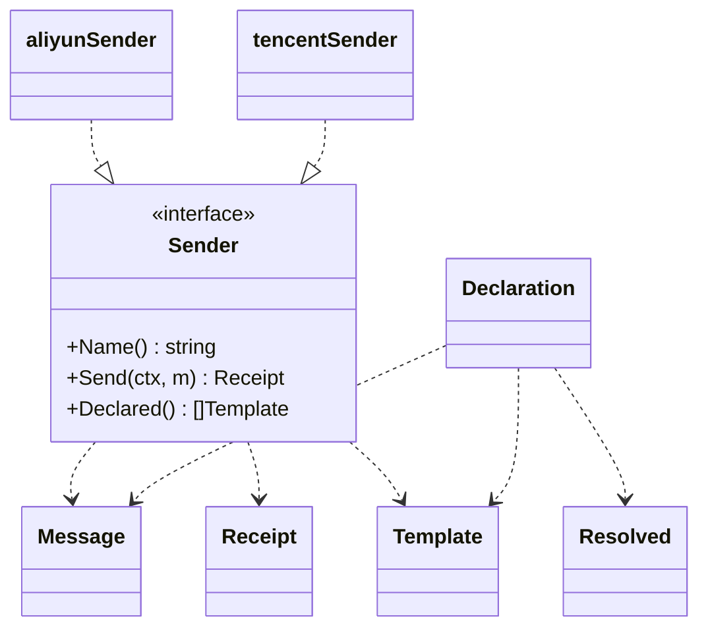

# sms

## 职责

本模块交付**按模板发出一条短信**的能力：调用方给出收信号码、模板名、参数与语言，模块经一个可插拔的载体把请求交给厂商，把厂商的回应归入封闭的几个哨兵。载体只构造请求、调用、归类，不解释这条短信的用途。

模板是**一等声明**，不是自由文本。国内厂商只收预先审核通过的签名与模板，不收自由文本；模板按语言分别审核；位置参数厂商还要求参数按审核时的次序给出。发送接缝因此以模板为中心：模板名、有序的参数名表、语言到厂商编号的映射都声明在载体一侧，调用方按参数名填值。

载体**排他交付**：一个进程里恰好一个载体生效，多于一个表态启用即启动失败。根包是接口包与工厂，不登记模块；实现子包绑定各自的厂商 SDK 并登记模块（[ADR-sms-capability-2026-10-13](../../adr/adr-sms-capability-2026-10-13.md)）。

### 非职责

- **不排队，不做工作池。** 发送是一次同步调用，`Send` 在厂商调用返回后才返回。异步投递、有界队列、队列满时的丢弃与重试策略归调用方：认证把发送交给自己的有界工作池，字段与队列容量都在认证一侧。
- **不持预算，不限流，不计尝试次数。** 本模块不认识「这条短信该不该发」。发送预算、重发间隔、每号码与每账户的上限、放行前缀都在调用方，本模块对每个 `Send` 都尝试发出去。
- **不持挑战状态，不生成也不校验验证码。** 验证码的生成、存放、比对与一次性消费归调用方；本模块不认识「验证码」这个概念，参数对它是不透明值。
- **不重试。** 厂商的发送接口不幂等，超时之后调用方无从知道短信是否已发出，重试会重复投递并重复计费。载体在超时、网络错误与上下文结束时把结果归入 `ErrUncertain`，从不自行重发。是否重发归调用方。
- **不声明语言闭集。** `Locale` 是不透明的非空字符串，用来索引模板的语言到编号的映射。本模块不认识 `zh-CN`、`en-US` 这类取值，也不解释 `Accept-Language`；语言取值的取得与归一归调用方。
- **不认识用途。** 模板名由调用方定义，本模块不知道 `authn.code.login` 是登录验证码还是别的。用途词表、模板名到用途的映射都在调用方。
- **不认识租户，不读请求上下文。** 本模块不 import 任何上层功能目录，也不 import `pkg/tenant`。
- **不落任何存储。** 本模块不写库、不写事件，除排他性去重的一项进程内有界记录外不持状态（见 `Message.DedupeID`）。

## 外部接口契约

### 交付的功能

```go
// 功能标识为 (*Sender)(nil)。
type Sender interface {
    Name() string
    Send(ctx context.Context, m Message) (Receipt, error)
    // Declared 报告载体声明了哪些模板：名字、有序参数名、语言（不含厂商编号），
    // 供消费方在启动期核对自己所需。
    Declared() []Template
}

type Message struct {
    To       string            // E.164
    Template string            // 逻辑模板名，调用方定（如 authn.code.login）
    Params   map[string]string // 键为模板声明的参数名
    Locale   string            // 非空；对 pkg/sms 不透明，只用来索引模板的语言→编号
    DedupeID string            // 稳定标识；载体至多对同一标识调厂商一次
}

type Receipt struct{ ProviderID string }
```

`Send` 的契约，约束的主体是每个交付 `Sender` 的模块：

- 响应 `ctx`；任何一次调用都不在载体层内重试。
- 对同一个 `DedupeID` 至多调用厂商一次：载体记住它已发过的标识（有界），重复者返回首次的结果，不作第二次厂商调用。
- 按 `Template` 与 `Locale` 从自己声明的模板里取出厂商编号与参数次序（见「模板声明」的 `Resolve`），取不到即调用方缺陷，`ErrRejected`，不调厂商。
- 把厂商的回应与错误归入 `ErrThrottled`、`ErrRejected`、`ErrUncertain` 之一；没有明确归入 `ErrThrottled` 或 `ErrRejected` 的错误，与全部超时、网络错误，一律归 `ErrUncertain`。
- `Message.Params` 里的值（例如验证码）与厂商凭据不写日志、不进错误文本、不进指标属性。

**`Locale` 为空是调用方缺陷。** 本模块把空 `Locale` 读作缺参，`Resolve` 以 `ErrRejected` 拒绝，与「语言不在声明的编号表里」同形；归一（把空串填成某个缺省语言）只由调用方做，认证一侧的归一在 `pkg/authn/sms`，其缺省语言取自共享的 `i18n.default-locale` 项，认证根包不再声明语言集或 `LocaleOf`（[ADR-i18n-language-set-2026-10-13](../../adr/adr-i18n-language-set-2026-10-13.md)）。

### 模板声明

载体用一个 `map[string]TemplateSpec` 声明它支持的模板：键是模板名，值是该模板的有序参数名表与语言到厂商编号的映射。这份声明在载体构造期冻结为一个 `Declaration`，是发送时唯一的查找来源。

```go
// 载体 config 里 "templates" 的值类型。
type TemplateSpec struct {
    Params []string          `config:"params"` // 有序：位置参数厂商按此铺位
    Codes  map[string]string `config:"codes"`  // 语言 → 厂商编号
}

// Declared 的只读视图，不含厂商编号。
type Template struct {
    Name    string
    Params  []string
    Locales []string
}

// 冻结的 TemplateSpec 集合。构造期做载体自洽校验，见下。
type Declaration struct{ /* ... */ }

func NewDeclaration(spec map[string]TemplateSpec) (Declaration, error)
func (d Declaration) Declared() []Template
func (d Declaration) Resolve(m Message) (Resolved, error)

type Resolved struct {
    Code    string            // 厂商模板编号
    Params  map[string]string // 键为声明的参数名
    Ordered []string          // 按 Params 的次序铺开的参数值
}
```

`Resolve` 把一条 `Message` 解成载体直接可用于构造请求的形状，四种落空的成因都是调用方缺陷，一律 `ErrRejected` 并点名缺的那一项：模板未声明、语言在该模板的编号表里没有、声明所需的参数名缺失、消息带了模板未声明的参数名。

**位置参数与键参数是同一份声明的两种用法。** `Resolved` 同时给出参数的键值表与有序值表：键参数厂商（阿里云）把 `Params` 序列化成 JSON 对象，次序无关；位置参数厂商（腾讯云）把 `Ordered` 按审核时的次序铺进请求。两家厂商都从同一份 `TemplateSpec.Params` 得到次序，次序因此只有一处定义。

**载体自洽由 `NewDeclaration` 在构造期保证**，约束的主体是每个声明模板的载体：每个模板至少一个参数、参数不重名、至少一种语言、每个语言的编号非空。不满足即 `ErrInvalidConfig`，在载体的 `Prepare` 报出。载体只保证自己声明的这份集合自洽，**不保证它覆盖某个消费方所需的组合**——覆盖由消费方在启动期核对自己所需（见“非职责”与下文消费方核对）。

### 登记单元与名字

| 包 | 模块名 | 交付 | 排他 |
|---|---|---|---|
| `pkg/sms` | 不登记 | `Sender`、`Message`、`Receipt`、模板声明与工厂 | — |
| `pkg/sms/aliyun` | `sms.aliyun` | `Sender` | 排他 |
| `pkg/sms/tencent` | `sms.tencent` | `Sender` | 排他 |

模块名照顶层能力：裸名 `sms`，实现叶子 `sms.<厂商>`，配置命名空间取同一个取值（对照 `kv`/`kv.redis`、`event`/`event.nats`）。每个登记模块的包导出自己的 `ModuleName` 常量。阿里云与腾讯云是厂商适配的封闭集；`sms.aliyun` 与 `sms.tencent` 同时纳入时，在消解阶段以排他冲突失败，宿主选其一。每个载体叶子包整个撤掉而不影响其他模块。

**消费方核对。** `pkg/sms` 不声明谁需要哪些模板：它只让载体报告自己声明了什么（`Declared()`）。需要一组固定模板的消费方在启动期取到 `Sender` 后立即调 `Declared()`，逐项核对自己所需的（模板，语言，参数）组合：模板与语言按所需齐备即可，参数名表则须与消费方所发的相等——`Resolve` 要求每个已声明的参数，载体多声明一个消费方从不发送的参数，该模板就没有任何消息能满足，与缺项同为 `ErrInvalidConfig`，在启动期点名。这一步落在唯一知道需求的一侧；覆盖闭集因此不进 `pkg/sms`。

### 稳定性承诺

- `Sender`、`Message`、`Receipt`、`Template`、`Resolved` 的字段与方法集，以及三个发送哨兵，是本模块对调用方的契约。加方法、改签名或改字段名对实现了 `Sender` 的载体与取用它的调用方都是不兼容变更。
- `Message` 的字段语义是承诺：`To` 是 E.164、`Template` 是调用方定义的逻辑名、`Params` 的键是模板声明的参数名、`Locale` 非空且对 `pkg/sms` 不透明、`DedupeID` 使载体至多对同一标识调厂商一次。
- **模板声明的形状是承诺**：`TemplateSpec` 的两个字段名与容器成形态（`params` 是列表、`codes` 是映射）是宿主写在配置文件里的东西，改它们使旧写法成为未知键。
- 单个载体叶子包可替换、可撤掉，不改变调用方的代码。

### 哨兵错误

| 哨兵 | 含义 |
|---|---|
| `ErrThrottled` | 厂商限流 |
| `ErrRejected` | 模板、签名或号码被厂商拒绝；或调用方的消息与模板声明不符 |
| `ErrUncertain` | 发送后超时，不知是否送达；不得盲目重发 |
| `ErrInvalidConfig` | 配置里的值跑不起来：载体自洽校验失败，或消费方核对自己所需时发现缺项 |

调用方以 `errors.Is` 判别，包裹一律用 `%w`。错误文本不携带参数值（例如验证码）或厂商凭据。

## 依赖

| 依赖 | 用途 |
|---|---|
| `pkg/core` | 登记描述符、交付功能 |
| `pkg/config` | 声明本模块的输入项（载体各自声明） |
| `pkg/log` | 可选：工厂在 `New` 里登记凭据的日志字面量脱敏匹配器 |
| 各厂商 SDK | 只被对应的载体叶子包 import |
| `pkg/internal/literal` | 与认证的登录叶子共用的脱敏字面量登记构造 |

**本模块不 import 任何上层功能目录，也不 import `pkg/authn`。** 判据是发送无关用途：`pkg/sms` 位于依赖图的底层之一，与 `pkg/kv`、`pkg/event` 同级，任何要发通知的模块都能单独引入它，不必背上整套认证。方向是调用方（`pkg/authn/sms`）import `pkg/sms` 的根包，`pkg/sms` 不 import 它。

**根包不 import 任何厂商 SDK。** 每个 SDK 落在绑定它的载体叶子包里，只有 import 该子包的宿主的 `go.mod` 才背负它。这一条没有编译期强制（同一 `pkg` 模块内每个客户端都在一份依赖清单里），顶上它的是 `pkg/sms/deps_test.go` 的守卫：根包的传递闭包不含任何厂商 SDK，也不含 `pkg/authn`。两家 SDK 在 `pkg/go.mod` 里精确钉版，同样由该守卫守住：阿里云用 `github.com/alibabacloud-go/dysmsapi-20170525/v5` v5.6.0，腾讯云用 `github.com/tencentcloud/tencentcloud-sdk-go/tencentcloud/sms/v20210111` v1.3.172。

**阿里云 SDK 经 `github.com/tjfoc/gmsm` 拖回未经模块图修剪的 `google.golang.org/genproto` 单体**：那个版本的 `googleapis` 包与拆分后的 `google.golang.org/genproto/googleapis/*` 模块重名，工作区构建因此报歧义导入。`go.work` 用一行 `replace` 把单体钉到拆分之后的版本（[ADR-sms-capability-2026-10-13](../../adr/adr-sms-capability-2026-10-13.md)）。gmsm 已是最新发布版，而这个钉版放进任一模块的 `go.mod` 都会被 `tidy` 当作无人引用的依赖删掉，所以它落在工作区层。

**`pkg/internal/literal` 是共享单元。** 两个 SMS 载体各自 import 它来登记凭据的字面量脱敏匹配器，认证的四个登录叶子（`authn/login/{google,github,wechatweb,wechatmp}`）也用它，所以它是多个实现子包共用的单元，落在 `pkg/internal/` 下。它不登记模块，不交付功能，不参与生命周期，只导出登记字面量匹配器的构造（[ADR-shared-backend-unit-2026-09-21](../../adr/adr-shared-backend-unit-2026-09-21.md)）。本模块的载体只经工厂取用它，见「工厂的构造次序」。

## UML 图

本模块的结构是一条接口、一份模板声明与多个实现的关系。图里的约束不在图中：载体之间是**互斥**的，而不是可用的一种选择——图上看不出这一点，因为排他性由描述符声明、由消解阶段裁定，不是类型之间的关系。模板声明的完整性由载体的 `Prepare` 保证，调用方所需的覆盖由调用方在 `New` 核对，两者都不在类型的形状里。



**每个载体各自登记为一个模块**，模块名形如 `sms.aliyun`、`sms.tencent`。根包是接口包与工厂，不登记模块。

## 核心数据结构

| 概念 | 类型 | 说明 |
|---|---|---|
| 消息 | `Message` | 号码、模板名、参数、语言、去重标识 |
| 回执 | `Receipt` | 厂商返回的标识；本模块不解释它 |
| 模板声明 | `TemplateSpec` → `Declaration` | 有序参数名表加语言到编号的映射，构造期冻结 |
| 模板视图 | `Template` | `Declared()` 交出的只读视图，不含编号 |
| 解析结果 | `Resolved` | 编号、参数键值表、按声明次序铺开的有序值表 |

**`Message.Params` 的键集是模板声明的参数名。** 多一个键、少一个键都是调用方缺陷，`Resolve` 以 `ErrRejected` 拒绝，不调厂商。参数值是调用方的不透明数据，本模块不解释。

**`Template` 不含厂商编号。** 编号是载体的私有数据，只进请求，不进 `Declared()` 交出的视图，也不进启动诊断——消费方核对的是「这个模板、这个语言、这些参数在不在」，不必知道编号是多少。

## 核心算法与流程

### 一次发送

1. 载体按 `DedupeID` 查自己的去重表；命中即返回首次的结果，不调厂商。
2. 载体的 `Declaration.Resolve` 把 `Message` 解成 `Resolved`；模板未声明、语言无编号、参数缺项或多出，都是 `ErrRejected`，不调厂商。
3. 载体按 `Resolved` 构造一次厂商调用：键参数厂商序列化参数对象，位置参数厂商按有序值表铺参数数组。
4. 调用返回后把厂商的回应与错误归入哨兵，把结果连同 `Receipt` 记进去重表，返回调用方。

### 工厂的构造次序

`Spec[C]` 与 `NewModule[C]`（仿 `pkg/kv` 的 `Spec` 与 `NewModule`）把载体的公共接线收进工厂，载体只提供自己的类型参数、配置原型、输入项、表态与打开函数：

```go
type Spec[C any] struct {
    ModuleName      string
    ConfigNamespace string
    Config          *C
    Items           map[string]config.Item
    Stance          func(cfg *C) (core.Enablement, error)
    Secrets         func(cfg *C) []string      // 凭据：登记为日志的字面量脱敏匹配器
    Open            func(ctx context.Context, cfg *C) (Sender, error)
}
```

交付排他：`Provides` 排他 `(*Sender)(nil)`；`Requires` 可选 `log.Logger`。阶段行为如下：

| 阶段 | 行为 |
|---|---|
| `Prepare` | `Decode` 自己那份配置；读出配置后调 `Stance`，与自身性质不符即启动失败，错误点名缺的是哪一项 |
| `New` | `Decode` 配置 → 取可选 `log.Logger` → 调 `Secrets` 并经 `literal.Register` 登记字面量脱敏匹配器 → 调 `Open` 建立载体 |

**次序固定：先登记脱敏字面量，再绑定任何带属性的 logger，最后 `Open`。** 日志脱敏规则只对它注册之后写出的记录起作用（[design-authn-gate](authn/design-authn-gate.md) 的脱敏规则），所以凭据的登记必须发生在载体把任何属性绑到 logger 之前。`Secrets` 钩子把「凭据先登记」这一步收进工厂，载体因此不 import `literal`，只交出凭据字符串。

**载体自洽落在 `Prepare`。** 载体在 `Stance` 或 `Open` 里调 `NewDeclaration` 校验自己那份 `templates`；不满足即 `ErrInvalidConfig`。`Prepare` 早于 `New`、早于服务，所以漏配在启动期被点名，不拖到第一次发送。

### 消费方的覆盖核对

需要一组固定模板的消费方在 `New` 里：`Resolve[sms.Sender]` 取到载体实例后立即调 `sender.Declared()`，与自己的需求集逐项比对——每个模板的名字与所需的语言都要齐备，参数名表则须与消费方发送的相等，少一个或多一个都是 `ErrInvalidConfig` 并点名那个参数。参数按相等而非包含来比对：`Resolve` 要求每个已声明的参数，载体多声明一个消费方从不发送的参数，该模板就没有任何消息能满足，包含式核对会放它过启动、随后在每次发送时静默失败。`Prepare` 早于 `New`、拿不到实例，所以核对落在 `New`；`New` 返回错误同样终止启动，早于服务。

### 厂商适配

适配只做下列事：按模板与语言取厂商编号、把参数按声明的次序铺开、构造请求、调用、把响应与错误归入哨兵。没有真实凭据无法在线验证，适配层测试用 `httptest` 起假端点校验请求形状。

| 项 | 阿里云 `sms.aliyun` | 腾讯云 `sms.tencent` |
|---|---|---|
| SDK | `github.com/alibabacloud-go/dysmsapi-20170525/v5` v5.6.0 | `github.com/tencentcloud/tencentcloud-sdk-go/tencentcloud/sms/v20210111` v1.3.172 |
| 调用 | `SendSmsWithContext` | `SendSmsWithContext` |
| 请求字段 | `SignName`、`TemplateCode`、`TemplateParam`（`Params` 的 JSON 对象） | `SignName`、`TemplateId`、`TemplateParamSet`（位置参数，按声明的参数次序铺开） |
| 归 `ErrThrottled` | 没有已核实的错误码 | `LimitExceeded.*` 错误码 |
| 归 `ErrRejected` | 没有已核实的错误码 | `TemplateParamSetNotMatchApprovedTemplate` |
| 归 `ErrUncertain` | 超时、网络错误与全部错误码 | 超时、网络错误与表中未列出的错误码 |

两家 SDK 的发送调用都不幂等，超时之后调用方无从知道短信是否已发出，所以超时归 `ErrUncertain`，适配层从不重试。阿里云的错误码到 `ErrThrottled`、`ErrRejected` 的归类未经核实（见「假设与守住它们的测试」），在核实之前阿里云适配把全部错误码归 `ErrUncertain`：这个方向只多计一次预算、不盲目重发，不会把未确认的失败当作确定的限流或拒绝。腾讯云的接入点由配置的 `region` 推出（SDK 按地域选定），没有单独的接入点配置项；阿里云另有 `sms.aliyun.endpoint`，可指向地域或网关接入点。

## 错误与失败语义

| 情形 | 表现 |
|---|---|
| 模板未声明 / 语言无编号 / 参数缺项 / 多出参数 | `ErrRejected`，点名缺的那一项，不调厂商 |
| 空 `Locale` | 调用方缺陷，`Resolve` 以 `ErrRejected` 拒绝 |
| 厂商限流 | `ErrThrottled` |
| 厂商拒绝模板、签名或号码 | `ErrRejected` |
| 超时、网络错误、上下文结束、未核实的错误码 | `ErrUncertain`；不得盲目重发 |
| 重复的 `DedupeID` | 返回首次的结果，不调厂商 |
| 载体自洽校验失败 | `ErrInvalidConfig`，`Prepare` 阶段终止启动 |
| 消费方所需的（模板，语言）缺项，或参数名表与消费方所发不等 | `ErrInvalidConfig`，消费方 `New` 阶段终止启动 |

**本模块不降级，不重试。** 厂商不可达即那次调用失败，不排队待发、不重连后补发；是否重发归调用方。

### 假设与守住它们的测试

以下行为未经运行核实。依赖它们的断言写作假设，对应的测试失败即视为该断言的前提不成立：

- **阿里云错误码归类。** 假设阿里云有确定表示限流或拒绝的错误码，可以对照 SDK 与厂商文档逐码核实后归入 `ErrThrottled` 或 `ErrRejected`；核实之前该适配的全部错误码归 `ErrUncertain`。适配层测试用 `httptest` 起假端点，断言任一错误码与超时、网络错误都落入 `ErrUncertain`；某个错误码经核实归入另外两个哨兵时，同一测试按码改写断言。
- **腾讯云限流码。** 假设 `LimitExceeded.*` 全是按号码的限流，归 `ErrThrottled` 不会误吞其他含义的限流。适配层测试逐码断言。
- **编译兼容。** 假设两个厂商 SDK 与同一个 `pkg` 模块内其余实现所绑的库编译兼容（已验证与认证的 TOTP、WebAuthn、SAML、go-oidc 库同在）。构建检查把全部模块一起编译。

## 并发与事务边界

- 载体必须可被多个协程并发使用。
- 去重表（`pkg/sms/internal/dedupe`）按键有界，可被并发读写；同进程内共享，不跨副本。
- 本模块不开事务，不写任何存储。

## 扩展点

**新增一种厂商即新增一个载体子包。** 以下各条是准入条件的全部：

- 必须排他交付：`Provides` 里声明 `(*Sender)(nil)`，并实现 `Name`、`Send`、`Declared`。
- 必须挂在 `sms.<厂商>` 专属的配置命名空间下，用一个 `map[string]TemplateSpec` 声明模板；两个载体在同一个命名空间下声明输入项，只要都被 import 就是冲突（[ADR-config-parsing-2026-09-20](../../adr/adr-config-parsing-2026-09-20.md)）。
- 必须在 `Prepare` 里调 `NewDeclaration` 做载体自洽校验。
- 必须把厂商的回应与错误归入三个哨兵之一，未归入限流或拒绝的一律归 `ErrUncertain`。
- 必须经 `Secrets` 钩子交出凭据，使其先于 logger 绑定被登记为日志的字面量匹配器。

## 实现状态

| 能力 | 状态 | 代码 |
|---|---|---|
| 接口、模板声明与工厂 | 已实现 | `pkg/sms/sms.go` `Sender`、`Message`、`Receipt`；`pkg/sms/template.go` `TemplateSpec`、`Declaration`、`Resolve`；`pkg/sms/module.go` `Spec`、`NewModule` |
| 归类助手（精确码表加缺省 `ErrUncertain`） | 已实现 | `pkg/sms/classify.go` |
| 去重表 | 已实现 | `pkg/sms/internal/dedupe` |
| 阿里云载体 `sms.aliyun` | 已实现 | `pkg/sms/aliyun/aliyun.go`、`pkg/sms/aliyun/config.go` |
| 腾讯云载体 `sms.tencent` | 已实现 | `pkg/sms/tencent/tencent.go`、`pkg/sms/tencent/classify.go`、`pkg/sms/tencent/config.go` |
| 根包依赖守卫与 SDK 封边、钉版 | 已实现 | `pkg/sms/deps_test.go` |
