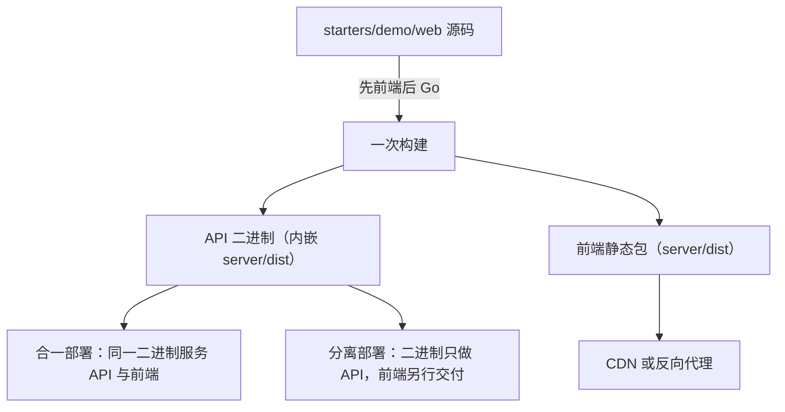
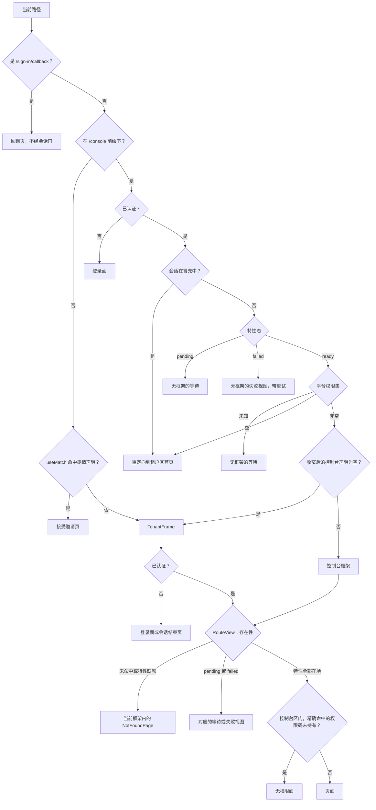

# starters

## 职责

`starters/demo` 是本仓库里一份可运行的示范程序，供拷走后当一个新产品的起点。它把「一个 speed 产品长什么样」写成可读、可编译、可部署的一整套：一个 Go 程序、一棵前端应用、一组部署栈、一套构建与打包的约定。**`demo` 说的是它是什么——一份示范**：它不演示某个功能，它本身就是产品骨架；使用者拷走 `starters/demo` 的一份副本、按自己的业务域改名，在其上长出业务。

它在仓库顶层与 `pkg/`、`tools/` 并列。库本身（`pkg/`）交付模块与接缝，示范交付一个把它们装起来的程序。这是 [ADR-core-scope-2026-09-13](../../adr/adr-core-scope-2026-09-13.md) 失效条件段所指的那部分：该记录写明「组成什么样的应用」没有模板，把这块留给脚手架而不是 `core`。示范兑现那句话（[ADR-starters-skeleton-2026-10-15](../../adr/adr-starters-skeleton-2026-10-15.md)）。

### 非职责

- **不评估模块。** 示范为承载业务而建，它的业务切片是使用者的，不是一份覆盖全部模块的验收清单。它装在 `pkg/` 之上、用命令树纳入模块，验收是使用者自己的业务。
- **不是第二个 `pkg/`。** 示范不交付任何可被依赖的接口，不被任何模块 import，也不登记自己的模块边界；方向是它 import `pkg/`，`pkg/` 不认识它。
- **不承载模块机制。** 模块描述符、注册、查询、生命周期驱动与零依赖公共基础设施归 [core](design-core.md)；示范不改这些契约，只调用它们。
- **不内建业务域。** 示范的业务目录是空位，装使用者自己的业务模块；示范自身不带一个具体的业务域。
- **空的面是设计使然，不是未完成。** 示范不种任何业务数据，所以它在浏览器里以空态呈现：控制台概览只有租户的统计（那几项读的是平台自己的名册）；通知的收件箱没有可展示的消息（示范不声明任何通知类型、也不投递，见下文的通知面）；偏好矩阵恒为空集。看到一个面是空的，读到的不是「这条没做完」，而是「这份基线不带业务域，数据由产品与它的用户产生」。空态与特性缺席是两回事：一个面因装配而不存在时，它的[特性](../../glossary.md)缺席，前端不以空态呈现它，而按不存在的路径处理（见「平台基线」与「前端的组合次序」）。

## 外部接口契约

这是宿主写下来、被命令行、被部署脚本、被前端构建读取的那一面。

### 目录结构

```
starters/demo/
  server/           # Go 程序，独立 module：github.com/vislake/speed/starters/demo/server
    go.mod          # 取 pkg 模块；pkg 尚无发布版本时带一条指向兄弟检出的 replace
    main.go         # 命令树与 run()，只剩业务决定
    host.go         # envPrefix、HostIdentity、端点常量
    signingkey.go   # 签名密钥的路径与首次运行生成
    modules/        # 业务模块的空位
    testdata/       # 配置样例与夹具
    review/         # 审查装配的配置
    dist/           # 前端构建产物，被 go:embed 嵌进二进制
    var/            # 运行时产物：对象存储的本地根目录与生成的签名密钥
  web/              # 前端应用的源码与构建，产物写进 server/dist
  Makefile          # 产品自己的构建入口，拷走后的树用它
  compose.yaml      # 部署栈外部后端的本地编排
  Dockerfile        # 容器镜像：先建前端产物，再建嵌入它的 Go 程序；构建上下文是仓库根
  fly.toml          # Fly.io 部署：单机、卷与检查
  deploy/           # 容器入口与它在启动时渲染的部署配置模板
  .gitignore        # 把运行时产物与构建输出挡在树外
  AGENTS.md         # 示范自己的契约
```

`AGENTS.md` 是示范自己的契约，随示范一起被拷走；`go.mod` 的 module 路径是 `github.com/vislake/speed/starters/demo/server`，使用者拷走后按自己的域改名。

**Go 程序与前端源码各占一棵树，构建产物落在 Go 那一棵里。** `go:embed` 只嵌得到内嵌包自己目录树下的文件，模式里不许出现 `..`，所以二进制要嵌的那份产物只能住在 Go 程序所在目录之内：前端源码在 `web/`，构建产物写进 `server/dist/`。

**产品自己的构建入口是示范自带的 `Makefile`。** 仓库的门禁入口是根 `Makefile`，它经 `go.work` 覆盖示范这个模块；拷出去的树上面什么都没有，它的构建、测试与静态检查命令因此写在示范自己的这一份里。`make help` 列出它跑什么，`make check` 全跑一遍，先前端后 Go——Go 构建内嵌产物，这个顺序是硬约束。**它是产品的入口，不是本仓库的入口**：仓库内跑的是根 `Makefile` 的 `make check`，前端腿在 `make web-check` 里。两条腿的输入由拷贝方提供、仓库不跑：`web-install` 把前端依赖装在包所在处（仓库内该包是 `web/` 工作区的成员，安装走工作区那份唯一的锁文件），`lint` 读模块目录向上最近的 `.golangci.yml`（仓库把它放在根）。

**Fly.io 部署取 `sqlite` 栈的单机形态。** 该栈的数据库落成文件、键值与事件后端都在进程内；部署装配在基线之上加入 `mail.smtp`、`authn.emailcode` 与两个社交登录方法 `authn.login.google`、`authn.login.github`，它的外部依赖是 SMTP relay 与这两家身份提供方。一套部署由镜像、一台 Machine 与一个挂在 `/data` 的卷组成；卷承载数据库、签名密钥与对象存储的本地根，跨部署与停机保留。镜像的构建上下文是仓库根：前端产物来自 `web/` 工作区，Go 程序来自 `go.work` 声明的两个模块，两者都不在本目录之内；`fly.toml` 的 `[build] dockerfile` 相对该文件解析，根 `Makefile` 的 `deploy` 目标把仓库根作为工作目录交给 `flyctl`。

容器入口 `deploy/entrypoint.sh` 把 `deploy/fly.yaml.tmpl` 渲染成 `/data/config.yaml`：公开来源由 `FLY_APP_NAME` 推出，自定域由 `DEMO_PUBLIC_URL` 给出；运营账户与库加密根键取自 Fly secret。模板不承载凭据，镜像不含开发值。SMTP 的主机、发件地址与凭据也取自 Fly secret：入口要求主机与发件地址，端口缺省 587、TLS 姿态缺省 `starttls`，用户名与口令为空表示不使用 AUTH。两家身份提供方的应用标识与密钥同取自 Fly secret，入口缺任一项即拒绝启动。两者登记给提供方的回调地址由公开来源推出，不另设配置项：`<公开来源>/api/v1/auth/callback/google` 与 `<公开来源>/api/v1/auth/callback/github`。模板的 `http` 节承载模块级的代理信任设置：可信代理网段取 Fly Proxy 进入 Machine 的地址段，来源地址头名取 `Fly-Client-IP`。入口取得卷的所有权后降权运行，先执行 `sqlite seed`，再把进程交给 `sqlite serve`；`seed` 只写缺失项，重启不覆盖运营者经界面做的修改。`serve` 带上基线的后台模块，不再另起进程。

**Fly 部署开放注册，口令与社交两种入口都开。** 镜像以 `-tags deploy` 构建，`deployModules` 在基线之上加入 `authn.emailcode`、`mail.smtp`、`authn.login.google` 与 `authn.login.github`；`deploy/fly.yaml.tmpl` 的 `mail.smtp` 与 `authn.login` 节由入口从 Fly secret 渲染，`seed.settings` 把 `authn.account.password-signup` 与 `authn.account.signup` 都写为 `open`，`workspace.personal.enabled` 为真。入口缺 SMTP 主机或发件地址时拒绝启动，因此开放注册不会落在没有投递通道的机器上。社交首登开户时，提供方声明为已验证的邮箱写成邮箱标识；`authn.account.auto-link` 保持缺省 `never`，与既有账户地址相同的一次社交登录答 `link-required`，不接管该账户（REQ-signup-019）。默认构建（不带 `deploy` 标签）仍不含邮件模块与社交方法、注册保持关闭。

**卷上的数据库不做数据迁移。** 联系方式预留的 `(kind, value)` 全局唯一由 `0003_contact_claim.sql` 施加；该迁移只加约束、不对账已有数据，已有库里重复的联系方式预留会让它失败。升级到含这条迁移的版本时，Fly 部署删除 Machine 与卷、以空库重新部署，再由 `seed` 写入初始账户与租户；签名密钥与对象存储的本地根随卷一起重建（[ADR-authn-contact-claim-2026-10-22](../../adr/adr-authn-contact-claim-2026-10-22.md)）。

部署门禁是后端监听上 `GET /` 的检查，入口文档由嵌入的前端产物作答；就绪信号是运营端点的 `GET /ready`，以顶层检查声明——运营监听不是对外服务，顶层检查只报告 Machine 健康、不影响路由。`.github/workflows/deploy.yml` 在 `check` 于 `main` 上成功之后、以及手动触发时调用 `make deploy`。

### 命令树

命令树照 [ADR-command-tree-2026-09-21](../../adr/adr-command-tree-2026-09-21.md) 的形态：根命令不纳入任何模块，命令挂在部署栈节点之下，纳入沿命令路径向下继承。示范的命令是 `serve`、`worker`、`migrate`、`seed`、`gen`，外加命令组。

- **`serve`** 起 HTTP 入口并接受流量。
- **`worker`** 跑后台模块，不起 HTTP 入口。
- **`migrate`** 只跑数据库引擎，经静态级纳入取得各模块的声明、把全部表建起来。
- **`seed`** 先写配置 `seed.settings` 点名的运行期设置（`{key, value}` 列表，值取声明类型自己的文本形式，经公开的 `settings.Store` 写全局层）：这些值可能约束随后写入的账户，账户存储的口令策略就在其中，设置晚于账户就等于没有约束到它。再写配置 `seed.accounts` 点名的初始账户（凭据按项给明文口令或 PHC 条目）、配置 `seed.tenants` 点名的租户（登记进名册），以及其中标记为平台管理员的那些账户所持有的运营角色——角色带上本进程声明的全部权限。角色与它的授权写进两类域：平台域（平台自己的管理面读它），以及 `seed.tenants` 的每个租户域（控制台按租户寻址的页面——成员、邀请、SSO 提供方——因此开箱即答；平台域的绑定不覆盖租户域，所以租户域里绑得上，得先在租户域把角色与授权写出来）。它驱动到 `Start`，因此把迁移一并带上，一个从未迁移过的库一条命令即可就绪；声明集未变时重复执行不写任何东西，逐项报「跳过」；运行期设置的键在全局层已有显式行时同样跳过，重跑因此不覆盖操作者经设置面做的修改（REQ-deployment-011），键拼错或值越出声明的域由设置模块拒绝，命令失败而不写入；进程新声明了一条权限时，重跑把缺的那条授权经宿主的种入面 `authz.Seeder` 补进已置 `builtin` 的运营角色，管理面仍然改不动它。配置里删去的账户与租户既不失效也不删除。角色与绑定只由它写入：迁移不种策略数据，谁是部署的管理员是宿主的回答（[authz](design-authz.md) 对宿主的要求、[authn.admin](authn/design-authn-admin.md) 的引导）。
- **`gen`** 合并并写出 API 规格，并写出特性声明的清单，见「`gen` 命令」。
- **命令组** 承载一次性运维动作。

**部署栈**是命令树上的一层，纳入向下继承，栈节点点一次数据库引擎，其下每条命令都跑在它上面。示范的部署栈是封闭集：`sqlite`、`sqlite-memory`、`postgres`、`postgres-redis-nats`、`postgres-nats-redis`、`postgres-memcached-nats`。每个栈由同一段代码建起，两个栈之间不同的只是数据库引擎、键值后端、事件后端与遥测导出后端各取哪个模块名。`sqlite` 与 `sqlite-memory` 全部用进程内后端，起一套不需要任何外部服务；两者的模块名相同，区别在配置指向的数据库，一个落在文件上、一个只在进程内，因此前者能保存 `seed` 写入的账户而后者不能。键值、事件与导出后端不在栈节点上而在具体命令上：`migrate` 只跑引擎，一个后端的输入项与可达性不该进一个部署前的作业。

**命令组**是把一次性运维动作分组的节点：每个组是一个词，组下的叶子各是一个一次性命令，每个叶子声明它驱动到哪个深度——只读的到 `Init`，写的到 `Start`。示范提供这套机制与一个占位的组骨架，使用者按业务填叶子的动作。

### 平台基线

`serve` 与 `worker` 各自点名纳入的那组平台能力是**平台基线**，写在 `main.go` 的 `baselineServe` 与 `baselineWorker` 两个列表里。基线的判据是一句话：**一条平台能力若能不要凭据、不要外部账号、不要部署栈之外的外部服务就启动，它就在基线里**；其余留给产品在拿到该依赖时自行加入。模块自己的契约是这个判据的落点——一项必需配置项给不出一个能启动的值，它就不属于基线。

判据的两侧各有一组例证。落在基线里的，是只用进程内实现或栈内后端就起得来的平台能力——入站的身份系统（`authn.gate` 网关、`authn.login`、`authn.login.password`、`authn.mfa.totp`、`authn.session`、`authn.account`）、租户的 `tenant.resolve`、`tenant.admission` 与 `tenant.self`、`authz.guard` 授权层、`authz.self` 的调用方权限读取、`audit.journal` 审计、`ratelimit` 限流、`settings` 设置、`feature.board` 特性文档的发布，以及任务（`jobs.db`、`jobs.scheduler`）、通知的收件箱、推送、偏好矩阵与投递流水线（`notification.inbox`、`notification.stream`、`notification.preferences`、`notification.delivery`）与对象存储的文件系统后端（`objectstore.fs`）。被判据排除在外的，是一启动就要一份外部凭据或一份栈外服务的：社交与企业身份提供方（`authn.login.google`、`authn.login.github`、`authn.login.wechat-web`、`authn.login.wechat-mp`、`authn.sso.oidc`、`authn.sso.saml`）、短信家族（`sms.*`、`authn.login.sms`、`authn.mfa.sms`、`authn.sms`）、SMTP 邮件（`mail.smtp`）、S3 对象存储（`objectstore.s3`）；它们在产品拿到对应依赖后自行加入。

**口令注册在基线上关闭。** 注册路由 `POST /api/v1/auth/register` 归 `authn.login`，基线装配纳入该模块，但设置项 `authn.account.password-signup` 保持缺省的 `closed`，基线的装配里也没有 `authn.emailcode`、`mail.smtp` 与短信通道；开放注册会产生永远无法验证的账户。此时调用注册路由答 403 `signup-closed`，发现面不出现注册入口。开放它需要装配邮箱验证通道，见「注册与完成设置」；Fly 部署不是这条基线，它用上面的 `deploy` 装配开放注册。

**WebAuthn（`authn.mfa.webauthn`）也在基线里，是判据放行、示范仍须点名的那一项。** 它的依赖方绑定在部署被访问的来源上——那是 `testdata/` 承载的一个配置项，不是外部凭据也不是栈外服务——所以它一启动不依赖任何外部物，过得了判据（`AGENTS.md` 因此把它从「被排除」一栏移到基线）。点名它是因为平台管理面要能演示自身：步进要求一个与本会话已证明过的认证方式不相交的因素种类，只有 TOTP 一种时，以 TOTP 登录的会话没有因素可用来升级，步进起点因此被拒；TOTP 并上 WebAuthn，让步进有第二种因素种类可点。示范自带的前端实现 WebAuthn 仪式：`@speed/auth-ui`、`@speed/account-ui` 与 `@speed/console-ui` 都经 `@speed/auth-core/webauthn` 子路径驱动同一仪式，把 passkey 的创建或请求选项解码后交给浏览器，再把返回的凭据按后端解的 JSON 形状序列化成答复。登记与升级因此都能在界面上走完，不需要界面之外的客户端（`AGENTS.md` 详述）。

**静态运营口令表（`authn.static`）是判据放行、示范却排除的那一项。** 它不需要任何外部服务，只需配置里的一张表，按判据本可入选；但它是唯一取 Basic 方案的后端，而浏览器只对 Basic 与 Digest 挑战弹原生口令框。示范把前端产物交给浏览器，一个受保护端点的 401 一旦带 Basic——会话或令牌过期时——就会在已登录用户面前弹出原生口令框，而不是让前端结束会话、回到自己的登录页。这里的每个调用方都由会话 cookie 与 bearer 令牌承载，示范因此不接 Basic 后端，`testdata/` 也不带口令表；想给运营入口或探针留 Basic 认证的拷贝，自行把 `authn.static` 与它的 `authn.static.subjects` 表加回来——实现见 `main.go` 的 `baselineServe`，`authn.static` 不在其中。

**命令树点名决定某个进程跑什么，import 可达决定契约文档覆盖什么，两者不是同一件事。** 一条被判据排除在运行之外的能力（`sms.admin`、`authn.sso.saml`），其 HTTP 片段仍属于平台契约：`gen` 与 `/openapi.json` 合并的是二进制 import 可达的全部片段，与命令树点名哪些模块跑无关。因此宿主 import 每一个声明了 HTTP 片段的平台模块，即便其中一些不进任何命令的纳入清单，合并文档的 operation 集合才等于各片段之和（见 `AGENTS.md`）。

**特性按同一条线分在两处。** `gen` 写出的 `contracts/features.json` 列的是可用集里的全部特性声明，与命令树点名哪些模块跑无关；一个 `serve` 进程发布的[特性文档](../../glossary.md)只含本进程启用集里的模块服务的特性（[feature](design-feature.md)）。示范的命令树不使用 `AllResources` 覆盖，`serve` 的特性文档因而不含任何本进程不运行的模块的特性。被判据排除在运行之外的能力，其特性名在 `contracts/features.json` 里，在基线 `serve` 的特性文档里则特性缺席，例如 `sms.admin`、`authn.phone`、`authn.admin.sso.metadata`、`notification.channel.email` 与 `notification.channel.sms`。前端按特性缺席处理它们：依赖它们的页面不进导航，直达其路径得到与不存在的路径相同的 404，依赖它们的控件不渲染；产品加入对应模块、在 `serve` 上纳入后，这些特性随之在场，前端代码不变。

`serve` 起 HTTP 入口，纳入全部带路由或中间件的模块；`worker` 纳入既不路由也不经网关就能启动的后台模块。栈的数据库引擎、键值后端、事件后端与导出后端仍点在各命令上，不在栈节点。

**`feature.board` 只在 `serve` 里。** 前端只从 `serve` 读特性文档；`worker` 不服务前端，不纳入它。`notification.delivery` 在 `serve` 基线里而不在 `worker` 基线里，渠道特性（`notification.channel.email`、`notification.channel.sms`）因而由 `serve` 进程判定；把投递流水线移到别的进程的产品，须让两边的装配一致（[notification-delivery](notification/design-notification-delivery.md)）。

**前端不经特性门控就调用其路由的后端模块，`serve` 必须运行级纳入。** 前端调用这些模块的路由之前不查特性文档；它们不在时，前端的登录、会话与特性门控本身都无从成立。这些模块的清单，以及前端用到的其余后端面怎样门控，见 [web](web/design-web.md#不经特性门控的后端模块)。

`testdata/` 的每份配置只写部署差异——监听地址、来源、路径、库定位符、种子与后端选择。平台默认文档 `server/defaults.yaml` 已经给出的取值不在每份配置里重复，其中包括文档里标了 `Required` 的项：文档由宿主明确写下，满足必填。文档没有给出、而模块又标了必填的项仍由每份配置写出。每份配置随骨架带一组开发用值（`seed.accounts` 的明文口令、库加密根键、`seed.settings` 里降到域下限的 `authn.mfa.sensitive-min-age`），由 `AGENTS.md` 点名、要求拷走后替换。签名密钥不由 `testdata/` 交付：`authn.token.signing-key-file` 指向工作目录下的 `var/token-signing-key.pem`，`run()` 在驱动生命周期之前发现该路径无文件时用 `pkg/authn/token` 的 `GenerateKey` 生成一份写入，已有文件则沿用；该路径由 `.gitignore` 挡在树外，生产部署换成自己的密钥材料。平台默认文档 `server/defaults.yaml` 里审计的请求级捕获样例只点名由操作者发起的写入路由，不点名前端会自动轮询的读（会话与本人的读之类）：被轮询的读逐次落一行，审计表与概览的最近活动会被它刷屏，真正要留痕的冒充、账号变更反而被淹没。样例同时避开已经由接缝级审计记录的管理动作，不重复记同一件事。示范的 `AGENTS.md` 是这组值与该基线的契约面。

### 审查装配

审查装配是示范程序的构建变体，只在以 `-tags review` 构建时存在。`server/review.go` 的 `reviewModules` 给 `serve` 的点名集加上基线判据排除在外的登录方式：社交登录方法（`authn.login.google`、`authn.login.github`、`authn.login.wechat-mp`、`authn.login.wechat-web`）与短信家族（`authn.sms`、`sms.registry`、`authn.login.sms`），外加载体 `sms.review`；口令注册另加邮箱验证模块 `authn.emailcode` 与它的日志载体 `mail.review`。默认构建编译 `server/review_off.go`，`reviewModules` 为空，二进制不含这些模块的代码路径；基线的判据与点名集不因它改变。

**配置是 `server/review/sqlite.yaml`，位于 `testdata/` 之外。** 它是一份覆盖文档，与 `testdata/` 的 sqlite 配置同形：只写部署差异，平台拓扑取自编译进二进制的 `server/defaults.yaml`；此外再加上这些模块需要的节：社交方法的一组假凭据（方法因此起得来并拼得出授权地址，对端不会被访问）、短信模板注册表（zh-CN 与 en-US 各一组模板码）、种子设置里的 `authn.account.signup` 与 `authn.account.password-signup` 为 `open`、`workspace.personal.enabled` 为真，以及放宽到可送达号码的 `authn.sms.allowed-prefixes`。库落在 `server/var/review.db`，与基线的 `var/demo.db` 分开；`testdata/` 里的基线配置保持原样。

**验证码由短信模块生成，不写死。** `sms.review` 经 `sms.NewModule` 提供载体的发送与模板两条接缝，不读任何配置项；短信模块把消息的 `code` 参数交给它，它把这一行写进进程日志的 `verification_code` 字段。该字段不叫 `code`，因为 `code` 是进程已登记的敏感键名，日志层会把值打码。号码仍经过真实的预算、挑战行与校验，流程跑的是产品自己的状态机。

**日志邮件与短信承载注册验证的走查。** `mail.review` 实现 `pkg/mail.Sender`，把渲染后的邮件写进进程日志，验证码落在 `verification_code` 字段（同样避开已登记的敏感键名 `code`）。审查走查链是：登录页切到注册模式，提交用户名、邮箱与口令 → 自动登录 → 落在 `/account?verify=1`（账户页的邮箱验证节；应用栏之下的验证提示也指向那里）→ 从 `mail.review` 的日志读邮箱验证码 → 提交验证 → `verification.state` 变为 `verified`，注册限制解除。个人租户在进入租户区时已由 ensure 建立，不依赖这次验证。手机走查仍可在账户页经 `sms.review` 的日志读码验证手机，但手机验证不解除注册限制，只作为登录方式与额外安全因素。

**审查装配只在回环地址上监听。** `server/review.go` 的 `reviewGuardModule` 在 `Prepare` 里、任何套接字绑定之前，读 `http.listeners` 每一项的地址，主机不是回环就拒绝启动：`localhost` 与 IP 回环地址算回环；空主机（所有网卡）、`0.0.0.0`、`::` 与其它不能判定为回环的写法都拒绝，误拒落在安全一侧。监听地址只能来自主配置文件，环境变量与命令行不能设置它，守卫与 http 模块读同一份配置，没有第二条通道绕过它。理由是审查装配带着公开的种子管理员口令与开放注册，能被网络访问的进程把这两样交给任何人。守卫只限定监听地址，不限定日志的去向：验证码写进进程日志，日志被收集或导出到别处时，验证码随之出机。

**构建与运行**：从仓库根执行 `go -C starters/demo/server build -tags review -o demo-review .`，产物是 `starters/demo/server/demo-review`（由 `.gitignore` 挡在树外）；随后在 `starters/demo/server` 下以 `./demo-review --config file:review/sqlite.yaml sqlite seed` 与 `... sqlite serve` 先种入一次、再启动。`seed` 幂等。根 `Makefile` 的 `vet-review` 腿在每次提交以 `go vet -tags=review ./...` 编译这个变体、不运行它，与 `vet-integration` 同理，也是 `check_test_tiers.py` 对树中每个构建标签要求的腿；`make check` 包含它。只在 `review` 标签下编译的用例（回环守卫的用例）不能只被编译：它们在提交门禁里被执行，守卫被删或改坏时门禁变红。

### `gen` 命令

`gen` 把二进制里各模块声明的 OpenAPI 片段合并成一份文档并写出。它调 [ops](design-ops.md) 的导出包 `pkg/ops/openapi` 里的 `Merge`——**一个纯函数**，模块在 `Init` 里合并、`/openapi.json` 交出的是它的结果，`gen` 写出制品的也是它。**不驱动生命周期、不绑端口、不构造任何模块**：合并读的是各模块的静态声明，不需要把任何模块跑起来，也不需要入口模块的登记面。这与 `ops` 模块在 `Init` 里合并、在运行面经 `/openapi.json` 交出是同一份合并逻辑的两种消费——运行面服务于一个活着的进程，`gen` 服务于构建与发布，把这份文档写进制品，供前端据它生成自己的 API 面。

**`gen` 同时写出特性声明的清单。** 输入项 `--features` 点名一个路径，`gen` 把可用集里的全部 `feature.Spec` 声明写到那里，每项带名字、声明模块、所有者与是否条件特性，按名字排序。所有者按声明所在的包判定：取描述符第一个非空生命周期回调所在的包，在平台的模块路径之下为平台所有，其余为应用所有，经平台导出的工厂构造的宿主模块（审查装配里的短信载体）因此按平台所有；没有生命周期回调的模块使 `gen` 报错而不是猜测。合并文档里应用所有的操作**只带**标签 `speed.application`：`gen` 把合并器写下的模块标签换成所有者标签，并把该模块名从顶层 `tags` 里摘掉，再添上所有者标签。一条 operation 因此只属于一个分组——带两个标签的操作会在按标签分组的文档里出现两次。`gen` 写出的文档因此与运行面的 `/openapi.json` 在这个标签、以及 `gen` 缺省填写的 `info.description` 与 `servers` 上不同（运行面这两个成员来自 `ops.description` 与 `ops.servers`，且没有所有者标签的替换）。它与合并文档同源：两者读的都是同一个二进制里已登记模块的静态声明，同样不构造模块、不推进生命周期。示范把它写成 `contracts/features.json`，与 `contracts/api.json` 并列，示范前端的 `api:gen` 写出 `contracts/api.json` 时一并写出它。`@speed/api-sdk/features` 的特性名类型由平台级再生成命令（`web/package.json` 的 `api:gen`）从它生成；应用所有的名字由示范 `api:gen` 运行的骨架副本 `starters/demo/web/scripts/feature-names.mjs` 写到应用自己的 `src/app-api/features.ts`（[api-sdk](web/design-web-api-sdk.md)）。`starters/demo/server` 的 `TestCommittedFeatureVocabulary` 比对已提交的 `contracts/features.json` 与本二进制的声明，两者不一致即失败（[ADR-feature-vocabulary-2026-10-17](../../adr/adr-feature-vocabulary-2026-10-17.md)）。`contracts/api.json` 同样受一条测试约束：测试比对已提交的 `contracts/api.json` 与本二进制 `gen` 当前写出的合并文档，不一致即失败，使 Go 侧新增或改动一个平台路由而没有重新生成时，门禁变红，而不依赖前端生成面的某条测试恰好读到被改动的一端。

### 端点集合

端点是产品自己划的流量边界：`api`、`account`、`admin`、`ops`、`web`。哪个端装哪些层是配置，示范在这里说的是哪类流量属于哪个端。基线在这些端上装好网关、租户解析与准入、鉴权、限流、审计、平台管理面与特性文档，逐端的固定装法写在编译进二进制的平台默认文档 `server/defaults.yaml` 里，配置文件只写部署差异。分离部署下拉起前端的那条通配路由独占 `web` 端（[webui](design-webui.md)）。

**通知面的授权是宿主侧的。** 通知能力（`notification.inbox`、`notification.stream`、`notification.preferences`）按设计不声明任何权限点（[notification](notification/design-notification.md)）：它的路由不带权限闸，谁可读由宿主决定。示范作为宿主把这个决定写下来——`server/notification.go` 的 `notification.access` 模块在 `Init` 里把 `/api/v1/notifications` 下的收件箱、偏好与推送路由在 `authz.guard` 的声明面上登记为开放：网关照常认证、授权层放行、handler 按调用方身份作答；不登记时它们落在缺省关闭的授权层下答 403。登记为开放而非挂权限点，是因为这些路由按调用方身份划界而不是按谁的权限划界——收件箱与推送读的是调用方自己的账户，偏好矩阵读的是宿主身份与授权侧给出的收件人（`preferences.WithRecipient`）。示范不接线那个收件人，也不声明任何通知类型，偏好矩阵因此恒为空集，收件人这一步在示范里不出现；声明了类型的宿主需另把调用方账户写进偏好路由的请求上下文。

**这些端点由两条监听承载。** 端点挂在监听上，一条监听是一个监听套接字，`pkg/http` 据此把多个端点并在一个地址上（[http](http/design-http.md)）。示范的平台默认文档把这几个端挂在两条监听上：`api`、`account`、`admin` 与 `web` 挂在 `backend` 监听上，`ops` 自开一条 `ops` 监听；监听本身与它们的地址由每份配置声明。前端与 API 因而同源，浏览器直接访问 `web` 与 `api` 无需 CORS。

**`backend` 监听上的各端由平台默认文档写出[认领前缀](../../glossary.md)，按能力命名空间认领。** 监听按认领为请求选端，不看本次装配挂了哪些路由（[http](http/design-http.md) 的分派 handler、[ADR-http-dispatch-2026-10-17](../../adr/adr-http-dispatch-2026-10-17.md)）。这张表由编译进二进制的 `server/defaults.yaml` 给出；`testdata/` 的每份配置与示范测试的配置都不再重复它，经加载器读到的是同一张表：

| 端 | `prefixes` |
|---|---|
| `api` | `/api` |
| `account` | `/api/v1/auth`、`/api/v1/features`、`/api/v1/workspace`、`/api/v1/tenants`、`/api/v1/system/auth` |
| `admin` | `/api/v1/system/audit`、`/api/v1/system/permissions`、`/api/v1/system/settings`、`/api/v1/system/sms`、`/api/v1/system/tenants` |
| `web` | `/`：`backend` 监听的[兜底端点](../../glossary.md)，`webui` 的通配路由挂在这里 |

`ops` 独占 `ops` 监听，省略 `prefixes`，即认领 `/`。

每个模块的 API 路由都以 `/api/v1/<作用域>/<能力>` 为根（租户级是 `/api/v1/tenants/<租户>/…`）；ops 探针留在 `ops` 监听的根上（[ADR-http-api-prefix-2026-10-18](../../adr/adr-http-api-prefix-2026-10-18.md)）。

- **认领是产品固定的命名空间表，去掉一项能力不删它的认领。** 撤出运行集也好，删掉 import 也好，那项能力的命名空间都留在认领里：示范的二进制 import 了 `sms.admin` 而基线不运行它，`admin` 仍认领 `/api/v1/system/sms`；从示范拷出、删掉 `tenant.admin` import 的产品，仍认领 `/api/v1/system/tenants`。认领表覆盖可用集里每个 operation 的命名空间，以及平台前端包会寻址的命名空间。
- **前端页面路径不落在 `/` 以外的任何认领之下。** 落在这类认领之下的页面路径，整页导航得到那个端的应答，拿不到入口文档。
- **开发代理由共享清单生成。** `starters/demo/web/backend-prefixes.json` 列出 `backend` 监听上全部非 `/` 的认领；`vite.config.ts` 的 `server.proxy` 由它生成按段边界匹配的正则键（`/api/v1/tenants` 的键不匹配 `/api/v1/tenants-old`），前端测试据它核对页面路径。

**认领由测试守住。**

- **认领覆盖平台命名空间。** 示范测试读在服的 `/openapi.json` 与已提交的 `contracts/api.json`，对其中每个 operation 取 `x-endpoint`，在该端所在的监听上按请求期的选端规则核对：配置的认领选中的正是这个端。`testdata/` 的每份配置都过同一判定。
- **清单与配置一致。** `backend-prefixes.json`、差分测试里写定的前缀归属，以及每份配置在 `backend` 监听上的非 `/` 认领，彼此相等。
- **页面路径不相交。** 前端测试断言页面表里的每个页面路径与页面前缀，按段边界都不落在清单的任何前缀之下；每个代理键匹配前缀之下的路径，不匹配任何页面路径。
- **去掉路由模块前后的未认证应答逐字节比较。** 差分测试在合一与分离两种拓扑下，以去掉若干路由模块的变体进程与基线进程比较未认证请求的应答，要求除 `Date` 外逐字节相同。凭据后端这类对端上每个请求都起作用的模块不在去掉之列；至少在一次运行中命中[匿名面路由](../../glossary.md)的请求不发送、不比较。同一端上匿名面路由与其余路由的匹配域不相交，由同一测试从网关冻结的登记表与在服的 `/openapi.json` 静态核对（[authn-gate](authn/design-authn-gate.md) 的对宿主的要求）；这一核对通过时，不发送的请求正是 [http](http/design-http.md) 术语表所界定的豁免请求。

**特性文档挂在 `account` 端。** `testdata/` 的每份配置都以 `feature.board.endpoint: account` 点名它：该端受认证网关守卫、不解析租户，并认领 `/api/v1/features`，满足 [feature](design-feature.md) 对宿主的要求，匿名者读不到特性文档，选定租户之前的前端读得到（[ADR-feature-document-2026-10-17](../../adr/adr-feature-document-2026-10-17.md)）。

### `main.go` 的保留内容

`main.go` 与 `host.go` 只保留「这个产品自己做主」的东西：

- **环境变量前缀与版本常量** 前缀经 `config.HostIdentity` 给进进程；版本常量写进 `version` 命令的应答与合并文档的 `info`。
- **端点集合** 见上。
- **命令树** `run()` 建命令树、执行、把结果转成退出码；命令树的纳名、栈表、命令组与深度是业务决定。
- **ready 与 stopped 记录** 长跑命令在全部模块启动之后写一条 ready 记录、在退出时写一条 stopped 记录，供监管者与用例等待。

`main.go` 不重写模块的接线规则：模块经 `init` 自行登记，命令树点名纳入，依赖闭包由注册表展开——`main` 只写下「这个产品由哪些模块、哪些命令组成」。

### 前端的页面表

前端应用的页面声明集中在 `starters/demo/web/src/routes.tsx` 的 `routes`，是 [route-kit](web/design-web-route-kit.md) 的一张声明表。一条声明所依赖的后端面若随装配而变，它以 `requires` 列出对应的特性名，所列特性全部在场时该页面才存在；只依赖前端直接依赖的模块（见「平台基线」）的页面不带 `requires`。下表列出示范租户区的全部声明：

| 页面 | `requires` | 声明者 |
|---|---|---|
| `/` | 无 | 示范 |
| `/account` | 无 | 示范 |
| `/account/setup` | 无 | 示范 |
| `/notifications` | `notification.inbox` | notification-ui 的 `notificationRoutes`（[notification-ui](web/design-web-notification-ui.md)） |
| `/invitations/:token` | `authn.invitations` | 示范 |
| `/sign-in/callback`、`/account/callback` | 无 | 示范 |

`/sign-in/callback` 与 `/account/callback` 依赖的是登录前的事实——部署有没有重定向类与企业类登录方式——它不在特性文档里，部署没有这类登录方式时它们怎样呈现，见「租户框架与回调落点」。控制台区的声明由 console-ui 导出，示范把它们挂在 `/console` 前缀下，`requires` 与权限码随声明自带（[console-ui](web/design-web-console-ui.md)）。

- **页面表里的每个 `requires` 都属于 `@speed/api-sdk/features` 的 `FEATURE_NAMES`**，含 console-ui 与 notification-ui 的声明：示范的测试逐项断言，示范自己的声明以 `satisfies` 收紧到 `FeatureName`（[ADR-feature-vocabulary-2026-10-17](../../adr/adr-feature-vocabulary-2026-10-17.md)）。
- **页面路径不落在 `backend-prefixes.json` 里任何前缀之下**，由测试守住，见「端点集合」（[ADR-http-dispatch-2026-10-17](../../adr/adr-http-dispatch-2026-10-17.md)）。

## 依赖

**Go 侧**取 `pkg` 模块：`go.mod` 以 `require github.com/vislake/speed/pkg <版本>` 取它。**前端侧**取 `@speed/*` 包：`package.json` 按 registry 版本范围声明（`^x.y.z`），不用 `workspace:*`。

**示范的 `go.mod` 在 `pkg` 有发布版本之前带一条 `replace` 指向兄弟检出**：仓库自己的两条腿——`build` 的 standalone 段与 `tidy-check`——以 `GOWORK=off` 运行，没有 `replace` 时它们解析不到一个尚未发布的模块。**拷贝出去的树删掉这一条**，`require` 的那一行成为 `pkg` 的唯一来源；这正是那行注释写明的事。

**「拷贝即用」的验收不得借助这条 `replace`。** 拷到仓库之外、把 module 路径与 `replace` 一并改掉、按发布版本构建，才算验到它——`replace` 留在验收里会把「本机恰好有这份仓库」当作前提，构建通过只证明本机检出可用，不证明一个真正的消费者能取到发布的版本。**这一步要等 `pkg` 有发布版本**，此前它跑不起来（[ADR-starters-skeleton-2026-10-15](../../adr/adr-starters-skeleton-2026-10-15.md)）。

**前端应用住在 `starters/demo/web/`，不住在包库 `web/` 里。** 它是一个住在 `web/` 之外、却能被 `web/` 的工作区工具链安装、检查与构建的前端包：作为外部成员加入 `web/` 的 pnpm workspace（`web/pnpm-workspace.yaml`）。**它对 `@speed/*` 按 registry 版本范围声明**，不用 `workspace:*`——示范是拷出去的产品起点，不是仓库内的成员。

**外部后端**由 `compose.yaml` 编排（数据库、键值存储、事件总线），供在本机起一整套外部服务。

## UML 图

构建一次产出两件制品，两条部署拓扑各取其一。图里看不出的是**构建顺序是硬约束**：`go:embed` 要求产物在前端构建之后才存在。



前端对一条路径的判定分支多，活动图给出它的次序。图里看不出的约束由「前端的组合次序」承载：区域只看路径前缀；控制台区先判特性态、再判平台权限集；权限码只取精确命中的那条声明。



## 核心数据结构

命令树的节点是 `pkg/config` 的命令对象，示范只写它的形状：一个词、一组纳入的模块名、一个深度、一个到达后要做的动作。部署栈是同一结构的一个层级，栈之间不同的只是那张「哪个能力取哪个模块名」的表。

前端的页面声明是 route-kit 的 `RouteDeclaration`：路径、视图、可选的导航标签、可选的权限码与可选的 `requires`。示范自己的声明与 console-ui、notification-ui 导出的声明共处一张表，示范按路径前缀把它分成租户区与控制台区。

## 核心算法与流程

**启动**：`run()` 先确保签名密钥就位、再建命令树 → `config.App` 解析命令行与环境变量、加载主配置源、把读取面预置给 `config` 模块 → 选中的命令发起驱动，沿命令路径纳入的模块经依赖闭包展开进入参与集 → 生命周期逐阶段推进到该命令的深度 → 长跑命令等在 `ctx` 上 → 取消后入口先停、其余模块逆序释放。

**签名密钥**：`run()` 在驱动生命周期之前检查 `var/token-signing-key.pem`，缺则用 `pkg/authn/token` 的 `GenerateKey` 以 ES256 生成一份、以独占创建写入并限定属主读写，已有文件则原样沿用；写入面只落这条路径，密钥不进树。

**构建**：先前端后 Go。前端构建出 `server/dist`，Go 构建把它嵌进二进制；同一个 `server/dist` 另作为静态包交付。

**`gen`**：静态级纳入取全部声明 → 合并各模块的 `http.Spec` 片段 → 写出文档；`--features` 点名路径时，另把可用集里的全部 `feature.Spec` 声明写到那里。不推进生命周期。文档的 `info.title` 与 `info.version` 由 `--title`、`--version` 点名，缺省取程序自己的名字与版本；`info.description` 与顶层 `servers` 由 `--description`、`--servers` 点名，缺省取宿主声明的默认值——宿主对自己的描述是宿主的声明，再生成命令与契约一致性用例因此都不必重复这段文字。

### 前端的组合次序

`starters/demo/web/src/app.tsx` 的 `AppFrame` 对每条路径按下列次序判定。`DemoApp` 给 `RouteProvider` 传 `presence`（auth-core 的 `featurePresence` 由特性态得出），以及 `pending`、`failed` 视图，route-kit 据此处理带 `requires` 的声明（[route-kit](web/design-web-route-kit.md)、[ADR-web-route-seam-2026-10-17](../../adr/adr-web-route-seam-2026-10-17.md)）。

1. **回调落点先于任何会话门。** 路径是 `/sign-in/callback` 时，不论会话状态，直接渲染回调页（`AuthCallbackPage`）：重定向类与企业类登录的回调到达时会话尚不存在，回调处理器自己完成在途流程、渲染宿主给的 `absent` 视图或显示横幅（见「租户框架与回调落点」）。
2. **区域按路径前缀判定。** 路径在 `/console` 前缀下的进控制台区，其余进租户区。区域与哪些页面特性在场无关。
3. **租户区**：路径是邀请落点、且 `useMatch()` 命中邀请声明时，渲染接受邀请页；只有已认证、特性态为 `ready` 且特性 `authn.invitations` 在场时才会命中。受理应答只带被接受租户的标识，不带别名，宿主因此随后读一次本人租户读取解析它的别名：解析到即把该租户设为当前租户，并落到它的租户区首页（REQ-tenancy-021）；解析不到（读失败，或已落定的清单不含该标识）仍落到租户区首页，但不写当前租户——无法命名的租户会让每个租户域请求带着一个没有来源的别名发出。其余情况进租户框架 `TenantFrame`：匿名者首访看到登录面，会话中途结束后看到会话结束页，已认证者进入存在性判定。`/account/callback` 在这里不拦截，它是租户区的一条普通声明。
4. **控制台区**先确保当前租户已落定：未知时按名册读出的默认租户（第一个启用且不是个人租户的行）落定（两域权限集的读取走受租户解析守护的端点，没有租户名的请求在 handler 之前被答 404）。名册没有这样的行、读被拒或失败时当前租户保持未知，区域照常按平台权限集判定。随后依次判定，先成立的分支即结果：
   - 匿名 → 登录面（`SessionGate`）；
   - 会话在冒充中（auth-core 快照的 `impersonating` 为真）→ 重定向到租户区首页，与平台权限集无关；
   - 特性态为 `pending` → 无框架的等待；为 `failed` → 无框架的失败视图，带重试；
   - 平台权限集未知、且档案的 `verification.state` 为 `pending` → 重定向到账户页的验证节 `/account?verify=1`：这样的账户读不到名册，平台权限集永远读不出，等待不会有结果；
   - 平台权限集未知（其余情形）→ 无框架的等待（`ConsoleAccessPending`）；
   - 平台权限集为空 → 重定向到租户区首页，任何 `/console/*` 路径都一样；
   - 控制台声明经 `presentDeclarations` 收窄后为空 → 按租户区处理，`/console/x` 与 `/x` 同为租户区的 404；
   - 其余 → 控制台框架，进入存在性判定。
5. **存在性**（`RouteView`，在全表上匹配）：未命中，或命中的声明在特性态 `ready` 下有特性缺席 → route-kit 的 `fallback`，即当前框架内的 `NotFoundPage`；特性态为 `pending` 或 `failed` 时，命中带 `requires` 的声明渲染对应视图；所列特性全部在场 → 进入权限判定。
6. **权限**，只在控制台区：`ConsoleRouteGuard` 只取 `useMatch()` 精确命中的那条声明的权限码，交给 layout-kit 的 `RouteGuard`；没有精确命中时放行，由存在性判定的 `fallback` 作答。

这套次序保证下列性质：

- **先存在性、后权限。** 特性缺席的页面，对持有其权限码的员工同样是 404；特性在场而权限码未持有的页面渲染无权限面。
- **非员工看不出控制台有哪些页面。** 区域只看路径前缀，平台权限集为空的已认证者访问任何 `/console/*` 路径都被重定向回首页，结果与页面特性在场与否无关。
- **冒充期间不提供控制台，重定向同样静默。** 平台管理面既不在准入层所守的端上、也未登记为可冒充，对冒充身份一律被网关拒绝，与被冒充账户的平台权限集无关，所以控制台区在冒充期间一律重定向到租户区首页。重定向处不加说明，冒充者的解释由租户框架里的冒充横幅与应用栏的身份指示承担（[ADR-web-impersonation-shell-2026-10-18](../../adr/adr-web-impersonation-shell-2026-10-18.md)、「冒充期间的壳」）。
- **特性态未定时不误判为非员工。** 平台权限集的读取依赖特性态（见「宿主侧的特性读取」），特性态为 `pending` 或 `failed` 时权限集保持未知；控制台区先判特性态、再判权限集，取回失败的员工看到失败视图，不被重定向。控制台声明的收窄结果在 `pending`、`failed` 时恒为空，这一判同样排在特性态之后。
- **权限读取先要一个租户名。** 两域权限集的读取走受租户解析守护的端点，没有租户名的请求在 handler 之前被答 404；当前租户未定时不读，两域保持未知，一次注定被拒的读不会记成「两域为空」。整页加载一个控制台路径时没有租户框架落定租户，控制台区因此自己从名册落定默认租户，否则平台员工会被自己的空集挡在门外。
- **权限码不经前缀继承。** 未命中任何控制台声明的路径渲染 `NotFoundPage`，与调用者持有哪些权限码无关；没有导航标签的控制台详情声明因此各自带权限码（[console-ui](web/design-web-console-ui.md)）。

### 租户框架与回调落点

`TenantFrame` 是 `app.tsx` 里包住租户区内容的框架：`TenantProvider`、`NotificationStreamProvider`、`NotificationPresenceProvider`、`ProductShell` 及其各个槽。租户区的 `RouteView` 渲染在它里面，`/sign-in/callback` 的 `absent` 视图也由它包住 `NotFoundPage`；特性缺席的页面、渲染 `absent` 视图的回调落点与一条不存在的路径因而走同一个框架、同一个匿名分支。

- **`/sign-in/callback`**：回调页给 auth-ui 的 `SocialCallbackHandler` 传 `absent`，取值是 `TenantFrame` 包住的 `NotFoundPage`。何时渲染它由回调处理器判定（[auth-ui](web/design-web-auth-ui.md)）：匿名者看到 `ProductShell` 的登录面或会话结束页，已认证者看到租户框架内的 404，都与一条不存在的路径相同。
- **`/account/callback`**：只有已认证者能到达，渲染在租户框架里。账户绑定回调页给 account-ui 的 `BindingCallbackHandler` 传 `absent`，取值是 `NotFoundPage`（[account-ui](web/design-web-account-ui.md)）。账户页给 `SocialBindingsSection` 传 `returnTo`，取值是 `/account/callback`，绑定流程据此回到这条声明。

### 账户没有成员关系时的租户区

首登开户的账户没有任何成员关系（[authn-account](authn/design-authn-account.md) 的「首登开户」），任何还没被加进租户的账户同样如此。宿主经本人租户读取（`GET /api/v1/auth/me/tenants`，[tenant.self](tenant/design-tenant.md)）拿到账户持有有效成员关系的租户；这份清单是租户选择器的列表，也是租户作用域请求要宣告的别名来源。租户是请求的路由事实，由宿主的路由得出；准入层对不可进入的租户一律答不区分原因的 404（[tenant 准入](tenant/design-tenant-admission.md)）。

- 清单为空就是没有成员关系，那是一个应答而不是一次失败。当前租户因此没有可显示的租户，租户区里取租户数据的面（通知面）在路由点名了一个租户时把准入层的裸 404 渲染为「无法访问当前组织」，说明它可能不存在、或账户还不是该组织的成员，并指引联系管理员发送邀请；不渲染成服务没有应答，也不给重试（REQ-tenancy-025；[notification-ui](web/design-web-notification-ui.md)）。
- 清单读不到时当前租户保持未知，租户作用域的读保持禁用：读的失败——5xx、网络、超时，以及部署没有纳入 `tenant.self` 时这条读答的 404——一律不当作「没有成员关系」，也不回落到占位清单；页面的失败与重试沿用该读自己的呈现，已落定的上一份清单留在原处。清单没有落定就不触发个人租户 ensure——是否为账户建户由清单是否落定且为空决定，而一次失败不是内容为空的清单。
- 账户级的页面（账户设置、注册后的完成设置页、验证邮箱页）不取租户数据，照常可用；个人租户的 ensure 失败时，失败占位只替换取租户数据的页面，不替换它们。
- 进入租户的途径是邀请链接与管理员授予的成员关系；示范只在启用个人租户时为没有成员关系的账户建一个个人租户（见「个人租户」），不提供一般的租户自助创建。

### 个人租户

决策见 [ADR-starters-personal-tenant-2026-10-18](../../adr/adr-starters-personal-tenant-2026-10-18.md)。宿主配置开启个人租户时（缺省关闭；示范的审查装配开启它，见「审查装配」），示范为没有任何成员关系的账户建一个个人租户，使账户在租户区即可使用。邮箱是否验证不影响这份空间是否存在；验证状态只限制账户在空间内可用的能力。

- **服务端是一个宿主模块，不进 `pkg/` 的公共面。** 它在 `account` 端挂一条没有租户解析的路由 `POST /api/v1/workspace/personal`，并声明特性 `workspace.personal`；开关关闭时路由不挂、特性不在场。`/api/v1/workspace` 作为 `account` 端的认领前缀写在每份配置与后端前缀清单里，认领与装配无关，开关关闭时该前缀对已认证调用答 404；未认证调用先被 `account` 端的网关拒绝为 401，这是各端认领前缀的普遍行为。契约属于应用自己的第二级契约：应用所有的操作与特性在合并文档里带所有者标记，平台包的生成面与特性名不含它们（[api-sdk](web/design-web-api-sdk.md)）。
- **路由对调用方的要求与应答。** 调用方须已认证、不在冒充中、不是静态凭据主体、不是服务账户，不满足答 403。资格由服务端判定：调用方已有自己的个人租户的成员关系时读回它，不论是否还有别的成员关系；没有个人租户而成员关系为空时建；没有个人租户而有其他成员关系答 409 `already-member`，不建；租户行已存在而状态不是启用答 409 `tenant-unavailable`，不写任何东西；别名被别的租户占用或派生的标识越出名册域答 409 `identifier-unavailable`，重试不会成功。注册验证状态不是资格判据：未验证账户同样建出租户，验证只限制其可用能力。成功应答 `{ tenant: { id, alias, kind: "personal" }, created }`，`created` 表示这次调用建了租户。依赖不可用答 503，不带着半份结果放行。
- **租户标识由账户标识确定性派生。** 标识与别名取同一个由固定前缀加账户标识组成的字符串，不取手机号、显示名或任何个人信息：别名随请求出现在日志、审计与路径里，是请求面标识，不翻译，也不含个人信息。确定性使并发的两次调用撞上同一个唯一约束，后到者读回既有租户。
- **个人租户与账户同一生命周期：宿主模块实现 `AccountLifecycle`。** 模块在 `Provides` 里声明 `(*authn.AccountLifecycle)(nil)`，并立、不排他；`AccountDisabled`、`AccountEnabled` 与 `AccountDeleted` 是它的动作，`ServiceSecretRevoked` 是空操作——服务账户没有个人租户，ensure 对它们一律拒绝。钩子在账户事务提交之后同步调用，账户状态已经生效，失败返回 `ErrCleanupIncomplete`，重试同一次调用补齐（[authn-account](authn/design-authn-account.md) 的钩子一节、[ADR-authn-account-lifecycle-2026-10-24](../../adr/adr-authn-account-lifecycle-2026-10-24.md)）。发件箱在场时，模块另订阅 `authn.account.status-changed` 与 `authn.account.deleted`，用同一组幂等钩子补齐进程停在提交与同步钩子之间的窗口；状态变化的处理先读账户的当前状态（`authn.Accounts`），迟到或乱序的事件因此不会把账户已经离开的状态施加到租户上，账户已被存储读作不存在时按删除处理。开关关闭只收起路由与特性，不收起钩子与订阅。**这条联动是装配的结果**：模块不在这一次运行里时，账户的状态迁移与删除没有这一份收尾，租户行与授权行留在原处，名册的终态没有任何一处替它写入。那个租户继续在册，而账户的成员关系已随账户删除，准入层对它的请求答 404；运营者从名册上看不出它已经没有人。
- **停用与恢复走名册的账户路径。** `AccountDisabled` 调 `tenant.Catalog.SetStatusByAccount` 把派生的租户停用，`AccountEnabled` 用同一个方法恢复。名册按停用来源约束状态迁移：运营者经 [tenant.admin](tenant/design-tenant-admin.md) 停用的租户不被账户恢复打开，账户造成的停用才随恢复撤销（REQ-tenancy-044、REQ-tenancy-030；[ADR-tenant-suspension-2026-10-24](../../adr/adr-tenant-suspension-2026-10-24.md)）。个人租户的标识由账户标识确定性派生，钩子不读账户行，也不需要另存账户与租户的对应。
- **两个状态钩子先读名册，读不到那一行或读到墓碑都返回 nil。** 名册上没有派生出来的标识，说明这个账户没有个人租户——发动这一轮联动的是一次普通的账户状态迁移，钩子没有要做的事；把它当成失败会让每一次这样的迁移都以 `ErrCleanupIncomplete` 结束，管理员得为一个不存在的租户重试。读到墓碑时同样返回 nil：删除是终态，账户的状态迁移不把它带回来，`SetStatusByAccount` 的 `ErrTenantDeleted` 在钩子里按无事可做处置。其余失败原样返回，账户调用以 `ErrCleanupIncomplete` 结束。
- **账户删除的收尾按固定次序做，每一步幂等，墓碑是完成标记。** `AccountDeleted` 先按派生的标识读名册：没有这一行（这个账户从未有过个人租户）即无事可做；已是已删除即跳过整段收尾，重复的钩子不再写任何东西。其余情形按下列次序做：
  1. 删掉租户内的成员关系：`Memberships.Members` 逐页读，`Remove` 逐条删。账户自己那一行已在账户事务里删除，这一步收掉的是被管理员加进来的其他账户的行。
  2. 删掉租户内的绑定与所有者角色：`Manager.Bindings` 逐条 `DeleteBinding`，`Manager.DeleteRole` 删掉 `owner` 角色并连带删掉它的授予与绑定。运营者把 `owner` 标成内置角色时 `DeleteRole` 报 `ErrBuiltinRole`，这一步容忍它：内置角色删不掉，租户已是墓碑，没有一条请求解析得到它。
  3. 写一行删除审计。
  4. `tenant.Catalog.Delete` 把租户写成已删除，标识与别名留在名册里、不再复用（[ADR-tenant-directory-2026-10-24](../../adr/adr-tenant-directory-2026-10-24.md)）。

  成员关系或绑定、角色的清理失败时，租户仍在册、审计行没写；审计写失败时前面清理的结果留着、租户仍在册；写墓碑失败时审计行已经落下、租户仍在册。重试从头做一遍，成员关系与绑定、角色的清理不再写任何东西，墓碑落定。代价是审计行可能重复一次——审计是只追加的，两行记的是同一次删除，事实不丢。
- **业务数据与审计行都不由这个模块删除。** 受约束表里那个租户的行归声明它们的模块，每个持有以账户为键的数据的模块在自己的 `AccountDeleted` 里清除；本模块只清成员关系与授权策略。审计行不随任何东西删除，删除之后仍可凭账户与租户查到创建与删除两行（REQ-tenancy-048）。残留的租户数据要清除或导出时，经 `EnterRegistered` 进入墓碑，那是删除之后仍进得去租户的唯一途径（[tenant](tenant/design-tenant.md) 的不经请求面的路径）。
- **创建与删除各写审计行，审计是模块的必需依赖。** 模块的 `Requires` 加 `(*audit.Audit)(nil)`：装配里没有审计模块时本模块起不来，而不是在没有记录的情况下服务。动作名是 `workspace.personal.tenant.create` 与 `workspace.personal.tenant.delete`，对象是租户标识，结果取 `success` 或 `failed`，明细是一个闭集：`action_id` 把一次动作的允许行与失败行对上，`account` 与 `tenant` 记这条动作的两端（形状与 tenant.admin 的写路径相同）。删除行由删除钩子写，不区分发起方：账户清扫发起的删除同样写这一行，而清扫的上下文不携带身份，审计的 actor 因此为空，表示这是系统动作；后台改动或重复投递重跑钩子时，删除行的至少一次记录语义不变。
  - **创建在 `Create` 之前写一行强制档审计。** 派生的标识在名册上读不到、这次调用会去建时先写这一行，审计写不进答 503、租户不建；`Create` 或 ensure 后续任一步失败时，另尽力写一行 `failed`，以 `action_id` 与允许行对应，它自己的失败只记日志、不改变应答。并发的两次 ensure 都读不到那一行时各写一行允许行，后到的那次在 `Create` 上撞 `ErrTenantExists`、写一行失败行；先到的那一次建出租户（REQ-tenancy-047）。
  - **删除在钩子里、写墓碑之前写一行强制档审计。** 主体由审计模块从上下文里的身份取，删除账户的管理员就是实际操作者；审计写不进即返回 `ErrCleanupIncomplete`，租户仍在册，重试补完（REQ-tenancy-048）。
- **每次调用幂等地核对并补齐，但不覆盖运营者的决定。** 租户行（不存在时经 `Create` 建，已存在则读回，读回前先经 `EnterRegistered` 追平本副本的名册快照）；账户在该租户的成员关系（已有一行，不论状态，就不改写，没有才写）；租户内的非内置角色 `owner`（`Manager.PutRole`）；该角色的授予收敛到宿主声明的允许集（`Seeder.SeedGrants` 补入缺的，多出的撤销）；账户到该角色的绑定（`Manager.PutBinding`，缺才写）。运营者要收回个人租户，停用租户即可，ensure 不替它复原；只删成员关系或绑定不算收回，下一次调用会补回。某一步失败时前面各步留着，下次调用补齐，补齐的那次调用 `created` 为假。
- **owner 的权限是宿主声明的允许集，不是租户域的全部权限。** 允许集只含个人租户该有的业务资源面，由宿主在代码里显式列出（现为空；通知面不声明权限点）。认证模块的租户级管理动作——成员管理、邀请、身份提供方管理、冒充与客户端管理，以及非成员放行——按租户域决策，授给 owner 会让每个自助注册的账户成为带成员与冒充管理权的租户管理员，并使被它加入的账户永远得不到自己的个人租户，所以不在允许集内。允许集由宿主声明而不由目录推出，进程之后新声明的租户级权限因此不会自动进入 owner。已按旧口径建出的个人租户，其 owner 的多余授予在下一次 ensure 时撤销。
- **租户框架在已认证、非冒充、特性 `workspace.personal` 在场、本人租户读取已落定且为空、当前租户未知时调用它，不看注册验证状态。** 装配里有租户名册读取时，名册还没有落定也不调用：那一步读会把已有成员关系的账户排除在 ensure 之外，先建出租户就会给它建出一份不该有的空间。清单非空即账户已有成员关系（个人租户本身也是一条），不触发；平台员工经平台名册落定了一个当前租户时也不触发——个人租户是给没有别的入口的账户准备的；读失败不触发，沿用该读自己的失败呈现与重试。启用个人租户的宿主必须同时纳入 `tenant.self`：触发判据就是那份清单，403 一类授权结果不再充当成员关系的事实。未验证账户同样建立并使用个人租户；验证提示由账户面单独呈现，与 ensure 无关。成功后把应答的租户挂成当前租户上下文并重读清单；失败（含 503）时，取租户数据的页面渲染可重试的失败占位，重试再调一次，账户级页面照常渲染；409 `already-member` 只出现在清单落定与 ensure 之间账户被授予了成员关系的竞态里，这时不挂个人租户，重读清单并按它落定当前租户；租户为空时读被禁用、只会停在加载占位，所以不以空租户收场。
- **个人租户的展示取前端文案。** 本人租户读取的应答只有标识与别名，不带种类：个人租户是宿主的策略，平台名册不记它（[ADR-tenant-self-2026-10-24](../../adr/adr-tenant-self-2026-10-24.md)）。宿主按账户标识与固定前缀派生出个人租户的标识（与服务端同一个函数），标识与它逐字相等的那一行渲染个人空间的文案（zh-CN 与 en-US 各一键），其余行渲染别名；别名从不翻译。**按相等判定，不按前缀**：另一个账户的个人租户也可以出现在调用方的成员关系里，前缀会把别人的个人空间标成本人的。
- **租户选择器列出本人有效租户。** 列表就是本人租户读取的应答，按标识升序原样渲染；当前租户那一行由宿主的 `currentTenantId` 相中并不可选中（REQ-tenancy-035、REQ-tenancy-036）。平台员工经决策接缝进入一个自己不是成员的租户时，清单里没有这个租户：宿主从平台名册读的别名缓存补一行当前租户，让触发器能命名它、也能离开它，那一行同样不可选中；缓存里没有那个别名、或平台名册读不在装配里时，触发器显示无当前租户状态，这是既有的一条已知限制。切换仍按「切换租户逐出离任租户的缓存」那一条逐出离任租户的查询子树。
- **当前租户的落定。** 路由点名了一个租户时以它为准，邀请接受成功时以被接受的租户为准，选择器不覆盖它们。没有这些时按次序取第一个能成立的：平台员工经平台名册读到的第一个启用且不是个人租户的租户（名册读归平台员工，普通成员读到 403 或特性缺席），名字取自名册的别名缓存；清单里的个人租户那一行（账户自己的空间）；清单第一行。三者都不成立时当前租户未知。落定的当前租户必须落在选择器能命名的那一份里：清单里的行由清单给出名字，平台名册那一档由名册的别名缓存给出；一个既不在清单里、别名缓存也没有的租户会让调用方落进既无法命名、也无法离开的租户，而它的每个租户域请求都被拒绝。
- **本人租户读取的时机与失败。** 已认证且非冒充时读一次，身份变更（`applyIdentityChange`）、ensure 新建个人租户后与邀请受理成功后重读；会话结束时连同当前租户与别名缓存一起清空。切换租户不重读：清单只取决于身份，不取决于当前租户。读失败且已有落定的清单时保留它；没有落定的清单时当前租户保持未知、租户作用域的读保持禁用，选择器按它的属性渲染（见「账户没有成员关系时的租户区」）。
- **切换租户逐出离任租户的缓存。** 租户是请求的路由事实，不是会话操作：选择器只把选中的租户标识报告一次，宿主随即改自己的路由与租户上下文。每个租户作用域的读都按租户标识分键（auth-core 的 `tenantQueryKey`），所以宿主在切换时用切换之前读到的离任租户标识调 `evictTenantQueries`，把该租户的整棵子树逐出；新租户的标识不逐出任何东西。当前租户未知（`null`）到某个租户的落定不是切换，不逐出。
- **注册完成后的落点与一次性提示。** 口令注册成功并自动登录后落在账户页的验证节 `/account?verify=1`，与个人租户是否启用无关。注册模式下经短信渠道登录成功后，启用个人租户时落在租户区首页，未启用时落在 `/account/setup`。首页顶部的「完成账户设置」提示（可关闭，链接到 `/account/setup`）由 ensure 应答的 `created` 为真触发——账户刚得到个人租户——且 `GET /api/v1/auth/me` 显示账户设置未完成（没有可作登录名的标识或没有口令），提示出现之后仍按账户当前资料实时判定，设置完成即消失，而不由登录屏的注册模式触发，所以直接以新号码走普通短信登录而隐式开户的账户同样得到这条提示。登录完成应答不带「新开户」的事实，平台契约不为它加字段。验证提示与这条一次性提示分开：它由 `verification.state` 为 `pending` 触发，持续到邮箱验证完成，不随会话内关闭而消失。

### 冒充期间的壳

决策见 [ADR-web-impersonation-shell-2026-10-18](../../adr/adr-web-impersonation-shell-2026-10-18.md)。冒充开始后会话的主体是被冒充账户，网关只把冒充身份放进准入层所守的端与登记为可冒充的路由，平台管理面一律被拒（[design-authn-impersonation](authn/design-authn-impersonation.md)）。示范在租户框架里给出下列几部分。

- **横幅。** `TenantFrame` 把 auth-ui 的 `ImpersonationBanner` 经 `ProductShell` 的 `banner` 槽挂在应用栏之下，始终挂载（[auth-ui](web/design-web-auth-ui.md)、[product-shell](web/design-web-product-shell.md)）。`impersonation` 非空当且仅当快照的 `impersonating` 为真。`subject` 取快照 `principal` 的显示名，没有显示名时取账户标识；`tenant` 与 `expiresAt` 取自冒充状态读（`GET /api/v1/auth/impersonation`）应答里 `grant` 对象的 `tenant` 与 `ends_at`，`tenant` 就是租户标识，因为租户名册读属平台管理面、冒充期间不可达。状态读只在 `impersonating` 为真时启用，没有冒充的访问者不发这条读，也就没有一次裸 404。`impersonating` 为真时该读答裸 404，是已落定的「已无冒充」，与 console-ui 同一规则，宿主据此调用 `applyIdentityChange('ended')`；重读由查询客户端缺省的标签页重新可见重读承担（每项 `staleTime` 为 0；该重读只在标签页由隐藏变为可见时触发，窗口失焦再得焦不触发），本设计不另加轮询。其余失败读不到时，`tenant` 与 `expiresAt` 缺省，横幅与结束控件照常。横幅覆盖租户框架内的页面：邀请落点是公开落点页，渲染在租户框架之外，不挂横幅；控制台框架不挂横幅，冒充期间控制台区重定向到租户区，控制台框架不会在冒充期间渲染。
- **横幅的隐藏、应用栏的身份指示与账户菜单的结束项。** `TenantFrame` 把 auth-ui 的 `ImpersonationNoticeProvider` 挂在 `ProductShell` 之外，三个部件从同一个提供者读：`banner` 槽里的横幅、`userMenu` 槽里账户菜单之前的 `ImpersonationIndicator`（冒充期间租户选择器不挂，它占的就是那个位置）、账户菜单里的 `ImpersonationEndMenuItem`。隐藏状态由提供者持有，是内存状态，不落任何存储，整页重载复位；复位的时刻与不复位的情形由 auth-ui 的「冒充横幅」给出，宿主只负责给出它们的输入：`grantId` 取状态读 `grant.id`，`identityKey` 取快照主体的账户标识加宿主的身份变更代数。结束尝试是宿主持有的一个 `useWriteFeedback` 作用域（`useImpersonationNoticeState`）：横幅的结束控件与菜单项都只调它的 `onEnd`，`pending`、`failureCode` 与 `successMessage` 由它派生后交给提供者。菜单项的文案取 auth-ui 的 `impersonation.end`，在途时取 `impersonation.ending`。
- **一个身份变更动作。** 宿主绑定 `applyIdentityChange(change)`，`change` 是 `started` 或 `ended`。它依次：整体逐出查询缓存，与会话结束的缺省策略是同一个动作（[product-shell](web/design-web-product-shell.md)）；调用会话的 `restore()` 重读主体与 `impersonating`；重读依赖身份的宿主状态，即两域权限集（它的读取以主体、`impersonating` 与当前租户为键，键变化时在读取自己里先置回未知、再按「宿主侧的特性读取」的门控重读；置回未知不由本动作直接做，否则 `restore()` 挂起或被拒时权限集停在未知，控制台区一直转圈）、当前租户（见下）与租户区的实时订阅（订阅按生效账户登记，身份变更后以变更代数重建 `NotificationStreamProvider`，使它重新按新的生效账户连接，[notification-ui](web/design-web-notification-ui.md)）。`started` 时再把页面带到租户区首页，`ended` 不导航：页面是租户页，结束后控制台重新可达。`restore()` 保留已附上的权限集，也不自行得知身份变了，所以两域权限集的读取以主体、`impersonating` 与当前租户为键，快照翻转即触发，不依赖特性态的变化；身份与当前租户都没有变化时权限集保持原样。调用方是横幅的 `onEnd`、console-ui 冒充页的发起与结束（经 `onImpersonationChange` 接入，[console-ui](web/design-web-console-ui.md)）与到期。本动作在写入落定之后、在该次尝试之外调用，它的失败被包住，不改判已落定的写入；横幅的 `onEnd` 在结束请求落定时兑现，结束请求答裸 404 也当成兑现，不等待本动作。本动作不逐出冒充状态读自己的查询；状态读的裸 404 触发的身份变更每个冒充区间只做一次，做过之后快照仍为冒充，就走与「到期」相同的有界重读，不靠状态读自己重发，否则状态读的新 404 会再触发本动作而成为紧循环。该查询在读取停用、区间结束之后由它的读取钩子逐出，下一个区间从一次新的读开始；上一个区间已结束的 grant 不会留在缓存里，被控制台冒充页这类无守卫的读取当成当前冒充。本动作的标识在租户框架的整个生命期内稳定，不随路由变化，否则换页会重新触发到期的定时与重读。
- **当前租户。** 冒充期间租户名册读与本人租户读取都被网关拒绝（本人租户读取不登记为可冒充，网关在 handler 之前拒绝），当前租户取冒充状态读的 `grant.tenant`（标识），两条读都不发，也不回落占位租户；状态读落定之前当前租户保持未知，租户作用域的读保持禁用。开始冒充之后新挂载的租户框架从未知开始，不取模块级单元里运营者的租户，否则状态读落定之前会有一次读带着运营者的别名发出、一条订阅按运营者的租户登记。请求播报用的别名取自此前读到的名册别名缓存里该标识的别名；缓存里没有它（整页重载、新开标签页）时该租户无法命名：请求不宣告别名，租户区的读被准入层答 404，这与没有名册读权限的普通成员是同一条已知限制，不为冒充另造别名来源。结束冒充后当前租户重新由名册读与本人租户读取决定。冒充期间租户选择器不挂：冒充限定在一个租户，两条读都不可达，选择器既没有可列的租户也无从切换，当前租户由横幅陈述；选择器照常渲染会因为列表里没有相配的行而显示「无当前组织」，与横幅相矛盾（[tenancy-ui](web/design-web-tenancy-ui.md)）。结束冒充后，选择器在本人租户读取重新落定当前租户之后恢复；落定之前同样不挂，否则这段过渡会因列表里没有相配的行而显示「无当前组织」。不是由冒充结束引起的未知（例如清单读失败）不在此列，选择器照常显示「无当前组织」。
- **到期。** 横幅给出 `expiresAt` 时，宿主在该时刻调用 `applyIdentityChange('ended')`。冒充记录的有效性判定按 `authn.session.check-ttl` 缓存（缺省 5 秒、取值域 0 到 60 秒），到期没有可发的事件，所以到期之后最长一个 `check-ttl` 内服务端仍可能按冒充处理，`restore()` 可能仍读到 `impersonating` 为真。读回仍为真时，宿主按固定的短间隔再读，总时长不超过 `check-ttl` 的上界；上限内仍为真则停止重试，横幅与结束控件保持可用，等下一次标签页重新可见的重读。定时取自浏览器时钟，与服务器时钟的偏差由这个有界重试吸收。
- **身份变更窗口里的中间态。** 通则：由写入的结果直接得出的陈述跟随写入，依赖重读到的事实的陈述跟随重读。冒充的结束落定（含裸 404）之后、快照翻转之前，宿主把横幅的 `impersonation` 置为 `null`，不等快照：用户点了结束并成功，横幅就不该再说「正在冒充」。组件不变，`null` 时它只留 live region，「冒充已结束」在这里立即可闻，结束控件随横幅一起撤下，应用栏的身份指示与账户菜单里的结束项在同一时刻撤下，都不会再被点出一次无谓的 404。置空持续到重读读到 `impersonating` 为假，或有界重读用尽而快照仍为真；重读与「到期」同一间隔与上界，因为各副本对记录有效性的缓存使显式结束之后的重读同样可能晚一个 `check-ttl`。后一种情形放开置空，横幅回到由快照驱动，它的结束控件把裸 404 当成兑现并再次触发身份变更，由此收敛。开始冒充没有对应的置空：横幅需要重读之后的主体与状态读，开始落定到重读落定之间宿主保持原样。当前租户、平台权限集与主体这些依赖重读的事实在窗口内按未知渲染，不另造过渡态。
- **开始冒充时覆盖轮换窗口：暂停宿主的读，并打开会话的身份过渡窗口。** 开始冒充是唯一轮换会话令牌的身份变更，写入落定时仍在途的、带旧令牌的请求会被拒绝。宿主把这段处理的入口接在 console-ui 的 `onImpersonationStarting` 接缝上：冒充页在发出开始写入之前同步调用它，写入被拒、被步进拦截或抛出时调用它返回的放行；写入落定的情形由身份变更动作落定后放行，宿主卸载时也放行，真实离线的客户端放行后仍保持离线——每条路径只放行一次。接到调用时宿主先调会话的 `beginIdentityTransition()`（[auth-core](web/design-web-auth-core.md) 的「外部接口契约」的「会话」），再取消全部在途查询，并把新查询的发出暂停（查询客户端的在线管理器）；放行时一并关闭该窗口。窗口保证即使某个读绕过了取消与暂停（effect 里的直接读、取消未及落地的 401、会话自己的读），它在旧 cookie 下读到的「无人登录」也不会把本地会话翻成匿名——静默恢复丢弃那个应答，原请求保留自己的 401；放行之后的下一次读落定新身份。暂停落在调用之后的一个任务，因为页面在同一轮里紧接着发出开始写入，立即暂停会把这条写入本身停住（缺省网络模式下写入同样排队等待在线），而它正是要放行的那条——暂停要挡的是写入之后才会发出的读。范围只含经查询客户端发出的读，不含 effect 里的直接读、会话自己的读与实时订阅的重连。结束冒充不轮换令牌，不暂停读，也不打开窗口。

### 注册与完成设置

决策见 [ADR-authn-signup-2026-10-22](../../adr/adr-authn-signup-2026-10-22.md)。登录页是 auth-ui 的 `SignInScreen`，注册入口由它按发现文档给出：`signup.enabled` 为真，且 `signup.password.enabled` 为真或至少一个可见方法带 `opens_account` 时显示（[auth-ui](web/design-web-auth-ui.md)）；示范不自造注册入口，也不在文案里断言注册可用。重定向类与企业类方法的授权地址由登录页在当前窗口导航，流程的 `return_to` 是 `/sign-in/callback`，提供方的一次往返因此落回示范自己的回调页。

- **口令注册成功后落在账户页的验证节（REQ-signup-028）。** 注册表单提交用户名、邮箱与口令（邮箱必填，确认口令只在客户端比较）；注册不建立会话，前端随后以同一凭据起一次口令登录。`SignInView` 的 `onSignedIn` 收到 `mode: 'register'`、`channel: 'password'` 时导航到 `/account?verify=1`；自动登录被拒时退回登录表单并预填用户名，账户已经建成。这个落点只在登录屏是应用登录页本身时生效，嵌入邀请接受页、控制台会话门的登录屏登录之后留在原地址。
- **账户页的验证节与持续验证提示。** 账户页 `/account` 承载 account-ui 的 `ContactVerificationSection`，受会话门保护；`?verify=1` 落地时给它传 `autoSend`：未验证且有目标邮箱时自动发送一次验证码；`?change=email` 落地即展开更换表单，不自动发送；普通访问不传 `autoSend`，只在用户点击时发送。`verification.state` 是账户注册验证状态的读面，不是 `signup_state` 列的投影：`none` 是没有邮箱、`pending` 是有邮箱而没有一条已证明的、`verified` 是已有一条证明。判定与账户来源无关，所以管理员预置的 operator 带着未证明邮箱时同样读 `pending`。`TenantFrame` 在应用栏之下另挂一条持续验证提示（`role=region`，不是 live region），读 `GET /api/v1/auth/me` 的 `verification.state`：`pending` 时显示目标邮箱、去验证与更换邮箱，验证完成后消失；它不随会话内关闭而消失，与个人租户的一次性提示分开。「去验证」落在 `/account?verify=1`，从验证码一步开始；「更换邮箱」落在 `/account?change=email`，账户页据此让验证节直接展开更换邮箱表单。宿主用独立的 `contactVerificationPending` 判据（`verification.state === 'pending'`）决定是否显示，不并进 `setupIncomplete`——验证状态与注册入口无关，管理员预置的账户也在其中。
- **未验证账户与个人租户。** `verification.state` 为 `pending` 时示范同样调用个人租户 ensure 并建立租户（见「个人租户」），同时在应用栏之下显示持续验证提示；验证状态只限制账户在空间内可用的能力，不决定空间是否存在。验证通过后提示消失，租户与别名不变。未启用个人租户时，账户落在租户区首页，不触发建户。
- **邮箱解除限制，手机不解除（REQ-signup-026）。** 邮箱验证走标识节的自助回路（`POST /api/v1/auth/identifiers` 与 `/verify`）；手机验证走手机节的两步。手机是登录方式与额外安全因素，验证手机不解除注册限制——只有邮箱被证明才把注册验证状态转为已验证。
- **短信与社交开户的落点不变。** 注册模式下经短信渠道登录成功（`mode: 'register'`、`channel: 'sms'`）仍按个人租户是否启用决定去租户区首页或完成设置页；这个落点同样只在登录屏是应用登录页本身时生效。社交与企业登录照常进入应用。这些渠道由 `authn.account.signup` 控制，与口令注册的开关相互独立。
- **完成设置页由 account-ui 的两个节组成，用户名先于口令。** `IdentifiersSection` 添加用户名；`PasswordSection` 只在账户已有可作登录名的标识（用户名或邮箱标识）之后可用，在此之前渲染说明：口令登录要有登录名，请先添加用户名。账户已经有登录名与口令时，页面陈述账户设置已完成并给出回到首页的链接。页面带一个回到首页的「稍后设置」链接；跳过不撤销已建的账户，账户仍可经短信登录。
- **注册建立账户，不建立成员关系。** 开户不建任何成员关系（[authn-account](authn/design-authn-account.md) 的「首登开户」），启用个人租户时，示范为没有成员关系的账户建一个个人租户（见「个人租户」），不提供一般的租户自助创建；未启用时新账户访问任何租户资源得 404，成员关系仍由管理员或邀请授予。
- **注册的可用性随装配。** 口令注册需要设置项 `authn.account.password-signup` 为 `open`，并装配邮箱验证通道（`authn.emailcode` 与一个 `pkg/mail.Sender`）；短信开户另需 `authn.account.signup` 为 `open` 与可用的短信载体。基线的装配与种子设置里这些都不具备，示范的登录页因此没有注册入口，装配了它们的部署才有。

### 宿主侧的特性读取

前端里只有宿主读特性态：示范经 auth-core 的 `useFeature`、`useFeatureState`、`featurePresence` 与 route-kit 的 `useHasRoute`、`presentDeclarations` 读取，再经属性或上下文组件交给能力 UI 包，能力 UI 包不调用 auth-core 的钩子（[ADR-web-feature-state-2026-10-17](../../adr/adr-web-feature-state-2026-10-17.md)）。特性缺席的控件隐藏；特性在场而调用者无权限的写入控件照常渲染，授权由服务端判定（[架构](../architecture.md#特性与前端定制)）。下表列出示范宿主按特性门控的全部位置：

| 位置 | 门控 |
|---|---|
| 账户页的 `PhoneSection` | 特性 `authn.phone` 在场才挂 |
| 账户页的 `MfaSection` | 特性 `authn.mfa` 在场才挂；可登记的因素种类由包内按 `mfa.factors` 过滤 |
| 账户页的 `IdentifiersSection` | `emailAvailable` 取特性 `authn.identifiers.email` 是否在场 |
| 头部的 `NotificationBell` | 特性 `notification.inbox` 在场才挂 |
| `NotificationStreamProvider` | `enabled` 取「已认证且特性 `notification.stream` 在场」 |
| `NotificationPresenceProvider` | `preferences` 取特性 `notification.preferences` 是否在场；`channels` 取 `notification.channel.email`、`notification.channel.sms` 中特性在场的那些所对应的 `email`、`sms` |
| 租户名册的读取（`TenantFrame` 与 `ConsoleAreaGate`） | 特性态为 `ready` 且特性 `tenant.admin` 在场才读；被 403 拒绝的普通成员没有平台名册可读，当前租户改由本人租户读取落定；`ready` 而该特性缺席时当前租户只由本人租户读取落定；`pending`、`failed` 时当前租户保持未知，租户作用域的查询保持禁用 |
| 本人有效租户的读取（`TenantFrame`） | 已认证且非冒充时读一次，身份变更、ensure 新建个人租户与邀请受理成功后重读；不受特性门控；任何失败（含部署没有纳入 `tenant.self` 时答的 404）沿用该读自己的失败呈现，当前租户保持未知，不回落到占位清单 |
| 控制台区的当前租户落定（`ConsoleAreaGate`） | 已认证且当前租户未定时读名册，落定其中第一个启用且不是个人租户的行，供两域权限集的读取带上租户名；读被拒、失败或名册没有这样的行时当前租户保持未知，区域照常按平台权限集判定 |
| 个人租户的 ensure（`TenantFrame`） | 特性 `workspace.personal` 在场、已认证、非冒充、本人租户读取已落定且为空、当前租户未知，且装配里有租户名册读取时它已落定，才调用；注册验证状态不是判据 |
| 注册模式下短信登录之后的落点（`SignInView`） | 特性 `workspace.personal` 在场去租户区首页，缺席去完成设置页 |
| 口令注册之后的落点（`SignInView`） | 一律去 `/account?verify=1` 的账户页验证节，与个人租户特性无关 |
| 平台权限集与租户权限集的读取（`platform-permissions.tsx`） | 特性态为 `ready` 且当前租户已落定时读调用方自身的权限读取路由（`GET /api/v1/authz/me/permissions`）；`pending`、`failed` 或当前租户未定时两域保持未知；读被拒或失败时两域挂空集 |
| 头部的 `ConsoleEntry` 与首页的控制台卡片 | 持有平台权限、且控制台声明经 `presentDeclarations` 收窄后非空时出现，冒充期间两者都不出现；目标是第一条特性在场、且持有其权限码的控制台导航项 |
| 首页的通知卡片 | `useHasRoute('/notifications')`：入口跟随目标页 |
| `ConsoleArea` | 给 console-ui 的 `ConsoleShell` 传经 `presentDeclarations` 收窄的控制台声明，以及取自 `featurePresence` 的 `hasFeature` |

账户页的验证节与验证提示不经特性门控：它们按本人档案的 `verification.state` 渲染，`none` 时不出现。

租户名册与两域权限集的读取以特性态为输入：特性态转为 `ready` 时各读一次；一次身份变更（`applyIdentityChange`）另是两域权限集、当前租户与本人有效租户的重读触发；当前租户落定或切换同样重读两域权限集——它的租户域集合是在请求解析到的租户里持有的那一份。特性态此时仍是 `ready`、没有转为 `ready` 这一沿，重读仍受上表的门控约束。**本人有效租户的读取不以特性态为输入**：它是账户的事实，已认证且非冒充即成立，特性态 `pending` 或 `failed` 不改变它；它的任何失败（含部署没有纳入 `tenant.self` 时答的 404）让当前租户保持未知，不回落到占位清单。两域权限集的读取另以当前租户为门控：租户未落定时不发读，落定之后才读。账户页的 `PasswordSection` 不经特性门控，修改口令的路由由 `authn.login` 恒挂。

**示范的文案不断言装配。** 哪些登录方式可用由 `GET /api/v1/auth/methods` 决定，哪些面存在由特性文档决定，文案不复述其中任何一项。登录页面向终端用户，不陈述部署运维的事实：第一个管理员账号怎样写入、仓库里有哪些开发文档，属于部署手册与示范的 README，登录页不提 `seed` 命令，也不指向仓库内的开发文档。

## 错误与失败语义

特性文档的取回、持有与失败分类归 [auth-core](web/design-web-auth-core.md)，带 `requires` 的声明在各特性态下怎样匹配归 [route-kit](web/design-web-route-kit.md)；本节只写示范宿主的呈现。

- **特性态为 `failed`。**
  - 租户区：带 `requires` 的页面渲染宿主交给 route-kit 的失败视图，带重试；门控的导航项与控件不渲染；不带 `requires` 的页面照常可用；租户框架的内容区顶部有一条带重试的提示，文案在示范自己的命名空间里，备 zh-CN 与 en-US。
  - 控制台区：无框架的失败视图，带重试。
  - 两域权限集与当前租户保持未知，既不当作特性缺席，也不当作特性在场。
  - 重试成功、特性态转为 `ready` 后，两域权限集与租户名册各读一次，控制台入口随之按「宿主侧的特性读取」出现。
- **特性态为 `pending`**，只在重试在途时出现：带 `requires` 的路径渲染等待视图，未登记的路径照常立即得到 404，门控的导航项不出现。
- **特性缺席的页面与不存在的路径走同一条代码路径。**
  - 租户区：`/notifications` 特性缺席与一条不存在的路径，都在租户框架内渲染 `NotFoundPage`。
  - 控制台区：`/console/sms` 特性缺席与 `/console` 下一条不存在的路径，都在控制台框架内渲染 `NotFoundPage`；控制台声明全部特性缺席时，两者都落到租户区的 404。
  - 回调落点：见「租户框架与回调落点」。
  - 合一拓扑下，不落在 `/` 以外任何认领前缀之下、末段不带扩展名的深链接在 HTTP 层得到入口文档与 200（[webui](design-webui.md)），404 完全由前端渲染。
- **匿名访问者在两个区里看到什么只取决于区域与会话史，与特性无关**：租户区（含邀请落点，以及渲染 `absent` 视图的回调落点）首访是登录面，会话中途结束后是会话结束页；控制台区是登录面。
- **部署前提**：同一个源背后的全部 `serve` 副本跑同一条命令、同一份配置。`serve` 纳入日志功能，每个 `serve` 进程在 `Start` 写出一行特性集摘要，供运维逐副本比对；副本间不一致时的表现见 [feature](design-feature.md) 的非保证。

## 扩展点

- **业务模块**：使用者的模块落在 `server/modules/`，照 `pkg/` 的模块形态写（描述符加 `init` 登记），被 `main.go` 的命令树纳入。这是「加一个业务」在示范里的唯一动作。
- **命令组的叶子**：占位的组骨架供使用者按业务填一次性运维动作。
- **前端的业务页面**：经路由包的声明式注册面接入（[web](web/README.md)）；页面依赖的后端面随装配而变时，声明以 `requires` 列出对应的特性名（见「前端的页面表」）。
- **业务模块的特性**：业务模块以 `feature.Spec` 声明自己服务的特性，条件特性在 `Init` 中经 `feature.Board` 的 `Post` 报告；`gen` 写出的 `contracts/features.json` 随之含有它们，前端的特性名类型经登记接口增补（[feature](design-feature.md) 的扩展点、[api-sdk](web/design-web-api-sdk.md)）。示范自带的个人租户模块声明特性 `workspace.personal`；它在 `contracts/features.json` 里标为应用所有，平台包 `@speed/api-sdk/features` 的生成只取平台所有的项，应用所有的名字由应用内的模块增补并入前端的 `FeatureName`（[api-sdk](web/design-web-api-sdk.md)）。

## 实现状态

| 能力 | 状态 | 代码 |
|---|---|---|
| 目录骨架与 `go.mod` | 已实现 | `starters/demo/server/go.mod`、`starters/demo/AGENTS.md` |
| 产品自带的构建入口 | 已实现 | `starters/demo/Makefile` |
| Fly.io 部署（镜像、单机卷、容器入口与部署工作流） | 已实现 | `starters/demo/Dockerfile`；`starters/demo/fly.toml`；`starters/demo/deploy/entrypoint.sh`、`starters/demo/deploy/fly.yaml.tmpl`；`.github/workflows/deploy.yml`；`./Makefile` `deploy` |
| 命令树与部署栈 | 已实现 | `starters/demo/server/main.go` `commandTree`、`addStack`；`starters/demo/server/host.go` `hostModule`、`servedEndpoints` |
| 签名密钥的首次运行生成 | 已实现 | `starters/demo/server/signingkey.go` `ensureSigningKey`、`signingKeyPath`；`starters/demo/server/main.go` `run` |
| 平台基线（`serve`/`worker` 的点名集与配置样例） | 部分实现 | `starters/demo/server/main.go` `baselineServe`、`baselineWorker`；`starters/demo/server/testdata/` |
| 审查装配（`-tags review` 的构建变体与 `server/review/sqlite.yaml`） | 已实现 | `starters/demo/server/review.go` `reviewModules`、`reviewSender`；`starters/demo/server/review_off.go` `reviewModules`；`starters/demo/server/review/sqlite.yaml` |
| 审查装配的提交门禁腿 | 已实现 | `./Makefile` `vet-review`、`test-review` |
| 审查装配的回环守卫 | 已实现 | `starters/demo/server/review.go` `reviewGuardModule`、`loopbackAddress` |
| 只在 `review` 标签下编译的用例在提交门禁里被执行 | 已实现 | `./Makefile` `test-review`；`tools/check_test_tiers.py` |
| 通知面的宿主侧授权 | 已实现 | `starters/demo/server/notification.go` `notificationModule`、`notificationRoutes`；纳入见 `starters/demo/server/main.go` `baselineServe` |
| `seed` 命令 | 已实现 | `starters/demo/server/seed.go` `seedModule`、`seedSchema`、`seedDatabase`、`seedTenant`、`seedAdministration`、`seedBinding`、`seedSettings`；命令见 `starters/demo/server/main.go` `addStack` |
| `gen` 命令 | 已实现 | `starters/demo/server/main.go` `genModule`、`genDocument`、`featureVocabulary` |
| 已提交的 `contracts/api.json` 与本二进制合并文档的一致性测试 | 已实现 | `starters/demo/server/demo_test.go` `TestCommittedMergedDocument` |
| 已提交的 `contracts/features.json` 的新鲜度测试 | 已实现 | `starters/demo/server/feature_test.go` `TestCommittedFeatureVocabulary` |
| 基线 `serve` 的特性文档端到端（逐项等于基线集合、匿名 401） | 已实现 | `starters/demo/server/feature_test.go` `TestServePublishesTheFeatureDocument` |
| 前端产物的内嵌与托管（合一拓扑的 Go 侧） | 已实现 | `starters/demo/server/main.go` `webBundle`（`//go:embed dist`）、`webuiModuleName` |
| 前端应用本身（`web/` 的源码与构建） | 部分实现 | `starters/demo/web/src/main.tsx` `bootstrapDemoApp`、`starters/demo/web/src/app.tsx` `DemoApp`、`starters/demo/web/src/routes.tsx` `routes`、`starters/demo/web/src/runtime-config.ts` `loadRuntimeConfig`；构建见 `starters/demo/web/vite.config.ts` |
| 应用自己的第二级契约生成 | 已实现 | `starters/demo/web/orval.config.ts` `appApi`、`starters/demo/web/package.json` `api:gen`、`starters/demo/web/scripts/orval-nodenext-fixup.mjs`；产物 `starters/demo/web/src/app-api/index.ts`、接缝 `starters/demo/web/src/app-api/runtime.ts` |
| `api:gen` 一并写出 `contracts/features.json` 并调用骨架的特性名生成器 | 已实现 | `starters/demo/web/package.json` `api:gen`；`starters/demo/web/scripts/feature-names.mjs` |
| 前端页面声明的 `requires` 与名字成员断言 | 已实现 | `starters/demo/web/src/routes.tsx` `businessRoutes`、`invitationRoutes`（`satisfies` 收紧到 `FeatureName`）；`starters/demo/web/src/routes.test.ts` |
| 前端的组合次序：区域按路径前缀、先存在性后权限、权限码按精确命中 | 已实现 | `starters/demo/web/src/app.tsx` `AppFrame`、`ConsoleFeatureGate`、`ConsoleAreaGate`、`ConsoleRouteGuard` |
| 租户框架 `TenantFrame` 与回调落点的 `absent` 视图 | 已实现 | `starters/demo/web/src/app.tsx` `TenantFrame`；`web/packages/auth-ui/src/SocialCallbackHandler.tsx` `SocialCallbackHandler`；`web/packages/account-ui/src/BindingCallbackHandler.tsx` `BindingCallbackHandler` |
| 宿主侧的特性读取与特性态失败的呈现 | 部分实现 | `starters/demo/web/src/app.tsx` `TenantFrame`、`ConsoleFeatureGate`、`RoutePresenceFailed`；`starters/demo/web/src/platform-permissions.tsx` `PlatformPermissions`；`starters/demo/web/src/pages/account-page.tsx` `AccountSettingsPage`；`starters/demo/web/src/pages/home-page.tsx` `HomePage` |
| 两域权限集以当前租户为门控，控制台区自行落定默认租户 | 已实现 | `starters/demo/web/src/platform-permissions.tsx` `usePlatformPermissions`；`starters/demo/web/src/app.tsx` `ConsoleAreaGate`、`useConsoleTenantSettle`、`defaultRosterTenant` |
| 结束冒充落定后横幅随即撤下，不等快照翻转 | 已实现 | `starters/demo/web/src/impersonation.tsx` `ImpersonationBannerSlot`；`starters/demo/web/src/impersonation.test.tsx` |
| 冒充期间不挂租户选择器 | 已实现 | `starters/demo/web/src/app.tsx` `TenantFrame` |
| 横幅在应用栏之下、横幅的隐藏与复位、应用栏的身份指示、账户菜单的结束项 | 已实现 | `starters/demo/web/src/impersonation.tsx` `useImpersonationNoticeState`、`ImpersonationBannerSlot`、`ImpersonationChip`；`starters/demo/web/src/app.tsx` `TenantFrame`；`starters/demo/web/src/chrome.tsx` `UserMenu` |
| 冒充期间的壳（横幅挂载、身份变更动作、当前租户、实时订阅重建、到期的有界重读、开始冒充时的读暂停、控制台区在冒充中的重定向） | 已实现 | `starters/demo/web/src/impersonation.tsx` `IdentityChangeProvider`、`useImpersonationStatus`、`ImpersonationBannerSlot`；`starters/demo/web/src/app.tsx` `TenantFrame`、`ConsoleImpersonationGate`、`ConsoleEntry`；`starters/demo/web/src/console-routes.ts` `useConsoleTarget`；`starters/demo/web/src/platform-permissions.tsx` `usePlatformPermissions` |
| 注册模式下短信登录之后的完成设置页（用户名、口令） | 已实现 | `starters/demo/web/src/pages/account-setup-page.tsx` `AccountSetupPage`；`starters/demo/web/src/pages/sign-in-view.tsx` `SignInView` |
| 审查装配的日志邮件 `mail.review` 与开放口令注册的走查链 | 已实现 | `starters/demo/server/review.go` `reviewMailModuleName`、`reviewMailSender`、`verificationCode`、`reviewModules`、`init`；`starters/demo/server/review/sqlite.yaml`（`authn.account.password-signup` 与四个 `authn.login.email-*` 预算）；`starters/demo/server/review_signup_test.go` `TestReviewPasswordSignupVerifiesItsEmailAndBuildsAPersonalTenant`、`TestReviewBaselineHasNoRegistrationEntry` |
| 口令注册成功落地 `/account?verify=1` 的账户页验证节与持续验证提示 | 已实现 | `starters/demo/web/src/pages/account-page.tsx` `AccountSettingsPage`；`starters/demo/web/src/pages/sign-in-view.tsx` `SignInView`；`starters/demo/web/src/contact-verification-banner.tsx` `ContactVerificationBanner` |
| 首次进入 `/account?verify=1` 自动发送一次验证码，更换邮箱落地不发送 | 已实现 | `starters/demo/web/src/pages/account-page.tsx` `AccountSettingsPage`；`web/packages/account-ui/src/ContactVerificationSection.tsx` `ContactVerificationSection` |
| ensure 为任何没有成员关系的账户建立个人租户，不看注册验证状态 | 已实现 | `starters/demo/server/personal.go` `personalProduct.ensure`、`handleEnsure`；`starters/demo/server/personal-openapi.json` |
| 未验证账户上同样调用个人租户 ensure；验证提示由账户面单独呈现 | 已实现 | `starters/demo/web/src/app.tsx` `TenantFrame`；`starters/demo/web/src/contact-verification-banner.tsx` `ContactVerificationBanner` |
| 个人租户随账户停用而停用、随账户恢复而恢复，运营者的停用不被覆盖 | 已实现 | `starters/demo/server/personal_lifecycle.go` `personalProduct.AccountDisabled`、`AccountEnabled`、`setAccountStatus`；`starters/demo/server/personal_lifecycle_test.go` `TestAccountDisabledDisablesThePersonalTenant`、`TestTheAccountLifecycleEnableRestoresOnlyTheAccountsDisable` |
| 账户删除时清理个人租户的成员关系、所有者角色与绑定，租户行留作墓碑、标识退役 | 已实现 | `starters/demo/server/personal_lifecycle.go` `personalProduct.AccountDeleted`、`clearMemberships`、`clearPolicy`；`starters/demo/server/personal_lifecycle_test.go` `TestTheAccountLifecycleDeletionRunsTheFourStepsInOrder`、`TestTheAccountLifecycleDeletionToleratesABuiltinOwnerRole`、`TestTheAccountLifecycleDeletionIsIdempotentOnATombstone` |
| 个人租户创建与删除的审计行，审计成为模块的必需依赖 | 已实现 | `starters/demo/server/personal.go` `personalProduct.ensure`、`personalCreateAction`、`personalDeleteAction`；`starters/demo/server/personal_lifecycle.go` `personalProduct.AccountDeleted`；`starters/demo/server/personal_lifecycle_test.go` `TestEnsureWritesTheCreationAuditBeforeCreate`、`TestTheEnsureAuditClosesAFailedCreateWithALinkedFailedRow`、`TestTheAccountLifecycleDeletionRecordsTheAuditWithoutAnIdentity`；`starters/demo/server/personal.go` `Module` 描述符里的 `(*audit.Audit)(nil)` |
| 模块实现 `AccountLifecycle`：停用、启用、删除，服务密钥撤销为空操作 | 已实现 | `starters/demo/server/personal_lifecycle.go` `personalProduct` 的编译期断言、`AccountDisabled`、`AccountEnabled`、`AccountDeleted`、`ServiceSecretRevoked`；`starters/demo/server/personal_lifecycle_test.go` `TestThePersonalModuleDeclaresTheLifecycleAndTheAudit`、`TestServiceSecretRevokedLeavesThePersonalTenantAlone` |
| Fly 部署的 `mail.smtp` 节、SMTP secret 与开放口令注册（`authn.emailcode`、`authn.account.password-signup`） | 已实现 | `starters/demo/server/deploy.go` `deployModules`；`starters/demo/deploy/fly.yaml.tmpl` `mail` 节与 `seed.settings`；`starters/demo/deploy/entrypoint.sh` |
| Fly 部署的 Google 与 GitHub 登录（两个方法的 Fly secret、`authn.login` 节与 `authn.account.signup`） | 已实现 | `starters/demo/server/deploy.go` `deployModules`；`starters/demo/deploy/fly.yaml.tmpl` `authn.login` 节；`starters/demo/deploy/entrypoint.sh`；`starters/demo/server/deploy_test.go` `TestTheDeployTemplateCarriesTheSocialCredentials` |
| 账户页承载验证节的 `?verify=1` 与 `?change=email` 落地 | 已实现 | `starters/demo/web/src/pages/account-page.tsx` `AccountSettingsPage`；`starters/demo/web/src/contact-verification-banner.tsx` `ContactVerificationBanner` |
| 个人租户：服务端 ensure、`POST /api/v1/workspace/personal`、特性 `workspace.personal`、`/api/v1/workspace` 的认领，以及租户框架的触发 | 部分实现 | `starters/demo/server/personal.go` `personalModule`、`personalProduct`；`starters/demo/server/personal-openapi.json`；`starters/demo/web/src/app.tsx` `TenantFrame` |
| 个人租户端点的 operation 声明与 `personal-openapi.json` 生成 | 已实现 | `starters/demo/server/personal.go`；`starters/demo/server/openapi_generated_test.go`；片段 `starters/demo/server/personal-openapi.json` |
| 个人租户 owner 的权限取宿主声明的允许集，ensure 把授予收敛到允许集 | 已实现 | `starters/demo/server/personal.go` `personalOwnerPermissions`、`convergeOwnerGrants` |
| ensure 不覆盖运营者的决定，读回前追平名册快照，已有个人租户的账户读回它，拒绝服务账户与静态凭据主体，别名冲突答 409 | 已实现 | `starters/demo/server/personal.go` `personalModule`、`personalProduct` |
| ensure 失败占位只替换取租户数据的页面，一次性提示按账户当前资料实时判定，注册落点只在应用登录页生效 | 已实现 | `starters/demo/web/src/app.tsx` `TenantFrame`；`starters/demo/web/src/pages/sign-in-view.tsx` `SignInView` |
| 本人租户读取 `GET /api/v1/auth/me/tenants` 进入 `serve` 的模块与配置，驱动租户选择器的列表、当前租户落定与租户作用域请求的别名来源 | 已实现 | `pkg/tenant/self` `self.go`、`routes.go`；`starters/demo/server/main.go` `baselineServe`；`starters/demo/server/defaults.yaml` `tenant.self`；`starters/demo/web/src/tenant-self.ts`、`starters/demo/web/src/app.tsx` `TenantFrame`；`web/packages/api-sdk/src/index.ts`、`starters/demo/web/src/app-api/index.ts` |
| 个人租户 ensure 以本人租户读取的空清单为触发，租户选择器的个人空间文案按派生的标识逐字相等判定 | 已实现 | `starters/demo/web/src/app.tsx` `TenantFrame`；`starters/demo/web/src/chrome.tsx` `TenantMenu`；`starters/demo/web/src/tenant-self.ts` `personalTenantId` |
| 邀请受理成功后以应答的租户标识为当前租户，别名经本人租户读取解析，解析不到时仍落到租户区首页但不写当前租户 | 已实现 | `starters/demo/web/src/pages/accept-invitation-page.tsx` `AcceptInvitationPage`；`starters/demo/web/src/tenant-self.ts` `loadSelfTenants` |
| 启用个人租户时注册完成后落在租户区首页，完成设置的提示由 ensure 应答的 `created` 触发 | 已实现 | `starters/demo/web/src/pages/sign-in-view.tsx` `SignInView`；`starters/demo/web/src/pages/home-page.tsx` `HomePage`；`starters/demo/web/src/app.tsx` `TenantFrame`；`starters/demo/web/src/personal-tenant-notice.tsx` `PersonalTenantNoticeProvider`；`starters/demo/web/src/account-setup.ts` `setupIncomplete` |
| 登录页文案不断言装配 | 已实现 | `starters/demo/web/src/pages/sign-in-view.tsx` `SignInView` |
| `backend` 监听上各端的认领前缀（平台默认文档给出的固定命名空间表） | 已实现 | `starters/demo/server/defaults.yaml` `http.endpoints`；`starters/demo/server/claims_test.go` `claimsFromFile`、`readEffective`（经 `config.Load` 读文件与默认文档合并后的生效配置） |
| 后端前缀清单 `backend-prefixes.json` 与由它生成的开发代理 | 已实现 | `starters/demo/web/backend-prefixes.json`；`starters/demo/web/src/backend-prefixes.ts` `backendProxyRules`；`starters/demo/web/vite.config.ts` |
| 回调页的路径 `/sign-in/callback` | 已实现 | `starters/demo/web/src/paths.ts` `AUTH_CALLBACK_PATH` |
| 认领覆盖平台命名空间的测试 | 已实现 | `starters/demo/server/claims_test.go` `checkPlatformClaims`、`checkClaimsCover`、`selectClaimedEndpoint` |
| 前缀清单、差分测试的前缀归属与配置认领的一致性测试 | 未实现 | — |
| 页面路径不落在认领之下、代理键按段边界匹配的前端测试 | 已实现 | `starters/demo/web/src/routes.test.ts` |
| 去掉路由模块前后未认证应答的差分测试 | 已实现 | `starters/demo/server/differential_test.go` `TestAnonymousAnswersDoNotDependOnTheAssembly`、`runDifferential`、`serveWithout` |
| 租户区对准入层裸 404 的呈现（通知面） | 已实现 | `web/packages/notification-ui/src/internal/tenant-section.tsx` `TenantAsyncSection` |
