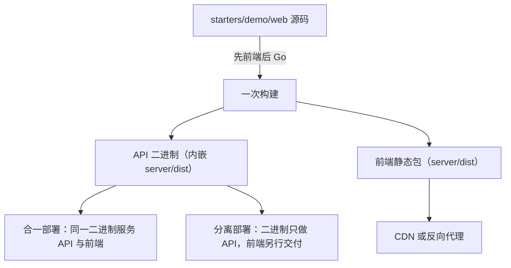
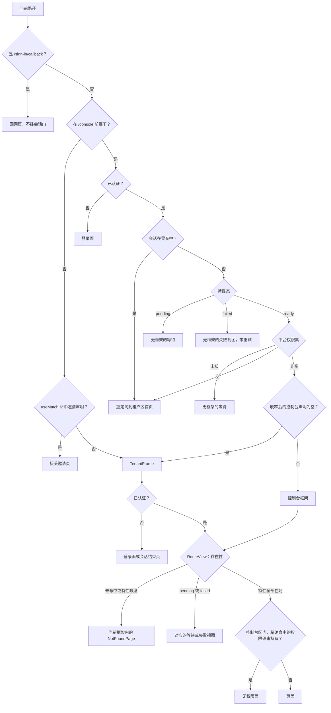

# starters

## 职责

`starters/demo` 是本仓库里一份可运行的示范程序，供拷走后当一个新产品的起点。它把「一个 speed 产品长什么样」写成可读、可编译、可部署的一整套：一个 Go 程序、一棵前端应用、一组部署栈、一套构建与打包的约定。**`demo` 说的是它是什么——一份示范**：它不演示某个功能，它本身就是产品骨架；使用者拷走 `starters/demo` 的一份副本、按自己的业务域改名，在其上长出业务。

它在仓库顶层与 `pkg/`、`tools/` 并列。库本身（`pkg/`）交付模块与接缝，示范交付一个把它们装起来的程序。这是 [ADR-core-scope-2026-09-13](../../adr/adr-core-scope-2026-09-13.md) 失效条件段所指的那部分：该记录写明「组成什么样的应用」没有模板，把这块留给脚手架而不是 `core`。示范兑现那句话（[ADR-starters-skeleton-2026-10-15](../../adr/adr-starters-skeleton-2026-10-15.md)）。

### 非职责

- **不评估模块。** 示范为承载业务而建，它的业务切片是使用者的，不是一份覆盖全部模块的验收清单。它装在 `pkg/` 之上、用命令树纳入模块，验收是使用者自己的业务。
- **不是第二个 `pkg/`。** 示范不交付任何可被依赖的接口，不被任何模块 import，也不登记自己的模块边界；方向是它 import `pkg/`，`pkg/` 不认识它。
- **不承载模块机制。** 模块描述符、注册、查询、生命周期驱动与零依赖公共基础设施归 [core](design-core.md)；示范不改这些契约，只调用它们。
- **不内建业务域。** 示范的业务目录是空位，装使用者自己的业务模块；示范自身不带一个具体的业务域。
- **空的面是设计使然，不是未完成。** 示范不种任何业务数据，所以它在浏览器里以空态呈现：对象存储初始为空；控制台概览只有租户的统计（那几项读的是平台自己的名册）；通知的收件箱没有可展示的消息（示范不声明任何通知类型、也不投递，见下文的通知面）；偏好矩阵恒为空集。看到一个面是空的，读到的不是「这条没做完」，而是「这份基线不带业务域，数据由产品与它的用户产生」。空态与特性缺席是两回事：一个面因装配而不存在时，它的[特性](../../glossary.md)缺席，前端不以空态呈现它，而按不存在的路径处理（见「平台基线」与「前端的组合次序」）。

## 外部接口契约

这是宿主写下来、被命令行、被部署脚本、被前端构建读取的那一面。

### 目录结构

```
starters/demo/
  server/           # Go 程序，独立 module：github.com/vislake/speed/starters/demo/server
    go.mod          # 取 pkg 模块；pkg 尚无发布版本时带一条指向兄弟检出的 replace
    main.go         # 命令树与 run()，只剩业务决定
    host.go         # envPrefix、HostIdentity、端点常量
    signingkey.go   # 签名密钥的路径与首次运行生成
    modules/        # 业务模块的空位
    testdata/       # 配置样例与夹具
    dist/           # 前端构建产物，被 go:embed 嵌进二进制
    var/            # 运行时产物：对象存储的本地根目录与生成的签名密钥
  web/              # 前端应用的源码与构建，产物写进 server/dist
  Makefile          # 产品自己的构建入口，拷走后的树用它
  compose.yaml      # 部署栈外部后端的本地编排
  .gitignore        # 把运行时产物与构建输出挡在树外
  AGENTS.md         # 示范自己的契约
```

`AGENTS.md` 是示范自己的契约，随示范一起被拷走；`go.mod` 的 module 路径是 `github.com/vislake/speed/starters/demo/server`，使用者拷走后按自己的域改名。

**Go 程序与前端源码各占一棵树，构建产物落在 Go 那一棵里。** `go:embed` 只嵌得到内嵌包自己目录树下的文件，模式里不许出现 `..`，所以二进制要嵌的那份产物只能住在 Go 程序所在目录之内：前端源码在 `web/`，构建产物写进 `server/dist/`。

**产品自己的构建入口是示范自带的 `Makefile`。** 仓库的门禁入口是根 `Makefile`，它经 `go.work` 覆盖示范这个模块；拷出去的树上面什么都没有，它的构建、测试与静态检查命令因此写在示范自己的这一份里。`make help` 列出它跑什么，`make check` 全跑一遍，先前端后 Go——Go 构建内嵌产物，这个顺序是硬约束。**它是产品的入口，不是本仓库的入口**：仓库内跑的是根 `Makefile` 的 `make check`，前端腿在 `make web-check` 里。两条腿的输入由拷贝方提供、仓库不跑：`web-install` 把前端依赖装在包所在处（仓库内该包是 `web/` 工作区的成员，安装走工作区那份唯一的锁文件），`lint` 读模块目录向上最近的 `.golangci.yml`（仓库把它放在根）。

### 命令树

命令树照 [ADR-command-tree-2026-09-21](../../adr/adr-command-tree-2026-09-21.md) 的形态：根命令不纳入任何模块，命令挂在部署栈节点之下，纳入沿命令路径向下继承。示范的命令是 `serve`、`worker`、`migrate`、`seed`、`gen`，外加命令组。

- **`serve`** 起 HTTP 入口并接受流量。
- **`worker`** 跑后台模块，不起 HTTP 入口。
- **`migrate`** 只跑数据库引擎，经静态级纳入取得各模块的声明、把全部表建起来。
- **`seed`** 写出配置 `seed.accounts` 点名的初始账户（凭据按项给明文口令或 PHC 条目）、配置 `seed.tenants` 点名的租户（登记进名册）、配置 `seed.settings` 点名的运行期设置（`{key, value}` 列表，值取声明类型自己的文本形式，经公开的 `settings.Store` 写全局层），以及其中标记为平台管理员的那些账户所持有的运营角色——角色带上本进程声明的全部权限。角色与它的授权写进两类域：平台域（平台自己的管理面读它），以及 `seed.tenants` 的每个租户域（控制台按租户寻址的页面——成员、邀请、SSO 提供方——因此开箱即答；平台域的绑定不覆盖租户域，所以租户域里绑得上，得先在租户域把角色与授权写出来）。它驱动到 `Start`，因此把迁移一并带上，一个从未迁移过的库一条命令即可就绪；声明集未变时重复执行不写任何东西，逐项报「跳过」；运行期设置的键在全局层已有显式行时同样跳过，重跑因此不覆盖操作者经设置面做的修改，键拼错或值越出声明的域由设置模块拒绝，命令失败而不写入；进程新声明了一条权限时，重跑把缺的那条授权经宿主的种入面 `authz.Seeder` 补进已置 `builtin` 的运营角色，管理面仍然改不动它。配置里删去的账户与租户既不失效也不删除。角色与绑定只由它写入：迁移不种策略数据，谁是部署的管理员是宿主的回答（[authz](design-authz.md) 对宿主的要求、[authn.admin](authn/design-authn-admin.md) 的引导）。
- **`gen`** 合并并写出 API 规格，并写出特性声明的清单，见「`gen` 命令」。
- **命令组** 承载一次性运维动作。

**部署栈**是命令树上的一层，纳入向下继承，栈节点点一次数据库引擎，其下每条命令都跑在它上面。示范的部署栈是封闭集：`sqlite`、`sqlite-memory`、`postgres`、`postgres-redis-nats`、`postgres-nats-redis`、`postgres-memcached-nats`。每个栈由同一段代码建起，两个栈之间不同的只是数据库引擎、键值后端、事件后端与遥测导出后端各取哪个模块名。`sqlite` 与 `sqlite-memory` 全部用进程内后端，起一套不需要任何外部服务；两者的模块名相同，区别在配置指向的数据库，一个落在文件上、一个只在进程内，因此前者能保存 `seed` 写入的账户而后者不能。键值、事件与导出后端不在栈节点上而在具体命令上：`migrate` 只跑引擎，一个后端的输入项与可达性不该进一个部署前的作业。

**命令组**是把一次性运维动作分组的节点：每个组是一个词，组下的叶子各是一个一次性命令，每个叶子声明它驱动到哪个深度——只读的到 `Init`，写的到 `Start`。示范提供这套机制与一个占位的组骨架，使用者按业务填叶子的动作。

### 平台基线

`serve` 与 `worker` 各自点名纳入的那组平台能力是**平台基线**，写在 `main.go` 的 `baselineServe` 与 `baselineWorker` 两个列表里。基线的判据是一句话：**一条平台能力若能不要凭据、不要外部账号、不要部署栈之外的外部服务就启动，它就在基线里**；其余留给产品在拿到该依赖时自行加入。模块自己的契约是这个判据的落点——一项必需配置项给不出一个能启动的值，它就不属于基线。

判据的两侧各有一组例证。落在基线里的，是只用进程内实现或栈内后端就起得来的平台能力——入站的身份系统（`authn.gate` 网关、`authn.login.password`、`authn.mfa.totp`、`authn.session`、`authn.account`）、租户的 `tenant.resolve` 与 `tenant.admission`、`authz.guard` 授权层、`audit.journal` 审计、`ratelimit` 限流、`settings` 设置、`feature.board` 特性文档的发布，以及任务（`jobs.db`、`jobs.scheduler`）、通知的收件箱、推送、偏好矩阵与投递流水线（`notification.inbox`、`notification.stream`、`notification.preferences`、`notification.delivery`）与对象存储的文件系统后端（`objectstore.fs`）。被判据排除在外的，是一启动就要一份外部凭据或一份栈外服务的：社交与企业身份提供方（`authn.login.google`、`authn.login.github`、`authn.login.wechat-web`、`authn.login.wechat-mp`、`authn.sso.oidc`、`authn.sso.saml`）、短信家族（`sms.*`、`authn.login.sms`、`authn.mfa.sms`、`authn.sms`）、SMTP 邮件（`mail.smtp`）、S3 对象存储（`objectstore.s3`）；它们在产品拿到对应依赖后自行加入。

**WebAuthn（`authn.mfa.webauthn`）也在基线里，是判据放行、示范仍须点名的那一项。** 它的依赖方绑定在部署被访问的来源上——那是 `testdata/` 承载的一个配置项，不是外部凭据也不是栈外服务——所以它一启动不依赖任何外部物，过得了判据（`AGENTS.md` 因此把它从「被排除」一栏移到基线）。点名它是因为平台管理面要能演示自身：步进要求一个与本会话已证明过的认证方式不相交的因素种类，只有 TOTP 一种时，以 TOTP 登录的会话没有因素可用来升级，步进起点因此被拒；TOTP 并上 WebAuthn，让步进有第二种因素种类可点。示范自带的前端实现 WebAuthn 仪式：`@speed/auth-ui`、`@speed/account-ui` 与 `@speed/console-ui` 各自在 `internal/webauthn.ts` 里驱动 `navigator.credentials.create`／`get`，把 passkey 的创建或请求选项解码后交给浏览器，再把返回的凭据按后端解的 JSON 形状序列化成答复。登记与升级因此都能在界面上走完，不需要界面之外的客户端（`AGENTS.md` 详述）。

**静态运营口令表（`authn.static`）是判据放行、示范却排除的那一项。** 它不需要任何外部服务，只需配置里的一张表，按判据本可入选；但它是唯一取 Basic 方案的后端，而浏览器只对 Basic 与 Digest 挑战弹原生口令框。示范把前端产物交给浏览器，一个受保护端点的 401 一旦带 Basic——会话或令牌过期时——就会在已登录用户面前弹出原生口令框，而不是让前端结束会话、回到自己的登录页。这里的每个调用方都由会话 cookie 与 bearer 令牌承载，示范因此不接 Basic 后端，`testdata/` 也不带口令表；想给运营入口或探针留 Basic 认证的拷贝，自行把 `authn.static` 与它的 `authn.static.subjects` 表加回来——实现见 `main.go` 的 `baselineServe`，`authn.static` 不在其中。

**命令树点名决定某个进程跑什么，import 可达决定契约文档覆盖什么，两者不是同一件事。** 一条被判据排除在运行之外的能力（`sms.admin`、`authn.sso.saml`），其 HTTP 片段仍属于平台契约：`gen` 与 `/openapi.json` 合并的是二进制 import 可达的全部片段，与命令树点名哪些模块跑无关。因此宿主 import 每一个声明了 HTTP 片段的平台模块，即便其中一些不进任何命令的纳入清单，合并文档的 operation 集合才等于各片段之和（见 `AGENTS.md`）。

**特性按同一条线分在两处。** `gen` 写出的 `contracts/features.json` 列的是可用集里的全部特性声明，与命令树点名哪些模块跑无关；一个 `serve` 进程发布的[特性文档](../../glossary.md)只含本进程启用集里的模块服务的特性（[feature](design-feature.md)）。示范的命令树不使用 `AllResources` 覆盖，`serve` 的特性文档因而不含任何本进程不运行的模块的特性。被判据排除在运行之外的能力，其特性名在 `contracts/features.json` 里，在基线 `serve` 的特性文档里则特性缺席，例如 `sms.admin`、`authn.phone`、`authn.admin.sso.metadata`、`notification.channel.email` 与 `notification.channel.sms`。前端按特性缺席处理它们：依赖它们的页面不进导航，直达其路径得到与不存在的路径相同的 404，依赖它们的控件不渲染；产品加入对应模块、在 `serve` 上纳入后，这些特性随之在场，前端代码不变。

`serve` 起 HTTP 入口，纳入全部带路由或中间件的模块；`worker` 纳入既不路由也不经网关就能启动的后台模块。栈的数据库引擎、键值后端、事件后端与导出后端仍点在各命令上，不在栈节点。

**`feature.board` 只在 `serve` 里。** 前端只从 `serve` 读特性文档；`worker` 不服务前端，不纳入它。`notification.delivery` 在 `serve` 基线里而不在 `worker` 基线里，渠道特性（`notification.channel.email`、`notification.channel.sms`）因而由 `serve` 进程判定；把投递流水线移到别的进程的产品，须让两边的装配一致（[notification-delivery](notification/design-notification-delivery.md)）。

**前端不经特性门控就调用其路由的后端模块，`serve` 必须运行级纳入。** 前端调用这些模块的路由之前不查特性文档；它们不在时，前端的登录、会话与特性门控本身都无从成立。这些模块的清单，以及前端用到的其余后端面怎样门控，见 [web](web/design-web.md#不经特性门控的后端模块)。

`testdata/` 的每份配置为基线里需要配置的模块写全必需项，并随骨架带一组开发用值（`seed.accounts` 的明文口令、库加密根键、`seed.settings` 里降到域下限的 `authn.mfa.sensitive-min-age`），由 `AGENTS.md` 点名、要求拷走后替换。签名密钥不由 `testdata/` 交付：`authn.token.signing-key-file` 指向工作目录下的 `var/token-signing-key.pem`，`run()` 在驱动生命周期之前发现该路径无文件时用 `pkg/authn/token` 的 `GenerateKey` 生成一份写入，已有文件则沿用；该路径由 `.gitignore` 挡在树外，生产部署换成自己的密钥材料。示范的 `AGENTS.md` 是这组值与该基线的契约面。

### `gen` 命令

`gen` 把二进制里各模块声明的 OpenAPI 片段合并成一份文档并写出。它调 [ops](design-ops.md) 的导出包 `pkg/ops/openapi` 里的 `Merge`——**一个纯函数**，模块在 `Init` 里合并、`/openapi.json` 交出的是它的结果，`gen` 写出制品的也是它。**不驱动生命周期、不绑端口、不构造任何模块**：合并读的是各模块的静态声明，不需要把任何模块跑起来，也不需要入口模块的登记面。这与 `ops` 模块在 `Init` 里合并、在运行面经 `/openapi.json` 交出是同一份合并逻辑的两种消费——运行面服务于一个活着的进程，`gen` 服务于构建与发布，把这份文档写进制品，供前端据它生成自己的 API 面。

**`gen` 同时写出特性声明的清单。** 输入项 `--features` 点名一个路径，`gen` 把可用集里的全部 `feature.Spec` 声明写到那里，每项带名字、声明模块与是否条件特性，按名字排序。它与合并文档同源：两者读的都是同一个二进制里已登记模块的静态声明，同样不构造模块、不推进生命周期。示范把它写成 `contracts/features.json`，与 `contracts/api.json` 并列，示范前端的 `api:gen` 写出 `contracts/api.json` 时一并写出它；`@speed/api-sdk/features` 的特性名类型由它生成（[api-sdk](web/design-web-api-sdk.md)）。`starters/demo/server` 的 `TestCommittedFeatureVocabulary` 比对已提交的 `contracts/features.json` 与本二进制的声明，两者不一致即失败（[ADR-feature-vocabulary-2026-10-17](../../adr/adr-feature-vocabulary-2026-10-17.md)）。

### 端点集合

端点是产品自己划的流量边界：`api`、`account`、`admin`、`ops`、`web`。哪个端装哪些层是配置，示范在这里说的是哪类流量属于哪个端。基线在这些端上装好网关、租户解析与准入、鉴权、限流、审计、平台管理面与特性文档，逐端的装法写在 `testdata/` 的配置里。分离部署下拉起前端的那条通配路由独占 `web` 端（[webui](design-webui.md)）。

**通知面的授权是宿主侧的。** 通知能力（`notification.inbox`、`notification.stream`、`notification.preferences`）按设计不声明任何权限点（[notification](notification/design-notification.md)）：它的路由不带权限闸，谁可读由宿主决定。示范作为宿主把这个决定写下来——`server/notification.go` 的 `notification.access` 模块在 `Init` 里把 `/api/v1/notifications` 下的收件箱、偏好与推送路由在 `authz.guard` 的声明面上登记为开放：网关照常认证、授权层放行、handler 按调用方身份作答；不登记时它们落在缺省关闭的授权层下答 403。登记为开放而非挂权限点，是因为这些路由按调用方身份划界而不是按谁的权限划界——收件箱与推送读的是调用方自己的账户，偏好矩阵读的是宿主身份与授权侧给出的收件人（`preferences.WithRecipient`）。示范不接线那个收件人，也不声明任何通知类型，偏好矩阵因此恒为空集，收件人这一步在示范里不出现；声明了类型的宿主需另把调用方账户写进偏好路由的请求上下文。

**这些端点由两条监听承载。** 端点挂在监听上，一条监听是一个监听套接字，`pkg/http` 据此把多个端点并在一个地址上（[http](http/design-http.md)）。示范的 `testdata/` 配置里，`api`、`account`、`admin` 与 `web` 挂在 `backend` 监听上，`ops` 自开一条 `ops` 监听：前端与 API 因而同源，浏览器直接访问 `web` 与 `api` 无需 CORS。

**`backend` 监听上的各端在配置里写出[认领前缀](../../glossary.md)，按顶层段认领。** 监听按认领为请求选端，不看本次装配挂了哪些路由（[http](http/design-http.md) 的分派 handler、[ADR-http-dispatch-2026-10-17](../../adr/adr-http-dispatch-2026-10-17.md)）。`testdata/` 的每份配置与示范测试的配置写同一张表：

| 端 | `prefixes` |
|---|---|
| `api` | `/api` |
| `account` | `/auth`、`/features` |
| `admin` | `/audit`、`/authz`、`/settings`、`/sms`、`/tenant` |
| `web` | `/`：`backend` 监听的[兜底端点](../../glossary.md)，`webui` 的通配路由挂在这里 |

`ops` 独占 `ops` 监听，省略 `prefixes`，即认领 `/`。

- **认领是产品固定的命名空间表，去掉一项能力不删它的认领。** 撤出运行集也好，删掉 import 也好，那项能力的命名空间都留在认领里：示范的二进制 import 了 `sms.admin` 而基线不运行它，`admin` 仍认领 `/sms`；从示范拷出、删掉 `tenant.admin` import 的产品，仍认领 `/tenant`。认领表覆盖可用集里每个 operation 的命名空间，以及平台前端包会寻址的命名空间。
- **前端页面路径不落在 `/` 以外的任何认领之下。** 落在这类认领之下的页面路径，整页导航得到那个端的应答，拿不到入口文档。
- **开发代理由共享清单生成。** `starters/demo/web/backend-prefixes.json` 列出 `backend` 监听上全部非 `/` 的认领；`vite.config.ts` 的 `server.proxy` 由它生成按段边界匹配的正则键（`/auth` 的键不匹配 `/authz/...`），前端测试据它核对页面路径。

**认领由测试守住。**

- **认领覆盖平台命名空间。** 示范测试读在服的 `/openapi.json` 与已提交的 `contracts/api.json`，对其中每个 operation 取 `x-endpoint`，在该端所在的监听上按请求期的选端规则核对：配置的认领选中的正是这个端。`testdata/` 的每份配置都过同一判定。
- **清单与配置一致。** `backend-prefixes.json`、差分测试里写定的前缀归属，以及每份配置在 `backend` 监听上的非 `/` 认领，彼此相等。
- **页面路径不相交。** 前端测试断言页面表里的每个页面路径与页面前缀，按段边界都不落在清单的任何前缀之下；每个代理键匹配前缀之下的路径，不匹配任何页面路径。
- **去掉路由模块前后的未认证应答逐字节比较。** 差分测试在合一与分离两种拓扑下，以去掉若干路由模块的变体进程与基线进程比较未认证请求的应答，要求除 `Date` 外逐字节相同。凭据后端这类对端上每个请求都起作用的模块不在去掉之列；至少在一次运行中命中[匿名面路由](../../glossary.md)的请求不发送、不比较。同一端上匿名面路由与其余路由的匹配域不相交，由同一测试从网关冻结的登记表与在服的 `/openapi.json` 静态核对（[authn-gate](authn/design-authn-gate.md) 的对宿主的要求）；这一核对通过时，不发送的请求正是 [http](http/design-http.md) 术语表所界定的豁免请求。

**特性文档挂在 `account` 端。** `testdata/` 的每份配置都以 `feature.board.endpoint: account` 点名它：该端受认证网关守卫、不解析租户，并认领 `/features`，满足 [feature](design-feature.md) 对宿主的要求，匿名者读不到特性文档，选定租户之前的前端读得到（[ADR-feature-document-2026-10-17](../../adr/adr-feature-document-2026-10-17.md)）。

### `main.go` 的保留内容

`main.go` 与 `host.go` 只保留「这个产品自己做主」的东西：

- **环境变量前缀与版本常量** 前缀经 `config.HostIdentity` 给进进程；版本常量写进 `version` 命令的应答与合并文档的 `info`。
- **端点集合** 见上。
- **命令树** `run()` 建命令树、执行、把结果转成退出码；命令树的纳名、栈表、命令组与深度是业务决定。
- **ready 与 stopped 记录** 长跑命令在全部模块启动之后写一条 ready 记录、在退出时写一条 stopped 记录，供监管者与用例等待。

`main.go` 不重写模块的接线规则：模块经 `init` 自行登记，命令树点名纳入，依赖闭包由注册表展开——`main` 只写下「这个产品由哪些模块、哪些命令组成」。

### 前端的页面表

前端应用的页面声明集中在 `starters/demo/web/src/routes.tsx` 的 `routes`，是 [route-kit](web/design-web-route-kit.md) 的一张声明表。一条声明所依赖的后端面若随装配而变，它以 `requires` 列出对应的特性名，所列特性全部在场时该页面才存在；只依赖前端直接依赖的模块（见「平台基线」）的页面不带 `requires`。下表列出示范租户区的全部声明：

| 页面 | `requires` | 声明者 |
|---|---|---|
| `/` | 无 | 示范 |
| `/account` | 无 | 示范 |
| `/objects` | `objectstore.objects` | 示范 |
| `/notifications` | `notification.inbox` | notification-ui 的 `notificationRoutes`（[notification-ui](web/design-web-notification-ui.md)） |
| `/invitations/:token` | `authn.invitations` | 示范 |
| `/sign-in/callback`、`/account/callback` | 无 | 示范 |

`/sign-in/callback` 与 `/account/callback` 依赖的是登录前的事实——部署有没有重定向类与企业类登录方式——它不在特性文档里，部署没有这类登录方式时它们怎样呈现，见「租户框架与回调落点」。控制台区的声明由 console-ui 导出，示范把它们挂在 `/console` 前缀下，`requires` 与权限码随声明自带（[console-ui](web/design-web-console-ui.md)）。

- **页面表里的每个 `requires` 都属于 `@speed/api-sdk/features` 的 `FEATURE_NAMES`**，含 console-ui 与 notification-ui 的声明：示范的测试逐项断言，示范自己的声明以 `satisfies` 收紧到 `FeatureName`（[ADR-feature-vocabulary-2026-10-17](../../adr/adr-feature-vocabulary-2026-10-17.md)）。
- **页面路径不落在 `backend-prefixes.json` 里任何前缀之下**，由测试守住，见「端点集合」（[ADR-http-dispatch-2026-10-17](../../adr/adr-http-dispatch-2026-10-17.md)）。

## 依赖

**Go 侧**取 `pkg` 模块：`go.mod` 以 `require github.com/vislake/speed/pkg <版本>` 取它。**前端侧**取 `@speed/*` 包：`package.json` 按 registry 版本范围声明（`^x.y.z`），不用 `workspace:*`。

**示范的 `go.mod` 在 `pkg` 有发布版本之前带一条 `replace` 指向兄弟检出**：仓库自己的两条腿——`build` 的 standalone 段与 `tidy-check`——以 `GOWORK=off` 运行，没有 `replace` 时它们解析不到一个尚未发布的模块。**拷贝出去的树删掉这一条**，`require` 的那一行成为 `pkg` 的唯一来源；这正是那行注释写明的事。

**「拷贝即用」的验收不得借助这条 `replace`。** 拷到仓库之外、把 module 路径与 `replace` 一并改掉、按发布版本构建，才算验到它——`replace` 留在验收里会把「本机恰好有这份仓库」当作前提，构建通过只证明本机检出可用，不证明一个真正的消费者能取到发布的版本。**这一步要等 `pkg` 有发布版本**，此前它跑不起来（[ADR-starters-skeleton-2026-10-15](../../adr/adr-starters-skeleton-2026-10-15.md)）。

**前端应用住在 `starters/demo/web/`，不住在包库 `web/` 里。** 它是一个住在 `web/` 之外、却能被 `web/` 的工作区工具链安装、检查与构建的前端包：作为外部成员加入 `web/` 的 pnpm workspace（`web/pnpm-workspace.yaml`）。**它对 `@speed/*` 按 registry 版本范围声明**，不用 `workspace:*`——示范是拷出去的产品起点，不是仓库内的成员。

**外部后端**由 `compose.yaml` 编排（数据库、键值存储、事件总线），供在本机起一整套外部服务。

## UML 图

构建一次产出两件制品，两条部署拓扑各取其一。图里看不出的是**构建顺序是硬约束**：`go:embed` 要求产物在前端构建之后才存在。



前端对一条路径的判定分支多，活动图给出它的次序。图里看不出的约束由「前端的组合次序」承载：区域只看路径前缀；控制台区先判特性态、再判平台权限集；权限码只取精确命中的那条声明。



## 核心数据结构

命令树的节点是 `pkg/config` 的命令对象，示范只写它的形状：一个词、一组纳入的模块名、一个深度、一个到达后要做的动作。部署栈是同一结构的一个层级，栈之间不同的只是那张「哪个能力取哪个模块名」的表。

前端的页面声明是 route-kit 的 `RouteDeclaration`：路径、视图、可选的导航标签、可选的权限码与可选的 `requires`。示范自己的声明与 console-ui、notification-ui 导出的声明共处一张表，示范按路径前缀把它分成租户区与控制台区。

## 核心算法与流程

**启动**：`run()` 先确保签名密钥就位、再建命令树 → `config.App` 解析命令行与环境变量、加载主配置源、把读取面预置给 `config` 模块 → 选中的命令发起驱动，沿命令路径纳入的模块经依赖闭包展开进入参与集 → 生命周期逐阶段推进到该命令的深度 → 长跑命令等在 `ctx` 上 → 取消后入口先停、其余模块逆序释放。

**签名密钥**：`run()` 在驱动生命周期之前检查 `var/token-signing-key.pem`，缺则用 `pkg/authn/token` 的 `GenerateKey` 以 ES256 生成一份、以独占创建写入并限定属主读写，已有文件则原样沿用；写入面只落这条路径，密钥不进树。

**构建**：先前端后 Go。前端构建出 `server/dist`，Go 构建把它嵌进二进制；同一个 `server/dist` 另作为静态包交付。

**`gen`**：静态级纳入取全部声明 → 合并各模块的 `http.Spec` 片段 → 写出文档；`--features` 点名路径时，另把可用集里的全部 `feature.Spec` 声明写到那里。不推进生命周期。

### 前端的组合次序

`starters/demo/web/src/app.tsx` 的 `AppFrame` 对每条路径按下列次序判定。`DemoApp` 给 `RouteProvider` 传 `presence`（auth-core 的 `featurePresence` 由特性态得出），以及 `pending`、`failed` 视图，route-kit 据此处理带 `requires` 的声明（[route-kit](web/design-web-route-kit.md)、[ADR-web-route-seam-2026-10-17](../../adr/adr-web-route-seam-2026-10-17.md)）。

1. **回调落点先于任何会话门。** 路径是 `/sign-in/callback` 时，不论会话状态，直接渲染回调页（`AuthCallbackPage`）：重定向类与企业类登录的回调到达时会话尚不存在，回调处理器自己完成在途流程、渲染宿主给的 `absent` 视图或显示横幅（见「租户框架与回调落点」）。
2. **区域按路径前缀判定。** 路径在 `/console` 前缀下的进控制台区，其余进租户区。区域与哪些页面特性在场无关。
3. **租户区**：路径是邀请落点、且 `useMatch()` 命中邀请声明时，渲染接受邀请页；只有已认证、特性态为 `ready` 且特性 `authn.invitations` 在场时才会命中。其余情况进租户框架 `TenantFrame`：匿名者首访看到登录面，会话中途结束后看到会话结束页，已认证者进入存在性判定。`/account/callback` 在这里不拦截，它是租户区的一条普通声明。
4. **控制台区**依次判定，先成立的分支即结果：
   - 匿名 → 登录面（`SessionGate`）；
   - 会话在冒充中（auth-core 快照的 `impersonating` 为真）→ 重定向到租户区首页，与平台权限集无关；
   - 特性态为 `pending` → 无框架的等待；为 `failed` → 无框架的失败视图，带重试；
   - 平台权限集未知 → 无框架的等待（`ConsoleAccessPending`）；
   - 平台权限集为空 → 重定向到租户区首页，任何 `/console/*` 路径都一样；
   - 控制台声明经 `presentDeclarations` 收窄后为空 → 按租户区处理，`/console/x` 与 `/x` 同为租户区的 404；
   - 其余 → 控制台框架，进入存在性判定。
5. **存在性**（`RouteView`，在全表上匹配）：未命中，或命中的声明在特性态 `ready` 下有特性缺席 → route-kit 的 `fallback`，即当前框架内的 `NotFoundPage`；特性态为 `pending` 或 `failed` 时，命中带 `requires` 的声明渲染对应视图；所列特性全部在场 → 进入权限判定。
6. **权限**，只在控制台区：`ConsoleRouteGuard` 只取 `useMatch()` 精确命中的那条声明的权限码，交给 layout-kit 的 `RouteGuard`；没有精确命中时放行，由存在性判定的 `fallback` 作答。

这套次序保证下列性质：

- **先存在性、后权限。** 特性缺席的页面，对持有其权限码的员工同样是 404；特性在场而权限码未持有的页面渲染无权限面。
- **非员工看不出控制台有哪些页面。** 区域只看路径前缀，平台权限集为空的已认证者访问任何 `/console/*` 路径都被重定向回首页，结果与页面特性在场与否无关。
- **冒充期间不提供控制台，重定向同样静默。** 平台管理面既不在准入层所守的端上、也未登记为可冒充，对冒充身份一律被网关拒绝，与被冒充账户的平台权限集无关，所以控制台区在冒充期间一律重定向到租户区首页。重定向处不加说明，冒充者的解释由租户框架里的持久横幅承担（[ADR-web-impersonation-shell-2026-10-18](../../adr/adr-web-impersonation-shell-2026-10-18.md)、「冒充期间的壳」）。
- **特性态未定时不误判为非员工。** 平台权限集的读取依赖特性态（见「宿主侧的特性读取」），特性态为 `pending` 或 `failed` 时权限集保持未知；控制台区先判特性态、再判权限集，取回失败的员工看到失败视图，不被重定向。控制台声明的收窄结果在 `pending`、`failed` 时恒为空，这一判同样排在特性态之后。
- **权限码不经前缀继承。** 未命中任何控制台声明的路径渲染 `NotFoundPage`，与调用者持有哪些权限码无关；没有导航标签的控制台详情声明因此各自带权限码（[console-ui](web/design-web-console-ui.md)）。

### 租户框架与回调落点

`TenantFrame` 是 `app.tsx` 里包住租户区内容的框架：`TenantProvider`、`NotificationStreamProvider`、`NotificationPresenceProvider`、`ProductShell` 及其各个槽。租户区的 `RouteView` 渲染在它里面，`/sign-in/callback` 的 `absent` 视图也由它包住 `NotFoundPage`；特性缺席的页面、渲染 `absent` 视图的回调落点与一条不存在的路径因而走同一个框架、同一个匿名分支。

- **`/sign-in/callback`**：回调页给 auth-ui 的 `SocialCallbackHandler` 传 `absent`，取值是 `TenantFrame` 包住的 `NotFoundPage`。何时渲染它由回调处理器判定（[auth-ui](web/design-web-auth-ui.md)）：匿名者看到 `ProductShell` 的登录面或会话结束页，已认证者看到租户框架内的 404，都与一条不存在的路径相同。
- **`/account/callback`**：只有已认证者能到达，渲染在租户框架里。账户绑定回调页给 account-ui 的 `BindingCallbackHandler` 传 `absent`，取值是 `NotFoundPage`（[account-ui](web/design-web-account-ui.md)）。账户页给 `SocialBindingsSection` 传 `returnTo`，取值是 `/account/callback`，绑定流程据此回到这条声明。

### 冒充期间的壳

决策见 [ADR-web-impersonation-shell-2026-10-18](../../adr/adr-web-impersonation-shell-2026-10-18.md)。冒充开始后会话的主体是被冒充账户，网关只把冒充身份放进准入层所守的端与登记为可冒充的路由，平台管理面一律被拒（[design-authn-impersonation](authn/design-authn-impersonation.md)）。示范在租户框架里给出下列几部分。

- **横幅。** `TenantFrame` 把 auth-ui 的 `ImpersonationBanner` 经 `ProductShell` 的 `banner` 槽挂在应用栏之上，始终挂载（[auth-ui](web/design-web-auth-ui.md)、[product-shell](web/design-web-product-shell.md)）。`impersonation` 非空当且仅当快照的 `impersonating` 为真。`subject` 取快照 `principal` 的显示名，没有显示名时取账户标识；`tenant` 与 `expiresAt` 取自冒充状态读（`GET /auth/impersonation`）应答里 `grant` 对象的 `tenant` 与 `ends_at`，`tenant` 就是租户标识，因为租户名册读属平台管理面、冒充期间不可达。状态读只在 `impersonating` 为真时启用，没有冒充的访问者不发这条读，也就没有一次裸 404。`impersonating` 为真时该读答裸 404，是已落定的「已无冒充」，与 console-ui 同一规则，宿主据此调用 `applyIdentityChange('ended')`；重读由查询客户端缺省的窗口重新聚焦承担（每项 `staleTime` 为 0），本设计不另加轮询。其余失败读不到时，`tenant` 与 `expiresAt` 缺省，横幅与结束控件照常。横幅覆盖租户框架内的页面：邀请落点是公开落点页，渲染在租户框架之外，不挂横幅；控制台框架不挂横幅，冒充期间控制台区重定向到租户区，控制台框架不会在冒充期间渲染。
- **一个身份变更动作。** 宿主绑定 `applyIdentityChange(change)`，`change` 是 `started` 或 `ended`。它依次：整体逐出查询缓存，与会话结束的缺省策略是同一个动作（[product-shell](web/design-web-product-shell.md)）；调用会话的 `restore()` 重读主体与 `impersonating`；重读依赖身份的宿主状态，即平台权限集（置回未知，再按「宿主侧的特性读取」的门控重读）、当前租户（见下）与租户区的实时订阅（订阅按生效账户登记，身份变更后以变更代数重建 `NotificationStreamProvider`，使它重新按新的生效账户连接，[notification-ui](web/design-web-notification-ui.md)）。`started` 时再把页面带到租户区首页，`ended` 不导航：页面是租户页，结束后控制台重新可达。`restore()` 保留已附上的权限集，也不自行得知身份变了，所以权限集的重读由本动作触发，不依赖特性态的变化。调用方是横幅的 `onEnd`、console-ui 冒充页的发起与结束（经 `onImpersonationChange` 接入，[console-ui](web/design-web-console-ui.md)）与到期。本动作在写入落定之后、在该次尝试之外调用，它的失败被包住，不改判已落定的写入；横幅的 `onEnd` 在结束请求落定时兑现，结束请求答裸 404 也当成兑现，不等待本动作。
- **当前租户。** 冒充期间租户名册读被网关拒绝，当前租户取冒充状态读的 `grant.tenant`（标识），不发名册读，也不回落占位租户；状态读落定之前当前租户保持未知，租户作用域的读保持禁用。请求播报用的别名取自此前读到的名册别名缓存里该标识的别名；缓存里没有它（整页重载、新开标签页）时回落占位表，别名与实际不符时租户区的读被准入层答 404，这与没有名册读权限的普通成员是同一条已知限制，不为冒充另造别名来源。结束冒充后当前租户重新由名册读决定。
- **到期。** 横幅给出 `expiresAt` 时，宿主在该时刻调用 `applyIdentityChange('ended')`。冒充记录的有效性判定按 `authn.session.check-ttl` 缓存（缺省 5 秒、取值域 0 到 60 秒），到期没有可发的事件，所以到期之后最长一个 `check-ttl` 内服务端仍可能按冒充处理，`restore()` 可能仍读到 `impersonating` 为真。读回仍为真时，宿主按固定的短间隔再读，总时长不超过 `check-ttl` 的上界；上限内仍为真则停止重试，横幅与结束控件保持可用，等下一次聚焦重读。定时取自浏览器时钟，与服务器时钟的偏差由这个有界重试吸收。

### 宿主侧的特性读取

前端里只有宿主读特性态：示范经 auth-core 的 `useFeature`、`useFeatureState`、`featurePresence` 与 route-kit 的 `useHasRoute`、`presentDeclarations` 读取，再经属性或上下文组件交给能力 UI 包，能力 UI 包不调用 auth-core 的钩子（[ADR-web-feature-state-2026-10-17](../../adr/adr-web-feature-state-2026-10-17.md)）。特性缺席的控件隐藏；特性在场而调用者无权限的写入控件照常渲染，授权由服务端判定（[架构](../architecture.md#特性与前端定制)）。下表列出示范宿主按特性门控的全部位置：

| 位置 | 门控 |
|---|---|
| 账户页的 `PhoneSection` | 特性 `authn.phone` 在场才挂 |
| 账户页的 `MfaSection` | 特性 `authn.mfa` 在场才挂；可登记的因素种类由包内按 `mfa.factors` 过滤 |
| 账户页的 `IdentifiersSection` | `emailAvailable` 取特性 `authn.identifiers.email` 是否在场 |
| 头部的 `NotificationBell` | 特性 `notification.inbox` 在场才挂 |
| `NotificationStreamProvider` | `enabled` 取「已认证且特性 `notification.stream` 在场」 |
| `NotificationPresenceProvider` | `preferences` 取特性 `notification.preferences` 是否在场；`channels` 取 `notification.channel.email`、`notification.channel.sms` 中特性在场的那些所对应的 `email`、`sms` |
| 租户名册的读取 | 特性态为 `ready` 且特性 `tenant.admin` 在场才读；`ready` 而该特性缺席时取缺省租户；`pending`、`failed` 时当前租户保持未知，租户作用域的查询保持禁用 |
| 平台权限集的读取（`platform-permissions.tsx`） | 特性态为 `ready` 且特性 `authz.admin` 在场才读；`ready` 而该特性缺席时挂空集；`pending`、`failed` 时权限集保持未知 |
| 头部的 `ConsoleEntry` 与首页的控制台卡片 | 持有平台权限、且控制台声明经 `presentDeclarations` 收窄后非空时出现；目标是第一条特性在场、且持有其权限码的控制台导航项 |
| 首页的对象卡片与通知卡片 | `useHasRoute('/objects')`、`useHasRoute('/notifications')`：入口跟随目标页 |
| `ConsoleArea` | 给 console-ui 的 `ConsoleShell` 传经 `presentDeclarations` 收窄的控制台声明，以及取自 `featurePresence` 的 `hasFeature` |

租户名册与平台权限集的读取以特性态为输入：特性态转为 `ready` 时各读一次；一次身份变更（`applyIdentityChange`）另是平台权限集与当前租户的重读触发，特性态此时仍是 `ready`、没有转为 `ready` 这一沿，重读仍受上表的门控约束。账户页的 `PasswordSection` 不经特性门控，修改口令的路由由 `authn.login` 恒挂。

**示范的文案不断言装配。** 哪些登录方式可用由 `GET /auth/methods` 决定，哪些面存在由特性文档决定，文案不复述其中任何一项。登录页的首个账户说明只陈述与装配无关的事实：部署的第一个管理员账号由 `seed` 命令写入。

## 错误与失败语义

特性文档的取回、持有与失败分类归 [auth-core](web/design-web-auth-core.md)，带 `requires` 的声明在各特性态下怎样匹配归 [route-kit](web/design-web-route-kit.md)；本节只写示范宿主的呈现。

- **特性态为 `failed`。**
  - 租户区：带 `requires` 的页面渲染宿主交给 route-kit 的失败视图，带重试；门控的导航项与控件不渲染；不带 `requires` 的页面照常可用；租户框架的内容区顶部有一条带重试的提示，文案在示范自己的命名空间里，备 zh-CN 与 en-US。
  - 控制台区：无框架的失败视图，带重试。
  - 平台权限集与当前租户保持未知，既不当作特性缺席，也不当作特性在场。
  - 重试成功、特性态转为 `ready` 后，平台权限集与租户名册各读一次，控制台入口随之按「宿主侧的特性读取」出现。
- **特性态为 `pending`**，只在重试在途时出现：带 `requires` 的路径渲染等待视图，未登记的路径照常立即得到 404，门控的导航项不出现。
- **特性缺席的页面与不存在的路径走同一条代码路径。**
  - 租户区：`/objects` 特性缺席与一条不存在的路径，都在租户框架内渲染 `NotFoundPage`。
  - 控制台区：`/console/sms` 特性缺席与 `/console` 下一条不存在的路径，都在控制台框架内渲染 `NotFoundPage`；控制台声明全部特性缺席时，两者都落到租户区的 404。
  - 回调落点：见「租户框架与回调落点」。
  - 合一拓扑下，不落在 `/` 以外任何认领前缀之下、末段不带扩展名的深链接在 HTTP 层得到入口文档与 200（[webui](design-webui.md)），404 完全由前端渲染。
- **匿名访问者在两个区里看到什么只取决于区域与会话史，与特性无关**：租户区（含邀请落点，以及渲染 `absent` 视图的回调落点）首访是登录面，会话中途结束后是会话结束页；控制台区是登录面。
- **部署前提**：同一个源背后的全部 `serve` 副本跑同一条命令、同一份配置。`serve` 纳入日志功能，每个 `serve` 进程在 `Start` 写出一行特性集摘要，供运维逐副本比对；副本间不一致时的表现见 [feature](design-feature.md) 的非保证。

## 扩展点

- **业务模块**：使用者的模块落在 `server/modules/`，照 `pkg/` 的模块形态写（描述符加 `init` 登记），被 `main.go` 的命令树纳入。这是「加一个业务」在示范里的唯一动作。
- **命令组的叶子**：占位的组骨架供使用者按业务填一次性运维动作。
- **前端的业务页面**：经路由包的声明式注册面接入（[web](web/README.md)）；页面依赖的后端面随装配而变时，声明以 `requires` 列出对应的特性名（见「前端的页面表」）。
- **业务模块的特性**：业务模块以 `feature.Spec` 声明自己服务的特性，条件特性在 `Init` 中经 `feature.Board` 的 `Post` 报告；`gen` 写出的 `contracts/features.json` 随之含有它们，前端的特性名类型经登记接口增补（[feature](design-feature.md) 的扩展点、[api-sdk](web/design-web-api-sdk.md)）。示范自带的应用模块不声明特性：本仓库的 `contracts/features.json` 是平台包 `@speed/api-sdk/features` 的生成源，只含平台模块的声明（[api-sdk](web/design-web-api-sdk.md)）。

## 实现状态

| 能力 | 状态 | 代码 |
|---|---|---|
| 目录骨架与 `go.mod` | 已实现 | `starters/demo/server/go.mod`、`starters/demo/AGENTS.md` |
| 产品自带的构建入口 | 已实现 | `starters/demo/Makefile` |
| 命令树与部署栈 | 已实现 | `starters/demo/server/main.go` `commandTree`、`addStack`；`starters/demo/server/host.go` `hostModule`、`servedEndpoints` |
| 签名密钥的首次运行生成 | 已实现 | `starters/demo/server/signingkey.go` `ensureSigningKey`、`signingKeyPath`；`starters/demo/server/main.go` `run` |
| 平台基线（`serve`/`worker` 的点名集与配置样例） | 部分实现 | `starters/demo/server/main.go` `baselineServe`、`baselineWorker`；`starters/demo/server/testdata/` |
| 通知面的宿主侧授权 | 已实现 | `starters/demo/server/notification.go` `notificationModule`、`notificationRoutes`；纳入见 `starters/demo/server/main.go` `baselineServe` |
| `seed` 命令 | 已实现 | `starters/demo/server/seed.go` `seedModule`、`seedSchema`、`seedDatabase`、`seedTenant`、`seedAdministration`、`seedBinding`、`seedSettings`；命令见 `starters/demo/server/main.go` `addStack` |
| `gen` 命令 | 已实现 | `starters/demo/server/main.go` `genModule`、`genDocument`、`featureVocabulary` |
| 已提交的 `contracts/features.json` 的新鲜度测试 | 已实现 | `starters/demo/server/feature_test.go` `TestCommittedFeatureVocabulary` |
| 基线 `serve` 的特性文档端到端（逐项等于基线集合、匿名 401） | 已实现 | `starters/demo/server/feature_test.go` `TestServePublishesTheFeatureDocument` |
| 前端产物的内嵌与托管（合一拓扑的 Go 侧） | 已实现 | `starters/demo/server/main.go` `webBundle`（`//go:embed dist`）、`webuiModuleName` |
| 前端应用本身（`web/` 的源码与构建） | 部分实现 | `starters/demo/web/src/main.tsx` `bootstrapDemoApp`、`starters/demo/web/src/app.tsx` `DemoApp`、`starters/demo/web/src/routes.tsx` `routes`、`starters/demo/web/src/runtime-config.ts` `loadRuntimeConfig`；构建见 `starters/demo/web/vite.config.ts` |
| 应用自己的第二级契约生成 | 已实现 | `starters/demo/web/orval.config.ts` `appApi`、`starters/demo/web/package.json` `api:gen`；产物 `starters/demo/web/src/app-api/index.ts`、接缝 `starters/demo/web/src/app-api/runtime.ts` |
| `api:gen` 一并写出 `contracts/features.json` 并调用特性名生成器 | 已实现 | `starters/demo/web/package.json` `api:gen`；`web/scripts/feature-names.mjs` |
| 前端页面声明的 `requires` 与名字成员断言 | 已实现 | `starters/demo/web/src/routes.tsx` `businessRoutes`、`invitationRoutes`（`satisfies` 收紧到 `FeatureName`）；`starters/demo/web/src/routes.test.ts` |
| 前端的组合次序：区域按路径前缀、先存在性后权限、权限码按精确命中 | 已实现 | `starters/demo/web/src/app.tsx` `AppFrame`、`ConsoleFeatureGate`、`ConsoleAreaGate`、`ConsoleRouteGuard` |
| 租户框架 `TenantFrame` 与回调落点的 `absent` 视图 | 已实现 | `starters/demo/web/src/app.tsx` `TenantFrame`；`web/packages/auth-ui/src/SocialCallbackHandler.tsx` `SocialCallbackHandler`；`web/packages/account-ui/src/BindingCallbackHandler.tsx` `BindingCallbackHandler` |
| 宿主侧的特性读取与特性态失败的呈现 | 部分实现 | `starters/demo/web/src/app.tsx` `TenantFrame`、`ConsoleFeatureGate`、`RoutePresenceFailed`；`starters/demo/web/src/platform-permissions.tsx` `PlatformPermissions`；`starters/demo/web/src/pages/account-page.tsx` `AccountSettingsPage`；`starters/demo/web/src/pages/home-page.tsx` `HomePage` |
| 冒充期间的壳（横幅挂载、身份变更动作、当前租户、实时订阅重建、到期的有界重读、控制台区在冒充中的重定向） | 已实现 | `starters/demo/web/src/impersonation.tsx` `IdentityChangeProvider`、`useImpersonationStatus`、`ImpersonationBannerSlot`；`starters/demo/web/src/app.tsx` `TenantFrame`、`ConsoleImpersonationGate`、`ConsoleEntry`；`starters/demo/web/src/platform-permissions.tsx` `usePlatformPermissions` |
| 登录页文案不断言装配 | 已实现 | `starters/demo/web/src/pages/sign-in-view.tsx` `SignInView` |
| `backend` 监听上各端的认领前缀（`testdata/` 的每份配置与示范测试的配置） | 已实现 | `starters/demo/server/testdata/` 六份配置的 `http.endpoints.*.prefixes`；`starters/demo/server/demo_test.go` `demoConfig` |
| 后端前缀清单 `backend-prefixes.json` 与由它生成的开发代理 | 已实现 | `starters/demo/web/backend-prefixes.json`；`starters/demo/web/src/backend-prefixes.ts` `backendProxyRules`；`starters/demo/web/vite.config.ts` |
| 回调页的路径 `/sign-in/callback` | 已实现 | `starters/demo/web/src/routes.tsx` `AUTH_CALLBACK_PATH` |
| 认领覆盖平台命名空间的测试 | 已实现 | `starters/demo/server/claims_test.go` `checkPlatformClaims`、`checkClaimsCover`、`selectClaimedEndpoint` |
| 前缀清单、差分测试的前缀归属与配置认领的一致性测试 | 未实现 | — |
| 页面路径不落在认领之下、代理键按段边界匹配的前端测试 | 已实现 | `starters/demo/web/src/routes.test.ts` |
| 去掉路由模块前后未认证应答的差分测试 | 已实现 | `starters/demo/server/differential_test.go` `TestAnonymousAnswersDoNotDependOnTheAssembly`、`runDifferential`、`serveWithout` |
