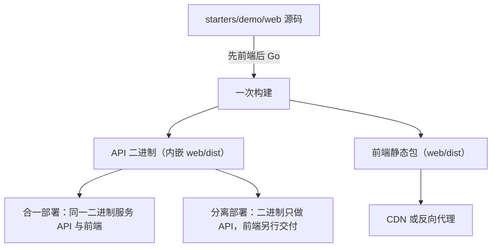

# starters

## 职责

`starters/demo` 是本仓库里一份可运行的示范程序，供拷走后当一个新产品的起点。它把「一个 speed 产品长什么样」写成可读、可编译、可部署的一整套：一个 Go 程序、一棵前端应用、一组部署栈、一套构建与打包的约定。**`demo` 说的是它是什么——一份示范**：它不演示某个功能，它本身就是产品骨架；使用者拷走 `starters/demo` 的一份副本、按自己的业务域改名，在其上长出业务。

它在仓库顶层与 `examples/`、`tools/` 并列。库本身（`pkg/`）交付模块与接缝，示范交付一个把它们装起来的程序。这是 [ADR-core-scope-2026-09-13](../../adr/adr-core-scope-2026-09-13.md) 失效条件段所指的那部分：该记录写明「组成什么样的应用」没有模板，把这块留给脚手架而不是 `core`。示范兑现那句话（[ADR-starters-skeleton-2026-10-15](../../adr/adr-starters-skeleton-2026-10-15.md)）。

### 非职责

- **不评估模块。** 评估每个模块、撞出模块缺陷并在模块内修，是 `examples/` 里那些宿主的职责；示范为承载业务而建，它的业务切片是使用者的，不是一份覆盖全部模块的验收清单。两者的分野是用途而非装法：都装在 `pkg/` 之上、都用命令树纳入模块，一个的验收是模块契约，另一个的验收是使用者自己的业务。
- **不是第二个 `pkg/`。** 示范不交付任何可被依赖的接口，不被任何模块 import，也不登记自己的模块边界；方向是它 import `pkg/`，`pkg/` 不认识它。
- **不承载模块机制。** 模块描述符、注册、查询、生命周期驱动与零依赖公共基础设施归 [core](design-core.md)；示范不改这些契约，只调用它们。
- **不内建业务域。** 示范的业务目录是空位，装使用者自己的业务模块；示范自身不带一个具体的业务域。

## 外部接口契约

这是宿主写下来、被命令行、被部署脚本、被前端构建读取的那一面。

### 目录结构

```
starters/demo/
  go.mod            # 独立 Go module：github.com/vislake/speed/starters/demo
  main.go           # 命令树与 run()，只剩业务决定
  host.go           # envPrefix、HostIdentity、端点常量
  modules/          # 业务模块的空位
  web/              # 前端应用
  testdata/         # 配置样例与夹具
  compose.yaml      # 部署栈外部后端的本地编排
  AGENTS.md         # 示范自己的契约
```

`AGENTS.md` 是示范自己的契约，随示范一起被拷走；`go.mod` 的 module 路径是 `github.com/vislake/speed/starters/demo`，使用者拷走后按自己的域改名。

### 命令树

命令树照评估宿主 `examples/crm-host` 的形态（[ADR-command-tree-2026-09-21](../../adr/adr-command-tree-2026-09-21.md)）：根命令不纳入任何模块，命令挂在部署栈节点之下，纳入沿命令路径向下继承。示范的命令是 `serve`、`worker`、`migrate`、`gen`，外加命令组。

- **`serve`** 起 HTTP 入口并接受流量。
- **`worker`** 跑后台模块，不起 HTTP 入口。
- **`migrate`** 只跑数据库引擎，经静态级纳入取得各模块的声明、把全部表建起来。
- **`gen`** 合并并写出 API 规格，见「`gen` 命令」。
- **命令组** 承载一次性运维动作。

**部署栈**是命令树上的一层，纳入向下继承，栈节点点一次数据库引擎，其下每条命令都跑在它上面。示范的部署栈是封闭集：`sqlite-memory`、`postgres`、`postgres-redis-nats`、`postgres-nats-redis`、`postgres-memcached-nats`。每个栈由同一段代码建起，两个栈之间不同的只是数据库引擎、键值后端、事件后端与遥测导出后端各取哪个模块名。`sqlite-memory` 全部用进程内实现，起一套不需要任何外部服务。键值、事件与导出后端不在栈节点上而在具体命令上：`migrate` 只跑引擎，一个后端的输入项与可达性不该进一个部署前的作业。

**命令组**是把一次性运维动作分组的节点：每个组是一个词，组下的叶子各是一个一次性命令，每个叶子声明它驱动到哪个深度——只读的到 `Init`，写的到 `Start`。示范提供这套机制与一个占位的组骨架，使用者按业务填叶子的动作。

### `gen` 命令

`gen` 把二进制里各模块声明的 OpenAPI 片段合并成一份文档并写出。它调 [ops](design-ops.md) 的导出包 `pkg/ops/openapi` 里的 `Merge`——**一个纯函数**，模块在 `Init` 里合并、`/openapi.json` 交出的是它的结果，`gen` 写出制品的也是它。**不驱动生命周期、不绑端口、不构造任何模块**：合并读的是各模块的静态声明，不需要把任何模块跑起来，也不需要入口模块的登记面。这与 `ops` 模块在 `Init` 里合并、在运行面经 `/openapi.json` 交出是同一份合并逻辑的两种消费——运行面服务于一个活着的进程，`gen` 服务于构建与发布，把这份文档写进制品，供前端据它生成自己的 API 面。

### 端点集合

端点是产品自己划的流量边界：`api`、`account`、`admin`、`ops`、`web`。哪个端装哪些层是配置，示范在这里说的是哪类流量属于哪个端。分离部署下拉起前端的那条通配路由独占 `web` 端（[webui](design-webui.md)）。

### `main.go` 的保留内容

`main.go` 与 `host.go` 只保留「这个产品自己做主」的东西：

- **环境变量前缀与版本常量** 前缀经 `config.HostIdentity` 给进进程；版本常量写进 `version` 命令的应答与合并文档的 `info`。
- **监听端点集合** 见上。
- **命令树** `run()` 建命令树、执行、把结果转成退出码；命令树的纳名、栈表、命令组与深度是业务决定。
- **ready 与 stopped 记录** 长跑命令在全部模块启动之后写一条 ready 记录、在退出时写一条 stopped 记录，供监管者与用例等待。

`main.go` 不重写模块的接线规则：模块经 `init` 自行登记，命令树点名纳入，依赖闭包由注册表展开——`main` 只写下「这个产品由哪些模块、哪些命令组成」。

## 依赖

**Go 侧**取 `pkg` 模块：`go.mod` 以 `require github.com/vislake/speed/pkg <版本>` 取它。**前端侧**取 `@speed/*` 包：`package.json` 按 registry 版本范围声明（`^x.y.z`），不用 `workspace:*`。

**验收不得含 `replace` 到本机 clone 的写法。** 一个 `replace github.com/vislake/speed/pkg => ../../pkg` 会把「本机恰好有这份仓库」这一前提带进验收——构建通过只证明本机检出可用，不证明一个真正的消费者能取到发布的版本。`examples/` 的宿主以 `replace` 指向兄弟检出，因为它们是本仓库内的评估宿主；示范不这样做（[ADR-starters-skeleton-2026-10-15](../../adr/adr-starters-skeleton-2026-10-15.md)）。

示范的 `go.mod` 不带 `replace`。在本仓库内，工作区（`go.work`）把 `pkg` 解析到本地检出，示范因而可以就地构建；拷贝出去的树在仓库之外，`require` 的那一行就是 `pkg` 的唯一来源。

**前端应用住在 `starters/demo/web/`，不住在包库 `web/` 里。** 先例是 `examples/reference-app/web`：它自述 living outside `web/` exactly where a delivered consumer project lives，并作为外部成员加入 `web/` 的 pnpm workspace（`web/pnpm-workspace.yaml`）。`starters/demo/web` 照此形态——一个住在 `web/` 之外、但能被 `web/` 的工作区工具链安装、检查与构建的前端包。**它与 `examples/reference-app/web` 的区别在依赖的声明方式**：后者是仓库内的成员，对 `@speed/*` 用 `workspace:*`；示范是拷出去的产品起点，按 registry 版本范围声明。

**外部后端**由 `compose.yaml` 编排（数据库、键值存储、事件总线），供在本机起一整套外部服务。

## UML 图

构建一次产出两件制品，两条部署拓扑各取其一。图里看不出的是**构建顺序是硬约束**：`go:embed` 要求产物在前端构建之后才存在。



## 核心数据结构

命令树的节点是 `pkg/config` 的命令对象，示范只写它的形状：一个词、一组纳入的模块名、一个深度、一个到达后要做的动作。部署栈是同一结构的一个层级，栈之间不同的只是那张「哪个能力取哪个模块名」的表。

## 核心算法与流程

**启动**：`run()` 建命令树 → `config.App` 解析命令行与环境变量、加载主配置源、把读取面预置给 `config` 模块 → 选中的命令发起驱动，沿命令路径纳入的模块经依赖闭包展开进入参与集 → 生命周期逐阶段推进到该命令的深度 → 长跑命令等在 `ctx` 上 → 取消后入口先停、其余模块逆序释放。

**构建**：先前端后 Go。前端构建出 `web/dist`，Go 构建把它嵌进二进制；同一个 `web/dist` 另作为静态包交付。

**`gen`**：静态级纳入取全部声明 → 合并各模块的 `http.Spec` 片段 → 写出文档。不推进生命周期。

## 扩展点

- **业务模块**：使用者的模块落在 `modules/`，照 `pkg/` 的模块形态写（描述符加 `init` 登记），被 `main.go` 的命令树纳入。这是「加一个业务」在示范里的唯一动作。
- **命令组的叶子**：占位的组骨架供使用者按业务填一次性运维动作。
- **前端的业务页面**：经路由包的声明式注册面接入（[web](web/README.md)）。

## 实现状态

| 能力 | 状态 | 代码 |
|---|---|---|
| 目录骨架与 `go.mod` | 未实现 | — |
| 命令树与部署栈 | 未实现 | — |
| `gen` 命令 | 未实现 | — |
| 前端应用与打包 | 未实现 | — |
