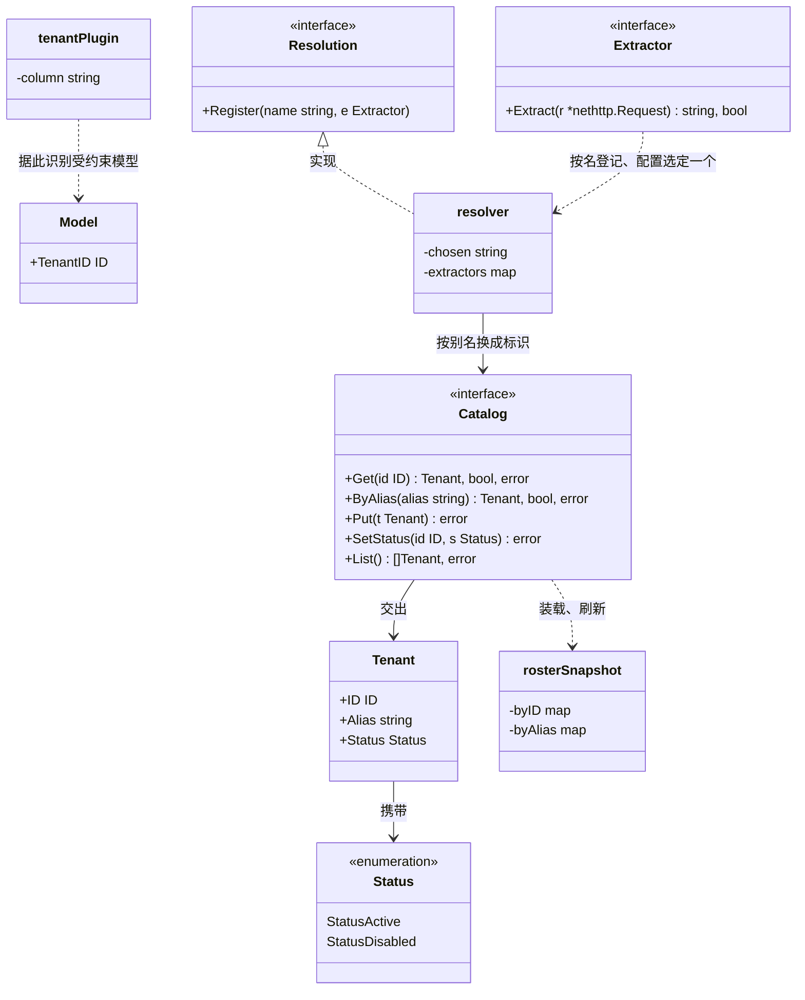
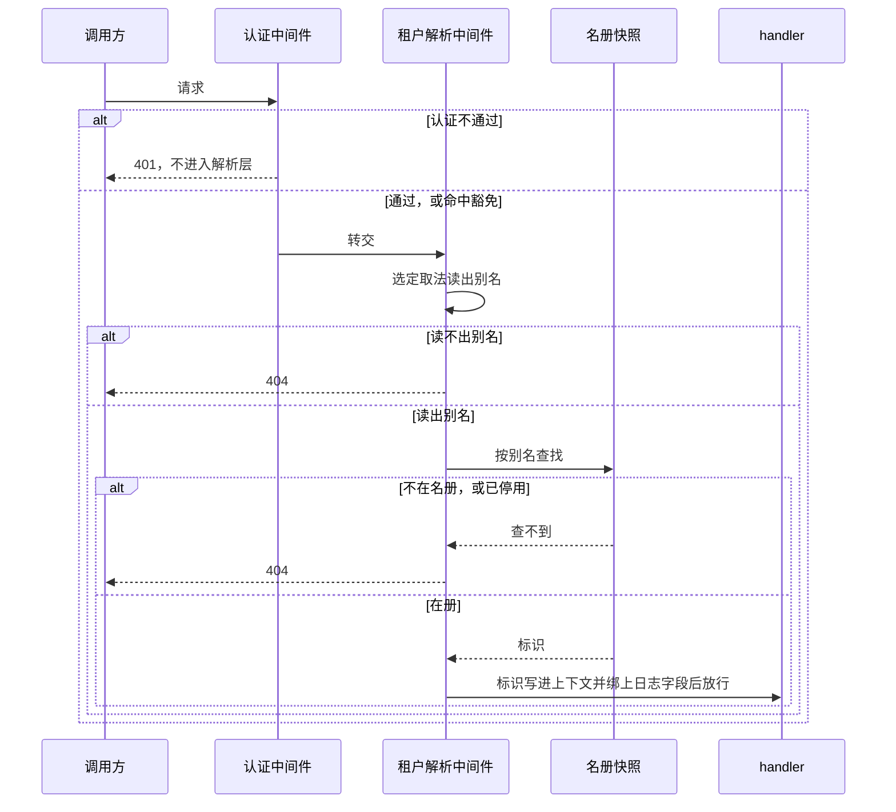
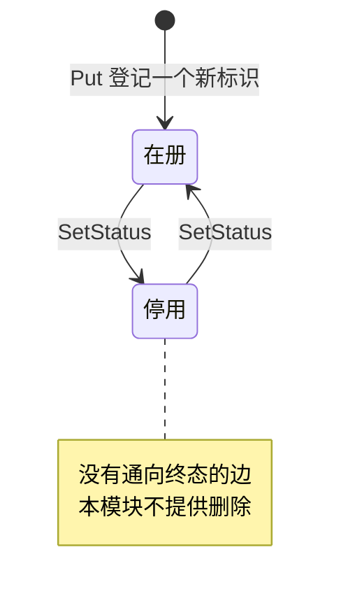
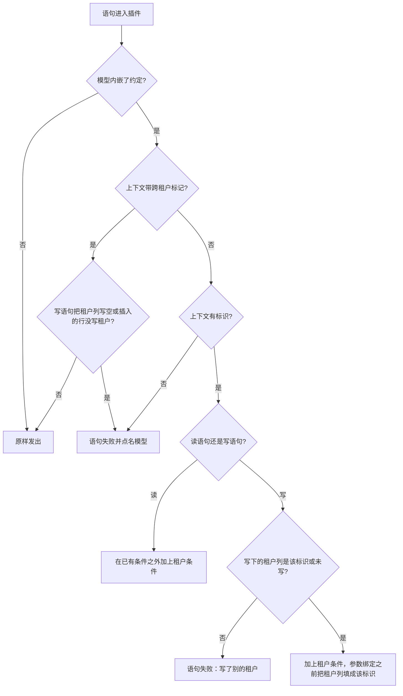

# tenant

## 职责

- 在监听端的中间件链上认定每条请求属于哪个租户：按配置选定的取法从请求面取出租户名，经名册换成不可变标识，写进请求上下文。
- 维护租户名册：租户的登记、别名与状态，以及它在内存里的快照。
- 定义受租户约束的模型的约定，并以一条 GORM 插件把租户条件作用于每一条针对这类模型的语句。
- 提供跨租户的唯一途径，并要求它在调用点字面写出。
- 把租户标识作为关联字段绑上 logger。
- 定义取法的接缝。

本功能目录由接口包与两个实现子包组成。`pkg/tenant` 根包定义功能接口、数据类型与模型约定，**自身不注册模块，也不导出模块名常量**；解析住在自己的子包并注册一个模块，名册住在自己的子包并注册一个模块，两者各自排他交付（[ADR-tenant-packaging-2026-09-21](../../adr/adr-tenant-packaging-2026-09-21.md)、[ADR-module-packaging-2026-09-14](../../adr/adr-module-packaging-2026-09-14.md)）。下文的"解析模块"与"名册模块"分别指这两个子包所注册的模块。

租户的认定、名册的维护与语句的过滤同属本功能目录，按租户取值的参数归[设置模块](design-settings.md)，按租户的授权判定归权限模型（[ADR-tenant-scope-2026-09-21](../../adr/adr-tenant-scope-2026-09-21.md)）。

**根包不导出模块名常量**，判据与认证的同一条：导出它没有对应的登记，宿主拿一个无人登记的名字去纳入，得到的是一个不在可用集里的名字，而命令树对未登记名字的处置在配置模块的哨兵表里没有对应项（见 [config](design-config.md)）。

### 非职责

- **不做权限判定，从不写 403。** 本模块回答"这条请求、这条语句属于哪个租户"，"这个租户或这个调用方能不能做这件事"归权限模型，它另立（[ADR-authn-scope-2026-09-20](../../adr/adr-authn-scope-2026-09-20.md)）。
- **不认定调用方是谁，不读 `Authorization`。** 那是认证模块；本模块不依赖身份，也不改动 `Identity`（[ADR-tenant-resolution-2026-09-21](../../adr/adr-tenant-resolution-2026-09-21.md)）。
- **不承载运行期可变的参数。** 判据是该值是否在数据库可用之前就被需要；取法与监听端清单在其列，租户的增删不在（[ADR-config-scope-2026-09-13](../../adr/adr-config-scope-2026-09-13.md)）。
- **不管理租户内的用户、角色与组织结构。** 主体归认证的校验后端；一个租户的存在，与它内部有哪些用户，是两件事（[ADR-tenant-scope-2026-09-21](../../adr/adr-tenant-scope-2026-09-21.md)）。
- **不做配额、计费与限流。**
- **不提供配置式的租户清单。** 租户的增删是运行期动作，配置是启动时的快照（[ADR-config-lifecycle-2026-09-13](../../adr/adr-config-lifecycle-2026-09-13.md)）。
- **不认识别的模块的模型。** 一个本该受约束却没有内嵌约定的模型，本模块判不出来，也不提供"哪些模型应当受约束"的清单（[ADR-tenant-isolation-2026-09-21](../../adr/adr-tenant-isolation-2026-09-21.md)）。
- **不代替宿主决定哪条命令纳入租户。** 模块不声明、也无从知道自己出现在哪条命令下（[ADR-command-tree-2026-09-20](../../adr/adr-command-tree-2026-09-20.md)）。
- **不保证隔离。** 按租户过滤在框架层没有机制保证（[ADR-db-scope-2026-09-14](../../adr/adr-db-scope-2026-09-14.md)），本模块把这一条承接为对外口径，逐条写在非保证一节（[ADR-tenant-guarantees-2026-09-21](../../adr/adr-tenant-guarantees-2026-09-21.md)）。
- **不提供租户的数据导出、删除与搬迁。** 它们要读受约束表里每个租户的数据量，那是应用自己的领域动作。
- **不为租户建立独立的库、schema 或连接。** 数据库模块按配置交付一个库（[ADR-db-multiplicity-2026-09-14](../../adr/adr-db-multiplicity-2026-09-14.md)）。
- **不记录谁在何时改了名册。** 留痕由[审计模块](design-audit.md)经数据库模块的插件扩展点承担（见 [db](design-db.md)）。

## 术语表

以下术语的含义限于本模块，以及租户主题的决策记录。

| 术语 | 英文 | 定义 |
|---|---|---|
| 取法 | extractor | 从请求面取出一个租户名的一份实现。按名登记，由配置选定，一次运行里只有一份生效。 |
| 别名 | alias | 请求面上出现的租户名。在名册上唯一，可改，不承担任何判定。 |
| 标识 | ID | 一个租户的不可变标识。受约束表的那一列存它，日志与诊断写它。 |
| 名册 | roster | 本模块自带的、记录全部租户及其别名与状态的表，以及它在内存里的快照。 |
| 受约束模型 | scoped model | 内嵌了本模块约定的模型。它的每一条语句都带租户条件，插入由插件填那一列。 |
| 跨租户 | cross-tenant | 一条语句有意不带租户条件的状态。只由调用点显式建立，不由任何配置或默认值产生。 |

## 外部接口契约

### 登记单元与名字

| 登记单元 | 模块名 | 交付 |
|---|---|---|
| 解析子包 | `tenant.resolve` | 排他地交付解析功能 |
| 名册子包 | `tenant.catalog` | 排他地交付名册功能 |
| 根包 | 不登记 | 只有接口、数据类型、模型约定与取值域判据 |

每个登记模块的包导出自己的 `ModuleName` 常量，配置命名空间取同一个取值。名字的每一段只用小写字母、数字与短横线：`Namespace` 按 `.` 切段后适用配置键的字符集规则，违反它会从环境变量名那一头破坏分层（见 [config](design-config.md)）。


### 交付的功能

功能标识的元素类型必须是接口，取用写作 `core.Resolve[tenant.Resolution](reg)` 与 `core.Resolve[tenant.Catalog](reg)`。

```go
// Resolution 是解析模块交付的功能，同时是取法的登记面。
type Resolution interface {
    // Register 登记一个具名取法，供配置按名选定。
    // 名字非空且不含空白；重名终止启动。
    Register(name string, e Extractor)
}

// Catalog 是名册模块交付的功能：名册的读写面。
type Catalog interface {
    // Get 按标识取一个租户。不存在时第二个返回值为假。
    Get(ctx context.Context, id ID) (Tenant, bool, error)
    // ByAlias 按别名取一个租户，即解析层走的那条路。
    ByAlias(ctx context.Context, alias string) (Tenant, bool, error)
    // Put 登记一个新租户，或者改写一个既有的租户。
    Put(ctx context.Context, t Tenant) error
    // SetStatus 改一个租户的状态。停用只走这一条，不删数据。
    SetStatus(ctx context.Context, id ID, s Status) error
    // List 列出全部租户，按标识排序。
    List(ctx context.Context) ([]Tenant, error)
}
```

两份交付声明都写作 `Provides: []core.Provision{{Token: (*Resolution)(nil), Exclusive: true}}` 与 `Provides: []core.Provision{{Token: (*Catalog)(nil), Exclusive: true}}`。**两者的排他性不可局部违反**：解析排他，因为两层解析同时在链上时上下文里那个租户由哪一层写的说不清；名册排他，因为两份名册等于两个真相（[ADR-tenant-packaging-2026-09-21](../../adr/adr-tenant-packaging-2026-09-21.md)）。

**两个模块的表态只能是 `StateEnabled`，永不 `StateAuto`**（形态与理由见认证网关的那一条，[ADR-authn-packaging-2026-09-20](../../adr/adr-authn-packaging-2026-09-20.md)）：排他加 `StateAuto` 正是消解要禁用的那一格。表态不表达跑不跑，被这条命令纳入的模块缺项即启动失败（[ADR-module-enablement-2026-09-21](../../adr/adr-module-enablement-2026-09-21.md)）。解析模块在 `Prepare` 里缺监听端清单或选定的取法时报故障，启动终止，错误点名缺的是哪一个键；**名册模块没有可缺的输入项**——刷新周期有默认值——配置缺项这一档对它不存在，不想要名册的命令不纳入它。

### 租户与请求上下文

```go
// ID 是一个租户的不可变标识。
type ID string

// Value 实现 driver.Valuer：取值域之外的标识拒绝被绑定进语句。
func (id ID) Value() (driver.Value, error)

// IsIdentifier 报告 s 是否落在标识的取值域内：非空，且不含空白与控制字符。
func IsIdentifier(s string) bool

// Tenant 是名册上的一行。
type Tenant struct {
    ID     ID      // 不可变标识
    Alias  string  // 请求面出现的名字，唯一，可改
    Status Status  // 在册或停用
}

// Status 是一个租户的状态。取值是一个封闭集合。
type Status int

const (
    // StatusDisabled 是零值：状态列未被写入，或写入了本版本不认识的取值，都读作停用。
    StatusDisabled Status = iota
    // StatusActive 是在册。
    StatusActive
)

// FromContext 取出本次请求的租户标识。没有租户时第二个返回值为假。
func FromContext(ctx context.Context) (ID, bool)
```

**注入口不导出，`FromContext` 不回落**，与认证的身份同形、同因（[ADR-tenant-resolution-2026-09-21](../../adr/adr-tenant-resolution-2026-09-21.md)）：回落等于把一条没有租户的请求读成某个租户，导出注入口等于让链上任何一层改写租户。

代价是下游必须自己处理第二个返回值为假的那一档：未被本模块守护的监听端、本模块未被纳入的进程，上下文里都没有租户。**豁免路由不在这一列**——解析层排在认证之内，认证层放行的豁免请求照常经过它。

**取值域之外的标识绑不进语句。** 空标识以 `ErrNoTenantInContext` 拒绝，含空白或控制字符的标识以 `ErrInvalidTenant` 拒绝；拒绝发生在驱动绑定参数的那一刻，因而对插入的租户列与按取值点名租户的条件同样成立，与语句跑在哪个句柄上、有没有装插件无关。这是约定随身带着的一道防线：一个没被填过的租户列里是空串，而非空约束挡得住 NULL、挡不住空串。拒绝之外取值仍一并交回，读值而丢弃错误的调用方——GORM 按主键取值给行做键时就是这样——拿到的是它要的字符串，而不是一个会让它 panic 的空值。

**写进上下文的是标识，不是别名。** 别名可改，因而不承担任何判定；日志、启动诊断与错误文本一概写标识，需要人能认出来的场合另外带上别名（[ADR-tenant-identifier-2026-09-21](../../adr/adr-tenant-identifier-2026-09-21.md)）。

**`Status` 的零值读作停用。** 零值必须有确定的读法，且不得落在宽松的一侧——认证把零值判决读成拒绝，形状与此同源（[ADR-authn-verdict-2026-09-20](../../adr/adr-authn-verdict-2026-09-20.md)）。一行没有被写入状态，或者写入了本版本不认识的取值，读出来都是停用，那个租户因而不会被解析出来。`Put` 取整份记录，漏填状态即落成停用；调用方要它立即被服务，就把 `StatusActive` 写在明处。

### 取法的接缝

```go
// Extractor 从请求面取出租户名。取不到时第二个返回值为假。
type Extractor interface {
    Extract(r *nethttp.Request) (string, bool)
}
```

取法只收请求面，交回一个租户名——**别名，不是标识**。把名字换成标识是名册的事，取法不认识名册。

名字非空且不含空白即合法，其余由名册判定。取法读不到名字时交回假，解析层据它决定这条请求属于哪个租户，处置见请求期的收口一节。

本模块内建三种取法，按名登记为 `header`、`subdomain` 与 `path`，分别从一枚请求头、从子域名、从路径前缀取。它们的参数与选定项并列挂在 `tenant.resolve` 下：`header-name` 给头名，`subdomain-index` 与 `path-index` 给取第几段。

**经 `Resolution.Register` 接入的取法，把参数声明在它自己所属模块的命名空间下。** 输入项的清单收集覆盖全部已注册模块，与本次选中哪条命令无关（见 [config](design-config.md)），因而一个取法模块有自己的命名空间可用。把它挂进 `tenant.resolve` 会与内建项同处一个命名空间，键一旦撞上就是收集阶段的冲突，进程起不来；两个模块的命名空间可以相同，前提是输入项路径不相交，而把这件事交给第三方去保证，不如给它一个自己的命名空间。

**一次请求只由一种取法解析**（[ADR-tenant-resolution-2026-09-21](../../adr/adr-tenant-resolution-2026-09-21.md)）。配置选定一个名字，其余已登记的取法在本模块里不生效。

### 名册的读写面

名册的读写面就是 `Catalog` 的五个方法。**写入是本模块唯一的运维面动作**：宿主经它登记租户、改别名、改状态。

`Put` 是幂等的按标识写入：标识已存在即改写那一行，别名与状态一并取新值。两个租户抢同一个别名是 `ErrAliasConflict`，写入与登记都拒绝，不留半个结果。

`SetStatus` 是停用的唯一途径。名册没有删除动作：删掉一行不会删掉受约束表里那个租户的数据，留下一批无主行，而"无主"在库里看不出来（[ADR-tenant-directory-2026-09-21](../../adr/adr-tenant-directory-2026-09-21.md)）。

**名册的读与写都不经隔离插件。** 名册表自己不内嵌受租户约束的模型约定，读写它的语句走的是与任何全局表相同的路径，既不要求上下文里有租户，也不因缺租户而失败。这一点与跨租户的途径无关：`CrossTenant` 是为受约束模型的语句设的，名册的语句本来就不在它的管界之内。

### 受租户约束的模型

```go
// Model 是受租户约束的模型内嵌的约定。它同时是那一列的定义与声明。
type Model struct {
    TenantID ID `gorm:"column:tenant_id;not null;primaryKey"`
}
```

**内嵌它即声明受约束**，没有第二个动作（[ADR-tenant-isolation-2026-09-21](../../adr/adr-tenant-isolation-2026-09-21.md)）。约定把那一列定死为 `tenant_id`、非空、**并且是主键的一部分**。

**内嵌指 GORM 把它展开进模型的任何一种写法**：直接内嵌、经模型内嵌的一个导出的公共基类、以指针内嵌，以及标了 `embedded` 的具名字段。这几种写法都把那一列带到模型上，因而都声明了受约束。GORM 不读未导出类型的内嵌结构体，约定放进一个未导出的公共基类，那一列就不在模型上，模型因而是一张全局表。

**那一列必须进主键，判据是它挡掉的那一类语句。** 唯一约束不以租户列打头的表——标识全局生成、业务键自己唯一——会让一个租户的写经由 `Save` 或 `OnConflict` 产生的插入碰到**另一个租户**的行，并把它改成写入方的租户：语句里没有任何一处写了别的租户，插件因而没有可以拒绝的东西。把租户列放进键里，这个形状从 schema 上就不存在了，不必逐条语句去判。模型自己的键与它并列标 `primaryKey`，合成受约束表本来该有的那个复合键。

声明方在迁移文件里另有两条义务，本模块验不了：

- **迁移里的键要与这个类型声明的键一致**，那一列的类型与长度也要与标识的形状一致，且带非空约束。非空约束挡的是 NULL；插件缺席时插入之所以失败而不是写下一个空串，靠的是标识拒绝以空值被绑定（见租户与请求上下文），不是这条约束。
- **受约束表的其余索引以租户列打头**，否则单租户的查询扫全表。主键那一部分由约定本身给出。

未内嵌约定的模型不受本模块影响：它的语句不带条件，插入不由插件填列。

### 跨租户

```go
// CrossTenant 返回一个带跨租户标记的上下文。
// 受约束模型的语句在这个上下文里不加租户条件，也不填租户列。
func CrossTenant(ctx context.Context) context.Context
```

**这是跨租户的唯一途径**（[ADR-tenant-scoping-2026-09-21](../../adr/adr-tenant-scoping-2026-09-21.md)）。它是上下文事实而非语句事实，因而可以在一个函数的入口处建立，此后的每一条语句都落在它之下。

**带标记的上下文不属于任何租户。** 建立标记的那一步同时交出上下文里的标识：在它里面 `FromContext` 第二个返回值为假，一个从请求上下文里建立标记的调用点把它那条请求的租户一并交出。跨租户的语句本就不受任何租户约束，把这样的上下文读成某个租户的，会让一条不受约束的语句在别处读起来像一条受约束的语句，审计行写下的租户列即是一例（见 [audit](design-audit.md) 的审计行的补全）。

**跨租户解除的是条件与填列，不是那一列。** 跨租户写下的行照样要属于某个租户：带标记的插入，行里没写租户列的拒绝；带标记的写把租户列写成空串或 NULL 的，以 `ErrNoTenantInContext` 拒绝，写成含空白或控制字符的字面值的，以 `ErrInvalidTenant` 拒绝。那样的行不属于任何租户，此后没有一条受约束的语句够得着它。租户列写成调用方自己给出的表达式不在此列，跨租户本就允许调用方说明那一列变成什么。

`Unscoped()` 不解除租户条件。它在 GORM 里表达的是软删除的范围，把它当成解隔离的开关，等于让一个与租户无关的动作拥有解除租户作用域的效果。

**这条途径一旦存在就可被滥用。** 本模块提供它，不判定调用点该不该用它；它的名字要能在评审里被认出来，这是选择具名函数而不是布尔参数或字符串键的理由。

### 中间件在链上代表的功能

解析模块登记的中间件以 `(*Resolution)(nil)` 作为自己的 `Provides`，与描述符里那条交付声明取同一个标识。**这是别的层把自己排在租户之内或之外的唯一锚点**，因而是本模块对外的稳定契约面。

反方向的约束用指向 `(*authn.Gate)(nil)` 的 `After` 表达，因而解析层排在认证之内（[ADR-tenant-ordering-2026-09-21](../../adr/adr-tenant-ordering-2026-09-21.md)）。`Order` 的取值在本模块这一侧不承担正确性：先后由那条硬约束决定，`Order` 只在约束落空时决定它落在哪里。

### 插件在语句上的作用点

名册模块在自己的描述符上声明一条 `db.Plugin` 资源，交付一个 GORM 插件。

**插件挂三处作用点**：读语句与删除语句的查询构造处、更新语句的构造处各加租户条件，插入语句在参数绑定之前把租户列填成上下文里的标识。更新与插入两处另有一件事——调用方写进租户列的取值不是上下文里的标识时拒绝该语句，跨租户的写把租户列写空时同样拒绝（见错误与失败语义）。

**读语句在 GORM 里分两条处理链，两条都挂。** `Find`、`First`、`Count`、`Pluck` 走查询链，`Scan`、`Row`、`Rows` 走行链；只挂查询链，后一类读在没有租户的上下文里读出全部租户的行而不报错，报表与投影到另一种结构体的写法恰好都用它。

**按关联写的联接，被联接那一侧同样加租户条件。** `Joins("Customer")` 读的是被联接模型的行，复合主键又允许两个租户复用同一个标识，只给主表加条件会把别的租户同标识的那一行联接进来。条件写进每一层联接的 ON 子句，逐层按那一层的模型判定：嵌套联接途经的全局表不加条件；一个全局模型经关联联接到受约束模型，同样要求上下文里有租户。以 SQL 文本写出的联接不在此列，见非保证。

**子查询的拒绝随外层语句报出。** GORM 在渲染外层语句时执行子查询，并丢弃子查询自己的错误——一条建在没有租户的句柄上的子查询因而会渲染成空，在一种方言上读成空集，在另一种方言上报一个与成因无关的语法错误。被拒绝的子查询于是渲染成一个绑定即失败的取值，外层语句执行时以同一个哨兵失败。

**插件不持有任何随运行而变的状态。** 它的判据全部来自两处：编译期常量（那一列的名字），以及每一条语句的上下文。这一点是刻意的。插件实例随描述符在 `init` 期冻结，而一个进程要执行两条命令就建两个注册表，两个装配共用描述符上那一个实例；插件的 `Initialize` 又由数据库模块在自己的 `New` 中调用，早于名册模块的构造，也早于任何一次快照装载。**把快照或配置装进插件实例的写法，在第二个注册表上会覆盖第一个的取值**，而先建的那个装配此后每条语句都按后者的取值判定。本模块因此不设这条通路。

**读名册只发生在解析层。** 插件不知道一个租户是否存在、是否停用，它只按上下文里的标识加条件。停用的生效面因而在请求面，不在语句面——一条显式把某个标识放进上下文的路径读得到那个租户的数据。这一条写在非保证里。

**插件可被多次 `Initialize`。** 数据库模块的 `Open` 自建连接时复用同一批插件实例，GORM 对每个句柄各调一次 `Initialize`；把首个 `*gorm.DB` 捕获进闭包的写法在第二个句柄上安装成功而不生效。数据库模块把这条写成建议（见 [db](design-db.md) 的扩展点），本模块接受并遵守它。

**需要排在租户过滤之后的插件，其所属模块要声明对名册功能的构造期依赖。** 插件之间次序的依据由数据库模块裁定并写在它的文档里（见 [db](design-db.md) 的插件的安装），本模块只留下这条结论。它有一个副作用要一并看待：名册模块排他交付，这条声明不会把它拉进那条命令的参与集，却会让它的缺席变成依赖解析处的缺提供者失败——那条命令因而必须在命令树上点名名册模块。

### 资源的取材域

本模块声明两种资源，不消费任何按类型收集的资源。

- **`db.Migrations`**：名册表建在它里面。作为声明方，本模块只贡献一个迁移集（[ADR-db-migration-2026-09-14](../../adr/adr-db-migration-2026-09-14.md)）。
- **`db.Plugin`**：隔离插件。同样只贡献声明。

**这两个消费点的取材域由数据库模块裁定并写在它的设计文档里**——迁移集取声明集，插件取启用集（架构不变量 15，[ADR-module-resources-2026-09-21](../../adr/adr-module-resources-2026-09-21.md)）。本模块不重复那份裁定，只在结论上依赖它：表随二进制走，插件随这次运行走。

### 配置

解析模块的输入项挂在 `tenant.resolve` 下。其中 `endpoints` 给出本模块守护哪些监听端，`extractor` 给出选定的取法名，其余几项是各取法自己的参数——头名、子域名取第几段标签、路径前缀取第几段。**端名清单只能是本模块自己的输入项**：登记面只有按名取端一个方法，枚举不出来；去 `Decode` 入口模块的命名空间会把本模块的配置面耦合到别人的配置形状上（与认证网关同一条判据，见 [authn](design-authn.md)）。**同一个端名出现两次是配置错误，终止启动并点名该端名**：端名清单是集合，重复会让解析层在同一端上登记两次，那个端的每条请求因而把名册查询与标识绑定各做两遍。

名册模块的输入项挂在 `tenant.catalog` 下，只有一项：刷新周期。**取零表示只在 `Init` 装载一次、此后不刷新**，那一档下停用要到进程重启才生效；不取零时它是名册那一读的间隔，也是"停用多久生效"这条上界。

两个模块都不声明 `Sensitive` 输入项：取法的参数是头名与路径段，都不是要保密的值。

### 对宿主的要求

以下各条是宿主在命令树上要做的全部动作。**宿主只能精确列举本次要跑的模块，列了它就必须把它配好**：被这条命令纳入的模块一律必须启动，缺配置、缺依赖或部署前提不满足都是启动失败，没有一档表态能让它退场（[ADR-module-enablement-2026-09-21](../../adr/adr-module-enablement-2026-09-21.md)）。**本模块既不能把这些要求声明出来，也没有检查它们的位置**，漏写不报错。

- **每条提供服务的命令写出解析模块与名册模块的 `ModuleName`。** 名册功能排他交付，依赖闭包不替宿主挑，解析模块对它的构造期依赖不会把名册模块拉进参与集——只写出解析模块的名字时名册缺席，依赖解析以缺提供者终止启动。只跑后台任务、不监听任何地址的命令只写出名册模块的名字。
- **不要把本模块放进根命令。** 根命令纳入的模块对每条子命令都有效，而解析模块要在 `Init` 里取到路由功能与校验后端，名册模块要有数据库引擎。落进根命令，等于要求每一条子命令——包括既不监听地址、也不装认证的那些——把这二者一并装上并配齐前提，缺一项即启动失败。名册模块没有可缺的输入项，其表按声明集取材建立。
- **施加迁移的命令要让名册模块静态级进入声明集。** 只运行级纳入数据库引擎时，带表的模块依赖引擎而引擎不依赖它们，依赖闭包够不到它们，名册表不建；`IncludeAllDeclarations` 是这类命令的推荐写法（[ADR-command-tree-2026-09-21](../../adr/adr-command-tree-2026-09-21.md)）。
- **不要对纳入本模块的命令用 `IncludeAll()`。** 它让参与集重新成为 import 图的函数，而在租户这条路径上，那意味着一个宿主没有列举过的模块可以发出受约束语句。
- **不要在需要租户的监听端上漏写解析模块。** 那样的监听端上上下文里没有租户，受约束模型的语句一律拒绝——fail-closed，当场可见。

### 稳定性承诺

`Resolution`、`Catalog`、`Extractor`、`Tenant`、`ID`、`IsIdentifier`、`Status`、`Model` 与 `CrossTenant`、`FromContext` 是本模块与其他模块之间的契约。中间件在链上代表的那个功能标识与描述符里的交付标识同为 `(*Resolution)(nil)`，别的模块据它排序，取值不变。约定里那一列的名字 `tenant_id`、它的非空约束与它在主键里的位置同样在这个面上：迁移文件由声明方写，改名或改键都是一次全库迁移。

**标识的取值域也在契约面上**：非空，且不含空白与控制字符，根包的 `IsIdentifier` 是本模块对这一条的唯一陈述，名册的字段判定（`pkg/tenant/catalog/roster.go` 的 `checkField`）也走它——空值在那次调用之前先判一档，只为挑出两种文本，取值域本身仍只有 `IsIdentifier` 一条陈述。按租户取值的模块各自复述这条判据——设置模块的 `ForTenant` 即一处——而不以 import 本模块的方式取用它（[settings](design-settings.md) 记有那条依赖为何不存在）。两处是否仍是同一条，由消费方自己的测试包 `pkg/settings/settings_test.go` 的 `TestForTenantAgreesWithTheTenantIdentifierDomain` 拿同一张标识形状表逐形状驱动双方守住。

## 依赖

根包不 import 本仓的任何模块，接口面上只出现标准库与本包自己的类型。**根包不依赖 `pkg/db`**：模型约定是一个只有一项字段与一条标签的结构体，不引用数据库模块的任何类型，`gorm` 这个包名只出现在标签字符串里。这与认证接口包的自我约束同形、同源——一个只要租户解析、或者只要在自己的模型上带一列的应用，不该因此承受数据库依赖（[ADR-authn-packaging-2026-09-20](../../adr/adr-authn-packaging-2026-09-20.md)）：它的 `go.mod` 不含数据库实现所绑的那串第三方库，`go.sum` 与实际下载则会经被 import 包的测试闭包带上它们，只有读整图的操作会看到全部实现所绑的库（[ADR-module-packaging-2026-09-22](../../adr/adr-module-packaging-2026-09-22.md)）。插件与迁移所需的一切留在名册子包里。

解析子包 import 根包、`pkg/core`、`pkg/config`、`pkg/http` 与 `pkg/authn` 的根包。**指向认证功能标识的硬约束要写出 `(*authn.Gate)(nil)` 这个表达式，那个 import 因而不可避免**（[ADR-tenant-ordering-2026-09-21](../../adr/adr-tenant-ordering-2026-09-21.md)）。

名册子包 import 根包、`pkg/core`、`pkg/config` 与 `pkg/db`。

**名册子包声明对数据库功能的构造期依赖**，它要建立那张表、并在 `Init` 中读它；表由它声明的迁移集建立，而迁移在 `Migrate` 阶段施加，整体早于 `Init`（见 [core](design-core.md) 的阶段表）。

**解析子包声明对名册功能的构造期依赖**，判据是存在要排的序：名册在 `Init` 中装载快照，解析在 `Init` 中登记中间件并在请求期读那份快照，而 `Init` 按依赖序执行（[ADR-tenant-packaging-2026-09-21](../../adr/adr-tenant-packaging-2026-09-21.md)）。这与认证网关把 `Requires` 留空的情形相反，那里的判据正是"不存在要排的序"（[ADR-authn-wiring-2026-09-20](../../adr/adr-authn-wiring-2026-09-20.md)）。

**日志功能不构成依赖。** 租户标识作为关联字段绑上去用的是 `log.WithAttrs`，包级函数，不经注册表。

方向满足架构不变量：本功能目录位于 `core`、`config`、`log`、`db`、`http` 与 `authn` 之上，不被其中任何一个 import。权限模型与按租户取值的模块位于本模块之上，它们取用标识而本模块不认识它们。

## UML 图

下图给出接缝上的各个类型与它们的关系。图中画不出的约束是时机：快照在 `Init` 装载并在其后按周期刷新，跨租户标记只由调用点建立，而那一列的值由插件在插入之前填入而不是由模型自己给出。



`resolver` 与 `tenantPlugin` 都未导出。**只有 `resolver` 走到名册**：它经名册功能把别名换成标识，一个租户是否存在、是否停用因此由解析层判定；插件只按上下文里的标识加条件，它和名册之间没有边（见插件在语句上的作用点）。快照是名册模块内部的东西，本模块的另一半不经过它的类型，类图里因而只挂在名册功能上。

下图给出请求期的路径，各类失败各走一条分支。它要固定的是定序：认证层整体早于解析层，因而未认证的请求驱动不了名册查询；解析层的判定整体早于 handler，因而受约束语句的作用域在 handler 运行之前就已确定。



认证层的收口与豁免的匹配不在本图内，它们归认证模块（见 [authn](design-authn.md)）。解析层自身 panic 时由它自己 recover 并收口 500——这一档要归到解析层名下就得在这里接住，入口模块的兜底层在默认格式下写出的同样是 500 而不区分崩的是哪一层（见 [http](design-http.md)）；这条路径不经过名册，图中不画。

一个租户有生命周期，因而画状态图。状态取值是一个封闭集合，停用可逆且不是终态。



**停用不是终态**，它是与在册并列的一个取值，两者之间可以来回。名册上没有删除动作，因而图上没有终态：一个租户的记录留在名册里，受约束表里它的数据也留在原处（[ADR-tenant-directory-2026-09-21](../../adr/adr-tenant-directory-2026-09-21.md)）。改别名不改变状态，因而不改变这张图上的位置。

语句期的判定分支密集，因而画活动图。这张图的价值是把四档判定与它们的顺序摆成一眼看得见的形状。



跨租户那一支不加条件、不填列，只核对写进租户列的取值；有标识那一支的写语句先核对、再加条件与填列。两处核对读的都是 GORM 自己构造赋值与行的那些位置，逐项见插件在语句上的判定。

**前三档的顺序即定序**：识别先于跨租户标记，跨租户标记先于标识判定。反过来先判标识，一条有意跨租户的语句会被拒绝；先判跨租户标记而不识别模型，一条不在受约束之列的语句会被无谓地拒绝（[ADR-tenant-isolation-2026-09-21](../../adr/adr-tenant-isolation-2026-09-21.md)、[ADR-tenant-scoping-2026-09-21](../../adr/adr-tenant-scoping-2026-09-21.md)）。

## 核心数据结构

**名册表**由本模块的迁移集建立。标识是主键，别名上有一个唯一约束，状态是一个整数列。表自己不内嵌受租户约束的模型约定，因而读它的语句不带租户条件。

**快照**是名册表在内存里的一份拷贝：租户以标识排序存放，标识与别名各有一条查表路径；**`List` 按那个次序给出，且交出的是副本**。它在 `Init` 装载，此后按配置的周期在后台重建，`Stop` 时取消刷新。**重建是全量替换而非增量合并**，替换通过一次指针交换完成，因而请求期读到的永远是一份自洽的快照，不会读到半新半旧的表。

**取法表**是取法名到实现的映射，在登记窗口内可写、`Start` 时冻结。约定的那三种由本模块自己登记，其余由别的模块经 `Resolution.Register` 登记。

**受约束模型的识别结果**由 GORM 自己的 schema 缓存承担：模型解析一次，插件据解析结果判断它有没有内嵌约定，此后每条语句直接读那个结果，不重做反射。

**跨租户标记**是请求上下文里的一个键，键类型不导出（[ADR-tenant-scoping-2026-09-21](../../adr/adr-tenant-scoping-2026-09-21.md)）。

## 核心算法与流程

### 阶段行为

| 阶段 | 行为 |
|---|---|
| `Prepare` | 两个模块各取配置读取面并 `Decode` 自己那份配置；配置缺项，或解析模块的监听端清单里同一个端名出现两次，即报故障终止启动，齐备则表态 `StateEnabled`。 |
| `New` | 构造。不读写任何数据。 |
| `Migrate` | 解析模块打开取法的登记窗口。本模块不迁移任何东西，名册表由本模块声明的迁移集建立、由数据库模块统一施加。 |
| `Init` | 名册模块装载快照；解析模块取路由功能、在配置列举的每个监听端登记中间件。取法的登记窗口在整个 `Init` 期间开着。 |
| `Start` | 解析模块关闭登记窗口，逐条校验登记并冻结取法表。 |
| `Serve` | 无动作。 |
| `Stop` | 取消快照的刷新。 |
| `Close` | 无动作。 |

**未被推进到的阶段其回调不执行**（[ADR-lifecycle-drive-2026-09-20](../../adr/adr-lifecycle-drive-2026-09-20.md)），本模块的每一条启动期判定因此都随它所在的阶段一起被跳过。深度浅于 `Init` 的驱动不装载快照，也不登记中间件；那条命令下本模块的构造与关闭照常发生，插件仍被安装在同一批句柄上，而它不读快照，因而不受影响。**深度止于 `Migrate` 的驱动收到的表照建**，这与本模块的交付面一致：表随二进制走。

**登记窗口借用 `Migrate` 与 `Start` 两个阶段位**，因为它要框住的是全局的 `Init` 窗口，而不是本模块自己的 `Init` 回调（见 [http](design-http.md) 为它的登记面给出的同一条理由）。阶段是逐个推进的：解析模块的 `Migrate` 回调执行时全局尚未进入 `Init`，它的 `Start` 回调执行时全局的 `Init` 已经结束，两者恰好是该窗口的两侧。**挂在本模块自己的 `Init` 上做不到这件事**：登记取法的第三方模块与解析子包之间没有依赖边，两者 `Init` 的先后取决于模块名一类与本次运行无关的因素，排在解析子包之前的一次合法登记会被判成调用点的编程错误。本模块不迁移任何东西，也没有自身的服务要启动，这两个阶段位没有别的用途。

**驱动深度决定这扇门的开合。** 浅于 `Migrate` 的驱动不打开它，也不推进到全局的 `Init`，因而没有登记发生，窗口的两侧同时缺席。**恰好止于 `Migrate` 的驱动则打开它而无人关上**，与入口模块的登记面同形：那种驱动下没有 `Init`、没有登记、也没有流量。

**`Prepare` 里两条读法要分开，它们指向不同的修复动作。** 取配置读取面得到 `ErrMissingProvider`，说明宿主漏了把它交进注册表；`Decode` 得到 `ErrMissingRequired`，说明本模块那份配置缺项。两者都终止启动，错误文本要分清是哪一件：前者点名缺失的提供者，后者点名缺的是哪一个键。把两者合成一句"没配"，修复动作会指向错误的一端（与认证网关同一条判据，见 [authn](design-authn.md)）。

### 别名的解析与快照的装载

请求期的解析是两次查表：按别名从快照取出那一行，读出标识与状态。别名到标识是一次映射查找，规模是名册里租户的条数；按标识的索引供 `Get` 使用。

**解析是每次请求一次查找，而不是一次数据库查询**：快照驻留内存，名册表只在装载与刷新时被读。

**快照发布之前，名册以失败作答。** `Get`、`ByAlias` 与 `List` 在那之前一律报错，而不是答成"没有这个租户"：那是一条关于表的事实，只有一次发生过的读才说得出来，答空会让一个尚未装载的名册看上去像一个空名册。

**解析成功的那一步做三件事**：把标识写进请求上下文，经 `log.WithAttrs` 把标识绑上 logger 作为关联字段，然后放行。字段名是 `tenant_id`。关联字段由产生它的模块在自己的注入点绑定（[ADR-log-context-2026-09-13](../../adr/adr-log-context-2026-09-13.md)），而 HTTP 中间件正是那条记录点名的注入点；这项字段除了本模块没有别人产得出，不绑上去，请求路径上的日志就无法归因到租户。**首次注入不由本模块做**——那是产生上下文那一步的事，中间件只做 `WithAttrs`（见 [log](design-log.md)）。

装载与刷新是同一条路径，区别只在失败时的处置。**`Init` 装载失败终止启动**，错误点名那张表与施加迁移的那条命令；**刷新失败保留上一份快照并记日志**——丢快照的失效形态是把全部请求拒掉，而一次刷新失败不构成那个理由。

**读到一行本模块不予处置的租户同样是一次读取失败**，走同一档处置。写入侧拦得住 `Put` 与 `SetStatus`，拦不住以别的方式进表的行；而解析沿用的正是读取给出的标识，把这样的行放进快照，就是把一个下游会拒收的标识送到每一个解析到该租户的请求上。**拒而不是滤**：滤掉坏行会让该租户的每个请求都被答成"不存在"，没有一处说得出来。**接受的代价**：一行坏行让整次读取失败——`Init` 期它挡住整个部署启动，运行期它让名册在下一次修好之前不再更新，各副本还各按上一份快照服务。

刷新的周期是一个输入项，取零表示不刷新。跨副本部署时各副本的刷新相位不同，同一个租户在两个副本上的答案可以短暂不同，这一条写在非保证里。

**别名冲突在写入侧拦住。** 快照按别名建索引，两条记录同用一个别名会让索引的构建本身成为一次覆盖而非一次冲突检出，因而唯一性必须在 `Put` 与迁移的唯一约束上成立，不能推迟到建索引。

### 插件在语句上的判定

判定按活动图那四档进行，每条语句走一遍。

**识别一档读的是 GORM 已经解析好的 schema**：先按约定那一列的字段名查找，命中再沿 GORM 给这个字段记下的结构体路径走到它所在的那个结构体，看它是不是约定类型。只看模型自己的顶层字段，经公共基类或指针内嵌的约定都会被当成全局表；看路径的终点而不是字段名，一个自带同名同类型字段、却不是约定的模型不会被误判。查找是常数时间，走路径的规模是内嵌的层数，而每一步读的都是 GORM 已经算好的结果——GORM 自己解析一次模型并缓存，这里不重做那一遍。

**读语句加上的是与已有条件并列的一个等值条件**，不覆盖调用方写的任何条件：一条已经带租户条件的语句在插件作用下带上两条，语义不变。

**调用方写下的条件整体成组，组内的意思就是 GORM 把它渲染成 WHERE 时的意思。** GORM 渲染 WHERE 时有两步改写：只含一个 AND 组的条件列表按组内内容渲染；以单个 OR 打头的列表，把第一个不是单个 OR 的条件挪到最前面，`Or(a).Where(b)` 因而读作 `b OR a`。成组时重做这两步，否则同一张列表会读成 `a AND b`。组尽量保持为 AND 组，因为 `FirstOrCreate` 与 `FirstOrInit` 在查不到时把 WHERE 里的等值条件抄回返回值，而它们只往 AND 组里看；只有单个条件且不是一条列上的等值时才另加括号。

**插件自己的条件不算调用方的条件。** GORM 拒绝一条什么条件都没有的更新或删除（`gorm.ErrMissingWhereClause`），插件的条件若被算进去，这条拒绝就变成一条作用于整个租户的写。判定因而推迟到语句渲染的那一刻、GORM 自己的条件——按结构体主键派生的那一段、软删除谓词——都已加上之后，按 GORM 的口径把插件那一条除开来算：除它之外没有条件、调用方也没有声明全局写的更新或删除，以 `gorm.ErrMissingWhereClause` 失败；声明了全局写的，照常作用于本租户的全部行。

**按结构体主键寻址的更新与删除，主键里租户那一半由插件按上下文填上。** 复合主键下，租户那一半没写的结构体指的是一行不属于任何租户的数据，写因而打不到任何行却报告成功。只在主键其余部分有值时才填：全零的主键什么也不指，给它填上租户那一半，等于把它变成指向整个租户的主键。主键里租户那一半写了别的租户，与显式写了别的租户的写同类，以 `ErrExplicitTenantMismatch` 失败。按值传入的结构体先复制一份再填，调用方交出的本来就是副本。

**同一条语句执行两次，按第二次的上下文重新判定。** 插件放进 WHERE 的那一条带着调用方原来的条件列表，再次执行时先把它取出、还原成调用方写下的样子再判定：先计数后读取的链不会叠出两条租户条件，一条在某个租户下执行过、再被带到另一个上下文里的链，按新上下文加条件、跨租户或拒绝。

**写语句填列发生在参数绑定之前**，值取自上下文里的标识。填列不覆盖调用方显式写下的值——一件显式指定了租户列的写，其语义是跨租户写入，而那条路径已经由跨租户标记表达；没有标记而显式写了别的租户的标识，是一次应当被读出来的调用点缺陷，本模块不以覆盖的方式掩盖它，行为见错误与失败语义。

**写进租户列的取值按 GORM 自己读取它的方式去读。** GORM 接受的每一种写法都要覆盖到，漏掉一种，那一种就是一条绕过核对的路：

- 插入的行从 GORM 解析出的目标值上读：结构体、结构体切片与指针切片，按指针传入与按值传入都算；按值传入的结构体或数组先复制一份再填。以 map 或 map 切片插入的，按键找租户列，键的解析与 GORM 相同，没写这一列的 map 由插件补上。
- 更新的赋值：显式的 SET 子句按原样读；map 按键读，`tenant_id`、`TenantID` 以及 GORM 经命名策略解析回这一列的其他写法都算；结构体用它自己的 schema 读，以另一种类型承载赋值的更新因而读的是那个类型上对应这一列的字段；选列与省列决定哪些列被赋值，被选中的零值也算赋值。被寻址的那个值自己的主键字段是条件而不是赋值，归主键那一档核对。
- upsert 在冲突时对冲突行的赋值：赋成将要插入的那一行自己的租户列不算写别的租户，其余一律核对。

**非跨租户的写，租户列只能是上下文里的那个标识。** 读不出是不是那个标识的取值——表达式、子查询、NULL——与写了别的租户同样拒绝：要回答的问题是"这是不是上下文的租户"，而插件替它答不了。

**第四档的失败发生在语句构造处而非执行处**，因而一条落在其中的语句不会到达数据库。代价是判定要在回调里完成，而回调抛错改写了 GORM 默认的错误处理路径，具体形态见错误与失败语义。

**这一层的代价与语句条数成正比**，每一条针对受约束模型的语句多一次字段查找与一次映射查找，两者都是常数时间。

## 错误与失败语义

启动期的失败一律终止启动。本模块为自己判定出的每一类失败提供哨兵错误，调用方以 `errors.Is` 判别，包裹一律用 `%w`。哨兵表对本模块自己产生的失败是封闭的：新判定出一类确定失败，要么并入既有哨兵，要么补一条。经由本模块返回的其他失败不在此列——数据库驱动自己的错误由它自己定义，本模块不为它们发明名字。

| 哨兵错误 | 触发条件 | 修复动作 |
|---|---|---|
| `ErrNoRouter` | 解析模块在 `Init` 里取不到路由功能 | 错误文本点明"纳入了租户解析却没纳入任何 HTTP 入口"；把入口实现子包的模块名写进这条命令 |
| `ErrUnknownEndpoint` | 配置里的监听端名在入口模块的配置里不存在 | 点名该端名；改端名，或在入口模块的配置里声明这个端 |
| `ErrDuplicateEndpoint` | 配置的监听端清单里同一个端名出现两次 | 点名该端名；删掉重复的那一条 |
| `ErrNoExtractor` | `Start` 关窗后，配置选定的取法名没有任何一条登记 | 点名该名字与本模块内建的三个名字；改配置，或登记一个取法 |
| `ErrExtractorConflict` | `Start` 关窗后，两条登记用了同一个名字 | 点名那个名字与两处登记的实现类型。**登记面拿不到登记方的身份**，因而点不到模块名——与认证的豁免登记同形（见 [authn](design-authn.md)） |
| `ErrInvalidExtractor` | `Start` 关窗后，一条登记的名字为空或含空白——任何一个 Unicode 算作空白的字符，出现在哪里都算——或者实现为空 | 点名那个名字与实现类型；实现为空时类型打不出来，错误文本点明"有一条实现为空的登记" |
| `ErrRosterMissing` | 名册表不存在：`Init` 装载时它还没建，或此后被删；快照尚未发布时名册被读，也以它作答 | 点名那张表与施加迁移的那条命令；把它写进那条命令的声明集 |
| `ErrInvalidTenant` | 一个本模块不予处置的租户：`Put` 的标识或别名为空、含空白或控制字符；`SetStatus` 给的标识没有任何一行；或者装载与刷新读到的某一行本身就是这样一个租户；或者这样一个标识被写进租户列——跨租户的写给了含空白或控制字符的字面值，或者它在任何句柄上被绑定进语句 | 点名那个字段、那个标识或那张表。**字段为空与字段含空白或控制字符是两档，文本上分开说**：前者要补一个值，后者要改掉那个值，改法不同。哨兵仍只有一个——调用方对这一类的处置相同，都是检查它传进来的那个值 |
| `ErrAliasConflict` | 两个租户抢同一个别名 | 点名该别名与占有它的那个标识；改掉其中一个 |
| `ErrNoTenantInContext` | 受约束模型的语句在上下文中没有标识；跨租户的写把租户列写成空串或 NULL，或插入的行没写租户列；空标识在任何句柄上被绑定进语句 | 点名模型；由调用方给出租户，或显式标为跨租户并在行上写明租户 |
| `ErrExplicitTenantMismatch` | 一条写语句显式给出的租户列取值与上下文里的标识不同，或是一个读不出是不是那个标识的取值（表达式、子查询、NULL）；或者一条按结构体主键寻址的写，主键里租户那一半写了别的租户 | 点名该模型与写下的取值；删掉显式写下的那个，或者改用 `CrossTenant` |

取不到配置读取面时，本模块把 `core` 的 `ErrMissingProvider` 原样外传，不另立哨兵：补救动作是宿主在驱动开始之前把读取面交进注册表（见 [core](design-core.md)），与本模块自己判定出的缺陷不同类。**"对方模块不在场"这一档同样由它承担**：两个模块各自声明了构造期依赖，依赖解析在任何模块构造之前完成，零个提供者与提供者被消解禁用都在那里以 `ErrMissingProvider` 终止，错误文本的成因由注册表区分（见 [core](design-core.md) 的哨兵表）。本模块不为它另立哨兵——立了也是一条走不到的条款。

本模块写出的启动诊断每行以 `tenant: ` 起头，与诊断有多个写者这条约定一致（见 [core](design-core.md)）。成功路径上无条件写出名册的快照规模与状态分布——总量在 `tenants` 下、两半在 `active` 与 `disabled` 下，这三个名字是读这条记录的人据以取数的契约——以及本次登记的取法与受守护的监听端清单。

### 请求期的收口

**以下档位只在推进到 `StageServe`、且解析模块已纳入并已启用的命令下发生。**

| 状态码 | 判据 | 归入其中的情形 |
|---|---|---|
| 404 | 这条请求不属于任何正被服务的租户 | 取法读不出别名；别名不在名册上；租户已停用 |
| 500 | 本模块自身的缺陷 | 解析层自己的 panic，由它自己 recover 后收口 |

**三种情形收口同一个状态码。** "这个租户不存在"与"这个租户已停用"对调用方是同一件事——这条请求此刻不属于任何正被服务的租户——分开表述会让调用方分得出一个名字对应的是一个从未存在的租户还是一个被停用的租户，而那是一台存在性预言机。两者在日志里分开记，运维面据它排查。

**请求期的记录经请求上下文里的 logger 写出**，拒绝与名册读不出的 500 都是，不经本模块长期持有的那一个（取 logger 的途径见 [log](design-log.md)）。请求上下文里的 logger 带着外层已经绑定的关联字段——追踪标识、认证层认定的主体——一个持合法凭据逐个试探租户名的调用方因而在日志里对得上它的每一次试探。

**不存在"无租户但放行"这一档。** 一条落在受守护监听端上的请求，若解析层读不出别名，它不进入 handler；受约束语句的拒绝因而只在 handler 之外的路径上出现——后台任务、管理面、宿主的自检代码。

本模块不写响应体，只写状态码。**404 不区分路由不存在与租户不存在**：本模块读不到路由表，它答的是"这条请求属于哪个租户"，答不出来即 404，而一个路由确实不存在的请求在 handler 之前就到不了。

### 语句期的失败

第四档的失败发生在语句构造处，因而一条落在其中的语句不会到达数据库。GORM 把回调返回的错误记在语句上，随后的 `Error` 读出它——**调用方按 `errors.Is` 判别即可，不需要另加一层包装**。

**语句期只用哨兵区分本模块判得出的那些，不区分一个租户是否存在、是否停用**——插件读不到名册，那是解析层的判定。理由与状态码那一侧并不相反：这里的读者是写代码的人，哨兵要说得出修复动作，而"这个标识不在名册上"对一条语句的修复动作与"没有标识"并无不同，都是调用点该把租户弄对。这一档也不构成预言机：发起语句的是本进程自己的代码，不是不受信的输入。

**一条显式写了租户列、值与上下文标识不同的写语句，本模块让它失败。** 跨租户是上下文事实，`CrossTenant` 是它的唯一途径（[ADR-tenant-scoping-2026-09-21](../../adr/adr-tenant-scoping-2026-09-21.md)）；允许调用方在语句上另写一个租户，等于给同一条规则开第二个入口，而那个入口不带任何跨租户的意图标记——一次复制粘贴改出来的写会静默落进另一个租户，不报错、也不触发任何哨兵。显式写下的值与上下文一致时不失败，那是同义的重述。

### 接受的代价

- **不经请求面的路径用不上过滤。** 上下文里那个标识只有解析层写得进去（见租户与请求上下文），因而一条后台路径要么整段跨租户、自己带租户列，要么不碰受约束表，没有第三种形状。过滤在那条路径上完全不生效，出错的形态因而是跨租户读写而不是被拦下——写入侧关上换来了意图的显式，代价是那里没有兜底。
- **各条裁定本身带来的代价记在各自的记录里**：取值途径与请求面伪造见 [ADR-tenant-resolution-2026-09-21](../../adr/adr-tenant-resolution-2026-09-21.md)；与认证的先后及它换来的两处看不见见 [ADR-tenant-ordering-2026-09-21](../../adr/adr-tenant-ordering-2026-09-21.md)；标识与别名的两个概念见 [ADR-tenant-identifier-2026-09-21](../../adr/adr-tenant-identifier-2026-09-21.md)；停用的时延与名册在关键路径上见 [ADR-tenant-directory-2026-09-21](../../adr/adr-tenant-directory-2026-09-21.md)；隔离是一条条件而非边界见 [ADR-tenant-isolation-2026-09-21](../../adr/adr-tenant-isolation-2026-09-21.md)；跨租户途径可被滥用见 [ADR-tenant-scoping-2026-09-21](../../adr/adr-tenant-scoping-2026-09-21.md)。
- **一个受守护的监听端上不能有不需要租户的路由。** 解析层按监听端守护，没有按路由的例外；探活与诊断这类路由要放到另一个监听端上。这一条是取法按监听端配置换来的（[ADR-tenant-resolution-2026-09-21](../../adr/adr-tenant-resolution-2026-09-21.md)）。
- **每一条请求多两次映射查找，每一条受约束语句多一次字段查找与一次映射查找。** 解析层的开销是每请求两次映射查找，插件的开销是每语句一次字段查找与一次映射查找，都是常数时间（见核心算法与流程）。
- **快照与库之间有一个窗口，且这个窗口只出现在别的副本上。** 写入方自己的副本在写成功之后立刻重载并发布，因而当即看到它；其余副本要等各自的下一次刷新，在这之前一个刚写入的租户对它们不可见、一个刚被停用的租户在它们那里继续被服务。
- **约定期望声明方遵守的两条本模块验不了**：那一列的类型与长度，以及迁移里的键与模型声明的是同一个。类型与长度漏了的形态由非空约束兜住一半；键漏了的形态是 upsert 能把别的租户的行改写过来，而它不报错、也不落在任何一条判据里。
- **名册的写入是本模块唯一的运维面动作，而它没有配套的管理界面。** 改一个租户的状态要宿主自己写一条命令或在别处调用 `SetStatus`。

### 非保证

以下各类性质本模块声明为不保证，落在这一侧的判据见 [ADR-tenant-guarantees-2026-09-21](../../adr/adr-tenant-guarantees-2026-09-21.md)。它们都是装配级的事实：成立与否取决于这次运行纳入了什么、链上还有谁，而本模块既不持有那些信息，也没有能观察它们的接缝。补偿手段是成功路径上无条件写出的快照规模、状态分布与受守护的监听端清单，它让这些情形可被人察觉，不让它们被拦住。

**推进到 `StageServe`、本模块已纳入且已启用时：**

- **链上不保证每个受守护的监听端都有解析层。** 解析模块登记的是一层普通中间件，位置由 `After`、`Before` 与 `Order` 排出（见 [http](design-http.md)）。一个取更小 `Order` 且不指向租户功能标识的层排在它之外，它自答的请求从未经过解析；一个层还可以在自己的 `Provides` 里声称代表租户功能，而入口模块不校验这条声称与登记方描述符的一致性。排他交付保证的只是"交付租户解析功能的模块唯一"，它管不到中间件登记面。宿主自己要做的是核对组装出的链——它在启动时是确定的、可以逐层列出。
- **认证层不在本次装配里时，解析层的位置不再受约束。** 指向 `(*authn.Gate)(nil)` 的那条 `After` 落空，约束消失而解析层照常运行，位置由它的 `Order` 决定（[ADR-http-middleware-2026-09-14](../../adr/adr-http-middleware-2026-09-14.md)）。本端若有别的层点名过认证功能，启动诊断里有一行"该功能在本端无人代表"，它分不出成因是未纳入，还是在场却漏写了声明；没有任何层点名过认证功能时，一行都不打印（[ADR-tenant-ordering-2026-09-21](../../adr/adr-tenant-ordering-2026-09-21.md)）。
- **解析层与名册不保证同时在场。** 一个方向被构造期依赖挡住：解析模块声明了对名册功能的需求，名册模块未被纳入时，它在依赖解析处以 `ErrMissingProvider` 终止启动，"链上有解析层而它拿不到名册"这一档因而不存在。**另一个方向是可达的**——宿主只写出名册模块的名字，不纳入解析模块——此时插件照常安装、链上没有解析层，受约束模型的语句在没有租户的上下文里一律以 `ErrNoTenantInContext` 被拒。**宿主自己要做的是：按名查两个模块各自的启用结果，一起核对**；只按其中一个判断"租户在不在场"，会在这一档上得出相反的结论。
- **不保证每条针对受约束表的语句都经过插件。** 插件只认它看得见的形状，以下三种它认不出或够不到，读写都不带租户条件：
  - **原生 SQL。** `Raw` 与 `Exec` 的 SQL 文本由调用方写成，语句预先填好了文本时整段子句构造被跳过，这是 GORM 的形状；`Raw` 之后接 `Find` 也一样，有租户时照常执行而不加条件。建迁移记录表的那几条语句走的正是这条路，因而不受影响是同一件事的另一面。
  - **以 SQL 文本写出的联接。** `Joins("JOIN accounts ON ...")` 里的表名在插件不解析的文本里，租户条件只落在主表上，被联接那一侧要调用方在 ON 里自己写出租户条件。按关联写的联接不在此列（见插件在语句上的作用点）。
  - **不经受约束模型的语句。** 受约束的判定只看语句经过的那个模型：只写 `Table` 而目标是 map，或者目标是另一个没有内嵌约定的类型，插件看到的不是受约束模型，于是把它当全局表放行。本模块不维护"哪张表受约束"的名单（见非职责），表名因而不构成判据。

  **宿主自己要做的是：受约束表的语句经它的模型发出——`Model(&X{})`，或以 `X` 为目标——原生 SQL 与文本联接自己写出租户条件，并在评审里对得上。**
- **不保证本该受约束的模型都内嵌了约定。** 漏内嵌的模型静默成为全局表：语句不带条件，插入不由插件填列，而没有任何一处会说出来。约定放进未导出的公共基类是同一种形态——GORM 不读那个基类，那一列不在模型上。**宿主自己要做的是：一张表要么内嵌约定，要么明确是全局表，并在评审里对得上。**
- **不保证租户标识不向内泄漏。** 解析层不改写请求，请求面上那个名字原样到达 handler。
- **不保证按请求做键的缓存或合并层把租户纳入键。** 排在解析层之内的缓存层若以路径为键缓存响应，一个租户的响应会被返给另一个租户；标识在上下文里，缓存层不去读它就看不见它。**宿主自己要做的是：解析层以内任何按请求做键的缓存或合并层，键里必须含租户标识。**
- **不保证停用即时生效。** 生效窗口的上界是快照的刷新周期，跨副本部署时各副本的相位还不同（[ADR-tenant-directory-2026-09-21](../../adr/adr-tenant-directory-2026-09-21.md)）。
- **不保证停用之后语句面也拒绝。** 插件不知道一个租户是否停用，它只按上下文里的标识加条件（见插件在语句上的作用点）。经请求面到达的语句在停用之后都会在解析层被拦下。**而不经请求面的路径根本没有标识可用**——写入侧是关着的，只有解析层写得进去——这样一条路径要处理受约束表，唯一的形状是整段跨租户、自己把租户列写出来，过滤在它上面因而不生效。**宿主自己要做的是：后台路径上写的租户列来自名册的一次读取，而不是某个长期驻留的常量**；本模块不经过那条路径，也就替它兜不住。
- **不保证请求面取到的租户不是伪造的。** 取法读到的名字本模块原样采信，不追问它与调用方的身份是否相符。两种情形各是一条路径：`Host` 与 `X-Forwarded-*` 由前置代理写入，本模块信任它读到的东西（**宿主自己要做的是：不让不受信的客户端直接够到本进程，也不把入站头当可信输入转发**）；而一个持合法凭据、通过了认证的调用方同样可以在请求面指名另一个租户，本模块不读身份因而拦不下它（**这一条没有就近的补救：本仓当前没有任何模块承担「这个主体属不属于这个租户」的判定，权限模型落地之前它是一条开放的越权路径，补救不是净化前置代理**）。
- **不保证别名回收之后旧书签不指向新租户。** 别名在任一时刻唯一，本模块不保证它指过的东西保持不变（[ADR-tenant-identifier-2026-09-21](../../adr/adr-tenant-identifier-2026-09-21.md)）。
- **不保证同一份租户在同一个二进制的每条命令下都可用。** 到场的模块由这条命令纳入了谁决定（见 [config](design-config.md)），而宿主可以在两条命令下列举不同的模块。

**宿主写了静态级纳入而漏了运行级纳入时：**名册表照建，受约束表的每一列都在，而插件没有安装、解析层没有登记、启动诊断一行都不打。观察到的是一个"看起来完全配好了"的多租户库在无过滤状态下服务。**这一档与下一档的补救动作不同**：这里要补的是一行运行级纳入，而"未被纳入"那一档要补的是整条命令的模块清单；合并成一条会指向错误的补救。这一档是静态级纳入带给本模块的新形态：在此之前，"表建了"与"模块运行了"是同一个动作的两个后果。

**本模块被运行级纳入时：**它必须启动，不存在"已纳入而缺席"这一档。解析模块在 `Prepare` 里缺监听端清单或选定的取法时报故障，启动终止，错误点名缺的是哪一个键；**名册模块没有可缺的输入项**（见上文两个模块的表态），卡住它的是依赖而非配置——它声明的构造期依赖指向数据库引擎，引擎在那条命令下缺席时，依赖解析在构造之前以缺提供者失败终止启动（见 [core](design-core.md) 的哨兵表），而解析模块依赖名册，名册起不来时它同样起不来。启动诊断里"某某模块未启用"这一档只剩消解落选，两个模块都不落在其中：它们声明排他且表态 `StateEnabled`，传播只禁用排他且表态 `StateAuto` 的提供者。

**本模块未被纳入这条命令时：**链上没有解析层，也没有插件。名册表不建——未被本次命令纳入的模块在取声明集的消费点上根本不进取材域。**受约束模型的语句在无过滤状态下执行**，读语句这一档的失效方向是放行而不是拒绝，与认证缺席时同向：没有租户的上下文里一条读语句读出全部租户的行，不报错；缺席的插件不拒绝任何语句，它只是不在那里。写语句分两档：租户列没人填的插入在绑定时被标识拒绝（见租户与请求上下文），以 `ErrNoTenantInContext` 失败，而不是落成一行不属于任何租户的数据；自己写明了租户列的写照常执行，也不受任何租户条件约束。**宿主自己要做的是：模型内嵌了约定的模块，声明对名册功能的构造期依赖**（`Requires` 里写 `(*tenant.Catalog)(nil)`），一条漏写名册模块的命令因而在依赖解析处以缺提供者终止，而不是在无过滤状态下起来。这是命令组合带来的危险：本模块不认识别的模块的模型，替它们声明不了这条依赖。这种情形不产生本模块自己的信号，别处也接不住：[architecture](../architecture.md) 的可观测性一节明确写明诊断不覆盖未被纳入与只被静态级纳入两种；参与结果查询与启用结果查询答得出，但要宿主主动去问（见 [core](design-core.md)）。

**驱动深度浅于 `StageServe` 时：**请求期与语句期两段不适用——没有请求经过解析层，也没有语句经过插件（插件随句柄交付，而句柄确实带上了它）。本模块仍被构造、名册仍被装载、驱动结束时仍被关闭，不是什么都没发生。**`StagePrepare` 是 `Stage` 的零值**：一条忘了写深度的服务命令会"成功"跑完表态就退出，退出码为零，而解析层从未存在过。

## 并发与事务边界

快照在 `Init` 装载，此后由刷新协程按周期整体替换，替换经一个原子指针完成。**请求期读到的那份快照在它被取到之后不再变化**，因而一条请求内的两次解析拿到同一个结果。**发布有两个来源**：写入方自己的协程（一次成功的写之后立刻重载，因此同一副本上写入当即可见），以及刷新协程的周期重载；两者发布的都是整份新快照。**裸指针赋值不构成同步点**，这一处因而不写成"一次交换、没有锁"：发布与读取之间的同步由原子类型承担。锁则不需要——发布方只发布一份新快照，不改写旧的，在它上面读到的那份一直有效到请求结束。

**刷新协程在 `Stop` 时取消，`Close` 不等待它。** 它是幂等的读，取消之后未完成的那些工作不产生任何要回收的东西；进程退出的路径上不停在这里。

取法表在借用自 `Migrate` 与 `Start` 的阶段窗口内可写，窗口关上后只读。窗口以本模块的 `Migrate` 回调为起点、`Start` 回调为终点，全局 `Init` 阶段整体落在其中。**写入侧由一把互斥保护**：写入来自别的模块的回调，那些回调可以在自己的协程上登记，先后因而不能靠协程的创建建立；冻结之后的读取发生在随后创建的请求协程中。

**插件的判定跑在发起语句的那个协程里**，它读的是上下文，而上下文在一条语句的生命期内不改写。**插件自身不持有可变状态**，因而不引入新的竞争面；它也不需要与快照的刷新同步，因为两者没有共享的东西。

**跨租户标记随上下文进入事务。** 一条在跨租户上下文里开启的事务，其内部每一条语句都落在跨租户之下；事务不改变本模块的任何判定。

本模块不开启任何事务，也不改变调用方开启的事务。名册的写入由调用方自己决定是否包在一个事务里；`Put` 的单条写入自身是原子的。

## 扩展点

**取法。** 新增一种从请求面取出租户名的方式即登记一个具名取法，配置按名选定它。以下各条是准入条件的全部：

- **登记必须落在本模块的登记窗口内**：窗口以本模块的 `Migrate` 回调为起点、`Start` 回调为终点，全局 `Init` 阶段整体落在其中，两端还各含 `Migrate` 与 `Start` 阶段中本模块之外的回调。此外的登记一律 panic，与入口模块的登记闸门同类：写不上的只有调用点的编程错误。
- 取法只收请求面，交回一个租户名或"取不到"。**它不读名册，也不写上下文**：把名字换成标识是名册的事，把结果写进上下文是解析层的事。
- 它不得从请求体读取。读一次请求体就把它耗掉了，handler 里的解码随后拿到的是一具空体，而调用方送出的请求体是完整的（认证为凭据记下过同一条，见 [authn](design-authn.md)）。
- 名字非空且不含空白。名字出现在配置里与启动诊断里。
- 它必须响应传入的 `nethttp.Request` 的上下文取消，不得在 `Extract` 里做任何阻塞等待：这个方法跑在每一条请求的路径上。

**取法的登记面**由解析模块交付，别的模块与宿主经它接入自己那一种。三个内建取法走的就是这条面，没有特权。

**受约束模型的约定**不是一个扩展点：它是本模块定义的一个类型，模型内嵌它即可，没有需要实现的方法，也没有登记。

## 实现状态

| 能力 | 状态 | 代码 |
|---|---|---|
| 解析模块、名册模块与各自的排他交付 | 已实现 | `pkg/tenant/resolve/resolve.go` `Module`、`pkg/tenant/catalog/catalog.go` `Module` |
| 名册表与它的迁移集 | 已实现 | `pkg/tenant/catalog/migrations/`；`catalog.go` `migrationsFS` |
| 名册的读写面与两个索引的快照 | 已实现 | `pkg/tenant/catalog/roster.go` `Get`、`ByAlias`、`Put`、`SetStatus`、`List`；`snapshot.go` `buildSnapshot` |
| 快照的周期刷新与 `Stop` 取消 | 已实现 | `pkg/tenant/catalog/roster.go` `start`、`stop`、`refreshOnce` |
| 三种内建取法 | 已实现 | `pkg/tenant/resolve/extract.go` `headerExtractor`、`subdomainExtractor`、`pathExtractor` |
| 取法的登记面与冻结 | 已实现 | `pkg/tenant/resolve/resolve.go` `Register`、`open`、`seal` |
| 请求期的解析、日志字段绑定与收口 | 已实现 | `pkg/tenant/resolve/resolve.go` `admit`、`refuse`、`middlewareFor` |
| 受约束模型的约定与识别 | 已实现 | `pkg/tenant/model.go` `Model`；`pkg/tenant/catalog/plugin.go` `conventionFieldOf`、`embedsConvention` |
| 隔离插件的三处作用点、四档判定与显式租户列的核对 | 已实现 | `pkg/tenant/catalog/plugin.go` `Initialize`、`scopeRead`、`scopeDelete`、`scopeUpdate`、`applyCondition`、`scopeTerm`、`grouped`、`fillKey`、`fillColumn`、`writeRows`、`assignedValues`、`upsertValues` |
| 行链上的读、关联联接的条件与子查询的拒绝 | 已实现 | `pkg/tenant/catalog/plugin.go` `Initialize`、`scopedJoins`、`applyJoins`、`joinTerm`、`renderRefusal` |
| 跨租户的上下文标记 | 已实现 | `pkg/tenant/scope.go` `CrossTenant`；`internal/tenantctx/tenantctx.go` |
| 取值域之外的标识拒绝被绑定 | 已实现 | `pkg/tenant/tenant.go` `ID.Value` |
| 租户标识作为关联字段绑上 logger | 已实现 | `pkg/tenant/resolve/resolve.go` `admit` |
| 启动诊断：快照规模、状态分布与受守护的监听端 | 已实现 | `pkg/tenant/catalog/roster.go` `load`；`pkg/tenant/resolve/resolve.go` `seal` |
| 哨兵错误 | 已实现 | `pkg/tenant/errors.go` |

模块内的性质由各自的包守住：隔离插件的四档判定在 `pkg/tenant/catalog/plugin_test.go` 里跑真实的 `*gorm.DB`，
取法的登记窗口在 `pkg/tenant/resolve/extract_test.go` 里跑真实的登记与关窗，标识的取值域在 `pkg/tenant/catalog/roster_test.go`
里由读路径对域外行的拒绝守住。它与设置模块对这条判据的复述之间的比对落在消费方自己的测试包
`pkg/settings/settings_test.go` 里，逐形状驱动双方：这个方向是依赖规则允许的那一个，而比对放在本模块内则需要
本模块认识一个消费方。

**装配级的性质在 `examples/orders-host` 的 `e2e_test.go` 里从进程外守住**，因为它们在别的包自己的测试里
观察不到：中间件在链上的位置（无凭据的请求由认证拦下、且不驱动名册查询）、名册模块没有写进命令树时解析模块
在依赖解析处以缺提供者终止启动、以及名册表与应用模块的表经静态级纳入被 `migrate` 建出来——最后一条由该用例直接读
数据库文件的 schema 判定，而不是采信命令的输出。
