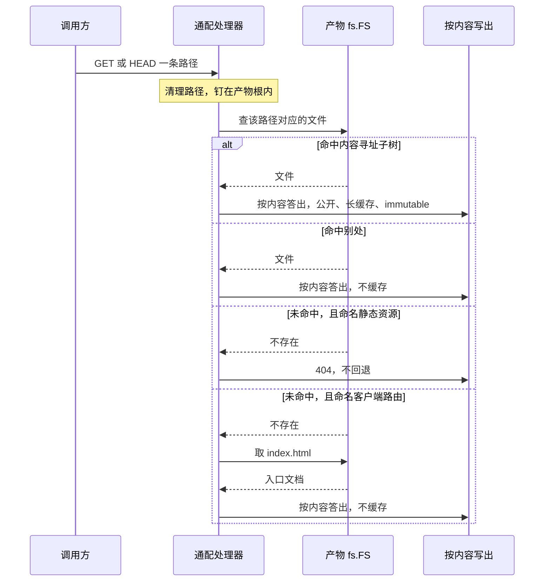

# webui

## 职责

把一份构建好的前端产物按 HTTP 交出去。产物由装配方以 `fs.FS` 交给本模块，本模块不认识任何具体应用，也不认识前端框架：它只按请求路径从这份 `fs.FS` 里取文件，按一套固定的缓存与回退口径作答。

- **静态应答。** `GET` 与 `HEAD` 请求按路径从产物里取文件答出，连同缓存头；文件按它的内容答，本模块不解释也不改写内容。
- **客户端路由回退。** 路径在产物里没有对应文件、它的末段不带文件扩展名、且不落在任何静态资源前缀下时，答入口文档 `index.html`：客户端路由在浏览器里，一个深链接要求服务端对未知路径交出入口文档。
- **缓存口径。** 产物里内容寻址的那棵子树长缓存，入口文档与其余不缓存。
- **路径限定。** 请求路径被清理并钉在产物的根内，请求不得到达产物之外的任何东西。
- **只占自己那条端。** 本模块在配置点名的一个端点上登记一条覆盖该端路径空间的路由，不抢占别处的路由。该端须认领 `/`，即所在监听的[兜底端点](../../glossary.md)：本模块答出的是所在监听上不落在别的端[认领前缀](../../glossary.md)之下的路径（[http](http/design-http.md) 的分派 handler）。

### 非职责

- **不解释、不改写资源内容。** 产物是什么就原样答什么。压缩（gzip、br）、内容指纹、按 `Accept-Encoding` 的变换、资源的合并与重写都不在本模块内：它们是构建工具的事，产物带着这些处理的结果进来。本模块不按内容改写媒体类型；扩展名缺失或未知时 `net/http` 的 `ServeContent` 按内容推定，这一档由它承担（见核心算法与流程）。
- **不认识前端框架与客户端路由表。** 本模块不解析产物里的路由表：一条未命中的路径回退还是被拒，只按这条路径的形状判定（末段有无文件扩展名、是否落在内容寻址子树或某个静态资源前缀下，见核心算法与流程），本模块不因此知道应用声明了哪些路由。不做服务端渲染，不做模板渲染。
- **不认识任何具体应用。** 产物由谁构建、由哪个工具构建、里面有哪些目录，都不是本模块的知识。它经 `fs.FS` 接口拿到内容，无从知道这个名字属于哪个应用。
- **不认证、不解析租户、不限流。** 这些是链上各层的职责，本模块只按静态资源与回退作答。它所在的端上装了哪些层，由宿主的配置决定，不由本模块选。
- **不是运行面。** 运行面（[ops](design-ops.md)：探针路由与合并后的 API 规格）回答进程自身状态，静态资源是一份构建产物的交付，两者只在都经 HTTP 暴露这一点上相交，互不承载。本模块不并入 `ops`，`ops` 也不并入本模块：`ops` 在它点名的端上登记具体路由，本模块登记一条覆盖全端路径空间的通配路由，两者挂到同一个端上会以路由冲突启动失败（见错误与失败语义），本就在同一端上并存不了（[ADR-web-static-hosting-2026-10-15](../../adr/adr-web-static-hosting-2026-10-15.md)）。
- **不打开磁盘上的部署目录。** 产物以 `fs.FS` 进入本模块；它不读 `APP_WEB_DIST` 这类环境变量，也不自己打开目录。从磁盘装配还是从二进制内嵌装配，是装配方在构造时决定的事。

## 外部接口契约

**构造。** 产物以 `fs.FS` 交给本模块，本模块按内容提供一个构造函数把它绑定上去：

```go
// ModuleName 是本模块在注册表与命令树上的名字。
const ModuleName = "webui"

// New 把本模块绑定到它要交付的那份前端产物上。
// fsys 是构建产物的根：内嵌部署传 embed.FS，从磁盘部署传 os.DirFS(dir)。
// 本模块不读产物之外的任何东西，也不知道它由哪个应用、哪个工具构建出来。
func New(fsys fs.FS) core.Module
```

装配方在自己的装配里以 `reg.Register(webui.New(fsys))` 把它纳入，并以名字 `webui` 在命令树上点名。

**交付的功能。** 本模块不交付任何功能接口。它是一条叶子，只在自己点名的端上登记路由；没有别的模块据它取用或定序，因而没有依赖闭包会把它拉进参与集——它只有被宿主显式点名才进参与集。

**配置面。** 本模块以 `config.Schema` 声明自己的输入项，挂在 `webui` 命名空间下：

```go
// Config 是本模块的输入项。
type Config struct {
    // Endpoint 是本模块登记路由的端点名，取自入口模块的配置。
    Endpoint string
    // AssetPrefix 是产物里内容寻址的那棵子树的目录名，缺省 "assets"。
    AssetPrefix string
    // ResourcePrefixes 是产物里静态资源前缀的集合，缺省 [".well-known"]。
    // 一条路径未命中且落在其中某个前缀下时答 404，不回退到入口文档。
    ResourcePrefixes []string
}
```

`endpoint` 必填，缺席即 `Prepare` 以 `config.ErrMissingRequired` 失败，错误以完整路径 `webui.endpoint` 点名缺的这一项。`asset-prefix` 可缺省，缺省值是 `assets`：构建工具把内容寻址的文件集中在一棵子树下，本模块按这棵子树判定长缓存。`resource-prefixes` 可缺省，缺省值是 `[".well-known"]`：一条未命中的路径落在其中某个前缀下时，无论末段有无文件扩展名都答 404 不回退，用来把无扩展名的静态资源（如 RFC 8615 的 well-known 空间下的 ACME HTTP-01 挑战令牌、根下的 `CNAME`）纳到资源侧——这类资源末段无扩展名，形状上与客户端路由无法区分，只能靠它所在的名字空间判定。给定时它整体替换缺省值：一份只写了 `["CNAME"]` 的配置不再保护 `.well-known` 那一段，要把缺省里的前缀留住，须一并列出。端的集合来自入口模块的配置这份数据，端名未声明时登记面给出 `http.ErrUnknownEndpoint`，在 `Init` 阶段终止启动。

`asset-prefix` 是配置项而非设置项：它是嵌入产物那棵子树的名称，本模块在构造时按它判定长缓存，改变它要重启进程、已答出的页面与新的缓存判定也要一起换；按 [ADR-config-scope-2026-09-13](../../adr/adr-config-scope-2026-09-13.md) 的判据 (b)，它塑造启动结构。`resource-prefixes` 同判。

**登记的路由。** 本模块在点名的端上为 `GET` 与 `HEAD` 各登记一条覆盖该端路径空间的路由，路径写成入口模块路由面接受的 gin 通配写法（`/*path`）。通配路由匹配该端上的一切路径，根路径也在内；`GET` 与 `HEAD` 分属不同的方法树，互不冲突。

**答出面的语义是承诺。** `GET` 与 `HEAD` 是答出的方法全集；未命中时，命名客户端路由的路径回退到 `index.html`，命名静态资源的路径答 404；内容寻址子树下的文件长缓存，其余不缓存。这些语义是宿主与运维据以部署的契约。

**与入口模块「无匹配路由」答复的关系。** 入口模块在组装每个端时给引擎装了一个无匹配路由的答复（`pkg/http/assemble.go` 的 `NoRoute`）：它是 404 的 `application/problem+json` 写出器，面向一个不存在的 API 路径，答案是一份问题文档。它不是 SPA 回退，两者不能互换。本模块的回退是它自己登记的一条路由，在它服务的端上请求永远命中这条路由，入口模块的无匹配答复因而不会触发；把 SPA 回退塞进那条无匹配答复，会让一份 API 的 404 变成一份 HTML，反过来把这条通配路由当成 API 的未命中答复，会吞掉真正该报 404 的请求。

**对外接口面。** 模块名 `webui`、配置键 `webui.endpoint`、`webui.asset-prefix` 与 `webui.resource-prefixes`、构造函数签名 `New(fs.FS) core.Module`，以及答出面的语义与 `asset-prefix` 的缺省值 `assets`、`resource-prefixes` 的缺省值 `[".well-known"]`，是宿主可见面；改动它们是破坏性变更。

## 依赖

| 依赖 | 用途 |
|---|---|
| `pkg/core` | 模块描述符、`Requires`、`Resolve` |
| `pkg/config` | 声明并读取本模块的输入项 |
| `pkg/http` | 取用的功能标识是 `Router`（`(*Router)(nil)`）；`Router.Endpoint` 返回的 `Endpoint` 与它的 `Route` 方法用于登记路由，两者都不是功能标识 |
| gin | 一条路由的 handler 是 `gin.HandlerFunc`；已在 `pkg/http` 的依赖闭包里，不为宿主另增依赖 |
| `io/fs`、`net/http`（标准库） | `fs.FS` 类型与 `fs.ValidPath`；`net/http` 的 `ServeContent` 做条件请求、`Range` 与 `Content-Type` 的推定 |

**`Requires` 是 `[]core.Requirement{{Token: (*speedhttp.Router)(nil)}}`，非可选。** `speedhttp` 是本模块给 `pkg/http` 起的引用别名，与标准库的 `net/http` 区分开。本模块没有可撤掉的形态：它存在的全部意义是在一个端上登记路由，取不到入口模块的登记面就没有要挂的端。

方向满足架构不变量：本功能目录位于 `core`、`config` 与 `http` 之上，不被其中任何一个 import。它是一条叶子，不被别的模块 import。

## UML 图

一次请求经过通配处理器的判定路径。图中画不到的约束：**回退与否按路径的形状判定**，命名静态资源（末段带文件扩展名，或落在内容寻址子树下，或落在某个静态资源前缀下）的未命中答 404，命名客户端路由（末段无文件扩展名且不落在任何静态资源前缀下）的未命中回退到入口文档；**缓存头在答出之前定好**，按路径是否落在内容寻址子树下决定，与请求头无关；**`GET` 与 `HEAD` 走同一条路径**，`HEAD` 只是不写正文。



## 核心数据结构

| 概念 | 类型 | 说明 |
|---|---|---|
| 产物根 | `fs.FS` | 一份构建好的前端产物；本模块只读它，构造时绑定一次 |
| 通配处理器 | `handler` | 持有产物根与配置，应答一次请求 |
| 内容寻址子树名 | `string` | 产物里那棵按内容命名的子树，取自配置项 `asset-prefix`，缺省 `assets` |
| 静态资源前缀集 | `[]string` | 产物里若干静态资源名字空间的前缀，取自配置项 `resource-prefixes`，缺省 `[".well-known"]`；未命中且落在其中某个前缀下的路径答 404 不回退 |
| 长缓存口径 | 常量 | 内容寻址文件的 `Cache-Control`：`public, max-age=31536000, immutable` |
| 不缓存口径 | 常量 | 入口文档与其余文件的 `Cache-Control`：`no-cache` |
| 入口文档名 | 常量 | 回退目标，`index.html` |

## 核心算法与流程

### 一次请求的应答

1. 从通配参数取请求路径，**先去开头的斜杠、再按 `path.Clean` 清理**，得到在产物根内的相对查找键；根路径清理后为 `.`（`path.Clean("")` 是 `.`，不是空串），映射到入口文档。其余查找键必须满足 `fs.ValidPath`，不满足即答 404。**两步的次序是有意的**：`..` 段会被 `Clean` 折叠，但折叠**只在它前面有段可退时**发生——`Clean` 把 `/a/../b` 折成 `b`，却把开头的 `../x` 原样留下（`path.Clean("../x") == "../x"`），留下它就过不了 `fs.ValidPath`，因而答 404。**一个开头的 `..` 因此不会被折到根上**：它不是一个合法的产物内路径，退到入口文档会把一个越界请求答成一张正常的页面。产物之外的文件经这一条取不到。
2. 按清理后的路径在产物根里查文件。查到则按内容答出，缓存头按该路径是否落在内容寻址子树下取长缓存或不缓存。
3. 未命中，且路径命名静态资源（落在内容寻址子树下、落在某个静态资源前缀下，或末段带文件扩展名），经入口模块的写出入口 `Fail` 答 404（问题文档形状），不回退。
4. 其余未命中的路径命名客户端路由，从产物根取 `index.html` 答出，不缓存。
5. `HEAD` 与 `GET` 走同一条路径，只是不写正文。

**只答 `GET` 与 `HEAD`。** 本模块在这条端上只登记这两个方法；其余方法在该端上无匹配路由，由入口模块的引擎答 405 并带 `Allow` 头（见 [http](http/design-http.md) 的路由引擎）。

**命名静态资源的未命中不回退。** 一个缺失的内容寻址资源是坏部署的签名——一份陈旧的 `index.html` 引用着一个这份产物不携带的包；一个缺失的运行期资源（如部署放在入口文档旁的 `runtime-config.json`）是部署的缺口。答以 `index.html` 会让浏览器把一份 HTML 文档当脚本执行，或把一份 HTML 正文喂给 JSON 解析器，并把这次缺失藏在一个 200 之后。

**形状判不出无扩展名的资源，靠名字空间兜住。** 静态资源与客户端路由的区分落在路径的形状上，而一张末段没有文件扩展名的路径（`/favicon`、根下的 `CNAME`、`.well-known` 下的 ACME HTTP-01 挑战令牌）形状上与客户端路由完全一样，形状这条判据对它无话可说：它落在回退侧。要把这样的资源按资源答出（答 404 而不是回退），须把它放到某个静态资源前缀下（缺省已含 RFC 8615 的 `.well-known`，其余由 `resource-prefixes` 点名），或给它一个文件扩展名。这是本模块的约定，不是缺陷：模块不解析路由表，就没有别的信息可用。

**回退只对产物负责，不对请求的期望负责。** 本模块不读 `Accept` 头决定回退与否，也不对别的媒体类型另作应答：回退与否只看路径的形状，与请求头无关，一个带扩展名的未命中不因它请求的媒体类型而回退。要按内容协商区分，是反代或另一层的事。

**条件请求与 `Range` 交给标准库。** 答出经 `net/http` 的 `ServeContent`：`If-None-Match`、`If-Modified-Since` 与 `Range` 的处置、`Content-Type` 的推定都由它承担，本模块只把内容与文件信息交给它。因而本模块不自己发 `ETag`，`ServeContent` 按文件信息决定是否给出。

### 本模块的阶段行为

| 阶段 | 行为 |
|---|---|
| `Prepare` | 取配置读取面、`Decode` 自己那份输入项；`endpoint` 缺席即报故障终止启动；构造期收到的 `fs.FS` 为空即报故障终止启动 |
| `New` | 交出一个持有产物根与配置的实例 |
| `Migrate` | 无动作 |
| `Init` | 取入口模块的登记面，按配置里的端名取得该端，在该端上为 `GET` 与 `HEAD` 各登记一条通配路由 |
| `Start` | 无动作 |
| `Serve` | 无动作 |
| `Stop`、`Close` | 无动作：本模块不持有连接，也不派生协程 |

宿主为本模块预置的实例不是本模块的产物时，`Init` 不对它做任何事。

## 错误与失败语义

### 启动期

| 情形 | 表现 |
|---|---|
| 配置里 `endpoint` 未给出 | 终止启动，以 `webui.endpoint` 点名缺的这一项 |
| 构造时收到的 `fs.FS` 为空 | 终止启动 |
| 取不到入口模块的登记面 | 缺提供者失败，点名 `speedhttp.Router` |
| 配置里的端名在入口模块的配置里不存在 | 终止启动，`http.ErrUnknownEndpoint` |
| 该端上已登记别的具体路由 | 组装期路由冲突，`http.ErrRouteConflict`（见下） |
| 该端没有认领 `/` | 组装期 `http.ErrUnclaimedRoute`：通配路由的字面前导路径为空，只落在 `/` 的认领之下 |

**产物为空不是启动失败，也不能是。** 一个 `fs.FS` 里没有 `index.html`，或者整棵树是空的，本模块照常构造、照常登记路由：请求到的文件答 404，回退取不到入口文档也答 404，而产物可以在部署之后补齐。把「产物已就位」做成构造前提，会让一个后端先起、前端后上的部署无法成立。

**同一个端上不能既有本模块又有 API 路由。** 该端上登记一条覆盖全路径的通配路由，与任何具体路由在同一方法树上互斥：gin 在挂载时以 panic 拒绝，入口模块捕获它并报成启动失败（`http.ErrRouteConflict`，见 [http](http/design-http.md) 的路由冲突归因）。宿主把 API 与前端放在一个端上时，这条启动失败即拒绝该装配；改法是把两者分到不同的端，或在前面放一个反向代理把两者归到各自的端（代价见 [ADR-web-static-hosting-2026-10-15](../../adr/adr-web-static-hosting-2026-10-15.md)）。

### 运行期

| 情形 | 表现 |
|---|---|
| 路径在产物里没有对应文件，且命名客户端路由（末段无文件扩展名、不在内容寻址子树下、不在任何静态资源前缀下） | 答 `index.html`，不缓存 |
| 路径在产物里没有对应文件，且命名静态资源（末段带文件扩展名，或在内容寻址子树下，或在某个静态资源前缀下） | 404，不回退 |
| 路径对应的文件在产物里存在 | 按内容答出，缓存头按子树判定 |
| 请求方法不是 `GET` 或 `HEAD` | 该端无匹配路由，入口模块的引擎答 405 并带 `Allow` 头 |
| 产物根取文件时报错（非「不存在」） | 答 500，经入口模块的写出入口写出 |

本模块不降级、不重试：一次取文件的失败即那次请求的结果，产物是只读的，重试没有意义。

### 非保证

以下各类性质本模块声明为不保证。

- **不解释、不压缩、不指纹。** 产物带着构建工具处理过的内容进来；本模块不按 `Accept-Encoding` 变换，也不为资源生成指纹名。
- **产物缺入口文档时，回退路径答 404。** 装配不因缺它而失败，一个尚未构建或尚未部署完的前端因此表现为一个答 404 的端，而不是一个起不来的进程。
- **产物内的符号链接被跟随。** 从磁盘装配（`os.DirFS`）时，产物内指向产物外的符号链接会被跟随，与 `net/http` 的文件服务一致：产物是部署者自己的构建输出，防它是防部署者自己。
- **装配级的性质。** 本模块未被命令树点名时，那个端上没有任何本模块的路由，全部请求落到入口模块的无匹配答复；那个端照常启动、仍是所在监听的兜底端点，监听上不落在别的端认领之下的路径都进它的链，得到这份无匹配答复。本模块的描述符里 `Provides` 为空，依赖闭包不会把它拉进来。察觉：读命令树。
- **落在别的端认领之下的页面路径到不了本模块。** 这类路径的整页导航得到认领它的那个端的应答，拿不到入口文档；本模块不认识客户端路由表，判不出页面路径与认领相交，页面路径的取法由宿主负责。
- **通配路由独占它登记的端。** 该端上不能同时登记别的路由，见启动期一节；这条不是本模块能收敛的，而是 gin 路由树的形状。
- **本模块不判定请求的期望媒体类型。** 回退与否只看路径的形状，与请求头无关；内容协商不在本模块内。

## 实现状态

| 能力 | 状态 | 代码 |
|---|---|---|
| 模块登记、构造与配置面 | 已实现 | `pkg/webui/webui.go` `New` |
| 静态应答与缓存口径 | 已实现 | `pkg/webui/handler.go` `handler.serve`、`handler.cacheControl` |
| 客户端路由回退 | 已实现 | `pkg/webui/handler.go` `handler.miss`、`resourceShaped`、`handler.underResourcePrefix`、`handler.serveEntry` |
| 路径限定 | 已实现 | `pkg/webui/handler.go` `handler.lookupKey`、`handler.handle` 拒绝 `!fs.ValidPath` 的分支 |
| 所在端认领 `/` 的启动期核对 | 已实现 | `pkg/http/dispatch.go` `(*dispatch).verifyRoutes`、`literalLeadingPath`，`pkg/http/module.go` `(*router).serve`；`pkg/webui/module_test.go` `TestAnEndpointThatDoesNotClaimTheRootFailsTheStartup` |
| 本模块未被点名时所在端作为兜底端点照常启动 | 已实现 | `pkg/http/dispatch.go` `buildDispatch` 的兜底端选择、`(*dispatch).handler` 的 `NoRoute`，`pkg/http/assemble.go` `newEngine` 的 `NoRoute`；`pkg/webui/module_test.go` `TestAnEndpointWithoutTheModuleStillStartsAsTheFallback` |
