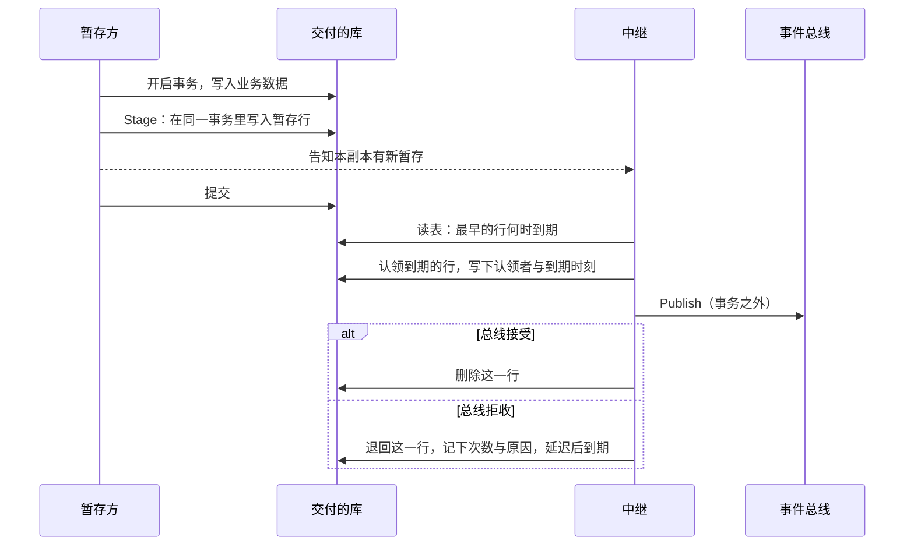
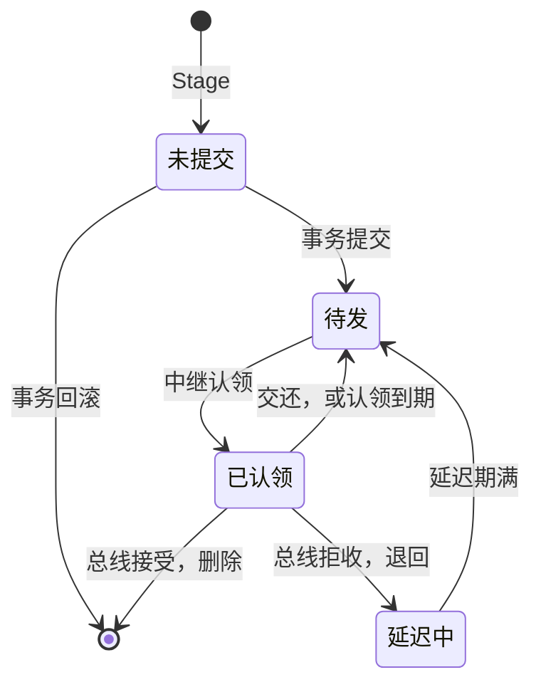

# outbox

## 职责

本模块交付**事务发件箱**：一个事件在写入它所宣告之事的那个数据库事务里暂存，事务提交之后才交给事件总线，事务回滚则永不发布；总线拒收时事件留在表里，此后一再重发，直到总线接受为止（[ADR-outbox-scope-2026-09-29](../../../adr/adr-outbox-scope-2026-09-29.md)）。

它补上[事件总线](design-event.md)不做的那一件事。总线的一次发布独立于调用方的事务：写入提交之后发布失败，写入留下而事件丢失；提交之前发布，宣告的写入可能随后回滚。经本模块暂存的事件与写入同成同败，发布跟在提交之后。

本功能位于事件功能目录之内，自成一项功能：接口包 `pkg/event/outbox` 声明功能接口与哨兵错误，不登记模块；实现子包 `pkg/event/outbox/relay` 登记模块 `event.outbox.relay`，排他地交付该功能（[ADR-outbox-packaging-2026-09-29](../../../adr/adr-outbox-packaging-2026-09-29.md)）。下文的"本模块"指这个实现。

### 非职责

- **不替订阅方去重。** 发布是至少一次，同一个事件每次都带着暂存时的标识；按标识去重归订阅方，与总线其他形式的重复到达相同（见 [event](design-event.md) 的事件标识）。
- **不开事务。** 事务由调用方用 GORM 的 API 开启，本模块只在调用方交来的事务里写一行。
- **不承诺发布顺序。** 一个中继按暂存的先后发布它认领的行，而被拒收的事件在延迟之后重发，排到后来暂存的事件后面；多个副本的中继各自发布，彼此之间没有先后。需要顺序的调用方在载荷里携带序号。
- **不跨库暂存。** 只在数据库功能交付的那个库里暂存，`Open` 自建的连接、宿主自建的句柄与别的装配的句柄上的事务一律拒绝。
- **不改变总线的投递承诺。** 事件被总线接受之后到达哪些副本、订阅者的失败回不回传，都照 [event](design-event.md) 的承诺。
- **不设死信。** 被拒收的事件一直重试，不因次数多而丢弃或转存别处；拒收的次数与最近一次的原因记在它那一行上。
- **不检查、不剥离载荷。** 载荷序列化之后以明文存放在表里，直到总线接受。把凭据挡在载荷之外仍是发布方的义务。

## 外部接口契约

### 登记单元与名字

| 登记单元 | 模块名 | 交付 | 构造期依赖 |
|---|---|---|---|
| 接口包 `pkg/event/outbox` | 不登记 | 只有功能接口与哨兵错误 | — |
| 实现子包 `pkg/event/outbox/relay` | `event.outbox.relay` | 排他地交付事务发件箱 | `(*db.Database)(nil)`、`(*event.Bus)(nil)`，`(*log.Logger)(nil)` 可选 |

本模块不读任何输入项，不声明配置命名空间。

### 交付的功能

```go
// 功能标识为 (*outbox.Outbox)(nil)。
type Outbox interface {
    Stage(tx *gorm.DB, evt event.Event) error
}

var ErrNoTransaction error // 会话不在事务中
var ErrOtherDatabase error // 事务不在交付的连接池上
```

取用写作 `core.Resolve[outbox.Outbox](reg)`，依赖声明写作 `core.Requirement{Token: (*outbox.Outbox)(nil)}`。

**`Stage` 在 `tx` 所在的事务里记下 `evt`，事务提交之后发布它。** `tx` 是交付句柄上一个事务的会话：`Transaction` 交给闭包的那个，`Begin` 返回的那个，在经 `db.Connection` 钉住的会话上开的事务同样可以。行写在 `tx` 自己的会话上、在 `tx` 的上下文下，随调用方自己的语句一同提交或回滚，不另取连接。

| 交给 `Stage` 的会话 | 结果 |
|---|---|
| 交付句柄上的一个事务 | 写入一行，事务提交之后发布 |
| 交付句柄本身，或由它派生、不在事务中的会话 | `ErrNoTransaction`，什么都不写 |
| `Open` 自建的连接、宿主自建的句柄、别的装配的句柄上的事务 | `ErrOtherDatabase`，什么都不写 |

**是否在事务中，按 GORM 自己的判断**：会话的连接是一个可提交的事务。**是不是交付的库，按事务所从出的连接池判断**，而不是按它连到哪个库：`Open` 自建到同一个库上的连接也拒绝。拒绝不在事务中的会话，挡住的是这样一种误用——在事务闭包里把开事务用的那个句柄交了进来：那一行会立即自行提交，事件从此与写入无关，而这正是本功能要消除的失效形态。

**标识与载荷在暂存时定下。** `ID` 为空时，`Stage` 以 `event.NewID` 的形式赋予一个；非空时原样携带。每个订阅者收到的都是这个标识，重发时也不变；要把它与自己的写入记在一起的调用方先设好它。载荷在暂存时序列化，不可序列化的载荷与 `Publish` 一样被拒绝。

**追踪上下文也在暂存时定下。** 实现子包 `pkg/event/outbox/relay` 经本模块内部的 `pkg/event/internal/tracing` 取用遥测模块的传播器（`observability.Propagator()`），`Stage` 用它从 `tx` 的上下文取出当时的跨度上下文，写进 `evt` 的行；中继发布时把它还原到事件上，`Publish` 因而不改动它。订阅者的跨度以那次写入所在跨度为父，不是以中继的跨度为父——宣告与写入挂在同一条追踪上，即使发布晚于提交若干秒（[ADR-event-tracing-2026-10-15](../../../adr/adr-event-tracing-2026-10-15.md)）。

**写行失败时返回的错误包着数据库的错误。** 表不在、权限不够、事务已经失败，都由数据库的错误报出，错误链完好；PostgreSQL 上这之后事务提交不了，调用方回滚，写入与宣告都不发生。

### 发布的承诺

- **事务提交了，事件至少被总线接受一次**：由同一个库上任一装配的中继完成，前提是有中继在运行、总线终究接受它。**事务回滚了，事件永不发布。**
- **发布跟在提交之后。** 订阅者得知这件事时，写入已经对别的连接可见。
- **时机。** 暂存它的那个副本上，中继在暂存之后先等 10 毫秒读表，此后间隔逐次翻倍，直到达到 1 秒；其余副本每秒读一次。一次暂存只让下一次读表提前，从不推后已经排定的那一次，本副本上的暂存再密集，读表也照这个节律进行。总线拒收期间没有上界。
- **同一个事件可能被发布不止一次。** 总线接受之后、删除那一行之前中继中断，删除那一行失败，或认领到期被另一个中继接管，都让它再被发布一次；每一次带着同一个标识。
- **订阅者收到的载荷是传输的形状**：解码出来的结构，每个数保留为十进制文本（`json.Number`），在任何一种总线实现下都如此，进程内实现也不例外；整数无论多大都精确（见 [event](design-event.md) 的载荷的读取）。
- **订阅者的调用上下文不是发布方的。** 进程内总线在中继的协程与上下文上调用订阅者：那个上下文带着本模块 `Start` 阶段收到的上下文里的值，不带发布方的请求上下文，也不带租户，每次发布至多 1 分钟。订阅方照 [event](design-event.md) 的规矩按事件的 `TenantID` 进入租户。
- **订阅者的跨度以暂存方的跨度为父。** 追踪上下文在暂存时定下（见交付的功能），中继发布时的事件带着它；订阅者的跨度因而挂在写入所在的跨度之下，不是挂在中继协程所在的跨度下（[ADR-event-tracing-2026-10-15](../../../adr/adr-event-tracing-2026-10-15.md)）。

### 对宿主的要求

- **命令树上点名本模块与一个总线实现。** 本功能与总线功能都排他交付，依赖闭包不替宿主挑：运行暂存方的每条命令都要把 `event.outbox.relay` 写进运行级纳入，或为它预置实例。
- **施加迁移的命令要收到本模块的迁移集**：它是带表的模块，照 [db](../design-db.md) 的迁移的应用，由那条命令静态级纳入，`IncludeAllDeclarations` 是推荐写法。
- **服务角色要有这张表的读写权限。** PostgreSQL 上是对 `event_staged` 的 `SELECT`、`INSERT`、`UPDATE`、`DELETE` 与序列 `event_staged_id_seq` 的 `USAGE`。
- **暂存的事件只由到达 `Start` 的命令里的中继发布。** 一条停在 `Start` 之前的命令暂存的事件，留在表里等下一个运行着中继的进程。

### 稳定性承诺

- `Outbox`、`ErrNoTransaction` 与 `ErrOtherDatabase` 是本模块与其他模块之间的契约，发布的承诺同属契约。
- `*gorm.DB` 出现在契约面上，GORM 的不兼容升级直达暂存方，与数据库功能相同（[ADR-module-packaging-2026-09-14](../../../adr/adr-module-packaging-2026-09-14.md)）。
- 表 `event_staged` 属于本模块，宿主不读写它；它的列供运维查看积压与拒收的原因，不是契约面。

## 依赖

| 依赖 | 用途 |
|---|---|
| `pkg/db` | 交付的库（表所在之处）、迁移集资源、方言 |
| `pkg/event` | 总线功能、事件类型、标识的形式 |
| `pkg/event/internal/dispatch` | 标识的赋予、载荷解码成传输形状，与各总线实现共用一处 |
| `pkg/log` | 可选依赖。中继要报告的事——总线拒收、读表失败——写进装配的日志；装配里没有日志功能时，写日志模块的进程默认记录器 |
| `pkg/event/internal/tracing` | 本模块触及遥测类型的唯一之处：实现子包从它取传播器，span 也经它起 |
| `pkg/observability` | 传播器与 tracer provider 的来源（`observability.Propagator()`）：经 `pkg/event/internal/tracing` 取用，实现子包在 `Stage` 里用传播器把写入事务所在跨度的追踪上下文写进暂存行 |
| `pkg/core` | 注册描述符、交付功能 |
| GORM | 接口面上的 `*gorm.DB` |

**接口包只 import 事件根包与 GORM**，`pkg/event/outbox` 的依赖面检查 `TestTheInterfacePackageCostsTheEventPackageAndGORMAlone` 守着这条：暂存方本来就经数据库功能写库、经总线发布，两者它都已承受；驱动与总线的客户端属于宿主登记的实现，不经接口包进入暂存方。**事件根包不 import 本模块**，它被每一个发布方 import，GORM 因此不进不暂存事件的发布方的闭包。

方向满足架构不变量：实现子包 import 数据库与事件两个功能目录的根包，以及事件目录自己的内部单元，不 import 任何别的实现子包；两个依赖都在它之前构造、在它之后停止。

## UML 图

一次暂存到一次发布的路径。图看不出的约束：暂存与写入在同一个事务、同一条连接上；中继发布时不持有任何事务与连接；认领有时限，到期未结清的行由另一个中继接管。



一行暂存的事件的生命周期：



## 核心数据结构

**暂存表 `event_staged`**，一行一个尚未被总线接受的事件。时刻一律取数据库的时钟，以 Unix 纪元以来的毫秒计，每个副本的中继按同一个时钟判断认领是否到期。

| 列 | 含义 |
|---|---|
| `id` | 暂存的先后，自增，不复用 |
| `event_id`、`type`、`tenant_id` | 事件的标识、类型与租户 |
| `trace_context` | 暂存时事件所在跨度的追踪上下文，序列化后保存；中继发布时还原到事件上。此前建成的表没有这一列，迁移补上它，旧行取默认的空值 |
| `payload` | 序列化之后的载荷，原文保存 |
| `staged_at` | 暂存的时刻 |
| `available_at` | 这一行下一次可被认领的时刻：暂存时即为当时，认领后为认领到期之时，拒收后为延迟期满之时 |
| `attempts` | 总线拒收的次数 |
| `claimed_by` | 持有认领的中继，空即无人持有；由主机名、进程号与一个只属于那个中继实例的标识组成 |
| `last_error` | 最近一次拒收的原因，至多 2000 字节 |

`available_at` 上有索引，读表与认领都按它找到期的行。

## 核心算法与流程

### 本模块的阶段行为

| 阶段 | 行为 |
|---|---|
| `Prepare` | 表态启用；不读输入项，没有可缺的东西 |
| `New` | 取用交付的库、总线与日志；方言没有写好的语句时启动失败 |
| `Migrate` | 数据库模块施加本模块声明的迁移集，建立暂存表 |
| `Start` | 中继开始运行，先读一次表，接手此前暂存、尚未发布的行。中继的上下文取自这一阶段收到的上下文，带着它的值而不随它取消 |
| `Stop` | 不再认领；正在进行的一次发布在 10 秒的宽限期内跑完，超出即取消，`Stop` 返回错误；中继持有而未发布的行全部交还，立即可被认领 |
| `Close` | 未经 `Stop` 时先执行它；句柄属于数据库模块，本模块不关闭它 |

宿主为本模块预置的实例不是本模块的产物时，`Start`、`Stop` 与 `Close` 都不对它做任何事：中继不由本模块启停，它持有的资源由预置的一方释放（[ADR-supplied-instance-2026-10-08](../../../adr/adr-supplied-instance-2026-10-08.md)）。

两个依赖都在本模块之前构造、之后停止：中继开始时总线已经接受发布，中继停止时总线还没有拒绝发布。

### 中继的一轮

1. **读表**：取最早一行的 `available_at` 与当前时刻之差。没有行即本轮结束；最早的还没到期，下一轮定在它到期之时。
2. **认领**：一条语句取至多 64 行到期的行，按暂存的先后，写下本中继为认领者、到期时刻为 2 分钟之后，并交回这些行。
3. **逐行发布**：交给总线的上下文 1 分钟后到期，这是一次发布的上界；发布在事务之外进行，不持有连接。一行只在它的认领还比一次发布的上界长时才交给总线，否则本批剩下的行全部交还，下一轮重新认领。
4. **结清**：总线接受即删除这一行；总线拒收——返回错误（上下文到期而返回的也在内）或 panic——即退回：认领者置空，拒收次数加一，记下原因，延迟之后到期。延迟从 1 秒起，每次拒收翻倍，至多 1 分钟。退回只作用于本中继仍持有的行：认领已经到期、被别的中继接手的那一行，它的认领与次数不动。

一轮在还有到期的行时接着认领下一批。每一批有读表与认领各一条语句，每一行另有结清的一条；空表上的一轮只有读表那一条。

**读表的时机**：`Start` 时；暂存方在本副本暂存之后，按 10 毫秒起、逐次翻倍到 1 秒的节律——暂存行在调用方提交之后才可见，而提交没有通知；下一行到期之时；此外至少每秒一次。一次暂存把下一次读表提前到 10 毫秒之后，已经排在更早时刻的那一次不因它推后：暂存的间隔一直短于 10 毫秒时，中继照样在每一轮之后 10 毫秒再读，不会等到暂存停下。读表或认领本身失败时，间隔从 1 秒起翻倍，至多 1 分钟，每次失败写一条错误日志。

### 多个副本

每个副本都运行中继，读同一张表，靠有时限的认领分摊（[ADR-outbox-replicas-2026-09-29](../../../adr/adr-outbox-replicas-2026-09-29.md)）。一行在认领到期之前只属于认领它的中继；一个中继在持有认领时终止，那些行在认领到期之后由别的中继接手。

**两个认领同时进行**，都读到同一行到期、都还没写下认领，这一种由行锁裁定：PostgreSQL 上认领对它取的行加锁，并跳过另一个认领正锁着的行，第二个认领因而既不取那些行，也不等它们。SQLite 一次只有一个写者，一条认领语句本身即原子，不另加锁。

### 停止

`Stop` 之后不再认领。正在进行的那次发布在宽限期内跑完，之后这一批里还没发布的行不再发布；中继退出时把自己持有的每一行交还，到期时刻置为当时，下一个中继——同一个库上别的副本，或下一次启动——立即可以认领，不必等认领到期。别的中继持有的行不在其内：它们正在被发布，交还了就会被第三个中继再发一次。宽限期耗尽时那次发布被取消，它那一行照样交还，不计为一次拒收。

## 错误与失败语义

| 情形 | 表现 |
|---|---|
| 会话不在事务中 | `Stage` 返回 `ErrNoTransaction`，什么都不写 |
| 事务不在交付的连接池上 | `Stage` 返回 `ErrOtherDatabase`，什么都不写 |
| 载荷不可序列化 | `Stage` 失败，什么都不写 |
| 暂存行写不进去（表不在、权限不够、事务已失败） | `Stage` 返回的错误包着数据库的错误；PostgreSQL 上事务此后提交不了 |
| 暂存它的事务回滚 | 那一行随之消失，事件不发布 |
| 总线拒收 | 那一行留下，拒收次数加一、原因记下，延迟之后重发；写一条警告日志，带事件的标识、类型、租户、次数与下次重试的间隔 |
| 拒收过的事件终于被接受 | 删除那一行，写一条信息日志，带尝试的次数 |
| 总线接受之后删除那一行失败 | 那一行留在认领中，认领到期之后再发布一次；写一条错误日志 |
| 总线拒收之后退回那一行失败 | 那一行留在认领中，认领到期之后再发布，这次拒收不计入次数；写一条错误日志 |
| 读表或认领失败（库不可用、表不在） | 行不动；写一条错误日志，间隔翻倍后再读 |
| 载荷在表里被改得解不出来 | 按拒收处置，一直重试 |
| 副本在持有认领时终止 | 那些行在认领到期之后由别的中继发布，至多晚 2 分钟 |
| `Stop` 时一次发布超出宽限期 | 发布被取消，`Stop` 返回错误；那一行交还，不计为拒收，下一个中继再发 |
| 交还失败 | 写一条错误日志；那些行在认领到期之后由别的中继接手 |
| 没有中继在运行 | 行留在表里，等下一个运行着中继的进程 |
| 方言没有写好的语句 | `New` 失败，点名方言 |

### 非保证

- **不是恰好一次。** 重复的来源见发布的承诺，按标识去重归订阅方。
- **总线拒收期间没有发布时延的上界。** 拒收一直持续，事件就一直留在表里。
- **不跨副本保序。**
- **只开一条连接的库上，暂存方的事务持有那条连接时中继等它。** 中继读表与认领都要一条连接，等的是调用方提交；那段时间里本副本不发布任何事件，调用方的事务不因此受阻。
- **不理会上下文期限的总线，一次发布超出上界仍不返回时，中继等它返回。** 这段时间里本副本不发布别的事件；认领到期之后那一行可能被别的中继再发一次（[ADR-outbox-replicas-2026-09-29](../../../adr/adr-outbox-replicas-2026-09-29.md)）。

## 并发与事务边界

- **暂存在调用方的事务里、调用方的连接上进行**，不取别的连接。SQLite 上这一行要的写锁与事务里的其他写入同一把。事务默认以 `IMMEDIATE` 开启，开启时就拿到这把锁，别的连接写着时在开启处照忙等时限等，暂存这一行不再等锁；定位符让事务以 `DEFERRED` 开启时，事务先读后写、写锁又在别的连接手里，暂存这一行当即以 `SQLITE_BUSY` 失败，由调用方处置（见 [db](../design-db.md) 的并发与事务边界）。
- **`Stage` 可被多个协程并发调用。** 告知中继有新暂存的通道只存一条，暂存从不等待，一串暂存只唤醒中继一次。
- **中继在自己的协程上经交付句柄发出语句**，每条至多 30 秒；发布时不持有事务与连接。进程内总线在中继的协程上同步调用订阅者，订阅者经交付句柄读写库时不会等中继，只开一条连接的库上也是如此。
- **SQLite 文件库上，调用方开着的事务让中继的认领、结清与交还等待。** 这几条是另一条连接上的写入。以 `IMMEDIATE` 开启的事务从开启起就占着写锁，只读不写的也一样；回滚日志模式下，读过的事务在结束之前还挡着别的连接提交（见 [db](../design-db.md) 的并发与事务边界）。那条语句等满忙等时限即以 `SQLITE_BUSY` 失败。认领失败按读表失败处置，行不动；结清与交还失败照错误与失败语义里对应的一格处置。
- **中继的上下文不随驱动的取消而结束**：宿主一开始停机，驱动的上下文就被取消，早于任何模块的 `Stop`，而中继运行到本模块自己的 `Stop` 为止。

## 扩展点

**新方言**：给出那个引擎的时钟表达式与认领时的锁子句（`pkg/event/outbox/relay/statements.go` `statementsFor`），并在迁移集里增加同名子目录。没有写好语句的方言在 `New` 被拒绝，不会带着一个读不了表的中继启动。

## 实现状态

| 能力 | 状态 | 代码 |
|---|---|---|
| 功能接口与哨兵错误 | 已实现 | `pkg/event/outbox/outbox.go` `Outbox`、`ErrNoTransaction`、`ErrOtherDatabase` |
| 模块描述符与迁移集 | 已实现 | `pkg/event/outbox/relay/relay.go` `Module`、`migrationsFS` |
| 暂存与会话的判断 | 已实现 | `pkg/event/outbox/relay/relay.go` `(*relay).Stage`、`(*relay).judge` |
| 追踪上下文的暂存与还原 | 已实现 | `pkg/event/internal/dispatch/dispatch.go` `StampTraceContext`、`EncodeTraceContext`、`DecodeTraceContext`（暂存在 `pkg/event/outbox/relay/relay.go` `(*relay).Stage` 里调用，还原在 `pkg/event/outbox/relay/loop.go` `(*relay).publish` 里）；列由 `pkg/event/outbox/relay/migrations/{postgres,sqlite}/0002_event_staged_trace_context.sql` 加上 |
| 中继的循环、读表与认领 | 已实现 | `pkg/event/outbox/relay/loop.go` `(*relay).run`、`(*relay).pass`、`(*relay).claim`、`(*relay).relayBatch` |
| 发布与结清 | 已实现 | `pkg/event/outbox/relay/loop.go` `(*relay).relayOne`、`(*relay).publish`、`timing.retryAfter` |
| 各方言的语句 | 已实现 | `pkg/event/outbox/relay/statements.go` `statementsFor`、`build` |
| 停止与交还 | 已实现 | `pkg/event/outbox/relay/relay.go` `(*relay).stop`、`pkg/event/outbox/relay/loop.go` `(*relay).releaseAll` |
