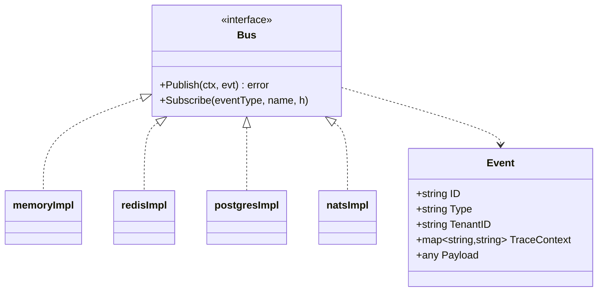
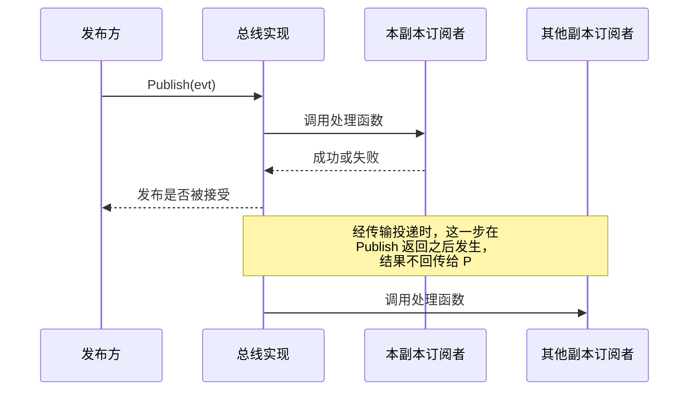

# event

event 是事件总线，位于依赖图的底层：每个发布方 import 它的根包，它不认识任何业务[模块](../../../glossary.md)，也不认识租户模块。它拥有排他交付的 `Bus` 功能、标识的赋予、订阅表、分发层的追踪与各后端实现；投递次数、顺序、去重与载荷结构不在它的承诺之内，与写入同成同败的发布由[事务发件箱](design-event-outbox.md)提供。读职责清单前应持有的一句话心智模型是：总线把事实交给按类型订阅的模块，`Publish` 返回 nil 只说明发布被接受，不说明有人处理过。

正文的次序是：职责与外部接口契约是第一遍，职责给出承诺的边界，外部接口契约给出 `Bus`、`Event` 与事件标识；依赖、UML 图与核心数据结构供查阅，分别说明绑定关系、类型关系与载荷的传递方式；核心算法与流程也是第一遍，以[走查](#走查)开头，给出一次发布从标识赋予到订阅者处理的路径；错误与失败语义、并发与事务边界与扩展点是最后的自检项，先读投递承诺的下界，再读各实现超出下界的部分；实现状态供核对上文承诺。

## 职责

本模块交付**事件总线**：一个模块发布一个领域事实，另一个模块按类型订阅它，两者之间不需要相互认识。它是审计这类横切能力取得领域事实的统一入口：这类能力订阅总线即可拿到全部事件，不必耦合每一个产生事件的模块（[ADR-event-scope](../../../adr/adr-event-scope.md)）。

实现有多个，绑定不同后端：进程内、Redis、PostgreSQL、NATS JetStream（[REF-nats](../../../references.md)）。**功能排他交付**：同一个进程里恰好一个实现生效。

订阅方通常不能 import 发布方的包：跨模块 import 一个具体类型会把依赖方向倒转。载荷因此以**结构化**方式读取：订阅方按字段名经序列化往返取它需要的字段，不做类型断言。

**订阅者一侧的追踪由本模块在分发层记下。** 事件跨进程携带发布时所在跨度的追踪上下文，本模块为每个订阅者起一个以它为父的跨度，因而“订阅者收到并处理了吗”从追踪里答得出（见[分发层的追踪](#分发层的追踪)，[ADR-event-tracing](../../../adr/adr-event-tracing.md)）。装配里没有遥测功能时这一部分不产生任何信号。

### 非职责

- **不校验事件类型名。** 类型名是发布方与订阅方之间的约定字符串，没有注册接口，也不在启动期检查有没有对应的发布方。发布方可以在运行期任意时刻出现。
- **不承诺投递次数与顺序。** 跨副本恰好一次、按发布顺序投递，都是实现与其后端的事。需要顺序的调用方在载荷里携带序号自行处理。
- **不替订阅方去重。** 事件带着一个标识（见“事件标识”），要只处理一次的订阅方按它自己去重；本模块不记录见过的标识，也不拦截重复的投递。
- **不承诺订阅者失败回传发布方。** 承诺的下界见“错误与失败语义”。
- **不把发布与调用方的写入绑在一起。** 一次发布独立于调用方的事务，被拒绝的发布本模块也不重发。要让一个事件随写入提交才发布，被拒收之后一再重发，发布方经[事务发件箱](design-event-outbox.md)在写入的事务里暂存它（[ADR-outbox-scope](../../../adr/adr-outbox-scope.md)）。
- **不做事件的持久化与重放。** 某些实现的后端让已发布的事件跨重启留存，那是那个实现的性质，不是接口承诺，也不构成重放能力。
- **不按租户过滤。** 事件携带租户标识，按它分流归订阅方。
- **不校验载荷的结构。** 载荷是不透明的，读不出来时订阅方自行决定丢弃还是记录。
- **不做事件模式的版本管理。** 载荷的结构随发布方演进，兼容性由发布方与订阅方约定。
- **不认识租户模块。** 租户标识在本模块是字符串，不引用租户模块的类型。
- **不定义追踪的语义本体。** 跨度、属性与传播格式取自上游遥测库与遥测模块的传播器（[ADR-event-tracing](../../../adr/adr-event-tracing.md)）；本模块只决定分发层为每个订阅者起一个跨度，不另造一层等价的追踪抽象。

## 外部接口契约

### 交付的功能

```go
// 功能标识为 (*Bus)(nil)。
type Bus interface {
    // Publish 把 evt 交给总线。返回 nil 表示发布已被接受，
    // 不表示任何订阅者已收到或已处理完成。
    Publish(ctx context.Context, evt Event) error

    // Subscribe 为类型名精确等于 eventType 的事件登记 h，name 是这个
    // 订阅者的名字，用作它跨度的名称。名字必填，留空即 panic。
    Subscribe(eventType string, name string, h Handler)
}

type Event struct {
    // ID 是这个事件的标识，幂等使用方按它去重。发布方留空时由 Publish 赋予。
    ID string

    // Type 是路由键。匹配是精确字符串比较，不解释通配符与前缀。
    Type string

    // TenantID 是事件所属的租户。系统级事件留空。
    TenantID string

    // TraceContext 是这个事件发布时所在跨度的追踪上下文，按上游传播格式的
    // 键取值。发布方留空时由 Publish 写入当时上下文里的跨度，非空时原样携带。
    // 订阅方的跨度以它指代的跨度为父，因而同一条追踪跨进程接续。装配里没有
    // 遥测功能时它始终为空。
    TraceContext map[string]string

    // Payload 是事件数据。订阅方按约定读取，不做类型断言。
    Payload any
}

type Handler func(ctx context.Context, evt Event) error
```

**排他交付。** 多于一个实现表态启用即启动失败。各实现都声明排他，依赖闭包展开事件功能时因而不替宿主挑，只取命令树上已经写下的那些：宿主在运行级纳入里点名哪个实现，参与的就是哪个；未点名的实现不进参与集，宿主为它预置了实例的除外，预置了实例的实现与点名的实现之间按消解的普通规则处置（见 [core](../design-core.md)）；参与集里一个实现都没有而又有模块依赖事件功能时，该功能缺提供者，启动失败。

### 实现的扩展点

各实现子包经 `Spec[C]`（`pkg/event/module.go`）把自己交给本包成为一个模块。追踪能力只在这个扩展点上出现，而且是本包自己定义的窄接口：根包因而不 import 遥测的接口包：

```go
type Spec[C any] struct {
    // 其余字段见 pkg/event/module.go。
    // Trace 取用可选的追踪能力：实现子包在这里把遥测模块的 provider 适配成
    // TracerProvider，装配里没有遥测功能时交回那个不导出任何信号的实现。
    Trace func(reg *core.Registry) (TracerProvider, error)
    Open  func(ctx context.Context, cfg *C, logger *slog.Logger, tracer TracerProvider) (Bus, error)
}

// TracerProvider 是本模块从追踪能力取用的最小接口：开始一个跨度。
type TracerProvider interface {
    // Start 按父跨度上下文、名称与属性开始一个跨度，返回带着它的上下文与跨度本身。
    Start(ctx context.Context, name string, attrs map[string]string) (context.Context, Span)
}

// Span 是一次投递的跨度：End 结束它，err 非 nil 时标为错误。
type Span interface{ End(err error) }
```

provider 的类型与传播器都只出现在实现子包与 `dispatch` 里：实现子包在 `Open` 里把适配好的 provider 与 `observability.Propagator()` 一并交给 `dispatch.New`。根包只承接上面这个窄接口，它的依赖因而不含遥测接口包带上的上游闭包（[ADR-event-tracing](../../../adr/adr-event-tracing.md)）。

**可选的追踪依赖由实现子包声明，根包不声明。** `NewModule` 交回的描述符里 `Requires` 只有日志功能那一条：根包不 import 遥测的接口包，也就写不出那条依赖。实现子包在 `NewModule(...)` 交回的描述符上自己追加一条 `core.Requirement`：`Token` 为 `(*observability.TracerProvider)(nil)`，`Optional: true`。少了这条边，两个模块之间只剩模块名的字典序，`event.*` 排在装配器之前构造，`Trace` 取不到 provider 而回退为不导出信号的实现，总线照常起落、跨度一个都不导出，且这一档不报错：这是这条声明存在的唯一理由。

### 事件标识

**标识是幂等使用方去重的键**（[ADR-event-identity](../../../adr/adr-event-identity.md)）。总线不承诺投递次数：经传输投递的实现把每个事件广播给每个副本，后端可能重投，发布方可能重发，一个效果不止于本副本的订阅者（共享库里每个事件一行、一次对外回调、一份投影）据此认出第二次到达的是同一个事件。两个标识相同的事件，在订阅方看来就是同一个事件投递了两次。

| 发布时的 `ID` | 订阅者收到的 |
|---|---|
| 空 | `Publish` 在事件离开发布调用之前赋予的一个：RFC 9562（[REF-rfc9562](../../../references.md)）第 7 版 UUID 的规范文本形式（`NewID`） |
| 非空 | 原样，不检查格式 |

发布时 `ID` 无论为空还是非空，同一个事件的每个订阅者（同一副本的、其他副本的、任何一种实现下的）收到同一个值；后端重投的条目带着同一个值。由本模块赋予的标识彼此不同；发布方自设的，唯一性由发布方负责。本模块赋予的标识以生成时刻的毫秒开头，后续位是随机数：不同毫秒生成的两个标识按那一毫秒排序，毫秒各取生成它的进程的时钟；同一毫秒内生成的两个标识先后随机，同一协程上先后发布的两个事件也是如此。标识因此不记录发布的先后，需要顺序的调用方在载荷里携带序号（见非职责）。

**`Publish` 不回传赋予的标识。** 需要在发布之前知道它的发布方（要把它与自己的写入记在一起，或在一次读不出结果的失败之后重发同一个事件）用 `NewID` 或自己的键先设好；留空重发的是一个新事件。

### 载荷的读取

订阅方拿到的载荷结构取决于投递路径：同进程投递是发布方自己的具体值，经传输投递是传输解出来的结构。两者都按字段名读取：

| 辅助 | 用途 |
|---|---|
| 解码为字段表 | 读顶层字段，读不出时报 false，不 panic |
| 按候选名取字符串 | 依次尝试若干个拼写（序列化标签、结构体字段名），取第一个非空字符串 |
| 按候选名取布尔 | 同上，区别是 false 是一个有意义的值，只有缺失或非布尔才继续尝试 |
| 解码为具名类型 | 订阅方能命名自己的类型时直接解，且要向上报出失败时用它；事件不带载荷（空值，或序列化为 null 的值）时返回 `ErrNoPayload`，不把零值当作解码结果交出 |

**从同进程值与传输解出的结构里读出的数，是同一个值。** 经传输投递的实现把载荷里的每一个数保留为它的十进制文本（`json.Number`），不转成浮点数；解码为具名类型时，整数无论多大都与同进程投递得到的一致。解码为字段表时，同进程值与传输解出的结构里的数都是浮点数，2^53 以内的整数精确，超出的会被舍入；要读出更大的整数（标识、以分计的金额）的订阅方解码为具名类型。

**这一组辅助是容错的**：读不出来的载荷报 false 或返回解码错误，绝不 panic，绝不返回部分值。订阅方与发布方的契约是“读不出就丢弃并记录”，因此读取路径上没有可上报的错误。

**载荷是发布方写的数据，本模块既不检查也不剥离它。** 订阅方可以把顶层字段原样写进自己的记录，审计正是把载荷的顶层标量字段写进明细，只遮蔽闭集里的键名（见 [audit](../audit/design-audit.md)）；因此放进载荷的凭据可能被订阅方写进自己的记录，落在闭集之外键名下的顶层标量凭据就原样进入审计明细。把凭据挡在载荷之外是发布方的义务：本模块没有一条规则能替它做这件事，载荷里有什么，订阅方就读得到什么。

### 对外接口

- **投递下界（见“错误与失败语义”）** 是接口的语义，实现不得弱于它。
- **类型名的匹配规则是精确比较**，不是前缀，不是大小写不敏感。
- **`Subscribe` 只对调用之后发布的事件生效**，不补发此前已发布的事件。
- **事件标识原样到达每一个订阅者**，在每个副本、每种实现下都是同一个值。
- **事件所携的追踪上下文在每个副本、每种实现下都是同一个值。** 发布方留空时由 `Publish` 写入，非空时原样携带。
- **一个订阅者失败不阻止同一事件的其余订阅者被调用。** 返回错误与 panic 都算失败，两者都不回到发布方。

## 依赖

| 依赖 | 用途 |
|---|---|
| `pkg/core` | 注册描述符、交付功能 |
| `pkg/config` | 声明本模块的输入项 |
| `pkg/log` | 可选依赖。实现自己要报告的事（订阅者失败、后端读取故障）写进装配的日志，记录因而服从装配配置的去处、格式与脱敏；实现另在构造期把经共享单元挂载的凭据（`dsn`、`password`）登记为日志的字面量匹配器（见下）；装配里没有日志功能时，写日志模块的进程默认记录器 |
| `pkg/observability` | 接口包，只为实现子包与 `dispatch` 所取用：provider（适配成本包定义的窄接口）与传播器（`observability.Propagator()`）。根包不 import 它；provider 是可选依赖，装配里没有遥测功能时缺席 |
| 共享单元（见下） | Redis 实现与 PostgreSQL 实现各自的使用：客户端的类型与连接构造、连接池的构造 |

**不依赖任何业务模块。** 租户标识是字符串而非租户模块的类型：本模块的根包被每一个发布方 import，参照租户包的类型会让它转而 import 租户的包。代价不是一份第三方依赖（租户的接口包只引标准库），而是总线对某个具体功能的接口的依赖；而本模块只需要一个字符串（[ADR-event-scope](../../../adr/adr-event-scope.md)）。**追踪那一侧也把它留在同一层**：根包不 import 遥测的接口包，provider 与传播器都只出现在实现子包与 `dispatch` 里，根包在这一侧只承接一个自己定义的窄接口；它因而仍与键值模块同处依赖图底层，遥测接口包带上的上游闭包不进每一个发布事件的模块（[ADR-event-tracing](../../../adr/adr-event-tracing.md)）。

Redis 实现与键值模块的 Redis 实现共用一个封装该客户端的共享单元，PostgreSQL 实现与键值模块的 PostgreSQL 实现共用一个封装连接池构造的共享单元；各实现子包的集成用例所用的服务器夹具（`pkg/internal/pgpool/pgtest`、`pkg/internal/natstest`、`pkg/internal/redis/redistest`）同属共享单元，理由与形态见 [ADR-shared-backend-unit](../../../adr/adr-shared-backend-unit.md)。

**共享单元的凭据在挂载它的实现里登记。** `pkg/internal/pgpool` 的 `dsn` 与 `pkg/internal/redis` 的 `password` 是凭据，由挂载它们的实现模块在构造期登记为日志的字面量匹配器：`event.postgres` 登记 `dsn`，`event.redis` 登记 `password`。各后端自己配置里的凭据同此办理：`event.nats` 登记它的 `url`（连接地址的 authority 里带凭据，与 `kv.nats` 的 `url` 一致）。共享单元不登记模块、没有可以登记的地方，凭据在挂载处登记（[ADR-log-secret-redaction](../../../adr/adr-log-secret-redaction.md)）。登记先于实现取得带属性的 logger，照 [log](../design-log.md) 的取用顺序：先取日志功能、再登记、最后 `Named`。标记 `Sensitive` 不代为登记，漏登记则这些值在日志里以明文出现而不报错。

## UML 图

图里是接口与它的实现，以及发布方与订阅方经由总线的关系。图看不出的约束：实现之间互斥；订阅方**不能**命名发布方的类型，因而只能结构化读取载荷；跨副本投递发生在 `Publish` 返回之后；每一次投递在分发层有一个跨度，名称取订阅者名。



一次发布的路径，其分支由实现决定：



## 核心数据结构

| 概念 | 类型 | 说明 |
|---|---|---|
| 事件 | `Event` | 标识、路由键、租户标识、追踪上下文、不透明载荷 |
| 处理函数 | `Handler` | 收到一个事件，返回它自己处理是否成功 |
| 类型名 | `string` | 约定字符串，精确匹配 |
| 订阅者名 | `string` | 一次订阅的名字，用作那个订阅者跨度的名称 |

**`Event` 是值类型，按值传递。** 订阅者拿到的是一次投递的副本，改动它本身不影响发布方。**载荷与追踪上下文是引用值，副本与它们共享所指之物**：进程内实现把发布方的具体值原样交出，载荷里的映射、切片与指针因而是同一份，就地把载荷里某个键改写会落到发布方与其余订阅者身上，双方都不报错；追踪上下文同理。本模块只在发布时写入追踪上下文、在投递时读取它，订阅方不修改它。要在订阅方改载荷，先自己拷一份。

## 核心算法与流程

### 走查

以一次经进程内实现发出的发布为例。初始状态：订阅表里有两个订阅者，类型都是 `account.created`，名字分别是 `audit` 与 `projection`；总线已进入 `Start`；发布方在跨度 S 上调用 `Publish`，事件的 `ID` 为空。

1. `Publish` 在事件离开发布调用之前赋予一个第 7 版 UUID，事件带着它交给分发层。订阅表不变。
2. 分发层按类型精确匹配到两个订阅者，为每个订阅者在事件类型下开始一个以 S 为父、以订阅者名为名称的跨度。两个跨度先后开始，处理函数各自在这个跨度上运行。
3. 两个处理函数返回后，`Publish` 返回 nil。发布方无从得知任何一次处理的结果；订阅表不变，总线不保存这个事件。
4. 持久状态由订阅者自己改变：订阅者各自写自己负责的记录，例如审计写出对应的审计行、投影更新自己的投影。总线这一侧没有留下事件记录。

同一个事件经传输实现发出时，标识赋予之后、分发之前多一次写后端：事件带着同一个标识离开 `Publish`，每个副本的读取协程各自投递，`Publish` 的返回值仍只表示发布被接受。

### 本模块的阶段行为

| 阶段 | 行为 |
|---|---|
| `Prepare` | 各实现 `Decode` 自己那份配置；读出部署前提输入项，与自身性质不符即启动失败，错误点名是哪一项输入 |
| `New` | 建立与后端的连接。PostgreSQL 实现在此建立自己的发件箱与投递标记两张表，不经数据库模块的迁移集（本模块在依赖图上低于数据库模块），因此只施加迁移的命令不建它们，第一条构造本实现的命令才建（所需权限见下）。从这里到 `Start` 之前，发布被拒绝，`Publish` 返回 `ErrNotStarted` |
| `Init` | 各模块在这一阶段订阅 |
| `Start` | 订阅表在此冻结；开始接受发布。经传输投递的实现在此定下本副本的读取位置并启动读取协程。读取与调用订阅者所用的上下文取自这一阶段收到的上下文，带着它的值而不随它取消 |
| `Stop` | 停止接受发布，此后 `Publish` 返回 `ErrClosed`；读取协程不再从后端取新条目，已经取到的在宽限期内交给订阅者并确认。正在运行的订阅者在未被取消的上下文上跑完；宽限期（10 秒）耗尽时它的上下文被取消，再等 1 秒后 `Stop` 返回错误，说明有投递被截断 |
| `Close` | 未经 `Stop` 时先执行它；Redis 与 NATS 实现删除以本进程命名的消费组与持久消费者，宿主配置了名字的保留，Redis 实现只从中删去本进程的消费者；关闭连接 |

宿主为某个实现预置了实例时，该实现的 `Prepare` 与 `New` 不执行。`Start` 只接受该实现自己的产物：预置的总线不是它时，`Start` 返回错误，推进到 `Start` 及更深的驱动因此失败。`Stop` 与 `Close` 照常对预置实例执行：实例实现了 `Stop(ctx)`、`Close(ctx)` 的分别由它停止、关闭，没有实现的不做任何事，它持有而这些方法不释放的资源由预置的一方释放（[ADR-supplied-instance](../../../adr/adr-supplied-instance.md)）。

**`Stop` 里拒收发布不会拒掉入口放进来的请求。** 本模块不声明 `Serve`，每个入口排空结束之后才收到 `Stop`（见 [core](../design-core.md) 的入口单独成一个阶段），入口在排空时限之内走完的请求，其发布都落在接受期之内。宿主为入口模块预置的实例不是它的产物时，排空不随之而来，那个实例放进来的请求不在这条先后之内：其中在本模块 `Stop` 之后才发布的，得到 `ErrClosed`。入口之外的发布方按逆依赖序与本模块排先后：声明依赖本功能的发布方构造在本模块之后，因而先于本模块停止；不声明依赖、在 `Init` 里才取用总线的发布方落在哪一侧，由注册表排开依赖序没有定下的部分的方式决定，构造在本模块之前的那些在本模块之后才停止，其间的发布得到 `ErrClosed`。订阅方一侧同理：先于本模块停止的订阅方，在本模块 `Stop` 的宽限期里仍会收到已取到的条目，怎样处置它们由订阅方自己的设计交代。

**PostgreSQL 实现只建缺的那部分，建之前先查系统目录。** 发件箱表、投递标记表、投递标记表上的索引与发件箱的各列都在时，启动不发出任何建立或修改表的语句，连接所用的角色只需要对发件箱表与投递标记表的读写权限（`SELECT`、`INSERT`、`UPDATE`、`DELETE`）与发件箱行号序列的使用权限（`USAGE`），不需要在模式上建对象的权限，也不需要是表的所有者：以有建表权限的角色运行一次构造本实现的命令把表建好，此后服务以只能读写行的角色运行，这样的部署照常启动。缺表的那次启动要建它，需要模式上的 `CREATE` 权限；缺索引、或者发件箱缺少某些列而要补上的那次启动，需要是表的所有者。权限不够时启动失败，错误点名正在建立或补上的对象，并带着服务端的拒绝。

### 订阅的登记与生效

**订阅表在本模块实现的 `Start` 回调里冻结**（`pkg/event/memory/memory.go` `start`，各实现一致）。驱动逐个阶段推进，`Migrate` 与 `Init` 都整体早于 `Start`，所以冻结发生时每个模块的 `Init` 都已执行完毕；从 `Migrate` 回调发出的登记同样早于冻结，因而被接受。

**登记的时机是各模块自己的 `Init`。** 冻结之后到达的订阅，其去向是实现自己的承诺，写在实现的文档里，可取的去向只有两种：在调用点被拒绝；或者登记成功而漏掉冻结之前发布的全部事件，且无从得知自己漏了什么。现有各实现都取在调用点被拒绝（`pkg/event/internal/dispatch/dispatch.go` `Table.Subscribe` 在表已冻结时 panic）。

**发布从 `Start` 起才被接受。** 订阅表在各模块的 `Init` 里逐个填起来，此前的一次发布只会到达恰好已经登记的那部分订阅者，其余的漏掉而无人知道；拒绝它（`ErrNotStarted`）是让这个错误在调用点可见的唯一位置。启动期要宣告什么的模块在自己的 `Start` 里发布：依赖事件功能的模块排在实现之后，它的 `Start` 晚于实现的 `Start`。

**读取位置在 `Start` 返回之前定下。** 一个在 `Init` 里登记的订阅者，其实现 `Start` 返回之后由任何副本发布的事件，都落在本副本的读取范围之内（投递次数仍不承诺，见“错误与失败语义”）。`Init` 与 `Start` 之间由其他副本发布的事件，各实现的去向不同：Redis 与 NATS 实现的消费组与持久消费者在 `Start` 才建立，位置在建立时的末尾，这段窗口里的事件不投递给本副本；PostgreSQL 实现的起点在 `New` 取定，这段窗口里的事件在 `Start` 之后投递：起点是数据库那一刻的快照，此前已提交的条目不属于本副本，此后提交的都属于，当时尚在进行中的事务写下的也在内，取起点不写任何一行；进程内实现没有其他副本。一个在 `Init` 读取状态、再靠订阅来跟进变化的订阅方，要在自己的 `Start` 里再读一次，才能盖住这段窗口。

**每个订阅者都收到一份独立的投递。** 同一类型有多个订阅者时，一个处理函数的失败不影响其余的处理函数被调用，也不影响它们收到的载荷。

### 投递路径

进程内实现在发布方的协程上依次调用订阅者，所以 `Publish` 返回时它们都已处理完毕。这不是接口承诺（经传输投递的实现做不到），而它们的失败不回传，与任何实现一样。

经传输投递的实现把事件写入其后端，并由每个副本自己的读取协程投递。**投递给本副本订阅者与投递给其他副本订阅者走的是同一条路径**，因此它们在时间上都不早于 `Publish` 返回；发布方无从得知任何一次调用的结果。

### 分发层的追踪

**每一个订阅者的每一次投递是一个跨度，由本模块在分发层起。** 跨度在事件的类型下按订阅者登记的顺序逐个开始，处理函数在这个跨度上进行（[ADR-event-tracing](../../../adr/adr-event-tracing.md)）。

**跨度的名称是订阅者名**，即登记这次订阅时给出的名字。同一个事件类型有多个订阅者时，它们的跨度各自以自己的名字命名；事件类型不进入名称。名字取订阅方自己的身份（模块名，或模块内的一个组件名），而不是它订阅了什么；同一个事件类型下两个订阅者取同一个名字不报错，它们的跨度靠事件类型属性区分，类型也相同时不可区分。

**属性**如下；租户不进属性，它的取值个数与租户数同阶，与请求路径的计量同一理由（[ADR-observability-instruments](../../../adr/adr-observability-instruments.md)）。

| 属性 | 取值 |
|---|---|
| `messaging.destination.name`（[REF-opentelemetry-semconv](../../../references.md)） | 事件类型 |
| `messaging.message.id` | 事件标识 |
| `messaging.operation` | 固定 `process` |
| `messaging.system` | 本实现所绑的后端名，由实现子包交给分发层 |

**处理函数返回错误或 panic 时，跨度标为错误**，`error.type` 取错误的类型；两者的处置与其余订阅者无关，与“错误与失败语义”一节相同。

**订阅者的跨度以发布方的跨度为父，两种实现下都是如此。** 父跨度取自事件携带的追踪上下文，不取自回调收到的上下文：本模块在投递前用遥测模块的传播器从中取出跨度上下文，据它开始跨度，再把带这个跨度的上下文交给处理函数。事件未携带追踪上下文时（发布方当时不在任何跨度里，或发布方所在进程没有遥测功能），订阅者的跨度自成一条追踪的根。

**装配里没有遥测功能时，这一部分不产生任何信号。** provider 由实现子包取用并适配成本包的窄接口，根包不 import 遥测的接口包；缺席时跨度在一个不导出的 provider 上开始与结束，注入与取出各自空转，事件所携的追踪上下文因而始终为空。provider 与传播器由实现子包在构造自己时一并交给分发层，与订阅表同处一处。

**分发层由实现子包构造。** 实现在 `Open` 里把四样东西交给 `dispatch.New`：本实现的名字、所绑后端的标识（`messaging.system` 的取值）、适配好的 provider 与遥测模块的传播器。把 provider 适配成本包窄接口的那份代码落在本模块的实现侧共享单元里，各实现共用一份：各写一份会各自漂移。跨度不标 client/server 类别：窄接口的 `Start` 不带该项。

**追踪上下文随事件跨进程。** 它进了每种传输实现的线格式：NATS 与 Redis 的 envelope 里各是一个字段，PostgreSQL 实现自己建的发件箱表因此多一列 `trace_context`，与标识、类型、租户、载荷同在那一行。空载体与旧行的这一列都读出为空载体，订阅者的跨度因而自成一条追踪的根；解码不为空值报错，也不把它当作有内容而解不开。事务发件箱的暂存表同此办理（见 [outbox](design-event-outbox.md)）。

## 错误与失败语义

### 投递承诺的下界

接口承诺以下各条，全部实现都满足（[ADR-event-delivery](../../../adr/adr-event-delivery.md)）：

- `Publish` 返回 nil 表示这次发布已被总线接受。不表示任何订阅者已收到或已处理完成。
- `Publish` 返回非 nil 表示发布**没有被接受**，且失败发生在交给总线的那一步：载荷不可序列化、连接不可用、总线不在接受发布的阶段。不表示某个订阅者处理失败。
- 订阅者的失败不回传发布方。

**经传输投递的实现在一个窗口里做不到“返回非 nil 即没有被接受”。** 请求已经到服务端手上，而应答在回程丢失时，这次发布可能已被服务端收下，客户端无从把它与请求根本没到区分开：调用返回错误，事件却在后端，按“没有被接受”另发一次就是同一个事实到达两次。这一窗口由服务端收下与客户端得知之间的那一次网络往返产生，实现关不掉它；事件标识随事件一起送达，订阅方按标识去重（[ADR-event-identity](../../../adr/adr-event-identity.md)），因而带同一标识的重发在它眼里仍是一个事件。**连接不可用时，一次发布失败，且客户端不把它排队待发、重连后也不补发**：被拒的发布在服务端恢复后落地，与返回非 nil 的含义相悖。

**断开同样落在订阅方一侧的确认上（NATS 实现）。** 该实现的确认与发布走同一条连接，断开期间发出的确认同样不被客户端排队待发：条目已经交给订阅者，这一次确认却没有送达服务端，条目留在未确认状态，服务器在确认等待之后把它交还给同名的持久消费者：订阅方会再收到一次同一个事件。它与后端重投、发布方带同一标识重发同属“不承诺投递次数”之内的常规到达，按标识去重即可（[ADR-event-identity](../../../adr/adr-event-identity.md)）。**Redis 实现与 PostgreSQL 实现没有这条重复来源**：Redis 实现不重读未确认的条目，一次失败的确认把条目留在本副本消费组里、没有一处再投递它；PostgreSQL 实现没有逐条确认，一条条目是否已交出由本副本自己的标记表记录。

**发布方在写入提交之后收到一次失败，这个事件就没有发出**，而写入已经留下，本模块不替它再发。宣告一次写入、又不能让宣告丢失的发布方，不直接发布，而是经[事务发件箱](design-event-outbox.md)在写入的事务里暂存：提交之后由中继交给本模块，被拒绝就一再重发，每一次都带着同一个标识。

**实现可以更强，且必须在自己的文档里写明强在哪。** 进程内实现在发布方的协程上依次调用每一个订阅者，所以 `Publish` 返回时它们都已处理完毕；调用方不得依赖这一点，因为经传输投递的实现做不到。**订阅者的失败在任何实现里都不回传**，理由见 [ADR-event-delivery](../../../adr/adr-event-delivery.md)。

| 情形 | 表现 |
|---|---|
| 载荷不可序列化 | `Publish` 失败，事件不投递给任何人 |
| 连接不可用 | `Publish` 失败 |
| 总线尚未到达 `Start` | `Publish` 返回 `ErrNotStarted`，事件不投递给任何人 |
| 总线已进入 `Stop` 或已关闭 | `Publish` 返回 `ErrClosed`，事件不投递给任何人 |
| `Stop` 的宽限期耗尽 | 仍在运行的订阅者的上下文被取消；本副本已取到而未交出的条目不再投递，`Stop` 返回错误 |
| 某订阅者返回错误 | 其余订阅者照常被调用；发布方看不到这个错误 |
| 某订阅者 panic | 与返回错误同等处置：实现接住它并记录，其余订阅者照常被调用；发布方看不到它，进程内实现下也不沿发布方的协程上抛 |
| 订阅了无人发布的类型 | 不报错，也不产生任何信号 |
| 同一个事件到达多次（广播到每个副本、后端重投、发布方带同一标识重发） | 每一次到达带着同一个标识；按它去重归订阅方 |
| 订阅的类型多于配置的连接池大小（Redis 实现） | 发布不受影响：每个类型一个读取协程，各占读取专用客户端的一条连接，不取发布所用的连接池；本实现保持的连接数是配置的池大小加上订阅的类型数；只被发布而无人订阅的类型不占读取连接。连接数 = 配置的池大小 + 订阅的类型数，订阅的类型数是否有界由调用方自己论证 |
| 进程未经 `Stop` 与 `Close` 就退出（被强行终止，传输实现） | 本副本已取到而未交出、未确认或未标记的条目不再投递：Redis 与 PostgreSQL 实现不重读它们，NATS 实现在确认等待之后把它交还持久消费者，只有同名的消费者会再收到。NATS 实现以本进程命名的持久消费者在无人拉取 24 小时后由服务器删除；Redis 实现以本进程命名的消费组留在流上，由运维删除 |
| 与服务器的连接断开（NATS 实现） | 不限次数地重连，每两秒一次；断开与恢复各写一条日志。断开期间的发布当即失败：客户端不把这次发布排队待发，重连后也不补发，被拒的发布因而不会在服务端恢复后落地；已交出条目的确认在断开期间发不出去，客户端同样不把它排队待发（重连中发出的确认当即失败，失败写进日志），条目留在未确认状态，服务器在确认等待之后把它交还同名的持久消费者，订阅方因而会再收到一次同一个事件（见投递承诺的下界）；读取协程每个取数等待重试一次 |
| 持久消费者或流在运行中消失（NATS 实现） | 读取协程重新建立它们，从流的末尾读起，消失期间发布的事件不投递给本副本；发布时发现流不在，重建流后再发一次，此前没有流收下它，不会重复 |
| 服务器版本低于 13（PostgreSQL 实现） | 建表失败，启动失败：发件箱记录写入条目的事务、副本记录自己的起点，所用的类型与快照函数自 13 起才有 |
| 多个副本同时在一个空库上启动（PostgreSQL 实现） | 建表在事务级咨询锁下依次进行，每个副本都启动成功 |
| 缺表、缺索引或缺列，而连接所用的角色无权建立或补上（PostgreSQL 实现） | 启动失败，错误点名正在建立或补上的对象并带着服务端的权限拒绝；都在时不需要这项权限，见本模块的阶段行为 |
| 连接串带首尾空白（PostgreSQL 实现） | 监听会话取连接池解析后的配置，与每一次发布落在同一个库 |
| 监听会话丢失（PostgreSQL 实现） | 读取协程以同一份配置重新取一条监听会话，随即读一遍表；取不到时每个轮询间隔重试一次，其间只靠读表投递 |

### 订阅方读取载荷

载荷读不出来时，订阅方丢弃并记录这条事件。它没有可上报的对象：发布方收不到订阅者的失败，而这条事件已经投递完毕。

**发布方改一个字段名会静默断开订阅。** 两者之间没有共享的静态类型，没有编译期检查，也没有运行期的模式校验。

## 并发与事务边界

- `Publish` 与 `Subscribe` 不从同一处调用：`Publish` 进请求协程，`Subscribe` 只出现在冻结之前的启动期回调里（`Migrate` 与 `Init`）。
- 实现必须保证订阅表冻结之后的读取是并发安全的。
- 处理函数在实现自己的协程上被调用（进程内实现即发布方的协程），它不得假设自己与发布方在同一协程，也不得假设与其他处理函数在同一协程。**它收到的上下文里的值由实现给出**：进程内实现以发布方交给 `Publish` 的那个上下文为底，传输投递的实现用一个自己的、不带发布方上下文的上下文为底。后者带着实现 `Start` 时收到的上下文里的值，不随驱动的取消而结束：宿主一开始停机就取消驱动的上下文，早于任何模块的 `Stop`，而投递要持续到实现自己的 `Stop`，那时仍在运行的订阅者也在这个上下文上跑完，只有 `Stop` 的宽限期耗尽才取消它。**上下文里的跨度不由实现给出**：它是本模块在分发层为这个订阅者起的一个跨度，以事件携带的追踪上下文为父，两种实现下都是如此：把父跨度从回调上下文里取出的订阅方，在两种实现下得到同一条追踪（见[分发层的追踪](#分发层的追踪)）。
- **订阅方要以事件所属租户的身份做事，按事件的 `TenantID` 经租户名册的 `Enter` 进入那个租户，不依赖回调收到的上下文里的租户。** 进程内实现交来的上下文带着发布方的租户，传输实现交来的不带任何租户；同一段订阅代码只有从事件的租户标识进入，才在两类实现下行为相同，进程内实现交来的那个租户这时被事件点名的租户替换。`TenantID` 为空的系统级事件不属于任何租户，订阅方不进入。进入的规则与拒绝，以及快照要拒绝时那一次读表在发布方的事务里等不到连接的情形，见 [tenant](../tenant/design-tenant.md) 的不经请求侧的路径。
- 本模块不开事务。一次发布是独立的，不与调用方自己的事务绑定。与写入同成同败的发布由[事务发件箱](design-event-outbox.md)提供：它在调用方的事务里暂存事件，提交之后再经本模块发布。

## 扩展点

**新增一种后端即新增一个实现子包。** 以下各条是准入条件的全部：

- 必须在 `Prepare` 中 `Decode` 自己那份配置，并在其中判断部署前提；前提不满足即启动失败，错误点名是哪一项输入。
- 必须排他交付：`Exclusive` 非空，且交付的功能标识为 `(*Bus)(nil)`。
- 必须挂在 `event.<后端>` 专属的配置命名空间下。
- 必须满足投递承诺的下界（订阅者 panic 的处置包括在内），且把超出下界的部分写进自己的文档：尤其是跨副本投递的语义（广播到每个副本，还是消费者组式的负载均衡）。
- 必须按本模块的阶段行为接受与拒绝发布，并在 `Stop` 里有界地结束投递。订阅表、阶段、标识的赋予、追踪上下文的读写、跨度的开始、订阅者的隔离调用与读取协程的生命周期由各实现共用的一处承担（`pkg/event/internal/dispatch`），新实现经它取得这些性质，而不是各写一份。
- 必须把事件标识原样带过后端，让每个副本的订阅者收到同一个值。
- 必须把事件所携的追踪上下文原样带过后端，让每个副本的订阅者拿到同一个载体；线格式里没有这一部分的旧条目读出来是空值，见 [ADR-event-tracing](../../../adr/adr-event-tracing.md)。
- 必须经 `Spec.Trace` 交回一个适配好的 `TracerProvider`（本包定义的窄接口），并在 `Open` 里把它与 `observability.Propagator()` 一并交给 `dispatch.New`；装配里没有遥测功能时交回那个不导出任何信号的 provider。
- 必须通过共享的一致性套件；在副本之间传递事件的实现还要通过其中跨副本的那一部分。

## 实现状态

| 能力 | 状态 | 代码 |
|---|---|---|
| 接口与根包 | 已实现 | `pkg/event/event.go` `Bus`、`Event`、`ErrNotStarted`、`ErrClosed`、`ErrNoPayload`、载荷读取辅助；`pkg/event/id.go` `NewID`；`pkg/event/module.go` `Spec`、`NewModule` |
| 订阅表、阶段与标识的赋予 | 已实现 | `pkg/event/internal/dispatch/dispatch.go` `Table`、`Grace`、`Stamp` |
| 分发层的追踪与事件所携的追踪上下文 | 已实现 | `pkg/event/internal/dispatch/dispatch.go` `(*Table).Deliver`、`(*Table).Stamp`、`EncodeTraceContext`、`DecodeTraceContext`；`pkg/event/internal/tracing/tracing.go` `Provider`、`Propagator`、`Requirement`；`pkg/event/nats/nats.go` `envelope`、`pkg/event/redis/redis.go` `entryValues`、`pkg/event/postgres/postgres.go` `createOutbox` |
| 内存实现 | 已实现 | `pkg/event/memory/memory.go` `Module`、`stance`、`start` |
| 一致性套件 | 已实现 | `pkg/event/internal/bussuite/bussuite.go` `AssertConforms`、`AssertReplicated` |
| Redis 实现 | 已实现 | `pkg/event/redis/redis.go` `Module`、`bus`、`readerClient` |
| PostgreSQL 实现 | 已实现 | `pkg/event/postgres/postgres.go` `Module`、`bus` |
| NATS JetStream 实现 | 已实现 | `pkg/event/nats/nats.go` `Module`、`bus` |
