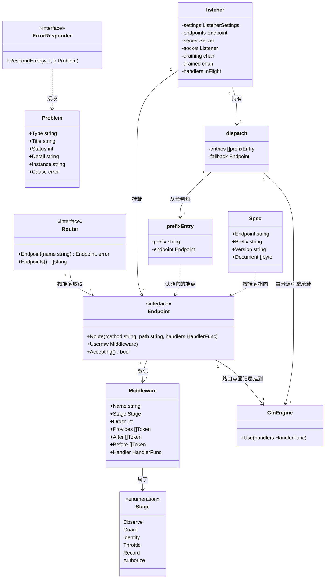
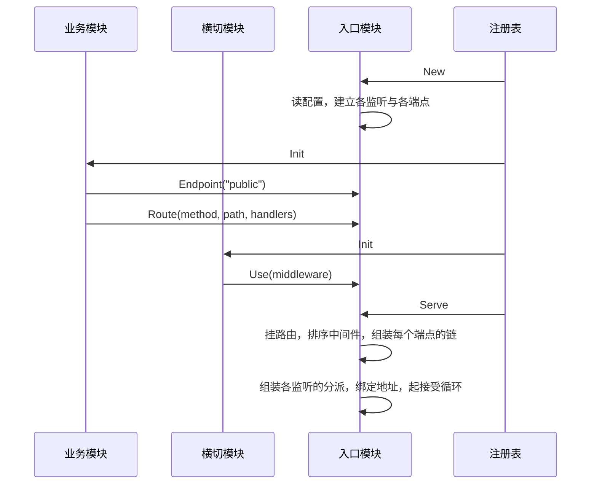
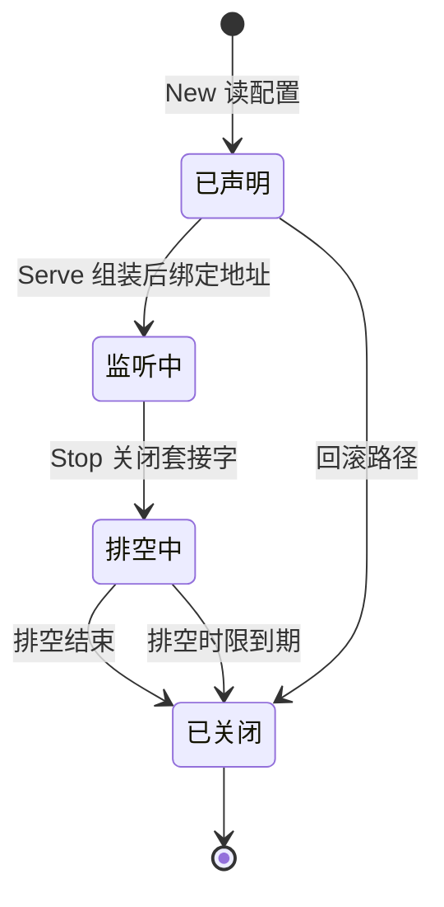

# http

## 职责

- 依据配置打开各条监听，在 `Serve` 阶段绑定其地址并开始接受请求；多个端点可挂在同一条监听上，共享它的套接字。
- 提供路由与中间件的登记面，写入闸门借用 `Migrate` 与 `Start` 阶段位，框住全局 `Init` 阶段。
- 按各中间件声明的阶段与阶段内约束组装每个端点的链，交给该端的 gin 引擎；监听持有一个分派 handler，按配置认领的前缀把请求交给认领它的端点，选端只由配置决定（[ADR-http-dispatch-2026-10-17](../../../adr/adr-http-dispatch-2026-10-17.md)）。
- 接住各登记层与 handler 抛出的 panic，收口一次响应并记一行日志（[ADR-http-recovery-2026-09-22](../../../adr/adr-http-recovery-2026-09-22.md)）。
- 为每个到达该端的请求写一条访问记录，成功与被拒的都在内（[ADR-http-access-log-2026-10-11](../../../adr/adr-http-access-log-2026-10-11.md)）。
- 按该端配置的 `max-body-bytes` 施加请求体上限，超限的请求体被限界并留下记录（[ADR-http-body-limit-2026-10-11](../../../adr/adr-http-body-limit-2026-10-11.md)）。
- 建立请求上下文，把日志模块的 logger 注入其中，供链上各层与 handler 取用。
- 停机时由 `Stop` 关闭各条监听的套接字，并等在途请求排空结束才返回（[ADR-http-shutdown-2026-09-14](../../../adr/adr-http-shutdown-2026-09-14.md)）；排空开始时向不会自行结束的响应发出信号。
- 报告各端点是否仍在接受请求，其状态取自该端点所属的监听。
- 定义资源类型 `Spec`，供模块声明自己的 OpenAPI 文档片段，并在启动时校验其形状。
- 定义默认的错误响应形状，经可选接缝接受定制，并提供写出它的入口，供各层与 handler 取用（[ADR-http-errors-2026-10-10](../../../adr/adr-http-errors-2026-10-10.md)）。
- 提供一个请求体绑定的入口 `BindJSON`，把绑定与校验的失败归成 413、400 或 422，并经写出入口答出（[ADR-http-bind-and-error-shape-2026-10-15](../../../adr/adr-http-bind-and-error-shape-2026-10-15.md)）。

登记面用 gin 的类型表达：路由的 handler 与中间件的 `Handler` 都是 `gin.HandlerFunc`。**本模块是 gin 的封装**（[ADR-http-surface-2026-09-14](../../../adr/adr-http-surface-2026-09-14.md)、[ADR-module-packaging-2026-09-14](../../../adr/adr-module-packaging-2026-09-14.md)）：路由匹配与路径的语法、中间件的调度、请求体的绑定与校验、响应的渲染都由 gin 提供，本模块不在其上另设一层，也不包装它们；它承担的是装配。取用本模块的宿主因而承受 gin 的依赖闭包。

### 非职责

- **不替代 gin 的绑定与校验器。** 请求体绑定与校验可经本模块的薄入口 `BindJSON`（见外部接口契约），它走 gin 的绑定能力，不是另写一套绑定语；响应渲染仍直接用 `gin.Context` 的方法，本模块不为 handler 自己写出的响应包装。
- **不改动 gin 绑定与校验器的进程级设置。** 那些设置对同一进程里的全部 gin 引擎生效，归宿主决定。
- **不认识任何具体功能。** 认证（[authn](../authn/design-authn.md)）、租户、限流是各自模块的事，本模块只按它们声明的约束排序，不知道任何一层做什么（[ADR-http-middleware-2026-09-14](../../../adr/adr-http-middleware-2026-09-14.md)）。
- **不为 handler 自己写出的响应定形状。** 默认的错误响应形状只覆盖本模块写出的响应与经写出入口写出的响应（见外部接口契约）；handler 用 gin 自己写出的响应，本模块不拦截。
- **不决定哪些路由免于认证、可选认证或允许冒充。** 这些登记归 authn 的网关（[authn-gate](../authn/design-authn-gate.md)），它以中间件的形式接入，请求期按已匹配的路由比对登记。
- **不认识前端的页面路径。** 前端与某条监听上的端点同源部署时，页面路径不落在该监听上任何非 `/` 认领之下，由宿主负责（见对宿主的要求）；本模块拿不到前端的页面表，判断不出两者相交。
- **不判定监听是否健康。** 本模块报告它是否仍在接受请求，把这个事实解读成健康与否归读取方，本模块不定义健康的含义，也不提供探活路由。
- **不合并 OpenAPI 片段，也不发布它们。** 本模块保存各模块声明的片段并校验其形状，把它们合成一份完整规格、或挂一条路由把它提供出去，都归读取方。
- **不签发或轮换 TLS 证书。** 监听的配置承载证书的位置，证书从哪里来、何时更换不在本模块范围内。
- **不承载运行期可变的参数。** 判据是该值是否在数据库可用之前就被需要；监听地址与超时在其列（[ADR-config-scope-2026-09-13](../../../adr/adr-config-scope-2026-09-13.md)）。

## 术语表

监听、端点、认领前缀、兜底端点与匿名面路由登记在项目[术语表](../../../glossary.md)。下列术语只在本文内按所列含义使用。

| 术语 | 英文 | 含义 |
|---|---|---|
| 次序 | `Order` | 一层中间件在它所属阶段之内的定位，以整数表达：越小越靠外，零值表示无偏好；只在同一阶段内比较，跨阶段的数值不可比。 |
| 路由模块 | route module | 经登记面 `Endpoint.Route` 登记路由的模块。 |
| 应答塑形模块 | response-shaping module | 对一个端点上的每个请求都起作用、不按路由区分的模块，按它交付的功能与登记的层判定，不按名字：交付凭据校验后端（`authn.Verifier`）、网关（`authn.Gate`）、错误响应形状（`ErrorResponder`）或语言能力（`i18n.Localizer`、`i18n.Resolver`、`i18n.Negotiator`）的模块，以及在网关之外登记层的模块——观测阶段、防护阶段，或鉴别阶段里排在网关之前。同时登记路由的模块按应答塑形模块处理。 |
| 未认证请求 | unauthenticated request | 不带凭据的请求，以及网关没能从所带凭据得出一个通过出口检查的主体的请求，界定与例举见 [authn-gate](../authn/design-authn-gate.md) 的请求期判定。主体成立、只因冒充范围不被该路由接纳而被网关拒绝的请求不在其列：它的调用方已认证。 |
| 豁免请求 | exempted request | 在比较的两次运行中至少一次命中匿名面路由，且每一次要么命中匿名面路由、要么没有匹配任何路由的请求。 |

## 外部接口契约

本模块交付一个功能，定义一种资源类型供其他模块声明，另有写出错误响应的入口与排空信号供 handler 与各层取用，另有一个供其他模块实现的可选接缝 `ErrorResponder`。本模块自己写出的拒绝从它自己声明的消息目录渲染文本，并把 `i18n.Localizer` 与 `i18n.Resolver` 作为可选依赖取用（见错误响应一节）。

**交付的功能**。功能标识的元素类型必须是接口，取用写作 `core.Resolve[http.Router](reg)`：

```go
type Router interface {
    // Endpoint 取得一个已声明的端点。任何阶段都可以调用。
    Endpoint(name string) (Endpoint, error)
    // Endpoints 返回已声明的全部端名，升序，每次调用返回一份新切片。
    // 任何阶段都可以调用。
    Endpoints() []string
}

// Endpoint 是一个端点上的登记面。
type Endpoint interface {
    // Route 登记一条路由：method 是 HTTP 方法，path 取 gin 的写法，
    // handlers 依次运行，最后一个处理本次请求。
    Route(method, path string, handlers ...gin.HandlerFunc)
    Use(mw Middleware)
    Accepting() bool
}
```

`nethttp` 是 `net/http` 在本包内的别名——本包自身叫 `http`，引用标准库时要区分开；`gin` 是 `github.com/gin-gonic/gin`。

`Endpoint` 在端名未声明时返回错误，因为端的集合来自配置这份数据。`Endpoints` 不返回错误：它读的是同一份已声明的集合。`Route` 与 `Use` 不返回错误：登记不上的只有调用点的编程错误，它们当场 panic，与 `core` 对非法功能标识、对重名登记的处理同类（见 [core](../design-core.md)）。`Handler` 为 `nil`、`Stage` 为零值或不是已声明的阶段、`Route` 没有 handler 或其中有 `nil`、`Provides`、`After` 与 `Before` 中出现非法的功能标识、不是 gin 规整后写法的路径、以及 gin 判为非法的方法或路径，都属于这一类——方法与路径是代码里写死的字符串，写错它们与数据无关。gin 接受 `nil` 的 handler 而要到请求到来时才崩，本模块因而在登记点拦下。登记时用一台独占的 gin 引擎单独试挂即可把非法的路径与冲突分开。

**路径须已是 gin 规整后的写法**：以 `/` 起头，不含多余的斜杠与 `.`、`..` 段，末尾的斜杠按原样保留。gin 把路径接到引擎的根上时会规整它，`c.FullPath()` 报出的是规整后的结果；登记的路径与它逐字相同，按（方法，`c.FullPath()`）与登记写法比对的层（认证网关的豁免、可选认证与可冒充登记，审计的匹配）才不会因为写法不同而永不命中。

**端的集合在本模块的配置里封闭，登记面按名取端，也列出全部端名。** 登记面的读方法是 `Endpoint` 与 `Endpoints`：`Endpoint` 按名取一个端，`Endpoints` 返回已声明的全部端名，按升序排列，每次调用返回一份新切片，调用方改动它不影响登记面，任何阶段都可以调用，`*` 作为保留端名不会出现在结果里（[ADR-http-enumeration-2026-10-10](../../../adr/adr-http-enumeration-2026-10-10.md)）。列出的只是端名：一个端上登记了哪些路由与层，登记面不提供枚举。

对全部端登记同一层的模块遍历 `Endpoints` 的结果，按清单收窄的模块照旧按名取端。前者的例子是认证网关，其 `endpoints` 的取值与展开见 [authn-gate](../authn/design-authn-gate.md)；后者的例子是租户准入层，见 [tenant-admission](../tenant/design-tenant-admission.md)。这两个使用者是例举，不是封闭集。

**漏写一个端不会让启动失败。** 模块能把自己声明的端名清单与端的全集互相比对，也能对每个已声明的端登记同一层；比对不是登记面做的，也不会让缺失自动失败。一个模块只在自己清单点名的端上登记，漏写一个端，那个端上就不会出现它的任何一层，启动期既不失败，也没有一行诊断指向它，除非那个模块自己拿全集比对并报错。这一档与宿主在命令树上漏写一个模块同源，起于装配的决定而不是意外（见 [architecture](../../architecture.md) 的可观测性）。

**察觉漏写靠 `Serve` 组装时逐端写出的链清单。** 每个已声明的端一行，行内按组装后的次序列出该端的各登记层，每一层连同它在 `Provides` 里声明的功能标识；不经登记面、也没有功能标识的那些内建层（请求上下文、`holdAllow`、访问日志、兜底层与请求体上限）同样列在这一行里，只有名字。功能标识是登记面能就「这一层代表什么」说出的唯一一件事，也是 `After` 与 `Before` 据以建图的那一样东西；`Middleware.Name` 只用于诊断，不是一个可被比对的标识，因而「某功能在这个端上的链里无人代表」只在这一行里读得出来。

同一个端上的路由**冲突**不属于这一类：登记只记录声明，两条路由是否冲突要到 `Serve` 组装、挂到该端的引擎上时才谈得上，那时 gin 以 panic 拒绝，本模块捕获它并报成启动失败。

功能标识是否合法，判据与 `core` 的同一条（元素类型必须是接口）。`core` 未导出它的判定，本模块自建一份，并以一条测试比对两者的结论——拿 `core` 的公开行为当基准，两份规则漂移时那条测试会红。

**`core` 不会导出这个判定**：它导出的包级函数受架构不变量约束，限于注册表的构造函数、进程级注册表变量、哨兵错误与需要类型参数的泛型封装，判定函数不在其中。本模块这份判定与那条比对测试因而是常设的，不是等上游补齐的临时措施。

本模块排他地交付 `(*Router)(nil)`：两个入口模块同时启用时，登记方无从知道自己登记到了哪一个，而"只能整体取出"对登记没有意义。本模块由根包在包初始化时登记，模块名是 `http`（导出为 `ModuleName`），**宿主在命令树上以这个名字点名它**：它排他交付，依赖闭包不替宿主挑，宿主没有写下的入口模块不进参与集，为它预置了实例的除外（见 [core](../design-core.md)）。

**排他声明多数时候并不是冲突真正暴露的地方。** 另一个交付 `Router` 的模块若同样使用 `http` 这个配置命名空间，同名输入项在 `config` 收集清单时就会失败，走不到消解阶段；同名登记更早，`core.Register` 在 `init` 期即 panic。排他声明因而是一条契约陈述，它在两个入口模块各自声明了不相交输入项这种情形下才是实际的拦截点。

**登记面在借用自 `Migrate` 与 `Start` 的阶段窗口内接受写入**，窗口之外的写入一律 panic。窗口以本模块的 `Migrate` 回调为起点、`Start` 回调为终点：阶段逐个推进，全局 `Init` 阶段整体落在这个区间之内，区间两端还各含 `Migrate` 与 `Start` 阶段中本模块之外的回调（见阶段行为一节）。最终 handler 在 `Serve` 阶段组装一次，此后不变（[ADR-http-routing-2026-09-14](../../../adr/adr-http-routing-2026-09-14.md)）。

读不受这道闸门限制：`Accepting` 报告该端此刻是否仍在接受请求，任何阶段都可以调用，绑定之前与停机之后都返回 `false`。

**中间件**。一层中间件连同它对自身位置的声明。类别由 `Stage` 给出，链按 `Stage` 上声明的顺序由外到内运行各阶段：

```go
// Stage 是本层所属的类别。零值不是任何一个类别，登记时拒绝。
type Stage uint8

const (
    StageObserve   Stage = iota + 1 // 看到每个请求，从不拒绝，也不写响应
    StageGuard                      // 与身份无关的防护：CORS、来源地址限流
    StageIdentify                   // 定身份与租户；拒绝为 401、404、503
    StageThrottle                   // 对已定的身份或租户施加配额
    StageRecord                     // 记录通过准入的请求，从不拒绝
    StageAuthorize                  // 对已定的身份裁决，拒绝由它之内各层记录
)

// OrderOutermost 与 OrderInnermost 是 Order 的两个公开哨兵，取 int 的极值，
// 用于"不被任何普通值超越"的诉求：前者不被更小的值超越，后者不被更大的值超越。
const (
    OrderOutermost = math.MinInt // 本阶段没有比它更小的普通值
    OrderInnermost = math.MaxInt // 本阶段没有比它更大的普通值
)

type Middleware struct {
    Name     string          // 只用于诊断：panic 文本与启动时列出的链
    Stage    Stage           // 本层所属的类别，必填：零值与未定义值在登记时 panic
    Order    int             // 本阶段内的定位：越小越靠外，零值表示无偏好，只在同一阶段内比较
    Provides []core.Token    // 本层在链上代表哪些功能，供他人指向
    After    []core.Token    // 本层位于这些功能的中间件之内，限本阶段
    Before   []core.Token    // 本层位于这些功能的中间件之外，限本阶段
    Handler  gin.HandlerFunc // 本层本身：c.Next 交给其后各层，c.Abort 终止链
}
```

**`Stage` 必填，没有默认值。** 登记时对零值与任何不是已声明阶段的值 panic：一个没说自己在哪个类别的层，本模块给不出位置；而一个默认值会让漏填的层落进没人选择的类别，对一个职责是拒绝请求的层，错误猜测选中的类别不是安全的那个（[ADR-http-stages-2026-10-11](../../../adr/adr-http-stages-2026-10-11.md)）。阶段之间的先后由本模块给出，与装配了哪些模块无关——这是它相对一个全局数值偏好的判据。**`Order` 没有必填一说。** 它的零值表示"无偏好"，落在本阶段已表态的各层之间，不区分"没写"与"写了 0"——排序里两者相同；`Stage` 必填的判据是"猜错类别不安全"，`Order` 没有对应的论证，因而不设必填。

**`After` 与 `Before` 限本层所属阶段，是硬约束；`Order` 只在阶段内取舍。** 阶段内的图按 `After` 与 `Before` 的边做拓扑排序，成环即启动失败；`Order` 只在就绪集合里选择，因而让位于阶段内的约束，两层取同一个值时由登记先后决定，同值不报诊断、也不构成失败。**跨阶段的 `After` 或 `Before` 是冗余的**：与阶段顺序同向时已被阶段满足、不建边，记一条 Debug 诊断；反向时启动失败，返回 `ErrStageConflict`，因为那条约束要的是阶段顺序的反面（[ADR-http-middleware-2026-09-14](../../../adr/adr-http-middleware-2026-09-14.md)、[ADR-http-stages-2026-10-11](../../../adr/adr-http-stages-2026-10-11.md)）。每个阶段规定进入它的层可以依赖什么，见中间件的排序一节。

**替换写出者的层要把它携带的可选接口转发出去。** gin 的链上，一层读响应的状态、是否已写出与已写出的字节数，用 `c.Writer` 的 `Status`、`Written` 与 `Size`，不必包装写出者；gin 的写出者本身按底层支持暴露 `Pusher`，并携带 `Flusher`、`Hijacker` 与 `Unwrap`，`http.NewResponseController` 经它可用。替换 `c.Writer` 的登记层要把原来那个写出者携带的可选接口转发出去，或用 `Unwrap` 把它暴露出来，否则一个对这些接口做类型断言的处理器在该端点上静默失效——流式响应与协议升级随之失效，且不报错。链的组装在这里，任何一层替换写出者都受它约束；本模块的内建层不替换写出者，因而不受影响。

**`Provides` 是约束能够落地的前提**：`After` 与 `Before` 指向功能，而链上哪一层代表哪个功能，只能由那一层自己声明。登记面拿不到登记方的身份——`Endpoint` 不带它，`core` 不提供「当前正在 `Init` 的模块」这样的查询，而本模块允许在协程里登记，调用栈也就不成立。`Provides` 为空是合法的，代价是无人能指向这一层。

**本模块不校验 `Provides` 与登记方描述符里 `Provides` 的一致性**，同样因为它不知道登记方是谁。一层因此可以声称代表一个它所属模块并不交付的功能。

声明写成：

```go
// 遥测模块：本层属于观测阶段，取哨兵 OrderOutermost 排在本阶段最外，不指向任何别的功能
ep.Use(http.Middleware{
    Name:     "observability",
    Stage:    http.StageObserve,
    Order:    http.OrderOutermost,
    Provides: []core.Token{(*observability.TracerProvider)(nil), (*observability.MeterProvider)(nil)},
    Handler:  instrument,
})

// 另一个模块的层：本层属于鉴别阶段，排在提供认证的那些层之内，二者同属一个阶段
ep.Use(http.Middleware{
    Name:     "tenant.resolve",
    Stage:    http.StageIdentify,
    After:    []core.Token{(*authn.Gate)(nil)},
    Provides: []core.Token{(*tenant.Resolution)(nil)},
    Handler:  resolve,
})
```

**路由引擎**。每个端点由本模块建一台 gin 引擎，不带 gin 的默认中间件；每条监听另建一台分派引擎，按各端点在配置里认领的前缀选出端点，把请求交给该端点的引擎（见分派 handler 一节）。两台引擎都是本模块的内部，登记方经 `Endpoint` 登记，拿不到它们。端点引擎有如下设定：

- **关闭尾斜杠重定向。** gin 默认把 `/x/` 重定向到 `/x`，而重定向发生在全局中间件之前，一个被重定向的请求不经过认证、限流、审计与遥测的任何一层。
- **开启对不允许的方法的识别。** 路径存在而方法不在其中时答 405 并带 `Allow` 头，不答 404。gin 在运行任何层之前就把 `Allow` 写进响应，一个在这条路径上先行拒绝的层（认证的 401、租户解析与租户准入的 404、限流的 429）因而会把路径存在与它允许的方法带给没有凭据的调用方；引擎的第一个内部处理器 `holdAllow` 把它摘下并留存，由方法不允许的处理器在各层放行之后写回。这个处理器不在登记面上，不参与排序，但列在启动时写出的链清单里。
- **开启上下文回落。** `*gin.Context` 作为 `context.Context` 使用时回落到请求上下文取值，`log.FromContext(c)` 与 `log.FromContext(c.Request.Context())` 取到同一个 logger。
- **无匹配路由与方法不允许经错误响应的入口写出**（见下）。两者与有匹配的请求一样经过全部登记层，认证因而在路径不存在时同样先于 404。
- **只有配置点名了可信代理，才采信转发头。** gin 默认采信任何来源发来的 `X-Forwarded-For`，`c.ClientIP()` 因而可以被客户端伪造；引擎的默认是不信任任何代理，`c.ClientIP()` 只返回连接的对端地址。一个端在配置里列出可信代理网段与来源地址头名时，`c.ClientIP()` 才从这些头里取地址，且只对来自这些网段的连接生效。网段与头名交给 gin 的 `SetTrustedProxies` 与 `RemoteIPHeaders`，本模块不自己解析任何转发头；配置已经拒绝了一个 gin 解析不了的网段，`SetTrustedProxies` 因此在这里不会失败。`Context` 回落到请求的上下文，放进那里的 logger 从 gin 上下文同样取得到。
- **gin 处于发布模式，调试输出不写到标准输出。** 运行模式与输出是 gin 的进程级设置：路由登记时的调试打印不经日志模块，本模块因而在构造时把它们关掉。

**路由冲突在 `Serve` 组装时报成启动失败，并归因到一对路由。** gin 在挂载时以 panic 拒绝冲突：同一位置上的路径参数名不一致、同一方法同一路径重复登记、通配与静态段或参数并存都在其列；静态段与参数并存则被接受，不同方法上的同一路径互不冲突。本模块捕获这个 panic，点名被拒的那一条，以及已挂载的哪一条与它冲突。归因的做法是把已挂载的每一条与被拒的那条两两放到一台独占的引擎上复现，复现出拒绝的那一对即是。**归因不出来时错误要说明这一点，不退化成只点名被拒的那条**：一条只对部分冲突成立的诊断承诺，会在遇到它答不出的那一类时悄悄失效。gin 在挂载时拒绝、而已挂载的路由中没有任何一条能与被拒的那条复现出拒绝的情形——例如一条路由连同该端各层的 handler 总数超出 gin 一条链所能容纳的上限——同样报成路由冲突，错误文本说明归因失败。登记点的试挂在一台没有任何层的引擎上做，看不到这一类。

**API 声明资源**。模块声明自己那一份 OpenAPI 文档，本模块保存供查询：

```go
type Spec struct {
    Endpoint string // 这份文档描述哪个端点上的 API
    Prefix   string // 该端点服务 API 的路径，写作裸段，如 "api"
    Version  string // 该模块服务的 API 版本段，如 "v1"
    Document []byte // OpenAPI 文档片段，JSON；paths 相对 Prefix 与 Version
}
```

`Document` 是片段而非完整的规格：它描述声明它的那个模块提供的 API，一个进程的完整规格由读取方把各片段合并得出。模块通常以 `//go:embed` 把自己的 `openapi.json` 读进来。

**片段的 paths 是相对写法。** 一条路由的完整路径由读取方拼出：`Prefix` 与 `Version` 非空的部分以 `/` 连成 API 根（`api` 加 `v1` 是 `/api/v1`），再接片段里的 path（`/auth/me`），得 `/api/v1/auth/me`。斜杠由读取方插入，声明里不写前导或尾随斜杠。**版本段由模块自己声明**：同一个模块开始服务第二版时，它为那一版再声明一个 `Spec`，两版的片段各带自己的 `Version`。**`Prefix` 是端点属性，同样由模块声明**：它是这个端点服务 API 的路径，与宿主配置里的认领前缀是两份各自维护的事实，本模块不解释、也不核对它们一致。

**片段可以由 operation 声明生成，声明同时绑定 handler。** 模块在 `Resources` 里再声明一份 `http.Operations`：每条 operation 是 `http.Operation[In, Out]`，带方法、相对路径、描述与应答集；`In` 与 `Out` 是 handler 的输入与成功应答类型。handler 经 `Operation.Handle` 绑定，签名必须是 `func(context.Context, In) (Out, error)`——别的签名编译不过。**入口模块负责把请求变成 `In`、把 `Out` 写成声明的成功应答**：参数从 `In` 的 `path`/`query`/`header`/`cookie` tag 绑定，请求体从 `json` tag 解码（未知成员拒绝），因此 handler 拿不到请求本身，读不到声明没带的参数，也写不出声明没描述的字段。handler 返回的错误经 `Failure` 接口给出状态，且只在该状态已声明时才写出，否则答 500。

**错误应答由公共集加覆盖声明。** 模块把一组 `Response` 作为公共失败集，`Failures(common, specific...)` 按状态合并：operation 同名状态的应答覆盖公共应答，任一侧独有的状态被加入。`Fault` 承载状态、问题类型、标题与详情，handler 可以返回它，也可以 `panic` 它；入口模块只写出该 operation 声明过的状态，未声明的一律 500。恢复层把携带 Problem 的 panic 只在该状态已声明时当作拒绝写出，其余 panic 仍按缺陷处理。**错误体形状是一份声明**（`ErrorShape`）：默认是 RFC 9457 问题文档；宿主交付自定义 `ErrorResponder` 时，用同一个形状声明它的错误应答，片段因此描述真正会写出的内容（[ADR-http-failure-responses-2026-10-19](../../../adr/adr-http-failure-responses-2026-10-19.md)）。

`pkg/internal/openapigen` 从同一份声明生成片段，桥接 `swaggest/openapi-go` 做 JSON Schema 反射与 OpenAPI 3.1 组装；片段因此是构建产物，生成结果与提交的片段不一致即生成测试失败。迁移按模块进行，尚未迁移的模块继续手写片段。`Spec` 给片段的文档与 API 根，`Operations` 给文档的内容；两者都在 `Resources` 里静态声明，都不参与路由（[ADR-http-openapi-generation-2026-10-18](../../../adr/adr-http-openapi-generation-2026-10-18.md)）。

`Spec` 不参与路由。它供文档合并、网关配置与权限清单这些发生在装配之外的用途读取，与实际登记是两份各自维护的事实（[ADR-http-routing-2026-09-14](../../../adr/adr-http-routing-2026-09-14.md)）。读取方用 `core.Resources[http.Spec](reg)` 取得全部片段，每一份都带着声明它的模块名，合并冲突因而能点到来源。**本模块交付的片段由运行面 [ops](../design-ops.md) 合并并发布，它取可用集、不做减法**（见 [ops](../design-ops.md) 的取材域与 [ADR-ops-spec-reader-2026-10-15](../../../adr/adr-ops-spec-reader-2026-10-15.md)）。

**取材域**（架构不变量 15）。本模块自己的形状校验取**可用集**：它只校验声明而不让声明生效，而畸形与否是静态事实，让一条声明因为本次没被纳入而漏检，会使同一个二进制在两条命令下给出不同的启动结论。它跑在 `Prepare` 里，此时启用结果尚未消解出来，只有启用集不可取（声明集与参与集在这之前就已确定，见 [core](../design-core.md)）。**这个消费点不做减法**：形状校验只读声明、不让它生效，一个本次不运行的模块，其 `Spec` 的畸形仍是这个二进制的一份静态事实。**读取方的取材域由读取方自己裁定**：问"这个二进制提供哪些 API"取可用集，问"此刻这个进程在服务哪些 API"取启用集。本模块交出全部片段，不替读取方过滤——那是它对读取方的承诺，不是对取材域的规定。

一个 `Spec` 对应一个端，API 分布在多个端的模块把多个 `Spec` 放进自己的 `Resources`。`Spec.Endpoint` 指向一个未声明的端时本模块不报错：资源是静态声明，本模块只保存并供查询，不解释它描述的内容。

**本模块校验文档的形状，不校验它的内容。** 空的 `Document`、不是 UTF-8、不是合法 JSON、顶层不是 JSON 对象、顶层没有 `openapi` 字段、`Prefix` 不是裸段列表、`Version` 不是单段、`paths` 里的一条不以 `/` 开头或已经带着 `Prefix` 与 `Version` 拼出的根，各是一类启动失败。最后两条挡住的是相对写法被破坏的两种形状：根会被拼两次，或拼出来不是一条合法路径。完整的 OpenAPI 语法校验要引入解析库，本模块不引入它；这里挡住的是会让下游的合并在启动之后才崩掉的那一类。

**配置**。本模块以 `config.Schema` 资源声明自己的输入项，分**监听**与**端点**两组。每条监听各有地址、四项超时、可选的 TLS 证书位置与排空时限，`Stop` 以排空时限为界等待该监听上在途请求走完；每个端点各有它挂靠的监听名、它认领的路径前缀、请求体上限、可信代理网段与来源地址头名。端点的 `listener` 指向一条不存在的监听时启动失败，错误点名该端点、它指的名字与已声明的监听名。监听的集合由配置给出：一条监听都没有声明时本模块无法启动，启动失败，错误点名缺的是监听的声明。纳入本模块即承诺装配它，配好至少一条监听因而不可省——无论由宿主在命令树上点名，还是不写命令树的调用方走 `Run` 入口。

**端名 `*` 是保留的。** 配置里写一个名为 `*` 的端，`Prepare` 即失败，错误点名该端与应改的键，与未知键、缺地址的判定同在读配置这一步。保留它，是为了让别的模块的端名清单能以 `*` 表示全部已声明的端，而不与某个真实端名相撞（[ADR-http-enumeration-2026-10-10](../../../adr/adr-http-enumeration-2026-10-10.md)）。

**端点在 `prefixes` 里列出它认领的路径前缀，监听只凭这些认领为请求选端**（见分派 handler 一节；[ADR-http-dispatch-2026-10-17](../../../adr/adr-http-dispatch-2026-10-17.md)）。取值是字符串列表，与端点集合的其余键一样只从主配置源取值。省略等于 `["/"]`。`/` 表示「本监听上不落在其他端点认领之下的路径」，认领它的端点是该监听的兜底端点，它不参与最长匹配；一个端点可以同时认领 `/` 与别的前缀，用来从外层的认领里收回一段嵌套的子树。只挂一个端点的监听因而不必写这个键，那个端点即兜底端点。

```yaml
http:
  endpoints:
    api:
      listener: backend
      prefixes: ["/api"]
    admin:
      listener: backend
      prefixes: ["/api/v1/audit", "/api/v1/settings", "/api/v1/tenant"]
    web:
      listener: backend
      prefixes: ["/"]      # 兜底端点：本监听上无人认领的路径交给它
    ops:
      listener: ops        # 独占一条监听，省略即 ["/"]
```

**一条前缀的写法**：以 `/` 开头，`/` 本身合法；除 `/` 外不以 `/` 结尾，没有空段，没有 `.`、`..` 段，没有以 `:` 或 `*` 开头的段；不含 `%`、`?`、`#`、空白与控制字符，因为分派比对的是解码后的请求路径，带 `%` 的前缀永远匹配不上。**同一个端点的列表**不为空（显式写 `[]` 同样拒绝，那样的端点收不到任何请求），没有重复项，除 `/` 外两条前缀不互为祖先。写法与列表上的错误都与未知键、缺地址、保留端名同属读配置时判出的取值错误，`Prepare` 即以 `ErrInvalidConfig` 失败，错误点名完整键路径（如 `http.endpoints.<端>.prefixes[<i>]`）与原值。

**同一条监听上，一条前缀只归一个端点。** 两个端点认领同一前缀、两个端点都认领 `/`，`Prepare` 即以 `ErrClaimConflict` 失败，错误点名该监听、两个端点与那条前缀。多端点监听上两个端点都省略 `prefixes`，就是两个端点都认领 `/`，错误文本因此写明改法：给除一个之外的每个端点写 `prefixes`。不同端点的前缀可以嵌套，请求期取最长的那条。

**各项的默认值**：读取请求头的时限 10 秒，读取与写出的时限各 30 秒，空闲连接 120 秒，排空时限 30 秒，请求体上限 1 MiB。可信代理网段与来源地址头名默认为空，即不信任任何代理、不读任何转发头。请求体上限由请求体上限那一层施加，`0` 表示不设上限。前四个时限与排空时限按监听配置，后三项按端点配置。

**监听条目与端条目里的每个键都要是那一类认得的键，认不出即启动失败。** 监听集合与端点集合各是一个容器叶子，其内部的键不参与配置的未知键校验（见 [config](../design-config.md)）：一个拼错的排空时限、请求体上限或监听名会被静默丢掉、默认值照样生效，而配置它的人以为这一条已按所写的生效。本模块因而自己查这些键，错误点名那条监听或那个端点、认不出的键与它可用的全部键。缺地址的监听同理点名该监听与要写的键。

**时长项的零值不统一，判据是关掉它的后果由谁承担。** 多数时长项显式 0 表示关闭该项，后果限于配置者自己那条监听。两项例外，显式 0 一律拒绝并给出理由：读取请求头的时限关掉之后，一个不发完头部的连接可以无限占住资源；排空时限关掉之后 `Stop` 会无限等一个卡不动的在途请求，而此时 context 已被剥掉取消、注册表也不施加停机超时，宿主阻塞在驱动里再无可打断的途径——排空时限正是 [ADR-http-shutdown-2026-09-14](../../../adr/adr-http-shutdown-2026-09-14.md) 指定用来满足「回调必须有界」的那一项。

**请求体与响应**。handler 的请求体绑定与校验可经本模块的 `BindJSON`，也可直接用 `gin.Context` 的方法；响应渲染仍直接用 `gin.Context` 的方法。

```go
// BindJSON 把请求体绑定到 dst，把绑定与校验的失败归成 413、400 或 422，
// 经 Fail 写出 Problem 并返回 false；成功返回 true。
func BindJSON(c *gin.Context, dst any) bool
```

`ShouldBindJSON` 失败时，`*nethttp.MaxBytesError` 归 413、其余归 400；绑定成功而 `dst` 实现 `interface{ Validate() error }` 并报错时归 422。请求体的大小上限由该端配置的 `max-body-bytes` 施加，落在一个内建层上（见请求体上限一节）：对该端的每个 handler 一律生效，无论谁以哪种方式读 body。声明了 `Content-Length` 且超限的请求，在该层就被写出一次 413；长度未知的请求被包住，读到超限时以 `*nethttp.MaxBytesError` 结束，调用方用 `errors.As` 判别。

**`BindJSON` 写出的拒绝不带本地化的标题，`Detail` 是底层错误的文本。** 本模块自己写出的四类拒绝（无匹配路由、方法不允许、请求体超限、接住 panic）从本模块的消息目录渲染 `Title`；`BindJSON` 做不到——它是一个包级函数，取不到装配好的本地化器，那是本模块各拒绝点的闭包变量，不在请求上下文里。**同一个状态码因而有两处标题来源**：`Content-Length` 已声明且超限的那条 413 由内建层写出、带本地化标题，经 `BindJSON` 读到超限的那条 413 不带。要让它也本地化，得给它一条到达本地化器的途径（例如把它放进请求上下文），那比一个薄入口的面要大（[ADR-http-bind-and-error-shape-2026-10-15](../../../adr/adr-http-bind-and-error-shape-2026-10-15.md)）。

**错误响应**。本模块写出的错误响应有一个默认形状，可由一个可选接缝整体替换；供各层与 handler 写出错误响应的入口与它们共用同一处决定形状（[ADR-http-errors-2026-10-10](../../../adr/adr-http-errors-2026-10-10.md)）：

```go
// Problem 是一次错误响应的内容，字段取自 RFC 9457。
type Problem struct {
    Type     string // 缺省为 "about:blank"
    Title    string // 缺省为状态码的标准说明，没有标准说明的状态码则省略
    Status   int
    Detail   string
    Instance string
    Cause    error // 不写入默认响应体，供定制的 ErrorResponder 读取
}

// ErrorResponder 决定本模块写出的全部错误响应的形状。
type ErrorResponder interface {
    RespondError(w nethttp.ResponseWriter, r *nethttp.Request, p Problem)
}

// Fail 把一次拒绝或失败写成错误响应，并中止其后的 handler。
func Fail(c *gin.Context, p Problem)
```

没有模块交付 `ErrorResponder` 时用默认形状：以 `Problem.Status` 为状态码，不在 200 至 599 之内时写 500——单独写出的 1xx 是信息性响应，不是最终状态；响应体是 `application/problem+json`，内容为 `Type`、`Title`、`Status`、`Detail` 与 `Instance` 中的非空字段，`Cause` 不写入。默认形状自己写出响应体，调用方在此之前设过的 `Content-Length` 与 `Content-Encoding` 描述的是另一份响应体，它丢弃这两个头，其余响应头保留。兜底层接住 panic 后写默认形状时，另外丢弃描述 handler 原打算写出的那份内容的头：`Content-Disposition`、`ETag`、`Last-Modified`、`Content-Range`、`Accept-Ranges`、`Cache-Control` 与 `Expires`——一条带着 handler 的 `Cache-Control: public` 的 500 会被缓存当作答案留下。交付者替换的是整个形状：它须按 `Problem.Status` 写出状态码，响应体与媒体类型由它决定，响应头一概不由本模块动。

**文本在到达这处接缝之前已经完成。** 一个决定错误响应形状的接缝不承载语言：`Problem.Title` 与 `Problem.Detail` 是被写出的成品文本，本模块不读取任何本地化输入。本模块自己写出的四类拒绝——无匹配路由的 404、方法不允许的 405、请求体超限的 413、接住 panic 的 500——由本模块从它自己声明的消息目录渲染文本（见本模块自己写出的拒绝的渲染一节；[ADR-i18n-error-rendering-2026-10-13](../../../adr/adr-i18n-error-rendering-2026-10-13.md)）。

**本模块自己写出的拒绝的渲染。** 本模块写出的四类拒绝的文本随请求语言变化，一处渲染点就在写它们的地方：本模块按状态码取消息键 `http.<status>`，从它自己声明的消息目录取文案，填进 `Problem.Title`。目录以 `i18n.Catalog` 资源声明，与别的模块的目录同形——一个语言一个 `locales/{tag}.json`，键到消息的 JSON 对象，由本模块的 `embed.FS` 承载；引擎把各模块的目录合并成一个索引，这些文案因而与其余模块的文案一起按请求语言渲染（[ADR-i18n-catalogs-2026-10-13](../../../adr/adr-i18n-catalogs-2026-10-13.md)）。

**本模块取用可选的 `i18n.Localizer`。** 渲染经 `i18n.Localizer` 完成，它是可选依赖：装配里有引擎时，它按请求上下文里的语言取出文案；没有引擎、或某个键没有目录承载时，拒绝回落到 `net/http` 的状态文本，`Title` 永不为空。取用的是本能力目录的根包，它只依赖标准库，因而不使本模块的依赖预算增长（[ADR-i18n-locale-type-2026-10-13](../../../adr/adr-i18n-locale-type-2026-10-13.md)）。一个只发机器字段（`Type`、`Status`）、不带文本的拒绝不在目录里取文案，按状态码回落到标准文本。

**本模块取用可选的 `i18n.Resolver`，用来在响应上写出正文的语言。** 默认形状在 `Content-Language` 头里写出这一次响应的语言，取自 `Resolver.LocaleOf`；没有装配引擎、因而没有解析器时不写这个头。一个客户端请求了一种语言、却因回落拿到另一种时，这个头是它知道拿到的是哪一种的途径。这个头只在默认形状下写：交付了 `ErrorResponder` 的装配里，形状与它的头都是那个实现的。

**经这处决定形状的响应**是：`Fail` 写出的；兜底层接住 panic 后写出的，状态码 500，`Cause` 是一个包着 panic 值的错误；无匹配路由的 404；方法不允许的 405。handler 用 gin 自己写出的响应不经它。

**`Fail` 之前设置的响应头保留。** 认证层的 `WWW-Authenticate`、限流层的 `Retry-After` 由各层在调用 `Fail` 前设好，形状的决定者不丢弃它们。响应已经开始流出去时，`Fail` 不写入，只中止其后的 handler，已提交的状态码与响应体不被改写。**「已开始」的判据是 gin 的写出者认定的已写出（`c.Writer.Written()`）**：提交过一个状态码、写出过一个字节、刷新过或接管过连接，都算已开始，而光调 `c.Status` 只设状态码、不提交，不算。兜底层写 500 用同一个判据，因而与 `Fail` 一致：handler 只设了状态码、没有真正提交过时，写出者仍报未写出，兜底层把它改写成 500，而不是留下那个从未提交的状态码。

**写出入口取得的 `ErrorResponder` 由请求上下文的建立那一层放进请求上下文**，与 logger 同途，`Fail` 从 `c.Request.Context()` 取它。请求上下文里没有它时（没有经过本模块的链，例如测试里单独构造的上下文）用默认形状。

**排空信号**。不会自行结束的响应——服务端事件流、长轮询、被接管去跑别的协议的连接——要知道停机已经开始，才能自己收尾：

```go
// Draining 返回一个通道：ctx 所属请求的那个端点停止接受请求、开始排空时，它被关闭。
func Draining(ctx context.Context) <-chan struct{}
```

**排空不取消在途请求的 context**：普通请求要能对着一个完整的系统走完，取消它的 context 会让它中途失败。只看自己 context 的长连接 handler 因而得不到任何通知，一直跑到排空时限把它切断，停机随之报排空超时；这个信号与请求的 context 分开，正是为此。它由端点的服务器放进每个请求的上下文，不经登记面，也不占链上的位置。**不是派生自请求上下文的 context 取不到它**，返回 `nil`，一个永远不会就绪的通道。

### 对宿主的要求

认领之内的路径由认领它的端点作答，认领之外的由兜底端点或分派作答，认领集合因此是一份对未认证者可读的配置。宿主写认领时守下列各条，这份清单是穷举的（[ADR-http-dispatch-2026-10-17](../../../adr/adr-http-dispatch-2026-10-17.md)）：

- **认领是产品固定的命名空间表，不随 import、也不随运行集增删。** 它至少覆盖可用集里各模块以 `Spec` 声明的路径所在的命名空间，以及该监听所服务的前端会寻址的命名空间，不论对应模块本次是否运行。
- **去掉一项能力时，它的命名空间留在认领里**，不论是把它撤出运行集，还是删掉它的 import。
- **认领按能力命名空间写**，例如 `/api/v1/tenant` 而不是 `/api/v1/tenant/admin`；只有要把一段子树划给另一个端点时才写更深的前缀。示范的业务端点认领 `/api`，同一监听上另两个端点因而按 `/api/v1/<能力>` 认领各自的那段子树（[ADR-http-api-prefix-2026-10-18](../../../adr/adr-http-api-prefix-2026-10-18.md)）。
- **与前端同源部署时，前端的页面路径不落在同一监听上任何非 `/` 认领之下。** 落在某条认领之下的页面路径，整页导航拿到的是那个端点的应答（未认证时是它的拒绝，已认证时是它的 404），拿不到前端的入口文档。
- **模块的挂载路径可以配置时，认领随之改**，例如认证的挂载基路径 `authn.gate.mount.base-path`。

漏写的认领一部分会在启动时暴露：模块运行时，它落在认领之外的路由让 `Serve` 以 `ErrUnclaimedRoute` 失败（见分派 handler 一节）。不运行的模块、删掉了 import 的能力漏写认领，本模块判不出，它们的缺席能从「拒绝还是兜底应答」读出。

## 依赖

`pkg/http` 根包 import `pkg/core`、`pkg/config`、`pkg/log`、`pkg/i18n` 与 gin：`core` 提供功能标识的类型与资源、实例的查询，`config` 用于声明输入项，`log` 提供可选依赖的功能标识与上下文存取，`i18n` 提供 `Localizer`、`Resolver` 功能标识与 `Catalog` 资源类型，gin 提供登记面的 handler 类型与路由、绑定、渲染。接口面上除标准库与本包自己的类型之外，出现 `core` 的功能标识类型与 gin 的 `gin.HandlerFunc`、`*gin.Context`；本模块把它的消息目录作为 `i18n.Catalog` 资源声明在模块的 `Resources` 上，该资源类型不出现在任何导出签名里，因而不在这一接口面上。

**本模块封装 gin，取用本模块的宿主因而承受 gin 的依赖闭包，另承受 `pkg/config` 的解析工具依赖。** 声明输入项与读取配置都经由 `pkg/config`，它解析配置所用的那些库因而落在本模块的传递闭包里，这是 [ADR-config-parsing-2026-09-20](../../../adr/adr-config-parsing-2026-09-20.md) 记下的代价；gin 与它的传递依赖落在其中，是 [ADR-http-surface-2026-09-14](../../../adr/adr-http-surface-2026-09-14.md) 记下的代价。守住的那一条是本模块不在其上新增：`pkg/http/deps_test.go` 以「标准库 ∪ 本仓库模块 ∪ `pkg/config` 的当前闭包 ∪ gin 的当前闭包」为预算扫描本模块的全部包，预算之外的一个包即失败，OpenAPI 解析库因而仍然进不来。

本模块声明对 `Logger` 功能的可选依赖：日志模块在场时注入它的 logger，不在场时不注入。可选依赖的缺失是一种合法配置，模块按文档所载的默认行为继续运行，这是架构允许的唯一降级形态（[ADR-dependency-resolution-2026-09-13](../../../adr/adr-dependency-resolution-2026-09-13.md)）。**代价**：没有日志模块时，请求路径上的日志照常写出，但进的是进程根 logger 的目的地即标准输出，而不是配置的目的地，且这不产生任何失败信号（[ADR-log-context-2026-09-13](../../../adr/adr-log-context-2026-09-13.md)）。

**这条代价在真实宿主里到得了。** 根包 import `pkg/log`，而它在包初始化时把自己注册进进程级注册表，于是凡 import 了本模块的宿主都传递地拿到一个**已登记**的日志模块。已登记不等于在场：取用只认已有的实例，一条只运行级纳入本模块与业务模块、没有列举 `log.ModuleName` 也没有预置日志实例的命令里，日志模块不进参与集、不构造，本模块也就真的取不到它。这一支的表现与手工构造注册表时相同——请求路径上的日志进进程根 logger 的目的地，而不是配置的目的地，且不产生失败信号。

本模块另声明对 `ErrorResponder` 功能的可选依赖：有模块交付它时，本模块写出的全部错误响应的形状由它决定；没有时用默认形状。这一项缺席不丢失信息，默认形状带着状态码与标题。多个模块交付它时取用以 `ErrAmbiguousProvider` 失败，启动随之失败。

本模块另声明对 `i18n.Localizer` 与 `i18n.Resolver` 功能的可选依赖，并声明自己的消息目录（`i18n.Catalog` 资源）：有模块交付 `Localizer` 时，本模块自己写出的四类拒绝按请求语言渲染文本；有模块交付 `Resolver` 时，默认形状在 `Content-Language` 里写出所用的语言。没有装配引擎时这些拒绝回落到 `net/http` 的标准状态文本、也不写这个头。这些缺席都不丢失信息，拒绝仍带着状态码与标准说明（见错误响应一节）。

方向满足架构不变量：本功能目录位于 `core` 与 `config` 之上、全部登记路由的模块之下，不 import 其中任何一个。它 import `pkg/i18n` 的根包，但那个根包不是登记路由的模块，只依赖标准库，因而不因此引入任何登记方。中间件的相对位置以功能标识声明，标识由声明方给出，本模块因而不 import 任何贡献中间件的模块。

## UML 图

登记面与其承载的声明：



`Spec` 与 `Endpoint` 之间是虚线：`Spec` 只按端名指向一个端点，不参与该端的组装。一层 `Middleware` 声明自己所属的 `Stage` 与在本阶段内的 `Order`，链按阶段顺序、阶段内的 `Order` 取舍，以及阶段内的 `After` 与 `Before` 排出。`listener` 未导出，`Serve` 阶段由它持有服务器、套接字、开始排空信号与排空结束信号、在途 handler 的计数，以及挂在它上面的各 `Endpoint`。**一个 `Endpoint` 有它自己的 gin 引擎，`listener` 持有的 `dispatch` 由另一台分派引擎承载**：端点的引擎承载它的路由与登记层；`dispatch` 的内容全部取自配置——`entries` 是挂在该监听上的各端点在 `http.endpoints.<端>.prefixes` 里认领的非 `/` 前缀，每项连同认领它的端点，从长到短排列，`fallback` 是认领 `/` 的端点，没有则为空。分派按 `entries` 把每个请求交给认领它的端点，不落在任何一项之下时交给 `fallback`，`fallback` 为空则自答 404。端点的路由表不进入 `dispatch`。`dispatch`、`prefixEntry` 与两处 `GinEngine` 都未导出。`ErrorResponder` 由其他模块交付，`Problem` 是它接收的内容。

一次装配中跨模块的交互：



业务模块与横切模块的 `Init` 先后由依赖序给出，图中的次序是其中一种。登记面此刻接受写入，`Serve` 之后不再接受。排序发生在 `Serve` 而非登记时：全部登记齐备才能排出确定的链。

一条监听的绑定与排空生命周期：



时限到期这条边从"排空中"出发，不从"监听中"：时限度量的是排空，而排空要到 `Stop` 把状态推进"排空中"之后才开始。从"已声明"直达"已关闭"的那条边是回滚路径：任一阶段失败时全部已构造的实例都要走 `Stop` 与 `Close`，因而 `Stop` 与 `Close` 必须容忍一条从未监听过的监听（见 [core](../design-core.md)）。

## 核心数据结构

登记面在登记窗口内积累的是声明，不是成品：每个端点持有一张按登记先后排列的路由表与一张中间件表。路由表与登记层在 `Serve` 阶段挂到该端的 gin 引擎上；引擎之内还有不经登记面的内建层——访问日志、兜底层与请求体上限，各落在阶段之间的固定位置（见组装与兜底层两节）；引擎之外只有请求上下文的建立。每个端点组装好的 handler 交给它所属监听的**分派 handler**，由分派 handler 按该端点在配置里认领的前缀在选择时把请求交给它；分派 handler 挂在监听的服务器上。认领在 `Prepare` 读配置时确定，与端点登记了哪些路由无关；分派不读路由表，路由表在 `Serve` 组装分派时只用来核对每条路由落在登记它的端点的认领之内（见分派 handler 一节）。

中间件表的每一项是一个 `Middleware` 值。`After` 与 `Before` 中的功能标识指代功能而非实例，与 `Requires` 中的写法一致（[ADR-capability-token-2026-09-13](../../../adr/adr-capability-token-2026-09-13.md)）。本模块不解析这些标识的含义，只用它们建图。

## 核心算法与流程

### Serve 阶段的组装

每个端点各组装一次，依次：

1. 内建层与登记层按固定的次序依次交给该端的 gin 引擎的 `Use`，因而每一层都作用于该端的全部路由，包括无匹配路由与方法不允许的响应。由外到内的次序是：`holdAllow`（引擎的第一个处理器）、访问日志、观测阶段的各层、兜底层、防护阶段的各层、请求体上限、鉴别及其内各阶段的各层。先于路由交给引擎是承重的：gin 在加入一条路由时才把引擎已有的 handler 并进它的链，路由挂上之后才交的层到不了它。
2. 该端的路由表挂到引擎上。同一个端上的路由冲突在此暴露，启动失败并点名冲突的两条路由与它们所在的端点。是否冲突由 gin 判定，本模块不自己比对；冲突落在哪两条上，按路由引擎一节所述归因。
3. 请求上下文的建立包在引擎之外、链的最外层（见请求上下文的建立一节），链上每一层与每个 handler 都能取到 logger 与 `ErrorResponder`。

随后每条监听各组装一次它的分派：以挂在其上的各端点在配置里认领的前缀建立选择表，取认领 `/` 的端点为兜底端点，并核对每个端点的每条路由都落在它自己的认领之内（见分派 handler 一节）。**一条路由按请求期的选端规则选中的不是登记它的端点时，在这里暴露，启动以 `ErrUnclaimedRoute` 失败**，错误点名该监听、该路由（方法与路径）、登记它的端点及其认领，以及实际会选中的端点与前缀，或者没有任何端点会选中它。同一条监听上的认领冲突不在这一步：它们在 `Prepare` 读配置时即以 `ErrClaimConflict` 失败（见外部接口契约的配置）。

组装完成后逐条监听绑定地址。链的组装、分派的组装与地址的绑定都在 `Serve` 的同步部分完成，其中任何一步失败都是启动失败。

**TLS 监听经 ALPN 同时提供 HTTP/2 与 HTTP/1.1**，与标准库自己的 TLS 路径相同。TLS 监听器由本模块自建，是为了让证书在 `Serve` 的同步部分装载、装载失败即启动失败，不为改变协议的选择；客户端只提供 HTTP/1.1 时照常走 HTTP/1.1。

**绑定之后逐条监听写一条记录，报出实际绑定的地址。** 记录带监听名、套接字实际绑定的地址、配置给出的地址、是否走 TLS，以及挂在该监听上的端点名清单。配置写 0 号端口时端口由操作系统挑选，这条记录是进程之外得知它的唯一途径；它在接受循环起来之前写出，而套接字此时已经绑定，读到它的客户端可以立即连接。

### 分派 handler

每条监听持有一个分派 handler，它由本模块为该监听组装的分派引擎承载，是本模块的内部，登记方拿不到它。分派引擎不挂任何路由：它的每个请求都进入同一条选择路径，按各端点在配置里写的**认领前缀**选出端点，再把请求交给那个端点的引擎。该端点自己的引擎再匹配一次并跑它的链，以它自己的形态作答——命中之路答其 handler，未命中之路答该端点的 404，路径存在而方法不允许之路答该端点的 405 加 `Allow` 头。请求路径不落在任何非 `/` 认领之下时，交给该监听的**兜底端点**，即认领 `/` 的端点；没有兜底端点则由分派自答 404（[ADR-http-dispatch-2026-10-17](../../../adr/adr-http-dispatch-2026-10-17.md)）。

**选端只读认领。** 一个请求交给哪个端点，只由请求路径与该监听上各端点的 `prefixes` 决定，与各端点登记了哪些路由、登记了没有都无关。比对的是解码后的请求路径，区分大小写，按段边界：路径等于某条前缀，或在它之后以 `/` 接续，才落在它之下，因而 `/apix`、`/API/x`、`//api/x` 都不落在 `/api` 之下。落在多条前缀之下时取最长的一条，不同端点的认领因而可以嵌套：认领 `/api` 的端点可与认领 `/api/internal` 的端点同处一条监听，`/api/internal` 及其之下的路径归认领它的端点。

**零路由的端点照常启动。** 认领来自配置，一个端点一条路由也没有登记时，落在它认领之下的请求照样进它的引擎：每个请求都走无匹配路由，链上各层照常运行，通过各层的请求得到该端点的 404；受认证网关守卫的端点上，未认证请求由网关拒绝，与该端点登记了路由时相同。零路由的兜底端点同样照常启动，本监听上无人认领的路径得到它的 404。`Serve` 逐端写出的链清单那一行同时带该端点的路由条数与认领前缀，运维据此核对认领。

**路由必须落在登记它的端点的认领之内。** 一条路由的**字面前导路径**是它第一个以 `:` 或 `*` 开头的段之前的字面部分：整条都是字面段的路由取整条路径，根路由 `/` 与首段即为动态段的路由取空串。`Serve` 组装分派时，对每个端点的每条路由，以它的字面前导路径按请求期的选端规则选端——空串不落在任何非 `/` 认领之下，选中的是兜底端点——选中的必须是登记它的端点，否则启动以 `ErrUnclaimedRoute` 失败。同一个端点上落在认领之外的路由一次全部列出，并附上能覆盖它们的共同前缀作为建议的认领；该前缀若是另一个端点已认领的，则只给出「把它们登记到选中它们的端点」这一条建议。错误不点名登记方：登记面不知道调用它的是谁，与路由冲突的报错同一口径。这条规则在常见形态上的后果如下，按例举列出：

- 同一（方法，路径）登记在同一监听的两个端点上时，至多一个能被选中，另一个报 `ErrUnclaimedRoute`；
- 通配路由（例如前端产物的 `/*path`）与首段即为动态段的路由，只能挂在认领 `/` 的端点上；
- 深层的通配挂在认领其字面前导路径的端点上可以启动，例如认领 `/files` 的端点上的 `/files/*p`；
- 兜底端点上的全字面路由落在别的端点的认领之下时永远到不了，启动失败；
- 部分遮挡可以启动：认领 `/api` 的端点登记 `/api/:id`、另一个端点认领 `/api/internal` 时，`/api/:id` 的字面前导路径 `/api` 仍选中认领 `/api` 的端点，`/api/internal` 这个取值则归认领它的端点，这是嵌套认领本来的含义。

选端不读路由，落在认领之外的路由只是到不了；这条核对拦下的是挂上了却永远到不了的路由，「未认证请求的应答不随路由模块的装配变化」这条性质不以它为前提。

**每个端点的引擎对它收到的每个请求都跑它的链。** 一个端点的引擎收到请求时，它的全部登记层照常运行，包括无匹配路由与方法不允许的响应——这与每个端点独占一个套接字时相同。多端点监听上的区别只在分派把哪个请求归给哪个端点：落在某端点认领之下的请求归该端点、跑该端点的链，不落在任何非 `/` 认领之下的请求归兜底端点、跑兜底端点的链。

**在下述前提与界定下，未认证请求的应答不随路由模块的装配变化。** 这是本模块与认证网关合起来的性质：本模块的选端只读配置；受网关守卫的端点上，不命中 `Exempt` 登记、也不是不带凭据而命中 `Optional` 登记的未认证请求，网关写出的应答与它匹配了哪条路由、有没有匹配、方法对不对都无关（[authn-gate](../authn/design-authn-gate.md) 的请求期判定）。路由模块、应答塑形模块、未认证请求与豁免请求按本文[术语表](#术语表)的含义使用，[匿名面路由](../../../glossary.md)按项目术语表的含义使用。

取同一个二进制的两次运行，两者之间只有下列不同：运行了哪些路由模块（应答塑形模块除外），以及模块内随装配挂了哪些路由组。对任一条监听收到的任一个未认证请求：

- **选端不变**：两次由同一个端点作答，或两次都由分派自答；
- **应答不变**：不是豁免请求时，两次应答的状态码相同，除 `Date` 外的全部响应头逐字节相同（头名不分大小写，同名多值按出现次序比较），响应体逐字节相同，两次都不是重定向。

比较的响应头包括 `WWW-Authenticate`、`Vary`、`Allow`、`Content-Type`、`Content-Language`、`Content-Length`、`Cache-Control`、`Set-Cookie` 与跨源头。请求的其余头取任何值都成立，包括 `Origin`、`Accept-Language` 与 cookie；监听挂一个端点还是多个、有没有兜底端点，都成立。**保证的单位因此是**：一个不是应答塑形模块、在各端点上都没有匿名面路由的路由模块，以及模块内随装配挂载、不含匿名面路由的路由组，未认证者不能借 HTTP 应答的差异判断它是否在运行。

**这条性质的前提**，任一条不成立时不作承诺：

- 网关由网关模块构造，入口模块的 `Router` 由本模块构造，都不是宿主预置的外来实例；
- 两次运行的配置相同，包括端点的划分与认领、哪些端点受网关守卫、跨源允许源、请求体上限与会话 cookie 的取名项；应答塑形模块的集合相同；
- 运行期状态相同：后端可用性、限流计数、网关的并发预算；
- 网关之外的层守各阶段的契约里不按路由作答那一条（见各阶段的契约一节），鉴别阶段里排在网关之前的层同样如此（[authn-gate](../authn/design-authn-gate.md) 的对宿主的要求）；
- 同一端点上，匿名面路由与其余路由的匹配域不相交：没有一个（方法，路径）能同时被一条匿名面路由与一条非匿名面路由的模式匹配。gin 的静态段优先于参数段，相交时一条非匿名的静态路由会遮住匿名参数路由的一部分取值，应答的差异就暴露了那条非匿名路由所属的模块。本模块不认识匿名登记，网关不读路由表，两者都判不出这一条，它由路由的作者与宿主负责（[authn-gate](../authn/design-authn-gate.md) 的对宿主的要求）。

**性质成立的机制。** 选端只读配置，两次运行的配置相同，选端因而相同；分派自答的 404 只取决于配置与应答塑形模块。请求进了不受网关守卫的端点：两次都没有匹配时走同一条无匹配路由的链，得到同一个 404；否则它至少一次命中匿名面路由，是豁免请求。请求进了受网关守卫的端点：网关之外的层是同一批模块且不按路由作答，两次要么都作答且字节相同，要么都放行；请求不豁免时，按匹配域不相交的前提，它在两次运行中都不匹配匿名面路由，网关写出与路由无关的同一个拒绝；路径存在而方法不允许时，`holdAllow` 摘下的 `Allow` 不随这个拒绝写出；写出走同一个错误响应形状。端点引擎与分派引擎都关了尾斜杠与路径修正的重定向，网关也不发重定向。

这条性质不覆盖的差异列在错误与失败语义的非保证里。

### 中间件的排序

每个端点各算一次，输入是该端登记的中间件表。

**先按 `Stage` 分桶，桶内再用 `After` 与 `Before` 建图。** 阶段之间的先后由阶段顺序给出：各桶按声明顺序拼接，外层阶段的每一层都排在任一内层阶段的层之外，这与本模块认不认识那些层无关。`After` 与 `Before` 只在同一阶段内建边——一条 `After` 边把本层排在提供该功能的那些中间件之内，`Before` 边反之；提供者在别的阶段时，同向的约束已被阶段满足、不建边，反向的约束启动失败。引用的功能在该端上没有提供者时，该边不存在，约束自动满足；提供它的模块在进程里却不守这个端，也是这一档。

**桶内的图按拓扑序展开，就绪集合中取出的次序由 `Order` 决定。** 数值小的先出，相等则按登记先后，不过后者只为让结果确定、可复现，不承载语义。`(Order, 登记先后)` 因而仍是阶段内的全序，结果唯一且可复现。`Order` 只在就绪集合内选择，因而选不出违反约束的位置。**`Order` 只在同一阶段内比较**，跨阶段的数值不可比：阶段的先后由阶段顺序给出，与数值无关。取普通数值时建议用十的倍数，留出插入的余量。

复杂度为 O(V+E)，V 是该端的中间件数，E 是它们之间成立的约束数；各桶各自求解再拼接。这是启动期各端一次性的开销。

约束成环时排不出序，启动失败并点名环上各成员，连同它们各自的声明（[ADR-http-middleware-2026-09-14](../../../adr/adr-http-middleware-2026-09-14.md)）。

**跨阶段的 `After` 或 `Before` 分向报。** 与阶段顺序同向时它已被阶段满足、不建边，记一条 Debug 诊断——它不是某一层没拿到的位置，装配照原样就是对的，读它的人是在追自己的 `After`/`Before` 链。反向时它要的是阶段顺序的反面，一条边也摆不出这个位置，启动失败，返回 `ErrStageConflict`，文本点名两层的层名、阶段与这条约束（[ADR-http-stages-2026-10-11](../../../adr/adr-http-stages-2026-10-11.md)）。

**未落到任何一层的约束要在启动诊断中列出。** 判据是这条约束有没有摆放任何东西：一条 `After` 或 `Before` 在跳过声明它的那一层之后若不再指向任何一层，它就无声地消失了——声明它的那一层以为自己有位置保证，实际没有。这不构成失败（功能缺席是合法配置），但它必须能被看见。

**诊断要分清两种原因，它们的修法不同。** 一种是该功能在本端无人代表：装配里缺了那个模块，或者它在进程里却不守这个端，或者它的层在这个端上却漏写了 `Provides`。另一种是该功能只由声明这条约束的那一层自己代表——自指的边按跳过自身丢掉，约束因而什么也没约束到，而这是声明本身写错了，不是谁不在场。**本层之外还有别的层代表该功能时不属于此列**：自指那部分被跳过，其余照常生效。

**诊断的级别随原因而定，判据是这次装配照原样能不能是对的。** 该功能在本端无人代表时，这一行记 Info：模块不在进程里、在进程里却不守这个端，都是合法配置，一个只在部分端上解析租户的宿主每次启动都会产生这样的行。把它记成警告，合法装配就带着一条永远消不掉的警告运行，运维学会跳过它之后，真正需要处理的那一条也随之被跳过。自指的那一种记 Warn：这条声明在任何装配下都摆放不了任何东西，没有哪种配置能让它成立。**代价**：漏写 `Provides` 在图上与模块缺席同形，登记面又不知道哪一层是谁登记的，它因而同样只记 Info，没有警告指向它（[ADR-http-middleware-2026-09-14](../../../adr/adr-http-middleware-2026-09-14.md)）。约束成环与阶段冲突不在此列，它们是启动失败。

### 各阶段的契约

每个阶段规定进入它的层可以依赖什么、可以做什么、不可以做什么。**这不是运行时强制的检查，是写进文档的契约**：本模块不认识任何一层做什么，能给的只有阶段边界；判据是那个边界上已经挂上了什么——兜底层落在观测阶段与防护阶段之间，请求体上限落在防护阶段之内。

| 阶段 | 进入时可依赖 | 本阶段的层做什么 | 不可做 |
|---|---|---|---|
| `StageObserve` | 请求已被访问日志看见；请求上下文里的 logger 已就位 | 计时、开 span、往上下文里绑字段 | 拒绝请求、写出响应；`c.Next` 必须恰好调用一次；按请求是否匹配路由、匹配了哪一条改变应答，`c.FullPath()` 与 `c.Params` 只读来记日志与打点 |
| `StageGuard` | 请求已被观测；本层（及其内层）的 panic 会被兜底层接住 | 与身份无关的拒绝：CORS 的 403、来源地址的 429；改写请求头与响应头 | 读身份；读请求体——请求体上限在本阶段之内，防护层不能依赖一个有界的 body；按请求是否匹配路由、匹配了哪一条决定拒绝与否或改变应答，`c.FullPath()` 与 `c.Params` 只读来记日志与打点 |
| `StageIdentify` | 同上；请求体已限界 | 写入身份与租户；拒绝：401、404、503 | 按身份配额 |
| `StageThrottle` | 身份与租户已确定（在场的话）；请求体已限界 | 拒绝：429 | |
| `StageRecord` | 请求已通过前面的准入控制 | 记录 | 拒绝请求 |
| `StageAuthorize` | 本阶段的拒绝会被它之外的记录层看到 | 拒绝：403、404 | |

**防护阶段不读请求体这条是承重的。** 请求体上限落在防护阶段之内，一个防护层若读 body，读到的就是未限界的请求体；而把上限移到防护阶段之前，会在来源地址限流计数之前就答掉超限请求，也让 413 落在 CORS 之外（CORS 是防护阶段的层），浏览器读不到那次拒绝。请求体上限落在当前这个位置，正是为了让防护层只看地址与头部：它们是识别之前唯一可用的键，也是不需要 body 就能给出的拒绝。

**观测与防护阶段不按路由作答这条，是分派 handler 一节那条未认证应答性质的前提之一。** 这两个阶段的层排在认证网关之外，未认证请求先经过它们；一层若按匹配的路由区分作答，未认证者就能经它读出路由在不在（见分派 handler 一节）。

### 请求上下文的建立

本模块在中间件链之外、早于任何一层取得该端的 logger 并写入请求上下文，链上各层与 handler 此后从上下文取它。注入点的位置决定字段的覆盖范围，链外是唯一能让每一层都取到 logger 的位置。

首次注入归产生上下文的这一方，不归中间件：注入是产生上下文那一步的一部分，放进中间件意味着同一条路径上可能有多个模块各自认为自己该兜底，而它们注入的 logger 带的模块名各不相同（[ADR-log-context-2026-09-13](../../../adr/adr-log-context-2026-09-13.md)）。

日志模块缺失时不注入，下游的 `log.FromContext` 回落到进程根 logger。

请求上下文里同时放着 `ErrorResponder`，写出错误响应的入口从那里取它（见外部接口契约）。

### 访问日志

**访问日志是引擎上的一个 handler，名字是 `http:access-log`，落在 `holdAllow` 之后、观测阶段之外，每端唯一。** 它在每一个到达该端的请求上写一行记录，被拒的请求与匹配不到路由的请求都在内（[ADR-http-access-log-2026-10-11](../../../adr/adr-http-access-log-2026-10-11.md)）。记录写到请求上下文里的 logger（`log.FromContext`），即入口模块注入的那一个，因而观测层绑进上下文的 trace 与 span 标识作为那个 logger 的属性一并写出，本层不点名它们。记录带端名、方法、`c.FullPath` 给出的路由、路径、状态码与响应体大小。它不在登记面上，不参与排序，也不出现在任何一层的约束里；它在链清单里列作 `http:access-log`。

**排在观测阶段之外，是为了让被拒的请求也留下记录。** 排在观测阶段之内时，一个观测层拒掉或中止的请求就看不到这一行；排在这个位置，本层读到的是整条链跑完之后的结果。

**它在 `c.Next` 返回之后重新读 `c.Request`，不沿用进入时捕获的那份指针。** 绑定 trace 与 span 的观测层会把 `c.Request` 整份换成一个带派生上下文的请求，进入时捕获的那个指针上仍是建链时的上下文，读它只会得到空字段；重读 `c.Request` 才拿到内层留下的上下文。**这与审计请求层正好相反**：审计层落在绑定层之内，必须沿用进入时那份请求。两处都容易写反，各配一条测试。状态码取写出者持有的值，1xx（101 除外）折算为 200，因为信息性状态之后还有最终状态，命名它会把一次 200 的应答记成 103。

### 兜底层

**兜底层是引擎上的一个 handler，名字是 `http:recovery`，落在观测阶段之内、防护阶段之外，每端唯一。** 它接住的是它之内各层与路由的 handler 抛出的 panic：接住之后当次请求结束，进程继续服务其余连接（[ADR-http-recovery-2026-09-22](../../../adr/adr-http-recovery-2026-09-22.md)、[ADR-http-stages-2026-10-11](../../../adr/adr-http-stages-2026-10-11.md)）。它不在登记面上：`Endpoint` 的方法集里没有它，不参与中间件的排序，也不出现在任何一层的约束里；它在链清单里列作 `http:recovery`。

**写在观测阶段之内，判据是观测层要看得到这一次失败。** 兜底层在观测层之内，于是观测层看到的是一个正常返回、响应是 500 的请求，据以构建状态码、`error.type` 与时长直方图；兜底层在观测层之外时，panic 会先穿过观测层，一个 `c.Next` 不返回的追踪层的跨度会以无状态结束，并跳过它在调用之后度量的一切。请求上下文此时已经建立，被接住的那一次因而在配置的目的地上写出一条记录；它读的是接住那一刻的 `c.Request`，链上各层到那时为止绑进去的关联字段随之出现在它写出的记录上——观测层在它之外绑的 trace 与 span 标识在列，请求走到鉴别阶段之后，主体与租户标识也在列。**它写进 gin 上下文错误列表的是一个固定类型的错误**，类型名就是观测层读到的 `error.type`，不带 panic 值：panic 值只进日志，不进跨度。

**写出的响应经错误响应的接缝决定**（见外部接口契约）：状态码 500，`Problem.Cause` 是包着 panic 值的错误，默认形状不把它写进响应体，并丢弃 handler 原打算写出的内容所描述的那几个头（见错误响应一节）。接住之后不再向下或向上传递；handler 已经写出部分输出的那一档状态码改不动，见错误与失败语义。

**panic 未发生时它原样转交**，不读请求也不碰响应；handler 正常产生输出时，任何结果都不经它改变。

**gin 自带的恢复中间件不装。** 它吞掉 `http.ErrAbortHandler`，响应以空体的 200 收口，一次有意的连接放弃于是读作成功（[ADR-http-recovery-2026-09-22](../../../adr/adr-http-recovery-2026-09-22.md)）。

**`net/http` 的 `ErrAbortHandler` 不被它接住。** 那个值是处理器在请求放弃这条连接，不是缺陷：本层原样抛出，让协议层按既有处置关掉连接，既不写状态码也不记一行。答成一次响应，会给一条已被处理器判定为坏掉的连接写状态码，并为一次客户端中途离开记一条错误。被包装过的这个值同样放行，`net/http` 按普通 panic 处置它：关掉连接，并为它自己写一条带堆栈的记录。

**handler 既没有返回、也没有抛出值时，它照样收口并记一行，但不称其为 panic。** 这是 handler 调用了 `runtime.Goexit`，或在 `GODEBUG=panicnil=1` 下 `panic(nil)`，两者在本层分不开；行内写明是这种情形与它的堆栈，`Problem.Cause` 是一个说明同一件事的错误值，不是 `nil`。`runtime.Goexit` 之后协程随即结束，那次响应到不了连接，协议层把连接关掉。

**它不覆盖跨协程的 panic。** 一个模块在自己起的协程里 panic，只有那个协程自己接得住；本层覆盖的是请求路径所在的这一次调用（同一条界限见 [authn-gate](../authn/design-authn-gate.md)）。

**观测阶段自身的 panic 不由它应答，这是接受的代价。** 一个观测层的 panic 在兜底层之外抛出，越过兜底层抵达 `net/http`：`net/http` 关闭该连接，并经该端配置的日志器写一条记录，调用方拿到的是连接中断，而不是一次 500。兜底层覆盖的是它之内各层与 handler 的 panic；要让观测层自己的 panic 也被收口，兜底层就得移到观测阶段之外，而那正是上面那条判据否决的位置。

**头部已经提交、响应已经开始流出去时，兜底层不写入。** 判据是 gin 的写出者认定的已写出（`c.Writer.Written()`），与 `Fail` 同一个：提交过一个状态码、写出过一个字节、刷新过或接管过连接，都算已开始。已开始时，已提交的状态码与已写出的响应体原样保留，兜底层只写那一行记录，不调用 `ErrorResponder`。在这一档上，一次带已提交头部、随后 panic 的请求以「格式完好但内容截断」的形态结束：本层接住 panic 之后正常返回，协议层按正常结束补上分块的结尾。没有这一层时 panic 一路逃到协议层，连接被直接关掉，客户端解析分块时看得出中断。**代价**：这一档截断对客户端不再可分辨，需要分辨它的处理器得自己在流的中间处理失败。

**它写出的那次响应不带归因。** 响应不区分崩的是哪一层、哪个模块；把一类 panic 归到具体某个后端或某条路径名下，仍由发现它的那一层自己做（见 [authn-gate](../authn/design-authn-gate.md)、[tenant](../tenant/design-tenant.md)）。它记下的那一行则是另一回事：那一行带端名、panic 值与堆栈，读日志的人据此定位到崩溃的那一帧。**这一帧就是崩溃处**：本层在它之内的层里接住 panic，堆栈在接住的那一刻取得，不从任何重抛处开始。

**`net/http` 为它自己写的记录进本模块的日志出口。** 端点的服务器把它的输出交给本模块的 logger，因而本层自身与协议层产生的 panic、TLS 握手失败、以及它对一条连接的处置，都进配置的目的地；没有这一步它们落进标准库日志的默认出口即标准错误，那是本模块的配置管不到的地方。**接受的代价**：端口扫描与协议探测产生的握手失败也在其中，它们在配置的目的地里是一类可观的量，不经这一步时只落在标准错误上；日志模块不在场时这些记录落在标准输出，与请求路径上那些记录同途。那些记录的措辞是 `net/http` 的，本模块不改写。

### 请求体上限

**请求体上限是引擎上的一个 handler，名字是 `http:body-limit`，落在防护阶段之内、鉴别阶段之外，每端唯一。** 它把该端配置的 `max-body-bytes` 施加到每个请求上，无论哪个层或 handler 以哪种方式读 body（[ADR-http-body-limit-2026-10-11](../../../adr/adr-http-body-limit-2026-10-11.md)）。它不在登记面上，不参与排序，也不出现在任何一层的约束里；它在链清单里列作 `http:body-limit`。`max-body-bytes` 为 0 或负数时不设上限。

**落在防护阶段之内是承重的。** 防护层按契约不读 body（只看地址与头部），在它们之前施加上限，会在来源地址限流计数之前就把超限请求挡掉；而 CORS 是防护阶段的层，把上限放到防护阶段之外会让 413 落在 CORS 之外，浏览器读不到那次拒绝（[ADR-http-stages-2026-10-11](../../../adr/adr-http-stages-2026-10-11.md)）。上限因此从鉴别阶段向内生效：鉴别、限流、记录、授权各层与 handler 读到的都是有界的 body。

**它分两步。** 请求声明了 `Content-Length` 且其值超过上限时，直接经 `Fail` 写出一次 413，`Cause` 是一个 `*nethttp.MaxBytesError`，并把原因记进 gin 上下文的错误列表，供观测层读取；其余请求把 `c.Request.Body` 换成 `MaxBytesReader`，外层再包一层本模块的 `ReadCloser`，它读到 `*nethttp.MaxBytesError` 时把原因记进错误列表并写一行日志，每个请求只记一次（`sync.Once`）——这样不依赖 handler 配合，无论谁读、读几次，第一次越过上限的读取都被记下。

**长度未知的那一档，状态码不统一，这是刻意的。** 声明了长度且超限的请求得到确定性的 413，而分块传输（长度未知）的请求由 handler 对那次失败读取的写法决定：走 gin 绑定的给 400，自己判 `ReadAll` 错误的给 413。本层保证的是「读取有界、原因被记录、日志与访问日志看得到」，不是状态码统一。它不从 `Read` 里 panic 打断 handler：那会穿透 handler 自己的 recover，一个会 recover 的网关会把它记成 500。

### 阶段行为

| 阶段 | 行为 |
|---|---|
| `Prepare` | 读配置，校验各模块声明的 `Spec` 的形状；一个端点都没有声明时启动失败，错误点名缺的是端点的声明，端名取了保留的 `*` 时同样启动失败；认领前缀的写法不合法、同一条监听上的认领冲突，也在这里启动失败。 |
| `New` | 按配置构造各端点的状态，不绑定地址。登记面此时尚不接受写入。 |
| `Migrate` | 打开登记面的写入闸门。 |
| `Init` | 登记面接受写入。本模块自身不在此阶段登记任何东西。 |
| `Start` | 关闭写入闸门。 |
| `Serve` | 逐端组装链、逐条监听组装分派并核对路由落在认领之内、绑定地址、写出实际绑定的地址、起接受循环的协程。 |
| `Stop` | 逐条监听关闭套接字，随后等待各条监听排空结束，以该监听配置的排空时限为界。 |
| `Close` | 收拾 `Stop` 没有走到的监听；生命周期自己的路径上无动作。 |

**宿主为本模块预置的实例不是本模块的产物时，从 `Migrate` 到 `Close` 的回调都不对它做任何事**：登记面的闸门不开合，`Serve` 不监听，`Stop` 与 `Close` 不排空也不释放；它怎样对外提供服务、持有的资源怎样释放，都由预置的一方负责，它放进来的在途请求也不在下文排空的界之内（[ADR-supplied-instance-2026-10-08](../../../adr/adr-supplied-instance-2026-10-08.md)）。

**闸门借用 `Migrate` 与 `Start` 两个阶段位**，因为它要框住的是全局的 `Init` 窗口，而不是本模块自己的 `Init` 回调。阶段是逐个推进的：本模块的 `Migrate` 回调执行时全局尚未进入 `Init`，本模块的 `Start` 回调执行时全局的 `Init` 已经结束，两者恰好是该窗口的两侧。挂在本模块自己的 `Init` 与 `Serve` 上做不到这件事——那样排在本模块之前的模块在 `Init` 里的合法登记会撞上假的拒绝，而整个 `Start` 阶段里的登记又会静默成功。本模块不迁移任何东西，也没有自身的服务要启动，这两个阶段位没有别的用途。

**驱动深度决定这扇门的开合，而两者之间没有约束。** 浅于 `Migrate` 的驱动不打开它，也不推进到全局的 `Init`，因而没有登记发生：窗口的两侧同时缺席，结果自洽。**恰好止于 `Migrate` 的驱动则打开它而无人关上**——`Start` 不执行，闸门一直敞到进程结束。那种驱动下没有 `Init`、没有登记、也没有流量，敞开的闸门不被任何人看见，但"登记窗口有两侧"这条性质在那里确实不成立。回避的办法是那条命令不纳入本模块：以施加迁移为目的的命令本来就不需要对外入口。代价是这一点不体现在任何一方的声明里——本模块借用的是阶段位，而推进到哪个阶段由发起驱动的那条命令决定，两者之间没有一处可供检查的约束（[ADR-lifecycle-drive-2026-09-20](../../../adr/adr-lifecycle-drive-2026-09-20.md)）。

`Serve` 的回调不阻塞：绑定地址同步完成，接受循环在独立协程中进行。绑定失败即启动失败，进程不会带着一条没有入口的监听跑起来。

### 排空的界

`Stop` 与 `Close` 收到的 context 去掉取消、保留值：正常停止的触发就是宿主取消 `ctx`，原样递下去会让任何遵守 context 的排空立刻返回（见 [core](../design-core.md)）。排空的界因而来自本模块配置的排空时限，不来自 context。

**本模块各条监听排空结束之前，停机不越过本模块的 `Stop`。** 在途请求可以触达进程内任何模块。注册表把入口——声明了 `Serve` 的模块，本模块即是——排在其余模块之前停止（见 [core](../design-core.md) 的入口单独成一个阶段），但它给出的只是先后：本模块的 `Stop` 若在排空途中返回，其余模块随即收到 `Stop`、拒收在途请求的工作，全部 `Stop` 之后的 `Close` 又会释放在途请求正在用的东西。本模块的 `Stop` 因而等排空结束才返回，此前任何模块都收不到 `Close`，不声明 `Serve` 的模块也收不到 `Stop`。形态与理由见 [ADR-http-shutdown-2026-09-14](../../../adr/adr-http-shutdown-2026-09-14.md)。

**这条保证不看一个模块构造在本模块的哪一侧。** 挂路由的业务模块、声明依赖本模块功能的模块与本模块可选依赖的那些提供者，只要不声明 `Serve`，都在本模块排空结束之后才收到 `Stop`，因而可以在自己的 `Stop` 里停止接收新工作。进程里的其他入口与本模块之间仍按逆依赖序逐个停止：排在本模块之前的入口在本模块仍接受请求时就已停止，排在本模块之后的入口要等本模块排空结束才开始停止，其间照常接受请求。

**被接管的连接同样算在途。** handler 接管连接之后（WebSocket 一类的协议升级即是如此），协议层不再跟踪那条连接，它的关停既不等它、也切不断它。本模块另按 handler 的调用计数等待：一次请求在它的 handler 返回之前都算在途，排空要等计数归零，以同一个排空时限为界，到期未归零同样是排空超时。这类连接与流式响应一样不会自行结束，它们的 handler 在 `Draining` 关闭时收尾，排空才能在时限之内走完（见外部接口契约）。**接受的代价**：时限到期时被接管的连接切不断，它归 handler 所有，本模块手里没有它；handler 把连接交给自己另起的协程后即返回的，那些协程不在排空的覆盖之内。

`Stop` 先关闭全部监听的套接字，再逐条监听等待，各条监听的排空因而并行进行。一条监听的排空超时不缩短其余监听的等待，逐条监听的失败聚合后由 `Stop` 一并返回，每一条的失败只报一次。

**时限从该监听关闭套接字起算**，即排空真正开始的那一刻。它限的是排空这件事本身，本模块关闭其余监听套接字所花的时间不计入其中。

## 错误与失败语义

启动期的失败一律终止启动。本模块为自己判定出的每一类失败提供哨兵错误，调用方以 `errors.Is` 判别，错误文本承载定位所需的信息。**读配置时判出的取值错误同归 `ErrInvalidConfig`，跨条目的引用与冲突各有哨兵。** 取值错误例如未知键、缺地址、保留端名 `*`、读取请求头的时限或排空时限写成 0、认领前缀的写法与同一端点内的前缀列表不合法、一条监听或一个端点都没有声明，宿主的补救动作都是改正或补写配置里的那一项，错误点名出错的条目与键（缺声明时点名缺的是哪一类声明），认领前缀的错误另带完整键路径 `http.endpoints.<端>.prefixes[<i>]` 与原值；跨条目的引用与冲突是端点指向一条未声明的监听（`ErrUnknownListener`）与同一条监听上的认领冲突（`ErrClaimConflict`）。读配置之外的各类失败是：端名未声明、路由落在登记它的端点的认领之外（`ErrUnclaimedRoute`）、gin 拒绝装载（`ErrRouteConflict`）、中间件约束成环、跨阶段约束与阶段顺序相反、`Spec` 的文档形状不合法、监听绑定失败各是一类。**`ErrRouteConflict` 只承载 gin 拒绝装载**：同一个端点上 gin 拒绝的路由冲突，以及一条路由连同该端各层超出 gin 一条链所能容纳的 handler 数（见路由引擎一节）。包裹一律用 `%w`，底层的 `net` 错误链保持完好。

哨兵表对本模块自己产生的失败是封闭的：新判定出一类确定失败，要么并入既有哨兵，要么补一条。经由本模块返回的其他失败不在此列——handler 与中间件的失败由它们自己定义，本模块不为它们发明名字。

每一类启动期失败给出修复动作：端名未声明时点名可用的端；端点指向一条未声明的监听时点名该端点、它指的名字与已声明的监听名；同一条监听上的认领冲突点名该监听、两个端点与那条前缀，两个端点都省略 `prefixes` 时写明给除一个之外的每个端点写它；路由落在认领之外时点名该监听、该路由（方法与路径）、登记它的端点及其认领、实际会选中的端点与前缀，并附上能覆盖落空路由的共同前缀作为建议；路由冲突时点名冲突的两条路由（方法与路径）与它们所在的端；约束成环时点名环上各成员并给出它们各自的声明；跨阶段约束反向时点名两层的层名、阶段与这条约束；文档形状不合法时点名声明它的模块与不合法之处；绑定失败时带上地址与底层原因。

**冲突与越界的报错不点名登记者**：登记面不知道调用它的是谁，这一点与中间件的 `Provides` 同源。方法与路径本身是代码里写死的字符串，足以定位到登记它们的地方。

**TLS 证书装载失败并入监听绑定失败**，不另设哨兵。判据是宿主的补救动作：证书路径写错与地址被占用，补救都是改配置重启，而具体原因由错误文本承载。

**`Handler` 为 `nil` 在登记时 panic**，`Route` 没有 handler 或其中有 `nil` 同样。gin 接受 `nil` 的 handler，要到请求到来时才崩，那时崩在请求路径上，已经没有启动失败这条路。

**运行期的失败由本模块自己定义行为**，启动期不降级这条规则到此为止。

- **接受循环异常退出**：记入日志，该端此后不再接受请求，`Accepting` 随之返回 `false`。绑定已在 `Serve` 的同步部分成功，此后的退出不再有终止启动这条路；`Run` 此刻阻塞等待宿主取消，本模块没有唤醒它的途径（[ADR-lifecycle-stages-2026-09-13](../../../adr/adr-lifecycle-stages-2026-09-13.md)）。本模块不判定这是否构成不健康，那归读取 `Accepting` 的一方。**接受的代价**：进程活着但该端不再接受请求，察觉它要靠有人去读这个状态，而不是靠进程退出。
- **排空时限到期**：仍在途的请求被切断，失败在 `Stop` 阶段以 `ErrDrainTimeout` 报出。
- **错误响应的写出**：响应已经开始流出去时，`Fail` 不写入，只中止其后的 handler，已提交的状态码与响应体不被改写。
- **各登记层与 handler 的 panic**：兜底层接住它并记一行日志，该请求随后结束，同一进程的其余连接照常服务。响应那一侧分两档：handler 尚未写出任何输出时，经错误响应的接缝写出一次 500；头部已经提交之后再 panic 时状态码无法改写，该请求以已提交的形状结束，日志照写。**观测阶段自身的 panic 不由它应答**：那一次越过兜底层抵达 `net/http`，连接被关闭，调用方拿到连接中断。

### 非保证

「未认证请求的应答不随路由模块的装配变化」这条性质的范围由它的陈述与前提划定（见分派 handler 一节）。以下各条落在范围之外，本模块声明为不保证，按例举列出，不是封闭集（[ADR-http-dispatch-2026-10-17](../../../adr/adr-http-dispatch-2026-10-17.md)）：

- **匿名面路由所属模块的在场。** [匿名面路由](../../../glossary.md)本就对未认证请求作答，它们所属的模块在不在场，可经这些路由本身探出（见 [authn](../authn/design-authn.md) 的非保证）。
- **应答塑形模块的在场与配置。** 它们对端点上的每个请求都起作用：挑战头里的 scheme 清单、无效 cookie 引出的清除 `Set-Cookie`、跨源预检的 204 或 403、来源地址限流的 429 与 `Retry-After`、语言能力在不在场带来的 `Content-Language`，都随它们变化，体现在每个应答上（见 [authn](../authn/design-authn.md) 的非保证）。它们不按路由区分，带不出路由模块的在场。
- **配置本身。** 端点的划分与命名、认领集合、哪些端点受网关守卫、跨源允许源，未认证者都读得出：一条路径落在认领之内还是之外，由「端点的拒绝还是兜底应答」直接看出。认领集合只在宿主把它写成产品固定的命名空间表时不带出装配（见对宿主的要求）。
- **不同二进制之间。** 性质只比较同一个二进制的两次运行。import 不同的两个二进制之间，选端不变靠宿主写出不随 import 增删的认领；由可用集派生的取值随 import 变化，例如 i18n 的受支持语言集。
- **计时与资源侧信道。** 一个请求在 gin 路由树上命中与否，查找的耗时不同，各端点的链长也不同；性质约束的是应答的内容。
- **跨请求的状态。** 匿名面上的请求改动限流计数，进而影响此后 429 出现的时机；由此带出的只是匿名面上已能探得的事实。
- **分派自答的 404 与端点作答的形状不同。** 没有兜底端点的监听上，不落在任何认领之下的路径由分派答 404，不经任何端点的链：不写访问记录，不产生跨度，不带 `Vary`，`Content-Language` 不随请求协商。它的形状只取决于配置与应答塑形模块。

## 并发与事务边界

登记面在借用自 `Migrate` 与 `Start` 的阶段窗口内接受写入，`Serve` 之后只读。窗口以本模块的 `Migrate` 回调为起点、`Start` 回调为终点，全局 `Init` 阶段整体落在其中。写入侧有互斥保护：各阶段按依赖序逐个模块驱动，但登记方可以在自己的回调里起协程，本模块不假设写入来自单一协程。

组装好的链此后结构不变，可被多协程并发调用。每个请求的上下文各自派生，链上各层绑定的属性落在派生出的上下文里，不共享。

监听的可变状态是它的绑定与排空：绑定由 `Serve` 写入，关闭由 `Stop` 写入，排空结果由后台协程写入并经一个通道通知等待它的 `Stop`。`Accepting` 读的正是这份状态，但报表值的是端点的：一个端点经它所属的监听读这份状态，因而同一条监听上的各端点报同一个值。调用可能来自任何协程、任何时刻，这份状态与各写入点之间因而要有同步。`Stop` 可能在一条从未监听过的监听上被调用，也可能被重复调用，两者都不产生失败。

本模块不为 handler 与中间件的调用加锁，也不保证它们的调用来自单一协程：每个请求各占一个协程，这是 `net/http` 的形态。

gin 的 `*gin.Context` 只在它所属那次请求的处理期间有效：handler 把它交给自己另起的协程时要先 `Copy`。

## 扩展点

**错误响应的形状**经可选接缝接入：交付 `ErrorResponder` 的模块整体替换默认形状，不需要修改本模块（[ADR-http-errors-2026-10-10](../../../adr/adr-http-errors-2026-10-10.md)）。

**中间件**由各模块自己贡献，经登记面接入。新增一种横切机制不修改本模块：它声明自己属于哪个阶段、在本阶段内相对哪些功能的位置，本模块按声明排序而不认识它做什么。**本模块自带的那些内建层是这条的一个例外**：访问日志、兜底层与请求体上限是内建行为，不是登记——它们不加 `Endpoint` 的方法，各占自己那个固定位置，也不出现在任何一层的约束里（[ADR-http-recovery-2026-09-22](../../../adr/adr-http-recovery-2026-09-22.md)、[ADR-http-access-log-2026-10-11](../../../adr/adr-http-access-log-2026-10-11.md)、[ADR-http-body-limit-2026-10-11](../../../adr/adr-http-body-limit-2026-10-11.md)）。

## 实现状态

| 能力 | 状态 | 代码 |
|---|---|---|
| 登记面与写入闸门 | 已实现 | `pkg/http/surface.go` `Router`、`Endpoint`、`Middleware`，`pkg/http/router.go` `(*router).open`、`(*router).seal`、`(*router).write`、`(*endpoint).Route`、`(*endpoint).Use` |
| 端名的列出与保留端名 | 已实现 | `pkg/http/router.go` `(*router).Endpoints`，`pkg/http/config.go` `reservedEndpointName`、`endpointConfig.resolve` |
| 监听与端点的配置读取、校验与引用检查 | 已实现 | `pkg/http/config.go` `moduleConfig`、`listenerConfig.resolve`、`endpointConfig.resolve`、`declaredListeners`、`checkClaims` |
| 入口模块的登记 | 已实现 | `pkg/http/module.go` `ModuleName`、`Module` |
| gin 引擎的建立与设定 | 已实现 | `pkg/http/assemble.go` `newEngine`、`holdAllow`、`setReleaseMode` |
| 中间件按阶段排序与链组装 | 已实现 | `pkg/http/order.go` `orderLayers`、`stageConflict`、`unplacedCause`，`pkg/http/assemble.go` `(*endpoint).assemble`、`useLayers`、`splitStages`、`(*endpoint).mount`、`(*endpoint).conflictError`、`reportRemarks`、`remarkCause.level` |
| 阶段与次序的定义、取值与链清单 | 已实现 | `pkg/http/surface.go` `Stage`、`Order`、`OrderOutermost`、`OrderInnermost`、`validStage`、`stageName`，`pkg/http/assemble.go` `chainDescription`、`chainStage`、`chainLayer`、`claimSummary` |
| 按认领前缀的监听级分派 | 已实现 | `pkg/http/dispatch.go` `buildDispatch`、`dispatch`、`(*dispatch).handler`、`(*dispatch).owner`、`fallsUnder`，`pkg/http/module.go` `(*router).serve` |
| 认领前缀的配置与校验 | 已实现 | `pkg/http/config.go` `endpointConfig.Prefixes`、`endpointConfig.claimPrefixes`、`prefixSummary`、`checkClaims`、`endpointSettings.prefixes` |
| 路由须落在认领之内 | 已实现 | `pkg/http/dispatch.go` `(*dispatch).verifyRoutes`、`literalLeadingPath`、`topLevelSegment` |
| 读配置时取值错误的哨兵 `ErrInvalidConfig` | 已实现 | `pkg/http/errors.go` `ErrInvalidConfig`，`pkg/http/config.go` `listenerConfig.resolve`、`endpointConfig.resolve`、`claimPrefixes`，`pkg/http/module.go` `prepare` |
| 监听的绑定与停机排空 | 已实现 | `pkg/http/listener.go` `(*listener).start`、`(*listener).stop`、`(*listener).close`、`(*listener).track`、`(*listener).endpointNames`、`inFlight`、`pkg/http/module.go` `(*router).serve`、`(*router).stop` |
| 请求上下文的建立 | 已实现 | `pkg/http/assemble.go` `(*endpoint).base`，`pkg/http/problem.go` `withResponder` |
| 请求路径的 panic 兜底 | 已实现 | `pkg/http/recovery.go` `recovery`、`answerDefect`、`panicError`、`handlerDefect`、`discardRepresentationHeaders`、`stackTrace` |
| 每请求一条访问记录 | 已实现 | `pkg/http/accesslog.go` `accessLog`、`answeredWith` |
| 请求体上限 | 已实现 | `pkg/http/bodylimit.go` `bodyLimit`、`limitedBody` |
| 请求体绑定入口 `BindJSON` | 已实现 | `pkg/http/bind.go` `BindJSON` |
| 拒绝文本的本地化渲染与本模块的消息目录 | 已实现 | `pkg/http/messages.go` `localesFS`、`messageCatalog`、`refusalKey`、`refusalTitle`，`pkg/http/locales/*.json`；`pkg/http/module.go` `localizerFor` |
| 错误响应的形状与写出入口 | 已实现 | `pkg/http/problem.go` `Problem`、`ErrorResponder`、`Fail`、`respondProblem`，`pkg/http/module.go` `errorResponder` |
| `Spec` 资源、形状校验与查询 | 已实现 | `pkg/http/surface.go` `Spec`、`pkg/http/spec.go` `validateSpecs`、`validateSpec` |
| operation 声明资源与 OpenAPI 片段生成 | 已实现 | `pkg/http/operation.go` `Operations`、`Operation`、`ProblemDocument`；`pkg/internal/openapigen` `Generate` |
| 排空信号 | 已实现 | `pkg/http/draining.go` `Draining`、`pkg/http/listener.go` `(*listener).start`、`(*listener).stop` |
