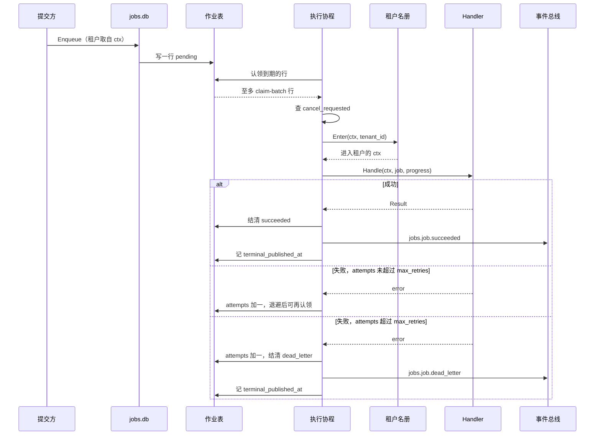
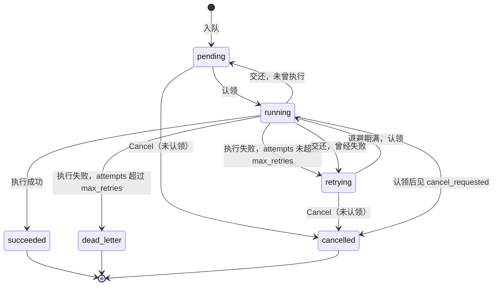

# jobs.db

## 职责

`jobs.db` 交付**跨副本的持久作业队列**与**handler 登记面**：`Queue`（提交、查询、取消）与 `Handlers`（登记执行者）两条接缝、一张作业表 `jobs`，以及把到期作业认领、执行、结清的驱动器。提交方经 `Queue.Enqueue` 在一个租户的上下文里落一行作业；每个副本的若干执行协程从这张表认领到期的行，经 `tenant.Catalog.Enter` 进入该行的租户，把行交给按 `Type` 登记的 `Handler` 执行，再按结果结清那一行——成功、按退避重试、或进入死信。作业因此至少执行一次；多副本之间靠有时限的认领分摊同一张表，不选主、不引入中间件（[ADR-jobs-claim-2026-10-15](../../../adr/adr-jobs-claim-2026-10-15.md)）。

`Queue` 与 `Handlers` 都由本模块**排他交付**：一个进程里恰好一个队列。根包 `pkg/jobs` 是接口包与公共类型，不登记模块；本子包登记模块 `jobs.db`，配置命名空间取同一个取值（[ADR-jobs-packaging-2026-10-15](../../../adr/adr-jobs-packaging-2026-10-15.md)）。

### 非职责

- **不含调度，不声明周期任务。** 周期声明 `jobs.Schedule`、窗口幂等键与按租户展开归 `jobs.scheduler`。本模块只执行提交进来的作业；它不认识「每个周期该做一次」这件事，落在作业行上的只是调用方给的 `idempotency_key`。
- **不解释作业语义。** `Task.Type` 与 `Task.Payload` 对队列不透明；作业做什么、`Result` 是什么，由登记该 `Type` 的 `Handler` 定义。
- **不替消费方去重。** 作业至少执行一次；一次因认领到期或副本崩溃带来的重复执行，由消费方按 `IdempotencyKey` 自行幂等，本模块不重放一次已结清作业的结果（[ADR-jobs-claim-2026-10-15](../../../adr/adr-jobs-claim-2026-10-15.md)）。
- **不选主，不持分布式锁。** 多副本的分摊靠有时限的认领，没有任何一个副本是唯一的认领者。
- **不保证执行顺序。** 认领按优先与到期取，退避与跨租户轮转都会改变次序；需要顺序的消费方在载荷里携带序号。
- **不拥有事件总线。** `(*event.Bus)(nil)` 是可选依赖；它缺席时终态事件不发，作业照常执行与结清。
- **不做进程内循环。** 本模块做的事是「认领到期作业并执行」，不是「按间隔跑一段逻辑」；进程内的周期循环归各模块自己的 ticker，见 [design-jobs](design-jobs.md) 的职责。
- **不实现业务补偿。** 失败后延迟重试、到上限进死信是队列的全部重试语义；一次执行留下的副作用由消费方自己补偿。
- **不挂 HTTP 面，不声明权限点。** 提交与取消是进程内的接缝调用，不经过任何路由。

## 外部接口契约

### 登记单元与名字

| 登记单元 | 模块名 | 交付 | 排他 | 构造期依赖 |
|---|---|---|---|---|
| 接口包 `pkg/jobs` | 不登记 | `Queue`、`Handlers`、`Handler`、`Task`、`Job`、`Result`、`Schedule`、`Status`、`Priority`、`ProgressFn`、`EnqueueOption` 及哨兵 | — | — |
| 子包 `pkg/jobs/db` | `jobs.db` | `(*jobs.Queue)(nil)` 与 `(*jobs.Handlers)(nil)` | 两者都排他 | 必需 `(*db.Database)(nil)`、`(*tenant.Catalog)(nil)`；可选 `(*event.Bus)(nil)`、`(*log.Logger)(nil)` |

### 交付的功能

```go
type Queue interface {
    Enqueue(ctx context.Context, t Task, opts ...EnqueueOption) (JobID, error)
    Get(ctx context.Context, id JobID) (*Job, error)
    Cancel(ctx context.Context, id JobID) error
}

type Handlers interface {
    Register(h Handler) error
    Registered() []string // 已登记的类型名
}

type Handler interface {
    Type() string
    Handle(ctx context.Context, job *Job, progress ProgressFn) (Result, error)
}
```

取用写作 `core.Resolve[jobs.Queue](reg)` 与 `core.Resolve[jobs.Handlers](reg)`；依赖声明写作 `core.Requirement{Token: (*jobs.Queue)(nil)}` 或 `core.Requirement{Token: (*jobs.Handlers)(nil)}`。

`Queue` 的契约，约束的主体是本模块交付的这一个 `Queue`：

- **租户取自 `ctx`，不取自 `Task`。** `Task` 不带租户字段，租户经 `tenant.FromContext(ctx)` 读出，写行时由内嵌的 `tenant.Model` 落下 `tenant_id` 列。上下文里没有租户时，`Enqueue` 以租户功能目录的哨兵 `tenant.ErrNoTenantInContext` 拒绝，什么都不写。这与数据库的租户过滤是同一条判据（[ADR-jobs-claim-2026-10-15](../../../adr/adr-jobs-claim-2026-10-15.md)）。
- **`Enqueue` 校验 `Task` 的形状再落一行。** `Type` 非空且有一个已登记的 `Handler`，否则以 `ErrInvalidTask` 或 `ErrNoHandler` 拒绝，不写行。`id` 是应用在该步生成的 UUID；`status` 起于 `pending`；`scheduled_at` 与 `available_at` 起于到期时刻。
- **选项按传入次序应用。** `WithDelay(d)` 把 `scheduled_at` 置为当下加 `d`，`WithScheduledAt(t)` 置为 `t`；两者互斥，**后传入者胜**——后应用的那一个覆盖先应用的。`WithMaxRetries`、`WithTimeout`、`WithPriority` 各自覆盖对应的列。未给 `WithMaxRetries` 时取 `DefaultMaxRetries`，未给 `WithTimeout` 时取 `DefaultTimeout`，未给 `WithPriority` 时取 `PriorityNormal`，`Priority` 的类型零值 `PriorityLow` 只在调用方显式传 `Priority(0)` 时出现。
- **`IdempotencyKey` 非空时 `Enqueue` 幂等。** `(tenant_id, idempotency_key)` 唯一，重复提交返回既有作业的 `JobID`，不新建行、不报错。
- **`Get` 在本租户可见范围内按 `id` 取一行。** 未知 `id`、他人的 `id`、不属于本租户的行一律同形 `ErrJobNotFound`，不泄露存在性。
- **`Cancel` 按行的当前状态分档。** 未知或被隐藏的行以 `ErrJobNotFound` 拒绝。未认领的行（`claimed_by` 为空，状态 `pending` 或 `retrying`）在一条语句里直接置 `cancelled`。已认领的行只置 `cancel_requested`，由认领者在认领与执行之间查它、命中即以 `cancelled` 结清。已进入终态的行（`succeeded`／`dead_letter`／`cancelled`）是幂等空操作，返回 `nil`、不改任何行。
- **队列未运行时它的每个方法都以 `ErrNotRunning` 拒绝。** 运行与否以 `Start` 与 `Stop` 为界：`Start` 之前、`Stop` 之后，队列都不服务。

`Handlers` 的契约，约束的主体是本模块交付的这一个 `Handlers`：

- **登记在执行开始之前完成。** 消费模块在自己的 `Init` 里登记自己的 handler；`Init` 早于 `Start`，作业开始执行时 handler 集已定。
- **同一 `Type` 只登记一个 handler。** 重复登记同一个 `Type`、登记一个 `Type()` 为空的 handler、或登记 `nil`，都以错误拒绝。
- **`Start` 之后登记以错误拒绝。** 执行期间的 handler 集不再变化。
- **`Registered` 列出已登记的类型名。** 它返回一份只读的类型名切片，供消费方在 `Start` 校验自己的声明类型已登记。

`Job`、`Task`、`Result`、`JobID`、`Status`、`Priority`、`ProgressFn` 与 `EnqueueOption` 的形状由 [design-jobs](design-jobs.md) 的接口契约给出；本模块交付的实现按它们的语义填值。

### 宿主可见面

以下是宿主写进配置文件、或在命令树与订阅方配置里点名的面。

| 项 | 值 |
|---|---|
| 模块名 | `jobs.db` |
| 配置命名空间 | `jobs.db` |
| 输入项 | `poll-interval`（时长，缺省 `1s`）、`workers`（整数，缺省 `4`）、`claim-batch`（整数，缺省 `16`）、`lease`（时长，缺省 `2m`）、`shutdown-grace`（时长，缺省 `10s`）、`retry-base`（时长，缺省 `1s`）、`retry-max`（时长，缺省 `1m`） |
| 取源 | 全部取主配置源 |
| 事件（发出） | `jobs.job.succeeded`、`jobs.job.dead_letter`、`jobs.job.cancelled`（终态）；可选依赖 `event.Bus` 缺席时不发，作业照常跑 |

各输入项的用途见「认领的常数与取值」；`jobs.db` 是排他交付 `Queue` 与 `Handlers` 的唯一模块，宿主在命令树上点名它或为它预置实例，依赖闭包不替它挑（排他交付的提供者不被依赖闭包自动纳入）。

### 稳定性承诺

- `Queue`、`Handlers`、`Handler`、`Task`、`Job`、`Result`、`Schedule`、`Status`、`Priority`、`ProgressFn`、`EnqueueOption` 与根包的哨兵是根包对调用方的契约，本模块交付的实现承诺它们的语义。加方法、改签名或改字段名，对实现这些接缝的模块与取用它们的调用方都是不兼容变更。
- **表 `jobs` 属于本模块，宿主不读写它。** 它的列供运维查看积压、重试与死信，不是契约面。
- **宿主可见面是承诺**：模块名 `jobs.db`、配置命名空间 `jobs.db` 与其中的输入项，改动它们是宿主可见的破坏性变更，须随发布对账。
- **事件类型名是承诺**：`jobs.job.succeeded`、`jobs.job.dead_letter`、`jobs.job.cancelled` 是发布方与订阅方之间的契约，改名改变订阅方的配置。

### 哨兵错误

| 哨兵 | 定义处 | 含义 |
|---|---|---|
| `ErrJobNotFound` | `pkg/jobs` | `Get`／`Cancel` 点名了本租户看不见的作业：未知 id、他人租户的 id 一律同形 |
| `ErrInvalidTask` | `pkg/jobs` | `Task` 的形状不合法（`Type` 为空） |
| `ErrNoHandler` | `pkg/jobs` | `Enqueue` 遇一个没有已登记 handler 的 `Type`，拒绝且不写行 |
| `ErrNotRunning` | `pkg/jobs` | 队列未在运行：`Start` 之前或 `Stop` 之后 |
| `ErrNoTenantInContext` | `pkg/tenant` | 上下文里没有租户；`Enqueue` 据此拒绝 |

调用方以 `errors.Is` 判别，包裹一律用 `%w`。

## 依赖

| 依赖 | 用途 |
|---|---|
| `pkg/core` | 登记描述符、交付功能 |
| `pkg/config` | 声明本模块的输入项 |
| `pkg/jobs` | 根包：接缝、公共类型与哨兵 |
| `pkg/db` | 作业表所在之处、迁移集、方言与交付句柄 |
| `pkg/tenant` | 租户列（`tenant.Model`）、`Catalog.Enter`、`Catalog` 的进入方法、`FromContext` |
| `pkg/event` | 可选：终态事件 |
| `pkg/log` | 可选：诊断 |
| GORM | 经交付句柄发出的语句 |

**方向。** 本模块 import 数据库、租户与 `pkg/jobs` 的根包，不 import 任何上层功能目录，也不 import `pkg/http`——提交与取消是进程内接缝，没有路由。数据库与租户都在本模块之前构造、在本模块之后停止。`event.Bus` 与 `log.Logger` 都是可选取用：取不到时终态事件不发、诊断减少，作业照常执行与结清。

## UML 图

一轮从提交到结清的路径。图里看不出的约束：认领是一次语句、并发认领由行锁裁定；执行在事务之外进行，不持有连接；终态事件的发布义务记在作业行上（`terminal_published_at`），总线缺席或发布失败时留待下一次补发；租户经 `tenant.Catalog.Enter` 进入，只带该行的租户，不带提交方的请求上下文。



一行作业的生命周期。图里看不出的约束：`succeeded`、`dead_letter`、`cancelled` 是终态，进入之后不再改变；未认领的行（`pending` 或 `retrying`）被 `Cancel` 时在一条语句里直接进入 `cancelled`，已认领的行由认领者在执行前观察到取消请求后进入 `cancelled`；一条遗留的 `running` 行由认领到期后的接手处置，接手不改变它的状态取值；交还把一行送回可认领的状态，未曾执行的回 `pending`，曾经失败的回 `retrying`。



## 核心数据结构

**`Status` 是作业状态的闭集**：`pending`、`running`、`retrying`、`succeeded`、`dead_letter`、`cancelled`。`Status.Terminal()` 对 `succeeded`、`dead_letter`、`cancelled` 为真，对 `pending`、`running`、`retrying` 为假；终态是稳定的，作业不再从终态转出。**`Priority` 是取值闭集**：`PriorityLow`（`0`）、`PriorityNormal`（`5`）、`PriorityHigh`（`10`）；它是认领的首要排序键。

**作业表 `jobs`**，一行一条作业。时刻以数据库的时钟为准，多副本的执行协程按同一个时钟判断到期与认领。租户列由内嵌的 `tenant.Model` 提供，约定列名 `tenant_id`。

| 列 | 含义 |
|---|---|
| `id` | 主键，应用在入队时生成的 UUID |
| `tenant_id` | 作业所属租户，由内嵌的 `tenant.Model` 从入队上下文的租户落下；是 `(tenant_id, idempotency_key)` 唯一索引的一半 |
| `type` | 作业类型，对应一个已登记 `Handler` 的 `Type()` |
| `status` | `Status` 闭集之一 |
| `priority` | `Priority`；认领按它降序取 |
| `payload` | 提交方给出的载荷，对队列不透明 |
| `result` | 成功时 `Handler` 交回的 `Result.Data`，非终态或失败时为 NULL |
| `error` | 最近一次失败的文本，成功或未曾失败时为 NULL |
| `attempts` | 已交给 `Handler` 执行的次数 |
| `max_retries` | 该作业的重试上限；`attempts` 超过它即进死信 |
| `timeout_ms` | 一次执行的时限，毫秒（取自 `Job.Timeout`） |
| `progress_pct`、`progress_msg` | `Handler` 最近一次经 `ProgressFn` 报的进度 |
| `idempotency_key` | 非空时使 `Enqueue` 幂等；未给时写作 NULL，参与 `(tenant_id, idempotency_key)` 唯一索引 |
| `scheduled_at` | 提交方要求执行的时刻（`WithDelay`／`WithScheduledAt` 定下）；仅记录到期依据，不改认领 |
| `available_at` | 这一行下一次可被认领的时刻：入队时等于 `scheduled_at`，认领后等于认领到期时刻，失败退回后等于退回时刻，交还时置为当时 |
| `started_at` | 最近一次执行开始的时刻 |
| `completed_at` | 进入终态的时刻 |
| `claimed_by` | 持有认领的执行者标识，空即无人持有 |
| `claim_expires_at` | 认领到期的时刻；到期之后别的副本可接手 |
| `cancel_requested` | 是否已被请求取消；认领与执行之间查它 |
| `terminal_published_at` | 终态事件已发布的时刻；为空即发布义务未结 |
| `created_at`、`updated_at` | 行的创建与最近更新时刻 |

索引：`available_at` 上有索引，认领按它取到期的行，读表按它算下一次到期；`(tenant_id, idempotency_key)` 唯一，使幂等键再次提交收敛到既有行。幂等键为空的行在该列上写作 NULL，SQL 的唯一索引不把多个 NULL 判为冲突，无键的作业因而可以多条并存。

## 核心算法与流程

### 本模块的阶段行为

| 阶段 | 行为 |
|---|---|
| `Prepare` | 解读本模块的配置；不读表 |
| `New` | 取用交付的库、租户名册与可选的日志、总线；方言没有写好的语句时启动失败 |
| `Migrate` | 数据库模块施加本模块声明的迁移集，建立 `jobs` 表；`New` 里表还不存在 |
| `Init` | 表已就绪；消费模块在这一阶段经 `Handlers.Register` 登记自己的 handler |
| `Start` | 执行协程开始运行，先读一次表，接手此前遗留的到期作业 |
| `Stop` | 不再认领；在飞作业跑完 `shutdown-grace`；持有的行全部交还 |
| `Close` | 未经 `Stop` 时先执行它；库句柄属于数据库模块，本模块不关闭它 |

生命周期阶段序是 `Prepare → New → Migrate → Init → Start → Serve`：`Migrate` 早于 `Init`，所以本模块在 `New` 里读不到表，首次读表落在 `Start` 的第一次读。宿主为本模块预置的实例不是本模块的产物时，`Start`、`Stop` 与 `Close` 都不对它做任何事（[ADR-supplied-instance-2026-10-08](../../../adr/adr-supplied-instance-2026-10-08.md)）。

### 一轮认领

一个执行协程的一轮固定为读表、认领、执行、结清四步（照 `pkg/event/outbox/relay` 的中继形态）：

1. **读表**：取最早一行的 `available_at` 与数据库当前时刻之差。没有行即本轮结束；最早的还没到期，下一轮定在它到期之时；有到期的行就进第 2 步。
2. **认领**：一条语句取至多 `claim-batch` 行到期的作业，按 `priority` 降序、`available_at` 升序、跨租户轮转取；写下本执行者为 `claimed_by`、认领到期为数据库当前时刻加 `lease`、`status` 置 `running`，交回这些行。
3. **执行**：逐行执行，交 handler 之前先查 `cancel_requested`、再经 `tenant.Catalog.Enter` 进入该行的租户；一次执行的上下文在作业自己的 `timeout_ms` 处到期。
4. **结清**：逐行以 `claimed_by` 为条件写回结果（见「退避与死信」与「终态事件与发布义务」）。

一轮在还有到期的行时接着认领下一批。每一批有读表与认领各一条语句，每一行另有结清的一条；空表上的一轮只有读表那一条。读表或认领失败时行不动，间隔从 `poll-interval` 起翻倍，至多 `retry-max`，每次写一条错误日志。

### 认领的常数与取值

常数全部取自本模块的配置项（命名空间与缺省见「宿主可见面」）：`poll-interval` 是无到期作业时读表的间隔，`workers` 是执行协程数，`claim-batch` 是一次认领取的行数上限，`lease` 是一次认领的有效期，`shutdown-grace` 是 `Stop` 等在飞作业的上限，`retry-base` 与 `retry-max` 是退避的起点与上限。退避自 `retry-base` 起，每次失败翻倍，至多 `retry-max`，形态照 `pkg/event/outbox/relay` 的 `timing.retryAfter`。

### 并发认领

两条认领同时进行，都读到同一行到期、都还没写下认领，这一种由行锁裁定：PostgreSQL 上认领对它取的行加锁，并跳过另一个认领正锁着的行，第二个认领因而不取那些行、也不等它们；SQLite 一次只有一个写者，一条认领语句本身即原子，不另加锁。时刻一律取数据库的时钟，多个副本的认领按同一个时钟判断到期——按各自副本的时钟判断会让一个时钟走快的副本提前接手别人还持有着的行。这两条与方言的时钟表达式、锁子句写在同一个扩展点里（见「扩展点」）。

### 执行与租户进入

把行交给 handler 之前，先以该行的 `tenant_id` 调 `tenant.Catalog.Enter(ctx, id)`，进入那个租户，再交 handler。进入之后 handler 里的受约束语句按该租户过滤、按该租户填列，与一条解析成功的请求相同。进入失败——名册里没有这一行，或该租户已停用——即本次执行失败，以租户的错误记下并按退避处置，不交 handler。**执行时的租户取自作业行，提交时的租户取自 `ctx`，两端是同一条租户作用域规则**：作业行内嵌 `tenant.Model`，租户列在入队时由上下文落下，执行时再进入同一个租户。

### 退避与死信

handler 返回错误、或执行上下文到期，都是本次执行失败：`attempts` 加一，`error` 记下失败文本，`available_at` 置为数据库当前时刻加退避。退避自 `retry-base` 起，每次失败翻倍，至多 `retry-max`。`attempts` 超过 `max_retries` 时不退避，`status` 置为 `dead_letter`（终态）。`attempts` 超过 `max_retries` 即 `max_retries` 次重试之后又失败一次，`DefaultMaxRetries` 取 `3`，因而默认下一条作业至多执行四次。

### 取消

`Cancel` 按行的当前状态分档。未认领的行（`claimed_by` 为空，状态 `pending` 或 `retrying`）在一条语句里直接置 `cancelled`，条件写清 `WHERE id = ? AND claimed_by IS NULL AND status IN ('pending','retrying')`。已认领的行只置 `cancel_requested`，执行协程在认领与执行之间查它：命中即不交 handler、把该行结清为 `cancelled`（终态）并发终态事件。终态行（`succeeded`／`dead_letter`／`cancelled`）是幂等空操作，返回 `nil`、不改任何行。一次执行中途的取消不被队列观察——队列不持有正在执行的那一行的取消通道，正在跑的 handler 自己按 `ctx` 判断；一次执行结束之后若有重试，下一次认领之后再查 `cancel_requested`。

### 终态事件与发布义务

作业进入 `succeeded`、`dead_letter` 或 `cancelled` 时，队列尝试向总线发一条对应类型的事件（`jobs.job.succeeded`、`jobs.job.dead_letter`、`jobs.job.cancelled`）。**发布义务记在作业行自己身上**：`terminal_published_at` 为空即未发布，结清进终态时尝试一次，一轮里另有一段补发取终态且 `terminal_published_at` 为空的行补发并置上时刻。总线缺席、或一次发布失败，都不改变作业的终态，也不撤销结清——`terminal_published_at` 留空，下一次补发接手。发布义务落在行上，`pkg/event` 因此是**可选依赖**：装配里没有总线时，事件不发，作业照常执行、结清、进死信（[ADR-jobs-terminal-event-2026-10-15](../../../adr/adr-jobs-terminal-event-2026-10-15.md)）。

### 公平性

认领的排序键含租户维度：在 `priority` 与 `available_at` 之后，认领按跨租户的轮转取，使一个租户的到期行不会在每一个批次里都排在别的租户之前。判据是**一个租户不得饿死其他租户**——一个租户的高优先作业堆满到期时刻，别的租户的作业仍要在有限的轮次里被认领到。租户维度是排序键，不是过滤条件：每一行仍在所有租户的行里竞争被认领，轮转只改变同一排序位置上的先后。

### 停机

`Stop` 之后不再认领。在飞的那一次执行在 `shutdown-grace` 内跑完，超出即取消它的上下文；本执行者持有而尚未执行的行全部交还——`claimed_by` 与 `claim_expires_at` 置空、`available_at` 置为当时、`status` 回到可认领（未曾执行的回 `pending`，曾经失败的回 `retrying`），下一个执行者——同一个库上别的副本，或下一次启动——立即可认领它们，不必等认领到期。别的副本持有的行不在其内：它们正在被执行，交还了就会被第三个副本再执行一次。

## 错误与失败语义

| 情形 | 表现 |
|---|---|
| 入队时上下文里没有租户 | `Enqueue` 返回 `tenant.ErrNoTenantInContext`，不写行 |
| `Task.Type` 为空 | `ErrInvalidTask`，不写行 |
| `Task.Type` 没有已登记的 handler | `ErrNoHandler`，不写行 |
| 幂等键已被占用 | 返回既有作业的 `JobID`，不新建、不报错 |
| `Get`／`Cancel` 点名未知 id、他人的 id、不可见的行 | `ErrJobNotFound`（同形，不泄露存在性） |
| 队列未在运行 | `ErrNotRunning` |
| `Register` 重复 `Type`、`Type()` 为空、`nil`，或 `Start` 之后登记 | 登记以错误拒绝，handler 集不变 |
| handler 返回错误 | `attempts` 加一，退避后重试；超过 `max_retries` 进 `dead_letter` |
| 执行上下文到期（作业 `timeout_ms` 到） | 同一次失败，退避后重试 |
| `tenant.Catalog.Enter` 失败（不在册、已停用） | 本次执行失败，退避后重试，不交 handler |
| 未认领的行被 `Cancel` | 一条语句直接置 `cancelled`（终态） |
| 认领后见 `cancel_requested` | 结清为 `cancelled`（终态），不交 handler |
| 终态行被 `Cancel` | 幂等空操作，返回 `nil`、不改任何行 |
| 读表或认领失败（库不可用、表不在） | 行不动，写错误日志，间隔翻倍后再读 |
| 结清命中 0 行（认领已被别的副本接手） | 跳过，不再写；那一行由接手的副本结清 |
| 发布终态事件失败或总线缺席 | 行的 `terminal_published_at` 留空，下一次补发接手；不影响终态 |
| 交还失败 | 写错误日志；那些行在认领到期后由别的副本接手 |
| 方言没有写好的语句 | `New` 失败，点名方言 |
| 副本在持有认领时终止 | 那些行在认领到期后由别的副本接手，至多晚 `lease` |

### 非保证

- **不是恰好一次。** 作业至少执行一次，重复的来源是认领到期后的接手与副本崩溃；按 `IdempotencyKey` 去重归消费方。
- **一次执行可能长过它的认领。** 作业 `timeout_ms` 大于 `lease` 时，一行在认领到期后可能被别的副本接手并与此处的执行并发跑；两处的结清都以 `claimed_by` 为条件，只有仍持有认领的那一处写得进。宿主把 `lease` 设到不小于它最长的 `Timeout`，可让一次执行在认领到期前结束（[ADR-jobs-claim-2026-10-15](../../../adr/adr-jobs-claim-2026-10-15.md)）。
- **不保证顺序。** 优先、到期与退避都改变次序，跨副本之间更没有先后。
- **死信不清理。** 进入 `dead_letter` 的行留在表里，直到运维处置；本模块不删它。
- **重试期间没有时延上界。** 一次失败一直重试到 `attempts` 超过 `max_retries`，退避有上限，重试的次数没有别的上界。
- **不理会上下文期限的 handler，一次执行超出 `timeout_ms` 仍不返回时，队列等它返回。** 这段时间里本协程不执行别的作业；认领到期之后那一行可能被别的副本接手再执行一次。
- **没有 leader 选举、没有分布式锁。** 分摊靠有时限的认领，读同一张表的所有副本都可能认领到任何到期行。

## 并发与事务边界

- 交付的 `Queue` 与 `Handlers` 可被多个协程并发使用。`Register` 在 `Start` 之前完成，执行期间的 handler 集不变；执行本身可被多个协程并发经过同一个 handler，handler 必须自己可被并发调用。
- **认领是一次语句，执行在事务之外。** 认领写完 `claimed_by` 与 `claim_expires_at` 即返回，执行不持任何事务与连接，handler 需要事务就自己开。结清是另一次语句，以 `claimed_by` 为条件，认领已被接手的行结清命中 0 行。
- **本模块自己的每条语句有上限**，一个停止应答的数据库拖住一轮而不是拖住整个队列，形态照 `pkg/event/outbox/relay` 的语句上界。
- **SQLite 文件库上，另一条连接上开着的事务让认领、结清与交还等待。** 这几条是另一条连接上的写入；等满忙等时限即以 `SQLITE_BUSY` 失败，认领失败按读表失败处置，行不动（见 [db](../design-db.md) 的并发与事务边界）。
- **`Enqueue` 的单行写入与唯一索引一起做幂等。** 两个并发提交带同一个幂等键，一行插入成功，另一行在唯一索引上冲突后读回既有作业的 `JobID` 并返回，不新建第二行。
- **执行协程的上下文不随驱动的取消而结束**：宿主一开始停机，驱动的上下文就被取消，早于任何模块的 `Stop`，而执行协程运行到本模块自己的 `Stop` 为止。

## 扩展点

**新方言**：给出那个引擎的时钟表达式与认领时的锁子句（照 `pkg/event/outbox/relay/statements.go` 的 `statementsFor`），并在迁移集里增加同名子目录。没有写好语句的方言在 `New` 被拒绝，不会带着一个读不了表的执行者启动：认领的取行、加锁与时钟表达式按方言而异，缺一个就没法既取到该取的到期行、又不与别的副本重复认领，因此宁可启动失败，也不带一个会重复执行作业的队列起来。

**队列后端**：`jobs.db` 是持久队列的默认实现，也是 `(*jobs.Queue)(nil)` 与 `(*jobs.Handlers)(nil)` 的排他提供者。另一个要点名同样两个功能标识的实现与它排他冲突，在消解阶段失败，宿主选其一；换一个后端不改变调用方的代码，也不改变作业表的既有语义。

## 实现状态

| 能力 | 状态 | 代码 |
|---|---|---|
| `Queue` 实现（`Enqueue`、`Get`、`Cancel`） | 未实现 | — |
| `Handlers` 登记面与 handler 集 | 未实现 | — |
| 作业表、迁移集与幂等唯一索引 | 未实现 | — |
| 一轮认领、执行、结清 | 未实现 | — |
| 退避、死信与取消 | 未实现 | — |
| 终态事件、发布义务与补发 | 未实现 | — |
| 各方言的认领语句 | 未实现 | — |
