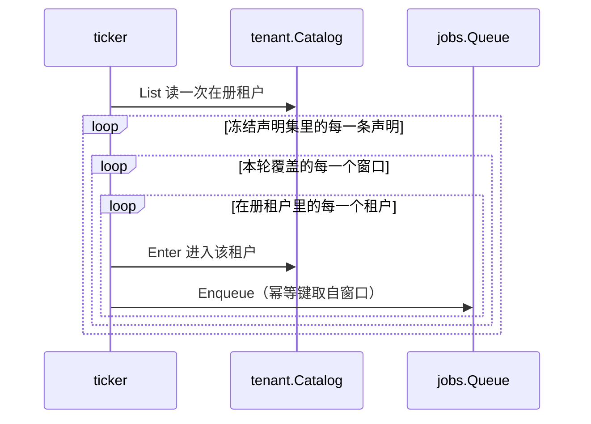

# jobs.scheduler

## 职责

本模块交付**周期触发的驱动**：按各业务模块放进自己 `Resources` 的周期声明 `jobs.Schedule`，在每一个窗口起点向作业队列入队一条作业，使一次跨副本的运行中每个窗口恰好排入一个作业，无论有多少副本在跑。它只 tick 与入队，不执行作业——认领、执行、租约、退避与死信归 `jobs.db`（[design-jobs-db](design-jobs-db.md)）。

本模块是 `jobs` 能力目录里的一个模块，包 `pkg/jobs/scheduler`，模块名 `jobs.scheduler`。根包 `pkg/jobs` 是接口包与公共类型，不登记模块；提交面 `Queue` 与登记面 `Handlers` 由 `jobs.db` 排他交付（[ADR-jobs-packaging-2026-10-15](../../../adr/adr-jobs-packaging-2026-10-15.md)）。本模块不认识任何作业类型：`Schedule.Type` 是别的模块定义的字符串，本模块原样交给 `Queue.Enqueue`。

**本模块没有表。** 窗口幂等键落在作业行的 `idempotency_key` 上，不需要本模块自己的表。判据：本模块的动作是入队，而「同一个窗口只入队一次」由队列侧 `(tenant_id, idempotency_key)` 的唯一约束给出——同一窗口的重复入队返回既有作业的标识，不新起一行，也不报错（[ADR-jobs-schedule-2026-10-15](../../../adr/adr-jobs-schedule-2026-10-15.md)）。

### 非职责

- **不执行作业，不做工作池。** 作业的认领、执行、租约、退避与终态归 `jobs.db`；本模块入队之后不再碰那条作业。
- **不选主，不引入分布式锁。** 多副本各跑自己的 ticker，靠窗口幂等键收敛（[ADR-jobs-schedule-2026-10-15](../../../adr/adr-jobs-schedule-2026-10-15.md)）。
- **不承载单个进程内循环。** 快照刷新、过期行清扫、文件轮转、轮询外部这类活每个副本各做各的、不需要在副本之间收敛，由需要它的那个模块自己起 ticker；本模块只承载必须跨副本收敛的周期（[ADR-jobs-scope-2026-10-15](../../../adr/adr-jobs-scope-2026-10-15.md)）。
- **不补跑。** 本模块不在磁盘或表里记「已调度到哪个窗口」。一个进程停在启动之前、或停机期间跨过的窗口，不由它补入队。
- **不认识作业类型，也不持有 handler 名册。** 本模块在 `Start` 经 `jobs.Handlers.Registered` 校验每一条启用声明的 `Type` 都已登记，缺一个即启动失败；`Type` 的含义与它对应的执行由别的模块定义。
- **不要求宿主提供租户清单。** 每条周期声明按名册里的租户展开，经租户名册 `tenant.Catalog.List` 列出在册租户、逐个 `Enter`；宿主不在配置或资源里为本模块提供任何租户清单接缝。

## 外部接口契约

### 登记单元与名字

| 包 | 模块名 | 交付 | 排他 |
|---|---|---|---|
| `pkg/jobs` | 不登记 | `Queue`、`Handlers`、`Handler`、`Schedule`、`Task`、`Job`、`JobID`、`Status`、`Priority`、`Result`、`ProgressFn`、`EnqueueOption` 与 `With*` 构造函数、常量与哨兵 | — |
| `pkg/jobs/db` | `jobs.db` | `Queue`、`Handlers` | 各排他 |
| `pkg/jobs/scheduler` | `jobs.scheduler` | 不交付功能接口，只 tick 并入队 | — |

模块名照顶层能力：裸名 `jobs`，叶子 `jobs.<名>`，配置命名空间取同一个取值（对照 `kv`/`kv.redis`、`event`/`event.nats`）。本模块的包导出自己的 `ModuleName` 常量。

### 交付的功能

本模块不交付功能接口。它不出现在任何 `core.Resolve[T]` 取用点的类型参数上，`Provides` 为空。它作为装配的一个成员存在：宿主把 `jobs.scheduler` 写进命令树的运行级纳入，本模块在 `Start` 里驱动一个 ticker。取用它的方式只有纳入这一条，没有别的模块经功能标识取它。

### 消费的资源

本模块 `Requires` `(*jobs.Queue)(nil)` 与 `(*jobs.Handlers)(nil)`（都必需，由 `jobs.db` 排他交付）、`(*tenant.Catalog)(nil)`（必需，用于按名册逐租户展开），可选 `(*log.Logger)(nil)`。它消费 `jobs.Schedule`：其它业务模块把周期声明放进自己的 `Resources`，本模块在 `New` 里经 `core.Resources[jobs.Schedule](reg)` 收齐，按取材域过滤后冻结成一份声明集。声明在登记期已定，进程存活期不变，本模块不重读、不轮询。

`tenant.Catalog` 在构造期必需：`New` 时名册不在场即启动失败；展开时每次 tick 读一次名册，本轮的每条声明与每个窗口共用这一份在册租户，逐个 `Enter` 后各入队一条。

### 取材域裁定

**`jobs.Schedule` 的消费点是本模块，取材域取「参与集」。** 判据：周期声明描述的是这次运行要做的活，它的效果依赖声明它的模块真的被驱动——那个模块的 handler 才登记得进去；只被静态级纳入的模块不构造、handler 不存在，它的声明因此不该被 tick。取材域之内，消解落选的模块其声明退出。

对照是 notification 的[类型分类法](../notification/design-notification-preferences.md)，它取**可用集**：类型是**词汇**——偏好写入与投递拿它当校验参照，同一个声明不能在这条命令下合法、在另一条下非法；周期声明是**活**——它必须与这次装配的东西一致，只被静态级纳入、handler 不存在的声明不该被 tick。两者判据的差别即 [ADR-jobs-schedule-2026-10-15](../../../adr/adr-jobs-schedule-2026-10-15.md) 的实质。

**`core.Resources[jobs.Schedule](reg)` 本身遍历全部已登记模块，不做任何过滤**：`core` 不解释资源，也就无从知道这一种该按哪个集合裁断（架构不变量 15）。过滤由本模块自己做：`reg.Participating(声明.Module)` 为真的留下；为真而 `reg.Enablement(声明.Module)` 判为禁用时退出，那是这次装配给出的否定（消解落选）；其余不进来，即未被本次命令纳入、也没有预置实例的模块。宿主用 `AllResources` 令某个静态级纳入的模块的全部声明当作在册处理时，本消费点照这个覆盖收取（架构不变量 15）。过滤在 `New` 里做一次，结果冻结。

### 宿主可见面

- **模块名**：`jobs.scheduler`。宿主的命令树点模块名纳入，配置命名空间取同一取值。
- **配置命名空间与输入项**：`jobs.scheduler` 下的 `tick`（时长，缺省 `1m`，取主配置源）。`tick` ≤0 即关闭，与仓库既有各处模块自起 ticker 同形：间隔 ≤0 时不起 ticker，`Start` 不排任何入队。

```yaml
jobs:
  scheduler:
    tick: 30s
```

### 对外接口面

- 本模块不交付任何符号给其它模块，因而不构成代码级接口面。它消费 `jobs.Queue` 与 `jobs.Schedule` 的字段语义，那些是根包的接口面（见 [jobs](design-jobs.md) 的对外接口面）。
- **宿主可见面**：模块名 `jobs.scheduler` 与配置键 `jobs.scheduler.tick`。改动它们是宿主可见的破坏性变更。
- **入队效果**：在有 ticker 运行的一次运行里，每个窗口起点至少对应一次入队尝试；同一窗口、同一租户的多次入队收敛成一条作业。

### 哨兵错误

| 哨兵 | 定义处 | 含义 |
|---|---|---|
| `ErrInvalidSchedule` | `pkg/jobs/scheduler` | 一条周期声明的形状不合法（`Key` 为空、`Type` 为空、`Interval` 非正）；`New` 拒绝并点名那条声明 |
| `ErrDuplicateSchedule` | `pkg/jobs/scheduler` | 参与集里两条声明共用同一个 `Key`；`New` 拒绝并点名冲突双方 |
| `ErrMissingHandler` | `pkg/jobs/scheduler` | 一条声明的 `Type` 没有已登记的 handler；`Start` 拒绝启动并点名那条声明 |

这些哨兵都由本模块判定，调用方以 `errors.Is` 判别，包裹一律用 `%w`。`tick` ≤0 不是失败，因此没有对应的哨兵。

## 依赖

| 依赖 | 用途 |
|---|---|
| `pkg/core` | 模块描述符；资源收集（`core.Resources[jobs.Schedule]`）；参与与启用查询（`Registry.Participating`、`Registry.Enablement`、`Registry.AllResourcesInForce`） |
| `pkg/config` | 声明本模块的输入项 `tick` |
| `pkg/jobs` | `Queue`、`Handlers`、`Schedule` 与哨兵；入队经 `Queue.Enqueue`，启动期经 `Handlers.Registered` 校验声明类型 |
| `pkg/tenant` | 必需：`Catalog.List` 与 `Catalog.Enter` 按名册逐租户展开每条声明 |
| `pkg/log` | 可选：tick 的入队失败记诊断 |

**本模块只经根包接缝入队与校验，不 import `jobs.db` 的实现。** 方向满足架构不变量 9（只按功能取用）与不变量 2（`core` 不解释资源）：取用写在 `Requires` 里，`Queue` 与 `Handlers` 由 `jobs.db` 排他交付，本模块不 import 任何实现子包。`tenant.Catalog` 用于按名册逐租户展开，`jobs.Handlers` 用于 `Start` 校验声明类型。

## UML 图

一次 tick 的路径。图里看不出的约束：声明集在 `New` 时一次收集、按取材域过滤并冻结，每次 tick 不再过滤；在册租户在每次 tick 里读一次，本轮的每条声明与每个窗口共用这一份，读取失败即本轮不展开；每条声明都按名册逐租户展开，`tenant.Catalog.Enter` 逐个进入后各入队一条；每次 `Enqueue` 各自独立，一次失败不影响同一轮里其余声明与窗口；同一窗口的多次入队收敛成一条作业由队列的 `(tenant_id, idempotency_key)` 唯一约束做出，不靠本模块记住发过没有。



## 核心数据结构

| 概念 | 类型 | 说明 |
|---|---|---|
| 周期声明 | `jobs.Schedule` | 键、作业类型、周期、载荷；由业务模块声明、本模块消费 |
| 冻结的声明集 | 未导出 | `New` 时经 `core.Resources[jobs.Schedule](reg)` 收齐、按取材域过滤后的切片，进程存活期不变 |

本模块不持存储状态：没有表，没有迁移集，没有需要释放的句柄。运行期它在进程内只持有冻结的声明集与一个 ticker。

`Schedule.Key` 是全局唯一的字符串，形如 `<模块>.<用途>`，既用来点名一条声明，也用作窗口幂等键的输入。`Schedule.Interval` 是周期，`>0`；它同时是窗口的长度。每条声明都按名册逐租户展开：`tenant.Catalog.List` 给出在册租户，`tenant.Catalog.Enter` 逐个进入，各入队一条。

## 核心算法与流程

### 本模块的阶段行为

| 阶段 | 行为 |
|---|---|
| `Prepare` | `Decode` 自己那份配置；读出 `tick`，≤0 记作关闭，不因此失败 |
| `New` | 取用 `jobs.Queue`、`jobs.Handlers`、`tenant.Catalog` 与可选的 `log.Logger`；经 `core.Resources[jobs.Schedule](reg)` 收齐声明、按取材域过滤、冻结；校验每条声明的形状 |
| `Migrate` | 无：本模块没有表，不声明迁移集 |
| `Init` | 无：本模块不读表，也没有别的启动期装载 |
| `Start` | 经 `jobs.Handlers.Registered` 校验每一条启用声明的 `Type` 都已登记，缺一个即启动失败；再起 ticker：立即跑一次 tick（不等一个 `tick`），这一次额外覆盖启动时刻所在的那个窗口，此后每 `tick` 一次、每次只覆盖 `(now - tick, now]` 内的窗口。`tick` ≤0 时不起 ticker |
| `Stop` | 停掉 ticker；正在跑的那一次 tick 等它返回后才入队结束，此后本模块不再入队 |
| `Close` | 未经 `Stop` 时先执行它；本模块不持需要释放的资源 |

**ticker 的上下文取自这一阶段（`Start`）收到的上下文**，带着它的值，不随驱动的取消而结束；它运行到本模块自己的 `Stop`。

### 窗口与窗口起点

一条周期为 `Interval` 的声明，窗口长度即 `Interval`。窗口起点是对齐到 `Interval` 的整数倍的时刻，以 Unix 纪元为原点：`W(t) = floor(t / Interval) * Interval`。对齐以纳秒计数计算（`pkg/jobs/scheduler` 的 `windowStart`），除法向下取整，纪元之前的时刻因而落在它所属窗口的起点而不是下一个窗口。落在同一个 `[W, W+Interval)` 区间里的时刻属于同一个窗口。

**一次 tick 覆盖窗口起点落在 `(now - tick, now]` 里的每一个窗口**，每条声明各入队一次。回溯下界取一个 `tick` 周期，使入队集合只由当前时刻与 `tick`、`Interval` 推出，多个副本各自算出的集合一致，不依赖任何已调度记录。**`Start` 里那次 tick 在此之上额外覆盖启动时刻所在的那个窗口**，即含 `now` 的那个窗口；此后每一次 tick 只覆盖 `(now - tick, now]` 内的窗口。启动时刻所在窗口的起点早于 `now - tick` 时（`Interval` 大于 `tick`，且启动时刻距该窗口起点超过一个 `tick`），这一次额外覆盖才纳入回溯区间之外的窗口；否则它本就在回溯区间内，两次覆盖的是同一批窗口。**比一个 `Interval` 更早的窗口不补跑。** 那次额外覆盖按同一个窗口键入队，该窗口已由别的副本或本副本更早的 tick 入过队时，重复入队由队列收敛成一条既有作业。相邻两次 tick 之间跨过几个窗口，这次 tick 就为这几条各入队一次。由此：

- **`tick` 比 `Interval` 密时（tick 间隔小于窗口长度）不重复入队。** 一个窗口内发生多次 tick，或不同副本的 tick 落在同一个窗口里，每次算出同一个窗口起点、同一个幂等键，重复入队由队列的唯一约束收敛成一条作业。
- **`tick` 比 `Interval` 疏时（tick 间隔大于窗口长度）不漏窗口。** 两次 tick 之间跨过多个窗口，一次 tick 把它们各入队一条，没有窗口被跳过。

`Interval ≤ 0` 的声明是坏声明，在 `New` 被拒。一次 tick 的代价与声明条数、每条声明跨过的窗口数、在册租户数之积成正比，每次入队是一条独立的队列调用。

### 一次 tick

1. 冻结的声明集为空即本轮结束，不读名册。
2. 经 `tenant.Catalog.List` 读一次在册租户。**一次 tick 只读一次名册**，本轮的每一条声明、每一个窗口共用这一份在册租户；读失败即本轮一条都不展开，记一条警告，下一个 tick 重来。
3. 按窗口算出本轮要入队的（声明，窗口起点）对：窗口起点落在 `(now - tick, now]` 里的每一个窗口，对每一条声明各一对；`Start` 里那次 tick 额外把启动时刻所在的那个窗口算进来。
4. 对每一对算出幂等键 `hex(sha256(声明.Key + 窗口起点的十进制 UnixNano))`（`pkg/jobs/scheduler` 的 `windowKey`），作为 `Task.IdempotencyKey`。
5. 对每一对里的每个在册租户，`tenant.Catalog.Enter(ctx, 租户)` 得到那个租户的上下文，再在该上下文上入队一条。作业行的租户列由队列侧的模型内嵌 `tenant.Model` 落下。
6. 每次 `Enqueue` 失败只记一条警告日志、继续下一对：一条声明、一个窗口入队失败不影响同轮里其余的对，下一个 tick 按同一个窗口起点重来，幂等键不变。

### 按租户展开

每条周期声明都按名册里的租户展开——这次运行里每个在册租户各做一次这条活。展开读的是租户名册，不是配置：本模块不认识也不持有租户清单，`tenant.Catalog.List` 给出当时的在册租户，`tenant.Catalog.Enter` 逐个给出以该租户为作用域的上下文。同一个窗口里每个租户的作业共用同一个 `IdempotencyKey`——幂等键里只含声明键与窗口起点、不含租户——它们各自成行，因为作业行的唯一约束是 `(tenant_id, idempotency_key)`，租户是其中的一维。

一个租户在两次 tick 之间被创建或删除，下一个 tick 的展开随之增减，本模块不为此记账：新建的租户从它下一次出现在名册时起被覆盖，删除的租户不再被 `Enter`，其已有的作业照常按队列的规则处置。

## 错误与失败语义

| 情形 | 表现 |
|---|---|
| 声明形状不合格（`Key` 为空、`Type` 为空、`Interval ≤ 0`） | `New` 以 `ErrInvalidSchedule` 失败，点名出问题的声明 |
| 参与集里两条声明共用同一个 `Key` | `New` 以 `ErrDuplicateSchedule` 失败，点名冲突双方（同一窗口、同一租户下两条声明会算出同一个幂等键，一条会被另一条吞掉） |
| `tenant.Catalog` 不在场 | `New` 失败（按名册逐租户展开必需它） |
| 启用声明的 `Type` 没有已登记的 handler | `Start` 以 `ErrMissingHandler` 失败，点名那条声明（`Handlers.Registered` 里没有它的 `Type`） |
| 一次 `Enqueue` 失败（队列未运行 `ErrNotRunning`、租户拒绝、队列答出的其它错误） | 记一条警告日志，点名声明键、作业类型与窗口起点；本轮继续处理其余的对 |
| `tenant.Catalog.List` 失败 | 本轮不展开，记一条警告；下一个 tick 重来 |
| `tenant.Catalog.Enter` 失败 | `ErrTenantDisabled` 的租户本轮跳过（那个停用租户本窗口的工作不做），记一条警告；`ErrInvalidTenant` 不该出现（名册刚列出的租户）；其余在册租户照常 |
| `tick` ≤0，或进程停在 `Start` 之前 | 没有 ticker 在跑，不排任何入队；周期声明的效果不发生，本模块不报错也不降级 |
| 缺少 `jobs.Queue` 或 `jobs.Handlers`（没有 `jobs.db`、也没有预置实例） | 构造期缺必需提供者，启动失败 |

本模块不重试：一次入队失败只记日志，本轮的其余入队照常，下一个 tick 按同一个窗口起点重来。因此一个窗口的入队尝试在 ticker 运行期间一再发生，直到队列接受或调用方停掉本模块。

### 非保证

- **停机与启动之间的窗口不补。** 本模块不记已调度到哪个窗口；进程在两次运行之间跨过的窗口，不由它补入队。要补一段错过的窗口，由宿主机外的手段做，不在本模块。
- **一次 tick 的入队次数没有上界，只与声明集、跨过的窗口数与在册租户数有关。** 一段长时间的 tick 中断后，下一次 tick 只回溯一个 `tick` 周期，更早的窗口不再被覆盖，与「不补跑」一致；启动那一次也只额外覆盖启动时刻所在的那一个窗口。
- **入队失败不影响队列里已有的作业。** 本模块只发起入队，队列是否接受、作业跑不跑由队列那一侧决定。

## 并发与事务边界

- **同一时刻至多一次 tick 在跑。** 下一次定时不早于上一次 tick 返回，避免两次 tick 并行为同一个窗口重复入队；即便重叠，幂等键也使重复收敛成一条作业，串行只是让空转更少。
- **tick 的入队串行进行**，逐条（声明，窗口）调用 `Queue.Enqueue`。每次入队各自独立，本模块不把它们放进一个事务，也不开事务：一次 tick 里部分入队成功、部分失败是正常态，下一个 tick 按同样的幂等键收敛。
- **入队的幂等由队列的 `(tenant_id, idempotency_key)` 唯一约束做出**，本模块不参与判定重复，也不缓存已入队的窗口。
- **声明集在 `New` 后只读**，tick 期间不被修改，多个 tick 之间不共享可变状态。

## 实现状态

| 能力 | 状态 | 代码 |
|---|---|---|
| 模块描述符与 `tick` 配置读取 | 已实现 | `pkg/jobs/scheduler/scheduler.go` `Module`、`ModuleName`；`pkg/jobs/scheduler/config.go` `schema`、`readSettings` |
| 周期声明的收集与取材域过滤 | 已实现 | `pkg/jobs/scheduler/scheduler.go` `collectSchedules`、`inForce` |
| 声明形状校验 | 已实现 | `pkg/jobs/scheduler/scheduler.go` `validate` |
| ticker 与窗口计算、幂等键 | 已实现 | `pkg/jobs/scheduler/scheduler.go` `start`、`tickOnce`、`windowStart`、`windowKey` |
| 按名册逐租户展开 | 已实现 | `pkg/jobs/scheduler/scheduler.go` `enqueueSchedule`、`enqueueOne` |
| 启动期声明类型校验 | 已实现 | `pkg/jobs/scheduler/scheduler.go` `checkHandlers` |
