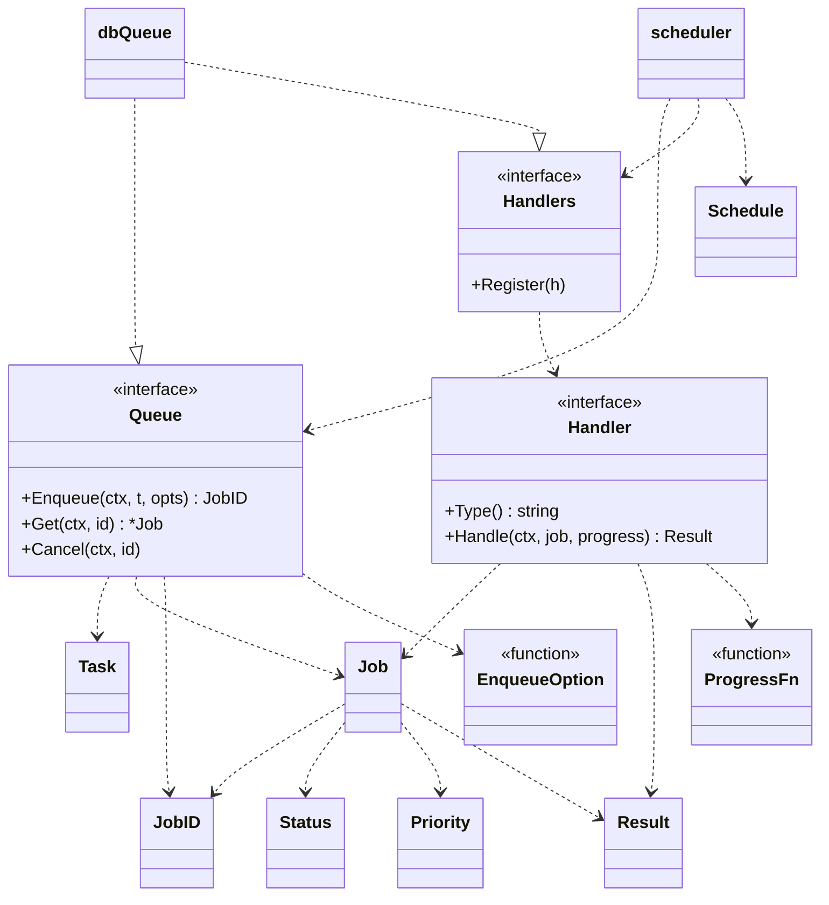
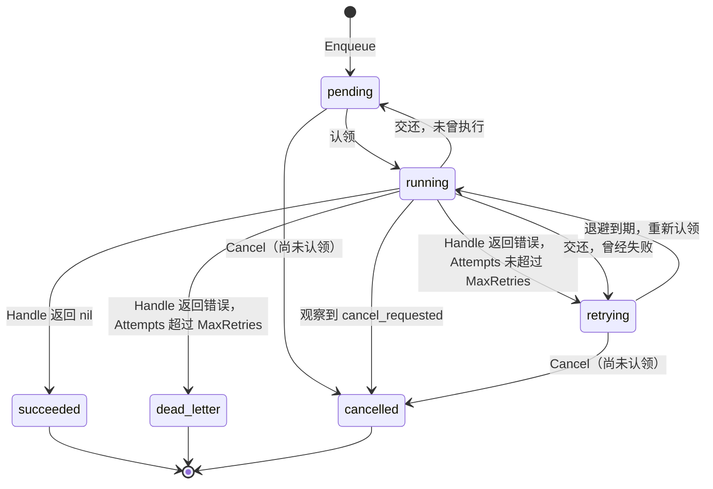

# jobs

## 职责

本能力交付**面向分布式部署的作业执行**：一件要在稍后的某个时刻做、或要离开当前请求路径在别处做的活，交成一条持久的作业记录，由任一在运行的副本认领并执行。同一张作业表承载三类需求——**定时一次**（在一个远期的时刻做一件事）、**周期**（每隔一段做一次）、**异步执行**（把一件耗时的活推迟到请求路径之外）。提交侧只依赖提交面 `Queue`，执行侧由业务模块登记 `Handler`。

根包 `pkg/jobs` 是接口包与公共类型，不登记模块。队列与登记面由 `pkg/jobs/db` 排他交付，它持一张作业表并组织消费者。周期调度由 `pkg/jobs/scheduler` 承担，它按业务模块声明的 `Schedule` 在 tick 上入队（[ADR-jobs-packaging-2026-10-15](../../../adr/adr-jobs-packaging-2026-10-15.md)）。

### 非职责

- **单个进程内循环触发的任务不由本能力承载。** 判据是**这件事的触发是否必须跨副本收敛**：一件必须全平台只做一次的活归本能力，一件每个副本各做各的、不需要在副本之间收敛的活不由本能力承载。仓库现有各模块自起的 ticker 循环属于不需要跨副本收敛的那一类——刷新进程内快照（`pkg/authz/policy`、`pkg/settings`、`pkg/tenant/catalog`）、清扫过期行（`pkg/authn/session`、`pkg/authn/token`、`pkg/authn/account`、`pkg/authn/mfa`、`pkg/authn/sms`、`pkg/authn/sso`）、文件轮转（`pkg/log`）、轮询外部（`pkg/sms/registry` 的厂商审核），其中 `pkg/sms/registry` 的那一个循环既刷新快照也轮询外部——各持有自己的循环与间隔，统一形态是「间隔 ≤0 即关掉、失败只 Warn、各自持停机制约」。这些活是每副本各刷自己的进程内状态，触发不需要跨副本收敛（[ADR-jobs-scope-2026-10-15](../../../adr/adr-jobs-scope-2026-10-15.md)）。
- **不做工作流编排。** 一个作业的执行结果不驱动下一个作业；作业之间没有依赖、没有扇入扇出、没有有向无环图。需要按序做几件事的调用方自己在 `Handle` 里做，或自己在成功之后再入队。
- **不在请求路径里同步执行。** `Enqueue` 只落一行并返回，执行发生在某个副本的消费者上；一件必须在调用返回前做完的活不在本能力的形态里。
- **不解释作业类型的含义。** 类型名由调用方定义（`Handler.Type()`），载荷是不透明字节，本能力不解释它，也不据它分派到业务数据。
- **不承诺结果的重放。** 结果存在作业行上供查询，本能力不把它投递给别的订阅方，也不在重复执行时重放（见「错误与失败语义」的至少一次）。
- **不选主、不引入中间件。** 多副本分摊靠作业表上有期限的认领，本能力没有 leader 选举、没有分布式锁、没有独立的队列中间件。

## 外部接口契约

### 交付的功能

```go
type JobID string
type Status string

const (
    StatusPending    Status = "pending"
    StatusRunning    Status = "running"
    StatusRetrying   Status = "retrying"
    StatusSucceeded  Status = "succeeded"
    StatusDeadLetter Status = "dead_letter"
    StatusCancelled  Status = "cancelled"
)
func (s Status) Terminal() bool

type Priority int

const (
    PriorityLow    Priority = 0
    PriorityNormal Priority = 5
    PriorityHigh   Priority = 10
)

type Task struct {
    Type           string // 作业类型，由调用方定义；对应 handler 的 Type()
    Payload        []byte
    IdempotencyKey string // 非空时使 Enqueue 幂等
}

type Result struct{ Data []byte }

type Job struct {
    ID          JobID
    Type        string
    Status      Status
    Priority    Priority
    Payload     []byte
    Result      *Result
    Error       string
    Attempts    int
    MaxRetries  int
    Timeout     time.Duration
    ProgressPct int
    ProgressMsg string
    ScheduledAt time.Time
    StartedAt   *time.Time
    CompletedAt *time.Time
    CreatedAt   time.Time
    UpdatedAt   time.Time
    // 视图不带租户字段：落租户列的行模型由 jobs.db 持有，它内嵌 tenant.Model。
}

type ProgressFn func(pct int, msg string)

type Handler interface {
    Type() string
    Handle(ctx context.Context, job *Job, progress ProgressFn) (Result, error)
}

// Queue 是可移植的提交面：任何要交活的模块只依赖它。
type Queue interface {
    Enqueue(ctx context.Context, t Task, opts ...EnqueueOption) (JobID, error)
    Get(ctx context.Context, id JobID) (*Job, error)
    Cancel(ctx context.Context, id JobID) error
}

// Handlers 是登记面：要被执行作业的模块在 Init 里登记自己的 handler。
type Handlers interface {
    Register(h Handler) error
    Registered() []string // 已登记的类型名
}

type EnqueueOption func(*enqueueOptions)
func NewEnqueueOptions() *enqueueOptions // 应用选项的起点；enqueueOptions 不导出
func WithPriority(Priority) EnqueueOption
func WithDelay(time.Duration) EnqueueOption
func WithScheduledAt(time.Time) EnqueueOption
func WithMaxRetries(int) EnqueueOption
func WithTimeout(time.Duration) EnqueueOption
// WithDelay 与 WithScheduledAt 互斥，后传入者胜。

// Schedule 是业务模块对外声明的周期任务（资源类型，见「周期声明与取材域」）。
type Schedule struct {
    Key      string        // 全局唯一，形如 "<模块>.<用途>"，也用作窗口幂等键的输入
    Type     string        // 作业类型，必须与某个已登记 Handler 的 Type() 相同
    Interval time.Duration // 周期；>0
    Payload  []byte
}

const (
    DefaultMaxRetries = 3
    DefaultTimeout    = 5 * time.Minute
)

var (
    ErrJobNotFound error // Get/Cancel 点名了本租户看不见的作业（未知 id、他人租户的 id 一律同形，不泄露存在性）
    ErrInvalidTask error // Task 的形状不合法
    ErrNoHandler   error // Enqueue 遇一个没有已登记 handler 的 Type
    ErrNotRunning  error // 队列未在运行（Start 之前 / Stop 之后）
)
```

`Queue` 与 `Handlers` 都由 `jobs.db` 排他交付。`Task` **不带租户字段**：租户取自 `ctx`（`tenant.FromContext`），无租户即以租户的错误拒绝——与数据库的租户过滤同一条判据，写行时租户列由模型内嵌的 `tenant.Model` 落下。

`Queue` 的各方法约束的主体是每个实现 `Queue` 的队列模块。`Enqueue` 校验 `Task` 的形状、从 `ctx` 解析租户、写下一行作业并返回它的 `JobID`；`IdempotencyKey` 非空且 `(tenant_id, idempotency_key)` 已占时返回既有作业的 `JobID`。`Get` 返回本租户可见的一条作业；未见过的 id、他人租户的 id 与已不可见的 id 一律以 `ErrJobNotFound` 拒绝，不区分存在性。`Cancel` 请求取消一条作业，按行的当前状态分档：未认领的行（`claimed_by` 为空）在一条语句里直接进入终态 `cancelled`，已认领的行只置下取消请求、由认领者在认领与执行之间观察后以 `cancelled` 结清，已进入终态的行是幂等空操作（见 [jobs.db](design-jobs-db.md) 的「取消」）。

`Handlers` 约束的主体是每个调用它的业务模块：`Register` 以 `Type()` 标识一个 `Handler`，同一类型只登记一次后由消费者按类型分派；`Registered` 列出已登记的类型名。`Queue.Enqueue` 遇一个没有已登记 handler 的 `Type` 时即以 `ErrNoHandler` 拒绝，不写行。

`Job` 是作业的只读视图，**不带租户字段**：持久化用的行模型由 `jobs.db` 持有，它内嵌 `tenant.Model` 并据此落租户列。`Status` 的取值是闭集；`Status.Terminal()` 对 `StatusSucceeded`、`StatusDeadLetter`、`StatusCancelled` 为真，对其余值为假。`Priority` 的取值是闭集 `{PriorityLow, PriorityNormal, PriorityHigh}`，认领按它降序。`Result` 与 `Error` 都是执行结果的表述，`Result` 只在成功时有值。

`EnqueueOption` 的各构造函数各自设定一个入队参数：`WithPriority` 设定 `Job.Priority`（缺省 `PriorityNormal`，不是 `Priority` 的类型零值 `PriorityLow`——只有调用方显式传 `Priority(0)` 时才是它）、`WithDelay` 设定从现在起延迟多久可被认领、`WithScheduledAt` 设定一个绝对时刻之后才可被认领、`WithMaxRetries` 设定 `Job.MaxRetries`（缺省 `DefaultMaxRetries`）、`WithTimeout` 设定单次执行的时限（缺省 `DefaultTimeout`）。`WithDelay` 与 `WithScheduledAt` 互斥，后传入者胜。

`enqueueOptions` 不导出；`NewEnqueueOptions` 是**跨包取得一份初始参数集的唯一入口**——队列模块（`jobs.db` 与提交方不在同一个包）先向它要一份起点：`PriorityNormal`、`DefaultMaxRetries`、`DefaultTimeout`、没有定时时刻；再按调用方传入的次序逐个应用选项。它本身不是调用方使用的符号，调用方只构造 `EnqueueOption`。

`Schedule` 是业务模块在 `Resources` 里声明的周期任务，由 `jobs.scheduler` 消费；字段语义见下一节的取材域裁定与 [jobs.scheduler](design-jobs-scheduler.md)。

### 登记单元与名字

| 包 | 模块名 | 交付 | 排他 |
|---|---|---|---|
| `pkg/jobs` | 不登记 | `Queue`、`Handlers`、`Handler`、`Task`、`Job`、`JobID`、`Status`、`Priority`、`Result`、`ProgressFn`、`Schedule`、`EnqueueOption`、`NewEnqueueOptions` 与 `With*` 构造函数、常量与哨兵 | — |
| `pkg/jobs/db` | `jobs.db` | `(*jobs.Queue)(nil)`、`(*jobs.Handlers)(nil)` | 两者都排他 |
| `pkg/jobs/scheduler` | `jobs.scheduler` | 不交付功能接口，只 tick 并入队 | — |

模块名照顶层能力：裸名 `jobs`，叶子 `jobs.<名>`，配置与设置的命名空间取同一个取值（对照 `kv`/`kv.redis`、`event`/`event.nats`）。`jobs.db` 同时排他交付提交面与登记面，使一个进程里恰好一个队列后端生效；`jobs.scheduler` 不交付任何功能接口，取用 `Queue`（入队）、`Handlers`（`Start` 经 `Registered` 校验声明类型）与 `tenant.Catalog`（按名册逐租户展开）。

### 周期声明与取材域

`Schedule` 是业务模块对外声明周期任务的资源类型；`pkg/jobs/scheduler` 是它的消费点。取材域取**参与集**。判据是：周期声明描述的是**这次运行要做的活**，它的效果依赖声明它的模块真的被驱动——那个模块的 handler 才登记得进去；只被静态级纳入的模块不构造、handler 不存在，它的声明因此不该被 tick。取材域之内，消解落选的模块其声明退出。

对照是 notification 的[类型分类法](../notification/design-notification-preferences.md)，它取**可用集**：类型是**词汇**——偏好写入与投递拿它当校验参照，同一个声明不能在这条命令下合法、在另一条下非法；周期声明是**活**——它必须与这次装配的东西一致，只被静态级纳入、handler 不存在的声明不该被 tick。两者判据的差别即本条裁定与类型分类法裁定之间的实质（[ADR-jobs-schedule-2026-10-15](../../../adr/adr-jobs-schedule-2026-10-15.md)）。

### 对外接口面

- `Queue`、`Handlers`、`Handler`、`Task`、`Job`、`JobID`、`Status` 及其闭集与 `Terminal`、`Priority`、`Result`、`ProgressFn`、`Schedule`、`EnqueueOption` 与 `NewEnqueueOptions` 及 `With*` 构造函数的字段与方法集，以及本能力的全部哨兵，是对调用方的接口面。加方法、改签名或改字段名对实现了接缝的队列模块与取用它们的调用方都是不兼容变更。
- `Task` 的字段语义：`Type` 对应某个已登记 `Handler` 的 `Type()`，`Payload` 对 `pkg/jobs` 不透明，`IdempotencyKey` 非空时使 `Enqueue` 幂等。`Job` 的字段语义、`Status` 的闭集与 `Terminal` 的判定同属接口面。
- **`Schedule` 的形状**：`Key` 全局唯一、`Type` 必须与某个已登记 handler 的 `Type()` 相同、`Interval > 0`；改这些字段使既有声明成为坏声明。
- **宿主可见面**：模块名 `jobs.db`、`jobs.scheduler`，配置与设置的命名空间 `jobs.db`、`jobs.scheduler` 及其输入项，表名 `jobs`。改动它们是宿主可见的破坏性变更。
- **`jobs.db` 可被替换**：另一个队列后端实现同一对 `Queue` 与 `Handlers` 接缝、各排他交付，调用方的代码不必改变。

### 哨兵错误

| 哨兵 | 定义处 | 含义 |
|---|---|---|
| `ErrJobNotFound` | `pkg/jobs` | `Get` 或 `Cancel` 点名了本租户看不见的作业：未知 id、他人租户的 id 一律同形，不泄露存在性 |
| `ErrInvalidTask` | `pkg/jobs` | `Task` 的形状不合法（例如 `Type` 为空） |
| `ErrNoHandler` | `pkg/jobs` | `Enqueue` 遇一个没有已登记 handler 的 `Type`，拒绝且不写行 |
| `ErrNotRunning` | `pkg/jobs` | 队列未在运行（`Start` 之前 / `Stop` 之后） |

调用方以 `errors.Is` 判别，包裹一律用 `%w`。哨兵定义在根包，消费者用同一个身份判别队列模块答出的错误。

## 依赖

| 依赖 | 用途 |
|---|---|
| `pkg/core` | 登记描述符、交付功能、按功能标识取用 |
| `pkg/config` | `jobs.db` 与 `jobs.scheduler` 声明各自的输入项 |
| `pkg/db` | `jobs.db`：作业表 `jobs` 与它自带的迁移集 |
| `pkg/tenant` | `jobs.db`：作业行的租户作用域与执行前进入；`jobs.scheduler`：每条周期声明经名册逐租户展开 |
| `pkg/event` | `jobs.db`（可选）：终态事件 `jobs.job.succeeded`、`jobs.job.dead_letter`、`jobs.job.cancelled` |
| `pkg/settings` | `jobs.db`（可选）：运行期可调的轮询间隔、认领批量、认领期限与两个退避边界 |
| `pkg/log` | `jobs.db` 与 `jobs.scheduler`（可选）：诊断 |

**根包不 import 任何上层功能目录。** 它只依赖标准库，位置与 `pkg/kv`、`pkg/event` 同级，任何要交活的模块都能只依赖 `pkg/jobs` 的提交面而不背上存储与租户。方向是调用方 import `pkg/jobs` 根包，根包不 import 调用方。**本能力不引入新的第三方依赖**：根包只用标准库，`jobs.db` 经 `pkg/db` 触达存储、经 `pkg/tenant` 取租户作用域，两者都是仓库既有的依赖。`jobs.scheduler` 只经 `Queue` 接缝入队，不 import `jobs.db` 的实现。

## UML 图

本能力的结构是两处接缝、一个资源类型与它们的实现之间的关系。图里看不出的约束：`Queue` 与 `Handlers` 由同一个模块 `jobs.db` **排他**交付，`jobs.scheduler` 不交付任何功能接口；`Schedule` 不由任何实现模块定义，它是业务模块放进自己 `Resources` 的声明，消费者是 `jobs.scheduler`；排他性由描述符声明、由消解阶段裁定，不是类型之间的关系。



一行作业在一个副本上的生命周期。图里看不出的约束：`pending` 在到期之前一直等着被认领（延迟与定时一次都落在这个状态里）；`retrying` 是失败之后、退避到期之前的状态；未认领的行（`pending` 或 `retrying`）被 `Cancel` 时在一条语句里直接进入 `cancelled`，已认领的行由认领者在执行前观察到取消请求后进入 `cancelled`；`succeeded`、`dead_letter`、`cancelled` 是终态，进入其一向总线发事件、不再被认领；认领之后持有而尚未执行的行在停机或认领到期时交还，回到可认领的状态——未曾执行的回 `pending`，曾经失败的回 `retrying`。



## 核心数据结构

| 概念 | 类型 | 说明 |
|---|---|---|
| 作业标识 | `JobID` | 应用生成的标识；`Get` 与 `Cancel` 按它寻址 |
| 作业状态 | `Status` | `pending`／`running`／`retrying`／`succeeded`／`dead_letter`／`cancelled` 的闭集，`Terminal` 判定终态 |
| 优先级 | `Priority` | `{0, 5, 10}` 的闭集，认领按它降序 |
| 作业请求 | `Task` | 提交方一次交活：类型、载荷、幂等键；不带租户字段，租户取自 `ctx` |
| 作业视图 | `Job` | 作业的只读视图：标识、状态、优先级、载荷、结果、错误、次数与重试上限、时限、进度、各时刻；不带租户字段 |
| 结果 | `Result` | 执行方交回的字节；本能力只存、只报 |
| 进度回调 | `ProgressFn` | 执行方在 `Handle` 里报告整数百分比与文本 |
| 周期声明 | `Schedule` | 业务模块对外声明的周期任务：键、类型、周期、载荷 |

**作业的持久形态是一张表 `jobs`，属于 `jobs.db`**，一行一个作业；表结构、列与索引见 [jobs.db](design-jobs-db.md)。本能力只把 `Job` 当作视图，它不带租户字段；持行模型、内嵌 `tenant.Model` 并据此落租户列的是 `jobs.db`。`Status` 的持久取值与 `Job.Status` 逐字一致。

**`Status` 的闭集有生命周期含义，不是自由字符串。** `pending`、`running`、`retrying` 是非终态，`succeeded`、`dead_letter`、`cancelled` 是终态；`Terminal` 只对终态为真。**`Priority` 的取值是闭集**：`PriorityLow`、`PriorityNormal`、`PriorityHigh`，认领的排序按它降序。

## 核心算法与流程

**提交一次作业。** 调用方构造 `Task` 并经 `Enqueue` 交来；实现校验形状、从 `ctx` 解析租户、把入队参数落成作业行的各列，写下一行并返回 `JobID`。`IdempotencyKey` 非空时以 `(tenant_id, idempotency_key)` 唯一索引收敛重复提交：重复的 `Enqueue` 返回既有作业的 `JobID`。无租户的上下文以租户的错误拒绝。

**认领与执行。** 消费者在自己的协程上按 `poll-interval` 读作业表，用一条语句认领至多 `claim-batch` 行到期的作业，写下认领者与到期时刻，然后逐个执行：先经 `tenant.Catalog.Enter(ctx, id)` 进入作业所属租户，再把作业交给按 `Type` 找出的 `Handler`，在 `Timeout` 之内跑 `Handle`。执行成功进终态 `succeeded` 并记下 `Result`；失败则按退避重排或进 `dead_letter`（细则见 [jobs.db](design-jobs-db.md)）。

**周期入队。** `jobs.scheduler` 按 `tick` 读全部 `jobs.Schedule` 声明，对每个到期的周期以窗口幂等键入队一条：键是 `sha256(声明键 + 窗口起点的十进制 UnixNano)` 的十六进制（不含租户），作为 `IdempotencyKey`，同一窗口的多次 tick 因此在唯一索引上收敛成一个作业。在册租户在每次 tick 里读一次（`tenant.Catalog.List`），本轮的每条声明与每个窗口共用这一份，逐个 `Enter` 后各入队一条（细则见 [jobs.scheduler](design-jobs-scheduler.md)）。

**终态与发布义务。** 一条作业进入任一终态时向总线发一条事件；发布义务记在作业行自己身上（`terminal_published_at` 为空即补发），因此对 `pkg/event` 是可选依赖——总线缺席时作业照跑、只是不发事件。

### 分布式语义总览

下表是分布式语义的总览，归属列指向承载其细节的模块文档。

| 语义 | 归属 | 概要 |
|---|---|---|
| 提交侧幂等 | [jobs.db](design-jobs-db.md) | `IdempotencyKey` 非空时 `(tenant_id, idempotency_key)` 唯一；重复 `Enqueue` 返回既有 `JobID` |
| 认领与租约 | [jobs.db](design-jobs-db.md) | 一条语句取至多 `claim-batch` 行到期作业，按优先级降序、`available_at` 升序、跨租户轮转取，写下认领者与到期时刻；行锁裁定并发认领 |
| 至少一次与消费方幂等 | [jobs.db](design-jobs-db.md) | 作业至少执行一次；重复执行不重放结果，由消费方按 `IdempotencyKey` 自行幂等 |
| 崩溃恢复 | [jobs.db](design-jobs-db.md) | 认领到期后由别的副本接手，遗留的 `running` 行照此处置 |
| 多副本周期调度 | [jobs.scheduler](design-jobs-scheduler.md) | 窗口幂等键 `sha256(声明键 + 窗口起点的十进制 UnixNano)` 的十六进制作为 `IdempotencyKey`，同一窗口的多次 tick 收敛成一个作业，不需要选主 |
| 公平性 | [jobs.db](design-jobs-db.md) | 跨租户轮转，一个租户不得饿死其他租户（认领语句的排序里含租户维度） |
| 停机宽限 | [jobs.db](design-jobs-db.md) | `Stop` 不再认领；在飞作业跑完 `shutdown-grace`；持有的行全部交还 |
| 延迟作业 | [jobs.db](design-jobs-db.md) | `available_at = ScheduledAt`，到期即可被认领 |
| 单次超时与退避 | [jobs.db](design-jobs-db.md) | 每作业 `Timeout`（默认 `DefaultTimeout`）；失败后退避自 `retry-base` 起翻倍至多 `retry-max`；`Attempts` 超过 `MaxRetries` 时进 `dead_letter` |
| 终态发事件 | [jobs.db](design-jobs-db.md) | 进入终态时向总线发事件；发布义务记在作业行自己身上（`terminal_published_at` 为空即补发），对 `pkg/event` 是可选依赖 |
| 租户作用域 | [jobs.db](design-jobs-db.md) | 作业行内嵌 `tenant.Model`；执行时先 `tenant.Catalog.Enter(ctx, id)` 再交 handler |
| 周期声明按租户展开 | [jobs.scheduler](design-jobs-scheduler.md) | 每次 tick 读一次在册租户（`tenant.Catalog.List`），本轮的每条声明与每个窗口共用这一份，逐个 `Enter` 后各入队一条 |
| 周期声明的取材域 | [jobs.scheduler](design-jobs-scheduler.md) | 取参与集；判据见本文「周期声明与取材域」 |

## 错误与失败语义

| 情形 | 表现 |
|---|---|
| `Task` 的形状不合法（如 `Type` 为空） | `Enqueue` 以 `ErrInvalidTask` 拒绝，什么都不写 |
| 上下文无租户 | 以租户模块的错误拒绝，与数据库的租户过滤同一条判据 |
| 幂等键已被占用 | 返回既有作业的 `JobID`，不新建、不报错 |
| `Get` 或 `Cancel` 点名本租户看不见的作业 | `ErrJobNotFound`，未知 id、他人租户的 id、已不可见的 id 同形，不泄露存在性 |
| 队列未在运行 | `ErrNotRunning`（`Start` 之前 / `Stop` 之后） |
| `Enqueue` 的 `Type` 没有已登记的 handler | 以 `ErrNoHandler` 拒绝，不写行 |
| `Handle` 返回错误，`Attempts` 未超过 `MaxRetries` | 作业进 `retrying`，退避到期后重新可被认领 |
| `Handle` 返回错误，`Attempts` 超过 `MaxRetries` | 作业进终态 `dead_letter` |
| 单次执行超过 `Timeout` | 按一次失败处置，进入退避或 `dead_letter` |
| 认领它的副本崩溃 | 认领到期后由别的副本接手，至少再执行一次 |

**本能力对执行是至少一次的。** 一次成功执行之后、把结果写回之前副本崩溃，或认领到期被另一个副本接手，都会让一个作业再执行一次；消费方据 `IdempotencyKey` 自行幂等，本能力不重放结果。终态事件的发布同样可能重复，订阅方按事件的标识去重。

## 并发与事务边界

- **提交面可被多个协程并发调用。** 每次 `Enqueue` 是一行插入，幂等由唯一索引裁定，一个调用不阻塞另一个。
- **认领由一条语句裁定。** PostgreSQL 上认领对取到的行加锁并跳过另一个认领正锁着的行，SQLite 上一次只有一个写者、认领语句本身即原子；两种方言共用同一条代码路径（细则见 [jobs.db](design-jobs-db.md)）。
- **执行不持有认领语句的事务与连接。** 消费者认领之后在事务之外执行 `Handle`，执行期间占的是自己的协程。
- **执行一个作业前先进入它的租户。** 作业在 `tenant.Catalog.Enter(ctx, id)` 之后的上下文里跑，模型内嵌的 `tenant.Model` 使语句落在该租户作用域内。
- **终态的写与事件的发布分离。** 先写作业行的终态，再由作业行自己的 `terminal_published_at` 记录发布义务；一次发布失败不撤销终态的写。

细则——认领语句、交还与停机、方言差异——落在 [jobs.db](design-jobs-db.md)。

## 扩展点

**新增一种队列后端。** 一个模块实现 `Queue` 与 `Handlers` 两处接缝并各排他交付，持自己的存储与认领机制，`pkg/jobs/db` 是默认实现。拒绝的条件是：根包必须保持接口包的身份、不登记模块；同一个功能标识 `(*jobs.Queue)(nil)` 或 `(*jobs.Handlers)(nil)` 上同时纳入两个实现时，在消解阶段以排他冲突失败。

**新增一种触发方式。** 触发是入队的另一种来路：一个模块取用 `Queue`，按它自己的规则（cron 表达式、外部事件、命令行动作）入队，`jobs.scheduler` 是周期触发的默认实现。新的触发方式不修改根包，也不修改 `jobs.db`——它只依赖提交面。

## 实现状态

| 能力 | 状态 | 代码 |
|---|---|---|
| 接缝与根包类型（`Queue`、`Handlers`、`Handler`、`Task`、`Job`、`JobID`、`Status`、`Priority`、`Result`、`ProgressFn`、`Schedule`、`EnqueueOption`、`NewEnqueueOptions` 与 `With*` 构造函数、常量与哨兵） | 已实现 | `pkg/jobs/jobs.go` `Queue`、`Handlers`、`Handler`、`Task`、`Job`、`JobID`、`Status`、`Priority`、`Result`、`ProgressFn`、`EnqueueOption`、`NewEnqueueOptions`、`WithPriority`、`WithDelay`、`WithScheduledAt`、`WithMaxRetries`、`WithTimeout` 及哨兵；`pkg/jobs/schedule.go` `Schedule` |
| 作业队列与登记面 `jobs.db` | 已实现 | `pkg/jobs/db/jobs.go` `Module`、`ModuleName`、`Register`、`Registered`；`pkg/jobs/db/store.go` `Enqueue`、`Get`、`Cancel`；`pkg/jobs/db/loop.go` `pass`、`claim`、`execute`、`settle`；`pkg/jobs/db/config.go` `schema`、`readSettings`；`pkg/jobs/db/tunables.go` `settingsSchema`、`retryAfter`；`pkg/jobs/db/migrations` |
| 周期调度 `jobs.scheduler` | 已实现 | `pkg/jobs/scheduler/scheduler.go` `Module`、`ModuleName`、`collectSchedules`、`validate`、`tickOnce`、`windowStart`、`windowKey`；`pkg/jobs/scheduler/config.go` `schema`、`readSettings` |
