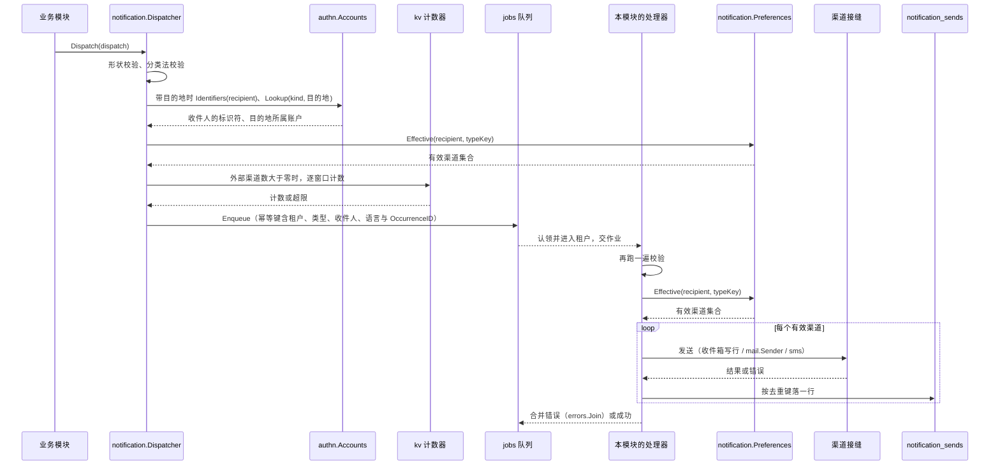
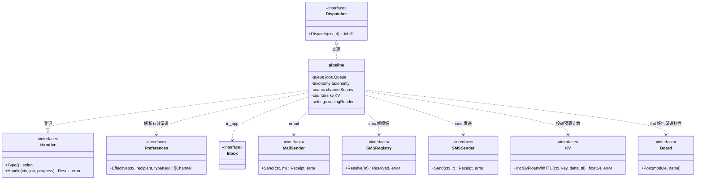

# notification.delivery

## 职责

本模块交付**出站投递流水线**：一条投递意图（`notification.Dispatch`）经校验后进入一条持久作业队列，由本模块登记的作业处理器消费；处理器再校验一次，按收件人解析有效渠道，逐渠道把消息送到对应接缝，并把每个渠道的终态记进本模块自己的账（`notification_sends`）。

提交面 `Dispatcher.Dispatch` 校验、判定目的地归属、计投递预算并入队——**不发送、不渲染、不写本模块的表**；消费过半程的是 `jobs.Handler`：它从队列取到作业、再跑一遍校验（worker 可能见到校验方从未见过的载荷：作业由别的提交方写入、或那一行被改动过），按收件人解析有效渠道，逐渠道发送，落账。渠道的可用性由装配决定，接缝缺席时该渠道跳过、记一条 `skipped`，不当作失败。

本模块排他交付提交面 `notification.Dispatcher`，并在 `Init` 里向 `jobs.Handlers` 登记自己的处理器。它经 [notification.preferences](design-notification-preferences.md) 的 `Effective` 读有效集，经 [notification.inbox](design-notification-inbox.md) 写站内信，经 `mail.Sender` 发邮件、经 `sms.Registry` 与 `sms.Sender` 发短信，经 `authn.Accounts` 读收件人的标识符并判定派发携带的目的地是否属于收件人。邮件与短信渠道在本进程能否兑现，本模块以[条件特性](../../../glossary.md)经 `feature.Board` 的 `Post` 报告（见「渠道的条件特性」）。

### 非职责

- **不声明通知类型，不持偏好矩阵。** 类型由业务模块声明，偏好矩阵归 [notification.preferences](design-notification-preferences.md)；本模块是类型分类法的**消费点之一**，在 `New` 里自己收齐分类法作校验参照。
- **不拥有收件箱存储。** 站内信行写进 `notification.inbox` 的 `in_app_messages` 表，经 `notification.Inbox` 接缝；本模块不读写那张表。
- **不拥有账户与标识符。** 收件人的标识符与目的地所属账户经 `authn.Accounts` 只读取得；本模块不写账户表、不产出标识符，也不为收件人推导一个目的地。
- **不拥有作业队列的执行。** 认领、租约、退避、多副本分摊归 [jobs](../jobs/design-jobs.md) 的队列模块；本模块只登记处理器、只用提交面。
- **不做站内信的实时推送。** 一条新收件箱行推给已连接的客户端归 [notification.stream](design-notification-stream.md) 的 SSE Hub。
- **不重试厂商。** 邮件与短信的载体都不重发；本模块对一次 `ErrUncertain` 不盲目重发（见错误与失败语义）。
- **不声明权限点。** 提交面是代码接缝，读谁可提交由宿主侧的授权决定（[ADR-notification-scope-2026-10-15](../../../adr/adr-notification-scope-2026-10-15.md)）。
- **不管外部联系人的同意台账。** 该台账刻意后置（见 [notification](design-notification.md) 的范围一节）。

## 外部接口契约

### 登记单元与名字

| 登记单元 | 模块名 | 交付 | 构造期依赖 |
|---|---|---|---|
| `pkg/notification/delivery` | `notification.delivery` | 排他交付 `(*notification.Dispatcher)(nil)`；向 `jobs.Handlers` 登记处理器 | 必需 `(*jobs.Queue)(nil)`、`(*jobs.Handlers)(nil)`、`(*db.Database)(nil)`、`(*tenant.Catalog)(nil)`、`(*notification.Preferences)(nil)`、`(*notification.Inbox)(nil)`、`(*i18n.Localizer)(nil)`、`(*authn.Accounts)(nil)`、`(*kv.KV)(nil)`；可选 `(*settings.Store)(nil)`、`(*log.Logger)(nil)`、`(*mail.Sender)(nil)`、`(*sms.Registry)(nil)`、`(*sms.Sender)(nil)` |

`kv.KV` 承载投递预算的计数器，是硬依赖：没有它就无法在入队前计数，而不计数的预算会放行每一条投递，方向与要求相反。`authn.Accounts` 是目的地归属规则的读取面，同样是硬依赖：没有它就无法判定派发携带的目的地是否属于收件人，而判不了归属就放行任意地址，方向与要求相反。`settings.Store` 列为可选依赖，使 settings 模块先于本模块初始化、快照已加载；缺席时每个预算各读自己的声明默认值，是合法装配。可选依赖的缺席都不使本模块启动失败：`log.Logger` 缺席则外部发送记在进程默认 logger 上；`mail.Sender` 缺席则 `email` 渠道不可用，`sms.Registry` 或 `sms.Sender` 缺席则 `sms` 渠道不可用，对应的条件特性也不报告（见「渠道的条件特性」）。**提交面 `notification.Dispatcher` 是本模块交付的功能**，本模块排他交付它（[ADR-notification-delivery-2026-10-15](../../../adr/adr-notification-delivery-2026-10-15.md)）。

### 交付的功能

```go
// 由 notification.delivery 排他交付。
type Dispatcher interface {
    Dispatch(ctx context.Context, d Dispatch) (jobs.JobID, error)
}
```

`Dispatcher.Dispatch` 是业务模块投递一条通知的唯一入口。它依次做**形状校验**（`TypeKey` 非空、`Recipient.Class` 为 `user`、`Recipient.UserID` 非空、`Locale` 非空；`external` 在闭集里但本轮无生产者，一律 `ErrInvalidRequest`）、**分类法校验**（`TypeKey` 在分类法里，`Params` 的键不越过该类型的 `RecipientVisibleParams` 白名单）、**目的地归属校验**（派发在参数里带了外部渠道的目的地时，经 `authn.Accounts` 核对它是否属于收件人，见「外部渠道的目的地与归属校验」）、**投递预算**（按收件人解析一次有效渠道，判定这条投递是否会有外部发送；有则按每个外部渠道计一次，见「投递预算」）与**入队**（构造一条作业写进队列，返回作业标识）。它为判定预算读一次有效渠道，不渲染文本、不写本模块的表。租户取自 `ctx`（`tenant.FromContext`），无租户即以租户的错误拒绝，与该队列自己的判据同形（[jobs](../jobs/design-jobs.md)）。

**入队幂等。** 作业的幂等键取租户、`TypeKey`、收件人类别与收件人标识、`Locale`、`OccurrenceID` 与 `Params` 的组合——即逐渠道去重键去掉渠道维度：同一租户、同一类型、同一收件人、同一语言的同一逻辑事件的重发（同一个 `OccurrenceID`、同一批参数）收敛成一条作业，`Dispatcher.Dispatch` 的重复调用返回同一条作业的标识而不新增一条。

### 端到端流水线

一次投递从业务模块的一次调用到每个渠道的一次终态，走这些步：

1. 业务模块经 `core.Resolve[notification.Dispatcher](reg)` 取到提交面，调 `Dispatcher.Dispatch(ctx, d)`。
2. `Dispatch` 校验、在派发带目的地时核对归属、按有效渠道计投递预算并把**这条投递入队为一条作业**（见交付的功能与「投递预算」）；逐渠道展开发生在消费端。
3. `jobs.db` 认领这条作业，`tenant.Catalog.Enter` 进入它的租户，把作业交给本模块登记的处理器。
4. 处理器解码载荷，**再跑一遍第 2 步的形状与分类法校验**——作业可能来自别的提交方，也可能那一行被改动过，处理器不假设提交方校验过。
5. 处理器按收件人经 `notification.Preferences.Effective` 解析有效渠道。
6. 逐渠道发送：`in_app` 渲染后写收件箱；`email` 渲染后经 `mail.Sender` 发；`sms` 字符串化参数后经 `sms.Registry` 解模板、`sms.Sender` 发。
7. 每个渠道的终态写一行 `notification_sends`；一个渠道的终态失败既不饿死其他渠道，也不被它们的成功掩盖——全部渠道都走完，各渠道的错误用 `errors.Join` 收口后返回。
8. 处理器返回的合并错误使作业按 [jobs](../jobs/design-jobs.md) 的退避重试；已经成功落账的渠道由去重键在重试里跳过（见「去重键与幂等落账」）。



图里画不出的约束：第 4 步的校验与第 2 步的形状与分类法部分是同一个例程，处理器不因提交方校验过就跳过它；**目的地归属只在提交端核对**，处理器不再读一次账户；第 6 步的渠道是否可发由装配决定，接缝缺席的渠道在第 7 步落 `skipped` 而不是错；`Effective` 只经偏好模块取，本模块不读偏好表。

### 渠道可用性由装配决定

渠道是通知能力声明的**封闭平台词汇**（`in_app`、`email`、`sms`），是否可发由本次装配里有哪些接缝决定：

| 渠道 | 可用当且仅当 | 缺席时 |
|---|---|---|
| `in_app` | 恒可用（收件箱是必需依赖） | — |
| `email` | `mail.Sender` 在场 | 该渠道跳过、落 `skipped` |
| `sms` | `sms.Registry` 与 `sms.Sender` **都在场** | 该渠道跳过、落 `skipped` |

**接缝缺席不是失败。** 一次投递到一个不可用的渠道记一条 `skipped` 结果、不产生错误、不进 `errors.Join`；这使「这次装配没有短信」与「这条短信被厂商拒绝」在账上分得开（[ADR-notification-channels-2026-10-15](../../../adr/adr-notification-channels-2026-10-15.md)）。`in_app` 依赖通知能力内的收件箱模块，该依赖是必需的，因此 `in_app` 恒可用。

### 渠道的条件特性

本模块不挂路由。渠道列由 [notification.preferences](design-notification-preferences.md) 恒挂的路由服务，一个渠道能否兑现却由本模块的接缝决定，所以邮件与短信渠道以本模块声明的条件特性发布（[feature](../design-feature.md)）。描述符的 `Resources` 带下列声明：

```go
feature.Spec{Name: "notification.channel.email", Conditional: true}
feature.Spec{Name: "notification.channel.sms", Conditional: true}
```

- **报告与发送路径用同一处判定。** 可选依赖 `mail.Sender`、`sms.Registry`、`sms.Sender` 由 `New` 解析并存进 `channelSeams`；`Init` 取得到 `feature.Board` 时按这份接缝报告：`emailReady()` 为真即报告 `notification.channel.email`，`smsReady()` 为真（`sms.Registry` 与 `sms.Sender` 都在场）即报告 `notification.channel.sms`。发送路径据以落 `skipped` 的正是这些判定，报告不另写条件。这是架构不变量 18 里「面由不挂路由的模块兑现」的那一支（[architecture](../../architecture.md#架构不变量)、[ADR-feature-ownership-2026-10-17](../../../adr/adr-feature-ownership-2026-10-17.md)）。
- **报告只在 `Init`。** 接缝在 `New` 就已解析，但 `New` 落在 `feature.Board` 接受 `Post` 的窗口之外，在那里调用 `Post` 即 panic。`feature.Board` 不在构造期依赖里，`Init` 经 `core.Resolve` 取用；进程里没有 `feature.board` 时报告静默跳过。
- **`in_app` 不立特性名。** 它恒可用，没有缺席的情形。
- **渠道特性缺席不改变偏好的取值集。** 偏好照旧按（类型，渠道）逐格存储，一个渠道的特性缺席时，它上面已存的偏好不变；装配补上该渠道的接缝之后，原值照旧生效（[ADR-notification-channels-2026-10-15](../../../adr/adr-notification-channels-2026-10-15.md)）。

### 去重键与幂等落账

每个渠道各有一个去重键，取值由接口契约给出，改动它是破坏性变更：

```
idempotency_key = hex(sha256(canonicalJSON{
    tenant, type_key, recipient_class, user_id, channel, locale, occurrence_id, params
}))
```

`canonicalJSON` 把对象按键排序、把值规范化成稳定的文本，使同一份载荷每次算出同一个键。租户取自 `ctx`，其余取自 `Dispatch` 与该渠道的取值。**逐渠道各一个**：同一事件走几个渠道即几个键。

`notification_sends` 上 `(tenant_id, idempotency_key)` 唯一，落账即幂等：一个渠道发送前先按去重键查这一行，**命中 `succeeded` 或 `skipped` 行即用那一行的结果、不重复发送**，命中 `failed` 行或查不到行才发送、才写行。这使一次作业的重试只补没成功的渠道，也使一次崩溃后的重放不重复投递已成功的渠道。

### 渲染按收件人的语言与类型声明

消息的文本由本模块在后端渲染，不交给客户端：一条 `notification.Message` 的 `Title` 与 `Body`、一封邮件的主题与正文、一条短信的参数，都按**收件人的语言**（`Dispatch.Locale`）与该**类型的声明**（`TypeSpec` 的键与 `RecipientVisibleParams`）渲染而成。渲染经 i18n 引擎（`i18n.Localizer`），目录键按通知命名空间与类型键拼出；`RecipientVisibleParams` 白名单之外的参数进不了渲染上下文，也进不了载荷（[ADR-notification-delivery-2026-10-15](../../../adr/adr-notification-delivery-2026-10-15.md)）。渲染是纯读取，不触达厂商。

**两个部件只在目录里有条目时才写。** 站内信的 `link` 与邮件的 `body_html` 是客户端会直接呈现的字段，目录里没有对应条目时留空，不把键串写进一个客户端当作链接或标记来处理的字段；其余部件按引擎的回落照常渲染——键串是文本，缺一条目录不是本模块可拒的事。

### 对外接口面

- `notification.Dispatcher` 的方法集，以及本模块对 `notification.Dispatch` 字段语义的依赖，是与其他模块之间的接口面；本模块的包导出的 `ModuleName` 同属接口面。
- **宿主可见面**：模块名 `notification.delivery`，以及提交面的功能标识 `(*notification.Dispatcher)(nil)`。命令树按模块名纳入本模块，或为它预置实例。
- 特性名 `notification.channel.email`、`notification.channel.sms`，以及「接缝在场即报告」这条判定。前端经生成的特性名类型引用它们，改名或撤去是宿主可见的破坏性变更。
- 表 `notification_sends` 属于本模块，宿主不读写它；它的列供运维查投放账，不在对外接口面内。

## 依赖

| 依赖 | 用途 |
|---|---|
| `pkg/jobs` | 提交面 `Queue`（入队）与登记面 `Handlers`（登记处理器） |
| `pkg/db` | `notification_sends` 表与迁移 |
| `pkg/tenant` | 租户上下文、`tenant.Model`、语句的租户过滤 |
| `pkg/kv` | 投递预算的计数器：按窗口原子累加，键的过期时间即桶宽 |
| `pkg/settings` | 预算上限的声明与读取；`settings.Store` 是可选依赖，缺席时读声明默认值 |
| `pkg/authn` | 用其 `ThrottledError`（读作 `ErrThrottled`，携带 `RetryAfter`）与 `ErrUnavailable` 表达可重试的拒绝；并经 `Accounts` 的 `Identifiers` 与 `Lookup` 读收件人的标识符、判定派发携带的目的地是否属于收件人。不使用其身份或任何实现 |
| `pkg/notification` | 根包的类型、哨兵与接缝（`Dispatcher`、`Dispatch`、`Preferences`、`Inbox`、`Channel`） |
| `pkg/mail` | 可选：`email` 渠道的发送接缝 `mail.Sender`（`Send`、`Message`、`Receipt` 与哨兵 `ErrThrottled`、`ErrRejected`、`ErrUncertain`、`ErrInvalidConfig`）。本模块只引用这条接缝，不设计它的内部 |
| `pkg/sms` | 可选：`sms` 渠道的 `sms.Registry`（解模板）与 `sms.Sender`（发送） |
| `pkg/i18n` | 把消息渲染成收件人语言的文本（`i18n.Localizer`，必需依赖） |
| `pkg/log` | 可选：外部发送的记录写在装配的日志能力上（`log.Logger`）；缺席时退回进程默认 logger |
| `pkg/feature` 根包 | 声明渠道的条件特性（`feature.Spec`）；`Init` 经 `core.Resolve` 可选取用 `feature.Board` 报告，不列入构造期依赖。根包只依赖标准库 |

**偏好、收件箱与渲染都在构造期依赖表里。** 本模块在 `New` 里用 `core.Resolve[notification.Preferences](reg)` 取偏好接缝、`core.Resolve[notification.Inbox](reg)` 取收件箱接缝、`core.Resolve[i18n.Localizer](reg)` 取渲染接缝，三者都是必需依赖，列在「登记单元与名字」的依赖列里。

**依赖方向。** 本模块 import `pkg/jobs`、`pkg/db`、`pkg/tenant`、`pkg/i18n`、`pkg/log`、`pkg/kv`、`pkg/settings`、`pkg/feature` 根包、`pkg/notification` 根包，并经 `pkg/authn` 根包取投递预算可重试拒绝的 `ThrottledError` 与 `ErrUnavailable`，以及目的地归属校验的 `Accounts`；也可选 import `pkg/mail` 与 `pkg/sms` 的根包，不 import 通知能力目录内的其他实现子包，不 import 认证能力目录内的任何实现子包（归属校验只经 `pkg/authn` 根包的 `Accounts` 接口），也不 import `pkg/authz`。它不 import 任何厂商 SDK：`mail` 与 `sms` 的载体叶子绑定各自的库，本模块只经它们的接口包触达。这些依赖都在本模块之前构造、之后停止。

**本模块不声明配置命名空间，不读任何输入项；它声明 settings。** 一次发送的作业参数（超时、重试次数、优先级）在入队时由本模块给出确定取值，不来自配置。运行期可调的只有「投递预算」一节的各上限，它们挂在 settings 的 `notification.delivery` 命名空间下。

## UML 图

本模块的结构是一条提交接缝、一条消费路径、渠道接缝与投递预算的关系。图里的约束不在图中：提交面排他交付，一个进程里至多一条流水线；偏好、收件箱与键值计数器是**必需**依赖，渠道接缝与 settings 存储都是**可选**的，渠道接缝缺席只让对应渠道跳过并让对应的条件特性不报告，settings 存储缺席只让各预算读声明默认值；`feature.Board` 不是构造期依赖，只在 `Init` 取用，取不到即不报告。



`pipeline` 同时实现 `Dispatcher` 并登记为一个 `jobs.Handler`；`channelSeams` 按本次装配在场的接缝决定哪些渠道可发，也决定 `Init` 向 `Board` 报告哪些渠道特性。

## 核心数据结构

**`notification_sends` 表**（租户作用域，内嵌 `tenant.Model`，约定列名 `tenant_id`）一行是一个渠道的一次终态。

| 列 | 含义 |
|---|---|
| `id` | 主键，应用生成 |
| `tenant_id` | 租户（由内嵌 `tenant.Model` 落下） |
| `type_key` | 通知类型键 |
| `channel` | 渠道（`in_app`/`email`/`sms`） |
| `recipient_class`、`recipient_user_id` | 收件人 |
| `status` | 闭集 `succeeded` / `failed` / `skipped` |
| `duration_ms` | 一次发送的耗时 |
| `error` | 终态失败的原因文本，至多一段；成功与跳过为空 |
| `provider_receipt_id` | 厂商回执标识（邮件、短信）；收件箱与跳过为空 |
| `idempotency_key` | 去重键，逐渠道各一个 |
| `created_at`、`updated_at` | 行的建立与最近一次写 |

唯一索引 `(tenant_id, idempotency_key)`：一个去重键至多一行，落账因此幂等。`status` 的闭集里 `skipped` 表示渠道本次不可用（接缝缺席），`failed` 表示渠道可用而发送终态失败，`succeeded` 表示外部载体受理了这条消息——**受理不等于送达**，带异步回执的载体只给消息标识，最终投递状态不在本模块的账上；站内信的 `succeeded` 表示那行已写进收件箱。

**载荷**存进作业的行（`jobs` 表的 `payload` 列），是 `Dispatch` 的序列化形态；本模块的解码是入队编码的逆，一个解不出的载荷按校验失败处置。

## 核心算法与流程

### 提交（Dispatch）

操作序固定：形状校验 → 分类法校验 → 目的地归属校验 → 投递预算 → 入队。形状校验的每一处落空都是 `ErrInvalidRequest`（`Recipient.Class` 不为 `user`——`external` 一律拒、`Recipient.UserID` 空、`Locale` 空、缺必填项）；`TypeKey` 不在分类法里是 `ErrUnknownType`；`Params` 带白名单外的键是 `ErrParamsNotAllowed`；派发带的目的地不属于收件人是 `ErrInvalidRequest`（见「外部渠道的目的地与归属校验」）。分类法在 `New` 里经 `core.Resources[notification.TypeSpec](reg)` 收齐，本模块是**消费点之一**，取材域取**可用集**、不做减法，与 [notification.preferences](design-notification-preferences.md) 同一份裁定（两处各自收齐）。收齐时逐份校验，判据与偏好模块逐条相同：一个 `TypeSpec` 声明不自洽（`Key` 为空、`DefaultChannels` 为空、`DefaultChannels` 含未知渠道、`DefaultChannels` 内有重复、`RecipientVisibleParams` 内有重复），或两个模块声明同一个 `Key`，都是 `ErrInvalidConfig`，`New` 终止启动并点名那个键与声明方。入队时本模块给出作业类型的名字、超时与重试次数；一次派发入队为**一条**作业，逐渠道展开在消费端；幂等键使同一租户内同一收件人的同一逻辑事件收敛成一条作业。

### 投递预算

一条投递在**入队之前**对两类预算计数：每个收件人的小时窗口与日窗口，以及整个部署的小时窗口。预算是**固定的时间桶**：每个桶一个计数器键，键随桶名更替，新桶从零开始。计数做在键值能力的计数器上，键的过期时间即桶宽。

**计在有效渠道之后。** 计预算前先按 `Preferences.Effective` 解析收件人的有效渠道，只数本次装配真正能发的外部渠道。解析结果里只有 `in_app`、或外部渠道的接缝缺席时，这条消息不出进程，不花任何预算；收件人关掉外部渠道时同样不花。计在有效渠道之前会让收件人自己的关闭动作消耗其预算，也让一个不产生外部发送的调用方替收件人耗掉额度。

**单位是外部渠道，不是派发。** 一次投递按它会尝试的每个外部渠道计一个单位：同时走 `email` 与 `sms` 的一次投递计两个。预算约束的是厂商调用，单位随之。

**顺序与拒绝。** 先查收件人小时窗口，再查日窗口，最后查部署窗口；任一处计数超过上限即以 `*authn.ThrottledError` 拒绝，携带的 `RetryAfter` 是当前桶剩余的时间（不少于一秒），且不写入任何作业。计数发生在比较之前，被拒的派发同样耗掉一个单位：只数放行的量会让已经超限的调用方在不付费的情况下重试。某一窗口拒绝后，其后的窗口不再计数，因此收件人被拒不会连带花掉部署窗口。

**上限来自 settings，每次派发读取。** 这些键挂在 `notification.delivery` 命名空间下，值分别是一个窗口内允许的外部消息数：

| 键 | 默认 | 取值域 | 约束 |
|---|---|---|---|
| `per-recipient-hourly` | 20 | 1–1000 | 一个收件人一小时内的外部消息数 |
| `per-recipient-daily` | 100 | 1–10000 | 一个收件人一天内的外部消息数 |
| `global-hourly` | 10000 | 1–10000000 | 整个部署一小时内的外部消息数，跨收件人与租户 |

取值域的下界是一：预算是安全边界，零关掉它就等于没有约束；要放宽的部署给一个大到不会被达到的数。一次读取失败或读到域外的值，该键回落到声明默认值并记一条 Error，回落的方向仍是一个上界。

**键的范围。** 收件人窗口按（租户，收件人标识）的摘要计数：收件人标识的文本可以带分隔符，两个租户也可以对同一个标识用不同账户。部署窗口不带租户，是部署范围的：一个租户的失控生产会耗尽全体，这是全局预算的定义。

**计数不可用即拒绝。** 计数器写失败时 `Dispatch` 以携带 `authn.ErrUnavailable` 的错误拒绝，不入队：一个计不了数的预算不能让消息通过。计数器的原子性由键值后端给出；多副本部署需装配共享状态的后端。

**计在去重之前。** 预算按一次 `Dispatch` 调用计数，而非按一个逻辑事件：队列的幂等键在入队时才告诉两侧是否收敛，而预算已在此前计入。能调用提交面的调用方本就可以改 `OccurrenceID` 造出不同作业，因此约束是预算本身，去重不承担这个职责。

### 消费与发送

处理器按 `Handle` 收到作业与租户上下文，做：解码载荷 → 再跑一遍提交处的形状与分类法校验 → `Preferences.Effective` 解析收件人的有效渠道 → 逐渠道发送并落账 → 合并错误返回。

**逐渠道发送的次序与判据**：

- **`in_app`**：渲染 `notification.Message`，经 `Inbox.Write` 写一行，落 `succeeded`。
- **`email`**：`mail.Sender` 缺席即落 `skipped`；在场则取派发参数里的目的地、渲染主题与正文（纯文本与 HTML），经 `mail.Sender.Send` 发一次，回执即落 `succeeded`（受理，不是送达）、错误即落 `failed`，厂商回执标识落 `provider_receipt_id`。
- **`sms`**：`sms.Registry` 或 `sms.Sender` 缺席即落 `skipped`；在场则取派发参数里的目的地、字符串化参数（见下），经 `sms.Registry.Resolve` 解出模板，再经 `sms.Sender.Send` 发一次，回执即落 `succeeded`（受理，不是送达）、错误即落 `failed`，厂商回执标识落 `provider_receipt_id`。

**每个渠道发送前先按去重键查账**：命中 `succeeded` 或 `skipped` 行即用那一行的结果、不重复发送；命中 `failed` 行即这一次重新发送（见「去重键与幂等落账」）。

### 外部渠道的目的地与归属校验

**外部渠道的目的地从派发参数 `to` 取。** 收件人是一个账户标识；目的地由调用方在 `Dispatch.Params` 里以参数名 `to` 给出：`sms` 取 E.164 号码，`email` 取 RFC 5322 地址。它是调用方给出的参数之一，本模块不从账户推出它，缺它也使不了别的来源。

**派发携带的目的地必须属于收件人。** 提交时，`Dispatch.Params` 带 `to` 的派发由 `Dispatch` 经 `authn.Accounts` 读收件人自己的标识符，并核对目的地是否属于同一个收件人。核对按收件人持有的每一种可投递标识符种类（`email` 与 `phone`）进行：把 `to` 交给账户存储的 `Lookup`，由存储用它自己的归一化形式比较，本模块不另写一套归一化；用户名是登录用的账户把手，不是可投递的地址，不参与核对。目的地属于收件人时，归属校验通过，派发继续走投递预算与入队。收件人没有任何可投递标识符、目的地属于另一个账户、目的地不属于任何账户，三者都拒为 `ErrInvalidRequest`，且不入队。收件人指名不到一个存活账户时，它没有标识符可以拥有目的地，同样拒绝；读账户存储失败是一个错误，不是放行。

**不覆盖：**

- **不带目的地的派发不核对。** 站内信不需要目的地；`Params` 里没有 `to` 时归属校验无事可做，派发照常入队。缺 `to` 的邮件或短信由该渠道在消费时以 `failed` 处置，与归属无关。
- **不做字符串化的目的地不核对。** `to` 存在但为空、或它的值字符串化不出非空文本时，归属校验没有可比较的地址，把它留给该渠道在消费时以 `failed` 处置。
- **消费端不重读归属。** 处理器重跑形状与分类法校验，不读账户、不重判目的地归属；归属由提交面负责。
- **没有账户的收件人类别保持既有规则。** 收件人类别是闭集 `user` 与 `external`；`user` 是一个账户，`external` 在形状校验处即被拒，因此没有任何无账户的类别走到归属校验。新增一个无账户的类别要另行决定它的规则。

### 短信参数的字符串化

**`to` 同时是模板参数之一。** 它与其余参数一同进 `sms.Registry.Resolve` 的参数表，模板没有声明的参数会被拒，因此声明该类型的业务模块要在自己的短信模板参数表里列出 `to`；目的地取值与模板参数取的是同一个值。

`sms.Message` 的参数是 `map[string]string`，而 `Dispatch.Params` 是 `map[string]any`。字符串化的判据是**只把有意义的值送上线路**：每个送进模板的参数都必须能字符串化成一个非空、稳定的文本——字符串原样、整数与布尔按十进制或小写文本、时间按约定的 RFC 3339 文本；**参数缺失、值为空、或值无法字符串化，一律使该渠道失败**（`ErrInvalidRequest`），不把空串或占位值送上线路。字符串化后的参数经 `sms.Registry.Resolve` 校验是否与模板声明的参数名表相等，缺项或多出都使该渠道失败。渲染与字符串化都在发送之前完成，任何一处失败都不触达厂商。

### 外部发送的记录

**每一次离开进程的发送写一条记录，成功与失败各一条。** 记录写在**模块自己的 logger** 上：`New` 取可选 `log.Logger`、以模块名绑定后由流水线持有。handler 的 context 不参与——投递作业跑在 `jobs.db` 创建的 context 上，那个 context 没有注入 logger，`log.FromContext` 会让这些记录落到进程默认链上，配置的 file／JSON 目的地看不到。

| 字段 | 取值 |
|---|---|
| `channel` | `email` 或 `sms` |
| `type_key` | 声明的通知类型键 |
| `outcome` | `sent`、`throttled`、`rejected`、`unroutable`、`uncertain` 或 `failed` |
| `provider_id` | 成功时厂商自己的回执标识 |
| `duration_ms` | 厂商调用耗时 |
| `cause` | 失败时厂商错误文本 |

`outcome` 是日志的归类，不是账上的状态：任何厂商失败在账上都是 `failed`。成功记 Info；厂商错误属于其哨兵（`ErrThrottled`、`ErrRejected`、`ErrUnroutable`、`ErrUncertain`）时记 Warn，落到哨兵之外（载体自身的缺陷）时记 Error。`ErrUnroutable` 保留自己的名字：消息本身没有缺陷，是这个部署送不到那个目的地。记录不携带收件人、消息正文与任何参数值；本模块在触达厂商之前自己判定的失败（缺目的地、模板解不出）不写这条记录，因为没有请求离开进程。

### 阶段行为

| 阶段 | 行为 |
|---|---|
| `Prepare` | 无动作 |
| `New` | 取用队列与登记面、数据库、租户名册、偏好接缝、收件箱接缝、渲染接缝、键值计数器与在场的渠道接缝；取可选 `settings.Store` 与可选 `log.Logger`，后者以模块名绑定；收齐并校验分类法 |
| `Migrate` | 数据库模块施加本模块声明的迁移集，建立 `notification_sends` 表 |
| `Init` | 向 `jobs.Handlers` 登记处理器（`Type()` 返回本模块的作业类型名）；取得到 `feature.Board` 时按 `channelSeams` 报告渠道的条件特性。实例不是本模块的产物时，登记与报告都不做 |
| `Start`、`Serve` | 无动作，消费由队列驱动 |
| `Stop`、`Close` | 无动作；在飞的一次投递随队列的停机宽限跑完或取消 |

### 一台副本上的重复消费

`jobs` 的投递至少一次，多副本靠认领分摊，同一条作业可能被重试。去重键 + `notification_sends` 的唯一索引使重复消费不重复投递：第一次消费落的行让第二次消费在发送前就跳过已成功的渠道，只补没成功的那些。同一租户、同一类型、同一收件人、同一语言的同一个 `OccurrenceID` 的多次入队收敛成一条作业。

## 错误与失败语义

| 情形 | 表现 |
|---|---|
| `TypeKey` 不在分类法里 | `Dispatcher.Dispatch` 与处理器都返回 `ErrUnknownType`，不入队／不发送 |
| `Recipient.Class` 不为 `user`（`external` 一律拒）、`Recipient.UserID` 空、`Locale` 空 | `ErrInvalidRequest`，不入队 |
| `Params` 带白名单外的键 | `ErrParamsNotAllowed`，不入队 |
| 派发携带的目的地不属于收件人（属于另一账户、不属于任何账户、收件人没有可投递标识符、指名不到存活账户） | `ErrInvalidRequest`，不入队 |
| 读收件人的标识符或查目的地所属账户失败 | 返回该读取错误；不入队，判不了归属即拒绝 |
| 收件人或部署窗口的投递预算已耗尽 | `Dispatcher.Dispatch` 返回 `*authn.ThrottledError`，`RetryAfter` 为当前桶剩余的时间；不入队 |
| 投递预算的计数器写失败 | 返回携带 `authn.ErrUnavailable` 的错误；不入队，计不了数即拒绝 |
| 一个 `TypeSpec` 声明不自洽、或两个模块声明同一个键 | `ErrInvalidConfig`，`New` 阶段终止启动 |
| 有效集里出现闭集之外的渠道 | 不可能：类型的 `DefaultChannels` 含未知渠道在分类法收齐处即拒，存储行由 PUT 按闭集校验 |
| 渠道的接缝不在本次装配里 | 该渠道落 `skipped`，不是错误，不进 `errors.Join` |
| 短信参数缺失、为空或无法字符串化 | 该渠道落 `failed`（`ErrInvalidRequest`），不触达厂商 |
| 派发参数里没有名为 `to` 的目的地 | 该渠道落 `failed`（`ErrInvalidRequest`），不触达厂商 |
| 厂商限流（`mail.ErrThrottled`、`sms.ErrThrottled`） | 该渠道落 `failed`，进合并错误，作业按退避重试 |
| 厂商拒绝（`ErrRejected`） | 该渠道落 `failed`，进合并错误；重试不会改变结果，但本模块不特判为终态 |
| 厂商超时、网络错误、`ErrUncertain` | 该渠道落 `failed`，进合并错误；本模块不盲目重发那一次调用，重试由作业承担（去重键使已成功的渠道不再发） |
| 多条渠道各失败 | 全部渠道走完，错误用 `errors.Join` 收口返回；一条渠道的失败不阻止其余渠道 |
| 载荷解不出 | 处理器按校验失败处置，返回错误使作业重试 |
| 某个渠道写账失败（表不在、库不可用） | 该渠道的结果未能落账，返回错误使作业重试；去重键使已落账的渠道不再发 |
| `ctx` 无租户 | 以租户的错误拒绝，不触达存储 |

**`ErrUncertain` 不得盲目重发。** 邮件与短信的发送都不幂等，超时之后本模块无从知道那一次是否已发出；本模块把一次 `ErrUncertain` 记成 `failed`、返回给队列，由队列的重试去补——重试时去重键命中成功的渠道直接跳过，只有确实没成功的渠道再发一次，代价是未确认的那一次可能重复，这是至少一次的代价而非本模块的重复投递。

### 非保证

- **不保证一条通知在所有渠道都送达。** 接缝缺席的渠道记 `skipped`，终态失败的渠道记 `failed`；一次投递的成功与否按渠道分别落账，不并成一个整体。
- **不保证渠道之间的次序。** 有效集里的渠道在本模块的循环里依次处理，但各渠道的厂商调用独立，先后与时延都不保证。
- **不保证渲染目录覆盖。** 一条通知的类型键在 i18n 目录里没有对应条目时，渲染回落到引擎的默认文案（键本身）；本模块不校验覆盖面。
- **不保证作业不被重复消费。** 队列的投递至少一次；本模块靠去重键使重复消费不重复投递，但一个尚未落账就崩溃的渠道在重试里会再发一次。
- **不保证一次投递的结果对提交方可见。** `Dispatcher.Dispatch` 只返回入队结果，一条通知的逐渠道终态写在 `notification_sends` 里，提交方不收到回调。
- **宿主为本模块预置实例时，渠道特性不报告。** 预置的实例不是本模块的产物，生命周期回调不处理它，`Init` 不报告任何渠道特性；特性文档里邮件与短信渠道的特性都缺席，不论预置的实例实际能发哪些渠道，方向是失败即关（[feature](../design-feature.md)）。
- **渠道特性只反映报告它的那个进程的装配。** 本模块只向同一进程里的 `feature.Board` 报告，特性文档由运行 `feature.board` 的进程发布；投递作业却由认领它的那个进程里的本模块消费，实际发送按那个进程的接缝进行。发布进程与消费进程装配的渠道接缝不同，特性文档就与实际投递不符：特性在场而消费进程缺接缝，该渠道落 `skipped`；特性缺席而消费进程有接缝，该渠道照常按偏好发送，前端却按缺席处理它。本模块装进发布特性文档的进程之外的进程时，各进程须装配同样的渠道接缝。

## 并发与事务边界

- **提交面可被多个协程并发调用。** `Dispatcher.Dispatch` 不持可变共享状态；分类法在 `New` 之后只读，入队由队列的提交面自行串行。重复的入队由幂等键收敛。
- **投递预算的计数由键值后端保证原子。** 每次 `Dispatch` 对每个窗口键各做一次原子自增，同一窗口内并发到达的派发由后端串行累加。计数与入队不在一个事务里：计数在入队之前，一次计数完成而入队失败的调用方耗掉了一个单位。
- **一条作业由一个处理器消费。** 队列的认领保证一条作业在一个副本上被一个处理器处理；处理器可被队列并发调用于不同作业，各作业的发送互不共享可写状态。
- **一次渠道落账在一个事务里。** 落账是先按去重键查、无则写一行，这两步在同一事务里，以唯一索引收口：两个并发的同一键写入只留一行。
- **本模块不发起跨表事务。** 它只写自己的 `notification_sends` 表；收件箱行经 `notification.Inbox` 在收件箱自己的事务里写，投递账与收件箱行不同成不同败——投递账是「发没发」的账，收件箱行是「收件人看得见什么」的账，两者各管各的。

## 扩展点

- **新增一个渠道不是扩展点。** 渠道是通知能力声明的封闭平台词汇，扩一个渠道要改根包的 `Channel` 常量与 `KnownChannel`，并在本模块的发送循环里加一支；这是通知模块自己的变更（[ADR-notification-channels-2026-10-15](../../../adr/adr-notification-channels-2026-10-15.md)）。
- **渠道接缝是可替换的实现。** `mail.Sender` 与 `sms.Sender` 由各自的载体叶子排他交付，本模块只经接口取用；换一个厂商是换一个载体叶子，不改本模块。
- **提交面与处理器由本模块排他交付，不是可替换的后端。** 换一套投递策略是改本模块的代码。
- **渲染接缝接入一个目录不改变本模块的调用面。** `i18n.Localizer` 是必需依赖；引擎对不受支持的语言回落默认语言、再回落键本身。

## 实现状态

| 能力 | 状态 | 代码 |
|---|---|---|
| 提交面 `Dispatcher` 与作业类型 | 已实现 | `pkg/notification/notification.go` `Dispatcher`；`pkg/notification/delivery/delivery.go` `Module`、`ModuleName`、`JobType` |
| `Dispatch`（形状校验、分类法校验、目的地归属校验、投递预算、入队） | 已实现 | `pkg/notification/delivery/dispatch.go` `Dispatch`、`decodeDispatch`；`pkg/notification/delivery/taxonomy.go` `collectTaxonomy`、`validate` |
| 投递预算（收件人小时与日窗口、部署小时窗口） | 已实现 | `pkg/notification/delivery/budget.go` `externalDeliveries`、`chargeBudgets`、`untilNextBucket`；`pkg/notification/delivery/settings.go` `settingsSchema`、`settingReader`、`defaultSettings` |
| 处理器与逐渠道发送 | 已实现 | `pkg/notification/delivery/handler.go` `Type`、`Handle`、`deliver`、`send`、`sendInApp`、`sendEmail`、`sendSMS` |
| 渠道可用性判定与 `skipped` | 已实现 | `pkg/notification/delivery/delivery.go` `channelSeams`、`emailReady`、`smsReady`；`pkg/notification/delivery/handler.go` `sendEmail`、`sendSMS` |
| 去重键与 `notification_sends` 幂等落账 | 已实现 | `pkg/notification/delivery/keys.go` `channelKey`、`dispatchKey`、`deriveKey`；`pkg/notification/delivery/store.go` `ledger`、`lookup`、`record` |
| 外部渠道的目的地与归属校验 | 已实现 | `pkg/notification/delivery/render.go` `destination`、`destinationParam`；`pkg/notification/delivery/ownership.go` `checkDestination`、`ownsDestination`、`destinationKinds` |
| 短信参数的字符串化 | 已实现 | `pkg/notification/delivery/render.go` `stringifyParams`、`stringify`、`renderValue` |
| `notification_sends` 表与迁移 | 已实现 | `pkg/notification/delivery/store.go` `sendRow`、`tableName`；`pkg/notification/delivery/migrations` |
| 渠道条件特性的声明与 `Init` 中按 `channelSeams` 的报告 | 已实现 | `pkg/notification/delivery/delivery.go` `Module`、`featureEmail`、`featureSMS`、`postFeatures`；`pkg/notification/delivery/feature_test.go` `TestAChannelIsNamedExactlyWhenItsSeamsArePresent`、`TestTheModuleDeclaresBothChannelFeatures` |
