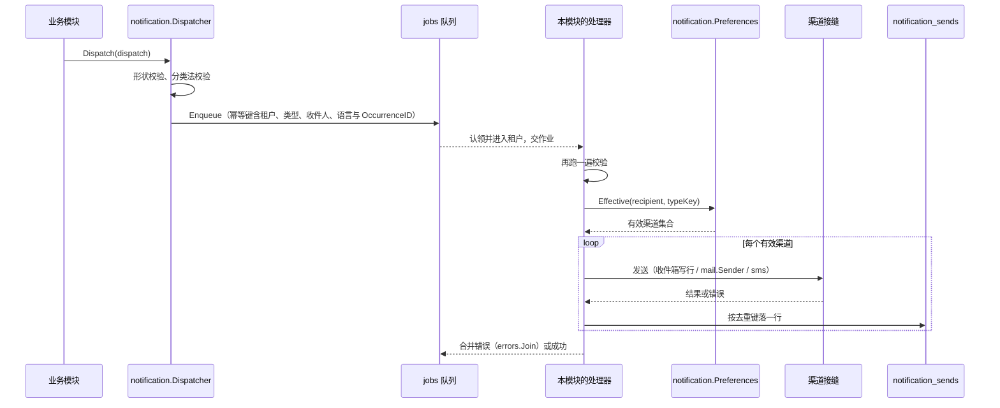
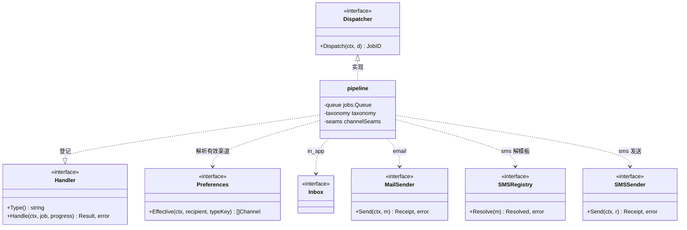

# notification.delivery

## 职责

本模块交付**出站投递流水线**：一条投递意图（`notification.Dispatch`）经校验后进入一条持久作业队列，由本模块登记的作业处理器消费；处理器再校验一次，按收件人解析有效渠道，逐渠道把消息送到对应接缝，并把每个渠道的终态记进本模块自己的账（`notification_sends`）。

提交面 `Dispatcher.Dispatch` 只校验并入队——**不发送、不渲染、不落库**；消费过半程的是 `jobs.Handler`：它从队列取到作业、再跑一遍校验（worker 可能见到校验方从未见过的载荷：作业由别的提交方写入、或那一行被改动过），按收件人解析有效渠道，逐渠道发送，落账。渠道的可用性由装配决定，接缝缺席时该渠道跳过、记一条 `skipped`，不当作失败。

本模块排他交付提交面 `notification.Dispatcher`，并在 `Init` 里向 `jobs.Handlers` 登记自己的处理器。它经 [notification.preferences](design-notification-preferences.md) 的 `Effective` 读有效集，经 [notification.inbox](design-notification-inbox.md) 写站内信，经 `mail.Sender` 发邮件、经 `sms.Registry` 与 `sms.Sender` 发短信。

### 非职责

- **不声明通知类型，不持偏好矩阵。** 类型由业务模块声明，偏好矩阵归 [notification.preferences](design-notification-preferences.md)；本模块是类型分类法的**消费点之一**，在 `New` 里自己收齐分类法作校验参照。
- **不拥有收件箱存储。** 站内信行写进 `notification.inbox` 的 `in_app_messages` 表，经 `notification.Inbox` 接缝；本模块不读写那张表。
- **不拥有作业队列的执行。** 认领、租约、退避、多副本分摊归 [jobs](../jobs/design-jobs.md) 的队列模块；本模块只登记处理器、只用提交面。
- **不做站内信的实时推送。** 一条新收件箱行推给已连接的客户端归 [notification.stream](design-notification-stream.md) 的 SSE Hub。
- **不重试厂商。** 邮件与短信的载体都不重发；本模块对一次 `ErrUncertain` 不盲目重发（见错误与失败语义）。
- **不声明权限点。** 提交面是代码接缝，读谁可提交由宿主侧的授权决定（[ADR-notification-scope-2026-10-15](../../../adr/adr-notification-scope-2026-10-15.md)）。
- **不管外部联系人的同意台账。** 该台账刻意后置（见 [notification](design-notification.md) 的范围一节）。

## 外部接口契约

### 登记单元与名字

| 登记单元 | 模块名 | 交付 | 构造期依赖 |
|---|---|---|---|
| `pkg/notification/delivery` | `notification.delivery` | 排他交付 `(*notification.Dispatcher)(nil)`；向 `jobs.Handlers` 登记处理器 | 必需 `(*jobs.Queue)(nil)`、`(*jobs.Handlers)(nil)`、`(*db.Database)(nil)`、`(*tenant.Catalog)(nil)`、`(*notification.Preferences)(nil)`、`(*notification.Inbox)(nil)`、`(*i18n.Localizer)(nil)`；可选 `(*mail.Sender)(nil)`、`(*sms.Registry)(nil)`、`(*sms.Sender)(nil)`、`(*event.Bus)(nil)`、`(*http.Endpoint)(nil)` |

可选依赖的缺席都不使本模块启动失败：`mail.Sender` 缺席则 `email` 渠道不可用，`sms.Registry` 或 `sms.Sender` 缺席则 `sms` 渠道不可用，`event.Bus` 缺席则不发事件。**提交面 `notification.Dispatcher` 是本模块交付的功能**，本模块排他交付它（[ADR-notification-delivery-2026-10-15](../../../adr/adr-notification-delivery-2026-10-15.md)）。

### 交付的功能

```go
// 由 notification.delivery 排他交付。
type Dispatcher interface {
    Dispatch(ctx context.Context, d Dispatch) (jobs.JobID, error)
}
```

`Dispatcher.Dispatch` 是业务模块投递一条通知的唯一入口。它依次做**形状校验**（`TypeKey` 非空、`Recipient.Class` 为 `user`、`Recipient.UserID` 非空、`Locale` 非空；`external` 在闭集里但本轮无生产者，一律 `ErrInvalidRequest`）、**分类法校验**（`TypeKey` 在分类法里，`Params` 的键不越过该类型的 `RecipientVisibleParams` 白名单）与**入队**（构造一条作业写进队列，返回作业标识）。它不解有效渠道、不渲染文本、不写任何存储。租户取自 `ctx`（`tenant.FromContext`），无租户即以租户的错误拒绝，与该队列自己的判据同形（[jobs](../jobs/design-jobs.md)）。

**入队幂等。** 作业的幂等键取租户、`TypeKey`、收件人类别与收件人标识、`Locale`、`OccurrenceID` 与 `Params` 的组合——即逐渠道去重键去掉渠道维度：同一租户、同一类型、同一收件人、同一语言的同一逻辑事件的重发（同一个 `OccurrenceID`、同一批参数）收敛成一条作业，`Dispatcher.Dispatch` 的重复调用返回同一条作业的标识而不新增一条。

### 端到端流水线

一次投递从业务模块的一次调用到每个渠道的一次终态，走这些步：

1. 业务模块经 `core.Resolve[notification.Dispatcher](reg)` 取到提交面，调 `Dispatcher.Dispatch(ctx, d)`。
2. `Dispatch` 校验并把**这条投递入队为一条作业**（见交付的功能）；逐渠道展开发生在消费端。
3. `jobs.db` 认领这条作业，`tenant.Catalog.Enter` 进入它的租户，把作业交给本模块登记的处理器。
4. 处理器解码载荷，**再跑一遍第 2 步的形状与分类法校验**——作业可能来自别的提交方，也可能那一行被改动过，处理器不假设提交方校验过。
5. 处理器按收件人经 `notification.Preferences.Effective` 解析有效渠道。
6. 逐渠道发送：`in_app` 渲染后写收件箱；`email` 渲染后经 `mail.Sender` 发；`sms` 字符串化参数后经 `sms.Registry` 解模板、`sms.Sender` 发。
7. 每个渠道的终态写一行 `notification_sends`；一个渠道的终态失败既不饿死其他渠道，也不被它们的成功掩盖——全部渠道都走完，各渠道的错误用 `errors.Join` 收口后返回。
8. 处理器返回的合并错误使作业按 [jobs](../jobs/design-jobs.md) 的退避重试；已经成功落账的渠道由去重键在重试里跳过（见「去重键与幂等落账」）。



图里画不出的约束：第 4 步的校验与第 2 步是同一个例程，处理器不因提交方校验过就跳过它；第 6 步的渠道是否可发由装配决定，接缝缺席的渠道在第 7 步落 `skipped` 而不是错；`Effective` 只经偏好模块取，本模块不读偏好表。

### 渠道可用性由装配决定

渠道是通知能力声明的**封闭平台词汇**（`in_app`、`email`、`sms`），是否可发由本次装配里有哪些接缝决定：

| 渠道 | 可用当且仅当 | 缺席时 |
|---|---|---|
| `in_app` | 恒可用（收件箱是必需依赖） | — |
| `email` | `mail.Sender` 在场 | 该渠道跳过、落 `skipped` |
| `sms` | `sms.Registry` 与 `sms.Sender` **都在场** | 该渠道跳过、落 `skipped` |

**接缝缺席不是失败。** 一次投递到一个不可用的渠道记一条 `skipped` 结果、不产生错误、不进 `errors.Join`；这使「这次装配没有短信」与「这条短信被厂商拒绝」在账上分得开（[ADR-notification-channels-2026-10-15](../../../adr/adr-notification-channels-2026-10-15.md)）。`in_app` 依赖通知能力内的收件箱模块，该依赖是必需的，因此 `in_app` 恒可用。

### 去重键与幂等落账

每个渠道各有一个去重键，取值是契约冻结的派生式：

```
idempotency_key = hex(sha256(canonicalJSON{
    tenant, type_key, recipient_class, user_id, channel, locale, occurrence_id, params
}))
```

`canonicalJSON` 把对象按键排序、把值规范化成稳定的文本，使同一份载荷每次算出同一个键。租户取自 `ctx`，其余取自 `Dispatch` 与该渠道的取值。**逐渠道各一个**：同一事件走几个渠道即几个键。

`notification_sends` 上 `(tenant_id, idempotency_key)` 唯一，落账即幂等：一个渠道发送前先按去重键查这一行，**已存在即返回既有结果、不重复发送**；不存在才发送、才写行。这使一次作业的重试只补没成功的渠道，也使一次崩溃后的重放不重复投递已成功的渠道。

### 渲染按收件人的语言与类型声明

消息的文本由本模块在后端渲染，不交给客户端：一条 `notification.Message` 的 `Title` 与 `Body`、一封邮件的主题与正文、一条短信的参数，都按**收件人的语言**（`Dispatch.Locale`）与该**类型的声明**（`TypeSpec` 的键与 `RecipientVisibleParams`）渲染而成。渲染经 i18n 引擎（`i18n.Localizer`），目录键按通知命名空间与类型键拼出；`RecipientVisibleParams` 白名单之外的参数进不了渲染上下文，也进不了载荷（[ADR-notification-delivery-2026-10-15](../../../adr/adr-notification-delivery-2026-10-15.md)）。渲染是纯读取，不触达厂商。

### 稳定性承诺

- `notification.Dispatcher` 的方法集，以及本模块对 `notification.Dispatch` 字段语义的依赖，是与其他模块之间的契约；本模块的包导出的 `ModuleName` 同样是契约。
- **宿主可见面是承诺**：模块名 `notification.delivery`，以及提交面的功能标识 `(*notification.Dispatcher)(nil)`。命令树按模块名纳入本模块，或为它预置实例。
- 表 `notification_sends` 属于本模块，宿主不读写它；它的列供运维查投放账，不是契约面。

## 依赖

| 依赖 | 用途 |
|---|---|
| `pkg/jobs` | 提交面 `Queue`（入队）与登记面 `Handlers`（登记处理器） |
| `pkg/db` | `notification_sends` 表与迁移 |
| `pkg/tenant` | 租户上下文、`tenant.Model`、语句的租户过滤 |
| `pkg/notification` | 根包的类型、哨兵与接缝（`Dispatcher`、`Dispatch`、`Preferences`、`Inbox`、`Channel`） |
| `pkg/mail` | 可选：`email` 渠道的发送接缝 `mail.Sender`。该能力尚未合入 main、位于同批在途的能力，引用按「路径 + 符号」写 |
| `pkg/sms` | 可选：`sms` 渠道的 `sms.Registry`（解模板）与 `sms.Sender`（发送） |
| `pkg/event` | 可选：每次成功写行后的事件 `notification.inbox.created`（供 SSE 转发） |
| `pkg/i18n` | 把消息渲染成收件人语言的文本（`i18n.Localizer`，必需依赖） |

**偏好、收件箱与渲染都在构造期依赖表里。** 本模块在 `New` 里用 `core.Resolve[notification.Preferences](reg)` 取偏好接缝、`core.Resolve[notification.Inbox](reg)` 取收件箱接缝、`core.Resolve[i18n.Localizer](reg)` 取渲染接缝，三者都是必需依赖，列在「登记单元与名字」的依赖列里。

**依赖方向。** 本模块 import `pkg/jobs`、`pkg/db`、`pkg/tenant`、`pkg/i18n` 与 `pkg/notification` 根包，并可选 import `pkg/mail`、`pkg/sms`、`pkg/event` 的根包，不 import 通知能力目录内的其他实现子包，也不 import `pkg/authn` 与 `pkg/authz`。它不 import 任何厂商 SDK：`mail` 与 `sms` 的载体叶子绑定各自的库，本模块只经它们的接口包触达。这些依赖都在本模块之前构造、之后停止。

**本模块不声明配置命名空间，不读任何输入项。** 一次发送的作业参数（超时、重试次数、优先级）在入队时由本模块给出确定取值，不来自配置；这是本模块没有可缺的启动项的直接结果（与 [event.outbox.relay](../event/design-event-outbox.md) 同形）。

## UML 图

本模块的结构是一条提交接缝、一条消费路径与渠道接缝的关系。图里的约束不在图中：提交面排他交付，一个进程里至多一条流水线；偏好与收件箱接缝是**必需**依赖，渠道接缝都是**可选**的，缺席只让对应渠道跳过。



`pipeline` 同时实现 `Dispatcher` 并登记为一个 `jobs.Handler`；`channelSeams` 按本次装配在场的接缝决定哪些渠道可发。

## 核心数据结构

**`notification_sends` 表**（租户作用域，内嵌 `tenant.Model`，约定列名 `tenant_id`）一行是一个渠道的一次终态。

| 列 | 含义 |
|---|---|
| `id` | 主键，应用生成 |
| `tenant_id` | 租户（由内嵌 `tenant.Model` 落下） |
| `type_key` | 通知类型键 |
| `channel` | 渠道（`in_app`/`email`/`sms`） |
| `recipient_class`、`recipient_user_id` | 收件人 |
| `status` | 闭集 `succeeded` / `failed` / `skipped` |
| `duration_ms` | 一次发送的耗时 |
| `error` | 终态失败的原因文本，至多一段；成功与跳过为空 |
| `provider_receipt_id` | 厂商回执标识（邮件、短信）；收件箱与跳过为空 |
| `idempotency_key` | 去重键，逐渠道各一个 |
| `created_at`、`updated_at` | 行的建立与最近一次写 |

唯一索引 `(tenant_id, idempotency_key)`：一个去重键至多一行，落账因此幂等。`status` 的闭集里 `skipped` 表示渠道本次不可用（接缝缺席），`failed` 表示渠道可用而发送终态失败。

**载荷**存进作业的行（`jobs` 表的 `payload` 列），是 `Dispatch` 的序列化形态；本模块的解码是入队编码的逆，一个解不出的载荷按校验失败处置。

## 核心算法与流程

### 提交（Dispatch）

操作序固定：形状校验 → 分类法校验 → 入队。形状校验的每一处落空都是 `ErrInvalidRequest`（`Recipient.Class` 不为 `user`——`external` 一律拒、`Recipient.UserID` 空、`Locale` 空、缺必填项）；`TypeKey` 不在分类法里是 `ErrUnknownType`；`Params` 带白名单外的键是 `ErrParamsNotAllowed`。分类法在 `New` 里经 `core.Resources[notification.TypeSpec](reg)` 收齐，本模块是**消费点之一**，取材域取**可用集**、不做减法，与 [notification.preferences](design-notification-preferences.md) 同一份裁定（两处各自收齐）。入队时本模块给出作业类型的名字、超时与重试次数；一次派发入队为**一条**作业，逐渠道展开在消费端；幂等键使同一租户内同一收件人的同一逻辑事件收敛成一条作业。

### 消费与发送

处理器按 `Handle` 收到作业与租户上下文，做：解码载荷 → 再跑一遍提交处的形状与分类法校验 → `Preferences.Effective` 解析收件人的有效渠道 → 逐渠道发送并落账 → 合并错误返回。

**逐渠道发送的次序与判据**：

- **`in_app`**：渲染 `notification.Message`，经 `Inbox.Write` 写一行，落 `succeeded`。
- **`email`**：`mail.Sender` 缺席即落 `skipped`；在场则渲染主题与正文，经 `mail.Sender.Send` 发一次，把结果归入 `succeeded` 或 `failed`。
- **`sms`**：`sms.Registry` 或 `sms.Sender` 缺席即落 `skipped`；在场则字符串化参数（见下），经 `sms.Registry.Resolve` 解出模板，再经 `sms.Sender.Send` 发一次，落账。

**每个渠道发送前先按去重键查账**：命中一行即用那一行的结果（已成功的跳过、已失败的跳过、已跳过的跳过），不重复发送。

### 短信参数的字符串化

`sms.Message` 的参数是 `map[string]string`，而 `Dispatch.Params` 是 `map[string]any`。字符串化的判据是**只把有意义的值送上线路**：每个送进模板的参数都必须能字符串化成一个非空、稳定的文本——字符串原样、整数与布尔按十进制或小写文本、时间按约定的 RFC 3339 文本；**参数缺失、值为空、或值无法字符串化，一律使该渠道失败**（`ErrInvalidRequest`），不把空串或占位值送上线路。字符串化后的参数经 `sms.Registry.Resolve` 校验是否与模板声明的参数名表相等，缺项或多出都使该渠道失败。渲染与字符串化都在发送之前完成，任何一处失败都不触达厂商。

### 阶段行为

| 阶段 | 行为 |
|---|---|
| `Prepare` | 无动作 |
| `New` | 取用队列与登记面、数据库、租户名册、偏好接缝、收件箱接缝、渲染接缝与在场的渠道接缝；收齐并校验分类法 |
| `Migrate` | 数据库模块施加本模块声明的迁移集，建立 `notification_sends` 表 |
| `Init` | 向 `jobs.Handlers` 登记处理器（`Type()` 返回本模块的作业类型名） |
| `Start`、`Serve` | 无动作，消费由队列驱动 |
| `Stop`、`Close` | 无动作；在飞的一次投递随队列的停机宽限跑完或取消 |

### 一台副本上的重复消费

`jobs` 的投递至少一次，多副本靠认领分摊，同一条作业可能被重试。去重键 + `notification_sends` 的唯一索引使重复消费不重复投递：第一次消费落的行让第二次消费在发送前就跳过已成功的渠道，只补没成功的那些。同一租户、同一类型、同一收件人、同一语言的同一个 `OccurrenceID` 的多次入队收敛成一条作业。

## 错误与失败语义

| 情形 | 表现 |
|---|---|
| `TypeKey` 不在分类法里 | `Dispatcher.Dispatch` 与处理器都返回 `ErrUnknownType`，不入队／不发送 |
| `Recipient.Class` 不为 `user`（`external` 一律拒）、`Recipient.UserID` 空、`Locale` 空 | `ErrInvalidRequest`，不入队 |
| `Params` 带白名单外的键 | `ErrParamsNotAllowed`，不入队 |
| 一个 `TypeSpec` 声明不自洽、或两个模块声明同一个键 | `ErrInvalidConfig`，`New` 阶段终止启动 |
| 有效集里出现闭集之外的渠道 | 不可能：类型的 `DefaultChannels` 含未知渠道在分类法收齐处即拒，存储行由 PUT 按闭集校验 |
| 渠道的接缝不在本次装配里 | 该渠道落 `skipped`，不是错误，不进 `errors.Join` |
| 短信参数缺失、为空或无法字符串化 | 该渠道落 `failed`（`ErrInvalidRequest`），不触达厂商 |
| 厂商限流（`mail.ErrThrottled`、`sms.ErrThrottled`） | 该渠道落 `failed`，进合并错误，作业按退避重试 |
| 厂商拒绝（`ErrRejected`） | 该渠道落 `failed`，进合并错误；重试不会改变结果，但本模块不特判为终态 |
| 厂商超时、网络错误、`ErrUncertain` | 该渠道落 `failed`，进合并错误；本模块不盲目重发那一次调用，重试由作业承担（去重键使已成功的渠道不再发） |
| 多条渠道各失败 | 全部渠道走完，错误用 `errors.Join` 收口返回；一条渠道的失败不阻止其余渠道 |
| 载荷解不出 | 处理器按校验失败处置，返回错误使作业重试 |
| 某个渠道写账失败（表不在、库不可用） | 该渠道的结果未能落账，返回错误使作业重试；去重键使已落账的渠道不再发 |
| `ctx` 无租户 | 以租户的错误拒绝，不触达存储 |

**`ErrUncertain` 不得盲目重发。** 邮件与短信的发送都不幂等，超时之后本模块无从知道那一次是否已发出；本模块把一次 `ErrUncertain` 记成 `failed`、返回给队列，由队列的重试去补——重试时去重键命中成功的渠道直接跳过，只有确实没成功的渠道再发一次，代价是未确认的那一次可能重复，这是至少一次的代价而非本模块的重复投递。

### 非保证

- **不保证一条通知在所有渠道都送达。** 接缝缺席的渠道记 `skipped`，终态失败的渠道记 `failed`；一次投递的成功与否按渠道分别落账，不并成一个整体。
- **不保证渠道之间的次序。** 有效集里的渠道在本模块的循环里依次处理，但各渠道的厂商调用独立，先后与时延都不保证。
- **不保证渲染目录覆盖。** 一条通知的类型键在 i18n 目录里没有对应条目时，渲染回落到引擎的默认文案（键本身）；本模块不校验覆盖面。
- **不保证作业不被重复消费。** 队列的投递至少一次；本模块靠去重键使重复消费不重复投递，但一个尚未落账就崩溃的渠道在重试里会再发一次。
- **不保证一次投递的结果对提交方可见。** `Dispatcher.Dispatch` 只返回入队结果，一条通知的逐渠道终态写在 `notification_sends` 里，提交方不收到回调。

## 并发与事务边界

- **提交面可被多个协程并发调用。** `Dispatcher.Dispatch` 不持可变共享状态；分类法在 `New` 之后只读，入队由队列的提交面自行串行。重复的入队由幂等键收敛。
- **一条作业由一个处理器消费。** 队列的认领保证一条作业在一个副本上被一个处理器处理；处理器可被队列并发调用于不同作业，各作业的发送互不共享可写状态。
- **一次渠道落账在一个事务里。** 落账是先按去重键查、无则写一行，这两步在同一事务里，以唯一索引收口：两个并发的同一键写入只留一行。
- **本模块不发起跨表事务。** 它只写自己的 `notification_sends` 表；收件箱行经 `notification.Inbox` 在收件箱自己的事务里写，投递账与收件箱行不同成不同败——投递账是「发没发」的账，收件箱行是「收件人看得见什么」的账，两者各管各的。

## 扩展点

- **新增一个渠道不是扩展点。** 渠道是通知能力声明的封闭平台词汇，扩一个渠道要改根包的 `Channel` 常量与 `KnownChannel`，并在本模块的发送循环里加一支；这是通知模块自己的变更（[ADR-notification-channels-2026-10-15](../../../adr/adr-notification-channels-2026-10-15.md)）。
- **渠道接缝是可替换的实现。** `mail.Sender` 与 `sms.Sender` 由各自的载体叶子排他交付，本模块只经接口取用；换一个厂商是换一个载体叶子，不改本模块。
- **提交面与处理器由本模块排他交付，不是可替换的后端。** 换一套投递策略是改本模块的代码。
- **渲染接缝接入一个目录不改变本模块的调用面。** `i18n.Localizer` 是必需依赖；引擎对不受支持的语言回落默认语言、再回落键本身。

## 实现状态

| 能力 | 状态 | 代码 |
|---|---|---|
| 提交面 `Dispatcher` 与作业类型 | 未实现 | — |
| `Dispatch`（形状校验、分类法校验、入队） | 未实现 | — |
| 处理器与逐渠道发送 | 未实现 | — |
| 渠道可用性判定与 `skipped` | 未实现 | — |
| 去重键与 `notification_sends` 幂等落账 | 未实现 | — |
| 短信参数的字符串化 | 未实现 | — |
| `notification_sends` 表与迁移 | 未实现 | — |
