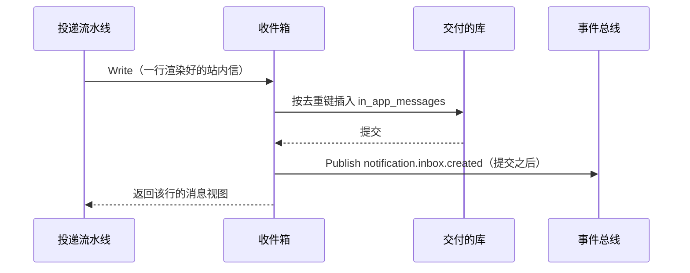
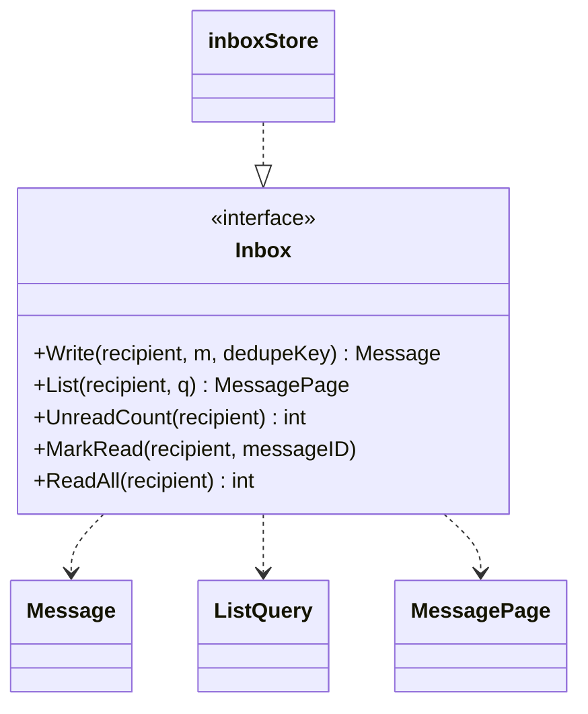

# notification.inbox

## 职责

本模块交付**站内信收件箱**：一个账户在应用内的消息行，以及它的列出、未读计数与标记已读。一条站内信由[投递流水线](design-notification-delivery.md)写进来——本模块的写入口是它唯一的下游写入口——HTTP 面把行读出来、把行标为已读，**不新建站内信行**。

行是租户作用域的：租户取自上下文，收件人是某个账户。`read_at` 是从空到一个时刻的单向变化，此后不再改写，首读时间戳因而稳定。写入口按去重键幂等，同一个去重键只落一行；标记已读由谓词给出，匹配的是“尚未标记”这个条件，与消息是否过期无关。

本模块的实现子包 `pkg/notification/inbox` 登记模块 `notification.inbox`，排他交付功能 `notification.Inbox`（功能标识写作 `(*notification.Inbox)(nil)`）。根包 `pkg/notification` 是接口包，声明 `Inbox` 接口、它的输入输出类型与消息视图，不登记模块。

### 非职责

- **不投递、不渲染。** 站内信是“给自己人发消息”的一个渠道；写这一行的标题与正文由投递流水线渲染好之后交进来。渲染、渠道选择与出站投递属于[投递流水线](design-notification-delivery.md)。
- **不推送。** 把“刚写入一行”推给在线客户端是[推送模块](design-notification-stream.md)的事；本模块只写行、读行、发一条总线事件。
- **不判定谁能读谁的收件箱。** 本模块不声明权限点，路由不带自有权限闸。谁可以读某个收件人的收件箱由宿主侧的授权决定（[ADR-notification-scope-2026-10-15](../../../adr/adr-notification-scope-2026-10-15.md)）。
- **不校验通知类型。** 一个 `type_key` 是不是已声明的类型，由[偏好与分类法](design-notification-preferences.md)这个消费点校验；本模块收下它并原样存下，不对照分类法。
- **不接收非用户收件人。** 站内信的一行有一个账户收件人；外部联系人的同意台账本轮刻意后置（[ADR-notification-scope-2026-10-15](../../../adr/adr-notification-scope-2026-10-15.md)），因此没有生产者写到 `external` 类的收件人。
- **不做已读以外的改写。** HTTP 面只改 `read_at` 一列；行一旦写入，其余列不再变化。

## 外部接口契约

### 登记单元与名字

| 包 | 模块名 | 交付 | 排他 |
|---|---|---|---|
| `pkg/notification` | 不登记 | `Inbox` 接口、消息视图与它的输入输出类型、本模块用到的哨兵 | — |
| `pkg/notification/inbox` | `notification.inbox` | `Inbox` 功能（`(*notification.Inbox)(nil)`） | 排他 |

配置命名空间取模块名 `notification.inbox`。构造期依赖：必需 `(*db.Database)(nil)`、`(*tenant.Catalog)(nil)`；可选 `(*event.Bus)(nil)`、`(*log.Logger)(nil)`、`(*http.Router)(nil)`、`(*i18n.Localizer)(nil)`。取用写作 `core.Resolve[notification.Inbox](reg)`，依赖声明写作 `core.Requirement{Token: (*notification.Inbox)(nil)}`。

**端名清单 `notification.inbox.endpoints` 在路由能力在场时必填。** `Init` 见到 `(*http.Router)(nil)` 在场而这一项为空即启动失败，以完整路径 `notification.inbox.endpoints` 点名这一项；`(*http.Router)(nil)` 缺席时本模块不挂路由，这一项不被读取，空清单合法。

### 交付的功能

```go
type ListQuery struct {
    Group  string // 空即全部组
    Limit  int
    Offset int
}
type MessagePage struct {
    Items []Message
    Total int
}
type Inbox interface {
    Write(ctx context.Context, recipient string, m Message, dedupeKey string) (Message, error)
    List(ctx context.Context, recipient string, q ListQuery) (MessagePage, error)
    UnreadCount(ctx context.Context, recipient string) (int, error)
    MarkRead(ctx context.Context, recipient, messageID string) error
    ReadAll(ctx context.Context, recipient string) (int, error)
}
```

`Inbox` 的每个方法都作用在上下文里的租户与一个**显式传参**的收件人上（投递是无请求路径，它自己知道收件人；路由从身份解析出收件人再传进来）；约束的主体是每个交付 `Inbox` 的实现：

- **租户取自上下文，不从入参取。** 收件人由方法参数给出，行的租户列由模型内嵌的 `tenant.Model` 落下、语句的过滤由名册模块的插件完成；上下文无租户时受约束模型的语句拒绝执行。
- **`Write` 按去重键幂等。** 同一个 `dedupeKey` 只落一行；重复调用返回既有行的视图而**不新建、不发事件**。空 `dedupeKey` 或空 `recipient` 是调用方缺陷，`Write` 以 `ErrInvalidRequest` 拒绝，不写任何行。
- **`Write` 受租户作用域约束。** 收件人是账户标识，不代表授权；写给别的租户的账户由租户作用域挡下，不落行。
- **`MarkRead` 命中已读行时不写库。** 一个能被本收件人看见、已经标记过的 `messageID` 是一次成功的空操作；`read_at` 只从空到一个时刻，首读时间戳不被覆盖。
- **`MarkRead` 对看不见的 `messageID` 答同一个 `ErrMessageNotFound`。** 未知 id、属于他人、属于他租户一律同形，不区分、不泄露存在性。
- **`ReadAll` 只匹配尚未标记的行**，返回本次标记的行数；目标态与现状相同不写库，重复调用返回 0 且成功。

### 哨兵错误

| 哨兵 | 定义处 | 含义 |
|---|---|---|
| `ErrMessageNotFound` | `pkg/notification` | 收件箱点名了本收件人看不见的消息：未知 id、他人、他租户一律同形 |
| `ErrInvalidRequest` | `pkg/notification` | 请求形状不可读：空收件人、空去重键、分页越界 |

调用方以 `errors.Is` 判别，包裹一律用 `%w`。本能力其余的哨兵（`ErrUnknownType`、`ErrUnknownChannel`、`ErrNotUnsubscribable`、`ErrParamsNotAllowed`、`ErrInvalidConfig`）由根包定义、由别的模块使用，不在本模块的路由上出现。

### 路由

基路径 `/api/v1/notifications`，本模块在 `Init` 里把路由挂在入口模块的登记面上，端取自配置项 `notification.inbox.endpoints` 点名的那些端，路径取 gin 写法。每条路由点名一个路径参数 `:messageId` 或不分页参数，**不带自有权限闸**：路由本身的访问控制由宿主侧的授权决定。下表是路由的全集（封闭集），列出方法、路径与成功应答。

| 方法 路径 | 成功应答 |
|---|---|
| `GET /api/v1/notifications/messages` | 200，`{"messages": [Message...], "total": N}` |
| `GET /api/v1/notifications/messages/unread-count` | 200，`{"unread": N}` |
| `POST /api/v1/notifications/messages/read-all` | 200，`{"read_count": N}` |
| `POST /api/v1/notifications/messages/:messageId/read` | 204，无正文 |

路由的响应体里，`Message` 视图逐字段从根包的 `Message` 构造：`id`、`type_key`、`group`、`title`、`body`、`params`、`link`、`read_at`、`created_at`，时间按 UTC 写出。

### 稳定性承诺

- `Inbox` 的方法集，`ListQuery`、`MessagePage` 与根包的 `Message` 视图的字段名，以及哨兵 `ErrMessageNotFound`、`ErrInvalidRequest`，是本模块对调用方的契约。加方法、改签名或改字段名对取用 `Inbox` 的调用方是不兼容变更。
- **宿主可见面是承诺**：模块名 `notification.inbox`，配置键 `notification.inbox.endpoints`，路由的路径，事件类型名常量 `EventInboxCreated`（`"notification.inbox.created"`）与它的载荷字段，以及 `Problem.Type` 前缀 `urn:speed:notification:` 及其下的码（`bad-request`、`message-not-found`）。改动它们是宿主可见的破坏性变更，须随发布对账。

## 依赖

| 依赖 | 用途 |
|---|---|
| `pkg/core` | 登记描述符、交付功能 |
| `pkg/config` | 声明输入项 |
| `pkg/db` | `in_app_messages` 表与迁移集；交付句柄 |
| `pkg/tenant` | 租户作用域：模型内嵌 `tenant.Model`，语句过滤由名册模块的插件完成；构造期声明 `(*tenant.Catalog)(nil)` |
| `pkg/http` | 可选：把自己挂到入口模块的登记面上 |
| `pkg/event` | 可选：发布 `notification.inbox.created` |
| `pkg/authn` | 从请求上下文取调用方身份，作为读与标记已读的收件人 |
| `pkg/log` | 可选：记诊断 |
| `pkg/i18n` | 可选：`i18n.Localizer` 按请求的协商语言渲染本模块写出的 `Problem` 的标题与正文；缺席时用本模块内嵌的英文文案 |

**`pkg/authn` 是上下文存取，不是构造期依赖。** 路由读调用方身份经 `pkg/authn` 的包级存取函数（`FromContext`），身份是请求上下文里的一个值、不来自任何模块实例，因此本模块不把它声明为 `core.Requirement`。方向满足架构不变量：本模块 import 认证根包，认证不认识本模块。

**本模块不 import 投递、偏好与推送模块。** 投递流水线是写入口的唯一调用方，它单向依赖本模块交付的 `Inbox`；本模块不认识投递的 `Dispatcher`、偏好或 Hub。

## UML 图

写入口的一条路径：一行站内信从投递流水线进来，落库并提交之后才发事件。图看不出的约束是：行先提交、事件后发，事件发失败不回滚那一行；总线的缺席只让事件不发，行照常落库，消费方回读那一行（见[推送模块](design-notification-stream.md)）。



本模块的结构：一个功能接口、一份消息视图与查询的类型。图上看不出的是：`Inbox` 排他交付，一个进程里恰好一个实现；`Message` 是读写共用的视图，写入口按它落行、返回它。



## 核心数据结构

**站内信表 `in_app_messages`**，一行一条站内信，租户作用域（内嵌 `tenant.Model`，租户列名为约定列 `tenant_id`）。时刻按 UTC 保存；`params` 以 JSON 持有，本模块不解释它的内容。

| 列 | 含义 |
|---|---|
| `id` | 主键，应用生成的 UUID |
| `tenant_id` | 租户列，由内嵌的 `tenant.Model` 提供 |
| `recipient_user_id` | 收件账户标识 |
| `type_key` | 通知类型键，形如 `<模块>.<实体>.<动作>` |
| `group` | 分组，供按组过滤 |
| `title`、`body` | 已渲染的标题与正文 |
| `params` | 已按类型白名单过滤的参数，JSON |
| `link` | 可选的跳转目标 |
| `dedupe_key` | 去重键，非空 |
| `expires_at` | 过期时刻，空即不过期 |
| `read_at` | 首读时刻，空即未读 |
| `created_at`、`updated_at` | 写入与更新时间 |

索引：`dedupe_key` 唯一（去重键已经含租户，因而一个全局唯一索引即可）；`(tenant_id, recipient_user_id, created_at)` 供收件人维度的倒序列出。

**消息视图 `Message`** 是投出去的行，只含调用方需要读的字段，不含 `tenant_id`、`recipient_user_id`、`dedupe_key`、`expires_at`、`updated_at` 这些记账列。

## 核心算法与流程

### 路由的判定顺序

这些路由共享一段前缀，之后各自分叉。前缀：从请求上下文取调用方身份（`pkg/authn` `FromContext`）；没有身份即 401——本模块不设权限闸，身份是用来确定读谁的收件箱的，缺了它无从服务。租户由解析层在中间件里写进上下文，路由不再判定租户。

| 路由 | 判定顺序 | 应答码 |
|---|---|---|
| `GET /messages` | 取身份（缺即 401）→ 解析 `group`（可选）、`limit`、`offset`：`limit` 缺省或 0 取 50，`<0` 或 `>200` 即 400，`offset<0` 即 400 → `List` | 200；参数越界 400 |
| `GET /messages/unread-count` | 取身份（缺即 401）→ `UnreadCount` | 200 |
| `POST /messages/read-all` | 取身份（缺即 401）→ `ReadAll` | 200 |
| `POST /messages/:messageId/read` | 取身份（缺即 401）→ `MarkRead(messageID)`：命中即 204，未命中即 404 | 204；404 |

**越界是整页拒绝，不静默截断。** `limit` 超过上限或 `offset` 为负时，路由答 400 而不取一个被夹住的值；一个越界的请求要么按原样答错，要么整页缺失，本模块取按原样答错这一条。

**`GET /messages` 的排序固定**：`created_at DESC, id DESC`。`created_at` 相同的两行按 `id` 倒序，翻页在并发写入下因而稳定——同一时刻写入多行时，一个 `id` 已经排定，不会在两次翻页之间跳序。

### 写行与去重键

**写行的唯一入口是投递流水线的 `Write` 调用**（[ADR-notification-delivery-2026-10-15](../../../adr/adr-notification-delivery-2026-10-15.md)）。路由不调用 `Write`；HTTP 面只读行与改 `read_at`。

`Write` 在交付的库上做一次插入，按 `dedupe_key` 幂等：插入命中唯一索引即返回既有行的视图，不新建、不发事件。去重键由投递流水线按逐渠道的公式算出——`idempotency_key = hex(sha256(canonicalJSON{tenant, type_key, recipient_class, user_id, channel, locale, occurrence_id, params}))`，站内信渠道的取值固定为 `in_app`——本模块收下这个键，不重算它（[ADR-notification-delivery-2026-10-15](../../../adr/adr-notification-delivery-2026-10-15.md)）。

**行先提交、事件后发。** `Write` 先把行插入并在自己的事务里提交，提交成功之后才发布 `notification.inbox.created`。本模块是这条事件的唯一发布方：写这一行的是 `Write`，发事件的也是它，调用它的[投递流水线](design-notification-delivery.md)不发布。装配里有总线时事件照发，发布失败不回滚那一行、也不向调用方报错；装配里没有总线时事件不发，行照常落库。这一条使“一次送不到任何人的通告什么都不丢”——消费方回读那一行即可，事件只决定它多快得到提示（[ADR-notification-stream-2026-10-15](../../../adr/adr-notification-stream-2026-10-15.md)）。

**事件载荷是封闭集**：`{message_id, tenant_id, recipient_user_id, type_key}`。事件的类型名常量 `EventInboxCreated` 由本模块在自己的包里声明；事件的标识由 `event.NewID` 赋予，发布方不预设它。审计动作不在此列——本模块不发审计事件，谁审计由宿主在配置里点名。

### 标记已读的谓词

**`ReadAll` 的幂等由谓词给出。** 它的语句是 `UPDATE in_app_messages SET read_at = <现在> WHERE <本收件人> AND read_at IS NULL`；谓词匹配的是“尚未标记”这个条件。重复调用匹配 0 行、返回 `read_count` 为 0 且成功。标记不以消息是否过期、是否已从列表隐藏为条件——一条已过期的行照旧可被标为已读。

**`MarkRead` 命中已读行时不写库。** 语句是 `UPDATE ... SET read_at = <现在> WHERE <本收件人> AND id = ? AND read_at IS NULL`。匹配到一行即成功；匹配 0 行时再取一次本收件人范围内的 `id`：存在即命中的是已读行，返回成功而不写库、保留首读时间戳；不存在即 `ErrMessageNotFound`，路由答 404。未命中（未知 id、他人、他租户）在语句层面就被收成一个“看不见”，不作区分。

### 列出与计数

**`List` 与 `UnreadCount` 排除已过期的行**，与未读计数同一条判据：`expires_at IS NULL OR expires_at > <现在>`。过期的行不再出现在列表里，也不再计入未读数，但它们的 `read_at` 可以被标记（见标记已读的谓词）。`List` 的过滤参数只有 `group` 一个：为空即不按组过滤，非空即只取该组的行；`Offset` 与 `Limit` 铺到 `LIMIT ? OFFSET ?`。

## 错误与失败语义

| 情形 | 表现 |
|---|---|
| 请求上下文没有身份 | 401；本模块不设权限闸，身份用来确定收件人 |
| `GET /messages` 的 `limit<0`、`limit>200` 或 `offset<0` | 400，`Problem.Type` 为 `urn:speed:notification:bad-request`，整页拒绝 |
| `POST /messages/:messageId/read` 点名未知 id、他人或他租户的行 | 404，`Problem.Type` 为 `urn:speed:notification:message-not-found`，一律同形 |
| `Write` 的 `dedupeKey` 或 `recipient` 为空 | 调用方缺陷，`Write` 返回 `ErrInvalidRequest`，不写行 |
| 路由能力在场而 `notification.inbox.endpoints` 为空 | 终止启动，以完整路径点名这一项 |
| 装配里没有总线 | `Write` 不发布事件，行照常落库，不报错 |
| 发布事件失败 | 事件不发，行已经在表里；写一条警告日志，行不被回滚 |
| `List`、`UnreadCount`、`MarkRead`、`ReadAll` 撞上数据库故障 | 语句本身的错误外传，路由答 503，不带 `Problem.Type`，成因只进日志 |

**本模块不重试、不降级。** 一次写落库即完成，本副本不因事件发不出去而重发；一条读失败即那次请求失败，不由本模块排队补发。

## 并发与事务边界

- **写入口可被多个协程并发调用。** 同一个去重键的两次并发插入由唯一索引裁定：一行落库，另一次命中索引、返回既有行，不产生两行、不产生两条事件。
- **写在自己的事务里提交，发布在其外。** `Write` 的插入在一个短事务里完成并提交，随后在事务之外发布事件；事件发布不持有任何连接或事务。
- **标记已读是条件写。** `ReadAll` 的两次并发调用各自只匹配当时的未读行，后到的一次匹配 0 行；`MarkRead` 的并发调用最多一次改写 `read_at`，其余命中已读行而不写库。
- **读与计数是只读语句**，不取写锁。SQLite 文件库上它们与持有写锁的事务之间的等待，按 [db](../design-db.md) 的并发与事务边界处置。
- **本模块不开跨语句的长事务。** 每个方法是一次语句或一次短事务；没有跨请求保留的连接。

## 实现状态

| 能力 | 状态 | 代码 |
|---|---|---|
| 功能接口、消息视图与查询类型 | 已实现 | `pkg/notification/notification.go` `Message`、`ListQuery`、`MessagePage`、`Inbox`；`pkg/notification/inbox/views.go` `messageView`、`messageViewOf` |
| 模块描述符与迁移集 | 已实现 | `pkg/notification/inbox/inbox.go` `Module`、`ModuleName`、`migrationsFS`；`pkg/notification/inbox/migrations` |
| 写入口与去重键幂等 | 已实现 | `pkg/notification/inbox/store.go` `Write`、`byDedupeKey` |
| 路由与判定顺序 | 已实现 | `pkg/notification/inbox/routes.go` `routes`、`mount`；`pkg/notification/inbox/handlers.go` `caller`、`handleList`、`handleUnreadCount`、`handleReadAll`、`handleMessageRead` |
| 事件发布 | 已实现 | `pkg/notification/inbox/inbox.go` `EventInboxCreated`、`Created`；`pkg/notification/inbox/store.go` `publishCreated` |
| 列出、计数与标记已读 | 已实现 | `pkg/notification/inbox/store.go` `List`、`UnreadCount`、`MarkRead`、`ReadAll` |
