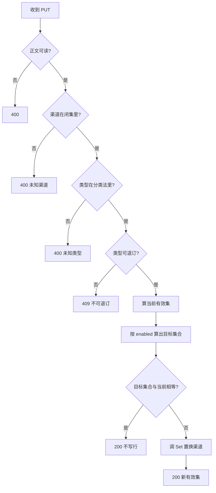
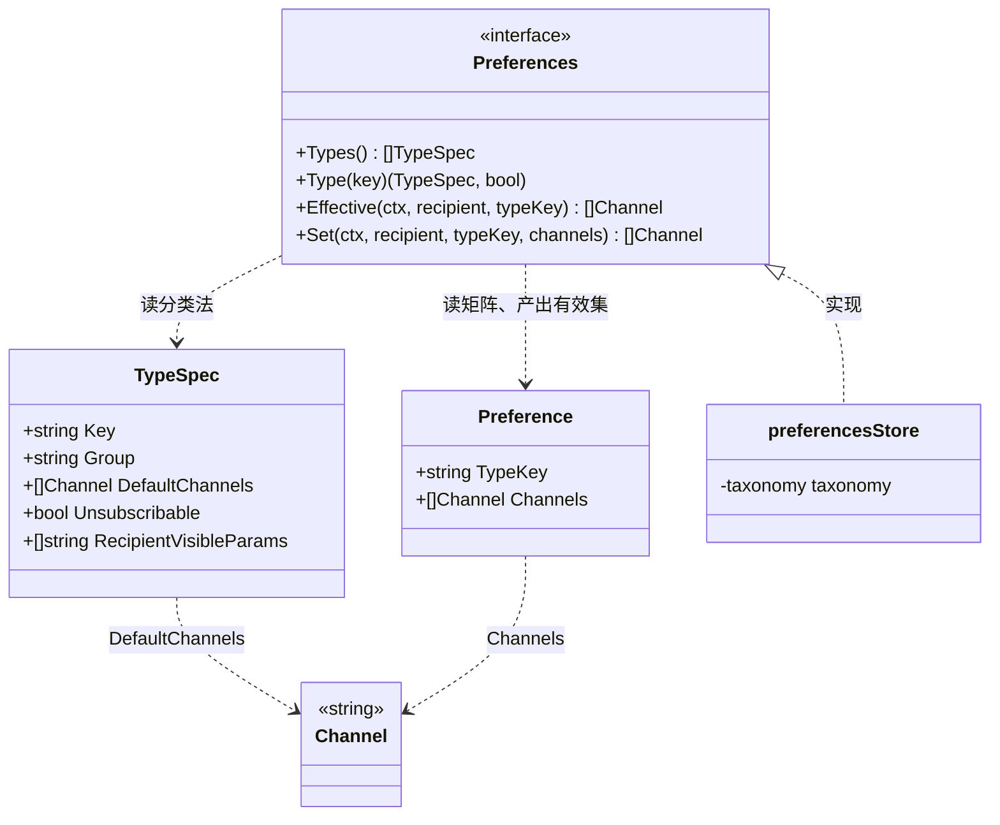

# notification.preferences

## 职责

本模块交付**按通知类型的渠道偏好矩阵**，并作为**通知类型分类法的消费点**。它把各业务模块声明的通知类型（`notification.TypeSpec`）收成一份只读分类法，据以校验一条偏好写入点名的类型是否在册；它持有每个收件人对每个类型的渠道集合，回答「这个收件人、这个类型，走哪些渠道」。它在入口模块的登记面上挂 `/types`、`/preferences` 与 `PUT /preferences/:typeKey/:channel`。

类型不是本模块声明的：一个类型是**发出它的那个业务模块的声明**。业务模块把 `notification.TypeSpec` 放进自己的 `Resources`，本模块在 `New` 里经 `core.Resources[notification.TypeSpec](reg)` 收齐全部声明，构成分类法。本模块排他交付 `(*notification.Preferences)(nil)`（[ADR-notification-taxonomy-2026-10-15](../../../adr/adr-notification-taxonomy-2026-10-15.md)）。

### 非职责

- **不发送，不渲染，不落收件箱。** 本模块只回答「这个收件人对这个类型走哪些渠道」，把消息送到渠道上归 [notification.delivery](design-notification-delivery.md)，收件箱行归 [notification.inbox](design-notification-inbox.md)。
- **不声明通知类型。** 类型是业务模块的声明，本模块只收、只读、只据以校验（见「类型分类法是资源消费点」）。
- **不做授权判定。** 路由不带本模块自己的权限闸。谁可以读某个收件人的偏好、谁可以改它，由宿主侧的授权决定；本模块不声明任何权限点（[ADR-notification-scope-2026-10-15](../../../adr/adr-notification-scope-2026-10-15.md)）。
- **不解释参数。** 类型声明里的 `RecipientVisibleParams` 是参数白名单，本模块只保存它、交给投递侧核对；本模块不认识参数的含义，也不读参数的值。
- **不持外部联系人的同意台账。** 该台账刻意后置（见 [notification](design-notification.md) 的范围一节）。
- **不区分收件人类别。** 偏好只按用户收件人存；`RecipientClass` 为 `external` 的收件人本轮没有生产者。
- **不做渠道的可用性判定。** 渠道是否可用由装配决定，归 [notification.delivery](design-notification-delivery.md)；本模块只据类型声明与偏好行算出渠道集合。邮件与短信渠道能否兑现，由 `notification.delivery` 以条件[特性](../../../glossary.md) `notification.channel.email`、`notification.channel.sms` 发布；本模块的应答不带渠道可用性，`PUT` 照常接受渠道闭集里的每个渠道，偏好的取值集不因装配增减（[ADR-notification-channels-2026-10-15](../../../adr/adr-notification-channels-2026-10-15.md)、[ADR-feature-ownership-2026-10-17](../../../adr/adr-feature-ownership-2026-10-17.md)）。

## 术语表

以下术语的含义限于本模块。

| 术语 | 英文 | 定义 |
|---|---|---|
| 分类法 | taxonomy | 本次装配收集到的全部 `notification.TypeSpec` 声明构成的只读集合。它在 `New` 里一次收齐，此后只读，是 `/types` 的应答来源与偏好写入的校验参照。 |
| 有效集 | effective set | 某个收件人对某个类型实际会走的渠道集合：该收件人在该类型上有存储行时取该行，没有存储行时取类型的 `DefaultChannels`。 |

## 外部接口契约

### 登记单元与名字

| 登记单元 | 模块名 | 交付 | 构造期依赖 |
|---|---|---|---|
| `pkg/notification/preferences` | `notification.preferences` | 排他交付 `(*notification.Preferences)(nil)` | 必需 `(*db.Database)(nil)`、`(*tenant.Catalog)(nil)`；可选 `(*http.Router)(nil)`（挂路由）、`(*log.Logger)(nil)`、`(*i18n.Localizer)(nil)` |

本模块的包导出 `ModuleName` 常量，命令树按这个名字纳入它。它取用 `(*notification.Preferences)(nil)` 这一功能标识的消费方写作 `core.Resolve[notification.Preferences](reg)`。

**本模块声明配置命名空间 `notification.preferences`，读端名清单 `notification.preferences.endpoints`。** 端名清单在路由能力在场时必填：`Init` 见到 `(*http.Router)(nil)` 在场而这一项为空即启动失败，以完整路径 `notification.preferences.endpoints` 点名这一项；`(*http.Router)(nil)` 缺席时本模块不挂路由，这一项不被读取，空清单合法。清单是一组具体端名（封闭判据）：保留端名 `*`、空名与写了两遍的端名都被拒绝并点名这一项。

**本模块声明静态[特性](../../../glossary.md) `notification.preferences`。** 描述符的 `Resources` 带 `feature.Spec{Name: "notification.preferences"}`；这个特性在场，表示本进程挂出「路由」一节的分类法与偏好路由（[feature](../design-feature.md)）。路由能力在场时端名清单必填，所以模块进入启用集、进程有路由器时这组路由无条件挂出，声明为静态特性符合架构不变量 18（[architecture](../../architecture.md#架构不变量)）。

### 交付的功能

```go
type Preferences interface {
    Types() []TypeSpec
    Type(key string) (TypeSpec, bool)
    Effective(ctx context.Context, recipient, typeKey string) ([]Channel, error)
    Set(ctx context.Context, recipient, typeKey string, channels []Channel) ([]Channel, error)
}
```

`Types` 与 `Type` 是只读视图：`Types` 返回分类法的一份副本，调用方改动它不影响本模块持有的那份；`Type` 报告一个类型是否在册。`Effective` 与 `Set` 的租户取自 `ctx`（`tenant.FromContext`），无租户一律以租户的错误拒绝；`recipient` 由调用方按身份给出，不由本模块解析。`Set` 用给定的渠道集替换该收件人该类型的渠道，返回**写入后的有效集**。这些方法都不判定调用方是否有权读改某个收件人的偏好——那是宿主侧的事。

**`Effective` 是投递侧解析渠道的唯一接缝。** [notification.delivery](design-notification-delivery.md) 的处理器按收件人调它拿到有效集，据以逐渠道发送；它不复制本模块的矩阵，也不直接读 `notification_preferences` 表。

### 类型分类法是资源消费点

**取材域取可用集**（架构不变量 15）。消费点在 `New`：`core.Resources[notification.TypeSpec](reg)` 遍历全部已登记模块，收齐每一份 `notification.TypeSpec`，构成分类法。判据是**类型是词汇**：偏好写入与投递拿它当校验参照，同一个类型声明不能在这条命令下合法、在另一条命令下非法——那会让同一份偏好在一处写得进、在另一处被拒，而类型本身没变。**这个消费点不做减法**：一个本次未被运行级纳入、或消解落选的模块，它声明的类型照常留在分类法里，与既有资源消费点（settings、authz 的 policy 与 guard）一致（[ADR-module-resources-2026-09-21](../../../adr/adr-module-resources-2026-09-21.md)）。

**减法只属于这样的消费点：这份声明所描述之物由这次运行产生或改写。** 通知类型不是由这次运行产生的：它是业务模块编译进来的一份供校验参照的词汇，跨命令不变，因此本消费点不适用减法。（对照：jobs 的周期声明 `jobs.Schedule` 描述的是「这次运行要做的活」，它的效果依赖声明它的模块真的被驱动，取材域取参与集——见 [jobs](../jobs/design-jobs.md) 的取材域裁定。两者判据的差别是「词汇」与「活」的差别。）

**不引入任何运行期可变的注册表。** 模块描述符在驱动开始前已冻结，全部声明在 `New` 那一刻都已在注册表里，「业务模块可以在 notification 之后才声明类型」因此平凡成立，不需要任何进程级的登记座。被否决的选项与各自的否决理由见 [ADR-notification-taxonomy-2026-10-15](../../../adr/adr-notification-taxonomy-2026-10-15.md)。

**声明冲突在 `New` 报出。** 一个 `TypeSpec` 声明不自洽（`Key` 为空、`DefaultChannels` 为空、`DefaultChannels` 含未知渠道、`DefaultChannels` 内有重复、`RecipientVisibleParams` 内有重复），或两个模块声明同一个 `Key`，都是 `ErrInvalidConfig`，在 `New` 终止启动并点名那个类型键与声明方；不等到一次请求才发现分类法读不起来。

### 路由

路由挂在通知基路径 `/api/v1/notifications` 下，端取自配置项 `notification.preferences.endpoints` 点名的那些端，全部不带本模块自己的权限闸；`recipient_user_id` 由宿主侧的授权与身份给出，作请求上下文里的一个取值传入 handler。下表是路由的全集（封闭集）。

| 方法 路径 | 应答 | `Vary: Accept-Language` |
|---|---|---|
| `GET /api/v1/notifications/types` | 200，分类法视图 | 是 |
| `GET /api/v1/notifications/preferences` | 200，调用方的偏好矩阵 | 是 |
| `PUT /api/v1/notifications/preferences/:typeKey/:channel` | 200，该类型的有效集 | 否 |

**端名清单必填，因为本模块的路由不能落在每一个端上。** 一个已被通配路由（gin 的 `/*path`）独占路径空间的端不能再承载具体路由：路由引擎在同一方法树上拒绝这一对，入口模块在组装链时以路由冲突终止启动。**前端与 API 同进程**是既定拓扑之一，而前端模块正是在它拿到的那个端上挂通配路由，所以两种路由必须分端；本模块的路由落在 `notification.preferences.endpoints` 点名的那些端上。取舍见 [ADR-notification-endpoints-2026-10-15](../../../adr/adr-notification-endpoints-2026-10-15.md)。

**`GET /types` 与 `GET /preferences` 的应答带 `Vary: Accept-Language`。** 应答体不随语言变化，但这条端点的表示按协商语言分键，使共享缓存不把一种语言下算出的表示当作另一种的：本模块为这些路由写出的错误应答按协商语言渲染，端点因此把语言计入缓存键。

**`GET /types` 报分类法本身**，一个收件人一份，人人相同：

```json
{ "types": [ { "key", "group", "default_channels", "unsubscribable", "recipient_visible_params" } ] }
```

**`GET /preferences` 报收件人的偏好矩阵**，每个在册类型一行，渠道取**有效集**——该类型在该收件人上没有存储行时取 `DefaultChannels`：

```json
{ "preferences": [ { "type_key", "group", "channels", "explicit" } ] }
```

`explicit` 为 true 表示该类型在该收件人上有一行存储行，false 表示渠道是 `DefaultChannels`。逐字段从本模块持有的结构构造，从不把存储形态原样交给客户端。

### PUT 的判定顺序

`PUT /preferences/:typeKey/:channel` 的正文是 `{ "enabled": true | false }`。判定顺序固定，收口在一处：

1. **正文可读**：正文不是一个对象、或 `enabled` 不是一个布尔值，即 `ErrInvalidRequest`（400）。
2. **渠道已知**：`KnownChannel(channel)` 为 false 即 `ErrUnknownChannel`，先于任何 no-op 分支拒绝。
3. **类型在册**：`Type(typeKey)` 的第二个结果为 false 即 `ErrUnknownType`。
4. **类型可退订**：该类型的 `Unsubscribable` 为 false 即 `ErrNotUnsubscribable`。
5. **算当前有效集**：按存储行或 `DefaultChannels` 算出当前集合。
6. **按 `enabled` 算出目标集合**：true 即把渠道并入集合，false 即从集合移除；集合去重、稳定排序。
7. **目标集合与当前有效集相等即 200 直接返回，不写行**：把一条已经在集合里的渠道再加一次、或把一条不在集合里的渠道再删一次，都落在这一支，读起来是成功，磁盘上没有写入。
8. **否则调 `Set(ctx, recipient, typeKey, 目标集合)` 置换该类型的渠道**，应答 200 与 `Set` 返回的有效集。

第 7 步使一次重复的 PUT 不产生写入，也让「本就没有存储行的类型被 PUT 成它的 `DefaultChannels`」不落一行——那样的行与缺行语义相同，写下来只会让 `explicit` 谎报一次。

**一次 PUT 只改（类型，渠道）这一格。** 第 6 步只把路径点名的渠道并入或移出当前有效集，同一类型其余渠道的有效值不变；前端按装配不显示某个渠道时，那一列上已有的偏好因此不随别的列的写入改变。

图里的顺序不可调换：渠道与类型的校验都在算有效集之前，未知渠道因此不会被当成一个 no-op；可退订的校验在它之后，使「一个不可退订的类型收到一条写入」以 409 而不是 200 回绝。



### 对外接口面

- `notification.Preferences` 的方法集，以及 `notification.TypeSpec`、`notification.Preference`、`notification.Channel`、`notification.KnownChannel` 的字段与取值，是本模块与其他模块之间的接口面；本模块的包导出的 `ModuleName` 同属接口面，改名会让命令树上的纳入静默失配。
- **宿主可见面**：模块名 `notification.preferences`，配置键 `notification.preferences.endpoints`，路由 `GET /api/v1/notifications/types`、`GET /api/v1/notifications/preferences`、`PUT /api/v1/notifications/preferences/:typeKey/:channel`，`Problem.Type` 前缀 `urn:speed:notification:` 及其下的码。改动它们是宿主可见的破坏性变更。
- 特性名 `notification.preferences`。前端经生成的特性名类型引用它，改名或撤去是宿主可见的破坏性变更。
- 表 `notification_preferences` 属于本模块，宿主不读写它；它的列供运维查看，不在对外接口面内。

### 哨兵错误

`GET` 路由不产生本模块自己的拒绝（除 503 一类的内部失败）；`PUT` 的拒绝映射到这些哨兵，调用方与本模块的 handler 都以 `errors.Is` 判别，包裹一律用 `%w`。

| 哨兵 | 定义处 | 含义 | 应答 |
|---|---|---|---|
| `ErrUnknownType` | `pkg/notification` | 点名的类型不在分类法里 | 400 `urn:speed:notification:bad-request` |
| `ErrUnknownChannel` | `pkg/notification` | 点名的渠道不在渠道闭集里 | 400 `urn:speed:notification:bad-request` |
| `ErrNotUnsubscribable` | `pkg/notification` | 该类型的 `Unsubscribable` 为 false，不可退订 | 409 `urn:speed:notification:not-unsubscribable` |
| `ErrInvalidRequest` | `pkg/notification` | 请求形状不可读：正文不是一个对象、`enabled` 不是布尔值 | 400 `urn:speed:notification:bad-request` |

## 依赖

| 依赖 | 用途 |
|---|---|
| `pkg/core` | 登记描述符、交付功能；取用 `notification.Preferences`；收集 `notification.TypeSpec` 资源 |
| `pkg/config` | 声明输入项：配置命名空间与端名清单 |
| `pkg/db` | `notification_preferences` 表与迁移 |
| `pkg/tenant` | 租户上下文、`tenant.Model`、语句的租户过滤 |
| `pkg/http` | 经登记面挂路由（可选依赖） |
| `pkg/feature` 根包 | 声明静态特性（`feature.Spec`）；根包只依赖标准库 |
| `pkg/log` | 可选：启动诊断 |
| `pkg/i18n` | 可选：`i18n.Localizer` 按请求的协商语言渲染本模块写出的 `Problem` 的标题与正文；缺席时用本模块内嵌的英文文案 |

**依赖方向。** 本模块 import 数据库、租户、`pkg/config`、`pkg/i18n`、`pkg/http`、`pkg/feature` 根包与 `pkg/core`，不 import 通知能力目录内的其他实现子包：它不 import `pkg/notification/delivery` 或 `pkg/notification/inbox`，与它们只经 `pkg/notification` 根包的类型相认。它也不 import `pkg/authn` 与 `pkg/authz`——授权在宿主侧，本模块不参与判定。除 `pkg/http` 外，这些依赖都在本模块之前构造、之后停止。

**根包 `pkg/notification` 不 import 本模块。** 根包依赖标准库与 `pkg/jobs` 这一个接口包（`Dispatcher.Dispatch` 的返回类型是 `jobs.JobID`），因而一个只读 `notification.Channel` 或 `notification.TypeSpec` 的业务模块 import 它，拉进来的是作业的标识类型，不是数据库、租户或本模块。

## UML 图

本模块的结构是一条接缝、一份分类法与一张矩阵表的关系。图里的约束不在图中：分类法在 `New` 里一次收齐、此后只读；有效集由存储行或类型的 `DefaultChannels` 算出，两者只有一处定义；本模块排他交付，一个进程里至多一个；渠道是根包声明的闭集，不由本模块扩展。



`preferencesStore` 在 `New` 里持有分类法；`Effective` 与 `Set` 读写的矩阵落在 `notification_preferences` 表，图里以类型边表示它们的关系。

## 核心数据结构

**分类法**是 `New` 里收齐的一份只读集合：类型键到 `notification.TypeSpec` 的映射，按类型键排序。它不进任何缓存表，进程存活期不变。

**`notification_preferences` 表**（租户作用域，内嵌 `tenant.Model`，约定列名 `tenant_id`）一行是某个收件人对某个类型的一份渠道集合。

| 列 | 含义 |
|---|---|
| `id` | 主键，应用生成 |
| `tenant_id` | 租户（由内嵌 `tenant.Model` 落下） |
| `recipient_user_id` | 收件人 |
| `type_key` | 通知类型键 |
| `channels` | 渠道集合，序列化为文本（一个稳定排序后的 JSON 数组） |
| `created_at`、`updated_at` | 行的建立与最近一次写 |

唯一索引 `(tenant_id, recipient_user_id, type_key)`：一个收件人对一个类型至多一行。渠道集合以文本列持有，因为集合的次序是值的一部分、且没有任何一处按它的分部查询；读出时解码成 `[]notification.Channel`。

## 核心算法与流程

### 分类法的收集

`New` 里 `core.Resources[notification.TypeSpec](reg)` 收齐全部声明，逐份校验：一个 `TypeSpec` 声明不自洽（`Key` 为空、`DefaultChannels` 为空、`DefaultChannels` 含未知渠道、`DefaultChannels` 内有重复、`RecipientVisibleParams` 内有重复），或两个模块声明同一个 `Key`，都是 `ErrInvalidConfig`，终止启动并点名那个键与声明方；校验通过的声明按类型键去重并排序，构成分类法。取值域是可用集，不做减法（见「类型分类法是资源消费点」）。

**分类法在 `New` 里定下，不读表。** `New` 早于 `Migrate`，本模块的表那时还不存在；分类法来自 `Resources`、不来自表。本模块的 `Init` 不读表——偏好矩阵按请求读，不持进程内快照。

### 有效集的计算

给定收件人与类型键，有效集的算法固定：

1. 该类型的 `Unsubscribable` 为 false 时，直接从 `DefaultChannels` 取——不可退订的类型没有存储行，也不接受写入。
2. 否则查 `notification_preferences`：有行取该行的 `channels`，无行取 `DefaultChannels`。
3. 结果去重、按渠道闭集的固定次序排序。

`GET /preferences` 对每个在册类型重复这一步；`Effective` 接口对单个类型做同一步；`PUT` 在第 5 步做同一步。有效集只有这一处定义，`GET /preferences`、`Effective` 与 `PUT` 消费同一个算法。

### 一次 PUT

操作序见「PUT 的判定顺序」一节；这里给出取值与写库的细节。第 6 步按 `enabled` 作用于第 5 步算出的集合，产出目标集合；第 7 步以集合相等（元素相同，与次序无关）判定 no-op，相等即返回当前有效集、不写行。第 8 步调 `Set` 把目标集合写进表：存在行即更新 `channels` 与 `updated_at`，不存在即插入，`Set` 返回写入后的有效集。写与读在同一事务里（见「并发与事务边界」）。

### 阶段行为

| 阶段 | 行为 |
|---|---|
| `Prepare` | 无动作 |
| `New` | 取用数据库、租户名册与配置读取面，读本模块的端名清单，收齐并校验分类法 |
| `Migrate` | 数据库模块施加本模块声明的迁移集，建立 `notification_preferences` 表 |
| `Init` | 取入口模块登记面；在 `notification.preferences.endpoints` 点名的端上挂本模块的路由；`http.Router` 缺席时不挂，端名清单也不被读取 |
| `Start`、`Serve` | 无动作 |
| `Stop`、`Close` | 无动作 |

路由注册跑在 `Init`，此时入口模块处在接受登记的窗口内（`Migrate` 到 `Start` 之间，见 [http](../http/design-http.md)）。

## 错误与失败语义

| 情形 | 表现 |
|---|---|
| `PUT` 正文不可读、`enabled` 非布尔 | 400 `urn:speed:notification:bad-request`（`ErrInvalidRequest`），不触达存储 |
| 点名的渠道不在闭集里 | 400 `urn:speed:notification:bad-request`（`ErrUnknownChannel`），先于 no-op 分支拒绝 |
| 点名的类型不在分类法里 | 400 `urn:speed:notification:bad-request`（`ErrUnknownType`） |
| 类型不可退订 | 409 `urn:speed:notification:not-unsubscribable`（`ErrNotUnsubscribable`） |
| 第 6 步结果与当前有效集相等 | 200 与新有效集，**不写行** |
| 两个模块声明同一个类型键、或一份声明不自洽 | `ErrInvalidConfig`，`New` 阶段终止启动，点名该键与声明方 |
| 读/写表失败（库不可用、表不在） | 503，不带 `Problem.Type`，成因只进日志 |
| `ctx` 无租户 | 以租户的错误拒绝，不触达存储 |
| 路由能力在场而 `notification.preferences.endpoints` 为空 | 终止启动，以完整路径点名这一项 |
| 端名清单含 `*`、空名或写了两遍的端名 | 终止启动，以完整路径点名这一项 |
| 端名清单点名了入口模块没有声明的端 | 终止启动，点名这一项与该端 |

**`GET /types` 与 `GET /preferences` 不产生本模块自己的拒绝。** 它们的形状由请求上下文给出，一个读不出偏好的失败是 503 类，不是 4xx。

## 并发与事务边界

- **分类法在 `New` 之后只读。** 它在单协程里建立，此前无请求路径可达它；`Types` 每次调用返回一份新切片，并发调用安全。
- **`Set` 的置换在一个事务里。** 它读该行、把给定的渠道集写回，两步在同一事务，行被锁住（PostgreSQL 上读该行时加锁，SQLite 一次只有一个写者），两个针对同一（租户、收件人、类型）的并发置换因此串行，每次置换写下一个完整的目标集合、不留中间态。
- **upsert 以唯一索引收口。** 插入不存在行时以 `(tenant_id, recipient_user_id, type_key)` 唯一索引为准，两个并发插入同名留一行。
- **本模块不发起跨表事务。** 它只写自己的 `notification_preferences` 表；它不写收件箱、不写投递账、不发事件。

## 扩展点

- **新增一个通知类型不是一个扩展点，而是一份声明。** 业务模块把一份 `notification.TypeSpec` 放进自己的 `Resources` 即可，本模块不改代码；分类法在下次装配的 `New` 里把它收进来。校验不合格即启动失败并点名。
- **渠道不是扩展点。** 渠道是通知能力自己声明的**封闭平台词汇**（`in_app`、`email`、`sms`），业务模块从中挑选、不能扩展；新增一个渠道是通知模块自己的变更，落在根包的 `Channel` 常量与 `KnownChannel`（[ADR-notification-channels-2026-10-15](../../../adr/adr-notification-channels-2026-10-15.md)）。
- **接缝由本模块排他交付，不是可替换的后端。** 换一套偏好存储是改本模块的代码，不是接一块实现。

## 实现状态

| 能力 | 状态 | 代码 |
|---|---|---|
| 接缝 `Preferences` 与分类法资源 `TypeSpec` | 已实现 | `pkg/notification/notification.go` `Preferences`、`TypeSpec`、`ValidateTypeSpec`；`pkg/notification/preferences/preferences.go` `Module`、`ModuleName`、`product` |
| 分类法的收集、校验与只读视图 | 已实现 | `pkg/notification/preferences/taxonomy.go` `buildTaxonomy`、`Types`、`Type`；`pkg/notification/preferences/views.go` `typeView`、`typeViewOf` |
| `notification_preferences` 表与迁移 | 已实现 | `pkg/notification/preferences/preferences.go` `Module`、`ModuleName`、`tableName`；`pkg/notification/preferences/store.go` `preferenceRow`；`pkg/notification/preferences/migrations` |
| 有效集的计算 | 已实现 | `pkg/notification/preferences/store.go` `Effective`、`canonicalChannels`；`pkg/notification/preferences/routes.go` `effectiveChannels` |
| 偏好路由与 PUT 的判定顺序 | 已实现 | `pkg/notification/preferences/preferences.go` `routes`、`mount`；`pkg/notification/preferences/routes.go` `handleTypes`、`handlePreferences`、`handleSetPreference`；`pkg/notification/preferences/store.go` `Set` |
| 配置命名空间与端名清单 | 已实现 | `pkg/notification/preferences/config.go` `ConfigNamespace`、`schema`、`validateEndpoints`、`readConfig`；`pkg/notification/preferences/preferences.go` `readerOf`、`mount` |
| OpenAPI 片段声明 | 已实现 | `pkg/notification/preferences/openapi/preferences.json`；`pkg/notification/preferences/preferences.go` `preferencesFragment`、`defaultEndpoint`、`Module` |
| 静态特性 `notification.preferences` 的 `feature.Spec` 声明 | 已实现 | `pkg/notification/preferences/preferences.go` `Module`；`pkg/notification/preferences/feature_test.go` `TestTheModuleDeclaresThePreferencesFeature` |
