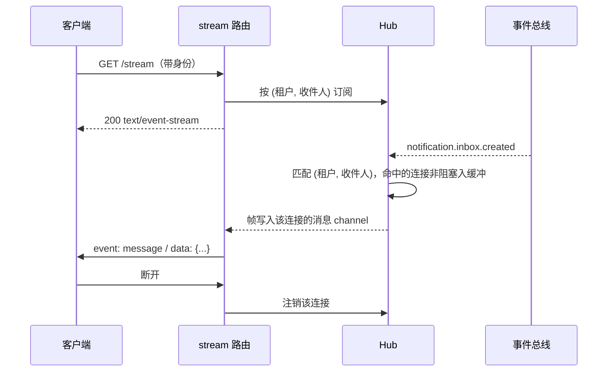
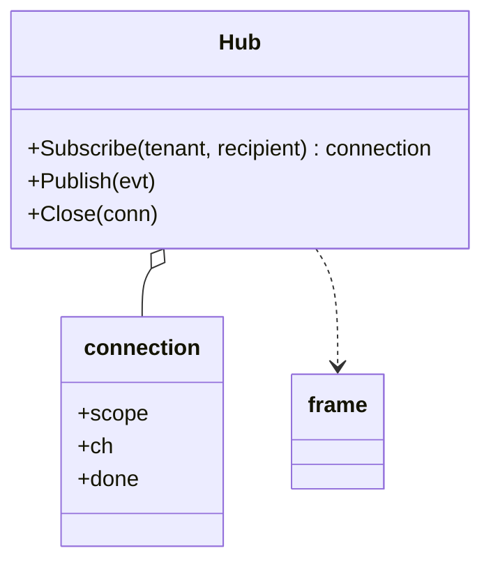

# notification.stream

## 职责

本模块交付**站内信实时推送**：把“收件箱刚写入一行”这件事推给已经连着的客户端，使它不必轮询。它是 `notification.inbox.created` 的订阅者，把事件按（租户，收件人）投给在该作用域上订阅的连接。

**行先提交、事件后发。** 收件箱先把行落库并提交，之后才发 `notification.inbox.created`（[ADR-notification-stream-2026-10-15](../../../adr/adr-notification-stream-2026-10-15.md)）。由此推出一条：一次送不到任何人的通告什么都不丢——没有客户端连着、事件在总线上丢失、本副本的 Hub 为空，都只把这次推送的延迟变成“客户端下一次回读”，那一行已经在表里。

Hub 在内存里，每个副本一个，只装本副本的连接。**Hub 唯一的价值是延迟**：行已经提交，事件只说“去读那一行”；Hub 不存储、不保证送达、不跨副本。本模块只做一件事——把事件尽快交给此刻正连着的客户端；其余由客户端回读[收件箱](design-notification-inbox.md)承担。

本模块的实现子包 `pkg/notification/stream` 登记模块 `notification.stream`，不交付功能接口，只把 `GET /stream` 挂在入口模块的登记面上。

### 非职责

- **不存储、不读数据库。** 消息内容在[收件箱](design-notification-inbox.md)的表里；连接收到的是“有一行了”的提示，客户端要内容就回读取件箱的 HTTP 面。
- **不跨副本。** 一台副本上写入的消息，推不到连在另一台副本上的客户端；本模块没有跨副本的 hub，也没有 Redis Pub/Sub 一类的接缝（[ADR-notification-stream-2026-10-15](../../../adr/adr-notification-stream-2026-10-15.md)）。
- **不保证送达、不保证顺序。** 客户端断开期间、慢消费者丢帧期间、事件在总线上丢失的期间，帧都可能没有到达；到达的先后也不构成业务顺序。需要确定内容的客户端回读那一行。
- **不做已读、不做计数。** 标记已读与未读计数是[收件箱](design-notification-inbox.md)的路由。
- **不判定谁能连。** 本模块不声明权限点，谁可以连 `GET /stream` 由宿主侧的授权决定。

## 外部接口契约

### 登记单元与名字

| 包 | 模块名 | 交付 | 排他 |
|---|---|---|---|
| `pkg/notification/stream` | `notification.stream` | 不交付功能接口，只挂 `/stream` 路由 | — |

配置命名空间取模块名 `notification.stream`。构造期依赖：必需 `(*event.Bus)(nil)`；可选 `(*http.Router)(nil)`、`(*log.Logger)(nil)`。

**端名清单 `notification.stream.endpoints` 在路由能力在场时必填。** `Init` 见到 `(*http.Router)(nil)` 在场而这一项为空即启动失败，以完整路径 `notification.stream.endpoints` 点名这一项；`(*http.Router)(nil)` 缺席时本模块不挂路由，这一项不被读取，空清单合法。

**本模块声明静态[特性](../../../glossary.md) `notification.stream`。** 描述符的 `Resources` 带 `feature.Spec{Name: "notification.stream"}`；这个特性在场，表示本进程挂出 `GET /api/v1/notifications/stream`（[feature](../design-feature.md)）。路由能力在场时端名清单必填，所以模块进入启用集、进程有路由器时这条路由无条件挂出，声明为静态特性符合架构不变量 18（[architecture](../../architecture.md#架构不变量)）。

### 不交付功能接口

本模块的描述符里 `Provides` 为空：没有别的模块按功能标识取用它，也没有一个数据面需要它回答。它从总线订阅、向 HTTP 连接推送，两端都不经功能标识。因此它对外只留下 `GET /stream` 这一条路由。

### 订阅

**订阅的事件类型名是 `notification.inbox.created`**（[收件箱](design-notification-inbox.md)在其包里声明的常量 `EventInboxCreated` 的取值）。订阅按字面类型名进行：事件总线按类型名精确比较路由，不解释通配与前缀，本模块也就按一个写死的字符串订阅，不 import 发布方的包。

**订阅带一个订阅者名，本模块用它自己的模块名。** `pkg/event` 的 `Bus.Subscribe(eventType string, name string, h Handler)` 取一个事件类型名、一个订阅者名与一个处理器；订阅者名是订阅方自己的身份，不是它订阅的类型，留空即 panic。本模块以 `notification.stream` 这一个名字订阅 `notification.inbox.created` 这一个类型名。

**事件载荷的字段是封闭集**：`message_id`、`tenant_id`、`recipient_user_id`、`type_key`。订阅端按字段名读取，不做类型断言；在进程内投递下它读到的是发布方的具体值，经传输投递下它读到的是传输解出来的结构，都按同一组字段名读。缺了 `tenant_id` 或 `recipient_user_id` 的事件无法归入任何连接的作用域，被丢弃。

### 路由

`GET /stream` 由本模块在 `Init` 里挂在入口模块的登记面上，端取自配置项 `notification.stream.endpoints` 点名的那些端，基路径 `/api/v1/notifications`（全路径 `/api/v1/notifications/stream`）。它是一条**长连接**路由，应答是一次流式的 `text/event-stream`。下表是它的判定顺序（封闭集）。

| 步骤 | 行为 |
|---|---|
| 取身份 | 从请求上下文取调用方身份（`pkg/authn` 的包级存取函数）；没有身份即 401。收件人取身份的**生效账户**（`Identity.Account()`），冒充时看到的是被冒充账户的收件箱 |
| 取租户 | 租户由解析层在中间件里写进上下文，路由不再判定 |
| 找写出者 | 沿响应写出者逐层 `Unwrap()`，找到实现 `http.Flusher` 的那一层；沿链都找不到即 500 |
| 设头 | 在写出任何正文之前设 `Content-Type: text/event-stream` |
| 订阅 | 按（租户，收件人）向 Hub 注册一条连接，返回该连接的消息 channel |
| 推帧 | 每从 channel 取到一个帧即写给客户端并 `Flush`，直到连接结束 |

**写出者的可选接口沿 `Unwrap()` 逐层找。** 链上替换过写出者的层会把 `Flusher` 与 `Unwrap` 一并留下；本模块对 `c.Writer` 逐层 `Unwrap` 直到找到 `Flusher`，不假定最外层就是它。找不到 `Flusher` 的写出者上流式应答无法刷新，路由答 500，不退回一次性写正文。

**事件帧的格式**：`event: message\n`、`data: {…}\n`、一个空行结尾，即 `event: message\ndata: {…}\n\n`。`data:` 冒号之后是一个 JSON 对象，字段就是订阅到的事件载荷（`message_id`、`tenant_id`、`recipient_user_id`、`type_key`）。`event:` 名固定为 `message`。客户端据 `message_id` 回读取件箱取内容。

### 对外接口面

- **事件帧的形状属于接口面**：`event: message` 这一行，`data:` 里 JSON 载荷的字段名，以及结尾的空行。改它们使已连接的客户端解析失效。
- **宿主可见面**：模块名 `notification.stream`，配置键 `notification.stream.endpoints`，路由 `GET /api/v1/notifications/stream`。改动它们是宿主可见的破坏性变更。
- 特性名 `notification.stream`。前端经生成的特性名类型引用它，改名或撤去是宿主可见的破坏性变更。
- 本模块不交付功能接口，因而不在功能标识面上；一个进程里恰好一个 `notification.stream`。

## 依赖

| 依赖 | 用途 |
|---|---|
| `pkg/core` | 登记描述符 |
| `pkg/config` | 声明输入项 |
| `pkg/event` | 订阅 `notification.inbox.created` |
| `pkg/http` | 可选：把自己挂到入口模块的登记面上；沿 `Unwrap` 取 `http.Flusher` |
| `pkg/tenant` | 路由从请求上下文取租户（`tenant.FromContext`），作为订阅作用域的一半 |
| `pkg/authn` | 从请求上下文取调用方身份，作为订阅作用域的收件人 |
| `pkg/feature` 根包 | 声明静态特性（`feature.Spec`）；根包只依赖标准库 |
| `pkg/log` | 可选：启动诊断 |

**`pkg/event` 是必需依赖，入口模块与日志是可选。** 没有总线就没有可订阅的事件，本模块无从起效，因此事件功能是必需依赖（`core.Requirement`，非 `Optional`）。入口模块只在本模块挂路由时需要，日志只在启动诊断上需要，两者都声明为可选：一个只做装配校验、不服务请求的驱动可以不带它们构造本模块。

**读身份与读租户都不经模块实例。** 身份经 `pkg/authn` 的包级存取函数读取，租户经 `pkg/tenant` 的 `FromContext` 读取，两者都是请求上下文里的值，本模块不把它们声明成构造期依赖；网关与 `/stream` 路由的先后由宿主的装配决定，本模块不为此声明任何依赖。方向满足架构不变量：本模块 import 认证与租户的根包，认证与租户不认识本模块。

## UML 图

一条连接从建立到收到一个帧的路径。图看不出的约束是：匹配在入缓冲之前做，先按（租户，收件人）过一遍，命中的连接才拿到一次非阻塞的入缓冲尝试；非阻塞意味着缓冲满了就丢本连接自己的帧，发布不因此停顿；连接的消息 channel 不因断开而关闭（见[并发与事务边界](#并发与事务边界)）。

Hub 与其连接的结构。图上看不出的是：连接的作用域是（租户，收件人），一个连接属于恰好一个作用域；缓冲深度是固定的 64；`done` 只用于通知读端退出，发送端从不写它。

## 核心数据结构

**Hub** 在内存里持有本副本的全部连接，按（租户，收件人）索引：一个作用域对应一组连接，一个连接属于恰好一个作用域。Hub 的读（`Publish` 找命中的连接）与写（`Subscribe` 增、`Close` 减）都可用并发调用，增删在一把写锁下进行，`Publish` 在锁下取到命中的连接集合后即可施发。

**连接（connection）** 承载一条已建立的流：

| 字段 | 含义 |
|---|---|
| 作用域 | （租户，收件人）二元组，订阅与匹配都按它 |
| `ch` | 该连接独享的消息缓冲，深度固定 64；`Publish` 只对它做非阻塞发送 |
| `done` | 关闭信号；`Close` 关闭它，读端据此退出并注销 |

**帧（frame）** 是一条待写出的 SSE 事件：`event:` 名与 `data:` 的 JSON。帧由 `Publish` 从事件载荷构造，写进连接的消息缓冲。

**缓冲深度 64 是本模块的定值，不是配置项。** 它约束的是单条连接的容忍度：一个连接在两次读出之间最多积压 64 个未写出的帧，超出即开始丢本连接自己的帧。

## 核心算法与流程

### 订阅

`GET /stream` 的业务部分是一段注册加一段循环。路由按（租户，收件人）向 Hub 注册一条新连接，取回它的消息缓冲，然后循环：从缓冲取帧、写给客户端、`Flush`。循环在下列情形之一出现时结束：客户端断开（请求上下文结束）、入口模块发出排空信号、或本模块的 `Stop` 运行；结束之前先向 Hub 注销这条连接。

**断开与注销之间没有关闭消息缓冲这一步。** 注销只把连接从 Hub 的索引里移出并置上 `done`；消息缓冲由垃圾回收随连接一起回收，不被显式关闭（理由见并发与事务边界）。

### 发布

一次 `Publish` 的全部工作都在 Hub 内完成：

1. **匹配在缓冲之前。** 事件带 `tenant_id` 与 `recipient_user_id`；Hub 先用这一对取命中的连接集合，命中之外的连接根本不进入后续步骤。这一条使整个平台的事件量挤不掉某个合法客户端自己的 64 格缓冲——不匹配它的事件连一次入缓冲的尝试都不做。
2. **逐命中的连接做一次非阻塞发送。** 对每个命中的连接，向它的 `ch` 做 `select { case ch <- frame: default: }` 形态的发送。
3. **永不阻塞、永不报错。** 缓冲满时 `default` 分支命中，这一个帧被丢弃，`Publish` 继续处理下一个连接，也不返回任何错误。丢弃的是**本连接自己的**帧，不牵连其他连接。

**`Publish` 从不等待任何一个客户端。** 一个读得很慢的客户端只丢自己的帧，其余连接与发布它的那个协程都不因此停顿。这也是本模块的全部流控：没有回压到发布方，没有跨连接的影响。

### 停机

**`Stop` 置上每条连接的 `done` 并从 Hub 注销。** 连接的读端在 `select` 里看到 `done` 就结束循环、写出结束、返回，`GET /stream` 这条长连接随之收尾，入口模块的停机排空因此不必等满排空时限。`Stop` 之后 Hub 为空，迟到的 `Publish` 找不到任何连接，什么也不做。

**长连接随排空信号一起结束。** 入口模块的排空信号与请求上下文分开；只看请求上下文的长连接 handler 得不到通知，会一直跑到排空时限被切断。本模块的读端同时听请求上下文（客户端断开）、排空信号与自己的 `done`，任一到达即收尾。

## 错误与失败语义

| 情形 | 表现 |
|---|---|
| 请求上下文没有身份 | 401；收件人无从确定 |
| 沿 `Unwrap()` 找不到 `http.Flusher` | 500；该写出者上流式应答无法刷新 |
| 客户端断开 | 路由向 Hub 注销该连接并返回，不报错 |
| 慢消费者缓冲满 | 该连接自己的一个帧被丢弃，`Publish` 不阻塞、不报错 |
| 事件缺 `tenant_id` 或 `recipient_user_id` | 该事件归不入任何作用域，被丢弃 |
| 装配里没有事件功能 | 构造期即失败（必需依赖缺失） |
| 路由能力在场而 `notification.stream.endpoints` 为空 | 终止启动，以完整路径点名这一项 |
| 装配里没有入口模块 | 端名清单不被读取，空清单合法；本模块仍构造，但不挂路由，`/stream` 不对外提供 |
| 写入发生在别的副本上 | 连在本副本的客户端收不到那条事件的帧（每副本一个 Hub）；不补发，客户端回读才看得到 |

**本模块不重试、不重连、不补发。** 一次丢帧即丢帧，一条断开的连接即断开；要拿到确定内容的客户端回读[收件箱](design-notification-inbox.md)。

## 并发与事务边界

- **Hub 可被并发读写。** `Subscribe`、`Publish` 与 `Close` 都可在不同协程上同时调用；增删连接在一把写锁下进行，`Publish` 在取到命中集合后施发，不在发送期间持有会被读端拉长的锁。
- **`Publish` 永不阻塞、永不报错。** 对每个命中连接只做一次非阻塞发送；缓冲满即丢本连接自己的帧。发布方协程的进度与客户端的读写速度无关。
- **每个连接一个深度 64 的缓冲。** 缓冲隔离了连接之间：一个客户端的读写速度只决定自己丢多少帧，不改变其他连接收到的帧。
- **消息 channel 永不 close。** `Close` 只置该连接 per-connection 的 `done` 并把它从 Hub 注销，从不关闭 `ch`。理由是与 `close` 竞争的发送正是会把并发 Hub 打 panic 的那种竞争：`Publish` 在一个连接上做发送，`Close` 在另一个协程上关闭同一个 channel，两者之间没有可以同时排除发送与关闭的锁——发送端要么持锁发送（把慢客户端拖住整个 Hub），要么不持锁（与关闭竞争）。让 channel 永不关闭、由读端 select `done` 退出，这条竞争因而不存在：一次迟到的发送要么落进仍然存在的缓冲（读端已走，帧被回收），要么被非阻塞分支丢弃，都不 panic。
- **匹配在缓冲之前做。** 事件的（租户，收件人）先于任何入缓冲尝试被比对，不匹配的连接不占一次发送尝试。
- **本模块不涉及事务。** 它不读也不写数据库，没有事务边界；它唯一的跨协程状态是 Hub，由上面的锁与 `done` 收口。

## 实现状态

| 能力 | 状态 | 代码 |
|---|---|---|
| 模块描述符与订阅 | 已实现 | `pkg/notification/stream/stream.go` `Module`、`ModuleName`、`subscribe` |
| Hub 与连接 | 已实现 | `pkg/notification/stream/hub.go` `Hub`、`Subscribe`、`Publish`、`connection` |
| `GET /stream` 路由与帧写出 | 已实现 | `pkg/notification/stream/routes.go` `routes`、`mount`、`handleStream`、`writeFrame` |
| 停机与注销 | 已实现 | `pkg/notification/stream/stream.go` `Module`；`pkg/notification/stream/hub.go` `Close`、`closeAll`、`remove` |
| OpenAPI 片段声明 | 已实现 | `pkg/notification/stream/openapi/stream.json`；`pkg/notification/stream/stream.go` `streamFragment`、`defaultEndpoint`、`Module` |
| 静态特性 `notification.stream` 的 `feature.Spec` 声明 | 已实现 | `pkg/notification/stream/stream.go` `Module`；`pkg/notification/stream/feature_test.go` `TestTheModuleDeclaresTheStreamFeature` |
