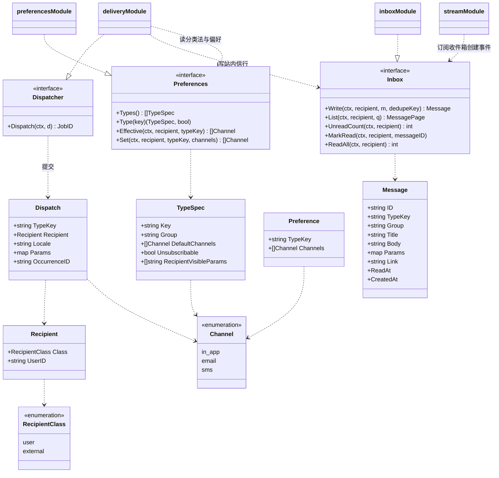
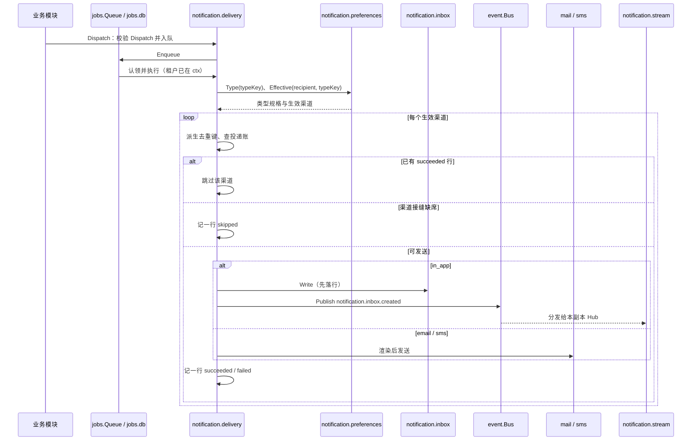

# notification

## 职责

本能力交付**把一次业务事件变成某个收件人可读的消息，并把它交给该收件人**：站内信收件箱是消息的落脚处，渠道偏好矩阵决定一条消息能走哪些渠道，类型分类法是「有哪些通知」的词汇表，出站投递流水线把一次派发按渠道发出去并把结果落成账，SSE 把刚落地的消息实时推给正在看的收件人。

一次派发由发出它的业务模块发起。业务模块声明自己的通知类型（`notification.TypeSpec`），构造一条 `notification.Dispatch`，经本能力的提交面校验并入队；投递流水线在消费这条作业时校验、解析生效渠道、逐渠道渲染与发送——站内信落到收件箱、邮件交 `pkg/mail`、短信交 `pkg/sms`——每一次尝试记一行投递账。

本能力位于依赖图的底层之一：它不认识任何业务，只认识「一条消息、一个收件人、一组参数」。它拆成下列模块，各持自己的一张表与迁移集：`notification.inbox`（站内信收件箱）、`notification.preferences`（渠道偏好矩阵与类型分类法的消费点）、`notification.delivery`（出站投递流水线）、`notification.stream`（SSE 推送）。根包 `pkg/notification` 是接口包与公共类型，不登记模块（[ADR-notification-scope-2026-10-15](../../../adr/adr-notification-scope-2026-10-15.md)）。

### 非职责

- **不声明通知类型。** 一个类型是发出它的那个业务模块的声明，本能力只收齐这份声明并拿它当校验参照（见「分类法与取材域」）。本能力不定义任何类型，也不持有类型的词表。
- **不声明任何权限点。** 本能力的路由不带自有权限闸：没有任何模块为本能力的路由声明权限，路由在中间件的声明表里按需认证、不带权限判定。谁可以读某个收件人的收件箱、谁可以改某个收件人的偏好，由**宿主侧的授权**决定——宿主在自己的链上另加一层判定，或按他自己的模型约束这些端。本能力因此不进入 `authz.PermissionSpec` 与 `authz.TranslationSpec` 的声明面（[ADR-notification-scope-2026-10-15](../../../adr/adr-notification-scope-2026-10-15.md)）。
- **非用户外部联系人的同意台账刻意后置。** 给**非用户的外部联系人**（手机号、邮箱地址这类不属于本系统账户的联系人）发消息，需要一份独立的同意台账：`verified_contacts` 表、`contact_type_unsubscribes` 表、平台级黑名单，以及 `/contacts` 一族路由（`POST /contacts`、`POST /contacts/:id/verify`、`POST /contacts/:id/resend`、`GET /contacts`）。**本轮刻意后置，不是漏项**（[ADR-notification-scope-2026-10-15](../../../adr/adr-notification-scope-2026-10-15.md)）。因此 `RecipientClass` 的闭集里保留 `external` 取值，但本轮**没有生产者**，相关的 `notification.contact.*` 审计动作本轮也不声明。
- **不发送邮件与短信本身。** 出站的外部渠道各经一条接缝：邮件交 `pkg/mail` 的 `Sender`，短信交 `pkg/sms` 的 `Registry` 与 `Sender`。本能力选择模板、渲染文本、构造请求，实际投递与厂商交互归 `pkg/mail` 与 `pkg/sms`。
- **不聚合同类消息，不限频。** 一次派发就落一条消息、发一次；把短时间内的同类型消息合并成一条、按收件人给发送设上限，都不在本能力内。面向收件人的发送上限由宿主经 `pkg/ratelimit` 另行施加。
- **不产生平台域的行。** 本能力的每一行都属于一个租户——收件人是一个账户，账户属于租户。平台级广播与非用户外部联系人的同意台账同属一类：它们需要一个不属于任何租户的收件人，而本轮没有这样的收件人。

## 外部接口契约

### 交付的功能

本能力交付下列功能接缝，各由对应的模块排他交付。

```go
type ListQuery struct {
    Group  string // 空即全部组
    Limit  int
    Offset int
}
type MessagePage struct {
    Items []Message
    Total int
}
type Inbox interface {
    Write(ctx context.Context, recipient string, m Message, dedupeKey string) (Message, error)
    List(ctx context.Context, recipient string, q ListQuery) (MessagePage, error)
    UnreadCount(ctx context.Context, recipient string) (int, error)
    MarkRead(ctx context.Context, recipient, messageID string) error
    ReadAll(ctx context.Context, recipient string) (int, error)
}

type Preferences interface {
    Types() []TypeSpec
    Type(key string) (TypeSpec, bool)
    Effective(ctx context.Context, recipient, typeKey string) ([]Channel, error)
    Set(ctx context.Context, recipient, typeKey string, channels []Channel) ([]Channel, error)
}

// 由 notification.delivery 排他交付。
type Dispatcher interface {
    Dispatch(ctx context.Context, d Dispatch) (jobs.JobID, error)
}
```

`Inbox`、`Preferences` 与 `Dispatcher` 的收件人一律**显式传参**：投递是无请求路径，它自己知道收件人；路由从请求上下文取出收件人再传进来。

`Dispatcher.Dispatch` 是发出派发的模块唯一要碰的入口：发出方把 `notification.TypeSpec` 放进自己模块的 `Resources` 声明类型，构造一条 `Dispatch`，交给它；它按分类法校验这条派发的类型在册、收件人类别为 `user`、语言非空、参数不越出该类型的白名单，把这条派发序列化成一次投递作业入队，返回作业标识。它**只入队、不出站**：不渲染、不投递、不写任何账。投递流水线的 handler 在消费这条作业时按分类法与偏好再校验一次并真正投递。

取用写作 `core.Resolve[notification.Inbox](reg)`、`core.Resolve[notification.Preferences](reg)`、`core.Resolve[notification.Dispatcher](reg)`；依赖声明写作 `core.Requirement{Token: (*notification.Inbox)(nil), Optional: true}` 一类。

### 根包类型与各字段语义

```go
// Channel 是一条消息走过的渠道，取值是封闭的平台词汇。
type Channel string

const (
    ChannelInApp Channel = "in_app"
    ChannelEmail Channel = "email"
    ChannelSMS   Channel = "sms"
)

// KnownChannel 报告一个取值是不是封闭集里的渠道。
func KnownChannel(Channel) bool

// TypeSpec 是业务模块对外声明的通知类型（资源类型）。
type TypeSpec struct {
    Key                    string    // 形如 "<模块>.<实体>.<动作>"，如 billing.invoice_paid
    Group                  string    // 分组，供收件箱按组过滤
    DefaultChannels        []Channel // 未经偏好改写时走的渠道
    Unsubscribable         bool      // false 表示不可退订（验证码一类）
    RecipientVisibleParams []string  // 非 nil 时白名单：只有列出的参数进得了载荷
}

// RecipientClass 是收件人的种类，取值是封闭集。
type RecipientClass string

const (
    RecipientUser     RecipientClass = "user"     // 系统账户
    RecipientExternal RecipientClass = "external" // 非用户外部联系人；本轮不做，见非职责
)

// Recipient 是一条消息的收件人。
type Recipient struct {
    Class  RecipientClass
    UserID string
}

// Dispatch 是一次派发：要发哪个类型、给谁、什么语言、带什么参数。
type Dispatch struct {
    TypeKey      string         // 已声明类型的 Key
    Recipient    Recipient      // 收件人
    Locale       string         // BCP 47，非空
    Params       map[string]any // 渲染与投递所用的参数
    OccurrenceID string         // 同一逻辑事件的重发使用同一个值，参与去重键
}

// Preference 是某收件人对某类型的渠道偏好。
type Preference struct {
    TypeKey  string
    Channels []Channel
}

// Message 是一条已经渲染好的站内信，收件箱的读写都经它。
type Message struct {
    ID        string
    TypeKey   string
    Group     string
    Title     string // 已渲染
    Body      string // 已渲染
    Params    map[string]any
    Link      string
    ReadAt    *time.Time
    CreatedAt time.Time
}
```

**`Channel` 的字段语义是承诺。** 取值恰是 `in_app`、`email`、`sms`，`KnownChannel` 是这条闭集的判定；业务模块从这条闭集里挑选类型默认渠道与偏好，**不能扩展**它。新增一个渠道是通知模块自己的变更，不是业务模块的扩展点（见「扩展点」）。

**`TypeSpec.Key` 是全局唯一的类型名**，形如 `<模块>.<实体>.<动作>`；命名空间前缀是本能力对消费点的约定，用于诊断与去重，本能力不按前缀做任何判定。`Group` 是给收件箱按组过滤用的自由文本，本能力不解释它的取值。`DefaultChannels` 是未经偏好改写时这条类型走的渠道，元素是 `Channel` 闭集的子集。`Unsubscribable` 为 `false` 表示这条类型不可退订——验证码一类只发往必要渠道、不因偏好被关掉；为 `true` 时收件人可以关掉某个渠道。`RecipientVisibleParams` 非 `nil` 时是白名单：载荷里只有列出的参数名进得了最终消息，其余被拒（`ErrParamsNotAllowed`）；为 `nil` 表示不设白名单，全部参数可见。

**`RecipientClass` 的闭集是 `user` 与 `external`。** `external` 取值留在闭集里以保证闭集稳定，但本轮没有生产者：没有任何一条派发的收件人是 `external`，给 `external` 的派发在本轮被拒（见非职责）。`Recipient.Class` 是收件人的种类，`Recipient.UserID` 在 `user` 类下是系统账户标识。

**`Dispatch.Locale` 非空**，是一条 BCP 47 标签。它决定渲染用哪种语言，也参与去重键；本能力不校验它是否受支持（受支持集由 i18n 目录派生，只有渲染引擎知道），一个不受支持而形状合法的标签在渲染时回落默认语言。`Dispatch.OccurrenceID` 是同一逻辑事件的重发标识：同一个逻辑事件重发必须携带同一个值，它在去重键里区分「同一件事的两次投递」与「两件事」。

**`Message` 的 `Title` 与 `Body` 是已渲染的成品文本**，不是模板。`Params` 是这条消息携带的参数原值，供客户端二次使用。`ReadAt` 为空表示未读。

**`Preference` 是一条按类型的渠道偏好**：某收件人对某类型选了哪些渠道。它不含收件人字段——收件人由存取它的接口方法给出。

### 登记单元与名字

| 包 | 模块名 | 职责 | 交付 | 构造期依赖 |
|---|---|---|---|---|
| `pkg/notification` | 不登记 | 接口包与公共类型：`Channel`、`TypeSpec`、`Recipient`、`Dispatch`、`Preference`、`Message`、`Inbox`、`Preferences`、`Dispatcher` 与全部哨兵 | — | — |
| `pkg/notification/inbox` | `notification.inbox` | 站内信收件箱：`in_app_messages` 表、写行、查、未读数、标记已读 | `(*notification.Inbox)(nil)` 排他 | 必需 `(*db.Database)(nil)`、`(*tenant.Catalog)(nil)`；可选 `(*event.Bus)(nil)`、`(*log.Logger)(nil)`、`(*http.Endpoint)(nil)` |
| `pkg/notification/preferences` | `notification.preferences` | 按类型的渠道偏好矩阵 + 类型分类法的消费点 | `(*notification.Preferences)(nil)` 排他 | 必需 `(*db.Database)(nil)`、`(*tenant.Catalog)(nil)`；可选 `(*http.Endpoint)(nil)` |
| `pkg/notification/delivery` | `notification.delivery` | 出站投递流水线：`Dispatch` 入队、消费 `jobs.Handler`、逐渠道发送、去重落账 | `(*notification.Dispatcher)(nil)` 排他 | 必需 `(*jobs.Queue)(nil)`、`(*jobs.Handlers)(nil)`、`(*db.Database)(nil)`、`(*tenant.Catalog)(nil)`、`(*notification.Preferences)(nil)`、`(*notification.Inbox)(nil)`、`(*i18n.Localizer)(nil)`；可选 `(*mail.Sender)(nil)`、`(*sms.Registry)(nil)`、`(*sms.Sender)(nil)`、`(*event.Bus)(nil)`、`(*http.Endpoint)(nil)` |
| `pkg/notification/stream` | `notification.stream` | SSE 推送：每副本一个 Hub | 不交付功能接口（挂 `/stream` 路由） | 必需 `(*event.Bus)(nil)`；可选 `(*http.Endpoint)(nil)`、`(*authn.Gate)(nil)` |

上表是各模块的切分与它们的构造期依赖。**`notification.delivery` 与 `notification.preferences` 是类型分类法的两处消费点**，各自在 `New` 里经 `core.Resources[notification.TypeSpec](reg)` 收齐分类法、都取可用集、都不做减法：偏好据以回答 `Types` 与 `Type` 并在写入时校验，投递据以在发送前查类型。投递经 `(*notification.Preferences)(nil)` 读每条收件人的生效渠道，经 `(*notification.Inbox)(nil)` 写站内信行，经 `(*i18n.Localizer)(nil)` 渲染标题、正文与主题（见「分类法与取材域」）。

### 渠道与可用性

**渠道是封闭的平台词汇**，取值恰是 `in_app`、`email`、`sms`，业务模块从中挑选、不能扩展。**一条渠道的可用性由装配决定**：`email` 需要 `mail.Sender` 在场，`sms` 需要 `sms.Registry` 与 `sms.Sender` 都在场，`in_app` 恒可用——它只写本进程的库。一条派发的生效渠道里若有接缝缺席的渠道，投递时**跳过该渠道并落一条 `skipped` 结果**，不当作失败：接缝缺席是装配的选择，不是这条消息的错，跳过它不重试、不失败整次派发。记录一次 `skipped` 让「这条消息本该走这个渠道、但这次装配没有它」在投递账上可查。

### 分类法与取材域

**一个通知类型是发出它的那个业务模块的声明，不是通知模块的声明。** 业务模块把自己的 `notification.TypeSpec` 放进模块描述符的 `Resources`：`core.ProcessRegistry.Register(...)` 的一个 `core.Module` 的 `Resources []any` 里含这个值。**`notification.preferences` 与 `notification.delivery` 是两处消费点**，各自在它的 `New` 里经 `core.Resources[notification.TypeSpec](reg)` 收齐全部声明：偏好据以回答 `Types` 与 `Type` 并在写入时对照它校验，投递据以在发送前查类型。

**取材域取「可用集」，不做减法。** 判据是：**类型是词汇**。偏好写入与投递拿它当校验参照——「这个类型键认不认识」是一个词汇问题，与这次命令装了什么无关；同一个声明不能在这条命令下合法、在另一条命令下非法。一个只被静态级纳入、没有被本次命令驱动的业务模块，它的类型声明照旧进得了分类法；消解落选的模块，其类型声明同样不退出。这与既有资源消费点（`settings.Schema`、`authz.PermissionSpec`、`authz.TranslationSpec`）同一条判据（[ADR-notification-taxonomy-2026-10-15](../../../adr/adr-notification-taxonomy-2026-10-15.md)、架构不变量 15）。

**不引入任何运行期可变的注册表。** 模块描述符在驱动开始前已冻结，全部声明在 `New` 那一刻都已在注册表里，「业务模块可以在 notification 之后才声明类型」因此平凡成立，不需要任何进程级的登记座。被否决的选项与各自的否决理由见 [ADR-notification-taxonomy-2026-10-15](../../../adr/adr-notification-taxonomy-2026-10-15.md)。

### 路由

路由挂在入口模块 `pkg/http` 的登记面上，基路径 `/api/v1/notifications`，各模块在自己的 `Init` 里挂。全部路由**不带自有权限**：没有任何权限点声明，也就没有权限闸；认证照常，可读性由宿主侧的授权决定。

| 归属模块 | 方法 + 路径 | 权限 |
|---|---|---|
| inbox | `GET /messages` | 无（宿主侧授权） |
| inbox | `GET /messages/unread-count` | 无 |
| inbox | `POST /messages/read-all` | 无 |
| inbox | `POST /messages/:messageId/read` | 无 |
| preferences | `GET /types` | 无 |
| preferences | `GET /preferences` | 无 |
| preferences | `PUT /preferences/:typeKey/:channel` | 无 |
| stream | `GET /stream`（SSE） | 无 |

`GET /messages` 的过滤参数只有 `group`；分页为 `limit`（缺省 50、上限 200）加 `offset`，参数越界**整页拒绝**、不静默截断；排序 `created_at DESC, id DESC`。`POST /messages/read-all` 的幂等由谓词给出：`WHERE recipient_user_id = ? AND read_at IS NULL`，重复调用匹配 0 行、答 `{read_count: 0}` 且成功；标记已读不以过期与否为条件。`POST /messages/:messageId/read` 命中已读行直接返回 204 且不写库，保留首读时间戳；未知 id、他人、他租户三合一，一律 `ErrMessageNotFound`，不做泄露存在性的区分。`GET /messages/unread-count` 只计未读且未过期的行。`GET /stream` 的语义见「SSE 推送」。

收件人来源随路由而分：inbox 与 stream 的 handler 经认证根包的读取面（`pkg/authn` `FromContext` 返回的 `Identity` 的账户）取已认定的身份，以其账户标识为收件人；preferences 的 handler 不从身份解析收件人，它的收件人取值来自请求上下文里的一个取值，由宿主的身份与授权侧给出（[notification-preferences](design-notification-preferences.md)）。本能力不给路由挂权限闸，因此「这个身份能不能读这个收件人的收件箱」不在本能力的路由上判定。

### 稳定性承诺

- `Channel`、`KnownChannel`、`TypeSpec`、`RecipientClass`、`Recipient`、`Dispatch`、`Preference`、`Message`、`Inbox`、`Preferences`、`Dispatcher` 的方法集与字段名，以及本能力的全部哨兵，是本能力对调用方的契约。加方法、改签名、改字段名对实现了接缝的模块与取用它们的调用方都是不兼容变更。
- `Channel` 的取值集合是承诺：`in_app`、`email`、`sms`，`KnownChannel` 的判定面。增删一个渠道是宿主可见的破坏性变更，须随发布对账。
- `TypeSpec` 的字段语义是承诺：`Key` 是全局唯一类型名、`DefaultChannels` 是 `Channel` 子集、`Unsubscribable` 的极性与「不可退订」相反、`RecipientVisibleParams` 非 `nil` 即白名单。改字段名或改极性使既有声明静默改变行为。
- `Dispatch` 的字段语义是承诺：`Locale` 非空、`OccurrenceID` 参与去重键。`Message` 的字段语义是承诺：`Title` 与 `Body` 是已渲染文本。
- 路由的路径、每条路由的过滤参数与分页界限、基路径 `/api/v1/notifications`，以及收件箱与偏好的应答形状，是宿主可见面；改动它们须随发布对账。
- 哨兵 `ErrUnknownType`、`ErrUnknownChannel`、`ErrNotUnsubscribable`、`ErrParamsNotAllowed`、`ErrMessageNotFound`、`ErrDeliveryQueue`、`ErrChannelUnavailable`、`ErrInvalidConfig`、`ErrInvalidRequest` 是判别面，调用方以 `errors.Is` 判别，包裹一律用 `%w`。

### 哨兵错误

| 哨兵 | 定义处 | 含义 |
|---|---|---|
| `ErrUnknownType` | `pkg/notification` | 类型不在已声明的分类法里 |
| `ErrUnknownChannel` | `pkg/notification` | 渠道不在封闭集里 |
| `ErrNotUnsubscribable` | `pkg/notification` | 该类型的 `Unsubscribable` 为 `false`，不可退订 |
| `ErrParamsNotAllowed` | `pkg/notification` | 载荷带了类型白名单外的参数 |
| `ErrMessageNotFound` | `pkg/notification` | 收件箱点名了本收件人看不见的消息（未知 id、他人、他租户三合一） |
| `ErrDeliveryQueue` | `pkg/notification` | 投递队列缺席 |
| `ErrChannelUnavailable` | `pkg/notification` | 该渠道的接缝不在本次装配里，报告一次显式的渠道查询 |
| `ErrInvalidConfig` | `pkg/notification` | 一个 `TypeSpec` 声明不自洽（类型键为空、`DefaultChannels` 含未知渠道、`DefaultChannels` 为空、参数白名单重复、`Unsubscribable` 为假而 `DefaultChannels` 含 `in_app` 之外的值），或两个模块声明同一个类型键 |
| `ErrInvalidRequest` | `pkg/notification` | 请求形状不可读：缺必填项、分页越界、正文不可解析、参数的值无法字符串化 |

`ErrChannelUnavailable` 与渠道可用性不同：投递时接缝缺席按 `skipped` 处置、不报错；`ErrChannelUnavailable` 是**显式查询**一条渠道能否用时得到的应答，供宿主或管理面在不触发一次投递的前提下问「email 这次能不能发」。

## 依赖

| 依赖 | 用途 |
|---|---|
| `pkg/core` | 登记描述符、交付功能、`core.Resources[notification.TypeSpec](reg)` 收齐分类法 |
| `pkg/jobs` | 投递作业的提交面 `Queue` 与执行面 `Handlers`；派发经它入队、投递经它执行 |
| `pkg/db` | 各模块的表与迁移集 |
| `pkg/tenant` | 租户进入与语句过滤；每个模块的表内嵌租户模型 |
| `pkg/i18n` | 投递时按 `<type_key>.<channel>.<part>` 渲染标题、正文与主题 |
| `pkg/mail` | `email` 渠道的发送接缝 `Sender`（`Send`、`Message`、`Receipt` 与哨兵 `ErrThrottled`、`ErrRejected`、`ErrUncertain`、`ErrInvalidConfig`）。**该能力尚未合入 main，与本能力同批在途**；本设计只引用这条接缝，不设计它的内部 |
| `pkg/sms` | `sms` 渠道的模板注册表 `Registry` 与发送接缝 `Sender` |
| `pkg/event` | 收件箱创建事件 `notification.inbox.created`：收件箱发布、推送订阅。可选 |
| `pkg/http` | 路由登记面。可选 |
| `pkg/authn` | 请求上下文中的已认定身份：handler 经 `authn.FromContext` 取身份，以其账户为收件人 |
| `pkg/log` | 可选诊断 |

**依赖方向。** 各模块都 import `pkg/core` 与根包；`notification.delivery` import `pkg/jobs`、`pkg/db`、`pkg/tenant` 的根包，以及 `pkg/i18n`、`pkg/mail`、`pkg/sms`、`pkg/event` 的根包；`notification.inbox` import `pkg/db`、`pkg/tenant`、`pkg/event`、`pkg/authn`；`notification.stream` import `pkg/event`、`pkg/http` 与 `pkg/authn`；`notification.preferences` import `pkg/db` 与 `pkg/tenant`。本能力**不 import 任何上层功能目录**，也不 import 任何业务模块：它位于底层，任何要发消息的模块引入它，不必背上对方。

**渲染经由 i18n 引擎，文案目录归声明它的业务模块。** 一条文案的键形如 `<type_key>.<channel>.<part>`，由**声明该类型的业务模块**以 i18n 目录承载，装配期并入引擎；`notification.delivery` 在投递时按收件人语言经 `(*i18n.Localizer)(nil)` 渲染标题、正文与主题，引擎回落默认语言、再回落键本身，结果永不为空。渲染缝是投递模块的构造期必需依赖。文案的归属与 i18n 的「由产生消息的模块渲染」不冲突：目录归声明方，渲染发生在把文本写出的投递流水线（[design-i18n](../design-i18n.md)）。

**`notification.delivery` 取用 `notification.Preferences` 读分类法与偏好。** 投递需要「这个类型走哪些渠道」（分类法的默认渠道，被收件人偏好改写后）与「这条收件人的生效渠道」，两者都归偏好模块；投递因此把 `(*notification.Preferences)(nil)` 列为构造期必需依赖（[ADR-notification-taxonomy-2026-10-15](../../../adr/adr-notification-taxonomy-2026-10-15.md)）。

方向满足架构不变量：`notification.delivery` import 的是各功能目录的根包，不 import 任何别的功能目录的实现子包；各模块不相互 import 对方的实现子包，只经根包声明的功能接缝与资源类型相连。

## UML 图

下图给出契约面上的类型、接缝与模块的关系。图看不出的约束：`Channel` 与 `RecipientClass` 是封闭集，`RecipientClass.external` 本轮无生产者；`TypeSpec` 是业务模块经 `Resources` 声明的资源类型、由 `notification.preferences` 与 `notification.delivery` 在各自 `New` 收齐；`Inbox`、`Preferences` 与 `Dispatcher` 各由对应模块排他交付；`notification.stream` 不经这些接缝，它只订阅 `pkg/event` 上的一条事件。



一次派发从入队到落账的路径，跨本能力的模块与外部接缝。图看不出的约束：`Dispatcher.Dispatch` 只入队、不出站；消费作业时租户已在上下文里（由 `jobs.db` 进入）；站内信行**先提交、事件后发**；每个渠道各自一个去重键，重复的作业不会重发已经成功的渠道。



## 核心数据结构

本能力的数据落在下列表里，各归一个模块、各随该模块的迁移集施加。

| 表 | 归属模块 | 列 | 索引 |
|---|---|---|---|
| `in_app_messages` | `notification.inbox` | `id`、`tenant_id`、`recipient_user_id`、`type_key`、`group`、`title`、`body`、`params`、`link`、`dedupe_key`、`expires_at`、`read_at`、`created_at`、`updated_at` | `dedupe_key` 唯一；`(tenant_id, recipient_user_id, created_at)` |
| `notification_preferences` | `notification.preferences` | `id`、`tenant_id`、`recipient_user_id`、`type_key`、`channels`、`created_at`、`updated_at` | `(tenant_id, recipient_user_id, type_key)` 唯一 |
| `notification_sends` | `notification.delivery` | `id`、`tenant_id`、`type_key`、`channel`、`recipient_class`、`recipient_user_id`、`status`、`duration_ms`、`error`、`provider_receipt_id`、`idempotency_key`、`created_at`、`updated_at` | `(tenant_id, idempotency_key)` 唯一 |

这些表都是**租户作用域**，各内嵌租户模型（约定列名 `tenant_id`）；语句过滤由租户名册模块交付的 GORM 插件完成，上下文无租户时受约束模型的语句拒绝执行，跨租户必须在调用点字面写出。

**投递账是租户作用域，不设平台行。** 一次投递的收件人要么是一个账户（`recipient_class = user`），要么是后置的外部联系人（`external`，本轮无生产者）；两种收件人都属于一个租户，因此每一行总有一个租户。平台级广播与平台级黑名单需要一个不属于任何租户的收件人，本能力在设计上排除了它们（见非职责）。

**`notification_sends.status` 是闭集** `succeeded`、`failed`、`skipped`：成功投递、尝试后失败、因渠道接缝缺席而跳过。`duration_ms` 是一次渠道调用的耗时，`provider_receipt_id` 是外部载体返回的回执标识（站内信为空），`error` 是失败原因文本，都不进上行的用户可见文本。

**去重键的派生式（逐渠道各一个）：**

```
idempotency_key = hex(sha256(canonicalJSON{
    tenant, type_key, recipient_class, user_id, channel, locale, occurrence_id, params
}))
```

`canonicalJSON` 是键序固定、数按十进制文本、不可序列化即失败的规范化编码。这个键把「同一租户、同一类型、同一收件人、同一渠道、同一语言、同一逻辑事件、同一参数」的两次尝试收敛成一行：消费一次作业时，投递对每个渠道先按它查 `notification_sends`，命中 `succeeded` 行即跳过该渠道、不重发；命中 `failed` 行则重试。因此一次作业重试只补发上次没成功的渠道。站内信行的 `dedupe_key` 用同一条派生式取 `channel = in_app` 的值，使收件箱行与投递账在同一逻辑事件下各自唯一。

**`notification_preferences.channels` 是按类型的渠道集**，存成文本（JSON 数组或分隔文本），因为没有任何一处按它的分部查询。一条偏好不存在即用类型的默认渠道；一条偏好存在即用它的渠道集，`Unsubscribable` 为 `false` 的类型不允许出现偏好行。

## 核心算法与流程

### 一次派发：从入队到落账

1. **业务模块构造派发。** 声明了类型 `S` 的业务模块把 `S` 放进自己的 `Resources`，构造一条 `Dispatch`（类型键为 `S.Key`、收件人为一个 `user`、语言非空、参数在白名单内、`OccurrenceID` 是这条逻辑事件的稳定标识），调提交面的 `Dispatch(ctx, d)`。
2. **`Dispatcher.Dispatch` 只入队、不出站。** 它按自己收齐的分类法校验 `d`：类型键在册、收件人类别为 `user`、语言非空、参数不越出该类型的 `RecipientVisibleParams`（`nil` 即不设限）。任一不符即以对应哨兵拒绝，不入队。全部相符则把 `d` 序列化成一次投递作业——作业类型是本能力的作业类型，载荷是 `d` 的规范化 JSON——经它持有的 `jobs.Queue` 入队，返回作业标识。它不渲染、不投递、不写任何账。
3. **投递流水线消费作业。** `notification.delivery` 在 `Init` 里向 `jobs.Handlers` 登记一个 handler，作业类型与 `Dispatch` 入队时用的相同。`jobs.db` 执行这条作业时先 `tenant.Catalog.Enter(ctx, id)` 进入它的租户，再交 handler；handler 因此在租户上下文里运行，不必自己进入。
4. **handler 校验并解析渠道。** handler 解出 `d`，经 `Preferences.Type(d.TypeKey)` 取类型规格（未声明即 `ErrUnknownType`，作业以终态失败），再经 `Preferences.Effective(ctx, d.Recipient.UserID, d.TypeKey)` 取生效渠道集——类型的默认渠道中被收件人退订的已去掉；`Unsubscribable` 为 `false` 的类型取全部默认渠道。生效集为空即没有可走的渠道，作业成功而不投递。
5. **逐渠道投递。** 对每个生效渠道：
   1. **渠道可用性**：`in_app` 恒可用；`email` 需 `mail.Sender` 在场；`sms` 需 `sms.Registry` 与 `sms.Sender` 都在场。任一缺席即记一行 `skipped`（`duration_ms` 为零），进下一个渠道。
   2. **去重**：按去重键查 `notification_sends`；命中 `succeeded` 行即跳过该渠道；命中 `failed` 行则重试。
   3. **渲染**：经 `i18n.Localizer` 按收件人语言渲染 `<type_key>.<channel>.<part>`：站内信渲染 `title` 与 `body`，邮件渲染 `subject` 与 `body_text`，短信取模板标识而非自由文本。引擎对不受支持的语言回落默认语言、再回落键本身。
   4. **发送**：站内信经 `Inbox.Write`（`dedupeKey` 取去重键在 `channel = in_app` 下的值），写行成功后经 `event.Bus` 发 `notification.inbox.created`（缺席即不发）；邮件经 `mail.Sender.Send`；短信先经 `sms.Registry.Resolve` 解出模板与参数、再经 `sms.Sender.Send`。
   5. **落账**：按该渠道的结果写一行 `notification_sends`——`succeeded` 带回执标识与耗时，`failed` 带原因与耗时。
6. **作业的终态。** 全部渠道处理完，若无渠道以失败告终，作业成功；有任一渠道失败则 handler 返回错误，作业按 `jobs.db` 的退避与重试规则重跑——重跑时已成功的渠道因去重键命中 `succeeded` 行而跳过，只补发失败的渠道。重试用尽即进死信（`dead_letter`），投递账上保留每次失败的原因。

**端到端的投递承诺是至少一次、由去重键收敛。** 一次派发至少被投递一次；重复的作业或重跑的作业不重发已经成功的渠道，因为那条成功已落成 `succeeded` 行、去重键唯一。站内信行的唯一 `dedupe_key` 与投递账的唯一 `(tenant_id, idempotency_key)` 是这条收敛的落点。

### 站内信的写、读与标记

一次站内信投递就是 `Inbox.Write`：以收件人与 `dedupe_key` 落一行；`dedupe_key` 命中既有行即返回既有消息、不重复写。读取按收件人过滤，命中不了本收件人的行（未知 id、他人、他租户）一律 `ErrMessageNotFound`，不区分。`ReadAll` 的幂等由谓词给出，重复调用匹配 0 行返回 0 且成功；`MarkRead` 命中已读行直接返回、不写库、保留首读时间戳。`UnreadCount` 只计未读且未过期的行，`expires_at` 到期的行不计入未读、其收件箱列表也不返回（分页与过滤的细节见 [notification-inbox](design-notification-inbox.md)）。

### SSE 推送

`notification.stream` 的 Hub 是**每副本一个**的内存结构，没有跨副本的 hub、没有 Redis Pub/Sub 接缝。它在 `Init` 里订阅 `event.Bus` 上类型名恰为 `notification.inbox.created` 的事件，载荷含 `{message_id, tenant_id, recipient_user_id, type_key}`；`GET /stream` 的连接按 `(tenant, recipient)` 作用域订阅本副本的 Hub。因为**行先提交、事件后发**——收件箱行先落库，投递流水线在每次成功的写行之后才发事件——所以一次送不到任何人的通告什么都不丢：消费方可以回读那一行，Hub 唯一的价值是延迟。Hub 的并发模型见「并发与事务边界」，路由与帧格式见 [notification-stream](design-notification-stream.md)。

## 错误与失败语义

| 情形 | 表现 |
|---|---|
| 类型键不在已声明的分类法里 | `ErrUnknownType`；提交时 `Dispatch` 拒绝，消费时作业以终态失败 |
| 渠道不在封闭集里 | `ErrUnknownChannel` |
| 对 `Unsubscribable` 为 `false` 的类型退订 | `ErrNotUnsubscribable` |
| 载荷带了类型白名单外的参数 | `ErrParamsNotAllowed`；提交时拒绝 |
| 收件箱点名了本收件人看不见的消息 | `ErrMessageNotFound`，不泄露存在性 |
| 投递队列缺席 | `ErrDeliveryQueue` |
| 显式查询一条接缝缺席的渠道 | `ErrChannelUnavailable` |
| 投递时某渠道接缝缺席 | 记一行 `skipped`，不失败、不重试该渠道 |
| 某渠道发送失败（限流、拒绝、超时） | 记一行 `failed`；handler 返回错误，作业按 `jobs.db` 退避重试 |
| 作业重试 | 已 `succeeded` 的渠道按去重键跳过，只补发失败的渠道 |
| 重试用尽 | 作业进死信 `dead_letter`，投递账保留每次失败的原因 |
| 收件箱事件缺席或总线拒收 | 不撤销已落库的收件箱行；推送是延迟优化，消费方可回读那一行 |
| 一个 `TypeSpec` 声明不自洽、或两个模块声明同一个键 | `ErrInvalidConfig`；`New` 阶段终止启动 |
| 请求形状不可读（缺必填项、分页越界、正文不可解析、参数的值无法字符串化） | `ErrInvalidRequest`；路由答 400，或该渠道落 `failed` |
| 语言不受支持 | 引擎回落默认语言、再回落键本身，结果非空，投递照常 |

**降级方向是「不丢消息、不重复发已成功的渠道」。** 渠道接缝缺席跳过而非失败，是为了让一次装配缺少某个渠道时不阻塞其余渠道；发送失败重试、成功不重发，是为了让一次作业的重跑只补未完成的渠道。本能力不聚合同类消息、不限频，因此不存在「因为合并而丢弃一条」的路径。

## 并发与事务边界

- **`Inbox.Write` 落行在自己的事务里**，以 `dedupe_key` 唯一索引裁定并发写：两个并发写同一去重键，一个落行、另一个命中唯一冲突即返回既有行，不重复写、不重复发事件。读与标记操作各自一条语句或一个事务，`ReadAll` 的谓词写是单条条件写。
- **投递 handler 可被多个作业并发执行。** 同一逻辑事件的两次作业（或一次作业的重跑）在逐渠道上是幂等的：去重键的两次查—写由唯一索引收口，一次成功、再一次读到 `succeeded` 行而跳过。因此同一渠道不会因为并发而重复发送，代价是两次尝试可能都发出请求、由唯一索引留下一条账。
- **SSE Hub 的 `Publish` 永不阻塞、永不报错。** 每连接一个深度 64 的缓冲；匹配 `(tenant, recipient)` 在缓冲**之前**做，使整个平台的流量挤不掉某个合法客户端自己的 64 格缓冲。慢消费者丢自己的帧，不拖累其他连接。
- **SSE 的消息 channel 永不 close。** `Close` 只置一个 per-connection 的 done 并注销该连接；发送侧的「一次与 close 竞争的发送」正是会把并发 hub 打 panic 的那种竞争，本能力以「channel 从不 close」消除它——注销之后新来的匹配帧无处可发即由发送侧丢弃。
- **投递的写与发送不在同一事务里。** 站内信行、投递账各自落表；一次外部发送（邮件、短信）不能进数据库事务，它的结果以 `notification_sends` 的一行记账，因此「账」与「外部副作用」之间是至少一次、由去重键收敛，不是恰好一次。
- **租户进入由 `jobs.db` 完成。** handler 运行在作业的租户上下文里，投递流水线不自行更改租户；投递对每条表语句的过滤因此照常按作业租户生效。

## 扩展点

**新增一个渠道是通知模块自己的变更，不是业务模块的扩展点。** `Channel` 是封闭的平台词汇；业务模块从这条闭集里挑选类型默认渠道与偏好，不能扩展它。要引入一个新渠道（如推送、Webhook），改的是本能力：

- 在根包 `Channel` 的闭集与 `KnownChannel` 里加取值；
- 在投递流水线里加该渠道的可用性判定（它需要哪条接缝在场）与发送分支；
- 声明该渠道的接缝依赖（一个发送接口），接缝缺席时该渠道按 `skipped` 处置。

**业务模块的扩展点是声明类型**，不是加渠道：业务模块把自己的 `notification.TypeSpec` 放进 `Resources` 即登记一个类型，据此可经偏好矩阵被退订、经 `/types` 被列出、经派发被投递。声明一个新类型不需要改本能力。

**站内信与偏好的实现各是排他扩展点**：另有实现点名同一个 `(*notification.Inbox)(nil)` 或 `(*notification.Preferences)(nil)` 时，两者同时纳入即在消解阶段以排他冲突失败。

## 实现状态

| 能力 | 状态 | 代码 |
|---|---|---|
| 根包类型、接缝与哨兵 | 未实现 | — |
| 提交面 `Dispatcher` | 未实现 | — |
| 站内信收件箱 `notification.inbox` | 未实现 | — |
| 渠道偏好与类型分类法 `notification.preferences` | 未实现 | — |
| 出站投递流水线 `notification.delivery` | 未实现 | — |
| SSE 推送 `notification.stream` | 未实现 | — |
