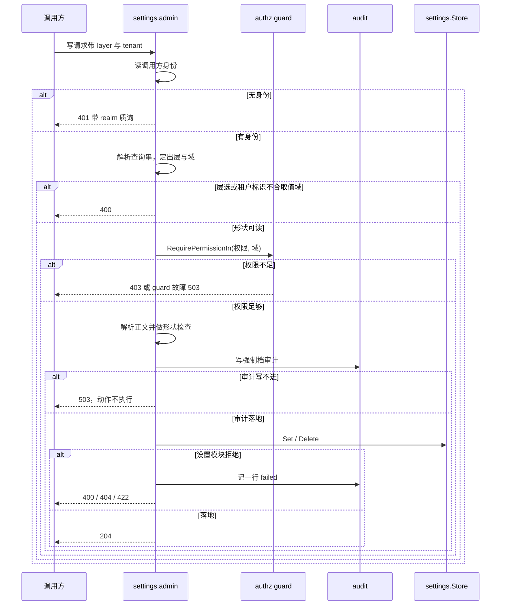

# settings.admin

## 职责

`settings.admin` 是运行期设置的管理面，挂在固定基路径 `/settings/admin` 下，不交付任何功能接口，只把设置的读写暴露成路由。每条路由的动作是经 `settings.Store` 调设置模块——列出声明项、读一层的值、写一层的一行、删一层的一行——模块自己不持数据、不持规则：声明项、类型、取值域与三级回落归设置模块，本模块只决定谁可以问、答案长什么样。

**本模块是设置能力不为它提供的那个管理面。** 设置能力交付的是接缝与实现，不是 HTTP 路由；它的立场是写面的调用点是宿主自己的代码或它写出的管理命令，写入面的访问控制由宿主负责（[design-settings](design-settings.md)）。一个想要管理面的宿主把本模块写进命令树，不必自己手写同一组路由、同一套按层判定与同一条审计前置。本模块正是那个「管理命令」的模块化形态，不改变设置能力的立场——`pkg/settings` 仍不做授权判定，判定归授权（[ADR-console-settings-2026-10-15](../../../adr/adr-console-settings-2026-10-15.md)、[ADR-settings-scope-2026-09-21](../../../adr/adr-settings-scope-2026-09-21.md)）。

路由挂在配置 `settings.admin.endpoints` 列出的端上，基路径不做可配置。每条路由按设置项的键寻址——命名空间与键——路径里不出现任何不透明的行标识。

### 非职责

- **不持有设置数据，不持规则。** 声明项、类型、取值域与回落规则归设置模块；本模块不建表、不缓存、不迁移，每个动作都是一次 `settings.Store` 调用。
- **不校验设置项的值。** 一个值的类型与取值域判据由声明方给出、由设置模块在写入时执行（`settings.ErrTypeMismatch`、`settings.ErrInvalidValue`）；本模块只做请求形状检查——查询串与路径参数的取值域、正文可读与否。
- **不认识租户名册。** 租户标识取自查询串，本模块不校验它在不在名册、不读请求解析出的租户，也不写上下文里的租户。租户标识的取值域由本模块就地复述，与设置模块对同一取值域的复述同源（见「访问控制」）。
- **不为请求认定租户，不建跨租户上下文。** 一条请求作用于哪一层由查询串点名；枚举声明项不是一次跨租户读。
- **不给自己授予任何权限，也不声明权限点。** 它读取与写入用的 `settings.read` 与 `settings.write` 由授权能力为设置能力承载（`pkg/authz/permissions.go` 的 `PermissionSettingsRead`、`PermissionSettingsWrite`），本模块不另声明目录与翻译；它把每条路由在中间件的声明表里登记为开放，由 handler 在内部判定。
- **不改变设置能力的立场。** `pkg/settings` 仍不做授权判定，仍不认识 HTTP；本模块把「宿主写出的管理命令」这一形态模块化，设置根包不因它背上管理面的依赖。

## 外部接口契约

### 登记

`settings.admin` 不交付任何功能接口（`Provides` 为空）。它 `Requires` 设置功能 `(*settings.Store)(nil)`、handler 内判定 `(*guard.Guard)(nil)` 与审计 `(*audit.Audit)(nil)`，并可选取 `log.Logger`。设置与 guard 各由唯一模块排他交付，命令的闭合不把它们拉进来，宿主在命令树上写下它们。表态是 `StateEnabled`、永不 `StateAuto`：挂不挂这面管理面是一个命令树上的决定，不是一个配置能推出的结论。HTTP 入口点与路由声明面在 `Init` 里取用而非声明——一个挂路由而没有入口点的命令是要在接线期报出的故障，而声明面的缺席是合法的：没有 gate 时路由不带声明，受守护的端把它们当未声明处理，所以挂这面路由的命令应同时点名授权模块。

**本模块声明静态[特性](../../../glossary.md) `settings.admin`。** 描述符的 `Resources` 带 `feature.Spec{Name: "settings.admin"}`；这个特性在场，表示本进程挂出设置管理面的路由（[feature](../design-feature.md)）。`settings.admin.endpoints` 必填、不接受空清单，挂路由而没有入口点是接线期故障，所以模块进入启用集、进程有路由器时这组路由无条件挂出，声明为静态特性符合架构不变量 18（[architecture](../../architecture.md#架构不变量)）。

### 路由

基路径 `/settings/admin`，下表是路由的全集（封闭集）：组、方法、路径与每条需要的权限。权限的域随层变，见「访问控制」。

| 组 | 方法 路径 | 权限 |
|---|---|---|
| 设置 | `GET /settings/admin/settings` | `settings.read` |
| 设置 | `GET /settings/admin/settings/:namespace` | `settings.read` |
| 设置 | `PUT /settings/admin/settings/:namespace/:key` | `settings.write` |
| 设置 | `DELETE /settings/admin/settings/:namespace/:key` | `settings.write` |

查询串点名作用在哪一层：

- **`layer`** 取 `global` 或 `tenant`，无缺省；缺席或取值不在闭集内即 400。
- **`tenant`** 在 `layer=tenant` 时必给，点名那个租户；`layer=global` 时不给。给与不给与 `layer` 对不上即 400。

一条路由的动作是一次 `settings.Store` 调用（方法集与各方法的语义见 [design-settings](design-settings.md)）：

| 路由 | 层选与动作 |
|---|---|
| `GET /settings` | `Declared()` 取声明项，`List(layer)` 取该层写下的行，`Get(layer, key, target)` 取每项解析到的值（回落按层选起点） |
| `GET /settings/:namespace` | 同上，取到的声明项限于 `:namespace` 那一组 |
| `PUT /settings/:namespace/:key` | `Set(ctx, settings.Write{Layer, Key, Value, Actor})`，键为拼出的全键，值取正文的 `value` |
| `DELETE /settings/:namespace/:key` | `Delete(ctx, layer, key, actor)`，键为拼出的全键 |

**`:namespace` 与 `:key` 拼成全键 `<namespace>.<key>`，全键必须已声明。** `:namespace` 点名声明该项的命名空间——`Declared` 报出的 `Module`，也就是键的前缀段（如 `deals`、`authn.session`）；`:key` 点名该命名空间下的键的其余部分（可以带点）。一次写或删拼出的全键不在 `Declared()` 里即 404。列表路由取 `:namespace` 那一组：键的前缀段等于 `:namespace` 的声明项。

**列表路由把层选作用到整份声明集上。** `GET /settings` 列出 `Declared()` 的全部声明项，`GET /settings/:namespace` 列出其中落在 `:namespace` 的那一组；列表交出的是该层解析到的值，`GET /settings/:namespace` 不匹配任何声明项即 404。

**列表不按本进程的装配收窄。** `Declared()` 的声明集取可用集（[design-settings](design-settings.md)），本进程未运行的模块声明的键照常列出、照常可写：一个键可以由同一部署里的另一个进程读取。特性 `settings.admin` 只回答这面管理面在不在，不回答某个键所属的模块在不在本进程运行。

### 访问控制

**判定由本模块在 handler 内做出，不经请求中间件的声明判定。** 管理面路由在中间件的声明表里全部登记为开放，好让中间件把请求放行到 handler；handler 先读调用方的身份，再经 `authz.guard` 的 handler 内判定 API 就这条路由的权限问一句，不足即回绝。模块不给自己授予任何权限。

**判定顺序固定，写与读在判定之后分叉。** handler 先读调用方：请求没有身份是 401，只有状态、没有 `Type`，并带与准入层、授权层同形的 realm 质询，不询问 guard 即返回。再解析查询串、定出层与域（见下），再向 guard 要本条路由的权限：不足即由 guard 写出它自己的拒绝——拒绝 403、故障 503——并返回。判定之后才分叉：写解析正文、跑本条路由的形状检查、落强制档审计、调设置模块；读调设置模块并应答。

**判定按层分，域由层选与查询串定出。** 全局层的读写是平台操作，在保留的平台域 `authz.PlatformDomain` 判定；租户层的读写落到查询串点名的那个租户，在该租户的域 `authz.Domain(id)` 判定。`settings.read`／`settings.write` 因此是在不同域上的两次判定：一个在平台域获授权的调用方才能改全局层，一个在某租户获授权的调用方只能改那个租户的层。handler 经 `RequirePermissionIn(c, perm, domain)` 显式指定域，`domain` 按 `layer` 取 `authz.PlatformDomain` 或 `authz.Domain(tenant)`。

**租户标识的取值域由本模块就地复述。** `settings.ForTenant(id)` 对落在租户标识取值域之外的 id 当场 panic，与层选为零值同一档——它是调用点的编程错误；查询串里的 id 是外部输入，本模块因此在拼层选之前把它挡在取值域外：id 为空、或含空白与控制字符即 400。这条判据是租户标识的取值域，本模块复述而不 import 租户能力——按标识分层存放值的模块与租户能力的依赖是刻意缺席的，设置模块对同一取值域同样只作复述（[design-settings](design-settings.md)）。

**每次写强制档审计，落在动作之前、事务之外。** 写路由在调设置模块之前写一行强制档审计；审计写不进则应答 503 且动作不执行。设置模块拒绝写时再尽力写一行 `failed` 行，与允许行以动作标识关联，它自己的失败只记 Error，不改变应答。模块不开自己的事务。读路由不写审计行。

### 视图

**读的应答是 200 加一份视图，落地的写与删是 204 无正文。** 视图逐字段构造，从不把设置模块的值原样交给客户端：声明部分逐字段取自 `settings.DeclaredItem`，值部分由该层的行与 `Get` 的解析结果给出。设置项视图的字段：`key`、`namespace`（声明它的模块，即键的前缀段）、`type`（声明类型自己的文本形式）、`description`、`domain`（取值域的规则，`DeclaredItem.Item.Domain` 的 `Rule()`，没有取值域的项为空）、`sensitive`、`default`、`written`、`has_row`（该层是否持有这个键的行）、`value`。时间不在此列——一张设置行的时间不随视图交给客户端。

**敏感项的值由本模块遮蔽。** `Declared` 的列表不带敏感项的默认值（`DeclaredItem.Default` 为空），`List` 与 `Get` 却照常交出敏感项的值；本模块按 `DeclaredItem.Sensitive` 把敏感项的 `default` 置空、把 `written` 与 `value` 换成一个固定遮蔽串再交出。漏了这一步不报错、凭据随响应出去。遮蔽只覆盖文本：`has_row` 照常报出该层是否持有行。视图里 `default`、`written`、`has_row`、`value` 的含义与遮蔽规则是宿主与前端据以读应答的契约（[ADR-settings-declaration-2026-09-29](../../../adr/adr-settings-declaration-2026-09-29.md)）。

### 宿主可见面

以下是宿主写进配置文件、或在命令树与网关上点名的面。

- **模块名**：`settings.admin`。宿主的命令树点模块名纳入，配置命名空间取同一取值。
- **配置命名空间与输入项**：`settings.admin` 下的 `endpoints`（字符串列表，必填，无缺省，只收具体端名、不收 `*`，取主配置源）。
- **管理端点**：`settings.admin.endpoints` 列出的端，`/settings/admin/*` 下的设置读写路由（路由见「路由」）。
- **权限**：读路由询 `settings.read`，写路由询 `settings.write`，由授权能力承载（`settings.read` 译成 `(settings, read)`、`settings.write` 译成 `(settings, write)`）；域随层选在平台域与租户域之间取。
- **问题应答**：`Problem.Type` 前缀 `urn:speed:settings:`，其下的码 `bad-request`、`invalid-value`。

### 对外接口面

- 模块名 `settings.admin`、配置键 `settings.admin.endpoints`、管理面路由的路径与查询串的键（`layer`、`tenant` 及其取值）、每条路由询问的权限（读 `settings.read`、写 `settings.write`）与域（平台域与租户域），以及 `Problem.Type` 前缀 `urn:speed:settings:` 及其下的码（`bad-request`、`invalid-value`），是本模块对宿主的接口面。改动它们是宿主可见的破坏性变更。
- 设置项视图的字段名（`key`、`namespace`、`type`、`description`、`domain`、`sensitive`、`default`、`written`、`has_row`、`value`）与敏感项遮蔽的规则是应答形状：宿主与前端据此读应答。`has_row` 报所选层是否真的有一行，使「默认」与「已覆盖」不靠文本值推断（空串值是一行，无行则不是）。
- 特性名 `settings.admin`。前端经生成的特性名类型引用它，改名或撤去是宿主可见的破坏性变更。
- 本模块可替换、可撤掉，不改变调用方或设置模块的代码。

## 依赖

| 依赖 | 用途 |
|---|---|
| `pkg/settings` | `settings.Store`（`Get`、`Set`、`Delete`、`List`、`Declared`）、`settings.Layer`、`settings.Global`、`settings.ForTenant`、`settings.Write`、`settings.Entry`、`settings.DeclaredItem` 与哨兵 `settings.ErrUnknownKey`、`settings.ErrTypeMismatch`、`settings.ErrInvalidValue`、`settings.ErrNotLoaded` |
| `pkg/authz`、`pkg/authz/guard` | 权限常量 `authz.PermissionSettingsRead`、`authz.PermissionSettingsWrite`、平台域 `authz.PlatformDomain`、租户域 `authz.Domain`、handler 内判定 `guard.Guard.RequirePermissionIn`、路由声明面 `authz.Gate` |
| `pkg/audit` | 强制档审计 |
| `pkg/authn` | 读请求上的身份（`authn.FromContext`） |
| `pkg/http` | 路由挂载与问题应答（`speedhttp.Router`、`speedhttp.Endpoint`、`speedhttp.Fail`、`speedhttp.Problem`） |
| `pkg/config` | 声明本模块的输入项 |
| `pkg/core` | 模块描述符与功能取用 |
| `pkg/feature` 根包 | 声明静态特性（`feature.Spec`）；根包只依赖标准库 |
| `pkg/log` | 可选：记诊断 |

**本模块不 import `pkg/tenant` 与 `pkg/db`。** 它复述租户标识的取值域而不是 import 它，也不触存储——设置的表由设置模块拥有，本模块每个动作都是一次 `settings.Store` 调用。这一形态与 `sms.admin`、`tenant.admin` 相同（[design-sms](../design-sms.md)、[design-tenant-admin](../tenant/design-tenant-admin.md)）。

**本模块可撤掉，不改变调用方或设置模块的代码。** 它 import `pkg/authz`、`pkg/audit`、`pkg/authn`、`pkg/http` 来挂一条受保护的管理面，是设置能力目录里唯一这样做的一层；设置根包本身不因它背上这些依赖。依赖方向满足架构不变量：本模块 import `pkg/settings` 的根包与 `pkg/authz`，而 `pkg/settings` 根包不 import 本模块、也不 import `pkg/authz`，不构成环；本模块落在依赖图的上层，是一个叶子。

## UML 图

本模块不持状态、不做判定之外的分支，它的结构是一串跨模块的调用。图固定一次写路由的操作序：读调用方 → 解析查询串与正文、定出层与域 → 向 guard 要权限 → 落强制档审计 → 调设置模块 → 映射拒绝。图上看不出的是这些约束：判定的域**随层选在平台域与租户域之间取**，不是请求解析出的租户；审计落在**动作之前、事务之外**，写不进即 503 且动作不执行；guard 的拒绝（403）与故障（503）由 guard 自己写出，本模块不重写；设置模块的拒绝经本模块的封闭映射变成 400／404／422，其余失败落 503。读路由在「向 guard 要权限」之后直接调设置模块，不经正文、审计与写路径。

## 核心数据结构

模块不持数据，只有路由、它的查询串与正文、以及交出的视图。

| 概念 | 形状 | 说明 |
|---|---|---|
| 设置项视图 | `{key, namespace, type, description, domain, sensitive, default, written, has_row, value}` | 声明部分逐字段取自 `settings.DeclaredItem`；值部分取自该层的行与 `Get` 的解析结果；敏感项的值遮蔽，`has_row` 不遮蔽 |
| 写正文 | `{value}` | `PUT /settings/:namespace/:key` 的正文；值按设置模块的声明类型编码 |
| 层选 | `settings.Layer` | 由查询串定出：`layer=global` 给 `settings.Global()`，`layer=tenant` 给 `settings.ForTenant(tenant)` |
| 域 | `authz.Domain` | 由层选定出：全局层给 `authz.PlatformDomain`，租户层给 `authz.Domain(tenant)` |

视图与正文都是本模块自己的类型，不是设置模块的：设置模块的 `Entry` 是表里的一行（含写入时刻），`DeclaredItem` 是键表里的声明（含反射类型）；交出去的是它们的字段化视图、收进来的是校验过形状的正文。

**遮蔽串与查询串的取值是封闭集。** `layer` 取 `global` 与 `tenant`；敏感项在 `written` 与 `value` 处换成固定遮蔽串，`default` 对敏感项置空，`has_row` 的布尔值不因敏感与否而变。这些取值是宿主与前端据以读应答的契约。

## 核心算法与流程

### 一次管理请求

一次管理请求的操作序固定（细节见「访问控制」）：读调用方（无身份 401）→ 解析查询串、定出层与域（层选或标识越出取值域即 400）→ 向 guard 要本条路由的权限（不足由 guard 写出 403／503）→ 判定之后写与读分叉，写先解析正文并做形状检查（越出形状即 400），再落强制档审计（落不进即 503、动作不执行），再调设置模块，把设置模块的回绝映射成应答；读直接调设置模块并应答。

### 按层判定与域的选取

层由查询串 `layer` 点名，域由层定出：`layer=global` 取 `authz.PlatformDomain`，`layer=tenant` 取 `authz.Domain(tenant)`。判定的主体是调用方的责任键 `Identity.Key()`，对象与动作由权限经进程翻译给出（`settings.read` → `(settings, read)`，`settings.write` → `(settings, write)`），域是层选指名的那个。全局层的写因此要平台域的授予——若按请求解析出的租户判定，一个在某租户获授权的调用方就能靠请求头触到全局层。租户层的写落到那个租户：一个在该租户获 `settings.write` 的调用方可以改那个租户的层。

### 写一项设置

1. 形状检查：查询串的层选合取值域、`:namespace` 与 `:key` 拼出的全键已声明、正文可读，否则 400；全键不在 `Declared()` 里即 404。
2. 落强制档审计（动作 `settings.set`，明细带键、层、租户与动作标识；敏感项的值不写明）。
3. `settings.Store.Set(ctx, Write{Layer: 层选, Key: 全键, Value: 正文的值, Actor: 调用方的责任键 Identity.Key()})`——设置模块把值按声明类型编码、按取值域判定，再写表。
4. `ErrTypeMismatch`／`ErrInvalidValue` → 422；`ErrUnknownKey` → 404；其余 → 503。落地 → 204。

### 删一项设置

1. 形状检查：查询串的层选合取值域、全键已声明，否则 400；全键不在 `Declared()` 里即 404。
2. 落强制档审计（动作 `settings.delete`，明细带键、层、租户与动作标识）。
3. `settings.Store.Delete(ctx, 层选, 全键, 调用方的责任键 Identity.Key())`；删一行不在的表行不是错误。
4. 其余失败 → 503。落地 → 204。

### 一层的一次列举

1. 形状检查：查询串的层选合取值域，否则 400。
2. `Declared()` 取声明项（无 IO）；`:namespace` 给定则限于键的前缀段等于它的那组，那组为空即 404。
3. `List(ctx, 层选)` 取该层写下的行，按键建索引；逐项用 `Get(层选, key, reflect.New(声明类型))` 取解析到的值。
4. 按 `DeclaredItem.Sensitive` 遮蔽敏感项的值，交出视图，200。

**列举按层给值，不改回落规则。** `List` 报出的是该层显式写下的行，`Get` 按层选起点走三级回落（租户行、全局行、声明默认值）；视图因此同时给出 `written`（该层显式写下的文本，无则为空）、`has_row`（该层是否持有行）与 `value`（解析到的值）。`written` 为空同时对应「该层无行」与「该层有一行且文本为空串」，两者由 `has_row` 区分。这与设置模块读写的语义一致，本模块不另定一套。

### 敏感项的遮蔽

`Declared` 不带敏感项的默认值，`List` 与 `Get` 却照常交出敏感项的值。本模块按 `DeclaredItem.Sensitive` 在交出视图之前遮蔽：`default` 对敏感项置空，`written` 与 `value` 换成固定遮蔽串。遮蔽是逐项的一次判断，漏判不报错——凭据会随响应一起出去，所以它在枚举与读的每条路径上都要做。

## 错误与失败语义

**回绝映射是封闭的、fail-closed 的。** handler 不把任何设置模块失败原样透给调用方，也不让一个映射不到的失败落成成功。

| 情形 | 表现 |
|---|---|
| 请求在形状上不可读（查询串的层选、路径参数拼出的全键、正文）、层选或租户标识越出取值域 | 400（`Problem.Type` 为 `urn:speed:settings:bad-request`），在调设置模块之前 |
| 全键不在 `Declared()` 里 | 404，不带 `Problem.Type` |
| `:namespace` 那组没有任何声明项 | 404，不带 `Problem.Type` |
| 值编不成声明类型，或落在声明方给出的取值域之外 | 422（`Problem.Type` 为 `urn:speed:settings:invalid-value`），设置模块报 `settings.ErrTypeMismatch`／`settings.ErrInvalidValue` |
| 强制档审计写不进 | 503，动作不执行 |
| 设置模块的其余失败、guard 的故障 | 503，不带 `Problem.Type`，成因只进日志 |

**403 与 401 由别处写。** 权限不足的 403 与 guard 故障的 503 由 guard 写出（[design-authz](../design-authz.md)）；无身份的 401 由本模块写出，与准入层、授权层同形（只有状态、无 `Problem.Type`、带 realm 质询）。本模块不重写它们。`settings.ErrNotLoaded` 不在映射里：它只出现在设置模块的 `Init` 装载快照之前的读，而管理面在请求路径上读，那时每个模块的 `Init` 都已跑完；它落到与未知失败同一个 503。

## 并发与事务边界

- 模块不持状态，可被多个协程并发使用。
- 模块不开事务：一次动作是一次 `settings.Store` 调用，写入与删除在设置模块自己取的连接上完成（[design-settings](design-settings.md)）；本模块不把动作放进任何事务。
- 强制档审计落在任何事务之外，且在动作之前：审计不落则动作不执行，所以一次被审计拦下的写什么都没改。
- **一次写不改两层之间的其它行。** `Set` 写一层的一行（该层无行则插入、有行则覆盖），`Delete` 删该层的一行；两层之间的回落不变。

## 实现状态

| 能力 | 状态 | 代码 |
|---|---|---|
| 管理面 `settings.admin`（路由、按层判定、审计、敏感遮蔽、回绝映射） | 已实现 | `pkg/settings/admin/admin.go` `Module`；`pkg/settings/admin/routes.go` `routes`、`mount`；`pkg/settings/admin/handlers.go` `handleList`、`handleListNamespace`、`handleSet`、`handleRemove`；`pkg/settings/admin/pipeline.go` `selectLayer`、`require`、`auditRequired`；`pkg/settings/admin/views.go` `maskedValue`、`viewOf` |
| 管理面 `settings.admin` 的 OpenAPI 片段与 `speedhttp.Spec` 资源 | 已实现 | `pkg/settings/admin/openapi/settings.admin.json`；`pkg/settings/admin/admin.go` `Module`、`defaultEndpoint`、`openAPIFragment` |
| 静态特性 `settings.admin` 的 `feature.Spec` 声明 | 未实现 | — |
