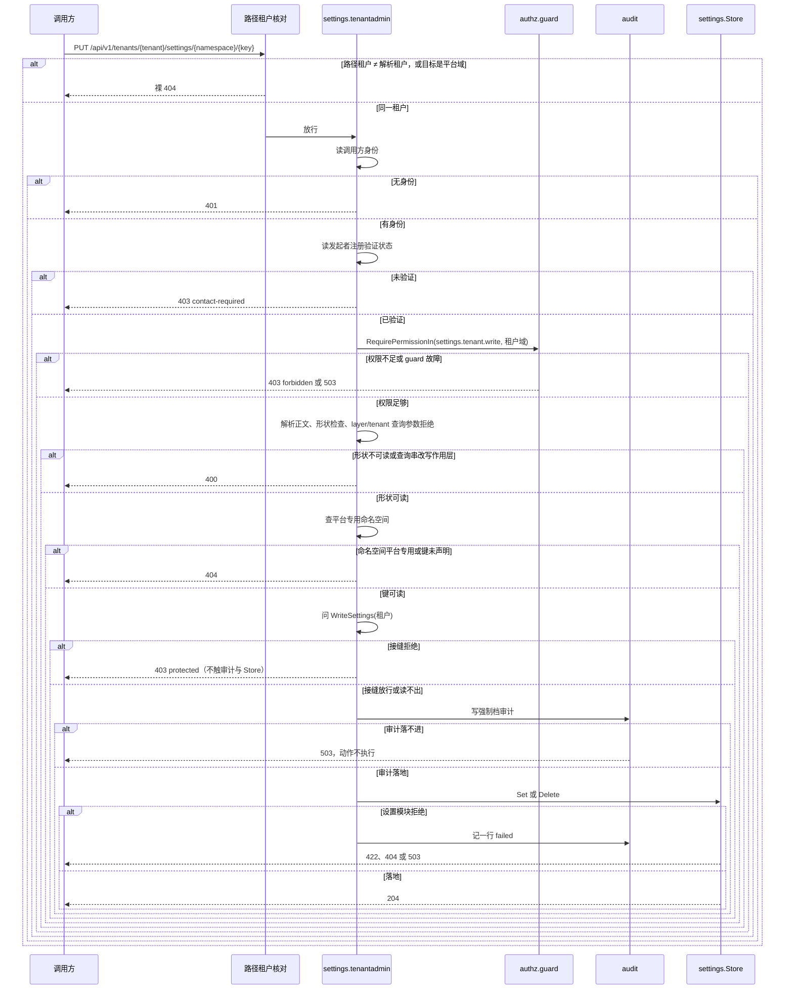

# settings.tenantadmin

## 职责

`settings.tenantadmin` 是运行期设置的租户域管理面，挂在租户作用域基路径 `/api/v1/tenants/{tenant}/settings` 下，不交付任何功能接口，只把一个租户的层上的设置读写暴露成 HTTP 路由。每条路由的动作是一次 `settings.Store` 调用：列出声明项、读该租户层解析到的值、写一行、删一行。模块自己不持数据、不持规则：声明项、类型、取值域与三级回落归设置模块，本模块只决定谁可以问、答案长什么样、哪些命名空间不向租户开放。

**本模块与 `settings.admin` 是同一能力的两个管理面。** `settings.admin` 服务平台员工，路径在 `/api/v1/system/settings` 下，全局层与租户层由查询串点名；本模块服务租户管理员，路径在租户可达的前缀下，作用层由路径里的租户固定，不提供全局层。两者共用 `settings.Store` 与视图形状，不共用路由、权限码或判定域。

### 非职责

- **不持有设置数据，不持规则。** 声明项、类型、取值域与回落规则归设置模块；本模块不建表、不缓存、不迁移，每个动作都是一次 `settings.Store` 调用。
- **不校验设置项的值。** 一个值的类型与取值域判据由声明方给出、由设置模块在写入时执行（`settings.ErrTypeMismatch`、`settings.ErrInvalidValue`）；本模块只做请求形状检查、平台专用命名空间检查与敏感遮蔽。
- **不认识租户名册。** 路径里的租户标识由租户层解析；本模块不校验它在不在名册、不读请求解析出的租户，也不写上下文里的租户。标识的取值域由本模块就地复述，与设置模块对同一取值域的复述同源。
- **不接受查询串改写作用层。** `layer` 与 `tenant` 查询参数在本面上是非法输入；作用层由路径里的租户固定，没有第二条通道把一次写指到全局层或另一个租户。
- **不提供全局层。** 全局层只经 `settings.admin`，并要平台域的 `settings.write`。
- **不声明权限点，也不做授权判定。** 它用的 `settings.tenant.read` 与 `settings.tenant.write` 由授权能力为设置能力承载（`pkg/authz/permissions.go` 的 `PermissionTenantSettingsRead`、`PermissionTenantSettingsWrite`），本模块不另声明目录与翻译；判定经 `authz.guard` 的 handler 内 API 做出。它把路由在中间件的声明表里登记为开放，由 handler 在内部判定。
- **不判定租户是不是个人租户。** 个人租户的拒绝由宿主的 `authz.WriteSettings` 接缝回答；本模块只把答复写成拒绝。
- **不改变设置能力的立场。** `pkg/settings` 仍不做授权判定，仍不认识 HTTP；本模块是那个「宿主写出的管理命令」在租户侧的模块化形态。

## 外部接口契约

### 登记

`settings.tenantadmin` 不交付任何功能接口（`Provides` 为空）。它 `Requires` 设置功能 `(*settings.Store)(nil)`、handler 内判定 `(*guard.Guard)(nil)`、审计 `(*audit.Audit)(nil)`、注册验证状态读面 `(*authn.SignupVerification)(nil)` 与设置写守卫 `(*authz.WriteSettings)(nil)`，并可选取 `log.Logger`。设置与 guard 各由唯一模块排他交付，写守卫由宿主在装配里提供；命令的闭合不把它们拉进来，宿主在命令树上写下前者、并在装配里提供后者。表态是 `StateEnabled`、永不 `StateAuto`：挂不挂这面管理面是一个命令树上的决定，不是一个配置能推出的结论。HTTP 入口点与路由声明面在 `Init` 里取用而非声明——一个挂路由而没有入口点的命令是要在接线期报出的故障，而声明面的缺席是合法的：没有 gate 时路由不带声明，受守护的端把它们当未声明处理，所以挂这面路由的命令应同时点名授权模块。

**`authz.WriteSettings` 是必需依赖。** 它不是一个可选的收紧接缝：装配这面管理面的宿主必须提供一个实现，缺席在依赖解析处以缺提供者终止启动。它只接收租户标识，个人租户的写拒绝落在宿主一侧，平台只负责在启动时要求它存在；平台专用命名空间的排除不在这里，而在本模块的封闭集合里。

**本模块声明静态[特性](../../../glossary.md) `settings.tenantadmin`。** 描述符的 `Resources` 带 `feature.Spec{Name: "settings.tenantadmin"}`；这个特性在场，表示本进程挂出租户设置的管理面路由（[feature](../design-feature.md)）。`settings.tenantadmin.endpoints` 必填、不接受空清单，挂路由而没有入口点是接线期故障，所以模块进入启用集、进程有路由器时这组路由无条件挂出，声明为静态特性符合架构不变量 18（[architecture](../../architecture.md#架构不变量)）。

### 路由

基路径 `/api/v1/tenants/{tenant}/settings`，下表是路由的全集（封闭集）：方法、路径与每条需要的权限。读路由问 `settings.tenant.read`，写路由问 `settings.tenant.write`；两者都只属于治理集，判定域是路径点名的那个租户。

| 组 | 方法 路径 | 权限 |
|---|---|---|
| 设置 | `GET /api/v1/tenants/{tenant}/settings` | `settings.tenant.read` |
| 设置 | `GET /api/v1/tenants/{tenant}/settings/{namespace}` | `settings.tenant.read` |
| 设置 | `PUT /api/v1/tenants/{tenant}/settings/{namespace}/{key}` | `settings.tenant.write` |
| 设置 | `DELETE /api/v1/tenants/{tenant}/settings/{namespace}/{key}` | `settings.tenant.write` |

`:namespace` 与 `:key` 拼成全键 `<namespace>.<key>`，与 `settings.admin` 同一口径。一条路由的动作是一次 `settings.Store` 调用：

| 路由 | 层选与动作 |
|---|---|
| `GET /settings` | `Declared()` 取声明项，`List(ForTenant(租户))` 取该层写下的行，`Get(ForTenant(租户), key, target)` 取每项解析到的值 |
| `GET /settings/{namespace}` | 同上，取到的声明项限于 `:namespace` 那一组 |
| `PUT /settings/{namespace}/{key}` | `Set(ctx, settings.Write{Layer: ForTenant(租户), Key: 全键, Value: 正文的 value, Actor: 调用方的责任键})` |
| `DELETE /settings/{namespace}/{key}` | `Delete(ctx, ForTenant(租户), 全键, 调用方的责任键)` |

**作用层只有一个。** 层选由路径里的租户构造：`settings.ForTenant(tenant)`。请求里出现 `layer` 或 `tenant` 查询参数时，本模块答 400：这两个参数只属于平台面，出现在租户面上就是一次要把写指到另一层的尝试。没有缺省层、没有回落层，`layer=tenant&tenant=other` 这种形状在本面上不可表达。

**平台域不是租户设置的目标。** 路径里的租户是 `authz.PlatformDomain` 时答裸 404，与一条不存在的租户同形；全局层只经平台面。

### 可写键允许集与平台专用命名空间

**本面的可写键允许集由服务端算出：`Declared()` 的键减去平台专用命名空间下的键。** 设置命名空间默认可由租户读写，平台专用的命名空间除外；平台维护一个封闭的平台专用命名空间集合，一个设置项属于本面，当且仅当它的命名空间不在这个集合里。首版的集合是 `ratelimit.*`、`tenant.admission.*` 与 `authn.*`：前两者是部署的限流与租户准入参数，后者是登录、会话、令牌、因素、短信、邀请与 SSO 的安全参数。租户面对这些命名空间的读与写都拒绝，动作不执行。

**集合是服务端的封闭常量，不在配置里，也不由声明自动推导。** 后续新增的命名空间默认可由租户写；要把它划为平台专用，就把它加进这份集合，这是一次代码变更。**读与写都按这一个集合判定**：列表不列出被排除的命名空间，单键读与单键写对它们答 404——本面不暴露它们，与它们是否存在无关。

**排除只作用于本面，不改设置模块。** `settings.Store` 仍能读写这些命名空间的租户层；平台面、宿主自己的代码与种入路径不受本面排除的影响。

### 访问控制

**判定由本模块在 handler 内做出，不经请求中间件的声明判定。** 管理面路由在中间件的声明表里全部登记为开放，好让中间件把请求放行到 handler；handler 先读调用方的身份，再经 `RequirePermissionIn` 就这条路由的权限问一句，判定域是路径点名的那个租户。模块不给自己授予任何权限。

**路径租户必须等于请求解析出的租户。** 这层前置覆盖全部 `ScopeTenants` 路由组，先于本模块的 handler 运行；路径里的 `{tenant}` 与 `tenant.FromContext` 给出的标识不是同一个租户时，以裸 404 作答。本模块不重复这层核对，也不接受一个与解析结果不一致的路径租户。

**判定顺序固定，写与读在判定之后分叉。** handler 先读调用方：请求没有身份是 401，只有状态、没有 `Type`，并带与平台面、准入层同形的 realm 质询，不询问 guard 即返回。写路由随后读发起者的注册验证状态：读作未验证（`SignupPending`）答 403 `contact-required`，读取失败答 503，动作不执行；服务账户与没有任何邮箱的账户（`SignupNone`）豁免。再向 guard 要本条路由的权限：不足即由 guard 写出它自己的 403 或 503。判定之后才分叉：写解析正文、跑形状检查、查平台专用命名空间、问宿主的 `WriteSettings`、落强制档审计、调 `settings.Store`；读查平台专用命名空间、调 `settings.Store` 并应答。

**个人租户的写由宿主接缝拒绝。** `authz.WriteSettings` 在形状检查与平台专用命名空间检查之后、强制档审计与 `Store.Set`／`Delete` 之前被问一次，只交租户标识；答复拒绝即 403 `urn:speed:settings:protected`，动作不执行、审计行不落、`Store` 不被调用；答复读不出来是 503，不按放行处理。**它与 `authz.WriteGuard` 分开**：后者保护策略数据的三种写（`WriteOp` 的封闭三元组），设置写不借用 `WriteGrant`，也没有第四个 `WriteOp`。宿主实现它时拒绝个人租户的写；平台专用命名空间的排除不在这里，而在本模块的封闭集合里。

**每次写强制档审计，落在动作之前、事务之外。** 写路由在调设置模块之前写一行强制档审计；审计写不进则应答 503 且动作不执行。设置模块拒绝写时再尽力写一行 `failed` 行，与允许行以动作标识关联，它自己的失败只记 Error，不改变应答。每条拒绝路径都不产生一行 `success` 审计：身份、注册验证、权限、形状、平台专用命名空间、`WriteSettings` 与审计本身任一档拒绝时，动作都没有发生。读路由不写审计行。

### 视图

**读的应答是 200 加一份视图，落地的写与删是 204 无正文。** 视图逐字段构造，从不把设置模块的值原样交给客户端：声明部分逐字段取自 `settings.DeclaredItem`，值部分由该租户层的行与 `Get` 的解析结果给出。设置项视图的字段：`key`、`namespace`（声明它的模块，即键的前缀段）、`type`（声明类型自己的文本形式）、`description`、`domain`（取值域的规则，没有取值域的项为空）、`sensitive`、`default`、`written`、`has_row`、`value`。时间不在此列。

**敏感项的值由本模块遮蔽。** `Declared` 的列表不带敏感项的默认值，`List` 与 `Get` 却照常交出敏感项的值；本模块按 `DeclaredItem.Sensitive` 把敏感项的 `default` 置空、把 `written` 与 `value` 换成一个固定遮蔽串再交出。遮蔽只覆盖文本：`has_row` 照常报出。

**列表不按本进程的装配收窄。** `Declared()` 的声明集取可用集，本进程未运行的模块声明的键照常列出；一个键可以由同一部署里的另一个进程读取。列表先去掉平台专用命名空间下的项，再按三级回落解析每个键在租户层的值；视图同时给出 `written`、`has_row` 与 `value`，三者与平台面的语义相同。列表按 `Declared` 的键字节序，不分页。

### 宿主可见面

以下是宿主写进配置文件、或在命令树与网关上点名的面。

- **模块名**：`settings.tenantadmin`。宿主的命令树点模块名纳入，配置命名空间、特性名与 OpenAPI 分组取同一取值。
- **配置命名空间与输入项**：`settings.tenantadmin` 下的 `endpoints`（字符串列表，必填，无缺省，只收具体端名、不收 `*`，取主配置源）。
- **管理端点**：`settings.tenantadmin.endpoints` 列出的端，`/api/v1/tenants/{tenant}/settings/*` 下的设置读写路由。
- **权限**：读路由询 `settings.tenant.read`，写路由询 `settings.tenant.write`，由授权能力承载（`settings.tenant.read` 译成 `(tenant_settings, read)`、`settings.tenant.write` 译成 `(tenant_settings, write)`）；判定域是路径点名的租户。
- **查询串**：`layer` 与 `tenant` 在本面上是非法输入，出现即 400。
- **平台专用命名空间**：首版是 `ratelimit.*`、`tenant.admission.*` 与 `authn.*`，租户面对它们的读与写都答 404。
- **问题应答**：`Problem.Type` 前缀 `urn:speed:settings:`，其下的码 `bad-request`、`invalid-value`、`protected`。写路由另在发起者为未验证账户时答 403 `contact-required`，这个码不属于该前缀。

### 对外接口面

- 模块名 `settings.tenantadmin`、配置键 `settings.tenantadmin.endpoints`、管理面路由的路径、`layer`／`tenant` 查询参数的拒绝、每条路由询问的权限（读 `settings.tenant.read`、写 `settings.tenant.write`）与判定域（路径点名的租户），以及 `Problem.Type` 前缀 `urn:speed:settings:` 及其下的码（`bad-request`、`invalid-value`、`protected`），是本模块对宿主的接口面。写路由在发起者为未验证账户时答 403 `contact-required`，同样是接口面。改动它们是宿主可见的破坏性变更。
- 设置项视图的字段名（`key`、`namespace`、`type`、`description`、`domain`、`sensitive`、`default`、`written`、`has_row`、`value`）与敏感项遮蔽的规则是应答形状。
- 平台专用命名空间集合是这一面的行为契约：哪些命名空间不向租户开放由它回答，新增一个平台专用命名空间是一次代码变更。
- 特性名 `settings.tenantadmin`。前端经生成的特性名类型引用它，改名或撤去是宿主可见的破坏性变更。
- 本模块可替换、可撤掉，不改变调用方或设置模块的代码。

## 依赖

| 依赖 | 用途 |
|---|---|
| `pkg/settings` | `settings.Store`（`Get`、`Set`、`Delete`、`List`、`Declared`）、`settings.Layer`、`settings.ForTenant`、`settings.Write`、`settings.Entry`、`settings.DeclaredItem` 与哨兵 `settings.ErrUnknownKey`、`settings.ErrTypeMismatch`、`settings.ErrInvalidValue`、`settings.ErrNotLoaded` |
| `pkg/authz`、`pkg/authz/guard` | 权限常量 `authz.PermissionTenantSettingsRead`、`authz.PermissionTenantSettingsWrite`、路径租户域、handler 内判定 `guard.Guard.RequirePermissionIn`、路由声明面 `authz.Gate`、必需的设置写守卫 `authz.WriteSettings` |
| `pkg/audit` | 强制档审计 |
| `pkg/authn` | 读请求上的身份（`authn.FromContext`）与发起者的注册验证状态（`authn.SignupVerification.SignupStateOf`） |
| `pkg/http` | 路由挂载与问题应答（`speedhttp.Router`、`speedhttp.Endpoint`、`speedhttp.Fail`、`speedhttp.Problem`） |
| `pkg/config` | 声明本模块的输入项 |
| `pkg/core` | 模块描述符与功能取用 |
| `pkg/feature` 根包 | 声明静态特性（`feature.Spec`）；根包只依赖标准库 |
| `pkg/log` | 可选：记诊断 |

**本模块不 import `pkg/tenant` 与 `pkg/db`。** 它复述租户标识的取值域而不是 import 它，也不触存储——设置的表由设置模块拥有，本模块每个动作都是一次 `settings.Store` 调用。这一形态与 `settings.admin`、`tenant.admin` 相同。

**本模块可撤掉，不改变调用方或设置模块的代码。** 它 import `pkg/authz`、`pkg/audit`、`pkg/authn`、`pkg/http` 来挂一条受保护的租户管理面，是设置能力目录里第二个这样做的一层；设置根包本身不因它背上这些依赖。依赖方向满足架构不变量：本模块 import `pkg/settings` 的根包与 `pkg/authz`，而 `pkg/settings` 根包不 import 本模块、也不 import `pkg/authz`，不构成环；本模块落在依赖图的上层，是一个叶子。

## UML 图

本模块不持状态、不做判定之外的分支，它的结构是一串跨模块的调用。图固定一次写路由的操作序：路径租户核对 → 读调用方 → 读注册验证状态 → 向 guard 要权限 → 解析正文与形状检查 → 查平台专用命名空间 → 问 `WriteSettings` → 落强制档审计 → 调设置模块。图上看不出的是这些约束：判定域是**路径点名的租户**；`layer`／`tenant` 查询参数出现即 400；平台专用命名空间的读与写都答 404；个人租户由宿主的 `WriteSettings` 拒绝；审计落在动作之前、事务之外，写不进即 503 且动作不执行；每条拒绝路径不产生 `success` 审计行。

## 核心数据结构

模块不持数据，只有路由、它的正文、以及交出的视图。

| 概念 | 形状 | 说明 |
|---|---|---|
| 设置项视图 | `{key, namespace, type, description, domain, sensitive, default, written, has_row, value}` | 声明部分逐字段取自 `settings.DeclaredItem`；值部分取自该租户层的行与 `Get` 的解析结果；敏感项的值遮蔽；平台专用命名空间下的项不出现 |
| 写正文 | `{value}` | `PUT .../settings/{namespace}/{key}` 的正文；值按设置模块的声明类型编码 |
| 层选 | `settings.Layer` | 由路径里的租户构造：`settings.ForTenant(tenant)` |
| 域 | `authz.Domain` | 由路径里的租户构造：`authz.Domain(tenant)` |

视图与正文都是本模块自己的类型，不是设置模块的：设置模块的 `Entry` 是表里的一行（含写入时刻），`DeclaredItem` 是键表里的声明（含反射类型）；交出去的是它们的字段化视图、收进来的是校验过形状的正文。

**平台专用命名空间是封闭集。** 它以命名空间前缀表示，成员是代码里的常量；首版是 `ratelimit.*`、`tenant.admission.*` 与 `authn.*`。一个键是否属于本面由此集合回答，不由声明、装配或调用方持有的权限推出。

## 核心算法与流程

### 一次管理请求

一次管理请求的操作序固定（细节见「访问控制」）：路径租户核对（不符或平台域即裸 404）→ 读调用方（无身份 401）→ 写路由读发起者的注册验证状态（未验证账户即 403 `contact-required`，读取失败即 503）→ 向 guard 要本条路由的权限（不足由 guard 写出 403／503）→ 判定之后写与读分叉：写解析正文并做形状检查（越出形状或出现 `layer`／`tenant` 查询参数即 400），再查平台专用命名空间（平台专用或未声明即 404），再问 `WriteSettings`（拒绝即 403 `protected`，读不出即 503），再落强制档审计（落不进即 503、动作不执行），再调设置模块，把设置模块的回绝映射成应答；读查平台专用命名空间后直接调设置模块并应答。

### 平台专用命名空间的判定

1. `:namespace` 与 `:key` 拼成全键。
2. 全键的命名空间在平台专用集合里：404，不带 `Problem.Type`；读与写同一处置。
3. 全键不在 `Declared()` 里：404，不带 `Problem.Type`。
4. 全键在声明里且命名空间不属于平台专用集合：继续形状检查、`WriteSettings`、审计与 `Store.Set`／`Delete`。

**判定只作用于本面。** 列表先去掉平台专用命名空间下的声明项；单键读与单键写对它们答 404。`settings.Store`、平台面与宿主代码仍能读写这些命名空间的租户层。

### 写一项设置

1. 路径租户核对与身份检查；写路由读注册验证状态。
2. 形状检查：路径里的租户落在标识取值域内、`:namespace` 与 `:key` 拼出的全键已声明、正文可读、查询串没有 `layer` 或 `tenant`，否则 400；全键未声明或命名空间平台专用即 404。
3. `WriteSettings.Denied(ctx, tenant)`：拒绝即 403 `protected`，读不出即 503，动作不执行。
4. 落强制档审计（动作 `settings.set`，明细带键、租户与动作标识；敏感项的值不写明）。
5. `settings.Store.Set(ctx, Write{Layer: ForTenant(tenant), Key: 全键, Value: 正文的值, Actor: 调用方的责任键 Identity.Key()})`——设置模块把值按声明类型编码、按取值域判定，再写表。
6. `ErrTypeMismatch`／`ErrInvalidValue` → 422；`ErrUnknownKey` → 404；其余 → 503。落地 → 204。

### 删一项设置

1. 路径租户核对与身份检查；写路由读注册验证状态。
2. 形状检查：全键已声明、查询串没有 `layer` 或 `tenant`，否则 400；全键未声明或命名空间平台专用即 404。
3. `WriteSettings.Denied(ctx, tenant)`：拒绝即 403 `protected`，读不出即 503。
4. 落强制档审计（动作 `settings.delete`）。
5. `settings.Store.Delete(ctx, ForTenant(tenant), 全键, 调用方的责任键)`；删一行不在的表行不是错误。
6. 其余失败 → 503。落地 → 204。

### 一层的一次列举

1. 路径租户核对与身份检查。
2. 形状检查：路径里的租户落在标识取值域内、查询串没有 `layer` 或 `tenant`，否则 400。
3. `Declared()` 取声明项（无 IO），去掉命名空间属于平台专用集合的项；`:namespace` 给定则限于键的前缀段等于它的那组，那组为空或整个落在平台专用集合里即 404。
4. `List(ctx, ForTenant(tenant))` 取该层写下的行，按键建索引；逐项用 `Get(ForTenant(tenant), key, reflect.New(声明类型))` 取解析到的值。
5. 按 `DeclaredItem.Sensitive` 遮蔽敏感项的值，交出视图，200。

**列举按租户层给值，不改回落规则。** `List` 报出的是该租户层显式写下的行，`Get` 按层选起点走三级回落（租户行、全局行、声明默认值）；视图因此同时给出 `written`、`has_row` 与 `value`。`written` 为空同时对应「该层无行」与「该层有一行且文本为空串」，两者由 `has_row` 区分。

## 错误与失败语义

**回绝映射是封闭的、fail-closed 的。** handler 不把任何设置模块失败原样透给调用方，也不让一个映射不到的失败落成成功。

| 情形 | 表现 |
|---|---|
| 请求在形状上不可读（路径参数拼出的全键、正文）、租户标识越出取值域、出现 `layer` 或 `tenant` 查询参数 | 400（`Problem.Type` 为 `urn:speed:settings:bad-request`），在调设置模块之前 |
| 全键不在 `Declared()` 里 | 404，不带 `Problem.Type` |
| 全键的命名空间在平台专用集合里，读或写 | 404，不带 `Problem.Type` |
| `:namespace` 那组没有任何可列出的声明项 | 404，不带 `Problem.Type` |
| 路径里的租户是平台域，或与请求解析出的租户不是同一个 | 裸 404，不带 `Problem.Type` |
| `WriteSettings` 答复拒绝 | 403（`urn:speed:settings:protected`），动作不执行、审计行不落 |
| 值编不成声明类型，或落在声明方给出的取值域之外 | 422（`urn:speed:settings:invalid-value`），设置模块报 `settings.ErrTypeMismatch`／`settings.ErrInvalidValue` |
| 发起者读作未验证（`SignupPending`），而这是写路由 | 403 `contact-required`（`authn.ErrContactRequired`），动作不执行 |
| 注册验证状态读取失败、`WriteSettings` 读不出答复 | 503，动作不执行，成因只进日志 |
| 强制档审计写不进 | 503，动作不执行 |
| 设置模块的其余失败、guard 的故障 | 503，不带 `Problem.Type`，成因只进日志 |

**403 与 401 由别处写，注册验证门控与 `WriteSettings` 的 403 除外。** 权限不足的 403 与 guard 故障的 503 由 guard 写出（[design-authz](../design-authz.md)）；无身份的 401 由本模块写出，与平台面、准入层、授权层同形（只有状态、无 `Problem.Type`、带 realm 质询）。本模块自己写出注册验证门控的 403 `contact-required` 与 `WriteSettings` 的 403 `protected`。`settings.ErrNotLoaded` 不在映射里：它只出现在设置模块的 `Init` 装载快照之前的读，而管理面在请求路径上读，那时每个模块的 `Init` 都已跑完；它落到与未知失败同一个 503。

## 并发与事务边界

- 模块不持状态，可被多个协程并发使用。
- 模块不开事务：一次动作是一次 `settings.Store` 调用，写入与删除在设置模块自己取的连接上完成（[design-settings](design-settings.md)）；本模块不把动作放进任何事务。
- 强制档审计落在任何事务之外，且在动作之前：审计不落则动作不执行，所以一次被审计拦下的写什么都没改。
- **一次写只动一个租户的一层一行。** `Set` 写该租户层的一行（无行则插入、有行则覆盖），`Delete` 删该租户层的一行；全局层与别的租户层不受影响，回落规则不变。

## 扩展点

**本模块没有登记式的扩展点。** 平台专用命名空间集合是代码里的封闭常量，不是登记面：把一个命名空间划为平台专用是一次代码变更，与「模块声明自己的设置项」不是同一件事——后者已经由设置能力的 `Schema` 资源承担。新增的设置命名空间默认可由租户读写；要把它排除，就改这份集合。让宿主配置这份集合会把「哪些命名空间可以被租户写」变成部署可改的策略，这正是这一面要避免的。

## 实现状态

| 能力 | 状态 | 代码 |
|---|---|---|
| 租户设置管理面 `settings.tenantadmin`（路由、按路径租户判定、平台专用命名空间、`WriteSettings`、审计、遮蔽、回绝映射） | 未实现 | — |
| 管理面 `settings.tenantadmin` 的 operation 声明、`speedhttp.Spec` 资源与片段生成 | 未实现 | — |
| 静态特性 `settings.tenantadmin` 的 `feature.Spec` 声明 | 未实现 | — |
| 配置 `settings.tenantadmin.endpoints` 的声明与读取 | 未实现 | — |
| 设置写面的注册验证门控与 `layer`／`tenant` 查询参数拒绝 | 未实现 | — |
