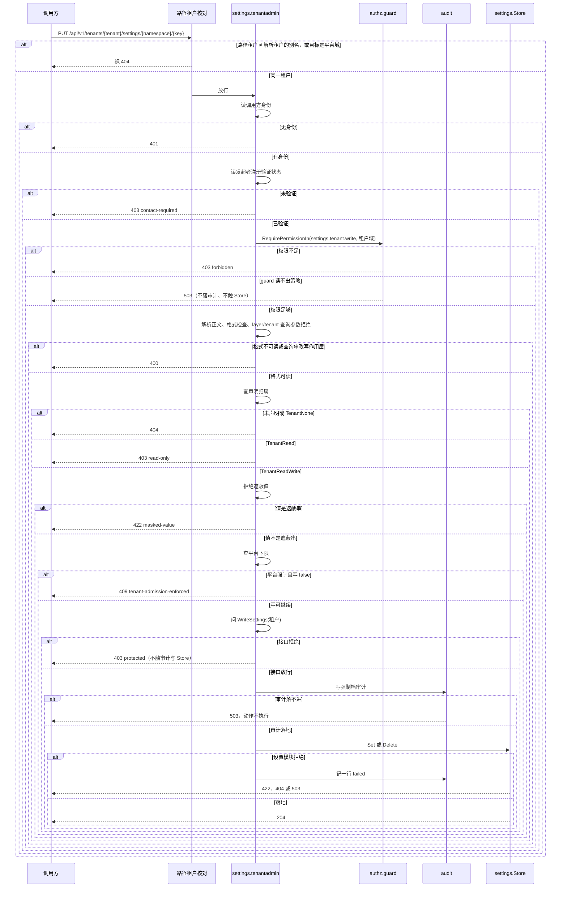

# settings.tenantadmin

本[模块](../../../glossary.md)是租户域的设置管理面，挂在租户可达的 `/api/v1/tenants/{tenant}/settings` 下，作用层由路径里的租户固定。它拥有租户层路由、声明归属的判定、平台下限的写入保护与宿主写守卫的接入，不拥有全局层，也不拥有设置数据与取值域判据。读职责清单前应持有的一句话心智模型是：本管理面只呈现声明显式交给租户的项，每一次写都只落在路径租户的一层上，平台层的值是一道租户降不下去的下限。

## 职责

`settings.tenantadmin` 把租户侧的运行期设置读写做成 HTTP 路由，不交付任何功能接口。它从设置模块的声明里选出对租户可见的项，把平台值与租户值合成有效值交给前端；它接受对租户可写项的一次单键写入或删除，并为平台下限与宿主的写守卫各做一次拒绝。模块自己不持数据、不持规则：声明项、类型、取值域与分层存储归设置模块，本模块只决定谁可以问、哪些项对租户可见、答案长什么样、哪些写必须被拒绝。

**本模块与 `settings.admin` 是同一能力的两个管理面。** `settings.admin` 服务平台员工，路径在 `/api/v1/system/settings` 下，全局层与租户层由查询串点名，继续以键值表呈现全部声明项；本模块服务租户管理员，路径在租户可达的前缀下，作用层由路径里的租户固定，不提供全局层，也不呈现平台级的声明项。两者共用 `settings.Store` 与敏感遮蔽常量，不共用路由、权限码、可见集或判定域。

### 非职责

- **不持有设置数据，不持规则。** 声明项、类型、取值域与分层存储归设置模块；本模块不建表、不缓存、不迁移，每个动作都是一次 `settings.Store` 调用。
- **不决定一个项是否属于租户。** 可见集由设置模块的声明回答：`Schema.TenantFacing` 为零时整份声明不对租户开放，每个 `Item.TenantAccess` 为零（`TenantNone`）时该项不可见。本模块读这两个字段，不按命名空间前缀、模块名或配置再推一次。
- **不校验设置项的值。** 一个值的类型与取值域判据由声明方给出、由设置模块在写入时执行（`settings.ErrTypeMismatch`、`settings.ErrInvalidValue`）；本模块只做请求格式检查、声明归属检查、平台下限检查、敏感遮蔽与回显拒绝。
- **不认识租户名册。** 路径里的租户标识由租户层解析；本模块不校验它在不在名册、不读请求解析出的租户，也不写上下文里的租户。标识的取值域由本模块就地复述，与设置模块对同一取值域的复述同源。
- **不接受查询串改写作用层。** `layer` 与 `tenant` 查询参数在本管理面上是非法输入；作用层由路径里的租户固定，没有第二条通道把一次写指到全局层或另一个租户。
- **不提供全局层。** 全局层只经 `settings.admin`，并要平台域的 `settings.write`。
- **不声明权限点，也不做授权判定。** 它用的 `settings.tenant.read` 与 `settings.tenant.write` 由授权能力为设置能力承载（`pkg/authz/permissions.go` 的 `PermissionTenantSettingsRead`、`PermissionTenantSettingsWrite`），本模块不另声明目录与翻译；判定经 `authz.guard` 的 handler 内 API 做出。它把路由在中间件的声明表里登记为开放，由 handler 在内部判定。
- **不判定租户是不是个人租户。** 个人租户的拒绝由宿主的 `authz.WriteSettings` 接口回答；本模块只把答复写成拒绝。
- **不改变设置能力的立场。** `pkg/settings` 仍不做授权判定，仍不认识 HTTP；本模块是那个「宿主写出的管理命令」在租户侧的模块化形态。
- **不提供登记式的扩展点。** 一个命名空间不再是可见性的单位：同一命名空间下可以同时有对租户可见与不可见的项，可见性逐项由 `TenantAccess` 回答。新增一个租户可见项是一次声明变更，不需要改本模块的常量。

## 外部接口契约

### 登记

`settings.tenantadmin` 不交付任何功能接口（`Provides` 为空）。它 `Requires` 设置功能 `(*settings.Store)(nil)`、handler 内判定 `(*guard.Guard)(nil)`、审计 `(*audit.Audit)(nil)`、注册验证状态读取接口 `(*authn.SignupVerification)(nil)` 与设置写守卫 `(*authz.WriteSettings)(nil)`，并可选取 `log.Logger`。设置与 guard 各由唯一模块排他交付，写守卫由宿主在装配里提供；命令的闭合不把它们拉进来，宿主在命令树上写下前者，并在装配里提供后者。表态是 `StateEnabled`、永不 `StateAuto`：挂不挂这个管理面是一个命令树上的决定，不是一个配置能推出的结论。HTTP 入口点与路由声明接口在 `Init` 里取用而非声明——挂路由而没有入口点的命令是要在接线期报出的故障，而声明接口的缺席是合法的：没有 gate 时路由不带声明，受守护的端把它们当未声明处理，所以挂这组路由的命令应同时点名授权模块。

**`authz.WriteSettings` 是必需依赖。** 它不是一个可选的收紧扩展点：装配这个管理面的宿主必须提供一个实现，缺席在依赖解析处以缺提供者终止启动。它只接收租户标识，个人租户的写拒绝落在宿主一侧，平台只负责在启动时要求它存在；声明归属的检查不在这里，而在本模块对声明表的读取里。

**本模块声明静态[特性](../../../glossary.md) `settings.tenantadmin`。** 描述符的 `Resources` 带 `feature.Spec{Name: "settings.tenantadmin"}`；这个特性在场，表示本进程挂出租户设置的管理面路由（[feature](../design-feature.md)）。`settings.tenantadmin.endpoints` 缺省为 `["api"]`、不接受显式空清单，挂路由而没有入口点是接线期故障，所以模块进入启用集、进程有路由器时这组路由无条件挂出，声明为静态特性符合架构不变量 18（[architecture](../../architecture.md#架构不变量)）。

### 路由

基路径 `/api/v1/tenants/{tenant}/settings`，下表是路由的全集（封闭集）：方法、路径与每条需要的权限。读路由问 `settings.tenant.read`，写路由问 `settings.tenant.write`；两者都只属于治理集，判定域是路径点名的那个租户。

| 组 | 方法 路径 | 权限 |
|---|---|---|
| 设置 | `GET /api/v1/tenants/{tenant}/settings` | `settings.tenant.read` |
| 设置 | `PUT /api/v1/tenants/{tenant}/settings/{namespace}/{key}` | `settings.tenant.write` |
| 设置 | `DELETE /api/v1/tenants/{tenant}/settings/{namespace}/{key}` | `settings.tenant.write` |

`:namespace` 与 `:key` 拼成全键 `<namespace>.<key>`，与 `settings.admin` 同一口径。按命名空间读的路由不存在：租户面只交出完整的可见集，请求一个未声明的路径由路由层答 404 或 405，不返回任何设置内容。一条路由的动作是一次 `settings.Store` 调用：

| 路由 | 层选与动作 |
|---|---|
| `GET /settings` | `Declared()` 取声明项并按 `TenantAccess` 过滤，`List(ForTenant(租户))` 与 `List(Global())` 各取显式行，逐项构造平台值、租户值与有效值 |
| `PUT /settings/{namespace}/{key}` | `Set(ctx, settings.Write{Layer: ForTenant(租户), Key: 全键, Value: 正文的 value, Actor: 调用方的责任键})` |
| `DELETE /settings/{namespace}/{key}` | `Delete(ctx, ForTenant(租户), 全键, 调用方的责任键)` |

**作用层只有一个。** 层选由路径里的租户构造：`settings.ForTenant(tenant)`。请求里出现 `layer` 或 `tenant` 查询参数时，本模块答 400：这两个参数只属于平台管理面，出现在租户管理面上就是一次要把写指到另一层的尝试。没有缺省层、没有回退层，`layer=tenant&tenant=other` 这种形式在本管理面上不可表达。

**平台域不是租户设置的目标。** 路径里的租户是 `authz.PlatformDomain` 时答裸 404，与一个不存在的租户一致；全局层只经平台管理面。

### 声明归属与可见集

**可见集由声明逐项回答，不由命名空间回答。** 设置模块在建键表时校验：`Item.TenantAccess` 非零的项必须处在一个 `Schema.TenantFacing` 为真的 schema 里，且标题、描述与控件元数据完整；否则启动失败。因此请求期看到的每个声明项都已通过这道校验，本模块只需判断 `TenantAccess` 的取值。`TenantRead` 与 `TenantReadWrite` 对租户可见，`TenantNone`（零值）不可见。本管理面不为「新增命名空间」保留任何默认开放：新模块不显式声明 `TenantFacing`，它的项就都不进入租户面。

**不可见与不存在对租户是同一个答案。** 一个未声明的键、一个 `TenantNone` 的项、一个 `Schema.TenantFacing` 为假的命名空间，以及一个不存在的路径，读与写都答同一个裸 404，响应体不含键名、值、来源、默认值或存在性。平台级项没有只读展示通道：租户面不返回它的任何字段。

**宿主可见的声明字段。** 租户面呈现的标题与描述由声明里的 `TitleKey`、`DescriptionKey` 按请求语言渲染；没有本地化器或词条缺失时回退到声明的英文 `Description`。`Control`、`Danger`、`Effect`、`TenantAccess` 原样进入视图，供前端决定控件、危险确认与生效范围文案。

### 访问控制

**判定由本模块在 handler 内做出，不经请求中间件的声明判定。** 管理面路由在中间件的声明表里全部登记为开放，好让中间件把请求放行到 handler；handler 先读调用方的身份，再经 `RequirePermissionIn` 就这条路由的权限问一句，判定域是路径点名的那个租户。模块不给自己授予任何权限。

**路径租户必须等于请求解析出的租户，且不能是平台域。** 覆盖全部 `ScopeTenants` 路由组的共同前置先做标识核对：请求一侧以标识或当前别名寻址，解析层把别名换成标识写进上下文，前置把路径里的 `{tenant}` 段经名册解析成唯一标识后与之比较，不相等时以裸 404 作答——路径段解析不到唯一租户，或解析到另一个租户，都答这个 404。本模块另用租户管理面的更严守卫包裹每条路由，在标识核对之后拒绝平台域，因此本管理面的路径租户核对还包括平台域的回绝；成员、邀请与 SSO 路由组没有这一档，它们管理的 `system` 租户本来就在平台域。本模块不重复实现核对逻辑，也不接受一个与解析结果不一致的路径租户。

**判定顺序固定，写与读在判定之后分开。** handler 先读调用方：请求没有身份是 401，只有状态、没有 `Type`，并带与平台管理面、准入层一致的 realm 质询，不询问 guard 即返回。写路由随后读发起者的注册验证状态：视为未验证（`SignupPending`）答 403 `contact-required`，读取失败答 503，动作不执行；服务账户与没有任何邮箱的账户（`SignupNone`）豁免。再向 guard 要本条路由的权限：不足即由 guard 写出它自己的 403 或 503。判定之后才分开：写解析正文、跑格式检查、查声明归属、拒绝遮蔽值、查平台下限、问宿主的 `WriteSettings`、落强制档审计、调 `settings.Store`；读按声明过滤后调 `settings.Store` 并应答。

**写路由先判声明归属，再判平台下限。** 未声明的键与 `TenantNone` 的项答裸 404；`TenantRead` 的项对租户可见但不可写，答 403 `read-only`；只有 `TenantReadWrite` 的项继续。遮蔽值与平台下限的检查都在宿主写守卫、审计与 `Store` 之前，被拒绝的写不询问宿主、不落成功审计、不改任何行。

**个人租户的写由宿主的接口拒绝。** `authz.WriteSettings` 在声明归属、遮蔽值与平台下限检查之后、强制档审计与 `Store.Set`／`Delete` 之前被问一次，只交租户标识；答复拒绝即 403 `urn:speed:settings:protected`，动作不执行，审计行不落，`Store` 不被调用；答复读不出来是 503，不按放行处理。**它与 `authz.WriteGuard` 分开**：后者保护策略数据的三种写操作（`WriteOp` 的封闭三元组），设置写不借用 `WriteGrant`，也没有第四个 `WriteOp`。宿主实现它时拒绝个人租户的写。

**每次写强制档审计，落在动作之前、事务之外。** 写路由在调设置模块之前写一行强制档审计；审计写不进则应答 503 且动作不执行。设置模块拒绝写时再尽力写一行 `failed` 行，与允许行以动作标识关联，它自己的失败只记 Error，不改变应答。每条拒绝路径都不产生一行 `success` 审计：身份、注册验证、权限、格式、声明归属、遮蔽值、平台下限、`WriteSettings` 与审计本身任一档拒绝时，动作都没有执行。读路由不写审计行。

### 有效值与平台下限

**有效值 = 平台值 OR 租户值。** 平台值是全局层的显式行，没有全局行时是声明的默认值；租户值是租户层的显式行，没有租户行时是声明的默认值。两项都是布尔开关，平台为真时该项即为真，租户不能把它降下来；平台为假时租户可以自行打开。有效值同时决定锁定：`locked_by_platform` 为真当且仅当平台值为真。

**来源层是封闭集 `tenant`、`global`、`default`。** 平台强制时来源为 `global`；平台未强制而租户层有行时来源为 `tenant`；租户层无行而全局层有行时来源为 `global`；两层都无行时为 `default`。没有单独的 `platform` 取值。

**写入保护与判定语义分开。** 平台下限由有效值的 OR 表达，准入判定读同一对层并取 OR，租户视图也取 OR，三处同源。平台强制时写 `false` 另答 409 `urn:speed:settings:tenant-admission-enforced`：这是一次体验保护，让前端在写入前就知道这次关闭不会生效；它不是下限本身。平台在租户已经写下 `false` 之后才打开时，那个旧行不会被清理，但 OR 让下一次请求仍按平台值判定，页面也同时显示「平台强制启用」。写 `true` 与删除租户行在平台强制时都合法：有效值不会因此下降。

### 视图

**读的应答是 200 加一个信封，落地的写与删是 204 无正文。** 信封的字段是 `settings`、`writable` 与 `read_only_reason`：`settings` 是可见项数组，`writable` 表示宿主的写守卫是否放行该租户，`read_only_reason` 在只读时是封闭的拒绝码（当前只有 `protected`），可写时为空串。视图逐字段构造，从不把设置模块的值原样交给客户端。

设置项视图的字段：`key`、`title`、`description`、`type`（声明类型自己的文本形式）、`control`、`danger`、`effect`、`tenant_access`、`effective_value`、`platform_value`、`tenant_value`、`locked_by_platform`、`has_row`、`source`。`effective_value`、`platform_value`、`tenant_value` 都是声明类型的文本形式；`has_row` 表示租户层是否有显式行。时间不在此列。

**标题与描述由服务端本地化。** 读路由按请求语言取 `TitleKey` 与 `DescriptionKey`，词条缺失时回退到声明的英文 `Description`；前端不在自己的词包里再维护一份权威文案。

**敏感项的值由本模块遮蔽。** 本模块按 `DeclaredItem.Sensitive` 把 `effective_value`、`platform_value` 与 `tenant_value` 换成设置能力导出的同一个遮蔽串再交出；遮蔽只覆盖文本，`has_row` 与 `source` 照常报出。写路由拒绝一个把该遮蔽串写回敏感项的请求，答 422 `urn:speed:settings:masked-value`；这样一次「把读到的值原样提交回去」的写不会把遮蔽串存成真实值。本轮两个准入项不敏感，机制保留给未来的敏感项。

### 宿主可见的接口

以下是宿主写进配置文件，或在命令树与网关上点名的目标接口。

- **模块名**：`settings.tenantadmin`。宿主的命令树点模块名纳入，配置命名空间、特性名与 OpenAPI 分组取同一取值。
- **配置命名空间与输入项**：`settings.tenantadmin` 下的 `endpoints`（字符串列表，缺省 `["api"]`，只收具体端名、不收 `*`，取主配置源；显式空清单被拒）。
- **管理端点**：`settings.tenantadmin.endpoints` 列出的端，`/api/v1/tenants/{tenant}/settings/*` 下的设置读写路由。
- **权限**：读路由询 `settings.tenant.read`，写路由询 `settings.tenant.write`，由授权能力承载（`settings.tenant.read` 译成 `(tenant_settings, read)`、`settings.tenant.write` 译成 `(tenant_settings, write)`）；判定域是路径点名的租户。
- **查询串**：`layer` 与 `tenant` 在本管理面上是非法输入，出现即 400。
- **声明归属**：可见集由设置模块的 `Schema.TenantFacing` 与 `Item.TenantAccess` 逐项回答；未声明、`TenantNone` 与不存在的路径都答裸 404。
- **问题应答**：`Problem.Type` 前缀 `urn:speed:settings:`，其下的码 `bad-request`、`invalid-value`、`protected`、`read-only`、`tenant-admission-enforced`、`masked-value`。写路由另在发起者为未验证账户时答 403 `contact-required`，这个码不属于该前缀。

### 对外接口

- 模块名 `settings.tenantadmin`、配置键 `settings.tenantadmin.endpoints`、管理面路由的路径、`layer`／`tenant` 查询参数的拒绝、每条路由询问的权限（读 `settings.tenant.read`、写 `settings.tenant.write`）与判定域（路径点名的租户），以及 `Problem.Type` 前缀 `urn:speed:settings:` 及其下的码，是本模块对宿主的接口。写路由在发起者为未验证账户时答 403 `contact-required`，同样是接口。改动它们是宿主可见的破坏性变更。
- 读信封的字段名（`settings`、`writable`、`read_only_reason`）、设置项视图的字段名、`source` 的封闭取值 `tenant`／`global`／`default`、有效值 OR 与平台下限的写入拒绝是应答结构。
- 可见集是设置模块声明的一部分，不是本模块的常量表：把一项交给租户是一次声明变更，本模块跟随声明。
- 特性名 `settings.tenantadmin`。前端经生成的特性名类型引用它，改名或撤去是宿主可见的破坏性变更。
- 本模块可替换、可撤掉，不改变调用方或设置模块的代码。

## 依赖

| 依赖 | 用途 |
|---|---|
| `pkg/settings` | `settings.Store`（`Get`、`Set`、`Delete`、`List`、`Declared`）、`settings.Layer`、`settings.ForTenant`、`settings.Global`、`settings.Write`、`settings.Entry`、`settings.DeclaredItem`、`settings.TenantAccess` 与哨兵 `settings.ErrUnknownKey`、`settings.ErrTypeMismatch`、`settings.ErrInvalidValue`、`settings.ErrNotLoaded` |
| `pkg/authz`、`pkg/authz/guard` | 权限常量 `authz.PermissionTenantSettingsRead`、`authz.PermissionTenantSettingsWrite`、路径租户域、handler 内判定 `guard.Guard.RequirePermissionIn`、路由声明接口 `authz.Gate`、必需的设置写守卫 `authz.WriteSettings` |
| `pkg/audit` | 强制档审计 |
| `pkg/authn` | 读请求上的身份（`authn.FromContext`）与发起者的注册验证状态（`authn.SignupVerification.SignupStateOf`） |
| `pkg/http` | 路由挂载与问题应答（`speedhttp.Router`、`speedhttp.Endpoint`、`speedhttp.Fail`、`speedhttp.Problem`） |
| `pkg/config` | 声明本模块的输入项 |
| `pkg/core` | 模块描述符与功能取用 |
| `pkg/feature` 根包 | 声明静态特性（`feature.Spec`）；根包只依赖标准库 |
| `pkg/log` | 可选：记诊断 |

**本模块不 import `pkg/tenant` 与 `pkg/db`。** 它复述租户标识的取值域而不是 import 它，也不触存储——设置的表由设置模块拥有，本模块每个动作都是一次 `settings.Store` 调用。这一形态与 `settings.admin`、`tenant.admin` 相同。

**本模块可撤掉，不改变调用方或设置模块的代码。** 它 import `pkg/authz`、`pkg/audit`、`pkg/authn`、`pkg/http` 来挂一条受保护的租户管理面，是设置能力目录里第二个这样做的一层；设置根包本身不因它背上这些依赖。依赖方向满足架构不变量：本模块 import `pkg/settings` 的根包与 `pkg/authz`，而 `pkg/settings` 根包不 import 本模块、也不 import `pkg/authz`，不构成环；本模块落在依赖图的上层，是一个叶子。

## UML 图

本模块不持状态、不做判定之外的分支，它的结构是一串跨模块的调用。图固定一次写路由的操作序：路径租户核对 → 读调用方 → 读注册验证状态 → 向 guard 要权限 → 解析正文与格式检查 → 查声明归属 → 拒绝遮蔽值 → 查平台下限 → 问 `WriteSettings` → 落强制档审计 → 调设置模块。图上看不出的是这些约束：判定域是**路径点名的租户**；`layer`／`tenant` 查询参数出现即 400；未声明、`TenantNone` 与不存在的路径都答 404；只读项答 403 `read-only`；平台强制时关闭答 409；个人租户由宿主的 `WriteSettings` 拒绝；guard 读不出策略时答 503，不落审计、不触 `settings.Store`；审计落在动作之前、事务之外，写不进即 503 且动作不执行；每条拒绝路径不产生 `success` 审计行。读的信封逐项给出平台值、租户值、有效值与 `source`，`source` 取值是 `tenant`、`global` 或 `default`。

## 核心数据结构

模块不持数据，只有路由、它的正文以及交出的信封与视图。

| 概念 | 结构 | 说明 |
|---|---|---|
| 读信封 | `{settings, writable, read_only_reason}` | `settings` 是可见项数组；`writable` 来自宿主写守卫；只读时 `read_only_reason` 是封闭拒绝码，可写时为空串 |
| 设置项视图 | `{key, title, description, type, control, danger, effect, tenant_access, effective_value, platform_value, tenant_value, locked_by_platform, has_row, source}` | 声明部分取自 `settings.DeclaredItem`，标题与描述按请求语言渲染；值部分是平台值与租户值及其 OR；`source` 取 `tenant`、`global` 或 `default`；敏感项的三个值字段遮蔽 |
| 写正文 | `{value}` | `PUT .../settings/{namespace}/{key}` 的正文；值按设置模块的声明类型编码 |
| 层选 | `settings.Layer` | 由路径里的租户构造：`settings.ForTenant(tenant)` |
| 域 | `authz.Domain` | 由路径里的租户构造：`authz.Domain(tenant)` |

视图与正文都是本模块自己的类型，不是设置模块的：设置模块的 `Entry` 是表里的一行（含写入时刻），`DeclaredItem` 是键表里的声明（含反射类型）；交出去的是它们的字段化视图，收进来的是校验过格式的正文。

**可见性逐项回答。** `TenantAccess` 是声明项上的闭集，零值 `TenantNone` 不可见，`TenantRead` 只读可见，`TenantReadWrite` 可读写。一个键是否属于本管理面由此字段回答，不由命名空间、装配或调用方持有的权限推出。

## 核心算法与流程

### 走查

初始状态：`tenant.admission.require-mfa` 已声明为 `TenantReadWrite`，租户 `acme` 的租户层没有这个键的行，全局层也没有；调用方是已通过注册验证、在租户 `acme` 持有 `settings.tenant.write` 的账户；宿主的 `WriteSettings` 对 `acme` 放行。

1. 调用方发 `PUT /api/v1/tenants/acme/settings/tenant.admission/require-mfa`，正文 `{"value": true}`。路径租户核对通过，handler 读身份、读注册验证状态、向 guard 要 `settings.tenant.write`，均通过。
2. 声明归属判定为 `TenantReadWrite`；值不是遮蔽串；平台下限读出全局层没有行，取声明默认值 `false`，不构成强制。`WriteSettings.Denied(ctx, "acme")` 放行；handler 在动作之前写一行强制档审计，动作标识为 `settings.set`。持久状态：审计表多一行，设置表未变。
3. handler 调 `settings.Store.Set`。设置模块编码值、判定取值域，在该租户层插入一行 `(acme, tenant.admission.require-mfa, true)`。持久状态：设置表一行，租户准入的下一次判定取平台值 `false` 与租户值 `true` 的 OR，要求多因素。
4. 平台随后在全局层写下 `tenant.admission.require-mfa=true`。租户页再读时得到 `effective_value=true`、`locked_by_platform=true`、`source=global`；同一租户层的旧行保持不变。
5. 平台强制后，租户发 `PUT .../{"value": false}`：声明归属通过，平台下限读出全局值为真，handler 答 409 `tenant-admission-enforced`，不询问 `WriteSettings`、不落审计、不调 `Store`。即使租户层已有一行 `false`，下一次准入判定仍取 OR，平台要求继续生效。

### 一次管理请求

一次管理请求的操作序固定（细节见「访问控制」）：路径租户核对（不符或平台域即裸 404）→ 读调用方（无身份 401）→ 写路由读发起者的注册验证状态（未验证账户即 403 `contact-required`，读取失败即 503）→ 向 guard 要本条路由的权限（不足由 guard 写出 403／503）→ 判定之后写与读分开：写解析正文并做格式检查（格式不合或出现 `layer`／`tenant` 查询参数即 400），再查声明归属（未声明或 `TenantNone` 即 404，`TenantRead` 即 403 `read-only`），再拒绝遮蔽值（422 `masked-value`），再查平台下限（强制时关闭即 409 `tenant-admission-enforced`），再问 `WriteSettings`（拒绝即 403 `protected`，读不出即 503），再落强制档审计（落不进即 503，动作不执行），再调设置模块，把设置模块的回绝映射成应答；读按声明过滤可见项后直接调设置模块并应答。

### 声明归属的判定

1. `:namespace` 与 `:key` 拼成全键。
2. 全键不在 `Declared()` 里：404，不带 `Problem.Type`。
3. 全键的 `TenantAccess` 是 `TenantNone`：404，与不存在的键同一个答案。
4. 全键的 `TenantAccess` 是 `TenantRead`：该项对租户可见但不可写；写与删答 403 `read-only`。
5. 全键的 `TenantAccess` 是 `TenantReadWrite`：继续格式检查、遮蔽值与平台下限检查、`WriteSettings`、审计与 `Store.Set`／`Delete`。

**判定只作用于本管理面。** `settings.Store`、平台管理面与宿主代码可直接读写任何声明项的租户层；本管理面只是不给租户一条看不见的通道。

### 写一项设置

1. 路径租户核对与身份检查；写路由读注册验证状态。
2. 格式检查：路径里的租户落在标识取值域内，正文可读，查询串没有 `layer` 或 `tenant`，否则 400；全键按声明归属判定，未声明或 `TenantNone` 即 404，`TenantRead` 即 403 `read-only`。
3. 敏感项收到遮蔽串：422 `masked-value`，动作不执行。
4. 平台下限：该项是布尔、写入值为假、全局层为真（或全局无行而声明默认为真）即 409 `tenant-admission-enforced`，动作不执行。
5. `WriteSettings.Denied(ctx, tenant)`：拒绝即 403 `protected`，读不出即 503，动作不执行。
6. 落强制档审计（动作 `settings.set`，明细带键、租户与动作标识；敏感项的值不写明）。
7. `settings.Store.Set(ctx, Write{Layer: ForTenant(tenant), Key: 全键, Value: 正文的值, Actor: 调用方的责任键 Identity.Key()})`——设置模块把值按声明类型编码、按取值域判定，再写表。
8. `ErrTypeMismatch`／`ErrInvalidValue` → 422；`ErrUnknownKey` → 404；其余 → 503。落地 → 204。

### 删一项设置

1. 路径租户核对与身份检查；写路由读注册验证状态。
2. 格式检查：查询串没有 `layer` 或 `tenant`，否则 400；全键按声明归属判定，未声明或 `TenantNone` 即 404，`TenantRead` 即 403 `read-only`。
3. `WriteSettings.Denied(ctx, tenant)`：拒绝即 403 `protected`，读不出即 503。
4. 落强制档审计（动作 `settings.delete`）。
5. `settings.Store.Delete(ctx, ForTenant(tenant), 全键, 调用方的责任键)`；删一行不存在的表行不是错误。平台强制时删除仍合法：有效值由平台值保持。
6. 其余失败 → 503。落地 → 204。

### 一次列举

1. 路径租户核对与身份检查。
2. 格式检查：查询串没有 `layer` 或 `tenant`，否则 400。
3. `Declared()` 取声明项（无 IO），只保留 `TenantAccess` 为 `TenantRead` 或 `TenantReadWrite` 的项。
4. `List(ctx, ForTenant(tenant))` 取租户层写下的行，`List(ctx, Global())` 取全局层写下的行，两者按键建索引；逐项取平台值与租户值，按有效值 OR 计算 `effective_value` 与 `locked_by_platform`，并按索引判定 `source`。
5. 按 `DeclaredItem.Sensitive` 遮蔽敏感项的三个值字段；按请求语言渲染标题与描述；向宿主的 `WriteSettings` 问一次该租户是否可写，构造信封，200。

**列举不改回退规则。** 平台值与租户值各自按「显式行优先、否则声明默认值」解析；有效值是两者的 OR，不是任一层单独的值。视图因此同时给出 `platform_value`、`tenant_value`、`effective_value` 与 `source`。

## 错误与失败语义

**回绝映射是封闭的、fail-closed 的。** handler 不把任何设置模块失败原样透给调用方，也不让一个映射不到的失败落成成功。

| 情形 | 表现 |
|---|---|
| 请求在格式上不可读（路径参数、正文），租户标识越出取值域，出现 `layer` 或 `tenant` 查询参数 | 400（`Problem.Type` 为 `urn:speed:settings:bad-request`），在调设置模块之前 |
| 全键不在 `Declared()` 里，或 `TenantAccess` 为 `TenantNone` | 404，不带 `Problem.Type` |
| `TenantAccess` 为 `TenantRead` 的项收到写或删 | 403（`urn:speed:settings:read-only`），动作不执行 |
| 路径里的租户是平台域，或路径段不等于请求解析出的租户别名 | 裸 404，不带 `Problem.Type` |
| 敏感项收到遮蔽串写回 | 422（`urn:speed:settings:masked-value`），动作不执行，审计行不落，`Store` 不被调用 |
| 平台强制时写入关闭值 | 409（`urn:speed:settings:tenant-admission-enforced`），动作不执行，审计行不落，`Store` 不被调用 |
| `WriteSettings` 答复拒绝 | 403（`urn:speed:settings:protected`），动作不执行，审计行不落 |
| 值编不成声明类型，或落在声明方给出的取值域之外 | 422（`urn:speed:settings:invalid-value`），设置模块报 `settings.ErrTypeMismatch`／`settings.ErrInvalidValue` |
| 发起者视为未验证（`SignupPending`），而这是写路由 | 403 `contact-required`（`authn.ErrContactRequired`），动作不执行 |
| 注册验证状态读取失败，`WriteSettings` 读不出答复，平台下限读不出 | 503，动作不执行，成因只进日志 |
| 强制档审计写不进 | 503，动作不执行 |
| 设置模块的其余失败、guard 的故障 | 503，不带 `Problem.Type`，成因只进日志 |

**403 与 401 由别处写，注册验证门控、只读项与 `WriteSettings` 的 403 除外。** 权限不足的 403 与 guard 故障的 503 由 guard 写出（[design-authz](../design-authz.md)）；无身份的 401 由本模块写出，与平台管理面、准入层、授权层一致（只有状态、无 `Problem.Type`、带 realm 质询）。本模块自己写出注册验证门控的 403 `contact-required`、只读项的 403 `read-only`、`WriteSettings` 的 403 `protected`、平台下限的 409、遮蔽值的 422 与取值域的 422。`settings.ErrNotLoaded` 不在映射里：它只出现在设置模块的 `Init` 装载快照之前的读，而管理面在请求路径上读，那时每个模块的 `Init` 都已跑完；它落到与未知失败同一个 503。

## 并发与事务边界

- 模块不持状态，可被多个协程并发使用。
- 模块不开事务：一次动作是一次 `settings.Store` 调用，写入与删除在设置模块自己取的连接上完成（[design-settings](design-settings.md)）；本模块不把动作放进任何事务。
- 强制档审计落在任何事务之外，且在动作之前：审计不落则动作不执行，所以一次被审计拦下的写什么都没改。
- **一次写只动一个租户的一层一行。** `Set` 写该租户层的一行（无行则插入、有行则覆盖），`Delete` 删该租户层的一行；全局层与别的租户层不受影响，有效值的 OR 不变。

## 实现状态

| 能力 | 状态 | 代码 |
|---|---|---|
| 租户设置管理面 `settings.tenantadmin`（路由、声明归属、有效值 OR、平台下限、`WriteSettings`、审计、遮蔽、回绝映射） | 已实现 | `pkg/settings/tenantadmin/handlers.go`、`pkg/settings/tenantadmin/pipeline.go`、`pkg/settings/tenantadmin/views.go` |
| 管理面 `settings.tenantadmin` 的 operation 声明、`speedhttp.Spec` 资源与片段生成 | 已实现 | `pkg/settings/tenantadmin/operations.go`、`pkg/settings/tenantadmin/openapi/settings.tenantadmin.json` |
| 静态特性 `settings.tenantadmin` 的 `feature.Spec` 声明 | 已实现 | `pkg/settings/tenantadmin/tenantadmin.go` `Module` |
| 配置 `settings.tenantadmin.endpoints` 的声明与读取 | 已实现 | `pkg/settings/tenantadmin/tenantadmin.go` `schema`、`readConfig` |
| 设置写入接口的注册验证门控与 `layer`／`tenant` 查询参数拒绝 | 已实现 | `pkg/settings/tenantadmin/pipeline.go` `requireVerifiedAccount`、`hasLayerQuery` |
