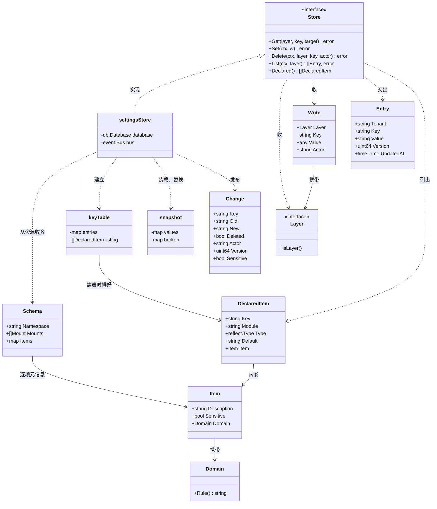
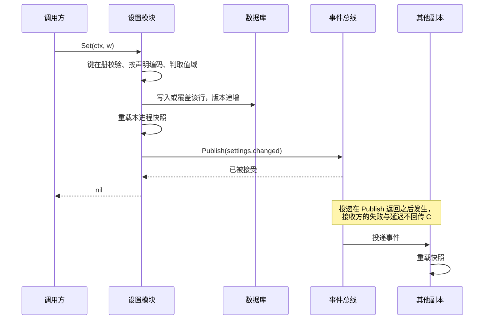
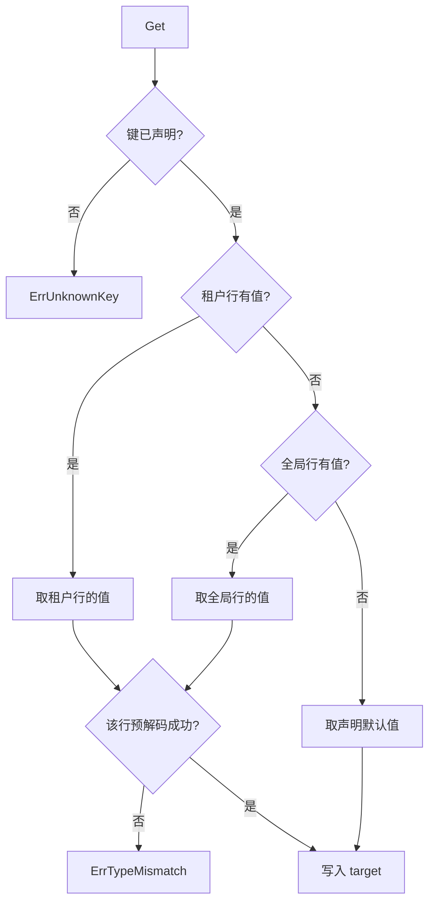

# settings

## 职责

本模块交付**运行期可变的参数**：模块声明自己的设置项，运维在运行期按租户或全局写入取值，消费方从内存快照按声明类型读取。存储是数据库，声明式类型化，取值按租户行、全局行、声明默认值三级回落。

配置与设置的划界由划界判据给出：一个值属于配置，当且仅当它在数据库可用之前就被需要，或它塑造一个启动结构、改变它要求重启；其余的值属于设置，能在不重启时生效的优先放设置（[ADR-config-scope](../../../adr/adr-config-scope.md)）。本模块承载判据另一侧、可由声明的键集合表达的参数——限流阈值、功能开关、通知模板是判据点名的用例；值集合本身是运行期数据的参数不在其列，由属主模块自带的存储承载（[ADR-config-scope](../../../adr/adr-config-scope.md)）。

本功能目录的根包同时是接口包与实现：它定义接口与数据类型并登记一个模块，排他交付设置功能（[ADR-settings-scope](../../../adr/adr-settings-scope.md)）。存储只有数据库一种，不拆实现子包。本模块依赖数据库功能与事件总线功能，两者都是构造期依赖；不依赖租户模块——租户标识在接口上是字符串。

### 非职责

- **不承载启动期的值。** 判据见划界：满足"数据库可用之前被需要"或"塑造启动结构、改变要重启"任一条的值落在配置一侧（[ADR-config-scope](../../../adr/adr-config-scope.md)）。
- **不做授权判定。** 谁能改一项设置归 [authz](../design-authz.md)：读与写各是一个权限点，落点见它的承接的权限点一节，写面的调用点是宿主自己的代码或它写出的管理命令，在 handler 内用判定 API 询问（[ADR-settings-scope](../../../adr/adr-settings-scope.md)）。框架另有两个可直接纳入的管理面模块：[settings.admin](design-settings-admin.md) 服务全局层与平台侧的租户层，[settings.tenantadmin](design-settings-tenantadmin.md) 服务租户可达前缀下的租户层。它们是那个「管理命令」的模块化形态，不改变本条立场。
- **不认识租户模块。** 租户标识是字符串，本模块不校验它在不在名册、不读请求上下文、不产生标识（[ADR-settings-scope](../../../adr/adr-settings-scope.md)）。
- **不解释值的内容。** 通知模板在本模块是一段字符串；渲染与转义归消费方。一个值合不合声明方的用途，判据由声明方以取值域给出，本模块只在写入时执行它（见写入面），自己不为任何设置项定判据（[ADR-settings-domain](../../../adr/adr-settings-domain.md)）。
- **不承载容器类型。** 映射与列表不在声明的类型集合里，需要它们的消费方把 JSON 文本存进字符串项自行解码（[ADR-settings-declaration](../../../adr/adr-settings-declaration.md)）。
- **不保存变更历史。** 变更事实经事件发布，历史的记录归审计模块，而审计不提供查询面（见 [audit](../audit/design-audit.md)），检索与导出的承载单元要另立（[ADR-settings-audit](../../../adr/adr-settings-audit.md)）。
- **不做事件总线。** 广播与投递由事件模块承担，本模块只发布与订阅（[ADR-settings-propagation](../../../adr/adr-settings-propagation.md)）。
- **不提供无类型的键值存取。** 那是键值模块的能力；没有声明的键在本模块读写两侧都不可用（[ADR-settings-declaration](../../../adr/adr-settings-declaration.md)）。

## 术语表

以下术语的含义限于本模块，以及设置主题的决策记录。

| 术语 | 英文 | 定义 |
|---|---|---|
| 设置项 | setting item | 一个有键、有类型、有默认值的运行期可变参数，由某个模块声明。 |
| 声明 | Schema | 本模块定义的资源类型，承载一个模块的全部设置项与它们的默认值。 |
| 键 | key | 设置项的路径标识，由命名空间与字段路径拼出，与配置键的规则同一条。 |
| 层选 | layer selector | 指名读写作用于哪一层的值，由 `Global()` 或 `ForTenant(id)` 构造；零值不是一个层。 |
| 全局行 | global row | 全局层对应的设置行，是全部租户共享的一层取值；存储上它的租户列为空。 |
| 回落 | fallback | 读取按租户行、全局行、声明默认值依次取值的过程；起点是调用方以层选指名的那一层。 |
| 键表 | key table | 装配期由全部声明聚合出的映射：键到声明类型、默认值与元信息。 |
| 快照 | snapshot | 全部已写入行在内存里的拷贝，装载时按声明预解码。 |
| 版本 | version | 一行的写入序号，每次写入递增，随变更事件发布。 |

## 外部接口契约

### 登记单元与名字

| 登记单元 | 模块名 | 交付 |
|---|---|---|
| 根包 | `settings` | 排他地交付设置功能 |

根包即实现，同时是接口包；模块名导出为 `ModuleName` 常量，配置命名空间取同一个取值。

### 交付的功能

功能标识的元素类型必须是接口，取用写作 `core.Resolve[settings.Store](reg)`。

```go
// Layer 指名读写作用于哪一层：全局层，或某个租户的租户层。
// 零值不是一个层，是调用点的编程错误。
type Layer interface {
    isLayer() // 未导出方法封住实现：Layer 只能由本模块的构造器产生
}

// Global 返回全局层。
func Global() Layer

// ForTenant 返回标识为 id 的租户层；id 落在租户标识取值域之外（为空、或含空白与控制字符）是调用点的编程错误，与层选为零值同一档：当场 panic，不返回错误。
func ForTenant(id string) Layer

// Store 是设置的读写面。功能标识为 (*Store)(nil)。
type Store interface {
    // Get 按声明的类型把设置值解码进 target。
    // 取值按 租户行 > 全局行 > 声明默认值 回落，从 layer 指名的层开始。
    // 键未声明时报 ErrUnknownKey；该键的已写入值解不成声明类型时报 ErrTypeMismatch；
    // 本模块的 Init 装载快照之前读取报 ErrNotLoaded。
    Get(layer Layer, key string, target any) error

    // Set 按声明的类型编码 w.Value 并写入 w.Layer 指名的那一层。
    // 写入成功后发布 settings.changed。
    Set(ctx context.Context, w Write) error

    // Delete 删除 layer 指名的那一层上的显式行；删除不存在的行不是错误。
    Delete(ctx context.Context, layer Layer, key, actor string) error

    // List 列出 layer 指名的那一层的显式行。结果按键的字节序排列，与数据库的排序规则无关。
    List(ctx context.Context, layer Layer) ([]Entry, error)

    // Declared 按键的字节序列出键表中的全部设置项；敏感项不带默认值。
    Declared() []DeclaredItem
}

// Get 是 Store.Get 的泛型封装，像 core.Resolve 一样把断言收进函数里；
// 类型参数与声明类型不符时返回 ErrTypeMismatch。
func Get[T any](s Store, layer Layer, key string) (T, error)

type Write struct {
    Layer Layer  // Global() 或 ForTenant(id)
    Key   string
    Value any    // 按声明类型编码
    Actor string // 记入事件载荷，本模块不解释
}

type Entry struct {
    Tenant    string // 这一行的租户列：全局行为空
    Key       string
    Value     string
    Version   uint64
    UpdatedAt time.Time
}

type DeclaredItem struct {
    Key     string       // 完整路径
    Module  string       // 声明方模块
    Type    reflect.Type // 声明类型：reflect.New(Type) 即 Get 接受的目标
    Default string       // 声明类型自己的文本形式；敏感项为空
    Item                 // 声明给出的说明、敏感标记与取值域
}
```

**零值不是一个层。** 接口上不存在"空租户"这个值：指名全局层要经 `Global()`，指名租户层要经 `ForTenant(id)`，而 `ForTenant` 拒收任何落在租户标识取值域之外的标识——非空、且不含空白与控制字符（判据与名册对标识的要求同一条，见 [ADR-tenant-identifier](../../../adr/adr-tenant-identifier.md)）。长度不在其中：本模块与名册一样不给标识定长度，那一列有多宽由声明方说了算。传一个 `nil` 的层选是调用点的编程错误，当场 panic 而不返回错误，判据与目标参数的非法形态同一条（见读取面）。

**读取不收上下文，写入收。** 读取只走内存快照，不发起任何 IO，因而没有可取消的点；写入与列举访问数据库，收上下文。同一种功能的两个方向取不同签名的判据是它们做什么，不是形态上的一致。

**排他交付**：`Provides: []core.Provision{{Token: (*Store)(nil), Exclusive: true}}`。设置是进程级的一份存取面，多于一个提供者表态启用即启动失败。

### 声明面

模块把 `Schema` 放进描述符的 `Resources` 中，声明自己的全部设置项（[ADR-settings-declaration](../../../adr/adr-settings-declaration.md)）：

```go
type Schema struct {
    Namespace string          // 键的命名空间，空表示顶层
    Mounts    []Mount         // 承载结构体，字段的当前取值即默认值
    Items     map[string]Item // 路径 -> 元信息；未列出的取默认
}

type Mount struct {
    Path  string // 相对命名空间的路径前缀，空表示挂在命名空间根
    Value any    // 承载结构体的指针
}

type Item struct {
    Description string
    Sensitive   bool   // 变更事件不携带该键的值
    Domain      Domain // 写入可以存下的值；零值接受声明类型的每一个值
}

// Domain 是声明方给一个设置项的取值域：声明类型上的一个谓词，连同说出这个集合的规则文本。
// 可比较；零值接受声明类型的每一个值。
type Domain struct{ /* 未导出 */ }

// DomainOf 构造声明类型为 T 的设置项的取值域：admits 判一个值在不在域内，
// rule 以一个名词短语说出这个集合，拒绝与列表都报出它。
func DomainOf[T any](rule string, admits func(value T) bool) Domain

// Rule 是构造时给出的规则文本；零值为空。
func (d Domain) Rule() string
```

一个模块的声明：

```go
var defaults = options{Window: time.Minute, Limit: 100}

settings.Schema{
    Namespace: "ratelimit",
    Mounts:    []settings.Mount{{Value: &defaults}},
    Items: map[string]settings.Item{
        "limit": {
            Description: "窗口内允许的请求数",
            Domain:      settings.DomainOf("the positive integers", func(v int) bool { return v > 0 }),
        },
    },
}

// 读取
var opts options  // 零值即可：未写入的键取声明默认值
err := store.Get(settings.ForTenant(tenantID), "ratelimit.window", &opts.Window)
```

**键的路径派生与 `pkg/config` 是同一套规则**：优先 `config` tag，其次 `json` tag，都没有则字段名转小写短横线；匿名字段内联；tag 写作 `-` 的字段跳过；实现了 `encoding.TextUnmarshaler` 的类型按标量叶子处理；不可解码的字段自动跳过（判据与清单见 [config](../design-config.md) 的名字的派生与映射一节，本模块不另立规则）。从配置迁往设置的一个参数，键名与承载结构体因此都不变。

**类型集合是封闭的**：字符串、布尔、整数、浮点、时长，以及自带文本形式的类型——它以 `UnmarshalText` 从文本解码，也以 `MarshalText` 编码回文本，两个方法声明在值上还是指针上都可以（`math/big.Int` 声明在指针上）。只能解码、不能编码回文本的类型不在集合里：写入存下的是声明类型自己写出的文本，这样一个键没有一次写入能存得下，收集期即判声明缺陷。容器不在其中（见非职责）。取值纪律与配置相同（[config](../design-config.md) 的取值与校验一节），本模块不另立规则：实现 `TextUnmarshaler` 的类型按它自己的约定往返。

**取值域由声明方随设置项给出**（[ADR-settings-domain](../../../adr/adr-settings-domain.md)）：`Item.Domain` 由 `DomainOf[T]` 构造，`T` 恰为这一项的声明类型，谓词收到的就是这个类型的值；规则文本是拒绝与列表报出的那一句。取值域在收集期先判一次：类型与声明类型不同、规则为空、谓词为空、声明的默认值不在域内，都是声明自身的缺陷——默认值是 `Set` 要收得回去的值（见列出设置项）。不给取值域的设置项接受声明类型的每一个值。写入时怎样判见写入面。

**声明的收集取自可用集**：来源是 `core.Resources[settings.Schema](reg)` 的全体；判据是键的有效性跟着二进制走，比任何一次命令长寿，因而未运行、消解落选与只被静态级纳入的模块，其声明一律在键表里。**取可用集的消费点不做减法**（每处按类型收集资源的消费点自行裁定取材域，见 [architecture](../../architecture.md) 的架构不变量一节）：一份参数声明不是由哪一次运行产生的，减法会让同一个键在一条命令下合法、在另一条下非法，而声明本身没变。两个模块声明同一个键是收集期的冲突，终止启动并点名冲突双方；单个模块的声明自身的缺陷（判据：不涉及第二方，仅凭这个模块声明的内容即可判定不可用）同样是启动失败，判据与示例归 `ErrInvalidDeclaration`。

**声明的聚合发生在 `New`**，产出键表：键到声明类型、默认值与元信息的映射。键表在装配期一次性建立，此后只读。

### 读取面

读取按三级回落取值（[ADR-settings-layer](../../../adr/adr-settings-layer.md)）：

| 次序 | 来源 | 何时命中 |
|---|---|---|
| 一 | 租户行 | 该租户有一个显式写入的行 |
| 二 | 全局行 | 租户行为空而全局行有值 |
| 三 | 声明默认值 | 两层都没有行 |

**读取从层选指名的那一层开始**：指名全局层时回落直接落在全局行上。层选由 `Global()` 或 `ForTenant(id)` 构造，接口上不存在"空租户"这个值（[ADR-settings-layer](../../../adr/adr-settings-layer.md)）。

**快照装载之前的读取报 `ErrNotLoaded`**，不回落到声明默认值。快照在本模块的 `Init` 装载，此前没有从表里读过任何一行，回落到默认值就是不论表里写着什么都答默认值，而读取方会拿它当真值用下去、没有任何一处报出来。功能在 `New` 之后即可取用，在别的模块自己的 `Init` 里读设置因而取决于构造次序：没有声明依赖的模块按名字排序，名字排在 `settings` 之前就先于它初始化。修复动作是读取方声明 `Requires (*settings.Store)(nil)`，或者让驱动至少推进到 `Init`；写入不受此限——`Set` 与 `Delete` 直接作用于表，写后的重载会把快照装上。

**读取不判取值域。** 一行解得成声明类型、却落在声明给出的取值域之外——它写在取值域声明之前，或是绕过本模块写进表的——读取照原样交出它，不报错，也不回落到下一级。按读到的值行事的消费方要判它读到的值，限流即如此（[ADR-settings-domain](../../../adr/adr-settings-domain.md)）。

**值在快照装载时按声明预解码**，标量种类的读取路径上没有文本转换。**自带文本形式的类型每次读取由文本重新解码**，那一行的文本，或声明默认值的文本：这类类型的拷贝之间可能共享存储而反射看不透——`net.IP` 底层是切片，`math/big.Int` 的方法原地改写拷贝共享的数位——读取方拿读到的值做运算，改掉的就是声明默认值或快照里的值，进程内其余读取方随之读到它。重新解码交出的值与本模块的存储无关。解码失败的行单独记下（键与层到错误的映射），读取命中它时报 `ErrTypeMismatch` 并点名键；其余键照常可用。装载因此不因一行坏值而失败——坏值的作用面限于读它的代码路径，进程照常启动，其余设置照常可用。

**目标参数与层选的非法形态是调用点的编程错误，panic 而不返回错误**：目标传入非指针、传入 `nil`；层选传入 `nil`、`ForTenant` 收到落在租户标识取值域之外的标识（空、或含空白与控制字符）。判据与配置的取值面同一条（[config](../design-config.md) 的取值与校验一节）；这一类不涉及第二方、与数据无关，调用点无从处理它。**这一判定先于键表**：`Get` 与 `Set` 先判层选与目标，再查键、编码值，同一个调用点因而无论键是否已声明、值能否编码都当场 panic，不会这一次返回错误、下一次才 panic。

### 写入面

写入只作用于显式的层：`Write.Layer` 指名写哪一层，`Global()` 写全局行，`ForTenant(id)` 写该租户的行。写入不改动其它层的任何行。

**写入的值按声明类型编码为文本**，编码规则是读取方向的逆：自带文本形式的类型由它自己的 `MarshalText` 写出、`Duration` 的 `ParseDuration` 格式、布尔与数值的常规文本。可赋值给声明类型的值按声明类型写出：`[]string` 写进一个以它为底层定义、自带文本形式的项，存下的是那个类型的文本。编码失败的形态是 `ErrTypeMismatch`，点名键与声明类型。

**写入收下的值先归一化到声明类型，归一化服从 [config](../design-config.md) 的取值与校验一节的取值纪律**，规则在那里给全，本模块不复述、不另立。归不到声明类型的值判 `ErrTypeMismatch`，不转换，也不截断；错误点名键与声明类型。管理端点把请求体按 JSON 或 YAML 解出的值原样交给 `Set` 是常规用法：那些值正是配置源对同一项会给出的值。落库的文本一律是声明类型自己的写法，与调用方交来的形式无关，以 `"300s"` 写入的时长存为 `5m0s`。

**配置模块不导出它的转换规则，本模块在 `pkg/settings/codec.go` 的 `coerce` 里另有一份实现**，同步由测试守住：`pkg/settings/discipline_test.go` 的 `TestTheWriteDisciplineAgreesWithConfiguration` 把同一份 YAML 文档里的值分别送进配置的装载路径与本模块的编码路径，要求两侧同拒，或同收且得到同一个值。

**归到声明类型之后，值再按声明给出的取值域判定**，落在域外即 `ErrInvalidValue`，错误点名键、规则与这个值将要存下的文本，不落库，快照与事件都不动（[ADR-settings-domain](../../../adr/adr-settings-domain.md)）。判定的对象是归一化之后、恰为声明类型的值：`0`、`"0"` 与 JSON 解出的 `0.0` 写进同一个整数项，得到同一个裁决；只可赋值给声明类型的值（`[]string` 之于以它为底层的类型）先拷成声明类型再交给谓词。敏感项的拒绝不带值，只点名键与规则。类型本身就不收的值仍是 `ErrTypeMismatch`，轮不到取值域。

**值的文本上限是 1 MiB**，超过即 `ErrInvalidValue`，不落库。上限服务的对象是快照：全部已写入行常驻内存，一个失控的写入不该把整个进程的内存拖垮。

**版本在数据库端递增**：`version = version + 1`，新行为 1。两个并发写入同一个键时结果是后到的那一个，版本号仍逐次递增——本模块不做比较并交换，丢更新写进非保证。

**写入的次序**：校验（声明类型、取值域、文本上限）、落库、重载本进程快照、发布事件；发布失败不回滚、不改变返回值，见事件一节。**删除**只删指定的层，被删的键此后回落到下一级；**`Delete` 不过键表**——它是声明被删之后留在库中的旧行的清理路径，而读取与 `Set` 都被键表拦住；`List` 交出的是显式行，不是回落后的有效值。**`List` 的次序是键的字节序，由本模块排好**，不交给语句：数据库按排序规则比较文本，SQLite 逐字节比较，PostgreSQL 取建库时的排序规则，而常见的默认规则在第一级忽略标点，`a-b` 排在 `ab` 旁边而不是 `aa` 之前——交给语句，同一批行的次序就随命令所在的方言变化。

**敏感项的值不进入本模块的任何日志与错误文本**。本模块的日志只写键与租户，不写值；敏感标记的作用面是事件载荷（见下）与设置项的列表（见列出设置项）。

**注册验证状态的门控落在写入口，不在 `Write` 接缝。** 这条门控执行的是未验证账户不得写设置这一约束（REQ-signup-025）：`settings.admin` 与宿主自己写出的写入口在各自的权限判定之前、动作之前读发起者的注册验证状态（`authn.SignupVerification.SignupStateOf`），发起者读作未验证（`SignupPending`：有邮箱而没有一条已证明的）时答 403 `contact-required`，读取失败答 503、不按放行处理；服务账户与没有任何邮箱的账户（`SignupNone`）豁免。判据与账户怎么创建无关。门控只收紧、不放行：它只多拒绝一类发起者，不改变写入口的权限判定。`Set` 与 `Delete` 不读注册验证状态，也不能代替写入口执行这条门控；门控在服务端，不靠前端隐藏入口。

### 列出设置项

`Declared` 按键的字节序列出键表中的全部设置项，与 `List` 同一种次序（[ADR-settings-key-listing](../../../adr/adr-settings-key-listing.md)）。每一项带着键、声明方模块、声明类型、默认值与声明给出的元信息，取值域的规则也在其中，经 `Item.Domain.Rule()` 读出，没有取值域的项为空；它为管理面这类宿主代码而设，那里要列出别的模块声明的每一项，又不该复述它们的声明。

**它只读键表**：键表在 `New` 建立、此后不变，`Declared` 因而不收上下文、不发起 IO，快照装载之前即可用——这一点与读取不同，读取在装载之前报 `ErrNotLoaded`。返回值是调用方自己的一份，改动它够不着键表，也够不着下一个调用方。

**`Type` 是声明类型本身**：读取的目标必须恰为声明类型，`reflect.New(Type)` 即 `Get` 接受的目标，不认识这份声明的代码也能按类型读出一个键的值；类型的名字由它的 `String()` 给出。

**`Default` 是声明类型自己的文本形式**，与一行持有同一个值时存下的文本相同：时长写作 `1m30s`，时间按它的 `MarshalText` 写出，而不是它打印出来的样子。这段文本 `Set` 原样收得下，`List` 对持有它的行也报出同一段文本；键的有效值因此可以由 `List` 的租户行、全局行与 `Default` 按回落规则推出，全程都是文本。**敏感项的 `Default` 为空**，`Sensitive` 同时说明它被扣下：列表的去处是客户端，一个编进二进制的凭据不因为被声明就获得传播到那里的资格。`Get` 与 `List` 对敏感项的行为不变，照常交出值，以列表的 `Sensitive` 遮蔽它们是宿主的事（见对宿主的要求）。

**列表里没有而 `List` 里有的键，是声明被删之后留下的旧行**，也就是 `Delete` 要清理的那些。

### 事件

每次 `Set`，以及删掉了一行的 `Delete`，在落库成功后发布一条变更事件（[ADR-settings-audit](../../../adr/adr-settings-audit.md)）。**没有删掉任何行的 `Delete` 不发布**：库里没有发生变更，一条事件会被订阅方记成一次从未发生的删除。它仍然不是错误。

```go
// ChangedEventType 是变更事件的类型名。
const ChangedEventType = "settings.changed"

// Change 是变更事件的载荷。变更作用的租户在事件信封的 TenantID 上
// （全局行留空，属系统级事件），载荷不重复携带它。
type Change struct {
    Key       string
    Old       string // 该层写入前的显式值，无行时为空
    New       string // 该层写入后的显式值，删除时为空
    Deleted   bool   // 为真时这是一次删除，New 为空
    Actor     string // 写入方给出，本模块不解释
    Version   uint64 // 写入后的版本号，删除时为 0
    Sensitive bool   // 为真时 Old 与 New 必为空
}
```

**`Actor` 由调用方给出，本模块不解释、不校验，也不替调用方填。** 经过认证的调用方传 `Identity.Key()`：它是责任键，冒充期间取的是实际操作者而不是被冒充的账户，设置的变更因此归责到真正动手的人；定义归 [authn](../authn/design-authn.md) 的身份一节，本模块不重复。

**`Old` 与 `New` 是写入所作用的那一层的显式值，不是回落后的有效值。** 事件描述的是这一次写入动作；"有效值因此变成什么"由订阅方按住回落的规则自行推出。**`Set` 的 `Old` 取自写入前本副本的快照**：它是发起写入的副本观察到的值，库中真实值可能更新——另一个副本刚写过而本副本尚未刷新，这一档写进非保证。**删除的 `Old` 由删除语句自己取回**，是被删那一行的文本：快照里没有声明已被删除的键的行，而那正是删除路径要清的行；快照也可能落后于库。

**发布时以事件信封携带变更作用的租户**：`Event.TenantID` 填写入所作用的租户，全局行留空（属系统级事件）；载荷因此不重复携带租户，订阅方从信封读取它。

**敏感项的载荷不携带值**：`Sensitive` 为真时 `Old` 与 `New` 为空。事件经传输可能到达消息后端并投递给每一个订阅方，一个凭据类的值不因为"要经审计"而获得传播到这些地方的资格。

**发布失败只有日志。** 值已经落库，回滚它会让一次成功的写入对调用方表现为失败；发布失败因而不改变 `Set` 的返回值，其余副本由周期刷新跟进；刷新间隔取零时它们要等下一次变更的事件或重启才看到这次改动，日志按本副本的刷新配置写明是哪一种。发布成功也不表示任何订阅方已收到（[event](../event/design-event.md) 的投递下界）。

**本模块在 `Init` 订阅自己的事件类型**，用途是跨副本重载：变更事件被投递到本副本时重载快照。事件的跨副本投递语义由事件实现决定——广播到每个副本，或消费者组式的负载均衡（见 [event](../event/design-event.md) 的扩展点）——本模块以收到为准，未投递到的那部分由周期刷新兜底。本副本发布的事件可能回到本副本，重载因而必须幂等——全量替换天然幂等。

### 配置

本模块的输入项挂在 `settings` 命名空间下：

| 键 | 作用 | 默认值 |
|---|---|---|
| `refresh-interval` | 快照的周期刷新间隔；取零表示不按周期刷新 | 5 分钟 |

周期刷新是变更事件的兜底（[ADR-settings-propagation](../../../adr/adr-settings-propagation.md)）；取零表示接受"只靠事件"的收敛语义——未被投递到本副本的变更在进程重启前不再被它看到。**负值使启动失败并点名该输入项**——负的间隔在计时器上无从表达。

本模块不声明敏感输入项，也没有可缺的输入项：**被运行级纳入即启动**，不想要设置功能的命令不纳入它。

### 对宿主的要求

以下各条是宿主在命令树上要做的全部动作。**本模块既不能把它们声明出来，也没有检查它们的位置**，漏写不报错。

- **每条要用到设置读写的命令写出本模块的 `ModuleName`，并点名一个数据库实现与一个事件总线实现。** 这两者排他交付，依赖闭包不替宿主挑，本模块的构造期依赖因而不把它们拉进参与集——既不点名也没有预置实例即在依赖解析处以缺提供者终止启动，点名了则各自的配置还要在那条命令下配齐。
- **把本模块静态级纳入施加迁移的命令。** 设置表与本模块的迁移集一起建立，依赖闭包够不到不运行的模块；`IncludeAllDeclarations` 是这类命令的推荐写法（见 [db](../design-db.md) 的迁移的应用）。
- **不要把本模块放进根命令。** 后果与租户、认证记下的同一条：它进入施加迁移那条命令的参与集并要在那里启动，而其表在该命令下的建立不受影响（迁移集按声明集取材，本模块在其中且不会被消解排除），真正的代价是它的输入项升格为全局参数、出现在每条命令的帮助里。
- **在自己的 `Init` 里读设置的模块声明 `Requires (*settings.Store)(nil)`。** 不声明，它的初始化次序由名字决定，排在本模块之前时读取报 `ErrNotLoaded`（见读取面）；在请求路径上读取的模块不受影响，那时每个模块的 `Init` 都已跑完。
- **写入面的访问控制由宿主负责。** 本模块不做授权判定，一个暴露到网络的写入口要由宿主自己鉴权。框架提供的 [settings.admin](design-settings-admin.md) 与 [settings.tenantadmin](design-settings-tenantadmin.md) 就是两个写入口的模块化形态，它们自己判定后再写。租户侧那个对平台专用命名空间以外的设置开放，`ratelimit.*`、`tenant.admission.*` 与 `authn.*` 不向租户开放；租户路径不接受 `layer`／`tenant` 查询参数改写作用层。`settings.tenantadmin` 以宿主实现的 `authz.WriteSettings` 为必需依赖，个人租户的拒绝落在宿主一侧。宿主自建的写入口还要在它的权限判定之前执行注册验证状态的门控：发起者读作未验证时答 403 `contact-required`，读取状态失败答 503；这条门控只收紧、不放行。
- **不把 `authn.*` 与 `tenant.admission.*` 命名空间下设置的写权限开放给租户或普通管理员。** 这两个命名空间的设置承载退避、短信预算、登录方式停用这类安全参数；本模块的写入面没有访问控制，持有写权限的主体即可在运行期把它们调松，认证模块只提供事后可见，不提供阻止（见 [authn-config](../authn/design-authn-config.md) 的设置项与放宽变更的监视）。
- **不要在交付句柄上开着的事务里写、删或列举设置，要在同一件工作里做就先提交那个事务。** 写入、删除与列举另取一条连接，不加入这个事务（见写入路径）：只开一条连接的库上，它们等的是这个事务自己占着的连接，五秒后失败；SQLite 文件库与 PostgreSQL 上，这个事务占着的锁会让它们等锁，等多久、怎样失败照引擎的等锁规则，期限由定位符与会话设置决定，都不设时可能一直等下去（见 [db](../design-db.md) 的并发与事务边界）；其余情形下写入与这个事务无关，事务回滚撤销不了它。进程内总线在发布方的协程上调用订阅方，发布方在事务里发布时，订阅方同在此列。
- **管理面自己遮蔽敏感项的值。** `Declared` 的列表不带敏感项的默认值，`List` 与 `Get` 却照常交出敏感项的值；把它们交给客户端的宿主，按列表里的 `Sensitive` 把这些值遮住。漏了这一步不报错，凭据随响应一起出去。
- **租户标识由调用方从请求面取得**（`tenant.FromContext`），以 `ForTenant` 包成层选交给本模块；取不到租户时读全局层还是拒绝由调用方决定。写一个不在名册上的标识不会被本模块拒绝，读取它的行也不会——本模块不认识名册。

### 对外接口面

`Layer`、`Global`、`ForTenant`、`Store`、`Get`、`Write`、`Entry`、`DeclaredItem`、`Schema`、`Mount`、`Item`、`Domain`、`DomainOf`、`Change`、`ChangedEventType`、`ModuleName` 与哨兵错误是本模块与其他模块之间的接口面。**设置读写用的权限码分两套**：全局层用 `settings.read`／`settings.write`；租户层（平台面的 `layer=tenant` 与租户可达前缀下的租户面）用 `settings.tenant.read`／`settings.tenant.write`。平台员工要在某个租户读写租户层，须在该租户持有对应的租户码，通常经该租户的 `tenant-admin`（治理集）。两套码由授权能力承载，本模块不声明也不判定它们。一个设置项的取值域是声明方的接口面：给它声明或收窄取值域，以前写得进去的值随之被拒绝。键的路径派生规则与配置共用一条，改它同时改变两个模块的键名。变更事件的类型名与载荷字段名是发布方与订阅方之间的约定，改一个字段名会静默断开订阅方的读取（[event](../event/design-event.md) 记有同一条）。

表名、列名与迁移文件的组织是内部实现，不在对外接口面内。

## 依赖

| 依赖 | 用途 |
|---|---|
| `pkg/core` | 注册描述符、交付功能、声明资源、取用别的功能 |
| `pkg/config` | 声明本模块的输入项 |
| `pkg/db` | 设置表的建立与读写；`(*db.Database)(nil)` 是构造期依赖 |
| `pkg/event` | 变更事件的发布与订阅；`(*event.Bus)(nil)` 是构造期依赖 |
| `pkg/log` | 刷新失败与发布失败的记录；经取用获得，不声明依赖 |

**事件总线是构造期依赖**（[ADR-settings-propagation](../../../adr/adr-settings-propagation.md)）：变更事件是设置的固有出口——跨副本的重载通知与审计的历史都经它——缺了它本模块的变更通道不成立；缺失在依赖解析处以 `ErrMissingProvider` 终止启动。

**日志不构成依赖**：取用的是 `log.Logger` 功能的可用则取、取不到则用进程根 logger 的形态（`Init` 里尝试一次，不写进 `Requires`）。日志记录只写键与租户，不写值。

**不依赖租户模块。** 租户标识是字符串（[ADR-settings-scope](../../../adr/adr-settings-scope.md)）；设置的表承载全局行，不内嵌受租户约束的模型约定，不依赖名册与隔离插件（[ADR-settings-layer](../../../adr/adr-settings-layer.md)）。

**`ForTenant` 的取值域是租户标识的取值域，本模块复述了它**：判据与名册对标识的要求同一条——非空，且不含空白与控制字符（见 [tenant](../tenant/design-tenant.md)）。复述与本模块不 import 租户模块两件事并存，两处是否仍是同一条因而不由本模块独自保证：本模块的测试包 `pkg/settings/settings_test.go` 里，`TestForTenantAgreesWithTheTenantIdentifierDomain` 拿同一张标识形状表同时驱动本模块的 `ForTenant` 与租户模块根包的 `IsIdentifier`。**比对落在本模块的测试面**：`IsIdentifier` 由测试包 import，而测试包的 import 不进产品的 import 闭包，本模块的接口包因而不接上租户模块。这一处比对不是可有可无的：按租户取值的模块把从请求上下文读到的标识原样交给 `ForTenant`，落在取值域之外时它当场 panic，而那个 panic 由入口模块的兜底层收成 500——名册已经收下的标识，设置一侧收紧一格就答不出来。

方向满足架构不变量：本功能目录位于 `core`、`config`、`log`、`db` 与 `event` 之上，不被其中任何一个 import。按租户取值并消费设置的模块（限流、通知）位于本模块之上，它们取用 `Store` 而本模块不认识它们。

## UML 图

下图给出契约面上的类型与模块内部的结构。图中画不出的约束：键表在装配期建立后只读，`Declared` 交出的是它那份列表的拷贝；`Domain` 只由 `DomainOf` 构造，它的谓词只在写入与建表时被调用；快照在 `Init` 与 `Start` 各装载一次，此后由写入重载、事件重载与周期刷新替换，替换是对整份的原子指针交换；层选由 `Global` 与 `ForTenant` 两个构造器产生，零值不是一个层。



一次写入的路径，其分支由事件总线的投递决定：



读取的回落三级，键表的判定先于快照：



## 核心数据结构

**设置表**由本模块的迁移集建立，主键是租户列与键列的组合：

| 列 | 类型 | 说明 |
|---|---|---|
| `tenant_id` | 文本，非空，默认空串 | 这一行的层：全局层取空串，租户层取租户标识 |
| `key` | 文本，非空 | 完整路径 |
| `value` | 文本，非空 | 按声明类型编码 |
| `version` | 整数，非空 | 每次写入递增 |
| `updated_at` | 时间，非空 | 每次写入更新 |

表不内嵌受租户约束的模型约定，读写它的语句自带租户条件；全局行与租户行落在同一个键空间里，主键因此覆盖"一个键在某一层至多一行"。**空的租户列是存储侧的表达**：接口上不存在"空租户"这个值，指名一层由层选承担（[ADR-settings-layer](../../../adr/adr-settings-layer.md)）。

**键表**是装配期由全部声明聚合出的只读映射：键到声明类型、默认值（连同它的文本形式）与元信息，另带一份按键的字节序排好的设置项列表。它在 `New` 建立，装载快照、两个读写方向与 `Declared` 都读它；`Declared` 交出的是那份列表的拷贝。

**快照**是全部已写入行在内存里的拷贝，含键与层到预解码值的映射，以及键与层到解码错误的映射（装载时解码失败的行）。它在 `Init` 装载、在 `Start` 再装载一次，此后由写入重载、事件重载与周期刷新整体替换；替换经一个原子指针完成，请求路径读到的永远是一份自洽的快照。

**发布与订阅的接线**：本模块在 `Init` 以 `ChangedEventType` 订阅事件总线，处理函数只做一件事——重载快照。

## 核心算法与流程

### 阶段行为

| 阶段 | 行为 |
|---|---|
| `Prepare` | `Decode` 自己那份配置，不合格即启动失败；表态启用 |
| `New` | 取数据库与事件功能，收集声明、建立键表；不读写数据 |
| `Migrate` | 无动作。设置表由本模块声明的迁移集建立，由数据库模块统一施加 |
| `Init` | 取日志（可用则取）；订阅变更事件；装载快照 |
| `Start` | 再装载一次快照；启动周期刷新 |
| `Serve` | 无动作 |
| `Stop` | 取消周期刷新 |
| `Close` | 无动作 |

宿主为本模块预置的实例不是本模块的产物时，`Init`、`Start` 与 `Stop` 都不对它做任何事：不订阅变更事件，不装载快照，也不启停周期刷新；它持有的资源由预置的一方释放（[ADR-supplied-instance](../../../adr/adr-supplied-instance.md)）。

**未被推进到的阶段其回调不执行**（[ADR-lifecycle-drive](../../../adr/adr-lifecycle-drive.md)）。深度浅于 `Init` 的驱动不装载快照、不订阅事件，其间的读取报 `ErrNotLoaded`；深度止于 `Migrate` 的驱动下设置表照建，与"表随二进制走"一致。

**取配置读取面的失败形态与租户名册同一条**：`core.Resolve[config.Reader](reg)` 得到 `ErrMissingProvider` 说明宿主漏了预置读取面，是终止启动的失败，没有一档表态可以让启动带着缺席的配置读取面继续走。

### 声明的收集与键表的建立

收集在 `New` 内完成，来源是 `core.Resources[settings.Schema](reg)` 的全体；键的有效性跟着二进制走，比任何一次命令长寿，未运行与只被静态级纳入的模块，其声明因而一律在键表里。**取可用集的消费点不做减法**（每处按类型收集资源的消费点自行裁定取材域，见 [architecture](../../architecture.md) 的架构不变量一节）。

每个声明贡献一组键：命名空间与挂载路径与字段路径逐段拼接，展开规则与配置的名字派生一致。聚合时逐键检查唯一性，两个模块的声明落在同一个键上即 `ErrDeclarationConflict`，终止启动并点名两个声明方；单个模块自身的缺陷即 `ErrInvalidDeclaration`，判据是不涉及第二方，下列是示例而非全集：键名违反字符集、挂载值不是结构体指针、展开出现类型环、`Items` 的键不对应任何叶子、声明的类型不在集合内（包括只能从文本解码、不能编码回文本的类型）、默认值编码不成文本或编出的文本读不回来、取值域建在别的类型上或缺规则、缺谓词、默认值落在自己的取值域之外、同一个模块的两处挂载落在同一个键上（无论两处挂载在一份声明里还是分属它的两份声明）。默认值编码不成文本、编出的文本读不回来、落在自己的取值域之外，这几条的依据相同，都是写回：默认值写不成文本，或不在自己的取值域内，一旦有行覆盖了它，就没有一次写入能把它写回去；敏感项的这一类报错不带默认值的文本，也不带类型自己给出的原因。这些判据与配置的输入项清单一节所列的判据同源（[config](../design-config.md)）。

**同一功能的互斥实现各自划分键的命名空间**，与配置对互斥实现的同一条要求：清单收集自全部已注册模块，两个实现即便不同时运行，声明仍然同时在册，同键即冲突、进程起不来。

### 快照的装载与刷新

装载与刷新是同一条路径：读设置表全量，逐行按声明的类型预解码，建一份新快照，原子替换。区别只在失败处置与触发来源。

| 触发 | 时机 | 失败处置 |
|---|---|---|
| 装载 | `Init` | 终止启动，`ErrTableMissing` 点名表与施加迁移的命令 |
| 启动重载 | `Start` | 终止启动 |
| 写入重载 | 本进程每次写入之后 | 保留上一份快照并记日志 |
| 事件重载 | `settings.changed` 投递到本副本 | 同上 |
| 周期刷新 | `refresh-interval` 的间隔 | 同上 |

**启动重载闭合总线开始投递之前的空档。** 传输型总线在自己的 `Start` 建立消费者，只把此后发布的事件交给它们，而首次装载在 `Init`，早于任何模块的 `Start`；其间另一个副本发布的变更不会投递到本副本，刷新间隔取零时本副本会一直服务那之前的值，直到重启。本模块依赖事件总线，因而在它之后启动：`Start` 时再读一次表，覆盖消费者建立之前写下的一切，此后的变更由消费者送达。它的失败与首次装载同样终止启动——装不上这一份，本副本服务的就可能是一个再没有事件会纠正的旧值。

**换上一批不同的行时记一行日志**，其时刻是这次生效的时刻。刷新路径由上表各类触发，逐次记行会变成每个写设置的请求一行，因而读到的行与当前快照相同时不记。这一行是「写进去的值没有被服务」这类排障里说出本副本落后多远的唯一落点：行自己的写入时刻在库里，快照读到的时刻只在这里（[ADR-settings-propagation](../../../adr/adr-settings-propagation.md)）。

**解码失败的行不阻断装载**：键与错误记进快照的另一份索引，读取命中时报告，其余键不受影响。装载因此不会因为一行坏值终止进程启动，而坏值也不会被静默地当作未设置——判据与后果见 [ADR-settings-declaration](../../../adr/adr-settings-declaration.md)。

**周期刷新取零时不启动刷新**，收敛语义落在广播上，代价写进配置一节。

### 写入路径

写入的步骤依次是：键在册校验、按声明类型编码、取值域判定、值上限检查、落库（插入或覆盖该层该键的行、版本递增、刷新 `updated_at`，并取回写入后的版本号）、重载本进程快照、发布变更事件。任一步在落库之前失败即返回错误，不触碰任何行。

**调用方的上下文只约束取连接与落库那条语句。** 语句提交之后的重载与发布是本模块为一行已在库里的值做的收尾，不是调用方的工作，它们在去掉了取消信号、保留了其余值（追踪信息在内）的上下文上跑完：请求恰在提交之后结束——客户端断开、截止时刻到了——这次写入照样在本副本生效、照样通知其余副本，而不是返回成功之后本副本继续服务旧值、其余副本也无从得知。`Delete` 同一条。

**返回值与落库结果一致**：`Set` 与 `Delete` 返回错误即这一行没有改动，返回 `nil` 即改动已提交，其后的重载与发布也已跑过；两者在提交之后失败只记日志、不改变返回值，重载失败时本副本在下一次重载之前仍服务改动之前的值（见错误与失败语义）。写入语句要取回它写下的东西（版本号、被删那一行的值），结果在服务端执行完之后才到；单独执行时 PostgreSQL 此刻已经提交，调用方在取回结果途中取消，调用会对一次已经落库的改动报错，本副本不重载、其余副本也收不到事件。语句因此放在一个只含它自己的事务里：事务的开启与提交不随调用方取消，语句本身随调用方取消——结果取回之前取消，语句失败、事务回滚；之后取消，已够不着提交。唯一无法判定的是提交途中数据库连接断开，那一次的结果只有数据库知道。

**写入、删除与列举各经数据库模块的 `Connection` 从交付连接池另取一条连接，不加入调用方的事务，取连接的界为五秒**（[ADR-settings-connection](../../../adr/adr-settings-connection.md)、[ADR-db-waits](../../../adr/adr-db-waits.md)）。取连接的等待还随调用方的上下文结束；取不到连接即失败，错误点明是在等连接，这一行不改动。写入先在调用方的取消之下取到连接，再在这条连接上于取消之外开事务：让事务的开启自己去取连接，这段等待就已经去掉了取消。**界只管取连接**：事务的开启、那条语句、提交与列举的那一读，各自照引擎的等锁规则等别的连接占着的锁（见 [db](../design-db.md) 的有界的连接与并发与事务边界），已经开始的这段等待不一定随上下文结束；写入的开启与提交在调用方的取消之外，那条语句在取消之内。引擎放弃等锁时，那条语句以它自己的错误失败，写入的事务随之回滚。**只开一条连接的库上**（数据库模块把内存库交付成这样），调用方在交付句柄上开着的事务占着那条连接，在这个事务里写、删或列举，等的是调用方自己，五秒后失败。其余的库上，调用方的事务占着的锁会让写入等锁，期限与失败形态由引擎定，本模块不改。写入在哪种库上都不在调用方的事务里：调用方回滚自己的事务，撤销不了一次已经返回 `nil` 的写入。

**写入后的版本号随写入语句取回**：实现用方言的返回子句在同一条语句里取回它；另发一次查询会读到别的写入者后写的值，版本号与这次写入对不上。

`Set` 的 `Old` 取自写入前本副本的快照——覆盖携带写入前快照里该层的显式值，新增携带空串；`New` 是写入后的显式值。**删除以一条带返回子句的语句完成**，取回被删那一行的文本作为 `Old`，`New` 为空、载荷的删除标记为真；返回子句没有带回行即表示没有删掉任何行，此时不发布事件。

## 错误与失败语义

启动期的失败一律终止启动。本模块为自己判定出的每一类失败提供哨兵错误，调用方以 `errors.Is` 判别，包裹一律用 `%w`。经由本模块返回的其他失败不在此列——数据库与事件实现自己的错误由它们自己定义，本模块不为它们发明名字。

| 哨兵错误 | 触发条件 | 修复动作 |
|---|---|---|
| `ErrUnknownKey` | 读取或写入一个没有任何声明覆盖的键 | 点名该键；补一份声明，或改掉调用点的键 |
| `ErrTypeMismatch` | 值无法按声明类型往返：写入值编码失败，或该键的已写入值解码失败 | 点名键与声明类型；写入一个合法的值，或修正声明与旧值的错配 |
| `ErrInvalidValue` | 值不合格：写入的值落在声明给出的取值域之外、写入的文本超过上限，或配置的刷新间隔为负 | 点名该键与不合格的原因，越域时是声明给出的规则；写入一个规则接受的值，这一次什么都没有写 |
| `ErrDeclarationConflict` | 两个模块声明了同一个键 | 点名该键与两个声明方；其中一方改键或改命名空间 |
| `ErrInvalidDeclaration` | 单个模块的声明自身的缺陷：不涉及第二方，仅凭这个模块声明的内容即可判定不可用 | 点名声明方与缺陷；判据与示例见声明的收集与键表的建立 |
| `ErrTableMissing` | `Init` 装载时数据库报告设置表不存在 | 点名那张表与施加迁移的命令；把本模块写进那条命令的声明集 |
| `ErrNotLoaded` | 本模块的 `Init` 装载快照之前读取 | 点名该键；读取方声明 `Requires (*settings.Store)(nil)`，或让驱动至少推进到 `Init` |

**`ErrTableMissing` 只覆盖表不存在这一种读失败**：连接失败、权限不足这类由各自的实现命名并原样外传，不并入它——并进去，修复动作会指向错误的成因。

**等待过界不另立哨兵**：它是数据库模块的界给出的失败（见写入路径）。取连接过界的错误点明是在等交付库的连接，包着 `context.DeadlineExceeded`；调用方自己的上下文还没结束就拿到它，即是这个界到了。引擎放弃等锁是它自己的错误，SQLite 的 `SQLITE_BUSY`、PostgreSQL 的 `lock_not_available` 或语句超时。

取不到配置读取面、数据库功能或事件总线功能时，本模块把 `core` 的 `ErrMissingProvider` 原样外传，不另立哨兵：补救动作是宿主预置读取面或纳入相应的提供者（见 [core](../design-core.md)），与本模块自己判定出的缺陷不同类。"对方模块不在场"这一档同样由它承担：构造期依赖在任何模块构造之前解析，零个提供者与提供者被消解禁用都在那里终止启动。

**运行期的失败不改变已写入的状态**：重载失败保留旧快照，发布失败不回滚写入、不改变返回值，两者都记日志。**被触发方撤回的重载不算失败**：`Stop` 取消的周期刷新、总线停止时取消的投递，失败原因是那次取消而不是表，只记调试级日志——记成错误，每次正常停机都会留下一条；写入之后的重载跑在不会被取消的上下文上，它的失败总是错误级。**本模块不重试**：重试归刷新路径的下一轮触发，而写入被调用方重复执行时按覆盖语义收敛。

**本模块不降级。** 数据库不可达即读写失败，回落到内存或返回过期值都不存在；读取本就从内存取值，它读到的是最近一次成功装载的快照，不是"随便什么值"。

### 非保证

以下各类性质本模块声明为不保证。它们都是装配级或尽力而为的事实，本模块既不持有全部信息，也没有能拦住它们的接缝。补偿手段是刷新路径的日志，它让这些情形可被人察觉，不让它们被拦住。

- **不保证跨副本的生效窗口。** 一次写入在发起它的副本上立即生效，在其余副本上要等一次变更事件的投递或一个刷新周期，先到的那个界定延迟；事件的投递语义与可靠性由事件实现决定（[event](../event/design-event.md) 的投递下界与扩展点），周期刷新是兜底。
- **不保证变更事件到达审计。** 记录的完整性由事件的投递决定，本模块在发布成功之后不再持有它（[ADR-settings-audit](../../../adr/adr-settings-audit.md)）。
- **不保证并发写入的结果。** 两个写入同时作用于一个键时结果是后到的那一个，本模块不做比较并交换；需要在并发写入中确定赢家时，由调用方在一侧串行化写入。
- **不保证 `Set` 事件里的 `Old` 是库中的上一个值。** 它取自发起写入的副本的快照，可能落后于库——另一个副本刚写过而本副本尚未刷新。删除事件的 `Old` 由删除语句取回，不在此列。
- **不保证两层之间的一致性快照。** 读取按层取值，两次读取之间任何一层都可能改变；把多个键拼成一个自洽的观察不是本模块的承诺。
- **不保证库里的行落在取值域内。** 取值域只在写入时判：它声明之前写下的行、绕过本模块写进表的行照原样读出，判不判它们由消费方决定（[ADR-settings-domain](../../../adr/adr-settings-domain.md)）。滚动发布期间新旧两版的副本各按自己的声明判，同一个值可能在一个副本上被拒、在另一个副本上写进去。
- **不保证租户标识在册。** 写入一个不在名册上的标识不会被拒绝，它留下的行没有租户读它；本模块不认识名册。
- **不保证写入面被鉴权。** 访问控制由宿主负责（[ADR-settings-scope](../../../adr/adr-settings-scope.md)）。
- **不保证写入与调用方的事务同进退。** 写入另取一条连接提交，调用方的事务回滚不撤销它（[ADR-settings-connection](../../../adr/adr-settings-connection.md)）。
- **不保证连接池被占满、或表被长时间锁住时写入、删除与列举成功。** 五秒内取不到连接即失败，本模块分不出占着连接的是调用方自己的事务还是别的协程（[ADR-settings-connection](../../../adr/adr-settings-connection.md)）。表被锁住时照引擎的设置等锁：SQLite 上每条语句等满连接的忙等时限失败；PostgreSQL 上等到上下文、`lock_timeout` 或 `statement_timeout` 结束它，都没有时一直等到锁放开。
- **不保证敏感项的值不外泄。** 事件载荷与 `Declared` 的列表对敏感项遮蔽值，但值本身以文本存库、出现在 `Entry` 与 `Get` 的返回里；按列表的 `Sensitive` 遮蔽它们、保护库与调用方代码是宿主的责任。

### 接受的代价

**各条裁定本身带来的代价记在各自的记录里**：值模型的边界见 [ADR-settings-declaration](../../../adr/adr-settings-declaration.md)；取值域只在写入时判、谓词不能序列化见 [ADR-settings-domain](../../../adr/adr-settings-domain.md)；对事件总线的构造期依赖见 [ADR-settings-propagation](../../../adr/adr-settings-propagation.md)；变更历史的存否与敏感项的记录见 [ADR-settings-audit](../../../adr/adr-settings-audit.md)；全局行的共享性、读取的额外一级、接口收层选与零值不可用见 [ADR-settings-layer](../../../adr/adr-settings-layer.md)；消费方对"没有租户"一档的处理与裸字符串标识见 [ADR-settings-scope](../../../adr/adr-settings-scope.md)。

设计本身带来的代价如下：**每一条读取多一次映射查找**（租户行未命中时的全局行查找），装载时的一次预解码换来标量种类读取路径上的零转换；**自带文本形式的项每次读取多一次解码**，换来读取方拿到的值与模块存储互不牵连，读取频繁的参数宜声明为标量；**快照常驻内存**，规模是全部已写入行——稀疏使用下可控，把设置当高频数据写会把这份内存放大。

## 并发与事务边界

**快照的替换与读取。** 装载发生在生命周期驱动的单协程或刷新协程里，发布与读取之间的同步由原子指针承担——裸指针赋值不构成同步点。读取拿到的快照在它被取到之后不再变化，替换不改写旧的那份。

**周期刷新在 `Stop` 取消，`Stop` 等它的协程退出才返回。** 进行中的那次重载是数据库句柄上的一次读，而数据库模块在本模块之后停止与关闭：放任它跑过 `Stop`，它会撞上正在关闭的句柄，在一次正常的停机里报出失败。读取跑在被取消的上下文上，等待的长度就是它察觉取消所用的时间。

**写入的并发由数据库仲裁**：两个并发写是两条独立语句，后提交的覆盖先提交的；版本递增在语句内完成，不经过读改写。**写入路径上另有一把进程内的锁**：每次写之后都要重载快照，而重载、事件重载、周期刷新与首次装载共用同一把互斥，写入因此与事件重载、周期刷新与首次装载排队——它保护的是快照替换与读取之间的一致性，不是数据本身的正确性。**写入先取连接，落库之后才进这把锁**：一次重载持锁期间在等一条连接，而这条连接可能正被调用方的事务占着；写入要是先等锁，等的就是一个在等调用方的重载，取连接的界够不着它。

**重载取连接不设界。** 它的触发方从不占着它要等的那条连接：调用方事务里的写入在重载之前已经失败，周期刷新不持有连接，本模块自己的变更事件在写入的连接归还之后才发布（见写入路径）。一次重载等的是别人的连接，那个占用结束它就接着走，`Stop` 也能取消周期刷新里的那一次。

**写入可能比调用方的截止时刻多占一段时间**：事务的提交与其后的重载、发布不随调用方取消（见写入路径），这段时间的上界由数据库与事件实现各自的超时给出，本模块不另设。

**本模块的事务只包一条写入语句，开在本模块自己取的那条连接上。** 写入是单行语句，自身原子；它放进事务不是为了原子性，而是为了让返回值与落库结果一致（见写入路径）。变更事件在事务之外发布，与写入不在同一个事务里——这正是审计只能依靠事件投递的形态来源，代价已经记在 [ADR-settings-audit](../../../adr/adr-settings-audit.md)。调用方要在自己的事务里读写设置都做不到：读取走快照，事务不作用于它；写入、删除与列举另取一条连接，与调用方的事务无关（[ADR-settings-connection](../../../adr/adr-settings-connection.md)）。

## 扩展点

**本模块没有扩展点。** 存储唯一（数据库），类型集合封闭，两者都不是登记式的接缝：换一个存储或增加一种值类型是本模块的代码变更，与日志模块"格式与目的地都是内置闭集"的形态相同。声明面不是扩展点——模块声明自己的设置项是使用方式，不是接入方式。

## 实现状态

| 能力 | 状态 | 代码 |
|---|---|---|
| 接口与数据类型 | 已实现 | `pkg/settings/settings.go` `Layer`、`Global`、`ForTenant`、`Store`、`Write`、`Entry`、`DeclaredItem`、`Schema`、`Mount`、`Item`、`Domain`、`DomainOf`、`Change`、`ChangedEventType`、`Get` |
| 取值域的收集期判定与写入判定 | 已实现 | `pkg/settings/keys.go` `domainDefect`；`pkg/settings/codec.go` `encodeValue`、`admit` |
| 声明面与键表 | 已实现 | `pkg/settings/keys.go` `buildKeyTable`、`expandSchema`、`classifyLeaf`、`encodesToText`、`defaultText`、`fieldName`、`camelToKebab` |
| 读取的三级回落与泛型封装 | 已实现 | `pkg/settings/store.go` `Get`；`pkg/settings/snapshot.go` `value`、`layer`；`pkg/settings/codec.go` `decodeValue`、`assignTarget` |
| 写入面与版本递增 | 已实现 | `pkg/settings/store.go` `Set`、`writeRow`、`commit`、`landed`、`Delete`、`List`、`onConnection`、`connectionWait`；`pkg/settings/codec.go` `encodeValue`、`coerce`、`fitFloat`、`textOf`、`marshalText` |
| 设置项的列表与敏感默认值的扣下 | 已实现 | `pkg/settings/store.go` `Declared`；`pkg/settings/keys.go` `buildKeyTable`、`declaredItem` |
| 设置表与它的迁移集 | 已实现 | `pkg/settings/snapshot.go` `tableName`、`row`；`pkg/settings/migrations/<方言>/0001_settings.sql` |
| 快照的装载、刷新路径与原子替换 | 已实现 | `pkg/settings/snapshot.go` `loadSnapshot`、`snapshot`；`pkg/settings/store.go` `reload`、`swap`；`pkg/settings/refresh.go` `startRefresh`、`stopRefresh` |
| 变更事件的发布与订阅 | 已实现 | `pkg/settings/store.go` `publish`；`pkg/settings/module.go` `subscribe` |
| 敏感项的事件遮蔽 | 已实现 | `pkg/settings/store.go` `changeFor`、`deleteChange`；`pkg/settings/codec.go` `mismatch` |
| 配置 | 已实现 | `pkg/settings/config.go` `schema`、`readSettings`、`moduleConfig` |
| 模块登记 | 已实现 | `pkg/settings/module.go` `Module`；`pkg/settings/settings.go` `ModuleName` |
| 哨兵错误 | 已实现 | `pkg/settings/errors.go` `ErrUnknownKey`、`ErrTypeMismatch`、`ErrInvalidValue`、`ErrDeclarationConflict`、`ErrInvalidDeclaration`、`ErrTableMissing`、`ErrNotLoaded` |
