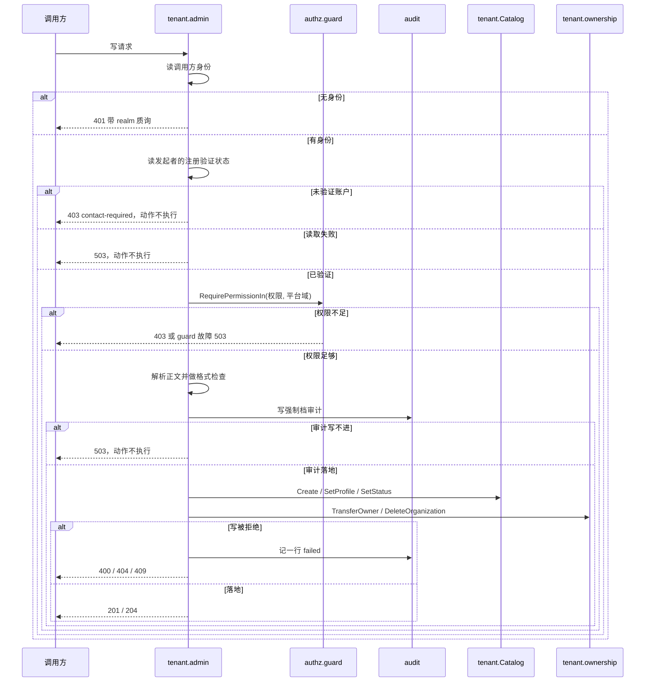

# tenant.admin

本[模块](../../../glossary.md)是租户名册的 HTTP 提供者，提供两个面：平台管理面挂在 `/api/v1/system/tenants` 下，由平台员工按权限操作；租户面挂在 `/api/v1/tenants/{tenant}` 下，由组织自己的所有者按身份操作组织的交接与终止。它拥有这些路由的判定顺序、视图与拒绝映射，不拥有名册的数据、规则与状态机，也不拥有租户内的账户、成员与角色。读职责清单前应持有的一句话心智模型是：这里每一次请求都翻译成一次 `tenant.Catalog` 调用或一次 `OrganizationWriter` 写，模块自己不做判定之外的事。

## 职责

`tenant.admin` 是租户名册的 HTTP 提供者。平台管理面挂在固定基路径 `/api/v1/system/tenants` 下，租户面挂在固定基路径 `/api/v1/tenants` 下，不交付任何功能接口，只把名册的读写做成路由。平台面的动作分三类：登记经 `tenant.Provisioner` 建立租户、它的所有者与首任管理员；读回、写资料与改状态经 `tenant.Catalog`；转移所有者与删除组织经 `tenant.OrganizationWriter` 写跨存储的事务。租户面只有两个路由，所有者转移与组织删除，调用同一个 `OrganizationWriter` 与同一把租户锁。模块自己不持数据、不持规则：名册由名册模块拥有，本模块只决定谁可以问、答案长什么样。

**本模块是框架为名册提供的那个提供者。** 租户能力本身不提供管理面：名册的写入是它唯一的运维动作，而它交付的是接口与实现，不是 HTTP 路由（[design-tenant](design-tenant.md)）。一个想要名册管理面的宿主把本模块写进命令树，不必自己手写同一组路由、同一套判定与同一条审计前置。它不改变租户能力的立场——`pkg/tenant` 仍不带管理面——只把这一面从「宿主自建」补成「框架提供一个可选用的提供者」（[ADR-admin-tenant](../../../adr/adr-admin-tenant.md)）。

平台路由挂在配置 `tenant.admin.endpoints` 列出的端上，租户路由挂在 `tenant.admin.tenant-endpoints` 列出的端上；两个基路径都不可配置。每条路由按标识寻址，路径里出现的只有租户标识这个自然键。

### 非职责

- **不持有名册。** 名册表、它的迁移与它在内存里的快照归名册模块；本模块不建表、不缓存、不迁移，每个动作都是一次 `tenant.Catalog` 调用。
- **不持有租户的规则。** 标识与名称的取值域判据取自根包的 `tenant.IsIdentifier`，状态的闭集取自根包的 `tenant.Status`，名称冲突与重复登记的判定在名册（`tenant.ErrNameConflict`、`tenant.ErrTenantExists`、`tenant.ErrInvalidTenant`）；本模块只把取值域当格式检查，不重新判断一个标识或一个名称是否合法。
- **不为请求认定租户。** 一条请求属于哪个租户由解析层认定（[design-tenant](design-tenant.md)）；平台面的路由在平台域判定，不读请求解析出的租户，也不写上下文里的租户。租户面的路由由路径里的租户段寻址，判定在租户自己的所有权上，读的是解析层认定的租户标识，不另认定租户。
- **不给自己授予任何权限。** 本模块向进程声明它自己的权限，但把每条路由登记为开放，让中间件把请求放行到 handler，由 handler 在内部判定。
- **不管理租户内的账户、成员与角色。** 账户与成员关系归认证，角色归授权（[design-tenant](design-tenant.md) 的非职责、[design-authz](../design-authz.md)）。
- **不删除其他模块的租户数据，也不提供数据导出与搬迁。** 组织删除写名册的墓碑并清除核心关系；受约束表里的业务数据仍由声明那些表的模块清除，本模块不触碰那些数据，也不提供导出与搬迁（[design-tenant](design-tenant.md)）。

## 外部接口契约

### 登记

`tenant.admin` 不交付任何功能接口（`Provides` 为空）。它 `Requires` 名册功能 `(*tenant.Catalog)(nil)`、handler 内判定 `(*guard.Guard)(nil)`、审计 `(*audit.Audit)(nil)`、注册验证状态读取接口 `(*authn.SignupVerification)(nil)`、写保护 `(*tenant.WriteGuard)(nil)`、首任管理员的建立 `(*tenant.Provisioner)(nil)` 与所有者转移及组织删除 `(*tenant.OrganizationWriter)(nil)`，并可选取 `log.Logger`。名册与 guard 各由唯一模块排他交付，命令的依赖闭包不把它们拉进来，宿主在命令树上写下它们。表态是 `StateEnabled`，永不 `StateAuto`：挂不挂管理面是一个命令树上的决定，不是一个配置能推出的结论。HTTP 入口点与路由声明接口在 `Init` 里取用而非声明——一个挂路由而没有入口点的命令是要在接线期报出的故障，而声明接口的缺席是合法的：没有 gate 时路由不带声明，受守护的端把它们当未声明处理，所以挂这组路由的命令应同时点名授权模块。

**本模块声明静态[特性](../../../glossary.md) `tenant.admin`。** 描述符的 `Resources` 带 `feature.Spec{Name: "tenant.admin"}`；这个特性在场，表示本进程挂出名册管理面的路由（[feature](../design-feature.md)）。`tenant.admin.endpoints` 必填、不接受空清单，挂路由而没有入口点是接线期故障，所以模块进入启用集且进程有路由器时这组路由无条件挂出，声明为静态特性符合架构不变量 18（[architecture](../../architecture.md#架构不变量)）。

### 路由

平台面的基路径是 `/api/v1/system/tenants`，租户面的基路径是 `/api/v1/tenants`。下表是路由的全集（封闭集）：面、方法、路径与每条路由需要的权限或判定。

| 面 | 方法 路径 | 判定 |
|---|---|---|
| 平台 | `GET /api/v1/system/tenants` | `tenant.read` |
| 平台 | `POST /api/v1/system/tenants` | `tenant.manage` |
| 平台 | `GET /api/v1/system/tenants/:tenant` | `tenant.read` |
| 平台 | `PUT /api/v1/system/tenants/:tenant/owner` | `tenant.manage` |
| 平台 | `DELETE /api/v1/system/tenants/:tenant` | `tenant.manage` |
| 平台 | `PATCH /api/v1/system/tenants/:tenant/profile` | `tenant.manage` |
| 平台 | `POST /api/v1/system/tenants/:tenant/status` | `tenant.manage` |
| 租户 | `PUT /api/v1/tenants/:tenant/owner` | 组织所有者 |
| 租户 | `DELETE /api/v1/tenants/:tenant` | 组织所有者 |

平台面的每条路由的动作是一次名册调用、一次组织写或一次资料写；租户面的两条路由是同一对组织写（方法集与各方法的语义见 [design-tenant](design-tenant.md)、[design-tenant-ownership](design-tenant-ownership.md)）：

| 路由 | 动作 |
|---|---|
| `GET /system/tenants` | `List`，列出全部租户，按名称排序 |
| `POST /system/tenants` | `Provisioner`，建立租户、它的所有者与首任管理员；标识由本模块生成 |
| `GET /system/tenants/:tenant` | `Get`，按名称取一个租户 |
| `PUT /system/tenants/:tenant/owner` | `OrganizationWriter.TransferOwner`，转移所有者 |
| `DELETE /system/tenants/:tenant` | `OrganizationWriter.DeleteOrganization`，写墓碑并清核心关系 |
| `PATCH /system/tenants/:tenant/profile` | `SetProfile`，只写四个资料列 |
| `POST /system/tenants/:tenant/status` | `SetStatus`，改一个租户的状态 |
| `PUT /tenants/:tenant/owner` | `OrganizationWriter.TransferOwner`，所有者自己交接 |
| `DELETE /tenants/:tenant` | `OrganizationWriter.DeleteOrganization`，所有者自己终止 |

**平台面的 `:tenant` 段是名称，不是内部标识。** 这组路由不在租户解析层的守护范围内——它们判定在平台域——由本模块在端点边界上注册的一层中间件把名称换成标识：按名册查名称，停用与墓碑都能命中，未知名称由这一层答 404；换好之后各模块的 handler 仍按标识读写，审计行也仍以标识归因。视图与错误文本只出现名称。内部标识不再作为路径或查询值被解析，旧标识路径按不存在处理。**这一层随 `tenant.admin` 装配**：一条命令略去该模块时，其他平台模块的租户寻址路由没有名称解析面，宿主必须把它们与 `tenant.admin` 一起纳入，这是装配约束而不是可选优化。

**登记走 `Provisioner`，一个租户、它的所有者与首任管理员一起建立。** 开一个租户不是一个孤立的插入：租户的创建者是它的所有者，也是它的第一个租户管理员，租户、所有者的名册列、创建者的成员关系与那条绑定必须一同成立。本模块把这件事交给宿主提供的 `tenant.Provisioner`，它按角色 → 授予 → 名册行 → 内置标记 → 创建者的成员关系与绑定的次序写：名册行先于管理员行，失败后留下的是 seed 能对账的租户，内置标记先于管理员行，标记失败时留下的是未冻结的角色而不是半份管理关系。标识以 `personal-` 开头的租户例外：宿主把它当作个人域，它的 `tenant-admin` 不置内置，宿主才能撤销允许集之外的授予。名册行之前失败时它清掉自己写过的策略行，路由答 503 且不留租户；名册行之后失败时租户留在册，路由答 503，绝不报成功——`MarkRoleBuiltin` 失败重试一次，仍失败即返回错误，租户在册而角色未冻结，创建者的成员关系与绑定未写（见「并发与事务边界」的已知限制）。`Create` 以 `ErrTenantExists` 拒绝是例外：那表示另一个副本先登记了同一个标识，该域属于先到者；创建者的成员关系与绑定写在名册行之后，后到的这次尚未写这两行，因而只留下先到者的角色、授予与管理行，既不拆它的策略，也不冻结它的角色。一个已被持有的标识由 `Create` 以 `tenant.ErrTenantExists` 拒绝，本模块把它答成 409。这是 `Create` 与 `Put` 的分工：`Put` 改写既有行，`Create` 只插入、什么也不覆盖（[design-tenant](design-tenant.md)）。创建者的账户标识随 `Tenant.OwnerAccount` 传给 provisioner，名册行因而带着所有者。

**名称创建后不可改。** `Catalog` 不提供改名写，本模块也不提供改名路由；`Put` 的名称必须与既有名称一致。要换一个对外名字，只能新建一个组织并删除旧的。

**所有者转移有两个面，判定分开。** 平台面 `PUT /api/v1/system/tenants/:tenant/owner` 要求平台域的 `tenant.manage`，由平台员工发起；租户面 `PUT /api/v1/tenants/:tenant/owner` 不要求任何权限，只要求调用方是该行的所有者。两个面调用同一个 `OrganizationWriter.TransferOwner` 与同一把租户锁，写的内容与事务边界完全相同。正文给出目标账户。租户面把调用方自己作为预期所有者传入：守卫读到的所有者已因一次更早的转移而改变时，本次转移以 `ErrOwnerChanged` 答 409，不把组织交给别人；平台面不传预期所有者。目标必须是该组织的活跃成员，且目标的账户必须活跃；未持有 tenant-admin 时由 `OrganizationWriter` 授予；原所有者保留成员关系与全部绑定。转移与这些写在同一条事务里。目标不是活跃成员、目标的账户不活跃或墓碑是 409，名册没有该标识是 404。审计动作 `tenant.owner.transfer`，detail 的 `surface` 记下实际经过的面（`platform` 或 `tenant`）。

**组织删除有两个面，判定分开，不新增权限码。** 平台面 `DELETE /api/v1/system/tenants/:tenant` 要求平台域的 `tenant.manage`，由平台员工发起；租户面 `DELETE /api/v1/tenants/:tenant` 不要求任何权限，只要求调用方是该行的所有者。两个面调用同一个 `OrganizationWriter.DeleteOrganization` 与同一把租户锁。所有者不能经平台面通过，除非它同时持有平台域的 `tenant.manage`；平台员工不是所有者时不能经租户面通过。租户面传入的预期所有者是调用方自己，转移抢先时以 `ErrOwnerChanged` 答 409。删前问 `tenant.WriteGuard` 的 `WriteDelete`，受保护的租户答 403 `urn:speed:tenant:protected`。写入是墓碑：状态写成 `deleted`、删除时刻落列，成员关系、绑定、角色与授予在同一条事务里清除；标识与名称留在墓碑上，永不复用。已删除的租户在读取里照常返回 200，只是状态是 `deleted`；对它的资料、状态、转移与删除写一律 409。审计动作 `tenant.delete`，detail 的 `surface` 记下实际经过的面（`platform` 或 `tenant`）。

**资料更新只经过 `SetProfile`。** 正文给出四个资料字段，全部必填，空串清空；标识、名称、所有者、状态与创建时间不在可写集合里。墓碑答 409；越出根包资料的取值域答 400。审计动作 `tenant.profile.update`，detail 带 `surface: platform`。

**状态路由的可写集合是 `active` 与 `disabled`。** 正文给出其中之一，其余取值是本模块拒绝的格式；`deleted` 是终态，不在可写集合里。登记的新租户起于 `active`：登记的正文给出标识与名称，状态不在这里给。改状态与资料更新遇到已删除的租户，由名册以 `tenant.ErrTenantDeleted` 拒绝，本模块答 409。

**受保护的租户拒绝停用与删除。** 状态路由在一次停用的格式检查之后、审计之前问 `tenant.WriteGuard`；删除路由同样在审计之前问 `tenant.WriteGuard` 的 `WriteDelete`。答复为拒绝时答 403 `urn:speed:tenant:protected`，动作不执行。`system` 租户与个人租户由宿主的实现声明为受保护（[design-tenant](design-tenant.md) 的写保护）。启用不是受写保护的写操作，不经过它。

### 访问控制

**判定由本模块在 handler 内做出，不经请求中间件的声明判定。** 管理面路由在中间件的声明表里全部登记为开放，好让中间件把请求放行到 handler；handler 先读调用方的身份，再经 `authz.guard` 的 handler 内判定 API 就这条路由的权限问一句，不足即回绝。模块不给自己授予任何权限。

**判定顺序固定，写与读在判定之后分支。** handler 先读调用方：请求没有身份是 401，只有状态、没有 `Type`，并带与准入层、授权层一致的 realm 质询，不询问 guard 即返回。写路由随后读发起者的注册验证状态（见下），再向 guard 要本条路由的权限：不足即由 guard 写出它自己的拒绝——拒绝 403、故障 503——并返回。判定之后才分支：写解析正文、跑本条路由的格式检查、落强制档审计、调名册；读调名册并应答。

**注册验证状态的门控在权限判定之前。** 写路由（登记、转移、删除、资料与改状态）在读完调用方身份之后，在权限判定、解析正文与落强制档审计之前，读发起者的注册验证状态（`authn.SignupVerification.SignupStateOf`）：发起者视为未验证（`SignupPending`：有邮箱而没有一条已证明的）时答 403 `contact-required`（`authn.ErrContactRequired`），动作不执行；服务账户与没有任何邮箱的账户（`SignupNone`）豁免，读路由不受这条门控影响。判据与账户怎么创建无关，管理员预置与导入的发起者带着未证明邮箱时同样被拦。读取状态失败答 503，不按放行处理。门控只收紧、不放行：它只多拒绝一类发起者，不改变权限判定本身，也不让任何未通过权限判定的请求通过。门控在服务端执行，不依赖前端的入口隐藏。

**平台面的判定在平台域做出。** 名册是平台资产，不是某个租户的，所以一次平台名册操作是平台操作；handler 经 `RequirePermissionIn(c, perm, authz.PlatformDomain)` 显式指定平台域判定。若按请求解析出的租户判定，一个在某租户获授权的调用方就能靠请求头触到整个名册。**枚举也是平台操作**：`List` 读的名册表不是受租户约束的表，它本就在过滤之外，所以列出全部租户是一次平台域的读，不是一次跨租户读——它不建跨租户上下文，也不要求跨租户的权限。按 [ADR-http-api-path-scopes](../../../adr/adr-http-api-path-scopes.md) 的判据，名册平台路由虽然按租户寻址（`/api/v1/system/tenants/{tenant}`），但判定在平台域，因此留在 `tenant.resolve` 与 `tenant.admission` 两层之外，不挂在它们所守的端上。

**租户面的判定是所有者身份，不是权限码。** 租户面的两条路由挂在 `tenant.resolve` 与 `tenant.admission` 所守的端上，由 `speedhttp.TenantAdminRouteGuard` 先把路径里的租户段与请求解析出的租户核对一致并拒绝平台域，再由本模块读调用方身份：调用方的账户标识必须等于该行的 `OwnerAccount`，否则答 403。平台员工若不是所有者，同样答 403；所有者不需要任何平台权限。租户面不向 guard 询问权限，也不在平台域判定。

**平台面的删除不再有所有者分支。** `DELETE /api/v1/system/tenants/:tenant` 只按平台域的 `tenant.manage` 判定；一个所有者没有该权限时在这一面答 403，必须走租户面。两面的写与锁完全相同。

**每次写强制档审计，落在动作之前、事务之外。** 写路由在调名册或组织写之前写一行强制档审计；审计写不进则应答 503 且动作不执行。写被拒绝时再尽力写一行 `failed`，与允许行以动作标识关联，它自己的失败只记 Error，不改变应答。登记、转移、删除、资料与改状态各是一行强制档审计；转移与删除的 detail 带 `surface`，记下请求实际经过的面（`platform` 或 `tenant`），资料更新写 `surface: platform`。读路由不写审计行。本模块自己不开事务：资料与状态在名册自己的句柄上写，转移与删除的事务由 `OrganizationWriter` 打开。

### 视图

**读的应答是 200 加一份视图，登记写的应答是 201 加一条记录视图，其余落地的写是 204 无正文。** 视图逐字段从根包的 `tenant.Tenant` 构造，从不把值原样交给客户端，记录日后新增一个字段，不会因为它存在就出现在应答里。租户视图的字段：`name`、`displayName`、`description`、`contactEmail`、`website`、`ownerAccount`、`status`（`active`、`disabled` 或 `deleted`，由 `tenant.Status` 的字符串形式给出）、`createdAt`、`kind`（`business` 或 `personal`，由宿主的 `tenant.KindResolver` 给出，缺席时按 `business`），以及 `disabledBy`（`operator` 或 `account`，由 `tenant.DisabledBy` 的字符串形式给出，只在状态是 `disabled` 时出现）。视图不带内部标识。四个资料字段为空串时照常出现，视图不隐藏它们；创建时间每一行都有，不是可空字段。`ownerAccount` 是名册行的所有者列，原样给出账户标识；平台自身的租户没有所有者，该字段是空串但仍出现。

**所有者只在这一个平台视图和租户资料视图上出现，成员可读的视图都不带它。** 成员列表携带成员关系自身的事实与角色，本人租户视图携带成员自己的 `name` 与 `kind`，两者的租户都以名称出现，也都没有所有者字段。租户资料视图经 `tenant.profile.read` 读取，见 [tenant-profile](design-tenant-profile.md)；成员列表与本人租户视图的边界分别在 [authn.admin](../authn/design-authn-admin.md) 与 [tenant](design-tenant.md) 的本人租户读取。

已删除的租户在读取里照常返回 200，视图的 `status` 是 `deleted`，资料字段与创建时间原样返回；资料、状态、转移与删除写对它是 409。

列出全部租户的应答是 200 加全部租户的视图，按名称排序。名册是一个部署所服务的租户集合，不分页。

### 宿主可见的接口

以下是宿主写进配置文件、或在命令树与网关上点名的接口。

- **模块名**：`tenant.admin`。宿主的命令树点模块名纳入，配置命名空间取同一取值。
- **配置命名空间与输入项**：`tenant.admin` 下的 `endpoints`（字符串列表，必填，无缺省，只收具体端名、不收 `*`，取主配置源）与 `tenant-endpoints`（字符串列表，只收具体端名，缺省 `["api"]`，取主配置源）。
- **管理端点**：`tenant.admin.endpoints` 列出的端承载 `/api/v1/system/tenants/*` 下的平台名册读写路由；`tenant.admin.tenant-endpoints` 列出的端承载 `/api/v1/tenants/{tenant}/*` 下的所有者路由，这些端必须同时装配租户解析与租户管理路由守卫（`speedhttp.TenantAdminRouteGuard`，由 `tenant.resolve` 交付）。
- **权限**：平台面读路由询 `tenant.read`，写路由询 `tenant.manage`；租户面不问权限，按所有者身份判定。本模块的权限经 `authz.PermissionSpec` 进入进程目录、经 `authz.TranslationSpec` 进入进程翻译（`tenant.read` 译成 `(tenant, read)`、`tenant.manage` 译成 `(tenant, manage)`）。
- **问题应答**：`Problem.Type` 前缀 `urn:speed:tenant:`，其下的码 `bad-request`、`conflict`、`protected`。写路由另在发起者为未验证账户时答 403 `contact-required`，这个码不属于该前缀。

### 对外接口

- 模块名 `tenant.admin`、配置键 `tenant.admin.endpoints` 与 `tenant.admin.tenant-endpoints`、平台面与租户面路由的路径与判定（平台读询 `tenant.read`、写询 `tenant.manage`；租户面按所有者身份判定），以及权限常量 `tenant.read`、`tenant.manage` 与 `Problem.Type` 前缀 `urn:speed:tenant:` 及其下的码（`bad-request`、`conflict`、`protected`），是本模块对宿主的接口。写路由在发起者为未验证账户时答 403 `contact-required`，同样是接口。改动它们是宿主可见的破坏性变更。
- 租户视图的字段名（`name`、`displayName`、`description`、`contactEmail`、`website`、`ownerAccount`、`status`、`createdAt`、`kind`、`disabledBy`）与容器形态是应答结构：宿主与前端据此读应答。`status` 的取值集合与 `disabledBy` 的取值集合同样是应答结构。
- 特性名 `tenant.admin`。前端经生成的特性名类型引用它，改名或撤去是宿主可见的破坏性变更。
- 本模块可替换、可撤掉，不改变调用方或名册的代码。

## 依赖

| 依赖 | 用途 |
|---|---|
| `pkg/tenant` | `tenant.Catalog`（名册的读写接口）、`tenant.Tenant`、`tenant.ID`、`tenant.IsIdentifier`、`tenant.Status`、写保护 `tenant.WriteGuard`、首任管理员建立 `tenant.Provisioner`、所有者转移与组织删除 `tenant.OrganizationWriter` 与哨兵 `tenant.ErrTenantExists`、`tenant.ErrNameConflict`、`tenant.ErrInvalidTenant`、`tenant.ErrOwnerNotMember`、`tenant.ErrOwnerChanged` |
| `pkg/authz`、`pkg/authz/guard` | 权限声明与翻译（`authz.PermissionSpec`、`authz.TranslationSpec`）、handler 内判定（`guard.Guard.RequirePermissionIn`）、平台域 `authz.PlatformDomain`、路由声明接口 `authz.Gate` |
| `pkg/audit` | 强制档审计 |
| `pkg/authn` | 读请求上的身份（`authn.FromContext`）与发起者的注册验证状态（`authn.SignupVerification.SignupStateOf`） |
| `pkg/http` | 路由挂载与问题应答（`speedhttp.Router`、`speedhttp.Fail`、`speedhttp.Problem`） |
| `pkg/config` | 声明本模块的输入项 |
| `pkg/core` | 模块描述符与功能取用 |
| `pkg/feature` 根包 | 声明静态特性（`feature.Spec`）；根包只依赖标准库 |
| `pkg/log` | 可选：记诊断 |

**本模块可撤掉，不改变调用方或名册的代码。** 它 import `pkg/authz`、`pkg/audit`、`pkg/authn`、`pkg/http` 来挂一条受保护的管理面，是租户能力目录里唯一这样做的一层；名册与解析本身不因它背上这些依赖。这一形态与 `sms.admin` 相同（[design-sms](../design-sms.md)）。

**依赖方向满足架构的不变量。** `pkg/tenant` 根包只依赖标准库，不 import `pkg/authz`（[design-tenant](design-tenant.md)）；本模块 import `pkg/tenant` 的根包与 `pkg/authz`，而 `pkg/authz` 也 import `pkg/tenant` 的根包，这不构成环——判据是 `pkg/tenant` 根包不 import `pkg/authz`。本模块落在依赖图的上层，是一个叶子。

## UML 图

本模块不持状态、不做判定之外的分支，它的结构是一串跨模块的调用。图固定一次平台面写路由的操作序：读调用方 → 读注册验证状态 → 向 guard 要权限 → 解析正文与格式检查 → 落强制档审计 → 调名册 → 映射拒绝。图上看不出的是这些约束：平台面的判定在**平台域**做出，不是请求解析出的租户；写路由在权限判定之前、审计之前读发起者的注册验证状态，**未验证账户答 403 `contact-required`、读取失败答 503**，动作都不执行，门控只收紧、不放行；审计落在**动作之前、事务之外**，写不进即 503 且动作不执行；guard 的拒绝（403）与故障（503）由 guard 自己写出，本模块不重写；名册的拒绝经本模块的封闭映射变成 400／404／409，其余失败落 503。读路由在「向 guard 要权限」之后直接调名册，不经正文、审计与写路径。租户面的两条写路由走同一张图，只把「向 guard 要权限」换成「读名册并比对所有者身份」：路径里的租户已由 `TenantAdminRouteGuard` 核对，调用方不是该行所有者即答 403，是所有者则继续解析正文、落审计、调 `OrganizationWriter`。

## 核心数据结构

模块不持数据，只有路由与它的正文以及交出的视图。

| 概念 | 结构 | 说明 |
|---|---|---|
| 租户视图 | `{name, displayName, description, contactEmail, website, ownerAccount, status, createdAt, kind, disabledBy?}` | 从 `tenant.Tenant` 逐字段构造，内部标识不出现；`ownerAccount` 是名册行的所有者列，没有所有者时为空串；`status` 是 `active`、`disabled` 或 `deleted`；`kind` 是 `business` 或 `personal`；`disabledBy` 是 `operator` 或 `account`，只在状态为 `disabled` 时出现 |
| 登记正文 | `{name, display_name, description?, contact_email?, website?}` | `POST /tenants` 的正文；标识由服务端生成，正文不收它；新租户起于 `active`，创建者是所有者 |
| 资料正文 | `{display_name, description, contact_email, website}` | `PATCH /tenants/:tenant/profile` 的正文；四个字段全部必填，空串清空 |
| 转移正文 | `{account}` | `PUT /tenants/:tenant/owner` 的正文；目标必须是活跃成员 |
| 状态正文 | `{status}` | `POST /tenants/:tenant/status` 的正文；取值闭集 `active`、`disabled` |

视图与正文都是本模块自己的类型，不是根包的 `tenant.Tenant`：`Tenant` 是名册上的一行（含状态枚举），而交出去的是它的字符串化视图、收进来的是校验过的结构。

## 核心算法与流程

### 走查

初始状态：名册里没有标识 `acme`，授权表里也没有这个租户的角色与授予；调用方是已通过注册验证、在平台域持有 `tenant.manage` 的账户。

1. 调用方发 `POST /api/v1/system/tenants`，正文为 `{name: "acme", display_name: "Acme"}`。handler 依次读身份、读注册验证状态、向 guard 要权限，均通过。
2. 格式检查通过之后、动作之前，handler 写一行强制档审计，动作标识为 `tenant.create`。持久状态：审计表多一行，名册与授权表未变。
3. handler 调 `Provisioner.Provision`，交出的记录带创建者的账户标识作为所有者。它按角色 → 授予 → 名册行 → 内置标记 → 创建者的成员关系与绑定的次序写：角色与授予先落，随后名册表里出现 `acme` 这一行（状态为在册、所有者是创建者），随后该角色被置上内置标记，最后创建者的成员关系与绑定落行。名册行之前失败时，它清掉自己写过的策略行，路由答 503，名册里不留租户；名册行之后失败时，租户留在册，路由答 503。
4. 全部成功时 handler 答 201 与租户视图。持久状态：名册里一行在册的 `acme`，它的首任管理员角色已冻结，创建者的成员关系与绑定已在。
5. 标识已被占用时 `Create` 报 `ErrTenantExists`，handler 答 409；持久状态仍是先到者的那一行，后到的这次没有写成员关系与绑定。

`personal-` 开头的标识是宿主的个人域，它的 `tenant-admin` 不置内置标记；走查里的内置标记只对非个人租户成立。

### 一次管理请求

一次管理请求的操作序固定（细节见「访问控制」）：读调用方（无身份 401）→ 写路由读发起者的注册验证状态（未验证账户即 403 `contact-required`，读取失败即 503）→ 向 guard 要本条路由的权限（不足由 guard 写出 403／503）→ 判定之后写与读分支：写解析正文并做格式检查（格式不符即 400），再落强制档审计（落不进即 503、动作不执行），再调名册，把名册的回绝映射成应答；读直接调名册并应答。

### 判定在平台域做出

一次名册操作是平台操作，handler 经 `RequirePermissionIn` 显式指定 `authz.PlatformDomain`。判定的主体是调用方的生效账户 `Identity.Account()`、域是平台域、资源与动作由权限经进程翻译给出（`tenant.read` → `(tenant, read)`，`tenant.manage` → `(tenant, manage)`）。不按请求解析出的租户判定：否则一个在某租户获授权的调用方靠一个请求头就能触到整个名册。

### 登记

1. 读发起者的注册验证状态：视为未验证（`SignupPending`）时答 403 `contact-required`，读取失败答 503，动作不执行。
2. 格式检查：`id` 与 `name` 都要落在 `tenant.IsIdentifier` 的取值域内，否则 400。
3. 落强制档审计（动作 `tenant.create`）。
4. `Provisioner.Provision(Tenant{ID: id, Name: name, Status: tenant.StatusActive, OwnerAccount: 发起者的账户标识}, 发起者的账户标识)`。
5. `ErrTenantExists` → 409；`ErrNameConflict` → 409；其余 → 503。落地 → 201 加视图。

### 转移所有者

平台面：

1. 读发起者的注册验证状态：视为未验证（`SignupPending`）时答 403 `contact-required`，读取失败答 503，动作不执行。
2. 向 guard 要平台域的 `tenant.manage`。
3. 路径的名称已由边界层解析（未知名称已答 404）；格式检查：正文的 `account` 是一个账户标识，否则 400。
4. `Catalog.Get(id)`；名册不持有该标识 → 404；墓碑 → 409。
5. 落强制档审计（动作 `tenant.owner.transfer`，detail 带 `surface: platform`）。
6. `OrganizationWriter.TransferOwner(id, account, "")`。它取租户锁，校验目标是活跃账户与活跃成员，在一条事务里授予 tenant-admin、写所有者；原所有者保留成员关系与全部绑定。
7. `ErrOwnerNotMember`、`ErrOwnerInactive`、`ErrTenantDeleted` → 409；其余 → 503。落地 → 204。

租户面：

1. `TenantAdminRouteGuard` 核对路径租户与解析租户一致并拒绝平台域。
2. 读调用方身份与注册验证状态；视为未验证时答 403 `contact-required`。
3. 读名册；调用方不是该行 `OwnerAccount` → 403。
4. 格式检查：正文的 `account` 是一个账户标识，否则 400。
5. `Catalog.Get(解析出的租户)`；墓碑 → 409。
6. 落强制档审计（动作 `tenant.owner.transfer`，detail 带 `surface: tenant`）。
7. `OrganizationWriter.TransferOwner(id, account, 调用方)`，与平台面同一个调用，预期所有者是调用方自己；拒绝映射相同，守卫读到的所有者已变时以 `ErrOwnerChanged` 答 409。

### 组织删除

平台面：

1. 读发起者的注册验证状态：视为未验证（`SignupPending`）时答 403 `contact-required`，读取失败答 503，动作不执行。
2. 向 guard 要平台域的 `tenant.manage`。
3. 路径的名称已由边界层解析（未知名称已答 404）。
4. `Catalog.Get(id)`；名册不持有该标识 → 404；墓碑 → 409。
5. 问 `tenant.WriteGuard` 的 `WriteDelete`；拒绝答 403 `urn:speed:tenant:protected`，读取失败答 503。
6. 落强制档审计（动作 `tenant.delete`，detail 带 `surface: platform`）。
7. `OrganizationWriter.DeleteOrganization(id, "")`。它取租户锁，在一条事务里写墓碑、清策略、清成员关系。
8. `ErrTenantDeleted` → 409；其余 → 503。落地 → 204。

租户面：

1. `TenantAdminRouteGuard` 核对路径租户与解析租户一致并拒绝平台域。
2. 读调用方身份与注册验证状态；视为未验证时答 403 `contact-required`。
3. 读名册；调用方不是该行 `OwnerAccount` → 403。
4. `Catalog.Get(解析出的租户)`；墓碑 → 409。
5. 问 `tenant.WriteGuard` 的 `WriteDelete`；拒绝答 403 `urn:speed:tenant:protected`。
6. 落强制档审计（动作 `tenant.delete`，detail 带 `surface: tenant`）。
7. `OrganizationWriter.DeleteOrganization(解析出的租户, 调用方账户标识)`；转移抢先时以 `ErrOwnerChanged` 答 409。落地 → 204。

### 资料更新

1. 读发起者的注册验证状态：视为未验证（`SignupPending`）时答 403 `contact-required`，读取失败答 503，动作不执行。
2. 路径的名称已由边界层解析（未知名称已答 404）；格式检查：正文四个字段都存在并落在根包资料的取值域内，否则 400。
3. `Catalog.Get(id)`；名册不持有该标识 → 404；墓碑 → 409。
4. 落强制档审计（动作 `tenant.profile.update`，detail 带 `surface: platform`）。
5. `Catalog.SetProfile(id, profile)`；失败按名册的哨兵映射，其余 → 503。落地 → 200 加视图。

### 改状态

1. 读发起者的注册验证状态：视为未验证（`SignupPending`）时答 403 `contact-required`，读取失败答 503，动作不执行。
2. 路径的名称已由边界层解析（未知名称已答 404）；格式检查：正文的 `status` 是 `active` 或 `disabled`，否则 400。
3. 停用时问 `tenant.WriteGuard`；答复为拒绝时答 403 `urn:speed:tenant:protected`，动作不执行；读失败答 503。
4. 落强制档审计（动作 `tenant.status`）。
5. `Catalog.SetStatus(id, 状态)`；`ErrInvalidTenant`（标识无名册行）→ 404；`ErrTenantDeleted`（该租户是墓碑）→ 409；其余 → 503。落地 → 204。

## 错误与失败语义

**回绝映射是封闭的、fail-closed 的。** handler 不把任何名册失败原样透给调用方，也不让一个映射不到的失败落成成功。

| 情形 | 表现 |
|---|---|
| 请求在格式上不可读（路径参数或正文）、状态取值不在闭集、正文携带未声明的字段、名称越出取值域 | 400（`Problem.Type` 为 `urn:speed:tenant:bad-request`），在调名册之前 |
| 名称被别的租户持有 | 409（`urn:speed:tenant:conflict`），名册报 `tenant.ErrNameConflict` |
| `GET`／`PATCH`／`PUT`／`DELETE`／状态路由点名一个名册不持有的名称 | 404，不带 `Problem.Type` |
| 资料、转移、删除或改状态点名一个已删除的租户 | 409（`urn:speed:tenant:conflict`），名册报 `tenant.ErrTenantDeleted` |
| 转移的目标不是活跃成员，或不是账户标识 | 409（`urn:speed:tenant:conflict`），组织写报 `tenant.ErrOwnerNotMember` |
| 转移的目标账户不存在、停用或删除 | 409（`urn:speed:tenant:conflict`），组织写报 `tenant.ErrOwnerInactive` |
| 所有者发起的转移或删除观察到所有者已变 | 409（`urn:speed:tenant:conflict`），组织写报 `tenant.ErrOwnerChanged` |
| 平台面删除的调用方没有平台域的 `tenant.manage`，或租户面的调用方不是组织所有者 | 403 |
| 发起者视为未验证（`SignupPending`），而这是写路由 | 403 `contact-required`（`authn.ErrContactRequired`），动作不执行 |
| 状态路由停用或删除路由删除一个受保护的租户 | 403（`urn:speed:tenant:protected`），`WriteGuard` 答复拒绝，动作不执行；读失败答 503 |
| 注册验证状态读取失败 | 503，动作不执行，成因只进日志 |
| 强制档审计写不进 | 503，动作不执行 |
| 名册的其余失败、guard 的故障 | 503，不带 `Problem.Type`，成因只进日志 |

**403 与 401 由别处写，注册验证门控的 403 除外。** 权限不足的 403 与 guard 故障的 503 由 guard 写出（[design-authz](../design-authz.md)）；无身份的 401 由本模块写出，与准入层、授权层一致（只有状态、无 `Problem.Type`、带 realm 质询）。本模块不重写它们；注册验证门控的 403 `contact-required` 由本模块在 handler 内写出，是它自己的拒绝。

## 并发与事务边界

- 模块不持状态，可被多个协程并发使用。
- **资料与改状态的竞争由名册自己在写入时仲裁。** 一次资料更新只写四个资料列，一次改状态只写状态两列，两者都不读整行再写回；两个副本同时改同一行时后写者生效，`ErrInvalidProfile` 与 `ErrTenantDeleted` 由名册在写入时判定。
- **转移与删除的事务和各存储属于自己的写分开。** 这两个动作由 `OrganizationWriter` 开一条事务并取租户锁；本模块在动作之前写的强制档审计不在那条事务里。一次转移与一次所有者发起的删除并发时，锁把两者排成先后，只有一方生效（[design-tenant-ownership](design-tenant-ownership.md) 的并发与事务边界）。
- **创建不是跨模块原子的，名册行之后的失败留下一个未冻结的角色。** `Provisioner` 按角色、授予、名册行、内置标记、创建者成员关系与绑定的次序写，名册行之后的任一步失败都不回滚名册行，路由答 503。`MarkRoleBuiltin` 失败重试一次；仍失败时租户在册、角色未冻结、创建者的成员关系与绑定未写。名册行之后的失败留下一个角色未被冻结的租户；下一次部署的 seed 会修复它；在那之前该角色照常生效，理论上只有管理面能碰到它，而这落在安全的一侧。seed 在每次运行对账名册里每个非个人租户的角色、授予与内置标记；成员关系与绑定只对 `seed.tenants[].admins` 点名的管理员对账。
- **资料、状态与登记的事务在名册自己的句柄上。** 本模块不为它们开事务；一次动作是一次 `tenant.Catalog` 或 `Provisioner` 调用，调用方的事务无处合并（[design-tenant](design-tenant.md)）。转移与删除的事务由 `OrganizationWriter` 开。
- 强制档审计落在任何事务之外，且在动作之前：审计不落则动作不执行，所以一次被审计拦下的写什么都没改。
- **名称不是名册的一个写接口，资料与所有者的写也只动自己的列。** `Put` 携带另一个名称时以 `ErrInvalidTenant` 拒绝，`Create` 只在插入时写名称；`SetProfile` 只写四个资料列，`SetOwner` 只写所有者一列，`Put` 整行写入的形态在这里不可用（见「登记走 `Create`」与 [design-tenant](design-tenant.md) 的写接口）。

## 实现状态

| 能力 | 状态 | 代码 |
|---|---|---|
| 管理面 `tenant.admin`（路由、判定、审计、回绝映射） | 已实现 | `pkg/tenant/admin/admin.go` `Module`；`pkg/tenant/admin/routes.go` `routes`、`tenantRoutes`、`mount`；`pkg/tenant/admin/tenants.go` `handleTenantList`、`handleTenantGet`、`handleTenantCreate`、`handleTenantTransferOwner`、`handleTenantDelete`、`handleTenantSetProfile`、`handleTenantSetStatus`、`handleTenantOwnerTransfer`、`handleTenantOwnerDelete`；`pkg/tenant/admin/pipeline.go` `guardRoute`、`guardOwnerRoute`、`auditRequired`、`failureOf` |
| 所有者转移与组织删除的平台路由，以及租户面的所有者路由 | 已实现 | `pkg/tenant/admin/routes.go` `routes`、`tenantRoutes`；`pkg/tenant/admin/tenants.go` `handleTenantTransferOwner`、`handleTenantDelete`、`handleTenantOwnerTransfer`、`handleTenantOwnerDelete`；`pkg/tenant/admin/pipeline.go` `guardOwnerRoute`；`pkg/tenant/admin/ownership_test.go` |
| 管理面 `tenant.admin` 的 operation 声明、`speedhttp.Spec` 资源与片段生成 | 已实现 | `pkg/tenant/admin/operations.go`；`pkg/tenant/admin/openapi_generated_test.go`；片段 `pkg/tenant/admin/openapi/tenant.admin.json` |
| 静态特性 `tenant.admin` 的 `feature.Spec` 声明 | 已实现 | `pkg/tenant/admin/admin.go` `Module`；`pkg/tenant/admin/feature_test.go` `TestTheModuleDeclaresTheTenantAdminFeature` |
| 租户写接口的注册验证门控（视为 `SignupPending` 时答 403 `contact-required`，经 `SignupVerification.SignupStateOf` 读取） | 已实现 | `pkg/tenant/admin/pipeline.go` `(*product).guardRoute`、`(*product).requireVerifiedAccount`；`pkg/tenant/admin/routes.go` `routes`；`pkg/tenant/admin/gate_test.go` |
| 登记经 `tenant.Provisioner` 建立租户与它的首任租户管理员 | 已实现 | `pkg/tenant/admin/tenants.go` `handleTenantCreate`；`pkg/tenant/admin/admin.go` `Module`；`pkg/tenant/protection.go` `Provisioner` |
| 状态与删除路由经 `tenant.WriteGuard` 拒绝受保护租户（`system`、个人租户） | 已实现 | `pkg/tenant/admin/tenants.go` `handleTenantSetStatus`、`handleTenantDelete`；`pkg/tenant/admin/admin.go` `Module`；`pkg/tenant/protection.go` `WriteGuard`、`WriteOp` |
| 租户视图的 `deleted` 状态、资料字段与 `disabledBy` 字段，以及墓碑上的写拒绝 | 已实现 | `pkg/tenant/admin/views.go` `tenantViewOf`；`pkg/tenant/admin/pipeline.go` `failureOf`；`pkg/tenant/admin/tenants_test.go` `TestTheViewCarriesTheNamedFieldsPerState`、`TestTheFailureMappingIsClosed` |
