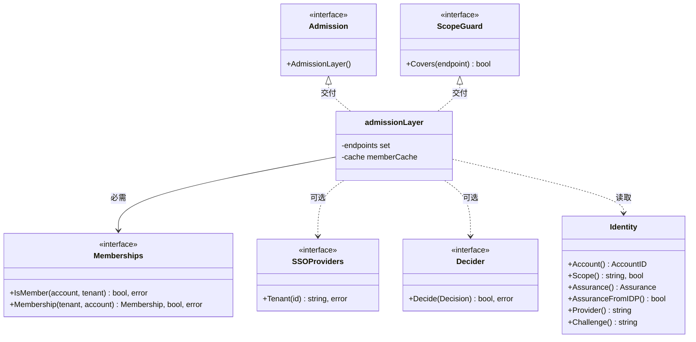
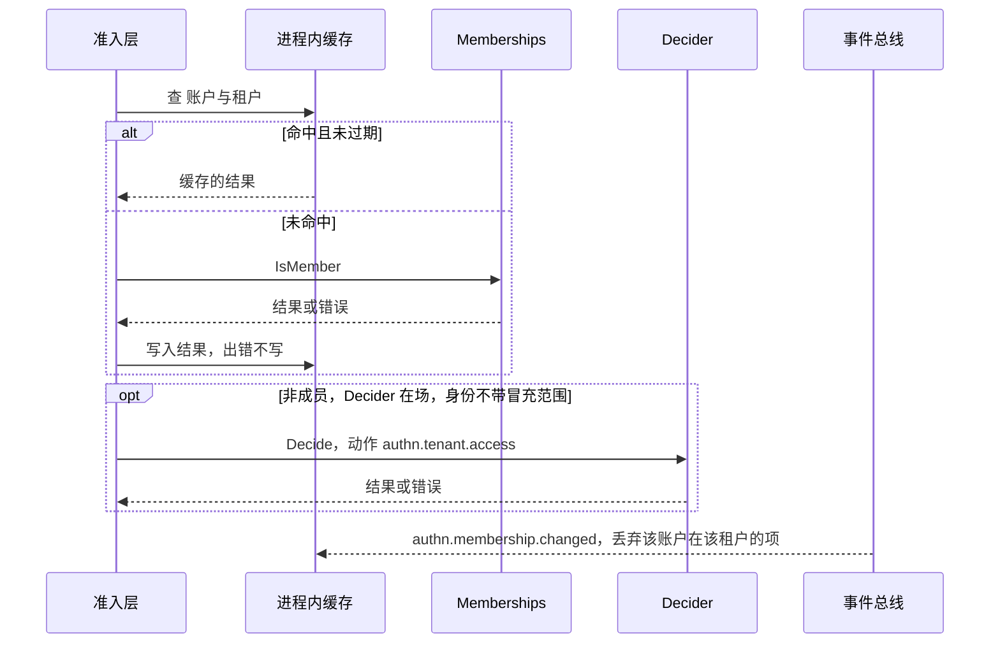
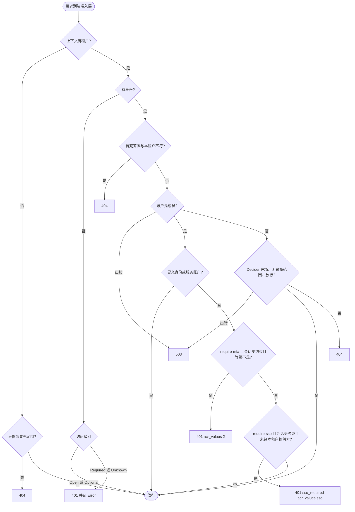

# tenant-admission

本[模块](../../../glossary.md)是租户能力的准入层，位置在请求链的授权阶段：身份与租户都已认定之后，它判定这个身份能否进入这个租户，并执行租户的认证强度要求与冒充范围。它拥有成员准入、强度判定、冒充范围核对与 `authn.ScopeGuard`，不拥有身份认定、成员关系存储与租户解析。读职责清单前应持有的一句话心智模型是：上游给的是“谁”与“哪个租户”，本层只回答“让不让进”。

第一遍的次序是职责与非职责、术语表、外部接口契约、依赖与 UML 图、核心数据结构与核心算法与流程：职责与非职责给出边界，术语表固定所守的端与有效保障等级，外部接口契约按“哪些路由落在所守的端上”“登记单元与名字”“交付的功能”“链上的位置”“请求期的应答”“配置与设置”逐节展开，依赖与 UML 图给出读取的接口与缓存失效路径；核心数据结构之后是核心算法与流程，判定次序是全文的主干。错误与失败语义、并发与事务边界属查阅用，非保证、威胁与对策与竞态情形是最后的自检项；扩展点与实现状态在主体之后回看。

## 职责

本文承载租户准入层 `tenant.admission`，包 `pkg/tenant/admission`：在已识别身份且已解析租户的请求上，判定该身份是否获准进入这个租户。身份由 `pkg/authn` 根包定义，租户上下文由 `pkg/tenant` 根包定义，判定所需的身份与租户上下文分属 `pkg/authn` 与 `pkg/tenant` 两个目录，准入层放在 tenant 目录并经认证根包的接口读成员关系，依赖方向仍是 tenant 指向 authn（[ADR-tenant-admission](../../../adr/adr-tenant-admission.md)）。

- 判定身份是否是请求所在租户的成员。成员关系的事实读自 `authn.Memberships`；静态口令表主体没有成员关系行，不是任何租户的成员。
- 就非成员询问判定接口：不带冒充范围的非成员可经 `Decider` 的 `authn.tenant.access` 动作放行，缺省拒绝（[ADR-authn-decision-seam](../../../adr/adr-authn-decision-seam.md)）。
- 执行租户级的认证强度要求：租户设置 `tenant.admission.require-mfa` 与 `tenant.admission.require-sso`。请求期的准入判定是这类要求对访问的执行点：两项要求都只约束认证时刻不早于起算时刻的会话，更早建立的会话按原强度继续工作，开启策略不使其失效，开启之后的每一次登录都受约束；准入层读取有效值时一并取得起算时刻。登录时认证侧还经本层交付的 `authn.TenantMFARequirement` 读同一份有效值：账户是哪一个租户的成员由账户解析确定，不依赖请求里的范围线索；任一租户要求而账户没有因素时，这次登录只能登记一个因素，登记完成后重证口令并用新因素通过第二因素，登录期间不发放会话。这条登录时判定是“不让下一次登录以低于多因素的强度进来”的前置条件，不替代请求期对既有会话的判定。`tenant.admission.sso-exempt-tenants` 列出的租户不受 SSO 要求约束：该要求问的是“这次会话是不是经本租户自己的身份提供方登录”，而一个没有提供方的租户永远答不出是：平台自己的 `system` 租户就是这种租户，对它执行这条要求会拒绝该租户上的每一个请求，管理后台一并被关掉。成员关系与多因素要求对这些租户照常生效。
- 执行冒充身份的租户范围：身份携带的 `Scope()` 与请求的租户不符，或请求没有租户上下文时拒绝（[ADR-authn-impersonation](../../../adr/adr-authn-impersonation.md)）。
- 交付 `authn.ScopeGuard`：声明自己守哪些端，使网关与 `authn.impersonation` 不 import `pkg/tenant` 即可得知冒充身份能被放进哪些端。
- 交付定序锚点 `(*tenant.Admission)(nil)`：授权功能目录（[authz](../design-authz.md)）与宿主自己的层在授权阶段之内用 `After` 指向它，落在准入层之内。
- 报出每次判定的结果：指标 `tenant.admission.decisions`，以及每次拒绝一行日志。
- 交付 `authn.TenantMFARequirement`：供登录引擎与多因素策略在登录时询问“账户所属的任一租户是否要求多因素”。它读本层已经持有的成员关系与同一份租户设置有效值，不新增存储，也不把登录的推进带回本层。

准入层的判据是判定所需的输入：需要同时读身份与租户上下文的判定归本层；只读凭据与主体来源的归认证；角色与授权归授权功能目录。

本功能目录的整体职责、租户名册与解析层见 [design-tenant](design-tenant.md)；身份、判决与成员关系的结构见 [design-authn](../authn/design-authn.md) 与 [design-authn-account](../authn/design-authn-account.md)。

### 非职责

- **不判定角色与授权，不写 403。** 本模块回答“这个身份能不能进入这个租户”，“进入之后能做什么”归授权功能目录，它另立（[ADR-authn-scope](../../../adr/adr-authn-scope.md)）。
- **不存成员关系，不定义身份。** 成员关系的表与读写接口由 `authn.account` 的 `Memberships` 实现独占（[design-authn-account](../authn/design-authn-account.md)）；准入层只经接口读。
- **不认定凭据，不读 `Authorization`。** 谁是调用方由网关与校验后端认定（[design-authn-gate](../authn/design-authn-gate.md)）；准入层读网关写进上下文的身份与访问级别。
- **不解析租户。** 请求属于哪个租户由 `tenant.resolve` 认定；准入层读 `tenant.FromContext`，不读请求一侧的租户名，也不读名册（[design-tenant](design-tenant.md)）。
- **不登记、不改写、不结束冒充，不核对冒充的发起条件。** 记录与限制归 `authn.impersonation`（[design-authn-impersonation](../authn/design-authn-impersonation.md)）；准入层只比对身份带的范围与请求的租户。
- **不合成保障等级。** 等级只在 `authn.mfa` 一处合成；准入层读身份上已盖章的 `Assurance()` 与 `AssuranceFromIDP()`（[design-authn-mfa](../authn/design-authn-mfa.md)）。
- **不核对网关的挂载端是否落在自己所守的端里。** 这条核对由网关在 `Start` 里经 `ScopeGuard.Covers` 执行（[design-authn-gate](../authn/design-authn-gate.md)）；本模块只核对自己的清单落在解析层清单之内。
- **不核对宿主有没有在所守的端上开租户解析的豁免。** `ScopeGuard.Covers` 只说准入层守哪些端。
- **不约束账户登录。** 强度要求与冒充范围约束的是该租户内的请求；账户全局，仍可登录、仍可访问它所属的其他租户。本层交付的 `authn.TenantMFARequirement` 只把“账户所属租户是否要求多因素”这一事实交给认证侧，登录流程的推进与会话的建立仍归 `authn.login`。
- **不提供判定接口、成员关系或 IdP 登记的默认实现。** `Decider`、`SSOProviders` 缺席时的行为是判定的一部分，写在核心算法与流程。
- **不决定哪条命令纳入准入层。** 模块无从知道自己出现在哪条命令下（[ADR-command-tree](../../../adr/adr-command-tree.md)）。

## 术语表

以下术语的含义限于本文与租户准入的决策记录。

| 术语 | 英文 | 适用范围 | 定义 |
|---|---|---|---|
| 所守的端 | guarded endpoint | 本文与租户准入的决策记录 | `tenant.admission.endpoints` 列出的端点：准入层在这些端上登记了中间件。`ScopeGuard.Covers` 对这些端回答真。 |
| 有效保障等级 | effective assurance | 本文与租户准入的决策记录 | 准入层在比对 `tenant.admission.require-mfa` 时使用的等级，由身份的 `Assurance()` 与 `AssuranceFromIDP()` 导出；规则见“有效保障等级”一节。 |
| 起算时刻 | effective-since instant | 本文与租户准入的决策记录 | 对一项准入策略，使它有效值为真的各层各自那一行的最后写入时刻中最早者；会话的认证时刻不早于它才受该策略约束，规则见“强度要求的起算时刻”一节。 |

## 外部接口契约

### 哪些路由落在所守的端上

一条路由只有在**既按租户寻址**（租户是路径段，不是查询值）、**又由该租户治理**（判定发生在该租户的策略域）时，才落在准入层所守的端上；缺任一条都不落。留在 `/api/v1/system` 下的租户相关接口因此是这条判据的反面例证，不是例外：名册的集合路由（`/api/v1/system/tenants`）不按租户寻址，单行路由（`/api/v1/system/tenants/{tenant}`）与授权（`/api/v1/system/tenants/{tenant}/roles`、`/bindings`）按租户寻址而判定在平台域，路径里的租户是被操作的行数据的标识；冒充记录（`/api/v1/system/tenants/{tenant}/impersonations`）同样按租户寻址，判定在平台域，租户是记录被限定的数据，不是请求的域；审计（`/api/v1/system/audit`）读的是整张表，行上带租户；设置（`/api/v1/system/settings`）的租户层由查询串点名。两者都不按路径段寻址，第一条就不成立。判据是判定域与寻址方式，不是路径里有没有租户；按形式推断会把平台域的租户数据操作误判成租户域。认证功能目录据此把租户管理作用域的路由（成员关系、邀请与 SSO 提供方）挂到 `authn.gate.mount.endpoints.tenants`，并让该端同时出现在本层与解析层的清单里；普通作用域与平台管理作用域的路由不在两层之内。

### 登记单元与名字

| 登记单元 | 模块名 | 交付 | 排他 | `Requires` | 在 `Init` 里取用（缺席合法者标○） |
|---|---|---|---|---|---|
| `pkg/tenant/admission` | `tenant.admission` | `(*tenant.Admission)(nil)`、`(*authn.ScopeGuard)(nil)`、`(*authn.TenantMFARequirement)(nil)` | 三者均是 | `authn.Memberships`、`(*tenant.Resolution)(nil)` | `http.Router`、`authn.SSOProviders`○、`authn.Decider`○、`settings.Store`○、`event.Bus`○、`log.Logger`○、`observability.MeterProvider`○ |

包导出自己的 `ModuleName` 常量，配置命名空间与设置键前缀取同一个取值。`Prepare` 只表态 `StateEnabled`，永不 `StateAuto`：排他加 `StateAuto` 正是消解要禁用的那一格，是否运行是命令树上的决定（[ADR-authn-packaging](../../../adr/adr-authn-packaging.md)）。

`Requires` 里的功能都由别的模块排他交付：依赖闭包不替宿主挑排他提供方；缺任何一个，依赖解析在构造之前以 `core.ErrMissingProvider` 终止。没有成员关系就没有可核对的事实，没有解析层就没有可核对的租户。

### 交付的功能

```go
// pkg/tenant：定序锚点，不是可调用的接口。
type Admission interface{ AdmissionLayer() }

// pkg/authn：冒充范围守卫，由准入层排他交付。
type ScopeGuard interface {
    // Covers 报告 endpoint 是否是准入层所守的端。
    Covers(endpoint string) bool
}

// pkg/authn：登录时的租户多因素要求，由准入层排他交付。
type TenantMFARequirement interface {
    // RequiresMFA 报告账户是否为某个要求多因素的租户的 active 成员。
    RequiresMFA(ctx context.Context, id AccountID) (bool, error)
}
```

交付声明写作 `Provides: []core.Provision{{Token: (*tenant.Admission)(nil), Exclusive: true}, {Token: (*authn.ScopeGuard)(nil), Exclusive: true}, {Token: (*authn.TenantMFARequirement)(nil), Exclusive: true}}`。这些排他性不可局部违反：两层准入同时在链上时，一个请求被谁放行说不清；两个租户多因素要求提供方同时在场时，登录读到哪一个说不清。

`tenant.Admission` 带一个**导出**的标记方法。接口在 `pkg/tenant` 根包、实现在 `pkg/tenant/admission`，别的包的类型无法实现带本包未导出方法的接口，用未导出方法时交付核对必然失败（[ADR-tenant-admission](../../../adr/adr-tenant-admission.md)）。授权功能目录只 import 根包，在授权阶段之内取 `(*tenant.Admission)(nil)` 作 `After` 锚点。

`ScopeGuard.Covers(endpoint)` 报出 `endpoints` 里是否有该端：清单只含具体端名，不含 `*`，所以回答是精确的集合成员判定。使用方：

- `authn.impersonation` 把 `ScopeGuard` 当必需依赖：没有准入层的装配里冒充无法限定在一个租户内，该装配在构造之前以 `core.ErrMissingProvider` 失败（[design-authn-impersonation](../authn/design-authn-impersonation.md)）。
- 网关把 `ScopeGuard` 当可选依赖：冒充身份只被放进准入层所守的端与登记为 `Impersonable` 的路由；网关在 `Start` 里按作用域核对：普通作用域与平台管理作用域的挂载端上 `Covers` 为真即 `ErrInvalidConfig`，租户管理作用域的挂载端（`authn.gate.mount.endpoints.tenants`）上 `Covers` 为假同样终止（[design-authn-gate](../authn/design-authn-gate.md)）。

### 链上的位置

中间件在 `endpoints` 的每个端上登记一层，描述符的 `Provides` 是 `(*tenant.Admission)(nil)`，`Stage` 声明授权阶段（`StageAuthorize`），不带 `After`：跨阶段的位置由阶段顺序给出，不由锚点或 `Order` 表达（[ADR-http-stages](../../../adr/adr-http-stages.md)）。阶段由外到内是观测、防护、鉴别、限流、记录、授权，网关与租户解析在鉴别阶段，限流在限流阶段，审计在记录阶段，准入层所在的授权阶段在它们之内；整条链的阶段与别的层的声明由各自的文档承载（[design-authn](../authn/design-authn.md)）。

非成员的拒绝因此必然进审计、必然计入限流：准入层所在的授权阶段在记录与限流两个阶段之内，位置由阶段顺序给出（[ADR-ratelimit-dimension](../../../adr/adr-ratelimit-dimension.md)）。审计或限流不在这次装配里时，记录或限流阶段上没有层，非成员的拒绝既不进审计也不计入限流。

### 请求期的应答

应答经入口模块的 `Fail` 写出，响应体的结构由入口模块决定（[design-http](../http/design-http.md)）。状态码是下表的封闭集，准入层不写别的：

| 状态码 | 判据 | 说明 |
|---|---|---|
| 404 | 请求不属于这个身份可进入的租户 | 与解析层的 404 一致，只有状态码，不区分原因：“租户不存在”“已停用”“不是成员”“冒充范围不符”读起来相同，所以没有租户枚举预言机 |
| 401 | 缺身份而路由必需认证；或强度要求未满足 | 强度未满足时带加强认证挑战，见下 |
| 503 | 成员核对、`Decider` 或 IdP 归属的读取出错 | 不放行，不当作拒绝 |

强度未满足的 401 头为 `WWW-Authenticate: <Identity.Challenge()> error="insufficient_user_authentication", acr_values="…"`（[REF-rfc9470](../../../references.md)）：`acr_values` 在多因素要求下取 `"2"`，在 SSO 要求下取 `"sso"`。Problem 类型随要求区分：多因素要求写 `urn:speed:authn:insufficient_user_authentication`，SSO 要求写 `urn:speed:authn:sso_required`，使客户端知道本地因素满足不了后一种要求，只有经本租户的提供方重新登录才行。方案名取身份的 `Challenge()`，即网关按凭据载体盖章的那一个。挑战不带 `max_age`：准入层只比对等级与提供方，不含新鲜度要求，没有可填的取值。多因素要求与 SSO 要求的挑战都只发给受该要求约束的会话，即认证时刻不早于起算时刻的那些；更早建立的会话不进入这些判定。账户登记了因素与没有登记因素时收到同一个多因素应答，客户端据此走加强认证或登记；准入层不读因素登记簿，登记与加强认证的端点所在的端不受租户解析守卫，客户端总有路可走（[design-authn-mfa](../authn/design-authn-mfa.md)）。

### 配置与设置

输入项的完整键表、取值域与缺省值只在 [design-authn-config](../authn/design-authn-config.md) 给出；本节写语义。

- **`tenant.admission.endpoints`**（配置，字符串列表）：准入层所守的端。**必填、无缺省、不接受 `*`，空清单是 `ErrInvalidConfig`**（[ADR-tenant-admission](../../../adr/adr-tenant-admission.md)）。清单的结构同 `tenant.resolve.endpoints`，一般与它相同；对 `*` 的处置不同：解析层把 `*` 当作未声明的端名，以 `ErrUnknownEndpoint` 终止，准入层以 `ErrInvalidConfig` 终止。**清单必须是 `tenant.resolve.endpoints` 的子集**：本模块在 `Prepare` 里读对方清单，列出对方不解析的端即 `ErrInvalidConfig`。落在那样的端上的请求没有租户上下文，而本层对非冒充的无租户上下文请求一律放行，成员检查就不会发生；对方清单未写出或未声明时无从比较，那一档由解析层自己的必填与空清单规则处理。清单不得含普通作用域与平台管理作用域的认证挂载端；租户管理作用域的挂载端必须同时在本清单与解析清单里，覆盖关系的核对由网关执行。
- **`tenant.admission.require-mfa`、`tenant.admission.require-sso`**（设置，布尔）：按租户取值，有效值是全局层与租户层的 OR。全局层是平台下限，任一层显式写下真即要求该策略；两层都没有行时取声明的默认值，默认关闭。平台在租户已写下假行之后打开时，OR 让要求继续生效。一项策略的有效值为真时，它的起算时刻取使它为真的各层各自那一行的最后写入时刻中最早者；租户层写下假不移动这个时刻。有效值与起算时刻来自同一次设置读取。
- **`tenant.admission.sso-exempt-tenants`**（配置，字符串列表，可选，缺省为空）：不受 SSO 要求约束的租户标识。名单里的租户仍要过成员关系行与多因素要求，只是不必经本租户的提供方登录。示范装配把平台自己的 `system` 租户写进名单。名单只在列出本模块的端时一并生效；它不改变任何租户对多因素要求的取值。
- **`tenant.admission.check-ttl`**（设置，时长）：成员结果与放行结果在进程内的缓存时长，只读全局层；0 关闭缓存，有上限。

设置对准入层是可选依赖：`settings.Store` 缺席时一律取声明的默认值，行为与默认值下的设置完全一致，只是调不了（[ADR-authn-settings-and-secrets](../../../adr/adr-authn-settings-and-secrets.md)）。放宽方向的取值有被写入接口改动的风险，见威胁与对策。

### 对宿主的要求

- **把 `tenant.admission`、`authn.account`、`tenant.resolve` 与 `tenant.catalog` 的模块名一并写进命令。** 命令缺其一，依赖解析终止启动。
- **`endpoints` 写成业务端，是 `tenant.resolve.endpoints` 的子集，并覆盖租户管理作用域的认证挂载端。** 准入层所守的端上，租户解析豁免的路由没有租户上下文：非冒充身份照常放行，冒充身份得 404。宿主不应在允许冒充的端上对业务路由开租户解析的豁免。认证的租户管理路由挂在 `authn.gate.mount.endpoints.tenants`，该端必须在两份清单里；普通作用域与平台管理作用域的路由不得落在本层所守的端上。
- **对租户与普通管理员不开放 `tenant.admission.*` 设置的写权限。** 设置的写入接口没有访问控制，由宿主自己鉴权（[design-settings](../settings/design-settings.md)）。
- **需要运营账号读租户数据时，经 `authn.tenant.access` 放行，或自写 handler。** 静态口令表主体不是任何租户的成员。
- **装配里要有授权或宿主自己的角色判定。** 准入层之后的权限判定不在本层。

### 对外接口

下列是本模块与其他模块之间的接口：`tenant.Admission` 与 `authn.ScopeGuard` 的结构，模块名与交付标识，`endpoints` 的必填与不接受 `*`，配置键 `tenant.admission.sso-exempt-tenants`，设置键 `tenant.admission.require-mfa`、`require-sso`、`check-ttl`，`Decider` 动作 `authn.tenant.access` 的使用方式，指标名 `tenant.admission.decisions` 与其 Meter（[REF-opentelemetry-go](../../../references.md)）名 `tenant`、属性 `outcome` 的取值，以及应答状态码的封闭集。改名、增减取值或扩大状态码集合是对宿主与授权功能目录的不兼容变更；设置键与指标属性值的变更同时是对运维接口的不兼容变更。

## 依赖

下表是准入层依赖的全部功能与它们的归属（封闭集）。

| 依赖 | 归属 | 用途 | 缺席时 |
|---|---|---|---|
| `authn.Memberships` | `pkg/authn` 根包，`authn.account` 交付 | 成员判定、`sso_exempt` 读取 | 必需，启动失败 |
| `(*tenant.Resolution)(nil)` | `pkg/tenant` 根包，`tenant.resolve` 交付 | 保证租户上下文由解析层写入 | 必需，启动失败 |
| `http.Router` | `pkg/http` | 登记中间件 | `tenant.ErrNoRouter`，启动失败 |
| `authn.SSOProviders` | `pkg/authn` 根包，`authn.sso` 交付 | 提供方所属租户 | 可选，见核心算法与流程 |
| `authn.Decider` | `pkg/authn` 根包，宿主或 `authz.guard` 交付 | `authn.tenant.access` | 可选，非成员一律 404 |
| `settings.Store` | `pkg/settings` | 租户设置与缓存时长 | 可选，取默认值 |
| `event.Bus` | `pkg/event` | 订阅 `authn.membership.changed` | 可选，缓存只靠 `check-ttl` 过期 |
| `log.Logger` | `pkg/log` | 启动诊断 | 可选，不写启动诊断 |
| `observability.MeterProvider` | `pkg/observability` | 指标 | 可选，不报指标 |

**方向满足架构不变量。** 准入层 import `pkg/authn` 根包而不 import `pkg/authn` 的任何子包：`pkg/authn/internal/...` 只能被 `pkg/authn/` 之下的包 import，准入层只经根包导出的接口读身份。`pkg/authn` 的子包不 import `pkg/tenant`，账户、登录、令牌的依赖闭包不含租户；准入层不 import `pkg/db`，成员关系的存取经 `Memberships`。`pkg/tenant` 位于 `pkg/authn` 之上，不被其中任何一个 import；授权功能目录位于准入层之上，只 import `pkg/tenant` 根包取锚点（[architecture](../../architecture.md)）。

## UML 图

下图给出准入层与它读取的接口。图中画不出的约束是归属：`Admission` 在 `pkg/tenant` 根包，别的接口在 `pkg/authn` 根包，`admissionLayer` 未导出，住在 `pkg/tenant/admission`；`Memberships` 与 `Resolution` 是必需依赖，`SSOProviders` 与 `Decider` 缺席合法。



下图给出成员与放行结果的取得与失效。它固定的是读的次序与失效路径：成员结果先读缓存，未命中才读 `Memberships`；`Decider` 只在非成员且身份不带冒充范围时被询问；事件只是让各副本提前丢弃缓存项，放宽的上界仍是缓存时长。



## 核心数据结构

准入层的数据结构都未导出，且只存在于进程内。

| 结构 | 内容 | 说明 |
|---|---|---|
| 所守的端集合 | `endpoints` 展开后的端名集合 | `Prepare` 读定后不变，`Covers` 在它上面做成员判定 |
| 成员条目 | 键（账户标识，租户标识）；值：`IsMember` 的回答、读取时刻 | 条目在读取时刻之后 `check-ttl` 内有效；出错不缓存 |
| 豁免条目 | 同键；值：`Membership` 行上的 `SSOExempt`、读取时刻 | 只在租户要求 SSO 且身份未经本租户的提供方登录时读取 |
| 放行条目 | 同键；值：`Decide` 对 `authn.tenant.access` 的回答、读取时刻 | 只在非成员且 `Decider` 在场、身份不带冒充范围时产生 |
| 判定结果 | 状态与成因类 | 成因类即指标属性 `outcome` 的取值，下表给出 |

指标 `tenant.admission.decisions`（单位 `{decision}`）按 `outcome` 计数，每个到达本层的请求恰计一次。它是名为 `tenant` 的 Meter 上的 `Int64ObservableCounter`：本模块属 `pkg/tenant`，与 authn 各模块的 `authn` Meter 分开命名；用可观察计数器是因为采集时才读本层持有的原子计数，每个 `outcome` 因此从第一次采集起就各有一条序列，同步计数器做不到这一点。`outcome` 的取值是封闭集：

| `outcome` | 含义 |
|---|---|
| `admitted` | 放行：不属租户域的请求、允许匿名的请求、成员且满足强度要求的请求，以及冒充身份与服务账户的放行 |
| `admitted-by-policy` | 非成员经 `Decider` 的 `authn.tenant.access` 放行 |
| `not-member` | 非成员且未经放行，404 |
| `scope-mismatch` | 冒充身份的范围与本租户不符，或冒充身份到了没有租户上下文的路由，404 |
| `step-up-mfa` | 租户要求多因素而有效保障等级不足，401 `insufficient_user_authentication` |
| `step-up-sso` | 租户要求 SSO 而身份未经本租户的提供方登录，401 `sso_required` |
| `no-identity` | 无身份而路由必需认证或访问级别未知，401 |
| `unavailable` | 成员核对、`Decider` 或 IdP 归属读取出错，503 |

## 核心算法与流程

### 判定次序

每个请求按下表自上而下判定，取第一条命中的行，命中即终止；表中的行是封闭的。

| 行 | 条件 | 结果 |
|---|---|---|
| 无租户上下文 | `tenant.FromContext` 取不到租户 | 有身份且 `Identity.Scope()` 有值（冒充身份到了没有租户上下文的路由）：**404**，与解析层一致；否则放行：请求不是租户域的，租户上下文缺席时受约束模型本就会被 db 插件拒绝 |
| 无身份 | 上下文里没有身份 | `AccessFromContext` 为 `Open` 或 `Optional`：放行，路由本来就允许匿名；为 `Required` 或 `Unknown`：**401** 并记 Error，链上没有网关或网关没守这个端是配置缺陷，失败时拒绝 |
| 冒充范围 | `Identity.Scope()` 有值且不等于本租户 | **404**，与解析层的 404 一致，不区分原因 |
| 成员 | `Memberships.IsMember(Account(), 租户)` 为假 | `Decider` 在场且 `Scope()` 为空：询问 `Decide(Decision{Action: ActionTenantAccess, Actor, Tenant})`，为真则终止判定并放行（计 `admitted-by-policy`），否则 **404**；`Decider` 缺席或身份带冒充范围时直接 **404** |
| 成员出错 | `IsMember` 或 `Decide` 返回 error | **503**，不放行 |
| 豁免 | 身份是冒充身份，或 `Methods` 含 `client-secret`（服务账户） | 跳过多因素强度与 SSO 强度的判定 |
| 多因素强度 | `tenant.admission.require-mfa` 的有效值为真（平台层 OR 租户层）、会话的认证时刻不早于起算时刻，且有效保障等级低于多因素（起算时刻见“强度要求的起算时刻”，等级的导出见“有效保障等级”） | **401** `insufficient_user_authentication`，`acr_values="2"` |
| SSO 强度 | `tenant.admission.require-sso` 的有效值为真（平台层 OR 租户层）、会话的认证时刻不早于起算时刻，且 `Identity.Provider()` 为空或对应提供方不属于本租户（起算时刻见“强度要求的起算时刻”）；成员的 `sso_exempt` 为真时改为只要求多因素 | **401** `sso_required`，`acr_values="sso"`；`sso_exempt` 成员未达多因素时，应答同多因素强度判定 |
| 通过 | 以上均未命中 | 放行 |



判定次序固定的约束：404 的各条路径（冒充身份无租户上下文、冒充范围不符、非成员）一致；强度判定整体在成员判定之后，非成员得到的恒是 404 或放行，看不到只有成员才会收到的强度提示；冒充身份与服务账户仍要先过成员判定。冒充身份核对的成员是被冒充者：`Account()` 是生效账户，冒充开始时被冒充者已核对为该租户的成员，请求期再核对一次，成员被移除后冒充随之失效。

经 `authn.tenant.access` 放行的非成员终止判定，不再适用该租户的 `require-mfa` 与 `require-sso`：租户级强度要求约束的是该租户的成员，对放行者的强度要求由 `Decider` 的实现方决定。

### 登录时的租户多因素要求

`authn.TenantMFARequirement.RequiresMFA` 回答一个账户是否为某个要求多因素的租户的 active 成员。它不读请求的租户，也不接受任何范围线索：

1. 读平台层 `tenant.admission.require-mfa`；平台层为真时直接回答真。设置存储缺席时没有可成立的要求，回答假。
2. 列出该账户的全部成员关系，跳过非 active 的行。每一行的租户读自己的 `tenant.admission.require-mfa`；任一层为真即回答真。
3. 平台层或某个租户层的读取失败以错误返回，调用方按要求处理：要求读不出来时不把它读成“不要求”。

有效值与请求期的判定取同一个平台层 OR 租户层，因此登录时强制登记与请求期拒绝的是同一份要求。租户层写假在平台层为真时不让要求消失，与请求期的 OR 一致。这个判断只回答“是否要求”，不判断起算时刻：起算时刻约束的是既有会话，登录流程要建立的是一条新会话。


### 有效保障等级

`require-mfa` 比对的是有效保障等级：身份的 `Assurance()`，但 `AssuranceFromIDP()` 为真时，只有 `SSOProviders.Tenant(Provider())` 等于本租户，多因素才保持多因素；提供方属于别的租户，或 `SSOProviders` 缺席，IdP 声明的多因素按单因素计，别的租户的 `require-mfa` 不认（[ADR-authn-mfa](../../../adr/adr-authn-mfa.md)）。`sso_exempt` 的成员须达到的多因素同样按有效保障等级比对。

### 强度要求的起算时刻

多因素要求与 SSO 要求都只约束认证时刻不早于起算时刻的会话。起算时刻按策略各自计算，是使该策略的有效值为真的各层各自那一行的最后写入时刻中最早者：

- 有效值为假时没有起算时刻，该策略不生效。
- 有效值为真时，全局层与租户层中显式写下真的那些层各自贡献自己那一行的最后写入时刻，取其中最早者。取最早者是保守的一侧：平台下限已经生效之后，租户层再写一次真不能把起算时刻推到会话之后，使一段本应受约束的会话获得豁免。平台强制期间租户层写下假，不移动起算时刻；只有租户层受约束时，租户层关掉再打开，起算时刻才是重新打开的那次写入。
- 认证时刻等于起算时刻的会话受约束。访问令牌的 `auth_time` 只到秒，比较因此按整秒进行：起算时刻的亚秒部分不参与比较，同一秒内的会话按相等处理，不落到豁免一侧。
- 认证时刻为零，或有效值为真而起算时刻为零时，按受约束处理，失败时收紧。
- 有效值与起算时刻来自同一次设置快照读取：读取不做 IO，两者属于同一份快照，不跨两次替换。读取失败按强制类开关处理，应答 503。
- 加强认证更新会话的认证时刻（[authn-session](../authn/design-authn-session.md) 的 `Sessions.Elevate`）；更新之后按新时刻判定。对多因素要求，此时会话已具备多因素，照常通过；对 SSO 要求，加强认证不改变提供方，仍未满足提供方要求的会话继续被拒。

### SSO 要求的比对

`require-sso` 只作用于认证时刻不早于起算时刻的会话，更早建立的会话不经这条判定。判据是提供方标识 `Identity.Provider()`，经 `SSOProviders.Tenant` 核对其租户，不看 `Methods`：加强认证会把方式集换成新那次事件的方式集，提供方标识不随之丢失（[ADR-authn-sso](../../../adr/adr-authn-sso.md)）。提供方不存在视为不属于本租户；查询出错 503。`SSOProviders` 缺席时 `require-sso` 一律拒绝，失败时拒绝。`sso_exempt` 为真的成员改为只要求多因素：该标记只能由经 `Decider`（动作 `authn.membership.manage`）的管理员设置并审计，用途是 IdP 故障时租户不被锁死；它读自 `Memberships.Membership`，只在身份未经本租户的提供方登录时才读取。

### 成员与放行的缓存

成员结果、豁免结果与放行结果缓存在进程内，键是（账户，租户），时长取设置 `tenant.admission.check-ttl`，0 关闭缓存。出错不缓存。放宽只来自缓存与设置快照的刷新周期：

- 成员被移除或暂停后，其他副本最多在 `check-ttl` 内仍放行；`authn.membership.changed` 事件（载荷含 `account_id`，信封带租户）使各副本丢弃该账户在该租户的缓存项，缩短这个窗口；事件总线缺席或事件丢失时，窗口仍以 `check-ttl` 为界。事件是提示，不是权威。
- 租户设置刚开启 `require-mfa` 或 `require-sso` 之后，设置的刷新周期内个别副本仍按旧值判定。两项要求下，这段窗口里建立的会话都可能被尚未刷新到新值（连同起算时刻）的副本放行；按起算时刻豁免的既有会话不属于这个窗口，那是要求的定义。准入判定读设置读的是内存快照，不做 IO，变更经 `settings.changed` 事件与周期刷新传播（[design-settings](../settings/design-settings.md)）。
- 准入层对 `Decider` 答复的 TTL 缓存是撤销生效延迟的上界之一：放行结果在缓存里保留至 `check-ttl` 过期，一个主体的平台级角色被撤销之后，其他副本最多在这个窗口内仍放行。见 [design-authz](../design-authz.md) 的非保证。

订阅在 `Init` 里登记，类型静态，处理函数幂等，只做“丢本地缓存”。

### 设置读取的方向

`require-mfa` 与 `require-sso` 是强制类开关：读不出来按拒绝，503。两项的读取都同时交出有效值与起算时刻，两者来自同一份快照，任一项取不到与读不出来同档。`check-ttl` 是调参类：读不出来取声明的默认值并记 Error。`settings.Store` 缺席时强制类开关取声明的默认值，即关闭，租户级强度要求在该装配里不可开启。

### 复杂度

每个请求的判定是常数时间：端集合与缓存的查找、有限次的设置快照读取（两项要求的有效值与起算时刻都在同一次读取里）与字段比对。缓存命中时不做 IO；未命中时多一次成员关系的点查（`Memberships` 的 db 读），经 `Decider` 放行的路径另多一次 `Decide` 调用，两者都只发生在缓存过期之后。

### 日志与诊断

每次拒绝一行 Info 日志，字段是账户、租户与成因类，经请求上下文里的 logger 写出，使它带着网关已绑定的关联字段（追踪标识、账户、冒充时的 `actor`）。无身份的 401 与出错的 503 记 Error。启动成功路径写出所守的端清单，诊断每行以 `tenant: ` 起头。`SSOProviders` 缺席而设置有可能开启 `require-sso` 时，启动写一行 Warn：租户一旦要求 SSO，该租户的全部请求被拒。

## 错误与失败语义

启动期的失败一律终止启动，包裹一律用 `%w`，调用方以 `errors.Is` 判别。下表对本模块自己产生的启动期失败是封闭的：

| 哨兵错误 | 触发条件 | 修复动作 |
|---|---|---|
| `ErrInvalidConfig`（`pkg/authn` 根包） | `tenant.admission.endpoints` 写成空清单、含空名，或含 `*`；清单里的端不在 `tenant.resolve.endpoints` 里（对方清单读得出时）；网关核对出普通作用域或平台管理作用域的挂载端被本层所守，或租户管理作用域的挂载端未被本层所守（这些核对由网关报出） | 点名该键与不合法之处；把该端加进解析层清单，或从本层清单里去掉；挂载端与清单按作用域对齐 |
| `ErrUnknownEndpoint`（`pkg/tenant` 根包） | `endpoints` 里的端名在入口模块里不存在 | 点名该端名；改端名，或在入口模块的配置里声明这个端 |
| `ErrDuplicateEndpoint`（`pkg/tenant` 根包） | `endpoints` 里同一个端名出现两次 | 点名该端名；删掉重复的那一条 |
| `ErrNoRouter`（`pkg/tenant` 根包） | `Init` 里取不到路由功能 | 把入口模块的 `ModuleName` 写进这条命令 |

未写 `endpoints` 键时，`Prepare` 以缺必填项的故障终止启动并点名该键，与解析模块一致（[design-tenant](design-tenant.md)）。`Memberships` 或 `Resolution` 缺席是 `core.ErrMissingProvider`，由依赖解析在构造之前报出，不另立哨兵。请求期的失败不是哨兵：应答是上文的状态码，成因进日志与指标。

### 失败方向

| 不可用的依赖 | 路径 | 行为 | 方向与上界 |
|---|---|---|---|
| 身份缺席 | 路由必需认证或访问级别未知 | 401 并记 Error | 拒 |
| `Memberships`（db） | 成员核对 | 缓存命中按缓存放行至 `check-ttl`；未命中 503 | 有界放：`check-ttl` |
| `Decider` 出错 | 非成员的放行询问 | 503，不带着半份结果放行 | 拒 |
| `Decider` 缺席 | 非成员 | 404 | 拒 |
| `SSOProviders` 缺席 | `require-sso`、IdP 声明的多因素 | `require-sso` 一律拒绝；IdP 声明的多因素按单因素计 | 拒 |
| `SSOProviders` 出错 | 提供方归属读取 | 503 | 拒 |
| `settings.Store` 缺席 | 租户设置、缓存时长 | 取声明的默认值 | 强度要求不可开启，明说 |
| 设置读取出错 | 强制类开关 | 503 | 拒 |
| 设置读取出错 | `check-ttl` | 默认值并记 Error | 编程错误才会出现 |
| `event.Bus` 缺席或事件丢失 | 缓存失效 | 缓存只靠 `check-ttl` 过期 | 有界放：`check-ttl` |

失败方向的总原则与整个认证功能目录一致：依赖不可用时拒绝，放宽只出现在表里写明的有界例外里（[ADR-authn-failure](../../../adr/adr-authn-failure.md)、[design-authn-failure](../authn/design-authn-failure.md)）。

### 接受的代价

本模块接受的各项代价与理由写在 [ADR-tenant-admission](../../../adr/adr-tenant-admission.md) 的后果一节；本文不复述。

### 非保证

以下是本模块声明不保证的性质。每一条都是装配级的事实：成立与否取决于这次运行纳入了什么、链上还有谁，本模块没有能观察它们的接口；列出的是已识别的情形，不是穷尽（[ADR-authn-guarantees](../../../adr/adr-authn-guarantees.md)）。

- **不装准入层的装配仍是开放的越权路径。** 约束指向的功能在该端无人代表时被入口模块丢弃，所以授权功能目录的 `After` 指向准入层，在没装准入层的装配里不产生任何影响；成员核对要靠宿主自己的层关闭。
- **不保证每个业务端都在 `endpoints` 里。** 不在清单里的端没有准入层；网关只放冒充身份进准入层所守的端与 `Impersonable` 路由，所以宿主的 admin 一类端对冒充身份是 401。
- **所守的端上，被租户解析豁免的路由没有租户上下文。** 非冒充身份照常放行，冒充身份得 404；`ScopeGuard.Covers` 只说准入层守哪些端，不核对宿主有没有在那些端上开解析豁免。
- **宿主为准入层预置的实例不是本模块的产物时，链上没有准入层，而注册表答它在场。** 回调对这样的实例不做事，成员核对、强度要求与冒充范围都随之缺席，由预置它的宿主自己负责（[ADR-supplied-instance](../../../adr/adr-supplied-instance.md)）。
- **不保证记录与限流阶段这次装配里有层。** 准入层的次序由它声明的授权阶段与固定的阶段顺序给出，它在解析、审计与限流之内；审计或限流不在装配里时，记录或限流阶段上没有层，非成员的拒绝既不进审计也不计入限流。守住它的测试：在同时纳入网关、解析、审计、限流与准入层的装配里读链清单，断言准入层位于解析、审计与限流之内（失效条件见 [ADR-tenant-admission](../../../adr/adr-tenant-admission.md)）。
- **不保证租户的强度要求即时生效。** 两项要求都按定义豁免认证时刻早于起算时刻的会话，这些会话在自身到期或被撤销之前一直可用；起算时刻之后的会话在设置的刷新周期内仍可能被尚未刷新到新值的副本放行。
- **不保证起算时刻与认证时刻的先后严格对应墙钟。** 起算时刻取写入方的应用时钟，认证时刻取登录方的应用时钟；跨副本的时钟偏差使紧邻边界的会话可能被多约束或少约束，判定以两个时刻的直接比较为准。

### 威胁与对策

下表是准入层相关的威胁，例举而非穷尽；完整的威胁模型见 [design-authn-threats](../authn/design-authn-threats.md)。

| 威胁 | 对策 | 残余 |
|---|---|---|
| 持合法凭据的调用方在请求中指名另一个租户 | 成员判定默认拒绝，404 一致 | 不装准入层的装配仍是开放路径 |
| 租户枚举：拒绝应答区分“不存在”与“不是成员” | 所有拒绝同为 404，成因只进日志与指标 | 无 |
| 冒充身份越过租户范围：访问不带租户解析的端，或带着 cookie 与令牌去别处 | 网关只放冒充身份进准入层所守的端与 `Impersonable` 路由；`authn.impersonation` 把 `ScopeGuard` 当必需依赖；准入层对无租户上下文与范围不符的冒充身份答 404 | 所守的端上被解析豁免的业务路由没有租户上下文；外部资源服务器若不读冒充令牌里的范围则不受约束 |
| 租户 A 的 IdP 声明的多因素被租户 B 的 `require-mfa` 采信 | 有效保障等级：IdP 声明的多因素按提供方所属的租户限定 | 租户 A 的 IdP 管理员对自己租户内请求的多因素判定有话语权，这是企业 SSO 的信任边界 |
| 冒充绕过租户的多因素与 SSO 要求 | 冒充的强认证在开始时核验，范围限定一个租户 | 租户的多因素与 SSO 要求在冒充期间对被冒充者本人不起作用 |
| `sso_exempt` 成员绕过强制 SSO | 标记只能由经 `Decider` 的管理员设置并审计；该成员仍须达到多因素 | 每个豁免成员是一条绕过 SSO 的口子；`authn.membership.changed` 与审计供监测 |
| 设置写权限被滥用来关闭租户的强度要求 | 宿主不对租户与普通管理员开放 `tenant.admission.*` 的写权限 | 设置写入接口没有访问控制；拿到写权限的主体能放宽，且不能事前阻止 |
| 开启一项强度要求之前建立的会话在开启后继续访问 | 两项要求都只约束认证时刻不早于起算时刻的会话；开启后的下一次登录起受约束 | 既有会话在自身到期或被撤销前一直可用，这是这两项要求的定义 |
| 失效的成员关系在缓存里继续放行 | 事件主动清缓存；`check-ttl` 有上限 | 窗口以 `check-ttl` 为界 |

## 并发与事务边界

- **准入层不持有请求之间的可变状态，缓存除外。** 缓存被所有请求协程并发读写，并发安全；读 `Memberships` 与询问 `Decider` 时不持锁，两者可能较慢，持锁等于让全部请求排队。
- **`Decider` 的实现必须可被并发调用。** 准入层对同一个键的并发未命中不合并，各自读取，结果相同。
- **事件处理函数在事件总线的协程里运行，只丢缓存项，幂等。**
- **设置读取接口是内存快照，读取无 IO、不收上下文。**
- **没有事务。** 准入层只读：成员核对是 `Memberships` 的读，不写任何表，不发事件，不记审计。

## 扩展点

- **判定接口 `Decider` 的 `authn.tenant.access` 动作。** 授权功能目录或宿主据此落地平台级角色（跨租户的客服、平台管理员），不必改准入层与认证；询问的参数是发起者身份与租户标识，缺省拒绝。**这条放行只表示这个身份可以进入该租户，进入之后能做什么仍归授权功能目录。**
- **定序锚点 `(*tenant.Admission)(nil)`。** 授权功能目录与宿主自己的层在授权阶段之内用 `After` 指向它，落在准入层之内。

## 实现状态

下表的状态以代码为准。准入层在 `pkg/tenant/admission` 已实现，逐项状态与代码如下。

| 能力 | 状态 | 代码 |
|---|---|---|
| 模块 `tenant.admission`、排他交付、`Stage` 声明授权阶段、不带 `After` | 已实现 | `pkg/tenant/admission/admission.go` `Module` |
| `tenant.Admission` 标记接口 | 已实现 | `pkg/tenant/capabilities.go` `Admission`；`pkg/tenant/admission/admission.go` `(*layer).AdmissionLayer` |
| `authn.ScopeGuard` 与 `Covers` | 已实现 | `pkg/authn/scope.go` `ScopeGuard`；`pkg/tenant/admission/admission.go` `(*layer).Covers` |
| `endpoints` 的必填、空清单与 `*` 的拒绝、端名核对，以及它是 `tenant.resolve.endpoints` 的子集 | 已实现 | `pkg/tenant/admission/config.go` `(moduleConfig).resolve`、`checkResolutionCoverage` |
| 判定次序：租户上下文、身份、冒充范围、成员、豁免、多因素强度、SSO 强度 | 已实现 | `pkg/tenant/admission/decide.go` `decide` |
| 经 `Decider` 的 `authn.tenant.access` 放行 | 已实现 | `pkg/tenant/admission/decide.go`；`pkg/authn/decide.go` `Decider` |
| 成员、豁免与放行结果的缓存，以及 `authn.membership.changed` 订阅 | 已实现 | `pkg/tenant/admission/cache.go`；`pkg/tenant/admission/admission.go` |
| 租户设置 `require-mfa`、`require-sso` 与 `check-ttl` 的声明与读取 | 已实现 | `pkg/tenant/admission/config.go`；`pkg/tenant/admission/admission.go` |
| `authn.TenantMFARequirement` 的交付与登录时判定 | 已实现 | `pkg/authn/tenant_mfa.go` `TenantMFARequirement`；`pkg/tenant/admission/mfa_requirement.go` `(*layer).RequiresMFA`；`pkg/tenant/admission/admission.go` `Module` 的 `Provides` |
| 指标 `tenant.admission.decisions`、拒绝日志与启动诊断 | 已实现 | `pkg/tenant/admission/admission.go`、`pkg/tenant/admission/decide.go` |

依赖的接口在代码里的现状：

- 租户解析层与 `tenant.FromContext`：已实现，代码 `pkg/tenant/resolve/resolve.go` `Module`、`pkg/tenant/scope.go` `FromContext`。
- 入口模块的端枚举：已实现，代码 `pkg/http/router.go` `Endpoints`。
- `Identity` 上的 `Scope`、`Assurance`、`AssuranceFromIDP`、`Provider`、`Challenge` 与根包的 `AccessFromContext`：已实现，代码 `pkg/authn/internal/identity/identity.go` `Scope`、`Assurance`、`AssuranceFromIDP`、`Provider`、`Challenge`，`pkg/authn/identity.go` `AccessFromContext`。
- `authn.Memberships` 由 `authn.account` 交付、`authn.Decider` 的接口在根包 `pkg/authn/decide.go`；交付 `authn.SSOProviders` 的 `authn.sso` 已实现，代码 `pkg/authn/sso/module.go` `Module`。
