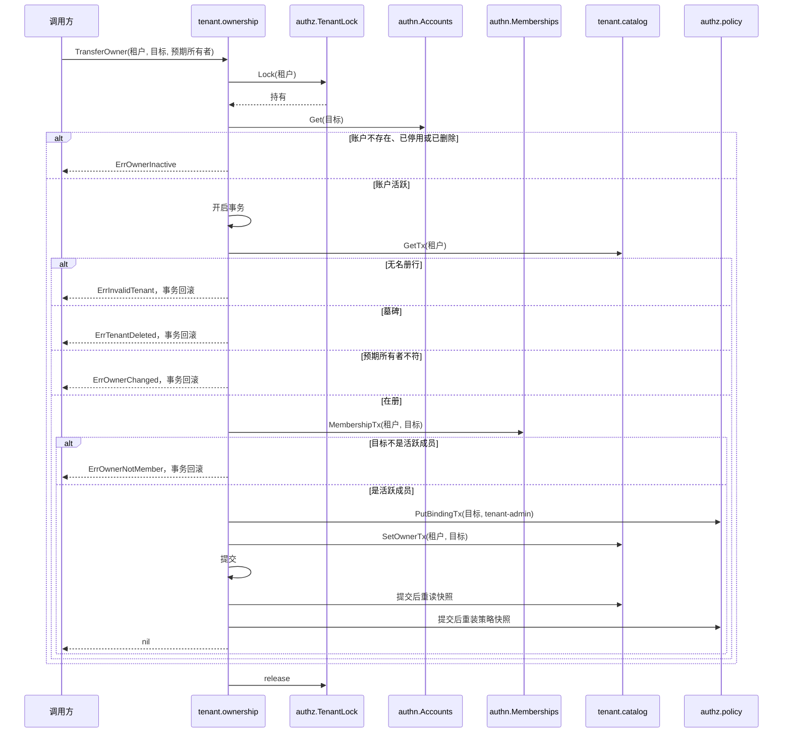

# tenant.ownership

本[模块](../../../glossary.md)承担组织生命周期里的两个写动作：所有者转移与组织删除。它不挂路由、不持配置，也不拥有名册或策略的数据；它只把一次动作涉及的存储写收进同一条事务，使它们一起成立或一起回退。读职责清单前应持有的一句话心智模型是：一次交接要么改写名册的所有者列并授予目标，要么名册与策略都不变；一次终止要么清掉名册、策略与成员关系，要么它们都保持原样。

## 职责

- 把组织所有权从一个账户交给另一个账户：目标必须是该组织的活跃成员，且目标的账户必须活跃；账户不存在、停用或删除时拒绝。转移只改写名册的所有者列，并在目标尚未持有 tenant-admin 时授予它；原所有者保留其成员关系与全部绑定。
- 删除一个组织：写名册的墓碑，并在同一条事务里清除该组织的成员关系、绑定、角色与授予；标识与名称留在墓碑上，永不复用。
- 在两条写路径上取同一个按租户的锁，使一次转移与一次删除不能交错。
- 把跨模块事务的成功与失败如实交出：事务中的任一步失败都回滚整条事务；提交之后才运行名册与策略的快照重读。

### 非职责

- **不判定谁能发起。** 平台员工与组织所有者的区分在 [tenant.admin](design-tenant-admin.md) 的 handler 里做出；本模块收到的是已经通过判定的调用。
- **不拥有名册、策略或成员关系。** 名册归 [tenant.catalog](design-tenant.md)，角色、授予与绑定归授权，成员关系归 [authn.account](../authn/design-authn-account.md)；本模块只调用它们的事务内写面。
- **不删除其他模块的租户数据。** 受租户约束表里的业务数据由声明那些表的模块在墓碑之后处理；本模块只清核心关系。
- **不提供恢复。** 组织删除是终态，没有撤销路径；要重新开始只能登记一个新组织。

## 外部接口契约

本模块 `Provides` 排他交付 `(*tenant.OrganizationWriter)(nil)`，不交付配置或路由。

```go
// OrganizationWriter 是组织生命周期里跨存储的两个写。
type OrganizationWriter interface {
    // TransferOwner 把 target 变成租户的所有者。目标必须是活跃成员，
    // 且目标的账户必须活跃；未持有 tenant-admin 时授予；原所有者保留
    // 成员关系与全部绑定。expectedOwner 为空表示调用方是平台员工；
    // 非空且与行上所有者不符时报 ErrOwnerChanged。
    TransferOwner(ctx context.Context, id ID, target string, expectedOwner string) error
    // DeleteOrganization 写墓碑并清除核心关系。expectedOwner 为空表示调用方
    // 是平台员工；非空且与行上所有者不符时报 ErrOwnerChanged。
    DeleteOrganization(ctx context.Context, id ID, expectedOwner string) error
}
```

两个方法都只接受取值域内的标识；`TransferOwner` 还要求目标是一个账户标识。拒绝沿用根包的哨兵：目标不是活跃成员报 `tenant.ErrOwnerNotMember`，目标的账户不是活跃状态报 `tenant.ErrOwnerInactive`，标识没有名册行报 `tenant.ErrInvalidTenant`，墓碑报 `tenant.ErrTenantDeleted`，所有者已变报 `tenant.ErrOwnerChanged`。调用方用 `errors.Is` 分辨它们；本模块不把名册、账户或策略的拒绝改写成另一种失败。

## 依赖

| 依赖 | 用途 |
|---|---|
| `pkg/db` | 打开跨存储的那一条事务 |
| `pkg/tenant` 根包 | `OrganizationWriter`、`Tenant`、`ID` 与哨兵 `ErrOwnerNotMember`、`ErrOwnerInactive`、`ErrInvalidTenant`、`ErrTenantDeleted`、`ErrOwnerChanged` |
| `pkg/tenant/catalog` | `TxCatalog` 的 `GetTx`、`SetOwnerTx`、`DeleteTx` |
| `pkg/authz/policy` | `TxManager` 的 `PutBindingTx`、`DeleteTenantPolicyTx` |
| `pkg/authn` 根包 | 账户读取接口 `Accounts`（转移目标的状态） |
| `pkg/authn/provisioning` | `MembershipWriter` 的 `MembershipTx`、`RemoveTenantMembershipsTx` |
| `pkg/authz` 根包 | 可选的 `TenantLock`、`Role` 与 `TenantAdminRole` |
| `pkg/core`、`pkg/log` | 模块描述符、功能取用与可选日志 |

数据库、名册的事务写面、策略的事务写面、成员关系的事务写面与账户读取面都是必需依赖，缺席即启动失败。租户锁可选：装配提供一个时，本模块与策略的绑定删除、成员关系守卫取同一个对象；不提供时它用自己的进程内实现，只串行本模块的转移与删除。

## UML 图

下图固定一次所有者转移的调用序。删除的组织也取同一把锁，并在同一条事务里依次写墓碑、清策略、清成员关系；两条路径的区别只在写的内容，不在事务与锁的形状。



图上看不出的约束：事务里的每一步都用调用方交来的同一个 `*gorm.DB`，没有任何一步另开连接；转移不写原所有者的任何行，它的成员关系与绑定保持提交前的状态；提交之前的任何一步失败都让整条事务回滚，提交之后的重读失败只记日志，不把已经落地的写报成失败；锁在事务与提交后重读都结束之后才释放。

## 核心数据结构

本模块不持表，也不持内存状态。它读写的行属于名册、策略与成员关系三个存储；它自己的类型只有接口参数。

| 概念 | 来源 | 说明 |
|---|---|---|
| 所有者 | `tenant.Tenant.OwnerAccount` | 组织唯一的账户标识；平台登记与自助创建时写成创建者，此后只由转移改写 |
| 原所有者 | `GetTx` 读到的 `OwnerAccount` | 转移时退出所有者位置，保留成员关系与全部绑定；与目标相同时整条转移是空操作 |
| 目标 | `TransferOwner` 的参数 | 必须已有活跃成员关系；未持有 tenant-admin 时被授予 |
| 预期所有者 | 两个方法的 `expectedOwner` | 平台员工传空；所有者发起的调用带上它观察到的值。删除遇到转移抢先、转移遇到更早的转移抢先，都以 `ErrOwnerChanged` 拒绝 |

## 核心算法与流程

### 走查

初始状态：名册里 `acme` 在册，所有者是 `alice`；`alice` 是 `acme` 的成员并持有 tenant-admin；`bob` 是 `acme` 的活跃成员但没有绑定。

1. 平台员工调用 `TransferOwner(ctx, "acme", "bob", "")`，组织所有者调用 `TransferOwner(ctx, "acme", "bob", "alice")`。本模块取 `acme` 的租户锁；随后经账户读取面读 `bob` 的账户状态——一次停用或删除 `bob` 同样取这把锁（见 [design-authz](../design-authz.md) 的账户管理锁），所以这里读到的状态不会在提交之前改变。账户不存在、停用或删除时报 `ErrOwnerInactive`。
2. 账户活跃时开启事务，`GetTx` 先读 `acme`：没有行报 `ErrInvalidTenant`，墓碑报 `ErrTenantDeleted`，`expectedOwner` 非空且与行上所有者不同报 `ErrOwnerChanged`，三者都在读成员关系之前。
3. 事务继续，经 `MembershipTx` 取 `bob` 的账户行锁并读到它的活跃成员关系——成员关系的写路径同样先取那一行，一次并发停用因而不会落在校验与提交之间；不是活跃成员报 `ErrOwnerNotMember`。
4. 事务的两次写：`PutBindingTx` 把 tenant-admin 绑给 `bob`；随后 `SetOwnerTx` 把所有者列写成 `bob`。原所有者的成员关系与绑定不被读写。
5. 提交。持久状态：`acme` 的所有者是 `bob`；`bob` 持有 tenant-admin；`alice` 仍是 `acme` 的活跃成员，保留她在 `acme` 的全部绑定，tenant-admin 也在其中；`acme` 的名册快照与策略快照在提交后重读。
6. 若第 4 步的任一语句失败，事务回滚：所有者仍是 `alice`，`bob` 没有新绑定，`alice` 的成员关系与绑定保持原样。

### 一次组织删除

1. 调用方取租户锁；事务开始，`GetTx` 读行。
2. 行不存在报 `ErrInvalidTenant`；行是墓碑报 `ErrTenantDeleted`；`expectedOwner` 非空且与行上所有者不同报 `ErrOwnerChanged`。三种拒绝都在写入之前。
3. `DeleteTx` 写状态与删除时刻；`DeleteTenantPolicyTx` 删除该租户的授予、绑定与角色；`RemoveTenantMembershipsTx` 删除该租户的全部成员关系。
4. 提交；提交后重读名册与策略的快照。
5. 标识与名称留在墓碑上：`Create` 对同一标识报 `ErrTenantExists`，对同一名称报 `ErrNameConflict`。

## 错误与失败语义

| 情形 | 表现 |
|---|---|
| 目标不是活跃成员，或不是账户标识 | `ErrOwnerNotMember` |
| 目标的账户不存在、停用或删除 | `ErrOwnerInactive` |
| 名册没有该标识 | `ErrInvalidTenant` |
| 租户是墓碑 | `ErrTenantDeleted` |
| 所有者发起的写观察到所有者已变（更早的转移抢先） | `ErrOwnerChanged` |
| 事务中任一步失败 | 整条事务回滚，原样交出该步的错误 |
| 提交后的快照重读失败 | 写已落地；记 Warn，不改变成功结果 |

名册与策略的哨兵不被改写：`ErrTenantExists`、`ErrNameConflict`、`ErrBuiltinRole` 等失败按原样交出，由调用方映射。本模块不写 403，也不判定调用方。

## 并发与事务边界

- **一条事务。** 转移与删除各自在 `db.Database.DB()` 上开一条事务；每一步都接收同一个 `*gorm.DB`，没有一步另开连接。任一步失败，涉及的各存储一起回退：转移回退名册与策略，删除回退名册、策略与成员关系。
- **一把锁。** 两个方法都在事务之前取 `authz.TenantLock` 的租户锁，在事务提交与提交后重读都结束之后释放。装配把策略的绑定删除与成员关系守卫接到同一个锁对象时，转移、删除、绑定删除与成员关系删除在同一租户上互相排除。
- **只有一方胜出。** 一次转移与一次所有者发起的删除并发时，锁把两者排成先后：删除先到，转移读到墓碑并被拒；转移先到，删除观察到的所有者已经改变，以 `ErrOwnerChanged` 被拒。两次所有者发起的转移并发时同样排成先后：后到的一次读到所有者已变，以 `ErrOwnerChanged` 被拒。
- **多副本的串行以共享数据库为界。** 进程内默认只串行本进程；宿主提供数据库级锁时串行共享那个库的副本。不共享数据库的副本之间不保证串行，这是装配级的非保证。

## 实现状态

| 能力 | 状态 | 代码 |
|---|---|---|
| 模块 `tenant.ownership` 与 `OrganizationWriter` 的交付 | 已实现 | `pkg/tenant/ownership/ownership.go` `Module`、`newProduct`、`wire` |
| 所有者转移：目标成员与预期所有者校验、授予、写所有者 | 已实现 | `pkg/tenant/ownership/transfer.go` `(*product).TransferOwner` |
| 组织删除：墓碑、核心关系清理、预期所有者校验 | 已实现 | `pkg/tenant/ownership/delete.go` `(*product).DeleteOrganization` |
| 名册的事务内读写 | 已实现 | `pkg/tenant/catalog/tx.go` `GetTx`、`SetOwnerTx`、`DeleteTx` |
| 策略的事务内清理 | 已实现 | `pkg/authz/policy/tx.go` `DeleteTenantPolicyTx`、`PutBindingTx` |
| 成员关系的事务内删除 | 已实现 | `pkg/authn/account/memberships.go` `RemoveTenantMembershipsTx` |
