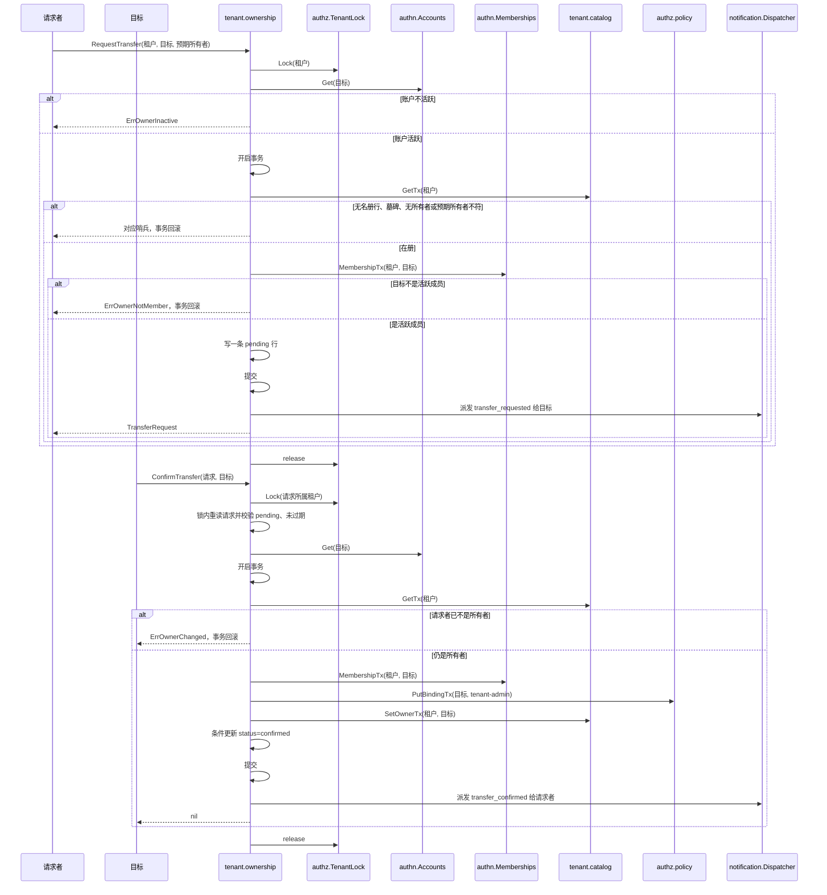

# tenant.ownership

本[模块](../../../glossary.md)承担组织生命周期里的写动作：所有者转移请求、它的确认、拒绝与取消，以及组织删除。它不挂路由、不持配置；它持且只持一张表 `tenant_owner_transfers`，记录待处理与已结束的转移请求，其余数据属于名册、策略与成员关系。读职责清单前应持有的一句话心智模型是：一次转移只有在目标确认之后才改写名册的所有者列；请求本身、拒绝、取消与到期都不改变所有权。删除提交之后，它还经可选的 `authn.InvitationRevoker` 请邀请模块收回该组织尚能发出的待接受邀请。

## 职责

- 记录一次所有权转移请求：目标必须是该组织的活跃成员，且目标的账户必须活跃；组织必须有可转出的所有者；同一组织同一时刻最多一条待处理请求。请求只写 `tenant_owner_transfers`，不改写名册、策略或成员关系。
- 由目标确认一条待处理请求：在一条事务里重新校验请求者仍是所有者、目标的账户仍活跃且仍是活跃成员，授予 tenant-admin，写名册的所有者列并把请求标为 confirmed。原所有者保留其成员关系与全部绑定。
- 由目标拒绝一条待处理请求，所有权不变；由当前所有者或平台员工取消一条待处理请求，所有权不变。
- 惰性结算到期请求：每次读取或动作先用条件更新把窗口已过的请求标为 expired，不依赖后台任务。
- 删除一个组织：写名册的墓碑，并在同一条事务里清除该组织的成员关系、绑定、角色与授予，取消它的待处理请求；标识与名称留在墓碑上，永不复用。提交之后请可选的 `authn.InvitationRevoker` 收回该组织的全部待接受邀请；收回失败只记警告，不把已经落地的删除报成失败。
- 在请求、确认、拒绝、取消与删除上取同一个按租户的锁，使它们不能交错。
- 把跨模块事务的成功与失败如实交出：事务中的任一步失败都回滚整条事务；提交之后才运行名册与策略的快照重读。
- 在请求、确认与拒绝时向相关账户派发站内信；到期不派发，派发失败只记日志，不改变已落地的事实。

### 非职责

- **不判定谁能发起。** 平台员工与组织所有者的区分在 [tenant.admin](design-tenant-admin.md) 的 handler 里做出；本模块收到的是已经通过判定的调用。
- **不拥有名册、策略或成员关系。** 名册归 [tenant.catalog](design-tenant.md)，角色、授予与绑定归授权，成员关系归 [authn.account](../authn/design-authn-account.md)；本模块只调用它们的事务内写面。
- **不删除其他模块的租户数据。** 受租户约束表里的业务数据由声明那些表的模块在墓碑之后处理；本模块只清核心关系。邀请行归 `authn.invite`，本模块只经 `authn.InvitationRevoker` 请它收回，不直接读写那张表。
- **不提供恢复。** 组织删除是终态，没有撤销路径；要重新开始只能登记一个新组织。
- **不发送邮件或短信。** 转移通知只走站内信：目标不保证有已验证的邮箱地址，而目标页是账户级入口，站内信只是提示。

## 外部接口契约

本模块 `Provides` 排他交付 `(*tenant.OrganizationWriter)(nil)` 与 `(*tenant.OwnershipTarget)(nil)`，不交付配置或路由。两个接口分开是因为前者是请求者对组织的写，后者是目标对自身请求的动作；[tenant.admin](design-tenant-admin.md) 的两组路由分别只依赖对应的一半。

```go
// OrganizationWriter 是请求者一侧的组织写。
type OrganizationWriter interface {
    // RequestTransfer 记录一条待处理请求；所有权不变。expectedOwner 为空
    // 表示平台员工；非空且与行上所有者不符报 ErrOwnerChanged。
    RequestTransfer(ctx context.Context, id ID, target, expectedOwner string) (TransferRequest, error)
    // CancelTransfer 取消一条待处理请求。expectedOwner 语义同上。
    CancelTransfer(ctx context.Context, id ID, requestID, expectedOwner string) error
    // PendingTransfer 读该组织当前的待处理请求；没有则第二返回值为 false。
    PendingTransfer(ctx context.Context, id ID) (TransferRequest, bool, error)
    // DeleteOrganization 删除组织；同一事务里把待处理请求结算为 cancelled。
    DeleteOrganization(ctx context.Context, id ID, expectedOwner string) error
}

// OwnershipTarget 是目标一侧的动作，只凭调用方自己的身份。
type OwnershipTarget interface {
    // ConfirmTransfer 确认请求；这是唯一把 owner 列写成新所有者的路径。
    ConfirmTransfer(ctx context.Context, requestID, target string) error
    // DeclineTransfer 拒绝请求；所有权不变。
    DeclineTransfer(ctx context.Context, requestID, target string) error
    // PendingTransfersFor 读目标名下的待处理请求。
    PendingTransfersFor(ctx context.Context, target string) ([]TransferRequest, error)
    // TransferFor 读目标名下的一条请求，含终态。
    TransferFor(ctx context.Context, requestID, target string) (TransferRequest, error)
}
```

两个接口都只接受取值域内的标识；`RequestTransfer` 还要求目标是一个账户标识。拒绝沿用根包的哨兵：目标不是活跃成员报 `tenant.ErrOwnerNotMember`，目标的账户不是活跃状态报 `tenant.ErrOwnerInactive`，标识没有名册行报 `tenant.ErrInvalidTenant`，墓碑报 `tenant.ErrTenantDeleted`，所有者已变报 `tenant.ErrOwnerChanged`。转移请求另有一组哨兵：请求不存在或不在调用方可见范围报 `tenant.ErrTransferNotFound`，调用方不是目标报 `tenant.ErrTransferNotTarget`，请求已结束报 `tenant.ErrTransferNotPending`，窗口已过报 `tenant.ErrTransferExpired`，已有待处理请求报 `tenant.ErrTransferAlreadyPending`，目标就是当前所有者报 `tenant.ErrTransferTargetIsOwner`，组织没有所有者报 `tenant.ErrNoOwner`。调用方用 `errors.Is` 分辨它们；本模块不把名册、账户或策略的拒绝改写成另一种失败。

## 依赖

| 依赖 | 用途 |
|---|---|
| `pkg/db` | 打开跨存储的那一条事务；`tenant_owner_transfers` 与迁移集的声明 |
| `pkg/tenant` 根包 | 两个接口、`TransferRequest`、`TransferStatus`、`ID` 与哨兵 |
| `pkg/tenant/catalog` | `TxCatalog` 的 `GetTx`、`SetOwnerTx`、`DeleteTx` |
| `pkg/authz/policy` | `TxManager` 的 `PutBindingTx`、`DeleteTenantPolicyTx` |
| `pkg/authn` 根包 | 账户读取接口 `Accounts`（目标的状态） |
| `pkg/authn/provisioning` | `MembershipWriter` 的 `MembershipTx`、`RemoveTenantMembershipsTx` |
| `pkg/authn` 根包 | 可选的 `InvitationRevoker`：删除提交之后收回该组织的待接受邀请 |
| `pkg/authz` 根包 | 可选的 `TenantLock`、`Role` 与 `TenantAdminRole` |
| `pkg/notification` | 可选的 `Dispatcher`；四种通知类型的声明 |
| `pkg/tenant` 根包的 `Catalog` | 可选的 `EnterRegistered`，把通知的租户放进派发上下文 |
| `pkg/i18n` | 本模块的文案目录资源 |
| `pkg/core`、`pkg/log` | 模块描述符、功能取用与可选日志 |

数据库、名册的事务写面、策略的事务写面、成员关系的事务写面与账户读取面都是必需依赖，缺席即启动失败。租户锁、通知派发面与名册读取面可选：装配提供一个租户锁时，本模块与策略的绑定删除、成员关系守卫取同一个对象；不提供时它用自己的进程内实现，只串行本模块的写。没有通知派发面时请求与结果照常成立，只记一条 Warn。`authn.InvitationRevoker` 可选：装配提供它时，删除提交之后收回该组织的待接受邀请；不提供时删除照常成立，留下的待接受邀请由接受侧的租户状态拒绝。

## UML 图

下图固定一次请求与确认的调用序。删除组织取同一把锁，并在同一条事务里依次写墓碑、清策略、清成员关系、取消待处理请求，并在提交之后请 `InvitationRevoker` 收回该组织的待接受邀请；两条路径的区别在写的内容，不在事务与锁的结构。



图上看不出的约束：事务里的每一步都用调用方交来的同一个 `*gorm.DB`，没有任何一步另开连接；确认不写原所有者的任何行，它的成员关系与绑定保持提交前的状态；待处理行的条件更新 `WHERE id = ? AND status = 0` 是并发确认与取消的仲裁，命中零行即回滚；提交之前的任何一步失败都让整条事务回滚，提交之后的重读失败只记日志，不把已经落地的写报成失败；锁在事务与提交后重读都结束之后才释放。

## 核心数据结构

本模块持一张表 `tenant_owner_transfers`，不持内存状态。它刻意不内嵌租户作用域模型：这张表是组织生命周期的元数据，如同名册表本身，而目标的确认接口是账户级请求，没有租户上下文。代之以硬约束：存储的每个方法都显式携带 `tenant_id` 或 `to_account` 谓词，不提供无谓词列出全部的方法。

| 概念 | 来源 | 说明 |
|---|---|---|
| 请求 | `tenant_owner_transfers` 行 | `id`、`tenant_id`、`from_account`、`to_account`、`status`、`requested_at`、`expires_at`、`resolved_at` |
| 请求者 | 请求行的 `from_account` | 请求时名册的所有者，不是点按钮的账户；平台员工只出现在审计操作者上 |
| 目标 | 请求行的 `to_account` | 必须已有活跃成员关系；未持有 tenant-admin 时在确认时被授予 |
| 预期所有者 | `RequestTransfer` 与 `CancelTransfer` 的 `expectedOwner` | 平台员工传空；所有者发起的调用带上它观察到的值 |
| 固定窗口 | 模块常量 `transferRequestTTL` | 请求自写入起 7 天；到期由读写路径惰性结算 |
| 状态 | 请求行的 `status` | 闭集：pending、confirmed、declined、cancelled、expired；终态无出边 |

状态机：

| 起始 | 事件 | 结果 |
|---|---|---|
| pending | 目标确认，且事务内校验全过 | confirmed，同一事务写 tenant-admin 与 owner |
| pending | 目标拒绝 | declined |
| pending | 当前所有者或平台员工取消 | cancelled |
| pending | 截止时刻已过，任一读取或动作触及 | expired |
| pending | 组织删除 | cancelled，与墓碑同事务 |
| confirmed / declined / cancelled / expired | 任何动作 | `ErrTransferNotPending` 或 `ErrTransferExpired` |

## 核心算法与流程

### 一次请求与确认

初始状态：名册里 `acme` 在册，所有者是 `alice`；`alice` 是 `acme` 的成员并持有 tenant-admin；`bob` 是 `acme` 的活跃成员但没有绑定。

1. 平台员工调用 `RequestTransfer(ctx, "acme", "bob", "")`，组织所有者调用 `RequestTransfer(ctx, "acme", "bob", "alice")`。本模块取 `acme` 的租户锁；随后经账户读取面读 `bob` 的账户状态。一次停用或删除 `bob` 同样取这把锁（见 [design-authz](../design-authz.md) 的账户管理锁），所以这里读到的状态不会在提交之前改变。账户不存在、停用或删除时报 `ErrOwnerInactive`。写入前先把该组织窗口已过的请求结算为 expired。
2. 账户活跃时开启事务，`GetTx` 先读 `acme`：没有行报 `ErrInvalidTenant`，墓碑报 `ErrTenantDeleted`，`expectedOwner` 非空且与行上所有者不同报 `ErrOwnerChanged`，行上没有所有者报 `ErrNoOwner`，目标就是该所有者报 `ErrTransferTargetIsOwner`，五者都在读成员关系之前。
3. 事务继续，经 `MembershipTx` 取 `bob` 的账户行锁并读到它的活跃成员关系。成员关系的写路径同样先取那一行，一次并发停用因而不会落在校验与提交之间；不是活跃成员报 `ErrOwnerNotMember`。
4. 事务写一条 pending 行，`from` 是名册当刻的所有者，`expires_at` 是当刻加固定窗口。部分唯一索引保证同一组织最多一条 pending；并发发起由索引仲裁，冲突报 `ErrTransferAlreadyPending`。提交后向目标派发站内信。
5. 目标调用 `ConfirmTransfer(ctx, 请求, "bob")`。本模块先按请求标识结算过期行，读请求并校验 `to` 是目标、状态 pending、窗口未过；随后取 `acme` 的租户锁，在锁内重读请求、重读 `bob` 的账户状态。
6. 开启事务，`GetTx` 读 `acme`：没有行报 `ErrInvalidTenant`，`held.OwnerAccount != from` 报 `ErrOwnerChanged`；墓碑报 `ErrTenantDeleted`，但删除事务已先取消待处理请求，这一支只在请求与名册不满足事务不变量的防御路径上出现。`MembershipTx` 再校验 `bob` 是活跃成员。随后 `PutBindingTx` 把 tenant-admin 绑给 `bob`，`SetOwnerTx` 把所有者列写成 `bob`，条件更新把请求标为 confirmed；条件更新命中零行说明另一写入者先结算了请求，事务回滚并报 `ErrTransferNotPending`。原所有者的成员关系与绑定不被读写。
7. 提交。持久状态：`acme` 的所有者是 `bob`；`bob` 持有 tenant-admin；`alice` 仍是 `acme` 的活跃成员，保留她在 `acme` 的全部绑定，tenant-admin 也在其中；`acme` 的名册快照与策略快照在提交后重读；请求行是 confirmed。提交后向 `alice` 派发结果站内信。
8. 若确认事务的任一步失败，事务回滚：所有者仍是 `alice`，`bob` 没有新绑定，请求保持 pending（到期或取消后结束）。

### 拒绝、取消与到期

1. 拒绝由目标发起：校验 `to` 是目标、请求 pending、窗口未过，取租户锁后以条件更新把状态置为 declined；提交后向 `from` 派发结果通知。所有权不变。
2. 取消由请求者或平台员工发起：请求必须属于路径上的租户；取租户锁后校验 `expectedOwner`（平台员工传空则不校验），以条件更新把状态置为 cancelled。取消不派发结果通知。
3. 到期不靠定时任务：`PendingTransfersFor`、`PendingTransfer`、`TransferFor`、确认、拒绝与取消都先执行一次 `UPDATE ... SET status = 4, resolved_at = ? WHERE status = 0 AND expires_at <= ?`。条件更新不改所有权，与确认的条件更新在数据库上串行，`resolved_at` 只有一个赢家。第一版不主动发送到期通知。

### 停用、移除与组织删除怎么结算待处理请求

- **目标的账户停用或被删除。** 发起时以 `ErrOwnerInactive` 拒绝；已存在的待处理请求不随账户停用自动结束，确认时重读账户状态，非活跃即以 `ErrOwnerInactive` 拒绝，所有权不变。
- **目标的成员关系停用或被移除。** 发起时以 `ErrOwnerNotMember` 拒绝；待处理请求不随成员关系变化自动结束，确认时以 `ErrOwnerNotMember` 拒绝，所有权不变。
- **请求者不再是所有者。** 另一条确认先落地时，请求行的 `from_account` 与名册不再一致，确认以 `ErrOwnerChanged` 拒绝，所有权不变；请求留待取消或到期。
- **组织被停用。** 停用不结算待处理请求，也不阻止确认；确认只校验名册行不是墓碑、请求者仍是所有者、目标的账户与成员关系仍活跃。停用影响的是请求面的解析，目标面是账户级接口，不要求该组织是当前租户。
- **组织被删除。** 删除事务在同一条里把该组织的待处理请求结算为 cancelled；此后目标再确认该请求，读到的是已结束，以 `ErrTransferNotPending` 拒绝，所有权不变。请求仍未结算而名册已是墓碑不在事务不变量之内；防御路径由 `GetTx` 的 `ErrTenantDeleted` 拒绝。
- **没有自动撤销。** 上述停用与移除都不主动改写请求状态；请求仍由目标确认或拒绝，由请求者或平台员工取消，或在固定窗口后到期。

### 一次组织删除

1. 调用方取租户锁；事务开始，`GetTx` 读行。
2. 行不存在报 `ErrInvalidTenant`；行是墓碑报 `ErrTenantDeleted`；`expectedOwner` 非空且与行上所有者不同报 `ErrOwnerChanged`。三种拒绝都在写入之前。
3. `DeleteTx` 写状态与删除时刻；`DeleteTenantPolicyTx` 删除该租户的授予、绑定与角色；`RemoveTenantMembershipsTx` 删除该租户的全部成员关系；条件更新把该组织的 pending 请求结算为 cancelled。
4. 提交；提交后重读名册与策略的快照。
5. 装配交付了 `authn.InvitationRevoker` 时，在事务之外请它收回该组织的全部待接受邀请。收回以“状态仍为待接受”为条件，失败只记一行 Warn，不回滚已经提交的删除；接受侧按租户状态拒绝尚未收回的行。
6. 标识与名称留在墓碑上：`Create` 对同一标识报 `ErrTenantExists`，对同一名称报 `ErrNameConflict`。

## 错误与失败语义

| 情形 | 表现 |
|---|---|
| 目标不是活跃成员，或不是账户标识 | `ErrOwnerNotMember` |
| 目标的账户不存在、停用或删除 | `ErrOwnerInactive` |
| 名册没有该标识 | `ErrInvalidTenant` |
| 租户是墓碑 | `ErrTenantDeleted` |
| 所有者发起的写观察到所有者已变 | `ErrOwnerChanged` |
| 组织没有所有者 | `ErrNoOwner` |
| 目标就是当前所有者 | `ErrTransferTargetIsOwner` |
| 已有待处理请求 | `ErrTransferAlreadyPending` |
| 请求不存在，或不在调用方可见范围 | `ErrTransferNotFound` |
| 调用方不是请求的目标 | `ErrTransferNotTarget` |
| 请求已确认、已拒绝、已取消或已到期 | `ErrTransferNotPending` / `ErrTransferExpired` |
| 事务中任一步失败 | 整条事务回滚，原样交出该步的错误 |
| 提交后的快照重读失败 | 写已落地；记 Warn，不改变成功结果 |
| 删除提交后收回邀请失败 | 删除已落地；记 Warn，待接受邀请由接受侧按租户状态拒绝 |
| 通知派发失败或派发面缺席 | 写已落地；记 Warn，不改变结果 |

名册与策略的哨兵不被改写：`ErrTenantExists`、`ErrNameConflict`、`ErrBuiltinRole` 等失败按原样交出，由调用方映射。本模块不写 403，也不判定调用方。

## 并发与事务边界

- **一条事务。** 请求、确认与删除各自在 `db.Database.DB()` 上开一条事务；每一步都接收同一个 `*gorm.DB`，没有一步另开连接。任一步失败，涉及的各存储一起回退：确认回退名册、策略与请求行，删除回退名册、策略、成员关系与请求行。拒绝与取消是单条条件更新，条件本身是仲裁。收回邀请不在那条事务里：它在删除提交之后进行，以“状态仍为待接受”为条件，幂等，失败不回滚删除。
- **一把锁。** 请求、确认、拒绝、取消与删除都在事务之前取 `authz.TenantLock` 的租户锁，在事务提交与提交后重读都结束之后释放。装配把策略的绑定删除与成员关系守卫接到同一个锁对象时，这些路径在同一租户上互相排除。
- **只有一方胜出。** 一次确认与一次所有者发起的删除并发时，锁把两者排成先后：删除先到，确认读到墓碑并被拒；确认先到，删除观察到的所有者已经改变，以 `ErrOwnerChanged` 被拒。一次确认与一次取消并发时，先写入条件更新的一方胜出，另一方读到零行。
- **到期结算不需要锁。** 条件更新不改所有权，并与确认的条件更新在数据库上串行。
- **多副本的串行以共享数据库为界。** 进程内默认只串行本进程；宿主提供数据库级锁时串行共享那个库的副本。不共享数据库的副本之间不保证串行，这是装配级的非保证。

## 实现状态

| 能力 | 状态 | 代码 |
|---|---|---|
| 模块 `tenant.ownership`、两个接口的交付与四种通知类型的声明 | 已实现 | `pkg/tenant/ownership/ownership.go` `Module`、`newProduct`、`wire`、`notificationTypes` |
| 请求、取消与待处理读取 | 已实现 | `pkg/tenant/ownership/transfer.go` `(*product).RequestTransfer`、`CancelTransfer`、`PendingTransfer` |
| 确认、拒绝与目标侧读取 | 已实现 | `pkg/tenant/ownership/transfer.go` `(*product).ConfirmTransfer`、`DeclineTransfer`、`PendingTransfersFor`、`TransferFor` |
| `tenant_owner_transfers` 表与迁移 | 已实现 | `pkg/tenant/ownership/migrations/{sqlite,postgres}/0001_tenant_owner_transfers.sql`；`pkg/tenant/ownership/store.go` |
| 惰性到期结算 | 已实现 | `pkg/tenant/ownership/store.go` `settleExpiredRequest`、`settleExpiredForTenant`、`settleExpiredForTarget` |
| 组织删除：墓碑、核心关系清理、待处理请求取消 | 已实现 | `pkg/tenant/ownership/delete.go` `(*product).DeleteOrganization` |
| 站内信派发（请求、确认、拒绝） | 已实现 | `pkg/tenant/ownership/notify.go`；`pkg/tenant/ownership/locales/*.json` |
| 名册的事务内读写 | 已实现 | `pkg/tenant/catalog/tx.go` `GetTx`、`SetOwnerTx`、`DeleteTx` |
| 策略的事务内清理与授予 | 已实现 | `pkg/authz/policy/tx.go` `DeleteTenantPolicyTx`、`PutBindingTx` |
| 成员关系的事务内读取与删除 | 已实现 | `pkg/authn/account/memberships.go` `MembershipTx`、`RemoveTenantMembershipsTx` |
| 组织删除后收回待接受邀请 | 已实现 | `pkg/tenant/ownership/delete.go` `(*product).DeleteOrganization`；`pkg/authn/invite/lifecycle.go` `(*product).RevokeTenantInvitations` |
