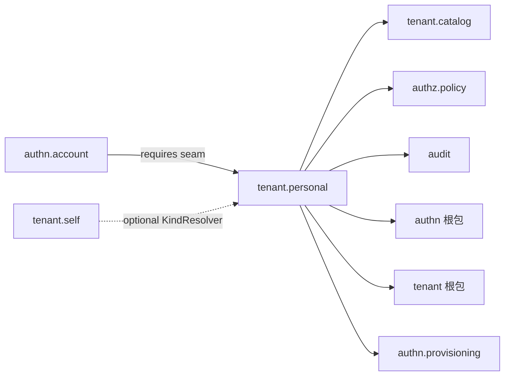
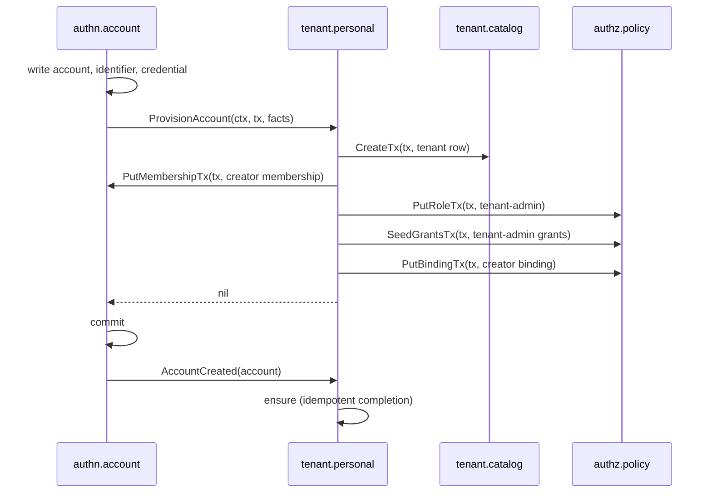

# tenant.personal

`tenant.personal` 是租户[功能目录](../../../glossary.md)里个人租户的公共模块，包 `pkg/tenant/personal`，登记名 `org.personal`。它拥有账户固有空间的全部写入：事务内的五步建立、跟随账户生命周期的状态迁移与删除，以及租户种类的解析。它不拥有账户表、名册与授权表，也不拥有审计记录本身。读职责清单前应持有的一句话心智模型是：**一个用户账户与它的个人租户是同一次账户事务里的两次写入，账户提交则空间提交，账户回滚则空间回滚**。

第一遍的次序是职责与非职责、外部接口契约、依赖与 UML 图、核心数据结构与核心算法与流程。外部接口契约先给出模块交付的三项能力，再给出宿主可见的导出面；核心算法与流程从[走查](#走查)开始，用一次账户创建把五次写入与提交后的回调串起来。错误与失败语义与并发与事务边界属查阅用；实现状态在最后供核对。

## 职责

- 实现认证根包的事务内 seam `provisioning.AccountProvisioning`：在账户创建的同一事务里写租户行、创建者成员关系、`tenant-admin` 角色、角色在允许集内的授予与创建者绑定（允许集为空时不写授予行）；在账户删除的同一事务里清空账户的绑定、删除 `tenant-admin` 角色并把租户行写成墓碑。
- 对服务账户什么也不写：服务账户由管理员授予租户访问，不拥有自己的组织。
- 把个人租户的别名写成账户的用户名，使个人组织在请求侧以用户名寻址；用户账户总有用户名，账户没有用户名时拒绝写入，不以派生标识代替。
- 实现认证根包的 `authn.AccountLifecycle`：创建钩子补齐事务内 seam 未完成的部分，停用与启用钩子按账户的状态迁移租户，删除钩子收尾租户内其余账户的成员关系。清空被删除账户的绑定、删除角色、写删除审计行与写墓碑由事务内的删除完成。
- 订阅账户的状态变更与删除事件，在事件投递时重跑同一组幂等钩子，作为进程在提交与钩子之间停止时的补偿。
- 交付 `tenant.KindResolver`：调用方自己的个人租户读作 `personal`，其余读作 `business`。
- 声明静态[特性](../../../glossary.md) `org.personal`：模块在装配中即在力，没有关闭配置项。
- 为建立与删除写审计行：对象是租户标识，明细以一个动作标识把一次尝试的允许行与失败行对上。

### 非职责

- **不持有账户。** 账户表、标识、凭据与成员关系归 [authn.account](../authn/design-authn-account.md)；本模块只经 seam 的 `*gorm.DB` 与账户模块的事务内成员关系写入写自己的五步。
- **不持有名册。** 租户表、迁移与快照归 [tenant.catalog](design-tenant.md)；本模块经 `tenant.Catalog` 与 `tenantcatalog.TxCatalog` 读写名册。
- **不持有授权。** 角色、授予与绑定归授权功能目录；本模块经 `authz.Manager`、`authz.Seeder` 与 `authzpolicy.TxManager` 写这些行，不自行判定权限。
- **不建表、不迁移。** 本模块没有自己的表与迁移集。
- **不决定账户状态。** 账户的停用、启用与删除由账户模块决定；本模块跟随，不反向写账户。
- **不实现守卫与准入。** 个人租户的写保护、成员关系的删除守卫与请求期准入归宿主与授权功能目录；本模块只提供种类答案与生命周期联动。
- **不提供配置项。** 账户没有个人租户不是一个合法的产品状态，所以没有开关、没有条件特性。
- **不生成账户标识。** 账户标识由账户模块生成；本模块从 `AccountFacts.ID` 读它。
- **不实现通用租户建立。** 业务组织的自助创建是租户功能目录里另一个公共模块；本模块只写账户自己的空间。

## 外部接口契约

### 交付的能力

`tenant.personal` 在描述符的 `Provides` 里声明三项能力，由同一个产品实例实现：

| 能力 | 用途 |
|---|---|
| `(*provisioning.AccountProvisioning)(nil)` | 账户创建与删除事务内的五步写入与收尾 |
| `(*authn.AccountLifecycle)(nil)` | 账户提交之后的创建、停用、启用与删除钩子 |
| `(*tenant.KindResolver)(nil)` | 本人租户读取的种类答案 |

认证账户模块把 `AccountProvisioning` 声明为必需依赖，装配里没有实现时启动失败（[design-authn-account](../authn/design-authn-account.md)）。`tenant.self` 把 `KindResolver` 声明为可选依赖，本模块在场时由它回答；没有本模块的装配里每一项读作 `business`。

### 必需依赖

描述符的 `Requires` 声明名册 `(*tenant.Catalog)(nil)`、名册的事务内写 `(*tenantcatalog.TxCatalog)(nil)`、授权的管理器 `(*authz.Manager)(nil)`、授予播种 `(*authz.Seeder)(nil)`、权限目录 `(*authz.Catalog)(nil)` 与事务内策略写 `(*authzpolicy.TxManager)(nil)`，以及审计 `(*audit.Audit)(nil)`。名册与授权各由唯一模块排他交付，本模块不在描述符里替宿主挑选它们。

账户模块要求本模块提供的 seam，所以本模块对账户模块的成员关系读取、删除收尾与事务内成员关系写入只能在 `Init` 里取用：在 `Requires` 里声明会形成依赖环。事件总线、账户读取与 logger 同样在 `Init` 里可选地取用；它们的缺席是合法装配。

### 宿主可见的导出面

模块导出登记名与特性名、标识前缀与派生函数，以及四个哨兵错误：

| 名字 | 用途 |
|---|---|
| `ModuleName`、`FeatureName` | 命令树与特性文档里的名字；两者都是 `org.personal` |
| `IDPrefix`、`TenantID`、`IsPersonalTenantID` | 派生与识别个人租户标识 |
| `ErrAliasConflict` | 用户名被业务组织持有的别名冲突，包装 `tenant.ErrAliasConflict` |
| `ErrUsernameMissing` | 用户账户没有用户名时的拒绝 |
| `ErrTenantUnavailable`、`ErrIdentifierUnavailable` | 提交后补完的两类拒绝 |

宿主的写保护与种子跳过经 `IsPersonalTenantID` 判断个人域；`tenant.KindResolver` 的比较经 `TenantID` 精确比较调用方自己的空间。

### 对外接口

`TenantID` 的派生规则与 `IsPersonalTenantID` 的前缀判定在对外接口上：宿主与测试据它们识别个人租户。模块不挂 HTTP 路由，也不声明 OpenAPI 分片。

## 依赖

依赖方向自上而下不成立：账户模块经 seam 依赖本模块，本模块又依赖名册与授权；这正是 seam 的用途——账户模块不知道个人租户，个人租户在账户的事务里写自己的数据。认证根包不导入 `gorm`，事务签名住在叶包 `pkg/authn/provisioning`，本模块只导入叶包。

## UML 图

账户创建时，账户模块先写账户行、标识与凭据，再调用 seam；seam 的五次写入与账户行共享一个事务，提交之后账户模块运行本模块的创建钩子与事件发布。

## 核心数据结构

本模块不声明表。它写四类行：

- **租户行**：`ID` 是 `personal-` 加账户标识，`Alias` 是账户用户名，`Status` 是 `active`，`OwnerAccount` 是账户标识，`Profile.DisplayName` 是账户的显示名。
- **成员关系**：账户在个人租户里的有效成员关系，来源写 `personal`。
- **授权行**：`tenant-admin` 角色（描述键 `authz.role.tenantAdmin`）与账户到该角色的绑定；角色在允许集内的授予只在允许集非空时写入。
- **审计行**：创建与删除各一行，结果取 `success` 或 `failed`。

删除把租户行写成墓碑：`Status` 变成 `deleted`，别名保留，标识因此不可复用。

## 核心算法与流程

### 走查

初始状态：账户表里没有 `alice`，名册里没有 `personal-<alice-id>`。

1. 账户模块在一个事务里写账户行、用户名标识与凭据。
2. 同一事务里调用 `ProvisionAccount`。本模块以 `ID=personal-<id>`、`Alias=alice`、`Status=active`、`OwnerAccount=<id>` 调 `CreateTx`；名册写入租户行并交回提交后的快照重读闭包。
3. 本模块经 `PutMembershipTx` 写 `alice` 在个人租户里的有效成员关系，来源 `personal`。
4. 本模块经 `PutRoleTx` 写 `tenant-admin` 角色，经 `SeedGrantsTx` 写允许集内的授予（允许集为空，这一步不写行），经 `PutBindingTx` 把 `alice` 绑到该角色。每次写入交回的闭包都交给上下文里的 `AfterCommit` 收集器。
5. 账户模块提交。名册重读与授权的快照刷新、事件发布与创建的审计行按收集器的顺序运行。
6. 账户模块调用 `AccountCreated`。本模块读到租户行已是 `active`，`ensure` 发现成员关系、角色与绑定都在，不写任何行。

持久状态：账户行、`personal-<id>` 租户行（别名 `alice`）、创建者的一条成员关系、`tenant-admin` 角色、该角色的零条授予、账户到该角色的一条绑定与一条创建审计行。授予为零是因为允许集为空：本骨架的 `personalBusinessPermissions` 没有列出任何业务资源权限，而允许集只从这个代码内列出的集合取，不从进程目录推导，所以模块声明的权限不会自行加入；当前允许集是它与 `TenantGoverned` 相交、再减去成员关系管理与身份提供方管理两个排除项的结果，因此为空。新增业务能力时，把它的租户级权限加入这个集合，下一次提交后的补完就会写入相应授予（见[扩展点](#扩展点)）。

### 事务内建立

`ProvisionAccount` 只对 `kind=user` 生效。它为租户标识派生 `TenantID(account)`，把别名写作用户名；用户账户总有用户名，用户名为空时以 `ErrUsernameMissing` 拒绝，账户事务回滚。五次写入的次序是租户行、成员关系、角色、授予（允许集为空时这一步没有行）、绑定；每一步交回的提交后闭包都追加到 `provisioning.AfterCommitOf(ctx)`。租户行这次真正建立时，创建的审计行也作为一个提交后闭包写入；幂等重放不再记一行。

租户行返回 `tenant.ErrTenantExists` 是幂等重放：租户行已在，剩下的四步继续补完。返回 `tenant.ErrAliasConflict` 是本模块导出的 `ErrAliasConflict`，同时包装名册的哨兵，账户事务回滚。其余失败原样返回，事务同样回滚。

### 事务内删除

`ProvisionAccountDeletion` 同样只对 `kind=user` 生效。次序是清空账户在个人租户里的绑定、删除 `tenant-admin` 角色、把租户行写成墓碑。内置角色不可删除的 `authz.ErrBuiltinRole` 被容忍，墓碑让拒绝无害；租户行不存在的 `tenant.ErrInvalidTenant` 是“没有要写的行”，同样容忍。每次写入的提交后闭包都登记；墓碑写成之后，删除的审计行也作为一个提交后闭包写入。墓碑与账户一起提交，审计因此不再能阻止它，只按至少一次记录。租户内其余账户的成员关系不在这个事务里清：成员关系的读取没有事务内接口，这部分由提交之后的删除钩子收尾。

### 提交后的生命周期

`AccountCreated` 在账户已提交之后运行：读账户，服务账户与已删除账户不做事；读租户行，墓碑不做事；否则运行提交后的 `ensure`。`AccountDisabled` 与 `AccountEnabled` 经名册的账户联动迁移：账户的停用写下账户来源，启用只解除账户自己的停用，运营者的停用保留。

`AccountDeleted` 先读租户行。没有这一行即无事可做；读到墓碑时，事务内的删除已经清空账户绑定、删除角色并写墓碑，钩子只移除租户内其余账户的成员关系，重复调用因此幂等。租户尚未成为墓碑时，钩子按成员关系、清空账户绑定并删除角色、写删除审计行、写墓碑的次序做完整收尾。成员关系经账户模块的删除收尾接口移除，不经守卫；绑定经 `ClearAccountBindings` 清空，不受最后管理员规则约束；审计行落不下时动作停止，墓碑不写。

### 提交后的补完

`ensure` 是创建钩子与事件补偿共用的幂等补完。它先读成员关系；已有则经 `EnterRegistered` 与 `Get` 读回租户行，没有则先写强制审计行，再读账户用户名作别名创建租户，然后补成员关系、角色、允许集内的授予与绑定（允许集为空时没有授予行），最后移除旧模型遗留的 `owner` 角色。用户名读不到时以 `ErrUsernameMissing` 拒绝且不创建租户；租户行不是 `active` 时在写任何行之前以 `ErrTenantUnavailable` 拒绝。

### 种类解析

`KindOf` 读请求上下文里的身份，把租户标识与 `TenantID(identity.Account())` 逐字比较：相等是 `personal`，其余是 `business`；没有身份时是 `business`。按相等而不按前缀，因为另一个账户的个人租户也可能出现在调用方的成员关系列表里。

## 错误与失败语义

| 情形 | 结果 |
|---|---|
| 服务账户 | 建立与删除都什么也不写，返回 nil |
| 用户账户没有用户名 | `ErrUsernameMissing`，账户事务回滚 |
| 租户行已存在 | 幂等重放，剩余四步继续 |
| 别名被业务组织持有 | `ErrAliasConflict`，同时匹配 `tenant.ErrAliasConflict`，账户事务回滚 |
| 其他名册失败 | 原样传播，账户事务回滚 |
| 删除时角色内置 | 容忍 `authz.ErrBuiltinRole`，继续写墓碑 |
| 删除时租户行不存在 | 容忍 `tenant.ErrInvalidTenant`，没有要写的墓碑 |
| 补完的创建审计行落不下 | 动作停止，不创建租户 |
| 删除的审计行落不下 | 墓碑随账户事务已提交；审计行在提交之后尽力写，失败只记日志 |

seam 的失败一律使账户事务回滚：账户与它拥有的空间要么都在，要么都不在。生命周期钩子的失败不撤销已提交的账户，下一次调用幂等补完；事件补偿另行重跑同一组钩子。

## 并发与事务边界

**建立与删除的每一次写都在账户模块交出的事务句柄上运行。** 本模块不打开自己的连接；打开自己的连接会让写在账户回滚之后留下，或让提交的账户缺少它应拥有的数据。这是本模块存在的理由：`AccountLifecycle` 在提交之后运行，承担不了“账户与空间同时成立”。

**提交后的工作经 `provisioning.AfterCommit` 交还账户模块。** 名册快照重读、授权快照刷新与事件发布都在提交之后运行；在事务里运行会读到未提交的写。闭包按登记顺序运行，一个失败不阻止后面的。

**补完与钩子是幂等的。** 两次并发的 `ensure` 以确定性标识在名册的唯一约束上相撞，败者读回胜者的行；重复的删除事件找到墓碑后只重试成员关系的移除，其余步骤已完成。事件按标识去重，内存里保留一个有界的近期集合。

**用户名与别名共用一个命名空间。** `tenants.alias` 的单列唯一约束仲裁并发：一个业务组织先占用了用户名，同一用户名的账户创建在租户行处失败并整体回滚；反过来，已存在的个人租户别名阻止业务组织使用同一别名。用户名空间保留 `personal-` 前缀，所以派生标识不会与用户名相撞。

## 扩展点

个人租户的 `tenant-admin` 允许集写在包内：业务资源集合与两个排除项在代码里显式列出，不从进程目录推导。本骨架的 `personalBusinessPermissions` 没有列出任何业务资源权限——集合不从进程目录推导，模块声明的权限不会自行加入——因此 `tenant-admin` 当前不持有授予。新增业务能力时，把它的租户级权限加入集合即可进入个人租户；平台只允许租户管理员治理的权限才真正写入授权行。本模块不提供配置项或接口来改写这个集合。

## 实现状态

| 能力 | 状态 | 代码锚点 |
|---|---|---|
| 事务内建立与删除 | 已实现 | `pkg/tenant/personal/provisioning.go` `(*product).ProvisionAccount`、`(*product).ProvisionAccountDeletion` |
| 账户生命周期钩子 | 已实现 | `pkg/tenant/personal/lifecycle.go` `(*product).AccountCreated`、`(*product).AccountDisabled`、`(*product).AccountEnabled`、`(*product).AccountDeleted` |
| 事件补偿 | 已实现 | `pkg/tenant/personal/events.go` `(*product).subscribe` |
| 提交后的幂等补完 | 已实现 | `pkg/tenant/personal/ensure.go` `(*product).ensure`、`(*product).usernameOf` |
| 种类解析 | 已实现 | `pkg/tenant/personal/operations.go` `(*product).KindOf` |
| 静态特性与装配 | 已实现 | `pkg/tenant/personal/personal.go` `Module` |
