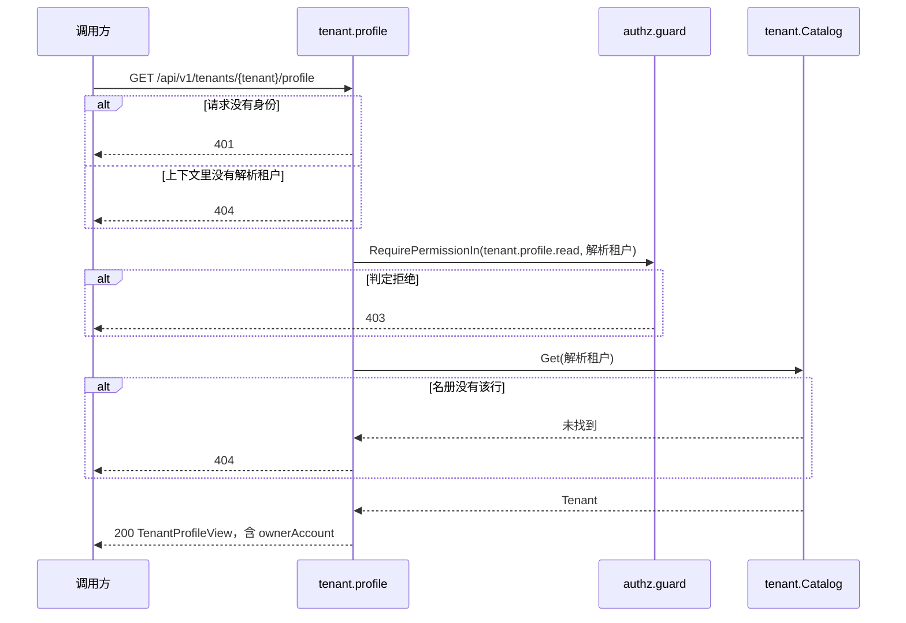

# tenant.profile

`tenant.profile` 是租户功能的组织资料模块，包 `pkg/tenant/profile`。它把组织资料的读取与写入做成两条租户面路由，挂在 `/api/v1/tenants/{tenant}/profile` 下；它不交付任何功能接口，不持表，也不持资料的取值域。资料的边界、归一与校验归根包 `pkg/tenant` 的 `Profile`，读写经 `tenant.Catalog` 完成。读职责清单前应持有的一句话心智模型是：**这是组织自己的管理员读写组织资料的那条路由，判定在请求解析到的那个租户里做出，平台域被拒绝。**

## 职责

- 读一条组织资料：`GET /api/v1/tenants/{tenant}/profile` 在请求解析到的租户里询 `tenant.profile.read`，经 `tenant.Catalog.Get` 读名册行，答 200 加一份 `TenantProfileView`。名册没有该行时答 404，读不写审计行。
- 写四个描述字段：`PATCH /api/v1/tenants/{tenant}/profile` 在同一个租户里询 `tenant.profile.write`，正文携带展示名、描述、联系邮箱与网站四项，空串清空；写经 `tenant.Catalog.SetProfile`，只动这四个资料列，答 200 加写后的视图。
- 在写之前拦住未证明邮箱的发起者：读取发起者账户的注册验证状态，`SignupPending` 答 403 `contact-required`，读取失败答 503，动作都不执行；读路由不受这道门控影响。
- 在写之前落一行强制档审计：审计动作 `tenant.profile.update`，明细带动作标识、租户与 `surface: tenant`；审计写不进则答 503，名册写不执行；名册拒绝时再尽力写一行与允许行以动作标识关联的失败行。
- 在视图里交付组织所有者：`TenantProfileView.ownerAccount` 取自名册行的所有者列。该字段只出现在本视图与平台管理面的租户视图上，成员可读的视图都不带它。
- 把路径里的租户段交给租户管理路由守卫：路径租户必须等于请求解析到的租户，平台域被拒绝；判定与视图都不在平台域成立。
- 声明静态[特性](../../../glossary.md) `tenant.profile`，前端据它的名字对组织资料页与导航做条件显示。

### 非职责

- **不持有名册。** 租户表、迁移与快照归 [tenant.catalog](design-tenant.md)；本模块只经 `tenant.Catalog` 读行与写资料列。
- **不持有资料的取值域。** 资料的字段上限、`Normalize` 与 `Validate` 归根包 `pkg/tenant`；本模块调用它们，不复述规则。
- **不定义权限码。** `tenant.profile.read` 与 `tenant.profile.write` 声明在授权的中央目录 `pkg/authz/policy`，翻译在 `pkg/authz/internal/translation`；本模块不声明权限规格。
- **不判定成员身份与角色。** 权限判定由 handler 内的 `authz.guard` 做出，准入与路径核对由租户解析与管理路由守卫做出。
- **不提供停用来源、状态写与所有者转移。** 平台管理面的租户视图、状态写与所有者转移归 [tenant.admin](design-tenant-admin.md)。
- **不提供成员列表。** 成员关系与角色归认证管理面，见 [authn.admin](../authn/design-authn-admin.md)。

## 外部接口契约

### 路由

| 方法 | 路径 | 权限 | 应答 |
|---|---|---|---|
| `GET` | `/api/v1/tenants/{tenant}/profile` | `tenant.profile.read`，在解析租户的策略域 | 200 加 `TenantProfileView` |
| `PATCH` | `/api/v1/tenants/{tenant}/profile` | `tenant.profile.write`，在解析租户的策略域；发起者须已证明邮箱 | 200 加写后的 `TenantProfileView` |

两条路由都由 `speedhttp.TenantAdminRouteGuard` 包裹，该守卫由 `pkg/tenant/resolve` 交付：路径里的租户段被核对为请求解析到的租户，平台域被拒绝，核对不过答 404。挂载时缺少这个守卫的装配在启动期被拒绝。
### 视图

`TenantProfileView` 逐字段从 `tenant.Tenant` 构造，字段是 `id`、`alias`、`displayName`、`description`、`contactEmail`、`website`、`ownerAccount`、`status` 与 `createdAt`。四个描述字段为空串时照常出现；`createdAt` 每一行都有，不是可空字段；`status` 取 `active`、`disabled` 或 `deleted`。

`ownerAccount` 是名册行的所有者列，原样给出账户标识。业务组织携带一个；个人组织的所有者是账户本身；平台自身的租户没有所有者，该字段是空串但仍出现。**所有者不在成员可读的视图里**：成员列表 `AuthnAdminMember` 携带成员关系自身的事实与角色，本人租户视图携带成员自己的 `id`、`alias` 与 `kind`，两者都没有所有者字段。本视图的读路由需要 `tenant.profile.read`，没有该权限的普通成员在守卫处被拒，走不到视图构造。

### 问题应答

问题类型前缀是 `urn:speed:tenant:`，本模块使用其下的 `bad-request` 与 `conflict`。401 与 404 只有状态、没有类型；403 的拒绝由守卫自己写出，未证明邮箱的 403 使用认证功能的 `urn:speed:authn:contact-required`。

### 宿主可见的接口

| 名字 | 用途 |
|---|---|
| 模块名 `tenant.profile` | 命令树点名纳入，同时是配置命名空间 |
| 配置键 `tenant.profile.endpoints` | 路由挂载的端点列表，缺省 `["api"]`，只收具体端名，拒绝 `*`、空名与重名 |
| 特性名 `tenant.profile` | 前端据它决定组织资料页与导航是否出现 |
| `openapi/tenant.profile.json` | 本模块的 OpenAPI 片段，由操作声明生成 |

## 依赖

| 依赖 | 用途 |
|---|---|
| `tenant.Catalog` | 读名册行与写四个资料列 |
| `guard.Guard` | 在解析租户的策略域内判定 `tenant.profile.read` 与 `tenant.profile.write` |
| `audit.Audit` | 写强制档审计行与尽力写的失败行 |
| `authn.SignupVerification` | 读发起者的注册验证状态，拦住未证明邮箱的写 |
| `speedhttp.Router`、`speedhttp.TenantAdminRouteGuard` | 在 `Init` 里取用：前者提供挂载位置，后者核对路径租户与平台域 |
| `authz.Gate` | 可选，在 `Init` 里取用；在场时把两条路由登记为开放，让授权中间件放行到守卫 |
| `config.Reader`、`log.Logger` | 读取端点配置；记录启动诊断与失败 |

名册、判定守卫、审计、验证状态读取与租户管理路由守卫都在描述符里声明为必需；日志可选；HTTP 入口点与路由声明接口在 `Init` 里取用。依赖方向是租户内部指向认证根包与授权根包，本模块不 import 授权的实现子包。

## UML 图

下图固定一次读的判定次序：身份、解析租户、权限判定必须先于名册读取，名册读取必须先于视图构造，因此没有 `tenant.profile.read` 的调用方既不触发名册读，也拿不到任何视图字段。

图的来源是 `pkg/tenant/profile/pipeline.go` 的 `guardRoute` 与 `pkg/tenant/profile/handlers.go` 的 `handleGet`。

## 核心数据结构

| 结构 | 字段 | 说明 |
|---|---|---|
| `TenantProfileView` | `id`、`alias`、`displayName`、`description`、`contactEmail`、`website`、`ownerAccount`、`status`、`createdAt` | 逐字段从 `tenant.Tenant` 构造；`ownerAccount` 取自行上的所有者列，没有所有者时是空串 |
| `profileBody` | `profile` | 读与写共用的应答容器 |
| `profileWriteInput` | `display_name`、`description`、`contact_email`、`website` | 写正文的四个成员，全部必填 |

视图是本模块自己的类型，不是根包的 `tenant.Tenant`：交出去的是字符串化后的字段，收进来的是校验过的正文。

## 核心算法与流程

### 走查

初始状态：名册里 `acme` 在册，所有者是 `alice`；某个[租户管理员](../../../glossary.md)持有 `acme` 的 `tenant.profile.read`，请求解析到的租户是 `acme`。

1. 调用方发 `GET /api/v1/tenants/acme/profile`。租户管理守卫核对路径里的 `acme` 与解析租户一致，拒绝平台域；请求带着调用方身份与解析租户进入本模块。
2. 本模块读到身份，读到上下文里的解析租户 `acme`，在 `acme` 的策略域内询 `tenant.profile.read`。判定放行。
3. 本模块调 `tenant.Catalog.Get(ctx, "acme")`，名册返回 `Tenant{ID: acme, Alias: acme, OwnerAccount: alice, ...}`。
4. 本模块逐字段构造视图，`ownerAccount` 是 `alice`，答 200。持久状态不变：这次读不写名册、不写审计。

同一个调用方没有 `tenant.profile.read` 时，第 2 步的判定拒绝并答 403，第 3、4 步都不执行，名册一次也没有被读。

### 写的次序

写路由的次序是身份、注册验证状态、解析租户、权限判定、正文形状、名册读取、强制档审计、`SetProfile`、构造视图。正文形状在名册读取之前检查，四项缺一答 400；强制档审计在 `SetProfile` 之前落地，审计失败答 503 且名册不写；名册拒绝按封闭映射转成 400、404、409 或 503。

## 错误与失败语义

| 情形 | 应答 |
|---|---|
| 请求没有身份 | 401，只有状态与 realm 挑战 |
| 上下文没有解析租户 | 404 |
| 没有 `tenant.profile.read` 或 `tenant.profile.write` | 403，守卫写出 |
| 写发起者的注册验证状态是 `SignupPending` | 403 `urn:speed:authn:contact-required` |
| 读注册验证状态失败 | 503 |
| 正文不是单个 JSON 对象或缺一个成员 | 400 `urn:speed:tenant:bad-request` |
| 资料越出根包取值域 | 400 `urn:speed:tenant:bad-request` |
| 名册没有解析租户 | 404，无正文 |
| 租户是墓碑 | 409 `urn:speed:tenant:conflict` |
| 强制档审计写不进，或名册报其他失败 | 503，成因只进日志 |

## 并发与事务边界

本模块不开事务。读是一次 `Get`；写是一次 `SetProfile`，只写四个资料列，不读整行再写回，因此两个副本同时改同一行时后写者生效，一次并发停用或删除不会被资料写覆盖。所有者列与资料列是同一条名册行上的不同列，资料写不改所有者；视图里的所有者是这一次读到的值，另一次转移在两次读之间提交时，视图给出转移后的所有者。名册行在 `Get` 与视图构造之间被删除时，本模块仍按读到的行作答，删除在名册自己的写路径上判定。

## 扩展点

- **端点选择。** `tenant.profile.endpoints` 决定路由挂在哪几个端上，缺省是 `api`。端必须携带租户解析与租户管理路由守卫；`*`、空名与重名在启动期被拒绝。
- **模块缺席。** 不点名本模块的命令没有这两条路由，租户能力的 `Catalog` 仍可供宿主自己的代码读写资料。模块只表态 `StateEnabled`，挂不挂是命令树上的决定。
- **路由声明。** 装配交付 `authz.Gate` 时，两条路由被登记为开放，让授权中间件把判定留给本模块的守卫；没有声明接口的装配按其规则把路由当作未声明处理。

## 实现状态

| 能力 | 状态 | 代码 |
|---|---|---|
| 模块登记、路由挂载与端点配置 | 已实现 | `pkg/tenant/profile/profile.go` `Module`、`pkg/tenant/profile/routes.go` `mount` |
| 读一条组织资料并答视图 | 已实现 | `pkg/tenant/profile/handlers.go` `handleGet`、`pkg/tenant/profile/views.go` `profileViewOf` |
| 写四个资料字段、顺序与失败映射 | 已实现 | `pkg/tenant/profile/handlers.go` `handleSet`、`pkg/tenant/profile/pipeline.go` `failureOf` |
| 注册验证门控与权限判定次序 | 已实现 | `pkg/tenant/profile/pipeline.go` `guardRoute`、`requireVerifiedAccount` |
| 强制档审计与失败行 | 已实现 | `pkg/tenant/profile/audit.go` |
| 视图里的 `ownerAccount` 与成员视图边界 | 已实现 | `pkg/tenant/profile/views.go` `TenantProfileView`、`pkg/authn/admin/views.go` `AuthnAdminMember` |
| OpenAPI 片段由声明生成 | 已实现 | `pkg/tenant/profile/openapi/tenant.profile.json`、`pkg/tenant/profile/openapi_generated_test.go` |
