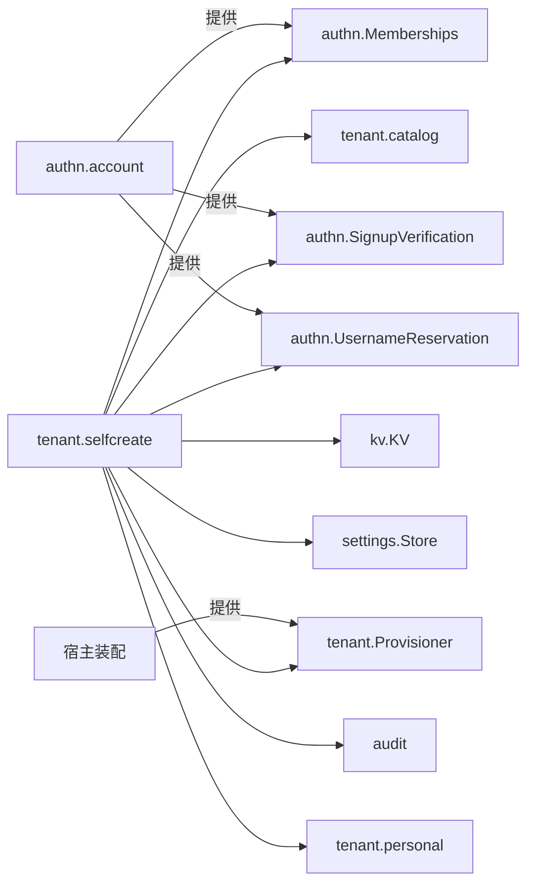
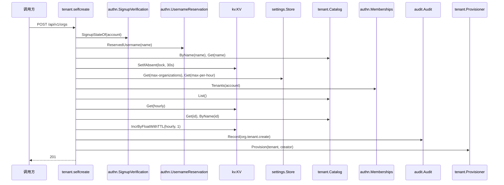

# tenant.selfcreate

`tenant.selfcreate` 是租户[功能目录](../../../glossary.md)里业务组织自助创建的公共模块，包 `pkg/tenant/selfcreate`，登记名 `org.create`。它拥有创建动作的全部判定：调用方资格、名称与资料的形状、上界、创建锁、审计与交给 `tenant.Provisioner` 的那一次建立。它不拥有名册、成员关系、授权与审计记录本身。读职责清单前应持有的一句话心智模型是：**一个没有未证明邮箱的账户在账户端请求一次自己的业务组织，模块按固定次序判定，把建立交给宿主提供的 provisioner，判定本身不写租户表**。模块作为公共模块、带上界与审计、不做人机验证的取舍见 [ADR-tenant-self-service-creation](../../../adr/adr-tenant-self-service-creation.md)。

第一遍的次序是职责与非职责、外部接口契约、依赖与 UML 图、核心数据结构与核心算法与流程。核心算法与流程从[走查](#走查)开始，用一次创建把判定次序与写入落点串起来。错误与失败语义与并发与事务边界属查阅用；实现状态在最后供核对。

## 职责

- 在账户端挂出 `POST /api/v1/orgs`：请求不解析租户，创建由调用方自己的账户决定。
- 按固定次序判定：已认证、拒绝冒充、拒绝服务账户与静态主体、邮箱证明、名称与资料形状、命名空间、创建锁、活跃业务组织上界、每小时次数、标识生成、计次、强制审计。
- 拒绝持有未证明邮箱地址的账户；没有邮箱地址的账户放行。
- 校验名称：slug 形状、保留字、不等于任何租户标识、在名册上唯一；用户名与名称共用一个命名空间。
- 把建立交给 `tenant.Provisioner`：创建者成为首任 `tenant-admin`，角色标为内置并持有治理集，成员关系来源写 `initial`。
- 声明静态配置开关 `org.create.enabled` 与条件[特性](../../../glossary.md) `org.create`；开关关闭时路由不挂、特性缺席。
- 声明两个平台运行时设置 `org.create.max-organizations` 与 `org.create.max-per-hour`，并只从全局层读取。
- 为一个已计次的尝试写强制审计行：成功行在 provisioner 之前落，provisioner 失败时补一条关联的失败行。

### 非职责

- **不持有名册。** 租户表、迁移与快照归 [tenant.catalog](design-tenant.md)；本模块只经 `tenant.Catalog` 读它。
- **不持有成员关系。** 成员关系归 `authn.Memberships`；本模块只读账户的成员关系来计数。
- **不持有授权。** 角色、授予与绑定由 `tenant.Provisioner` 的实现写入；本模块不写授权行。
- **不持有审计记录。** 审计行归审计能力；本模块只经 `audit.Audit` 请求写入。
- **不决定账户资格。** 邮箱是否已证明由 `authn.SignupVerification` 回答；本模块不读账户表。
- **不实现宿主的 provisioner 与写保护。** 首任管理员的建立、成员关系的写入与租户写保护是宿主装配的职责。
- **不做人机验证。** 本模块不校验人机验证证明；上界与审计是这一轮的防滥用手段。

## 外部接口契约

### 创建路由

路由挂在 `account` 端，绝对路径 `/api/v1/orgs`，操作标识 `org.create.create`，声明在模块自己的 OpenAPI 分片里。请求体：

| 字段 | 含义 |
|---|---|
| `name` | 必填。对外的 slug，三到六十三个小写字母、数字与连字符，以字母或数字开头；创建后不可改 |
| `display_name` | 必填。显示名，去空白后一到一百个 rune |
| `description` | 可选。描述，去空白后至多五百个 rune |

成功应答 201，携带生成的组织标识、名称、显示名、描述与 `active` 状态。拒绝是 400（形状或保留字）、401（没有身份）、403（冒充、服务账户、静态主体或邮箱未证明）、409（`creation-in-progress`、`organization-limit` 或 `identifier-unavailable`）、429（`rate-limited`，带 `Retry-After`）与 503（依赖无法回答）。问题类型落在 `urn:speed:org:` 命名空间。

开关关闭时本模块不挂 `/orgs`，该路径到达账户端自己的 404。个人租户没有路由：它在账户创建事务里写入，不占用账户端的任何路径。

### 开关与特性

`org.create.enabled` 是主配置源与环境变量可写的静态开关。产品的缺省是打开，由宿主的默认文档写入；模块的配置原型不携带默认值，因而不写这个键的宿主得到关闭。开关关闭时模块表态 `StateDisabled`，路由不挂，条件特性 `org.create` 不投递；前端应把它读作特性缺席。

### 运行时设置

两个数值项由本模块声明：

| 键 | 缺省 | 取值域 | 含义 |
|---|---|---|---|
| `org.create.max-organizations` | 5 | 正整数 | 一个账户可持有的活跃业务组织上界；个人租户与停用租户不计 |
| `org.create.max-per-hour` | 3 | 正整数 | 一个账户每小时的创建次数上界；通过全部前置校验并进入 provisioner 的请求计一次，provisioner 失败也消耗 |

声明的 `settings.Schema` 不设 `TenantFacing`，两个 `Item` 的 `TenantAccess` 保持零值 `TenantNone`，`Control`、`Danger` 与 `Effect` 同样保持零值。这是 fail-closed：未显式打开 `TenantFacing` 的键默认属于平台层。租户设置面的读取按声明过滤，因而看不到 `org.create.*`；租户的 PUT 与 DELETE 对这两个键答 404，与“不可见”一致。平台设置面按声明列出并允许编辑这两个整数项；消费者只读全局层。

开关本身不进 `settings.Schema`：它是静态配置，不是运行时可改项。

### 宿主可见的导出面

模块导出登记名、特性名、路由路径与描述符：

| 名字 | 用途 |
|---|---|
| `ModuleName`、`FeatureName` | 命令树与特性文档里的名字；都是 `org.create` |
| `RoutePath` | 创建路由的绝对路径 |
| `Module` | 宿主登记的描述符 |

登记名与特性名同为 `org.create`，这是特性文档的命名规则决定的：一个特性的首段必须等于声明它的模块名的首段。包路径仍是 `pkg/tenant/selfcreate`，两者不要求同名。

### 对外接口

路由路径、操作标识、请求与应答字段、拒绝状态与三个 `org.*` 错误码是前端与生成的客户端据以分支的事实，改动它们是宿主可见的破坏性变更。配置键 `org.create.enabled` 与两个设置键同样在对外接口上。

## 依赖

名册、成员关系、邮箱证明、保留字答案、provisioner、键值存储、设置存储与审计是必需依赖。`authn.UsernameReservation` 由账户模块排他交付：它把内置保留名与部署追加的保留名放在一处，名称因此拒绝与用户名写入相同的名字集。`tenantpersonal.IsPersonalTenantID` 用于计数时排除个人租户，前缀判定对任何账户的个人租户都成立，正是计数要的口径。

`tenant.Provisioner`、`authn.Gate`、`feature.Board`、HTTP 入口点与 logger 中，只有 provisioner 是必需依赖，其余按装配在场与否决定挂载与投递。

## UML 图

一次成功创建的消息次序：

## 核心数据结构

本模块不声明表。它读写三类值：

- **租户值**：交给 provisioner 的 `tenant.Tenant`，携带生成的 `org-<uuid>` 标识、调用方给出的名称、`active` 状态、创建者作为 owner 与调用方给的资料。
- **键值键**：创建锁 `org.create.lock.<account>`，存活三十秒；每小时计数 `org.create.hourly.<account>.<UTC 整点秒>`，过期时间落在下一个整点之后。
- **审计行**：动作 `org.tenant.create`，对象是租户标识，明细带动作标识、账户与租户；成功行与失败行由同一个动作标识关联。

请求与应答的字段见[创建路由](#创建路由)。

## 核心算法与流程

### 走查

初始状态：账户 `alice` 已证明邮箱，名册里没有名称 `acme-team`，账户不持有任何业务组织，当前小时没有创建记录。

1. 请求带 `name=acme-team`、显示名与描述到达。模块读到身份，拒绝冒充、服务账户与静态主体。
2. `SignupStateOf` 回答已证明；资料去空白后显示名非空且在界内；`tenant.IsName` 接受名称；`ReservedUsername` 回答不是保留名。
3. `ByName` 与 `Get` 都未命中，名称可用。
4. 创建锁写入成功；`Tenants` 读到个人租户，`List` 读到它处于在册，计数为零；每小时计数为零。
5. 生成 `org-<uuid>`，标识与名称都不在名册上；开始计次，写入强制审计行。
6. `Provision` 写角色、授予、名册行、内置标记、创建者的成员关系与绑定；成员关系来源 `initial`。
7. 应答 201；`defer` 释放创建锁。

持久状态：名册里多一行 `org-<uuid>`/`acme-team`，账户在它里面有一条有效成员关系与一条 `tenant-admin` 绑定，审计里有一条成功行，键值里当前的每小时计数加一。

### 判定次序

判定次序固定，前置拒绝不写计数：

1. 已认证；没有身份答 401。
2. 冒充身份答 403，先于一切读取。
3. 服务账户与静态主体答 403。
4. 邮箱证明：`SignupPending` 答 403 `authn.contact_required`；读取失败答 503；`SignupNone` 与已证明放行。
5. 资料与名称的形状：显示名为空、资料越界、名称不是 slug，或保留名，答 400。
6. 名称可用：名册上作为名称或标识被占用，答 409 `org.identifier_unavailable`。
7. 创建锁：取不到答 409 `org.creation_in_progress`。
8. 活跃业务组织上界：达到上界答 409 `org.organization_limit`。
9. 每小时次数：达到上界答 429 `org.rate_limited`，带 `Retry-After`。
10. 生成自由标识；重试三次仍冲突答 409 `org.identifier_unavailable`。
11. 计次：失败答 503，本次不建立。
12. 强制审计：写不下答 503，本次不建立。
13. `Provision`：`ErrTenantExists` 或 `ErrNameConflict` 是另一个副本先到，答 409 `org.identifier_unavailable`，不再补第二条审计行；其余失败补齐关联的失败行并答 503。

### 上界与锁

**活跃业务组织按“有效成员关系、租户在册、非个人”计数。** 成员关系先读一次，名册再读一次，计数两次读完成；个人租户与停用租户都不计。

**每小时次数只计通过全部前置校验的尝试。** 计次发生在强制审计与 provisioner 之前，因而 provisioner 的失败同样消耗一次；形状、邮箱、名称、锁、组织上界与限流的拒绝都不计。

**创建锁是每账户一把，存活三十秒。** 并发请求只有一个能取到锁，其余得到 `creation-in-progress`；请求结束（无论成功、拒绝或失败）都尽力释放锁，TTL 是进程在释放前停止时的兜底。多副本依赖共享键值存储；内存键值只保证单副本内的互斥。

### 名称与命名空间

调用方给的值先去首尾空白，再按 `tenant.IsName` 判定：三到六十三个小写字母、数字与连字符，以字母或数字开头。模块不折叠大小写，也不改写其余内容。

保留名由 `authn.UsernameReservation` 回答：内置保留名、部署经 `authn.account.reserved-usernames` 追加的名字，以及 `personal-` 前缀。名称与用户名共用这个集合，因为两者共用一个请求侧命名空间。

名称还不得等于任何租户的标识，也不得被任何租户作为名称持有（[ADR-tenant-identifier](../../../adr/adr-tenant-identifier.md)）。用户名与名称的互斥由个人租户承担：个人租户的名称就是账户的用户名，因此 `ByName` 对一个已存在的用户名同样命中。反过来，新用户名等于一个业务组织的名称时，账户创建事务在写个人租户行处得到 `ErrNameConflict` 并整体回滚；个人租户模块把该失败包装成账户模块的“标识已存在”，账户创建以 409 拒绝。

并发的名称竞争由名册的 `tenants.name` 单列唯一约束仲裁：两个请求都通过预检时，后到者的 provisioner 得到 `ErrNameConflict`，答 409 `org.identifier_unavailable`，先到者的行保留。

### 审计

每次进入 provisioner 的尝试先写一条成功行，明细带动作标识、账户与租户。provisioner 失败时补一条失败行，与成功行用同一个动作标识关联。前置拒绝不写审计行：审计记录的是尝试，不是被拒的调用。名称的跨副本冲突不再补第二条行，因为这一次请求的强制行已经落过。

## 错误与失败语义

| 情形 | 结果 |
|---|---|
| 没有身份 | 401 |
| 冒充、服务账户、静态主体 | 403 |
| 邮箱未证明 | 403 `contact-required` |
| 邮箱状态读取失败 | 503 |
| 显示名或名称形状不合法，或名称是保留名 | 400 |
| 名称是现有租户的名称或标识 | 409 `identifier-unavailable` |
| 创建锁被占用 | 409 `creation-in-progress` |
| 活跃业务组织达到上界 | 409 `organization-limit` |
| 每小时次数达到上界 | 429 `rate-limited`，带 `Retry-After` |
| 生成标识连续冲突 | 409 `identifier-unavailable` |
| 设置读取失败或读出非正数 | 503 |
| 计次失败 | 503 |
| 强制审计落不下 | 503 |
| provisioner 报名称冲突 | 409 `identifier-unavailable`，不再补失败行 |
| provisioner 其他失败 | 503，补一条关联的失败行 |
| 开关关闭 | 路由 404，特性缺席 |

## 并发与事务边界

**模块自己不写租户、成员关系与授权，也不开事务。** 建立由 `tenant.Provisioner` 完成，它的实现决定写入次序与失败清理；模块只在 provisioner 返回后读错误并作答。

**同一账户的并发创建由创建锁串行。** 只有一个请求能进入 provisioner，其余在锁处得到 409；锁的 TTL 是进程停止时的兜底。

**跨副本的名称与标识竞争由名册的唯一约束仲裁。** 预检读的是本副本的快照，可能落后于别的副本；provisioner 的 `ErrTenantExists` 与 `ErrNameConflict` 是最终裁决，模块把它们答成同一个 409。

**多副本的上界依赖共享键值存储。** Redis、PostgreSQL、NATS 与 memcached 的键值实现让每个副本看到同一把锁与同一个计数；内存键值只在单副本内成立，部署文档要写明这一前提。

## 扩展点

本模块不提供改写判定次序的接口。上界由两个运行时设置调整；开关决定功能是否存在；保留名集合由账户模块的声明与部署设置决定。新增一类资格判定或一个新的上界是一次代码改动，而不是装配改动。

## 实现状态

| 能力 | 状态 | 代码锚点 |
|---|---|---|
| 模块描述符、开关与条件特性 | 已实现 | `pkg/tenant/selfcreate/selfcreate.go` `Module`、`configSchema`、`readConfig` |
| 创建路由与判定次序 | 已实现 | `pkg/tenant/selfcreate/handlers.go` `(*product).handleCreate`；`operations.go` `createOperation` |
| 名称形状、保留名与命名空间 | 已实现 | `handlers.go` `(*product).nameAvailable`；`pkg/authn/reserved.go` `UsernameReservation` |
| 两个运行时设置与平台层写入 | 已实现 | `selfcreate.go` `settingsSchema`；`settings_test.go` `TestThePlatformLayerWritesBothNumericLimits` |
| 活跃业务组织与每小时上界 | 已实现 | `handlers.go` `(*product).activeBusinessOrganizations`、`hourlyCount`、`recordAttempt` |
| 创建锁 | 已实现 | `handlers.go` `(*product).handleCreate`、`lockKeyOf` |
| 审计行 | 已实现 | `handlers.go` `(*product).auditRequired`、`auditBestEffort` |
| 宿主装配 | 已实现 | `starters/demo/server/main.go` `baselineServe`；`starters/demo/server/defaults.go` `org.create.enabled` |
