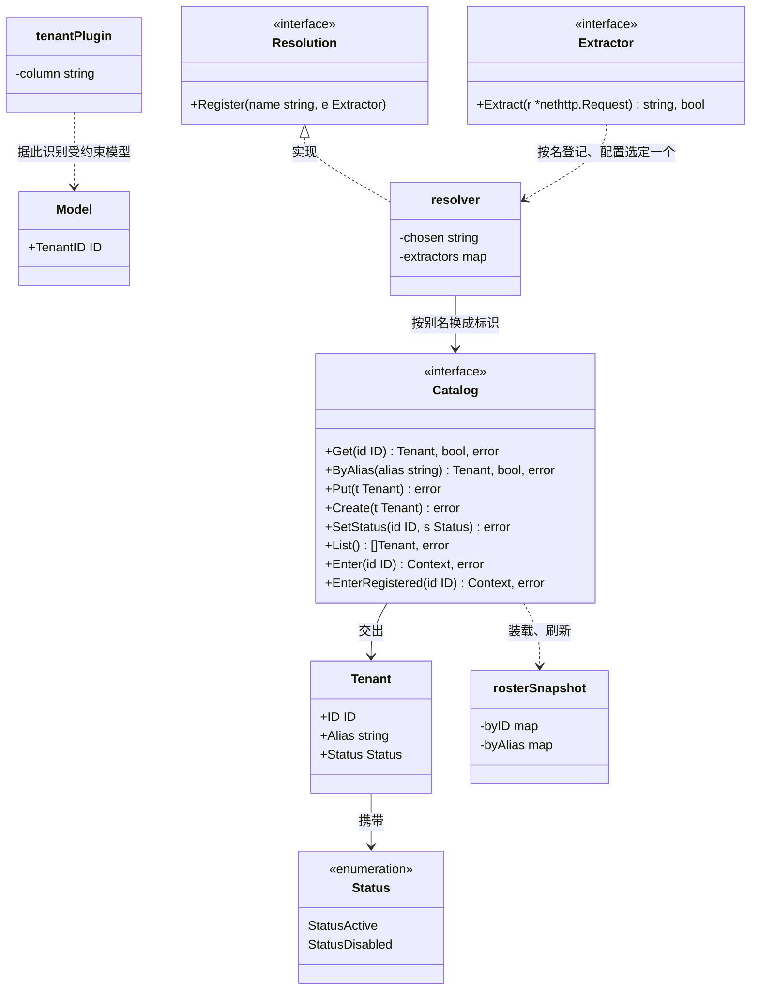
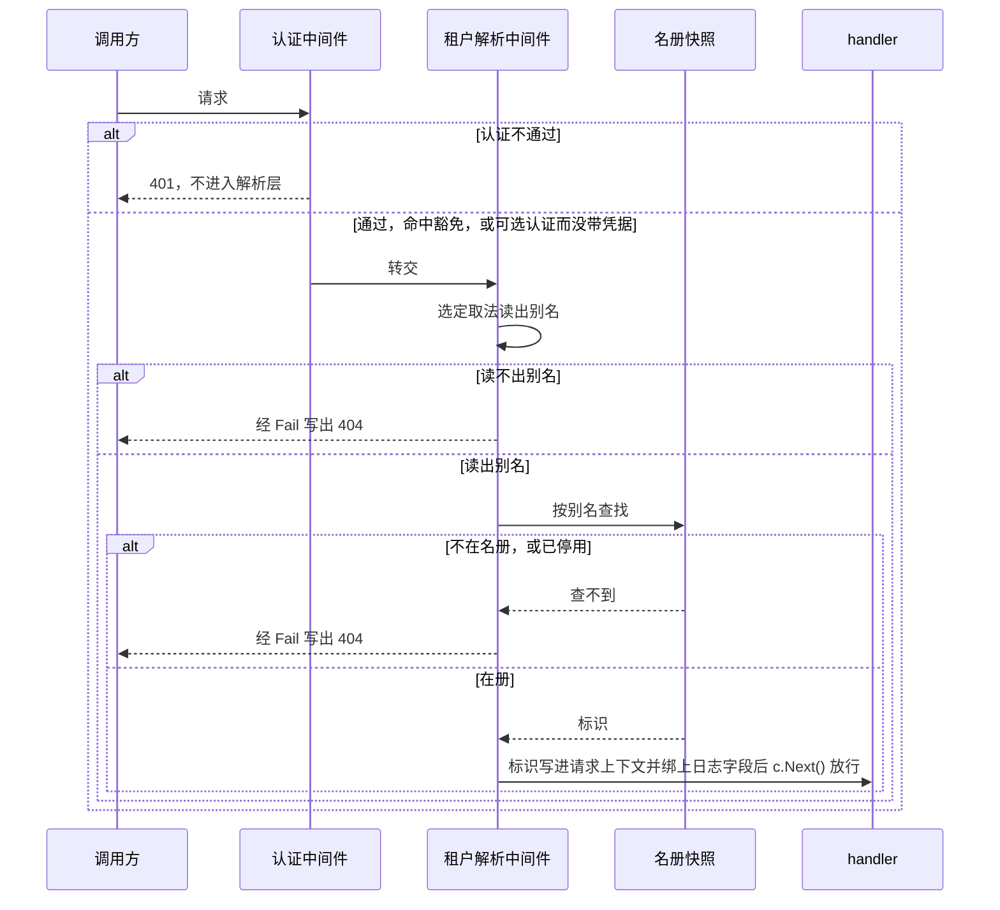
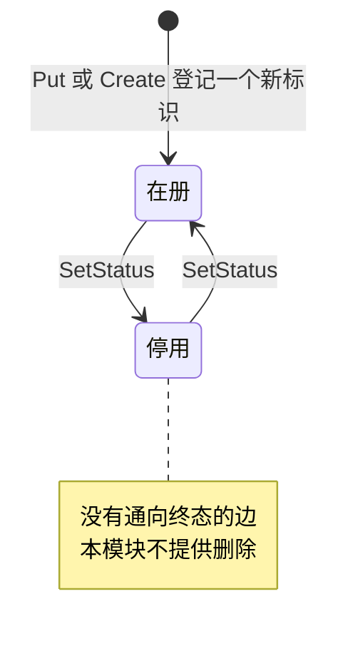
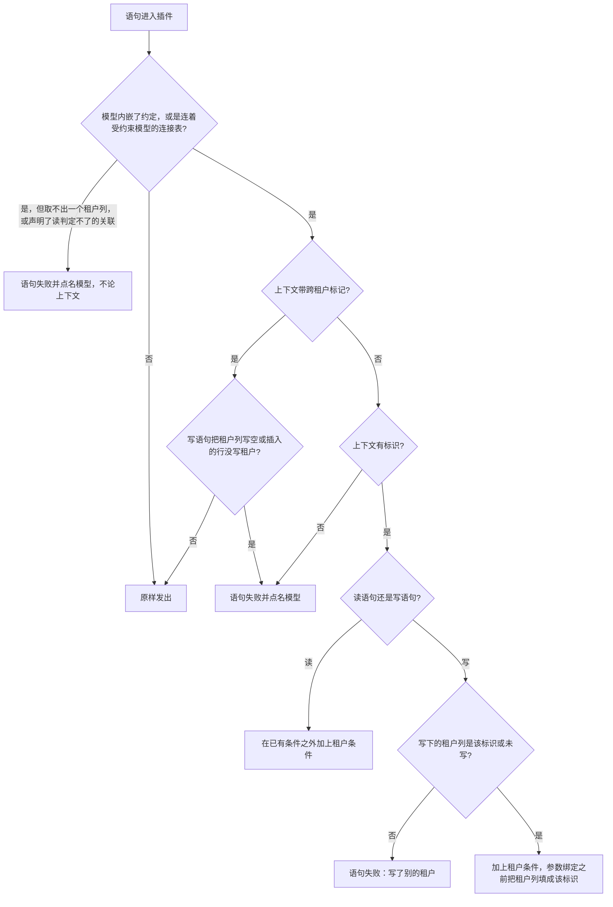

# tenant

## 职责

- 在监听端的中间件链上认定每条请求属于哪个租户：按配置选定的取法从请求面取出租户名，经名册换成不可变标识，写进请求上下文。
- 维护租户名册：租户的登记、别名与状态，以及它在内存里的快照。
- 定义受租户约束的模型的约定，并以一条 GORM 插件把租户条件作用于每一条针对这类模型的语句。
- 提供跨租户的唯一途径，并要求它在调用点字面写出。
- 为不经请求面的路径提供进入单个租户的途径，进入之前经名册核对：一条进入正被服务的租户，另一条连停用的租户也进入，供停用期间仍属于那个租户的工作使用。
- 把租户标识作为关联字段绑上 logger。
- 定义取法的接缝。
- 在已认定身份与租户的请求上，判定这个账户是否被准入这个租户，并执行租户对其成员的认证强度要求与冒充的租户范围；这一层是准入层，全文见 [design-tenant-admission](design-tenant-admission.md)。

本功能目录由接口包与各实现子包组成。`pkg/tenant` 根包定义功能接口、数据类型、模型约定与准入层的定序锚点，**自身不注册模块，也不导出模块名常量**；解析住在自己的子包并注册一个模块，名册住在自己的子包并注册一个模块，两者各自排他交付（[ADR-tenant-packaging-2026-09-21](../../../adr/adr-tenant-packaging-2026-09-21.md)、[ADR-module-packaging-2026-09-14](../../../adr/adr-module-packaging-2026-09-14.md)）。准入层同样住在自己的子包并注册一个模块，全文见 [design-tenant-admission](design-tenant-admission.md)。下文的"解析模块"与"名册模块"分别指解析子包与名册子包所注册的模块，本文不写准入层的内部。

租户的认定、名册的维护与语句的过滤同属本功能目录，请求期的成员准入由本功能目录的准入层承担，按租户取值的参数归[设置模块](../design-settings.md)，按租户的授权判定归授权（[ADR-tenant-scope-2026-09-21](../../../adr/adr-tenant-scope-2026-09-21.md)）。

**根包不导出模块名常量**，判据与认证的同一条：导出它没有对应的登记，宿主拿一个无人登记的名字去纳入，得到的是一个不在可用集里的名字，而命令树对未登记名字的处置在配置模块的哨兵表里没有对应项（见 [config](../design-config.md)）。

### 非职责

- **不做授权判定，从不写 403。** 本模块回答"这条请求、这条语句属于哪个租户"，准入层另回答"这个账户是不是这个租户的成员"；"这个租户或这个调用方能不能做这件事"归授权，它另立（[ADR-authn-scope-2026-10-10](../../../adr/adr-authn-scope-2026-10-10.md)）。准入层的拒绝应答由 [design-tenant-admission](design-tenant-admission.md) 规定，本模块不写 403。
- **不认定调用方是谁，不读 `Authorization`；解析层与名册不读身份。** 认定是认证模块的事，本模块不改动 `Identity`。身份与租户的对照只发生在准入层：它读认证写进上下文的身份与解析层写进上下文的租户，不改写其中任何一个（[ADR-tenant-resolution-2026-09-21](../../../adr/adr-tenant-resolution-2026-09-21.md)、[design-tenant-admission](design-tenant-admission.md)）。
- **不承载运行期可变的参数。** 判据是该值是否在数据库可用之前就被需要；取法与监听端清单在其列，租户的增删不在（[ADR-config-scope-2026-09-13](../../../adr/adr-config-scope-2026-09-13.md)）。
- **不管理租户内的账户、成员关系、角色与组织结构。** 账户全局、可属多个租户，账户与成员关系归认证（成员关系是认证的一张表，准入层只读它，见 [design-authn-account](../authn/design-authn-account.md)），角色归授权；一个租户的存在，与它内部有哪些成员，是两件事（[ADR-tenant-scope-2026-09-21](../../../adr/adr-tenant-scope-2026-09-21.md)）。
- **不做配额、计费与限流。**
- **不提供配置式的租户清单。** 租户的增删是运行期动作，配置是启动时的快照（[ADR-config-lifecycle-2026-09-13](../../../adr/adr-config-lifecycle-2026-09-13.md)）。
- **不认识别的模块的模型。** 一个本该受约束却没有内嵌约定的模型，本模块判不出来，也不提供"哪些模型应当受约束"的清单（[ADR-tenant-isolation-2026-09-21](../../../adr/adr-tenant-isolation-2026-09-21.md)）。
- **不代替宿主决定哪条命令纳入租户。** 模块不声明、也无从知道自己出现在哪条命令下（[ADR-command-tree-2026-09-20](../../../adr/adr-command-tree-2026-09-20.md)）。
- **不保证隔离。** 按租户过滤在框架层没有机制保证（[ADR-db-scope-2026-09-14](../../../adr/adr-db-scope-2026-09-14.md)），本模块把这一条承接为对外口径，逐条写在非保证一节（[ADR-tenant-guarantees-2026-09-21](../../../adr/adr-tenant-guarantees-2026-09-21.md)）。
- **不提供租户的数据导出、删除与搬迁。** 它们要读受约束表里每个租户的数据量，那是应用自己的领域动作。
- **不为租户建立独立的库、schema 或连接。** 经模块机制交付的库只有一个，配置给出的或宿主预置的（[ADR-db-multiplicity-2026-09-14](../../../adr/adr-db-multiplicity-2026-09-14.md)）。
- **不记录谁在何时改了名册。** 留痕由[审计模块](../design-audit.md)经数据库模块的插件扩展点承担（见 [db](../design-db.md)）。

## 术语表

以下术语的含义限于本模块，以及租户主题的决策记录。

| 术语 | 英文 | 定义 |
|---|---|---|
| 取法 | extractor | 从请求面取出一个租户名的一份实现。按名登记，由配置选定，一次运行里只有一份生效。 |
| 别名 | alias | 请求面上出现的租户名。在名册上唯一，可改，不承担任何判定。 |
| 标识 | ID | 一个租户的不可变标识。受约束表的那一列存它，日志与诊断写它。 |
| 名册 | roster | 本模块自带的、记录全部租户及其别名与状态的表，以及它在内存里的快照。 |
| 受约束模型 | scoped model | 内嵌了本模块约定、GORM 从约定解析出一个租户列的模型；多对多关联的连接表，只要关联的键把受约束一侧的租户写进它的一列，也是受约束模型，那一列就是它的租户列。它的每一条语句都带租户条件，插入由插件填那一列。内嵌了约定却取不出一个租户列的模型、取不出一个租户列的连接表、声明了读判定不了的多对多关联的模型都不是受约束模型，它们的语句一律被拒绝。 |
| 准入层 | admission layer | 在已认定身份与租户的请求上，判定这个账户是否被准入这个租户的中间件层，由 `tenant.admission` 交付；本文只写它与解析层、名册相接的地方，全文见 [design-tenant-admission](design-tenant-admission.md)。 |
| 跨租户 | cross-tenant | 一条语句有意不带租户条件的状态。只由调用点显式建立，不由任何配置或默认值产生。 |

## 外部接口契约

### 登记单元与名字

| 登记单元 | 模块名 | 交付 |
|---|---|---|
| 解析子包 | `tenant.resolve` | 排他地交付解析功能 |
| 名册子包 | `tenant.catalog` | 排他地交付名册功能 |
| 准入子包 | `tenant.admission` | 排他地交付准入层的定序锚点与 `authn.ScopeGuard`，全文见 [design-tenant-admission](design-tenant-admission.md) |
| 根包 | 不登记 | 只有接口、数据类型、模型约定、取值域判据与准入层的定序锚点 `Admission` |

每个登记模块的包导出自己的 `ModuleName` 常量，配置命名空间取同一个取值。名字的每一段只用小写字母、数字与短横线：`Namespace` 按 `.` 切段后适用配置键的字符集规则，违反它会从环境变量名那一头破坏分层（见 [config](../design-config.md)）。


### 交付的功能

功能标识的元素类型必须是接口，取用写作 `core.Resolve[tenant.Resolution](reg)` 与 `core.Resolve[tenant.Catalog](reg)`。

```go
// Resolution 是解析模块交付的功能，同时是取法的登记面。
type Resolution interface {
    // Register 登记一个具名取法，供配置按名选定。
    // 名字非空且不含空白；重名终止启动。
    Register(name string, e Extractor)
}

// Catalog 是名册模块交付的功能：名册的读写面。
type Catalog interface {
    // Get 按标识取一个租户。不存在时第二个返回值为假。
    Get(ctx context.Context, id ID) (Tenant, bool, error)
    // ByAlias 按别名取一个租户，即解析层走的那条路。
    ByAlias(ctx context.Context, alias string) (Tenant, bool, error)
    // Put 登记一个新租户，或者改写一个既有的租户。
    Put(ctx context.Context, t Tenant) error
    // Create 登记一个尚未登记的租户。名册表里已有这个标识报 ErrTenantExists，什么也不写。
    Create(ctx context.Context, t Tenant) error
    // SetStatus 改一个租户的状态。停用只走这一条，不删数据。
    SetStatus(ctx context.Context, id ID, s Status) error
    // List 列出全部租户，按标识排序。
    List(ctx context.Context) ([]Tenant, error)
    // Enter 返回一个属于这个租户的上下文，供不经请求面的路径使用。
    // 名册上没有它报 ErrInvalidTenant，已停用报 ErrTenantDisabled。
    Enter(ctx context.Context, id ID) (context.Context, error)
    // EnterRegistered 与 Enter 相同，只是不论状态：停用的租户也进入。
    // 名册上没有它报 ErrInvalidTenant。
    EnterRegistered(ctx context.Context, id ID) (context.Context, error)
}
```

解析模块与名册模块的交付声明分别写作 `Provides: []core.Provision{{Token: (*Resolution)(nil), Exclusive: true}}` 与 `Provides: []core.Provision{{Token: (*Catalog)(nil), Exclusive: true}}`。**这两个模块的排他性不可局部违反**：解析排他，因为两层解析同时在链上时上下文里那个租户由哪一层写的说不清；名册排他，因为两份名册等于两个真相（[ADR-tenant-packaging-2026-09-21](../../../adr/adr-tenant-packaging-2026-09-21.md)）。准入模块的交付声明与排他见 [design-tenant-admission](design-tenant-admission.md)。

**解析模块与名册模块的表态只能是 `StateEnabled`，永不 `StateAuto`**（形态与理由见认证网关的那一条，[ADR-authn-packaging-2026-10-10](../../../adr/adr-authn-packaging-2026-10-10.md)）：排他加 `StateAuto` 正是消解要禁用的那一格。表态不表达跑不跑，被这条命令纳入的模块缺项即启动失败（[ADR-module-enablement-2026-09-21](../../../adr/adr-module-enablement-2026-09-21.md)）。解析模块在 `Prepare` 里缺监听端清单或选定的取法时报故障，启动终止，错误点名缺的是哪一个键；**名册模块没有可缺的输入项**——刷新周期有默认值——配置缺项这一档对它不存在，不想要名册的命令不纳入它。

### 租户与请求上下文

```go
// ID 是一个租户的不可变标识。
type ID string

// Value 实现 driver.Valuer：取值域之外的标识拒绝被绑定进语句。
func (id ID) Value() (driver.Value, error)

// IsIdentifier 报告 s 是否落在标识的取值域内：非空，且不含空白与控制字符。
func IsIdentifier(s string) bool

// Tenant 是名册上的一行。
type Tenant struct {
    ID     ID      // 不可变标识
    Alias  string  // 请求面出现的名字，唯一，可改
    Status Status  // 在册或停用
}

// Status 是一个租户的状态。取值是一个封闭集合。
type Status int

const (
    // StatusDisabled 是零值：状态列未被写入，或写入了本版本不认识的取值，都读作停用。
    StatusDisabled Status = iota
    // StatusActive 是在册。
    StatusActive
)

// FromContext 取出本次请求的租户标识。没有租户时第二个返回值为假。
func FromContext(ctx context.Context) (ID, bool)
```

**注入口不导出，`FromContext` 不回落**，与认证的身份同形、同因（[ADR-tenant-resolution-2026-09-21](../../../adr/adr-tenant-resolution-2026-09-21.md)）：回落等于把一条没有租户的请求读成某个租户，导出注入口等于让链上任何一层改写租户。**写入侧只有两个写入者，都在本功能目录里，都先读名册**：解析层在放行一条请求时写，名册的两个进入方法 `Enter` 与 `EnterRegistered` 在一条不经请求面的路径进入租户时写（见不经请求面的路径）。

代价是下游必须自己处理第二个返回值为假的那一档：未被本模块守护的监听端、本模块不在参与集里的进程、没有进入任何租户的后台路径，上下文里都没有租户；宿主为解析模块预置的实例不是该模块的产物时，解析层不登记，经请求面到达的请求同样没有租户（见阶段行为）。**认证层放行的没有身份的请求不在这一列**——登记为豁免的路由，以及登记为可选认证而没带凭据的请求，认证层都放行；解析层排在认证之内，照常解析它们的租户，在受守护的端上它们同样要在请求面带着租户名（认证层的登记见 [authn-gate](../authn/design-authn-gate.md) 的登记的比对）。

**取值域之外的标识绑不进语句。** 空标识以 `ErrNoTenantInContext` 拒绝，含空白或控制字符的标识以 `ErrInvalidTenant` 拒绝；拒绝发生在驱动绑定参数的那一刻，因而对插入的租户列与按取值点名租户的条件同样成立，与语句跑在哪个句柄上、有没有装插件无关。这是约定随身带着的一道防线：一个没被填过的租户列里是空串，而非空约束挡得住 NULL、挡不住空串。拒绝之外取值仍一并交回，读值而丢弃错误的调用方——GORM 按主键取值给行做键时就是这样——拿到的是它要的字符串，而不是一个会让它 panic 的空值。

**写进上下文的是标识，不是别名。** 别名可改，因而不承担任何判定；日志、启动诊断与错误文本一概写标识，需要人能认出来的场合另外带上别名（[ADR-tenant-identifier-2026-09-21](../../../adr/adr-tenant-identifier-2026-09-21.md)）。

**`Status` 的零值读作停用。** 零值必须有确定的读法，且不得落在宽松的一侧——认证把零值判决读成拒绝，形状与此同源（[ADR-authn-verdict-2026-10-10](../../../adr/adr-authn-verdict-2026-10-10.md)）。一行没有被写入状态，或者写入了本版本不认识的取值，读出来都是停用，那个租户因而不会被解析出来。`Put` 取整份记录，漏填状态即落成停用；调用方要它立即被服务，就把 `StatusActive` 写在明处。

### 取法的接缝

```go
// Extractor 从请求面取出租户名。取不到时第二个返回值为假。
type Extractor interface {
    Extract(r *nethttp.Request) (string, bool)
}
```

取法只收请求面，交回一个租户名——**别名，不是标识**。把名字换成标识是名册的事，取法不认识名册。

名字非空且不含空白即合法，其余由名册判定。取法读不到名字时交回假，解析层据它决定这条请求属于哪个租户，处置见请求期的收口一节。

本模块内建的取法是 `header`、`subdomain` 与 `path`（封闭集），按这几个名字登记，分别从一枚请求头、从子域名、从路径前缀取。它们的参数与选定项并列挂在 `tenant.resolve` 下：`header-name` 给头名，`subdomain-index` 与 `path-index` 给取第几段。

**子域名取法把读到的那一段标签转成小写再交出。** 主机名不区分大小写，`ACME.example.com` 与 `acme.example.com` 是同一个主机，必须落到同一个租户上；名册按字节比对别名，两种写法合成一个名字只能在这里做。经子域名取法服务的租户，别名因而登记成小写。请求头与路径段的取值区分大小写，另两种取法原样交出。

**经 `Resolution.Register` 接入的取法，把参数声明在它自己所属模块的命名空间下。** 输入项的清单收集覆盖全部已注册模块，与本次选中哪条命令无关（见 [config](../design-config.md)），因而一个取法模块有自己的命名空间可用。把它挂进 `tenant.resolve` 会与内建项同处一个命名空间，键一旦撞上就是收集阶段的冲突，进程起不来；两个模块的命名空间可以相同，前提是输入项路径不相交，而把这件事交给第三方去保证，不如给它一个自己的命名空间。

**一次请求只由一种取法解析**（[ADR-tenant-resolution-2026-09-21](../../../adr/adr-tenant-resolution-2026-09-21.md)）。配置选定一个名字，其余已登记的取法在本模块里不生效。

### 名册的读写面

名册的读写面就是 `Catalog` 的方法。**写入是本模块唯一的运维面动作**：宿主经它登记租户、改别名、改状态。两个进入方法不写名册，它们读名册、写上下文，见不经请求面的路径。

`Put` 是幂等的按标识写入：标识已存在即改写那一行，别名与状态一并取新值。两个租户抢同一个别名是 `ErrAliasConflict`，写入与登记都拒绝，不留半个结果。**并发时同样如此**：两次写同时查到别名空闲，后提交的那一次撞上别名列的唯一约束，它同样以 `ErrAliasConflict` 作答并点名占有者，驱动的约束错误留在错误链里，而不是以驱动错误本身作答。

**不许覆盖既有租户的登记走 `Create`。** 它只插入：名册表里已有这个标识即以 `ErrTenantExists` 拒绝，什么也不写；别名的冲突与 `Put` 同样以 `ErrAliasConflict` 拒绝。**标识是否已被占用问的是表，不是快照**：插入本身在标识冲突时什么也不做，没有插入任何一行即是拒绝，因而一个快照早于别的副本那次登记的副本，拿不到那个标识；同一个标识的两次创建同时发生，结局是一个租户、一次 `ErrTenantExists`，后到的那一次等前一次的行落定之后被拒，不改写它。先 `Get` 再 `Put` 两条性质都没有：快照还没见过某个租户的副本会把它当成新租户，改写它的别名与状态，一个停用的租户因此被重新启用。宿主的注册入口、管理端点这类"开一个新租户"的动作因而写 `Create`，并把 `ErrTenantExists` 答成冲突；种子数据这类有意每次都写成同一份的动作写 `Put`。

`SetStatus` 是停用的唯一途径。名册没有删除动作：删掉一行不会删掉受约束表里那个租户的数据，留下一批无主行，而"无主"在库里看不出来（[ADR-tenant-directory-2026-09-21](../../../adr/adr-tenant-directory-2026-09-21.md)）。

**名册的读与写都不经隔离插件。** 名册表自己不内嵌受租户约束的模型约定，读写它的语句走的是与任何全局表相同的路径，既不要求上下文里有租户，也不因缺租户而失败。这一点与跨租户的途径无关：`CrossTenant` 是为受约束模型的语句设的，名册的语句本来就不在它的管界之内。

### 受租户约束的模型

```go
// Model 是受租户约束的模型内嵌的约定。它同时是那一列的定义与声明。
type Model struct {
    TenantID ID `gorm:"column:tenant_id;not null;primaryKey"`
}
```

**内嵌它即声明受约束**，没有第二个动作（[ADR-tenant-isolation-2026-09-21](../../../adr/adr-tenant-isolation-2026-09-21.md)）。约定把那一列定为 `tenant_id`、非空、**并且是主键的一部分**；内嵌时标的 `embeddedPrefix` 是唯一改得掉这个列名的东西，GORM 把前缀加在列名前面。

**内嵌指 GORM 把它展开进模型的任何一种写法**：直接内嵌、经模型内嵌的一个导出的公共基类、以指针内嵌，以及标了 `embedded` 的具名字段，带不带内嵌前缀都算。这几种写法都把那一列带到模型上，因而都声明了受约束。**模型的租户列按来源认**：它是 GORM 从约定的字段解析出的那一列，叫什么名字都一样（见插件在语句上的判定）。

**以下写法内嵌了约定，却给不出一个租户列，经这样的模型的每一条语句都被拒绝**，不论上下文是否带租户、是否跨租户，而不是把它当成全局表：一是约定放在 GORM 不读的地方——未导出类型的内嵌结构体、未导出的字段、标了 `-` 的字段——那一列因而不在模型上，GORM 既不把它读进模型，也不把它写进插入的行；二是约定在一个模型上内嵌了两次、落在两个列上，而一行只属于一个租户。修复在模型的声明上：把约定放到 GORM 读得到的地方，或只内嵌一次（[ADR-tenant-isolation-2026-09-21](../../../adr/adr-tenant-isolation-2026-09-21.md)）。

**模型在约定那一列上另声明一个字段时，GORM 读写的是那个字段**：与约定同名的字段、另起名字却标着那一列的字段，或经另一处内嵌先于约定带上同一列的字段，都会取代约定的字段——GORM 把每一列绑到一个字段上，取路径最短的那一个，同样短的取先声明的，读写只经它。这样的模型内嵌了约定，照样受约束，插件填列与核对的是 GORM 绑到那一列上的字段（见插件在语句上的判定）。约定随它那个字段带来的两件事这时要由取代它的字段自己声明：主键里租户那一半，只在那个字段标了 `primaryKey` 时才有；以空值被绑定时的拒绝（见租户与请求上下文），只在那个字段的类型是 `ID` 时才有（[ADR-tenant-isolation-2026-09-21](../../../adr/adr-tenant-isolation-2026-09-21.md)）。

**那一列必须进主键，判据是它挡掉的那一类语句。** 唯一约束不以租户列打头的表——标识全局生成、业务键自己唯一——会让一个租户的写经由 `Save` 或 `OnConflict` 产生的插入碰到**另一个租户**的行，并把它改成写入方的租户：语句里没有任何一处写了别的租户，插件因而没有可以拒绝的东西。把租户列放进键里，这个形状从 schema 上就不存在了，不必逐条语句去判。模型自己的键与它并列标 `primaryKey`，合成受约束表本来该有的那个复合键。

声明方在迁移文件里另有两条义务，本模块验不了：

- **迁移里的键要与这个类型声明的键一致**，那一列的类型与长度也要与标识的形状一致，且带非空约束。非空约束挡的是 NULL；插件缺席时插入之所以失败而不是写下一个空串，靠的是标识拒绝以空值被绑定（见租户与请求上下文），不是这条约束。
- **受约束表的其余索引以租户列打头**，否则单租户的查询扫全表。主键那一部分由约定本身给出。

**只读别处一张表的模型不承担这两条义务。** 一张表由声明它的模块建立、由那个模块写入；另一个模块或宿主要按租户读它——审计表即是一例，审计模块不提供查询面（见 [audit](../design-audit.md)）——就在一个只读的模型里内嵌约定，由插件给它的每一条读加租户条件（[ADR-tenant-isolation-2026-09-21](../../../adr/adr-tenant-isolation-2026-09-21.md)）。上面两条义务约束的是建表并写入的一方：键以租户列打头，挡的是一次写经冲突改写另一个租户的行；非空约束挡的是写下一行不属于任何租户的数据。只读模型不发写语句，那张表的键与可空的租户列因而不在它的义务之内。它的读有以下性质：

- 租户列为 NULL 的行不属于任何租户，任何一个租户下的读都读不到它，`tenant_id = ?` 不匹配 NULL。
- 跨租户的读读得到这些行。经约定的字段读出时，那一列是空标识，不报错：GORM 把 NULL 扫成字段的零值，一行不属于任何租户的数据与一行租户列写成空串的数据在这个类型上分不出来。跨租户读这类表又要分出这些行，用一个租户字段接得住 NULL 的类型，例如指针：一个不内嵌约定的类型，或者在只读模型上另声明一个指针字段取代约定的字段（见上文），后者在租户之下的读照样带租户条件。
- `First` 与 `Last` 按 GORM 认定的主键排序。模型上只有约定标了 `primaryKey` 时那就是租户列，而一个租户之内按租户列排序等于不排；按表自己的键取首末行要写明 `Order`。

**只读模型只发读语句。** 经它发出的写照样被插件填列与核对，但那张表的键不以租户列打头，一次按键的 upsert 碰得到另一个租户的行；那张表也归声明它的模块写。插件分不出一个只读模型与一个受约束模型，这一条靠评审守住。

**多对多关联的连接表按它所连的模型认定，不按它自己的声明**（[ADR-tenant-isolation-2026-09-29](../../../adr/adr-tenant-isolation-2026-09-29.md)）。GORM 从被连接的两行的键构造一行关联：受约束的一侧以含租户列的整个键参与关联时，它的租户写进连接表的一列，那一列就是连接表的租户列——不论连接表的模型是 GORM 自己构造的，还是 `SetupJoinTable` 点名的，也不论那个模型内不内嵌约定。受约束的一侧只以键的其余部分参与关联时，它不往连接表里写租户，读写它的行的语句由它自己的模型加条件，一行关联指的是关联所属租户里的那一行；跨租户的读不加条件，这时另一侧每一个持有那个键的租户的行都被读到。连接表的每一条语句——写入关联行、删除关联行、预加载时读关联行——照受约束模型的规矩加条件、填列与核对。两个受约束模型之间的关联，写法是让两侧键里的租户那一半落在同一列：

```go
Contacts []Contact `gorm:"many2many:deal_contacts;joinForeignKey:TenantID,DealID;joinReferences:TenantID,ContactID"`
```

**以下声明取不出一个租户列，经这样的连接表的每一条语句都被拒绝**，不论上下文，以 `ErrNoTenantInContext` 失败并点名连接表、关联与缘由：

- 至少一侧受约束，却没有一侧往连接表里写租户——两侧都只以键的其余部分参与关联——一行关联不属于任何租户，指的是每一个持有那个键的租户里的行；
- 两侧把租户写进两个不同的列，两个受约束模型之间不写 `joinForeignKey` 与 `joinReferences` 时 GORM 构造的连接表即是：一行关联属于一个租户，库里没有约束让两列相等；
- 连接表的模型内嵌了约定，落在两侧写租户的那一列之外的另一列上，同样是两列。

**受约束模型与全局模型之间的多对多关联，读判定不了的，声明它的模型本身被拒绝**，经它的每一条语句都以 `ErrNoTenantInContext` 失败，不论上下文，错误文本点名关联、连接表与缘由。**属主不出现在语句里的那条读够不着这个拒绝**：关联模式的 `Find` 与 `Count` 把连接表按表名联接进另一侧的读，语句里没有属主，插件没有可以据以判定或拒绝的东西，这条读写在非保证里。关联模式读这种关联时，属主键里租户那一半是那条读里唯一能说明它属于哪个租户的东西（见插件在语句上的判定），以下声明让它缺席：

- 属主只以键的其余部分参与关联，连接表里没有租户；
- 属主的租户列绑在一个不是 `ID` 类型的字段上（见上文取代约定字段的字段），它在那条读里的取值与别的取值分不开。

修复与连接表的第一种相同：以含租户列的整个键参与关联；或把接管那一列的字段声明成 `ID`。另一侧是受约束模型时，那条读由它自己的模型加条件，不在此列。

**外键含租户列的一对多、一对一与属于关系，读与追加在租户之内，解除关联被拒绝。** GORM 把一条记录从属主上取下的做法是把外键的每一列写成 NULL，租户列在其中，这条更新把租户列写空，在租户之下以 `ErrExplicitTenantMismatch` 失败；`Unscoped` 的关联删除删掉那一行，照常落在上下文的租户里。

未内嵌约定、也不是一个连着受约束模型的连接表的模型，不受本模块影响：它的语句不带条件，插入不由插件填列。

### 跨租户

```go
// CrossTenant 返回一个带跨租户标记的上下文。
// 受约束模型的语句在这个上下文里不加租户条件，也不填租户列。
func CrossTenant(ctx context.Context) context.Context
```

**这是跨租户的唯一途径**（[ADR-tenant-scoping-2026-09-21](../../../adr/adr-tenant-scoping-2026-09-21.md)）。它是上下文事实而非语句事实，因而可以在一个函数的入口处建立，此后的每一条语句都落在它之下。

**带标记的上下文不属于任何租户。** 建立标记的那一步同时交出上下文里的标识：在它里面 `FromContext` 第二个返回值为假，一个从请求上下文里建立标记的调用点把它那条请求的租户一并交出。跨租户的语句本就不受任何租户约束，把这样的上下文读成某个租户的，会让一条不受约束的语句在别处读起来像一条受约束的语句，审计行写下的租户列即是一例（见 [audit](../design-audit.md) 的审计行的补全）。**logger 上的 `tenant_id` 随之撤下**，日志记录因而不把跨租户做的事记在某个租户名下。根包不 import 日志模块（见依赖），撤下这个字段的办法由写进标识的那一方随标识一起留在上下文里：解析层与 `Enter` 绑上字段时，把日志模块按键解除的函数一并存进上下文，`CrossTenant` 找到它就调用；一个没有经过这两个写入者的上下文，logger 上也没有本模块绑的字段可撤。

**跨租户解除的是条件与填列，不是那一列。** 跨租户写下的行照样要属于某个租户：带标记的插入，行里没写租户列的拒绝；带标记的写把租户列写成空串或 NULL 的，以 `ErrNoTenantInContext` 拒绝，写成含空白或控制字符的字面值的，以 `ErrInvalidTenant` 拒绝。那样的行不属于任何租户，此后没有一条受约束的语句够得着它。租户列写成调用方自己给出的表达式不在此列，跨租户本就允许调用方说明那一列变成什么；赋值目标是一段认不出是哪一列的原样 SQL 的，跨租户同样拒绝，因为说不出它写的是不是租户列、写成了什么（见插件在语句上的判定）。

`Unscoped()` 不解除租户条件。它在 GORM 里表达的是软删除的范围，把它当成解隔离的开关，等于让一个与租户无关的动作拥有解除租户作用域的效果。

**这条途径一旦存在就可被滥用。** 本模块提供它，不判定调用点该不该用它；它的名字要能在评审里被认出来，这是选择具名函数而不是布尔参数或字符串键的理由。

### 不经请求面的路径

事件订阅者、后台任务与命令行动作没有请求，解析层不经过它们。**只为一个租户做事的这类路径，经名册的 `Enter` 进入那个租户**（[ADR-tenant-scoping-2026-09-28](../../../adr/adr-tenant-scoping-2026-09-28.md)）：

- **进入之前读名册。** 名册上没有这个标识，或它不在取值域内，以 `ErrInvalidTenant` 拒绝；这个租户已停用，以 `ErrTenantDisabled` 拒绝。快照发布之前以 `ErrRosterMissing` 拒绝。
- **放行读快照，拒绝读表。** 快照里那个租户在册且被服务即放行，读的是解析层读的那一份；快照要拒绝时，先从名册表读出那个标识的那一行，以那一行作答。一次拒绝是这类路径据以丢弃工作的答案——总线不论订阅者答什么都确认投递——而快照可能落后于表：另一个副本在本副本上一次读名册之后登记或重新启用的租户，照快照会被拒，照表当即进得去。那一行读不出时不以 `ErrInvalidTenant`、`ErrTenantDisabled` 作答：答案没有读出来，答成"没有这个租户"会让调用方丢掉一件属于在册租户的工作。名册表不在了——此后被删——以 `ErrRosterMissing` 作答；那一读五秒之内取不到连接，以 `ErrNoConnection` 作答；调用方的上下文先结束，以上下文的错误作答；其余读失败——引擎放弃了等锁、连接断开之类——原样交出，不带哨兵（见并发与事务边界）。那次读取的错误都留在错误链里。快照放行的进入不读表。
- **读出的那一行与快照不一致时，本副本随即重读整张名册**，快照因而跟上表，解析层读到的也随之跟上；同时到达、为同一个租户读表的多次进入只重读一次。这次重读失败按刷新失败处置——保留上一份快照并记日志——进入照样以读出的那一行作答。
- **进入之后，上下文就是那个租户的**，与一条解析成功的请求相同：`FromContext` 答它，插件按它加条件、填列、核对，审计与限流读到它；标识以 `tenant_id` 绑上上下文里的 logger，与解析层绑的是同一个字段。
- **交回的上下文不带跨租户标记，传入的上下文里的租户被替换**，logger 上的也是：从跨租户的上下文进入，标记随之解除；从属于别的租户的上下文进入，以点名的那个租户为准，记录上的 `tenant_id` 只有这一个取值，而不是旧的在前、新的在后两个。
- **拒绝时交回的上下文既不属于任何租户，也不跨租户**，logger 上原先绑的 `tenant_id` 也撤下。丢掉错误照用它的调用方，受约束的语句一律以 `ErrNoTenantInContext` 被拒，失效方向是拒绝而不是放行；它写出的记录也不点名任何租户。

**事件的订阅者按事件里的租户标识进入，不依赖总线交来的上下文。** 进程内的总线在发布方的上下文上调用订阅者，租户随之而来；经传输的总线另起上下文，里面没有租户（见 [event](../event/design-event.md) 的并发与事务边界）。同一段订阅代码要在两类总线上行为相同，它就从事件的租户标识字段进入，这时进程内总线交来的那个租户被替换为事件点名的租户。系统级事件的租户标识为空，它不属于任何租户，订阅者不进入。**进程内总线的订阅者跑在发布方的事务里时，快照要拒绝的那一次进入等不到连接**：只开一条连接的库上那条连接由发布方占着，进入五秒之后以 `ErrNoConnection` 作答，发布方随之多等五秒（见非保证）。

**横跨多个租户的工作仍走跨租户**，例如给全部租户重建一次索引、一次登记多个租户的种子数据：它不属于其中任何一个，把它放进某一个租户的上下文，等于只处理那一个。

**停用期间仍属于那个租户的工作，经 `EnterRegistered` 进入它**（[ADR-tenant-scoping-2026-09-29](../../../adr/adr-tenant-scoping-2026-09-29.md)），例如查看一个停用租户的审计轨迹、下线之前导出它的数据、清除它的数据。它与 `Enter` 只差一处：不论状态，名册上有那一行即进入；没有那一行照样以 `ErrInvalidTenant` 拒绝，放行读快照、拒绝读表也与 `Enter` 相同。进入之后过滤、填列与核对照常作用于那个租户：一次漏写条件的清除只删得到那个租户的行，而跨租户的清除漏写一处条件就删到每一个租户。**停用拦下的是请求面与 `Enter`，拦不下点名 `EnterRegistered` 的调用点**，这正是它的用途，它因而是一个单独的具名方法，在评审里认得出来。

**两个进入方法都不判定调用方能不能代表这个租户**，与跨租户的途径同理，而后者的权力更大。持有名册功能的代码经 `Enter` 能把任何一个在册且被服务的租户写进上下文，经 `EnterRegistered` 连停用的租户也能，请求路径上的 handler 也不例外；"这个账户属不属于这个租户"是准入层在请求面上判的事，进入方法不带身份、不经准入层（见 [design-tenant-admission](design-tenant-admission.md)）。

### 中间件在链上代表的功能

解析模块登记的中间件以 `(*Resolution)(nil)` 作为自己的 `Provides`，与描述符里那条交付声明取同一个标识。**这是别的层在认定阶段内指向解析层的唯一锚点**，因而是本模块对外的稳定契约面；跨类别的先后由阶段给出，不由这条锚点给出。

该层声明 `StageIdentify`，与认证网关同处认定阶段。它用指向 `(*authn.Gate)(nil)` 的 `After` 把自己排在认证之内（[ADR-tenant-ordering-2026-09-21](../../../adr/adr-tenant-ordering-2026-09-21.md)）——这是一条阶段内的硬约束，不是跨类别的定位。本层不声明 `Order`：它在认定阶段内的位置由阶段内的约束与登记先后给出。

准入层以 `(*Resolution)(nil)` 作为自己的 `After` 锚点之一，排在解析层之内，读解析层写进上下文的标识；解析层不读身份，也不知道准入层的存在（见 [design-tenant-admission](design-tenant-admission.md) 的链上的位置）。

### 插件在语句上的作用点

名册模块在自己的描述符上声明一条 `db.Plugin` 资源，交付一个 GORM 插件。

**插件挂三处作用点**：读语句与删除语句的查询构造处、更新语句的构造处各加租户条件，插入语句在参数绑定之前把租户列填成上下文里的标识。更新与插入两处另有一件事——调用方写进租户列的取值不是上下文里的标识时拒绝该语句，跨租户的写把租户列写空时同样拒绝（见错误与失败语义）。

**读语句在 GORM 里分两条处理链，两条都挂。** `Find`、`First`、`Count`、`Pluck` 走查询链，`Scan`、`Row`、`Rows` 走行链；只挂查询链，后一类读在没有租户的上下文里读出全部租户的行而不报错，报表与投影到另一种结构体的写法恰好都用它。

**被拒绝的 `Row` 经它交回的那一行报出拒绝。** `Row` 没有自己的错误返回值，只交回 GORM 行链那一步留在语句上的行，而语句已经失败时那一步不产出任何行，调用方的 `Scan` 会对一个空指针取值而 panic。被拒绝的 `Row` 因而在拒绝语句的同时，在语句上留下一行专门报出拒绝的结果：它的 `Scan` 与 `Err` 以同一个哨兵失败，点名模型。**这一行不到达任何库，也不占连接池里的连接**：只开一条连接的库在那条连接被调用方占着时，拒绝同样立即报出，而不是等到调用方的期限、报成超时。`Rows` 与 `Scan` 有错误返回值，照查询链的方式拒绝。

**按关联写的联接，被联接那一侧同样加租户条件。** `Joins("Customer")` 读的是被联接模型的行，复合主键又允许两个租户复用同一个标识，只给主表加条件会把别的租户同标识的那一行联接进来。条件写进每一层联接的 ON 子句，逐层按那一层的模型判定，租户列按那一层模型自己的来源认：嵌套联接途经的全局表不加条件；一个全局模型经关联联接到受约束模型，同样要求上下文里有租户；联接到一个内嵌了约定却取不出租户列的模型，那条读与经这个模型的读一样被拒绝。以 SQL 文本写出的联接不在此列，见非保证。

**条件里以表名限定各列的整键元组——关联模式写键的形状，元组是谁写的分不出——租户那一半由插件按上下文填上**（[ADR-tenant-isolation-2026-09-29](../../../adr/adr-tenant-isolation-2026-09-29.md)）。`Association` 的 `Find`、`Count`、`Append`、`Replace`、`Delete` 与 `Clear` 在任何回调之前就把属主与所给记录的整个键读出来，写成语句的条件，形状总是对键的各列取 `IN` 的元组，各列都以它所寻址的表的表名限定，每条记录一组，保留的记录写在 NOT 里；宿主按标识的其余部分寻址时，租户那一半在元组里是空标识。插件只填这种元组：各列都以这条语句自己的表名限定，合起来是这张表的一整个键——模型的主键，或一个关联在这张表上绑定某一侧键的那组列——租户那一位是空的、其余部分写了值。其余部分全空的元组什么也不指，填上租户那一半也只会让它改指整个租户，因而不填，与按结构体主键寻址的写同理。元组写在分组、OR 或 NOT 里也照样找得到。

**调用方自己写在租户列上的其他条件照原样判定，从不填补。** 等值、只对租户列的 `IN`、不是整个键的元组、不以表名限定各列的元组——map、结构体、`clause.Eq`、`clause.IN` 与列表取值写出的都是这些——里的空值留作空值：以字符串写的，语句碰不到任何行；以 `ID` 写的，绑定时被拒绝（见租户与请求上下文）。一次取值意外为空的删除或更新因而什么也不做，而不是作用于整个租户。这样的条件照 GORM 的口径算作调用方的条件，除插件自己的条件之外没有条件的写照样拒绝（见核心算法与流程）。调用方亲手写出与关联模式一模一样的元组——以表名限定各列、覆盖一整个键——插件分不出，照键处理，填上的租户那一半只让它指向那个键在上下文租户里的行。条件——不论填没填——在这条语句自己的租户列上写了别的租户的，写语句以 `ErrExplicitTenantMismatch` 拒绝，读语句照原样，读不到任何行。以别的表限定的列是那张表的，别的列上的标识类型取值也不动，二者都是调用方自己的条件。

**关联模式读多对多关联，以表名把连接表联接进另一侧的读。** `Find` 与 `Count` 读的是另一侧的模型，连接表写在 FROM 子句里，语句中没有它的模型；ON 把连接表的列与另一侧的键列相等，并以一个 `IN` 带上属主的键。插件从 ON 里认出连接表的租户列：ON 在那一列上绑定了标识类型的取值——属主键里租户那一半，约定的字段与 GORM 抄出的连接表字段都是这个类型——或把那一列与这条读自己的租户列相等。认出之后，插件填上键里空的租户那一半，并在 ON 里加上那一列等于上下文标识的条件，这条读因而与受约束模型的读一样要求上下文里有租户，一个写了别的租户的属主读不到任何行。ON 显示被联接的表把租户放在两列上，或受约束的这一侧只按键的其余部分联接一张看不出租户列的表，那条读被拒绝，理由与连接表自己的各条拒绝理由相同（见受租户约束的模型）。这条读里没有属主的模型、schema 或关联，另一侧是全局模型时，ON 里属主键的租户那一半是它唯一的租户；属主的声明让它缺席的，拒绝落在属主上（见受租户约束的模型），而属主不出现在语句里时，插件手里只有联接的表名与 ON，认不出这张表是连接表，那条读写在非保证里。

**子查询的拒绝随外层语句报出。** GORM 在渲染外层语句时执行子查询，并丢弃子查询自己的错误——一条建在没有租户的句柄上的子查询因而会渲染成空，在一种方言上读成空集，在另一种方言上报一个与成因无关的语法错误。被拒绝的子查询于是渲染成一个绑定即失败的取值，外层语句执行时以同一个哨兵失败。GORM 渲染外层语句与执行它是同一步，插件插不进两者之间，这个哨兵因而在外层语句取到连接、绑定参数时才报出：连接池的连接都被占着时，外层语句与任何一条语句一样等连接，调用方的期限先到就报超时。

**插件不持有任何随运行而变的状态。** 它的判据全部来自两处：语句经过的模型——GORM 解析好的 schema 与模型的类型，二者都只取决于模型的声明——以及每一条语句的上下文。这一点是刻意的。插件实例随描述符在 `init` 期冻结，而一个进程要执行两条命令就建两个注册表，两个装配共用描述符上那一个实例；插件的 `Initialize` 又由数据库模块在自己的 `New` 中调用，早于名册模块的构造，也早于任何一次快照装载。**把快照或配置装进插件实例的写法，在第二个注册表上会覆盖第一个的取值**，而先建的那个装配此后每条语句都按后者的取值判定。本模块因此不设这条通路。

**读名册只发生在写进标识的那两处**：解析层，以及名册的两个进入方法。插件不知道一个租户是否存在、是否停用，它只按上下文里的标识加条件。停用的生效面因而在写进标识的那一步，不在语句面——一条跨租户的路径不经名册，读得到停用租户的数据。这一条写在非保证里。

**插件可被多次 `Initialize`。** 数据库模块的 `Open` 自建连接时复用同一批插件实例，GORM 对每个句柄各调一次 `Initialize`；把首个 `*gorm.DB` 捕获进闭包的写法在第二个句柄上安装成功而不生效。数据库模块把这条写成建议（见 [db](../design-db.md) 的扩展点），本模块接受并遵守它。

**需要排在租户过滤之后的插件，其所属模块要声明对名册功能的构造期依赖。** 插件之间次序的依据由数据库模块裁定并写在它的文档里（见 [db](../design-db.md) 的插件的安装），本模块只留下这条结论。它有一个副作用要一并看待：名册模块排他交付，这条声明不会把它拉进那条命令的参与集，却会让它的缺席变成依赖解析处的缺提供者失败——那条命令因而必须在命令树上点名名册模块，或为它预置实例。

### 资源的取材域

本模块声明两种资源，不消费任何按类型收集的资源。

- **`db.Migrations`**：名册表建在它里面。作为声明方，本模块只贡献一个迁移集（[ADR-db-migration-2026-09-14](../../../adr/adr-db-migration-2026-09-14.md)）。
- **`db.Plugin`**：隔离插件。同样只贡献声明。

**这两个消费点的取材域由数据库模块裁定并写在它的设计文档里**——迁移集取声明集，插件取启用集（架构不变量 15，[ADR-module-resources-2026-09-21](../../../adr/adr-module-resources-2026-09-21.md)）。本模块不重复那份裁定，只在结论上依赖它：表随二进制走，插件随这次运行走。

### 配置

解析模块的输入项挂在 `tenant.resolve` 下。其中 `endpoints` 给出本模块守护哪些监听端，`extractor` 给出选定的取法名，其余几项是各取法自己的参数——头名、子域名取第几段标签、路径前缀取第几段。**端名清单是本模块自己的输入项**：登记面能列出已声明的全部端名，本模块不取这份名单替配置选端，守护哪些端由这份清单点名。**清单没有缺省，也不把保留端名 `*` 展开为全部端**（判据见 [ADR-tenant-resolution-2026-09-21](../../../adr/adr-tenant-resolution-2026-09-21.md)）：`*` 不是已声明的端名，写它与写任何未声明的名字同样以 `ErrUnknownEndpoint` 终止启动。**同一个端名出现两次是配置错误，终止启动并点名该端名**：端名清单是集合，重复会让解析层在同一端上登记两次，那个端的每条请求因而把名册查询与标识绑定各做两遍。

名册模块的输入项挂在 `tenant.catalog` 下，只有一项：刷新周期。**取零表示只在 `Init` 装载一次、此后不刷新**，那一档下停用要到进程重启才生效；不取零时它是名册那一读的间隔，也是"停用多久生效"这条上界。

两个模块都不声明 `Sensitive` 输入项：取法的参数是头名与路径段，都不是要保密的值。

### 对宿主的要求

以下各条是宿主在命令树上要做的全部动作。**宿主只能精确列举本次要跑的模块，列了它就必须把它配好**：被这条命令纳入的模块一律必须启动，缺配置、缺依赖或部署前提不满足都是启动失败，没有一档表态能让它退场（[ADR-module-enablement-2026-09-21](../../../adr/adr-module-enablement-2026-09-21.md)）。**本模块既不能把这些要求声明出来，也没有检查它们的位置**，漏写不报错。

- **每条提供服务的命令写出解析模块与名册模块的 `ModuleName`。** 名册功能排他交付，依赖闭包不替宿主挑，解析模块对它的构造期依赖不会把名册模块拉进参与集——只写出解析模块的名字、也没有为名册模块预置实例时名册缺席，依赖解析以缺提供者终止启动。只跑后台任务、不监听任何地址的命令只写出名册模块的名字。
- **不要把本模块放进根命令。** 根命令纳入的模块对每条子命令都有效，而解析模块要在 `Init` 里取到路由功能，名册模块要有数据库引擎。落进根命令，等于要求每一条子命令——包括既不监听地址、也不装认证的那些——把这二者一并装上并配齐前提，缺一项即启动失败。名册模块没有可缺的输入项，其表按声明集取材建立。
- **施加迁移的命令要让名册模块静态级进入声明集。** 只运行级纳入数据库引擎时，带表的模块依赖引擎而引擎不依赖它们，依赖闭包够不到它们，名册表不建；`IncludeAllDeclarations` 是这类命令的推荐写法（[ADR-command-tree-2026-09-21](../../../adr/adr-command-tree-2026-09-21.md)）。
- **不要对纳入本模块的命令用 `IncludeAll()`。** 它让参与集重新成为 import 图的函数，而在租户这条路径上，那意味着一个宿主没有列举过的模块可以发出受约束语句。
- **不要在需要租户的监听端上漏写解析模块。** 那样的监听端上上下文里没有租户，受约束模型的语句一律拒绝——fail-closed，当场可见。

### 稳定性承诺

`Resolution`、`Catalog`、`Extractor`、`Tenant`、`ID`、`IsIdentifier`、`Status`、`Model` 与 `CrossTenant`、`FromContext` 是本模块与其他模块之间的契约。中间件在链上代表的那个功能标识与描述符里的交付标识同为 `(*Resolution)(nil)`，别的模块据它排序，取值不变。约定里那一列的名字 `tenant_id`、它的非空约束与它在主键里的位置同样在这个面上：迁移文件由声明方写，改名或改键都是一次全库迁移。准入层的定序锚点 `Admission` 与它交付的守卫的稳定性写在 [design-tenant-admission](design-tenant-admission.md) 的稳定性承诺里。

**标识的取值域也在契约面上**：非空，且不含空白与控制字符，根包的 `IsIdentifier` 是本模块对这一条的唯一陈述，名册的字段判定（`pkg/tenant/catalog/roster.go` 的 `checkField`）也走它——空值在那次调用之前先判一档，只为挑出两种文本，取值域本身仍只有 `IsIdentifier` 一条陈述。按租户取值的模块各自复述这条判据——设置模块的 `ForTenant` 即一处——而不以 import 本模块的方式取用它（[settings](../design-settings.md) 记有那条依赖为何不存在）。两处是否仍是同一条，由消费方自己的测试包 `pkg/settings/settings_test.go` 的 `TestForTenantAgreesWithTheTenantIdentifierDomain` 拿同一张标识形状表逐形状驱动双方守住。

## 依赖

根包不 import 本仓的任何模块，接口面上只出现标准库与本包自己的类型。**根包不依赖 `pkg/db`**：模型约定是一个只有一项字段与一条标签的结构体，不引用数据库模块的任何类型，`gorm` 这个包名只出现在标签字符串里。这与认证接口包的自我约束同形、同源——一个只要租户解析、或者只要在自己的模型上带一列的应用，不该因此承受数据库依赖（[ADR-authn-packaging-2026-10-10](../../../adr/adr-authn-packaging-2026-10-10.md)）：它的 `go.mod` 不含数据库实现所绑的那串第三方库，`go.sum` 与实际下载则会经被 import 包的测试闭包带上它们，只有读整图的操作会看到全部实现所绑的库（[ADR-module-packaging-2026-09-22](../../../adr/adr-module-packaging-2026-09-22.md)）。插件与迁移所需的一切留在名册子包里。

解析子包 import 根包、`pkg/core`、`pkg/config`、`pkg/http` 与 `pkg/authn` 的根包，以及 gin：登记的层是 `gin.HandlerFunc`，gin 已在 `pkg/http` 的依赖闭包里，解析子包不为宿主另增依赖。**指向认证功能标识的硬约束要写出 `(*authn.Gate)(nil)` 这个表达式，那个 import 因而不可避免**（[ADR-tenant-ordering-2026-09-21](../../../adr/adr-tenant-ordering-2026-09-21.md)）。

准入子包同样 import `pkg/authn` 的根包，并只经根包读身份，不 import 认证的任何子包；它的依赖逐项见 [design-tenant-admission](design-tenant-admission.md) 的依赖。

名册子包 import 根包、`pkg/core`、`pkg/config`、`pkg/db` 与 `pkg/log`；最后一个用于启动诊断，以及两个进入方法把标识绑上 logger、或在拒绝时撤下的 `log.WithAttrs` 与 `log.WithoutAttrs`。

**名册子包声明对数据库功能的构造期依赖**，它要建立那张表、并在 `Init` 中读它；表由它声明的迁移集建立，而迁移在 `Migrate` 阶段施加，整体早于 `Init`（见 [core](../design-core.md) 的阶段表）。

**解析子包声明对名册功能的构造期依赖**，判据是存在要排的序：名册在 `Init` 中装载快照，解析在 `Init` 中登记中间件并在请求期读那份快照，而 `Init` 按依赖序执行（[ADR-tenant-packaging-2026-09-21](../../../adr/adr-tenant-packaging-2026-09-21.md)）。这与认证网关把 `Requires` 留空的情形相反，那里的判据正是"不存在要排的序"（[ADR-authn-wiring-2026-10-10](../../../adr/adr-authn-wiring-2026-10-10.md)）。

**日志功能不构成依赖。** 租户标识作为关联字段绑上去用的是 `log.WithAttrs`，撤下用的是 `log.WithoutAttrs`，都是包级函数，不经注册表。两个写入者把这两个函数交给内部包 `internal/tenantctx`，由它在写进标识的同时绑上字段，并把撤下的那一个留在上下文里供 `CrossTenant` 调用——根包与内部包因而不 import 日志模块，仍只依赖标准库。

方向满足架构不变量：本功能目录位于 `core`、`config`、`log`、`db`、`http` 与 `authn` 之上，不被其中任何一个 import；`pkg/authn` 的任何子包都不 import `pkg/tenant`。准入层要同时读认证的身份与本功能目录的租户上下文，把它放进认证目录会让两个目录互相依赖，放在本功能目录里方向仍是本功能目录指向认证（[ADR-tenant-admission-2026-10-10](../../../adr/adr-tenant-admission-2026-10-10.md)）。授权模块与按租户取值的模块位于本模块之上，它们取用标识而本模块不认识它们。

## UML 图

下图给出接缝上的各个类型与它们的关系。图中画不出的约束是时机：快照在 `Init` 装载并在其后按周期刷新，跨租户标记只由调用点建立，而那一列的值由插件在插入之前填入而不是由模型自己给出。



`resolver` 与 `tenantPlugin` 都未导出。**插件不走到名册**：`resolver` 经名册功能把别名换成标识，两个进入方法是名册功能自己的方法，一个租户是否存在、是否停用因此在写进标识的那一步判定；插件只按上下文里的标识加条件，它和名册之间没有边（见插件在语句上的作用点）。快照是名册模块内部的东西，本模块的另一半不经过它的类型，类图里因而只挂在名册功能上。

下图给出请求期的路径，各类失败各走一条分支。它要固定的是定序：认证层整体早于解析层，因而被认证层拒绝的请求驱动不了名册查询；解析层的判定整体早于 handler，因而受约束语句的作用域在 handler 运行之前就已确定。



认证层的收口与豁免、可选认证的匹配不在本图内，它们归认证网关（见 [authn-gate](../authn/design-authn-gate.md) 的请求期判定）。成员准入排在解析层之后、审计与限流之内，判定归准入层，同样不在本图内（见 [design-tenant-admission](design-tenant-admission.md)）。解析层自身 panic 时由它自己 recover 并经 `Fail` 收口 500——这一档要归到解析层名下就得在这里接住，入口模块的兜底层接住 panic 后写出的同样是 500，而不区分崩的是哪一层（见 [http](../http/design-http.md)）；这条路径不经过名册，图中不画。

一个租户有生命周期，因而画状态图。状态取值是一个封闭集合，停用可逆且不是终态。



**停用不是终态**，它是与在册并列的一个取值，两者之间可以来回。名册上没有删除动作，因而图上没有终态：一个租户的记录留在名册里，受约束表里它的数据也留在原处（[ADR-tenant-directory-2026-09-21](../../../adr/adr-tenant-directory-2026-09-21.md)）。改别名不改变状态，因而不改变这张图上的位置。

语句期的判定分支密集，因而画活动图。这张图的价值是把分档的判定与它们的顺序摆成一眼看得见的形状。



跨租户那一支不加条件、不填列，只核对写进租户列的取值；有标识那一支的写语句先核对、再加条件与填列。两处核对读的都是 GORM 自己构造赋值与行的那些位置，逐项见插件在语句上的判定。

**识别、跨租户标记、标识判定的先后即定序**：识别先于跨租户标记，跨租户标记先于标识判定。反过来先判标识，一条有意跨租户的语句会被拒绝；先判跨租户标记而不识别模型，一条不在受约束之列的语句会被无谓地拒绝。识别一档自己也会拒绝：内嵌了约定却取不出一个租户列的模型在这一档失败，跨租户标记与标识都不再看（[ADR-tenant-isolation-2026-09-21](../../../adr/adr-tenant-isolation-2026-09-21.md)、[ADR-tenant-scoping-2026-09-21](../../../adr/adr-tenant-scoping-2026-09-21.md)）。

## 核心数据结构

**名册表**由本模块的迁移集建立。标识是主键，别名上有一个唯一约束，状态是一个整数列。表自己不内嵌受租户约束的模型约定，因而读它的语句不带租户条件。

**快照**是名册表在内存里的一份拷贝：租户以标识排序存放，标识与别名各有一条查表路径；**`List` 按那个次序给出，且交出的是副本**。它在 `Init` 装载，此后按配置的周期在后台重建，`Stop` 时取消刷新。**重建是全量替换而非增量合并**，替换通过一次指针交换完成，因而请求期读到的永远是一份自洽的快照，不会读到半新半旧的表。

**取法表**是取法名到实现的映射，在登记窗口内可写、`Start` 时冻结。约定的那三种由本模块自己登记，其余由别的模块经 `Resolution.Register` 登记。

**受约束模型的识别结果**不另存：模型由 GORM 解析一次并缓存，插件每条语句读那份 schema，先看它是不是某个多对多关联的连接表，再在模型的字段里找出自约定的那一个；schema 里没有这样的字段时，再沿模型类型上的内嵌走一遍，找 GORM 不读的那种内嵌（见插件在语句上的判定）。几步读的都是类型与 GORM 算好的结果，不读语句的取值。

**跨租户标记**是请求上下文里的一个键，键类型不导出（[ADR-tenant-scoping-2026-09-21](../../../adr/adr-tenant-scoping-2026-09-21.md)）。

## 核心算法与流程

### 阶段行为

| 阶段 | 行为 |
|---|---|
| `Prepare` | 两个模块各取配置读取面并 `Decode` 自己那份配置；配置缺项，或解析模块的监听端清单里同一个端名出现两次，即报故障终止启动，齐备则表态 `StateEnabled`。 |
| `New` | 构造。不读写任何数据。 |
| `Migrate` | 解析模块打开取法的登记窗口。本模块不迁移任何东西，名册表由本模块声明的迁移集建立、由数据库模块统一施加。 |
| `Init` | 名册模块装载快照；解析模块取路由功能、在配置列举的每个监听端登记中间件。取法的登记窗口在整个 `Init` 期间开着。 |
| `Start` | 解析模块关闭登记窗口，逐条校验登记并冻结取法表。 |
| `Serve` | 无动作。 |
| `Stop` | 取消快照的刷新。 |
| `Close` | 无动作。 |

宿主为其中一个模块预置的实例不是该模块的产物时，该模块从 `Migrate` 到 `Close` 的回调都不对它做任何事：解析模块不开合登记窗口、不登记中间件，名册模块不装载快照、不启停刷新，各自负责的那一份启动诊断也不写出；它持有的资源由预置的一方释放（[ADR-supplied-instance-2026-10-08](../../../adr/adr-supplied-instance-2026-10-08.md)）。

**未被推进到的阶段其回调不执行**（[ADR-lifecycle-drive-2026-09-20](../../../adr/adr-lifecycle-drive-2026-09-20.md)），本模块的每一条启动期判定因此都随它所在的阶段一起被跳过。深度浅于 `Init` 的驱动不装载快照，也不登记中间件；那条命令下本模块的构造与关闭照常发生，插件仍被安装在数据库模块于这次驱动里构造的句柄上（宿主预置的数据库实例不经这一步，见非保证），而它不读快照，因而不受影响。**深度止于 `Migrate` 的驱动收到的表照建**，这与本模块的交付面一致：表随二进制走。

**登记窗口借用 `Migrate` 与 `Start` 两个阶段位**，因为它要框住的是全局的 `Init` 窗口，而不是本模块自己的 `Init` 回调（见 [http](../http/design-http.md) 为它的登记面给出的同一条理由）。阶段是逐个推进的：解析模块的 `Migrate` 回调执行时全局尚未进入 `Init`，它的 `Start` 回调执行时全局的 `Init` 已经结束，两者恰好是该窗口的两侧。**挂在本模块自己的 `Init` 上做不到这件事**：登记取法的第三方模块与解析子包之间没有依赖边，两者 `Init` 的先后取决于模块名一类与本次运行无关的因素，排在解析子包之前的一次合法登记会被判成调用点的编程错误。本模块不迁移任何东西，也没有自身的服务要启动，这两个阶段位没有别的用途。

**驱动深度决定这扇门的开合。** 浅于 `Migrate` 的驱动不打开它，也不推进到全局的 `Init`，因而没有登记发生，窗口的两侧同时缺席。**恰好止于 `Migrate` 的驱动则打开它而无人关上**，与入口模块的登记面同形：那种驱动下没有 `Init`、没有登记、也没有流量。

**`Prepare` 里两条读法要分开，它们指向不同的修复动作。** 取配置读取面得到 `ErrMissingProvider`，说明宿主漏了预置读取面；`Decode` 得到 `ErrMissingRequired`，说明本模块那份配置缺项。两者都终止启动，错误文本要分清是哪一件：`ErrMissingProvider` 点名缺失的提供者，`ErrMissingRequired` 点名缺的是哪一个键。把两者合成一句"没配"，修复动作会指向错误的一端（与认证网关同一条判据，见 [authn-gate](../authn/design-authn-gate.md) 的阶段行为）。

### 别名的解析与快照的装载

请求期的解析是两次查表：按别名从快照取出那一行，读出标识与状态。别名到标识是一次映射查找，规模是名册里租户的条数；按标识的索引供 `Get` 使用。

**解析是每次请求一次查找，而不是一次数据库查询**：快照驻留内存，名册表只在装载与刷新时被读。

**快照发布之前，名册以失败作答。** `Get`、`ByAlias` 与 `List` 在那之前一律报错，而不是答成"没有这个租户"：那是一条关于表的事实，只有一次发生过的读才说得出来，答空会让一个尚未装载的名册看上去像一个空名册。

**解析成功的那一步做三件事**：把标识写进请求上下文，经 `log.WithAttrs` 把标识绑上 logger 作为关联字段，然后放行。写进上下文用 `c.Request = c.Request.WithContext(...)`，下游各层与 handler 经 `c.Request.Context()` 读到它；放行是 `c.Next()`。字段名是 `tenant_id`；经 `WithAttrs` 绑定的字段按键替换，同名字段后绑的替换先绑的（见 [log](../design-log.md) 的外部接口契约），`CrossTenant` 把它撤下（见跨租户）。关联字段由产生它的模块在自己的注入点绑定（[ADR-log-context-2026-09-13](../../../adr/adr-log-context-2026-09-13.md)），而 HTTP 中间件正是那条记录点名的注入点；这项字段除了本模块没有别人产得出，不绑上去，请求路径上的日志就无法归因到租户。**首次注入不由本模块做**——那是产生上下文那一步的事，中间件只做 `WithAttrs`（见 [log](../design-log.md)）。

装载与刷新是同一条路径，区别只在失败时的处置。**`Init` 装载失败终止启动**，错误点名那张表，表读不出时还点名施加迁移的那条命令；**刷新失败保留上一份快照并记日志**——丢快照的失效形态是把全部请求拒掉，而一次刷新失败不构成那个理由。

**读到一行本模块不予处置的租户同样是一次读取失败**，走同一档处置。写入侧拦得住 `Put` 与 `SetStatus`，拦不住以别的方式进表的行；而解析沿用的正是读取给出的标识，把这样的行放进快照，就是把一个下游会拒收的标识送到每一个解析到该租户的请求上。**拒而不是滤**：滤掉坏行会让该租户的每个请求都被答成"不存在"，没有一处说得出来。**接受的代价**：一行坏行让整次读取失败——`Init` 期它挡住整个部署启动，运行期它让名册在下一次修好之前不再更新，各副本还各按上一份快照服务。

刷新的周期是一个输入项，取零表示不刷新。跨副本部署时各副本的刷新相位不同，同一个租户在两个副本上的答案可以短暂不同，这一条写在非保证里。

**别名冲突在写入侧拦住。** 快照按别名建索引，两条记录同用一个别名会让索引的构建本身成为一次覆盖而非一次冲突检出，因而唯一性必须在 `Put` 与迁移的唯一约束上成立，不能推迟到建索引。

### 插件在语句上的判定

判定按活动图的各档进行，每条语句走一遍。

**识别一档按来源认租户列，读的是 GORM 已经解析好的 schema**：在模型的全部字段里找约定自己的那个字段——Go 字段名是约定的字段名，沿 GORM 给它记下的结构体路径走到的那个结构体是约定类型——找到即为受约束，**租户列就是 GORM 给这个字段定下的那一列**，内嵌前缀改过的列名照样是它。三种别的找法都会把内嵌了约定的模型当成全局表，因而都不用：只看模型自己的顶层字段，经公共基类或指针内嵌的约定都找不到；按约定声明的列名 `tenant_id` 找，内嵌前缀把那一列改了名，找不到；按约定的字段名找，模型自己另声明的同名字段先占了这个名字，找到的是它，不是约定的字段。看字段出自哪个结构体而不是字段名，一个自带同名同类型字段、却不是约定的模型也不会被误判。

**schema 里没有约定的字段时，插件再沿模型的类型把内嵌走一遍**：匿名字段与标了 `embedded` 的字段，导出与否、值还是指针，都往里走，经 GORM 读得到的公共基类也往里走——它可以再内嵌一个 GORM 不读的结构体。走到约定类型，说明约定放在了 GORM 不读的地方，模型被拒绝；走不到，模型是全局表。**约定的字段落在两个不同的列上时，模型同样被拒绝**；落在同一列上——约定直接内嵌一次、又经公共基类再带一次——仍是一个租户列。这两种拒绝经它的每一条语句报出，以 `ErrNoTenantInContext` 失败，点名模型与缘由，上下文跨不跨租户都如此（见错误与失败语义）：一个不带租户列的模型上，没有一条语句能落到某一个租户，而把它放行就是跨租户读写（[ADR-tenant-isolation-2026-09-21](../../../adr/adr-tenant-isolation-2026-09-21.md)）。沿类型走的那一遍记着这条路径上走过的结构体，一个内嵌指向自己的指针的结构体因而走到头就停。

**识别一档也认连接表。** GORM 给连接表的 schema 挂上通向两侧模型的关系——它自己构造的连接表模型上挂着，`SetupJoinTable` 点名的模型上也抄了一份——而声明关联的那个模型带着以这份 schema 为连接表的多对多关系。插件沿这份 schema 上的关系走到两侧的模型，找出以它为连接表的多对多关联，再逐侧看：受约束的一侧的租户列在关联的键里时，键把它写进连接表的哪一列，那一列就是租户列（见受租户约束的模型）。填列与核对落在连接表模型上绑在那一列上的字段，GORM 构造的连接表模型上，那个字段的类型抄自受约束一侧的租户字段；连接表的模型自己内嵌了约定时，约定的列必须就是这一列。走的是 GORM 已经算好的关系，规模是连接表 schema 上的关系数与两侧模型的多对多关联数；这些关系在 GORM 写它们时用的锁之下读，解析一个带一对多关联的模型会往被关联模型的关系里写一条反向记录。

**插件填列与核对的是 GORM 绑到租户列上的字段**，不论它是不是约定自己的字段：约定的字段被取代时 GORM 从不写它，判它等于判一个到不了表里的值，而 GORM 写下的那个字段反倒没人管。约定的字段找到之后，按它的列取绑定的字段是一次映射查找；找约定的字段要把模型的字段走一遍，规模是模型的字段数，每个字段先比一次字段名，只有名字相同的才沿路径走，规模是内嵌的层数。读的都是 GORM 已经算好的结果——GORM 自己解析一次模型并缓存，这里不重做那一遍；只有 schema 里没有约定字段的模型，才另把模型类型上的内嵌走一遍，规模是这些内嵌里的字段数。

**读语句加上的是与已有条件并列的一个等值条件**，不覆盖调用方写的任何条件：一条已经带租户条件的语句在插件作用下带上两条，语义不变。

**调用方写下的条件整体成组，组内的意思就是 GORM 把它渲染成 WHERE 时的意思。** GORM 渲染 WHERE 时有两步改写：只含一个 AND 组的条件列表按组内内容渲染；以单个 OR 打头的列表，把第一个不是单个 OR 的条件挪到最前面，`Or(a).Where(b)` 因而读作 `b OR a`。成组时重做这两步，否则同一张列表会读成 `a AND b`。组尽量保持为 AND 组，因为 `FirstOrCreate` 与 `FirstOrInit` 在查不到时把 WHERE 里的等值条件抄回返回值，而它们只往 AND 组里看；只有单个条件且不是一条列上的等值时才另加括号。括号括住的是那个条件自己的渲染：一个嵌在条件列表里的 WHERE 交给 GORM 当作取值渲染时，会连同 `WHERE` 这个关键字一起写出，而关联模式删除关联行时写的条件正是这种形状。

**插件自己的条件不算调用方的条件。** GORM 拒绝一条什么条件都没有的更新或删除（`gorm.ErrMissingWhereClause`），插件的条件若被算进去，这条拒绝就变成一条作用于整个租户的写。判定因而推迟到语句渲染的那一刻、GORM 自己的条件——按结构体主键派生的那一段、软删除谓词——都已加上之后，按 GORM 的口径把插件那一条除开来算：除它之外没有条件、调用方也没有声明全局写的更新或删除，以 `gorm.ErrMissingWhereClause` 失败；声明了全局写的，照常作用于本租户的全部行。插件填补的只有整键元组——以表名限定各列、覆盖这一整个键，关联模式写键的唯一形状，谁写的分不出——填过之后键的其余部分仍在条件里；调用方写在租户列上的条件原样渲染，它算作一条条件，空值也不会被改写成只剩租户的条件，这条拒绝因而对每一种写法都成立。

**按结构体主键寻址的更新与删除，主键里租户那一半由插件按上下文填上。** 复合主键下，删除把主键的每一段都写进条件，租户那一半没写的结构体指的是一行不属于任何租户的数据，删除因而打不到任何行却报告成功；更新只把主键里有值的那几段写进条件，填上租户那一半让被寻址的值与它写到的那一行一致。只在主键其余部分有值时才填：全零的主键什么也不指，给它填上租户那一半，等于把它变成指向整个租户的主键。主键里租户那一半写了别的租户，与显式写了别的租户的写同类，以 `ErrExplicitTenantMismatch` 失败。按值传入的结构体先复制一份再填，调用方交出的本来就是副本。租户列绑在主键之外的字段上时（见受租户约束的模型），GORM 按主键寻址不读那个字段，这一档不填它也不核对它；更新赋给它的值归赋值那一档核对。

**`Save` 不在此列。** GORM 在任何回调之前就判定：主键有一部分是零值的结构体是一行新数据，`Save` 于是走插入，插件看到的是一条插入，分不出它来自 `Save` 还是 `Create`。插件没有早于这一判定的挂点——`Save` 是 `*gorm.DB` 上的方法而不是一条回调链，模型的钩子也都在它选定的那条链里——因而替它填不上主键里租户那一半。一个租户那一半没写的结构体被 `Save` 时，插件把租户列填上、照常插入，那一行已经存在就以主键冲突失败——不改写那一行，也不静默成功。

**请求路径上"没有就建、有就改写"的写，形态是按主键的 upsert**：`Clauses(clause.OnConflict{UpdateAll: true}).Create(&x)`。租户那一半留给插件，插件在 GORM 渲染冲突子句之前把它填上，复合主键让冲突落在上下文那个租户自己的行上，碰不到另一个租户里主键其余部分相同的那一行；GORM 为它生成的赋值不含主键列，租户列因而不在赋值里。**只改写既有的一行**，用按条件的更新；**坚持用 `Save`**，就在结构体上写明租户那一半，取自 `FromContext`——写下的是上下文自己的标识，是同义的重述，插件照常放行（见下一段）。

**同一条语句执行两次，按第二次的上下文重新判定。** 插件放进 WHERE 的那一条带着调用方原来的条件列表，再次执行时先把它取出、还原成调用方写下的样子再判定：先计数后读取的链不会叠出两条租户条件，一条在某个租户下执行过、再被带到另一个上下文里的链，按新上下文加条件、跨租户或拒绝。

**写语句填列发生在参数绑定之前**，值取自上下文里的标识。填列不覆盖调用方显式写下的值，而是核对它：写下的正是上下文里的标识，是同义的重述，照常放行；写下别的租户的标识，意思是跨租户写入，而那条路径只由跨租户标记表达——没有标记而这样写，是一次应当被读出来的调用点缺陷，本模块不以覆盖的方式掩盖它，行为见错误与失败语义。

**写进租户列的取值按 GORM 自己读取它的方式去读，写到哪一列按数据库解析列名的方式去认。** GORM 接受的每一种写法都要覆盖到，漏掉一种，那一种就是一条绕过核对的路：

- 插入的行从 GORM 解析出的目标值上读：结构体、结构体切片与指针切片，按指针传入与按值传入都算；按值传入的结构体或数组先复制一份再填。以 map 或 map 切片插入的，按键找租户列，键怎么认见下文，没写这一列的 map 由插件补上。**map 的一个键有没有被选中，按 GORM 写出它的那一列去判**：模型的 schema 解析得到的键——按字段的 Go 名或按它的列名——看那个字段的列，解析不到的键看键本身；`Select` 点名的是一个以租户列另一种写法为列的字段时，写到租户列上的正是它，照样核对。插入写出的字段里，除绑在租户列上的那一个之外、写到的列被数据库读成租户列的字段——同一列的另一种写法——GORM 与租户列并排写出，而 SQLite 对插入里重复的列取第一个，那一行的租户因而由先声明的那种写法决定；这样的字段按 GORM 构造那一行的方式取值（选列与省列、默认值、创建时间），与租户列同样核对。**GORM 不写的字段不核对**：GORM 从每一列绑上的那个字段写出插入的行，另把默认值由数据库给出、又有值的字段并排写出；一个与别的字段同列、两样都不是的字段——经内嵌重复了某一列的字段即是——从不到达表里，按它的取值拒绝，拒绝的是一条照常落进上下文租户的插入。
- **GORM 构造出的行不带租户列的插入一律拒绝**，以 `ErrNoTenantInContext` 失败，上下文跨不跨租户都如此：选列没有点名那一列、省列点了它，或者绑在那一列上的字段不在插入时写出，插件填进去的与调用方写下的都只留在值里，到不了表。那一行在租户列可空的表上不属于任何租户，在非空的表上撞约束。
- 更新的赋值：显式的 SET 子句与目标值两处都读——目标值产出赋值时 GORM 渲染的是它们、不是调用方写的 SET 子句，产不出时才轮到 SET 子句，只读其中一处，另一处就是绕过核对的路；map 按键读；结构体按 GORM 从结构体构造赋值的方式读：对模型的每一列，GORM 在承载赋值的那个类型——模型自己，或另一种类型——上按这一列的名字找字段，这一步也按 Go 字段名找得到，再把找到的那个字段自己的列写进赋值。写到租户列上的因而是这些列里数据库读成租户列的那几列，而不是那个类型上恰好以租户列命名的字段：模型有一列名叫 `Note`，补丁类型的 `Note` 字段标着租户列的另一种写法，写出的就是那种写法。选列与省列决定哪些列被赋值，被选中的零值也算赋值，map 的键按插入那一条的规则判选列。GORM 还给模型上每一个带更新时间戳、而 map 没有写到的字段写进当前时间，除非选列把它排除在外；这样一个字段的列是租户列的另一种写法时，写进租户列的就是那个时间，照样核对。被寻址的那个值自己的主键字段是条件而不是赋值，归主键那一档核对。**落到租户列上的赋值不止一条时，每一条都核对**：SQLite 对更新里重复的列取最后一个，只核对第一条，排在后面的另一种写法就能把行改到别的租户。
- upsert 在冲突时对冲突行的赋值：以 GORM 自己写出的形式赋成将要插入的那一行自己的租户列——`excluded` 下的那一列、按原名——不算写别的租户，其余一律核对；另一种写法可能被数据库读成将要插入那一行的别的列，把它抄进租户列。

**一个赋值目标是不是租户列，按数据库的读法去认，取几种读法里最宽的那一个。** GORM 先经模型的 schema 解析一个键，解析得到就写那个字段的列，解析不到的键并不丢弃，而是作为列名写进语句；两种情形下写出的列名都加引号，交给数据库去解析——SQLite 比较列名不分大小写，引号里也一样；PostgreSQL 把不带引号的名字折成小写；标成原样写入的列（`clause.Column{Raw: true}`）按 SQL 原文读，两边都略过它两侧的空白；带点的名字取最后一段作列；GORM 的主键占位符写成它所代表的那一列，模型自己的主键不叫 `id` 时即是排在最前的租户列。于是 `tEnAnT_iD`、自带引号的 `` `tenant_id` ``、原样写入的 ` tenant_id` 都会落到租户列上，插件把它们一律认作租户列、照常核对。**认宽的代价是拒掉一条数据库本来也会拒绝的写，认窄的代价是一行被带进别的租户**，因而取宽：去掉两侧空白与一对引号后不分大小写地等于租户列名，即认作租户列。

**认不出是哪一列的原样目标一律拒绝**，与上下文跨不跨租户无关，以 `ErrExplicitTenantMismatch` 失败。原样写入的目标只要不是一个——可带限定、可带引号的——列名，例如 `tenant_id = 'globex', note`，它就是插件不解析的 SQL，可能在别的列之外也写了租户列，写进去的是什么也说不出来。

**非跨租户的写，租户列只能是上下文里的那个标识。** 读不出是不是那个标识的取值——表达式、子查询、NULL——与写了别的租户同样拒绝：要回答的问题是"这是不是上下文的租户"，而插件替它答不了。这一条对上文认作租户列的每一种目标都成立：一个受约束模型的写，其赋值无论用哪种写法落到租户列上，写下的都只能是上下文的标识；跨租户的写按跨租户一节的那几条核对。

**标识判定一档的失败发生在语句构造处而非执行处**，因而一条落在其中的语句不会到达数据库。代价是判定要在回调里完成，而回调抛错改写了 GORM 默认的错误处理路径，具体形态见错误与失败语义。

**这一层的代价与语句条数成正比**，每一条语句——经受约束模型的与经全局模型的都算——把模型的字段走一遍找约定的字段，规模是字段数，受约束模型另加一次映射查找。schema 里没有约定字段的模型，另把模型类型上的内嵌走一遍，规模是这些内嵌里的字段数。以结构体承载的插入与更新另把模型的列走一遍，找写到租户列上的每一种写法，规模是模型的列数，与 GORM 自己为这条语句构造行或赋值时走的那一遍同阶。每一条语句还把 schema 上的关系走一遍，看它是不是某个多对多关联的连接表，规模是关系数与两侧模型的多对多关联数；经受约束模型的语句另把它声明的多对多关联走一遍，看其中有没有读判定不了的，规模是那些关联数乘另一侧模型的字段数；受约束的语句另把条件走一遍找租户列上的取值，带 FROM 联接的读另把每个联接的 ON 走一遍，规模都是条件的个数；条件里出现租户列上的元组时，另把模型的关联走一遍求它的键，规模是关系数。

## 错误与失败语义

启动期的失败一律终止启动。本模块为自己判定出的每一类失败提供哨兵错误，调用方以 `errors.Is` 判别，包裹一律用 `%w`。哨兵表对本模块自己产生的失败是封闭的：新判定出一类确定失败，要么并入既有哨兵，要么补一条。经由本模块返回的其他失败不在此列——数据库驱动自己的错误由它自己定义，本模块不为它们发明名字。

| 哨兵错误 | 触发条件 | 修复动作 |
|---|---|---|
| `ErrNoRouter` | 解析模块在 `Init` 里取不到路由功能 | 错误文本点明"纳入了租户解析却没纳入任何 HTTP 入口"；把入口模块的模块名写进这条命令 |
| `ErrUnknownEndpoint` | 配置里的监听端名在入口模块的配置里不存在 | 点名该端名；改端名，或在入口模块的配置里声明这个端 |
| `ErrDuplicateEndpoint` | 配置的监听端清单里同一个端名出现两次 | 点名该端名；删掉重复的那一条 |
| `ErrNoExtractor` | `Start` 关窗后，配置选定的取法名没有任何一条登记 | 点名该名字与本模块内建的取法名 `header`、`subdomain`、`path`；改配置，或登记一个取法 |
| `ErrExtractorConflict` | `Start` 关窗后，两条登记用了同一个名字 | 点名那个名字与两处登记的实现类型。**登记面拿不到登记方的身份**，因而点不到模块名——与认证的路由登记同形（见 [authn-gate](../authn/design-authn-gate.md) 的网关交付的功能） |
| `ErrInvalidExtractor` | `Start` 关窗后，一条登记的名字为空或含空白——任何一个 Unicode 算作空白的字符，出现在哪里都算——或者实现为空 | 点名那个名字与实现类型；实现为空时类型打不出来，错误文本点明"有一条实现为空的登记" |
| `ErrRosterMissing` | 名册表不在：`Init` 装载时它还没建，或此后被删。名册自己的一条语句——整张名册的读、进入方法按标识的那一读、写入与写入里的核对读——失败之后，在同一条连接上、事务之外问库里有没有这张表，没有时以它作答，那条语句的错误留在错误链里（[ADR-tenant-directory-2026-09-29](../../../adr/adr-tenant-directory-2026-09-29.md)）。别的原因失败的语句——引擎放弃了等锁、连接断开、对表或对表所在模式没有权限——不以它作答，这一问本身失败时也不；语句因调用方的上下文结束、或因取不到连接而没有执行的，同样不以它作答。快照尚未发布时名册被读或被进入，也以它作答 | 点名那张表与施加迁移的那条命令；把它写进那条命令的声明集 |
| `ErrNoConnection` | 名册自己的一条语句在数据库模块的 `Connection` 给的五秒之内没有从交付连接池取到连接，那次读或写因而没有发生（[ADR-tenant-directory-2026-09-29](../../../adr/adr-tenant-directory-2026-09-29.md)）；只开一条连接的库上，调用方在交付句柄上的事务里调用名册即是这一档 | 点明是在等连接与那个界；把这次调用挪到那个事务之外，事件在提交之后发布；连接池被别的调用方长时间占满时，按负载给池扩容。它不是拒绝：表没有读，对那个租户没有答案 |
| `ErrInvalidTenant` | 一个本模块不予处置的租户：`Put` 或 `Create` 的标识或别名为空、含空白或控制字符；`SetStatus`、`Enter` 或 `EnterRegistered` 给的标识在名册表里没有任何一行，或本身不在取值域内；或者装载与刷新读到的某一行本身就是这样一个租户；或者这样一个标识被写进租户列——跨租户的写给了含空白或控制字符的字面值，或者它在任何句柄上被绑定进语句 | 点名那个字段、那个标识或那张表。**字段为空与字段含空白或控制字符是两档，文本上分开说**：前者要补一个值，后者要改掉那个值，改法不同。哨兵仍只有一个——调用方对这一类的处置相同，都是检查它传进来的那个值 |
| `ErrAliasConflict` | 两个租户抢同一个别名，经 `Put` 或 `Create` | 点名该别名与占有它的那个标识；改掉其中一个 |
| `ErrTenantExists` | `Create` 给的标识名册表里已经有一行，无论本副本的快照里有没有它；什么也没写 | 点名那个标识；要开一个新租户就换一个标识，要改既有的那一个走 `Put` 或 `SetStatus` |
| `ErrTenantDisabled` | `Enter` 给的标识在名册表里，但那个租户已停用 | 点名那个标识与它的状态；这不是调用点的缺陷，要做的事等租户恢复服务，或者丢弃；停用期间仍属于那个租户的工作改走 `EnterRegistered`。与 `ErrInvalidTenant` 分开，因为两者的处置不同；请求面把二者收成同一个 404 的理由——不向进程外的调用方暴露名册——在这里不成立，这里的读者是进程自己的代码 |
| `ErrNoTenantInContext` | 受约束模型的语句在上下文中没有标识；跨租户的写把租户列写成空串或 NULL，或插入的行没写租户列；GORM 构造出的插入行不带租户列——选列、省列，或绑在那一列上的字段插入时不写；空标识在任何句柄上被绑定进语句；经一个内嵌了约定、却取不出一个租户列的模型的任何一条语句，不论上下文——约定放在 GORM 不读的地方，或落在两个列上；经一张取不出一个租户列的连接表的任何一条语句，以及以表名联接这样一张表的读，不论上下文；经一个声明了读判定不了的多对多关联的模型的任何一条语句，不论上下文 | 点名模型或连接表；由调用方给出租户——经受守护的监听端，或不经请求面时经 `Enter`——或显式标为跨租户并在行上写明租户；租户列被选列或省列排除的，把它点名进选列；模型取不出租户列的，错误文本点明缘由，把约定放到 GORM 读得到的地方，或只内嵌一次；连接表取不出租户列的，用 `joinForeignKey` 与 `joinReferences` 让受约束一侧键里的租户那一半落在同一列上；关联的读判定不了的，错误文本点名关联与连接表，以含租户列的整个键参与关联，或把接管租户列的字段声明成 `ID` |
| `ErrExplicitTenantMismatch` | 一条写语句显式给出的租户列取值与上下文里的标识不同，或是一个读不出是不是那个标识的取值（表达式、子查询、NULL）——租户列按数据库的读法去认，键与列名的任何写法都算；或者一条按结构体主键寻址的写，主键里租户那一半写了别的租户；或者关联模式写进一条写语句条件的键，租户那一半写了别的租户；或者一条写的赋值目标是认不出是哪一列的原样 SQL，无论上下文跨不跨租户 | 点名该模型与写下的取值，目标认不出时点名那段原样文本；删掉显式写下的那个，或者改用 `CrossTenant`；目标认不出的，把它写成单独一个列名 |

取不到配置读取面时，本模块把 `core` 的 `ErrMissingProvider` 原样外传，不另立哨兵：补救动作是宿主在驱动开始之前预置读取面（见 [core](../design-core.md)），与本模块自己判定出的缺陷不同类。**"对方模块不在场"这一档同样由它承担**：两个模块各自声明了构造期依赖，依赖解析在任何模块构造之前完成，零个提供者与提供者被消解禁用都在那里以 `ErrMissingProvider` 终止，错误文本的成因由注册表区分（见 [core](../design-core.md) 的哨兵表）。本模块不为它另立哨兵——立了也是一条走不到的条款。

本模块写出的启动诊断每行以 `tenant: ` 起头，与诊断有多个写者这条约定一致（见 [core](../design-core.md)）。名册模块与解析模块的实例都是各自的产物时，成功路径上无条件写出名册的快照规模与状态分布——总量在 `tenants` 下、两半在 `active` 与 `disabled` 下，这三个名字是读这条记录的人据以取数的契约——以及本次登记的取法与受守护的监听端清单；宿主为其中一个模块预置的实例不是该模块的产物时，那个模块负责写出的那一份不写出（见阶段行为）。

### 请求期的收口

**以下档位只在推进到 `StageServe`、且解析模块在参与集里的命令下发生。** 这些档位都经入口模块的错误响应入口 `Fail` 写出（见 [http](../http/design-http.md) 的错误响应）。

| 状态码 | 判据 | 归入其中的情形 |
|---|---|---|
| 404 | 这条请求不属于任何正被服务的租户 | 取法读不出别名；别名不在名册上；租户已停用 |
| 500 | 本模块自身的缺陷 | 名册读不出；解析层自己的 panic，由它自己 recover 后收口 |

**取法读不出别名、别名不在名册上、租户已停用，收口同一个状态码。** "这个租户不存在"与"这个租户已停用"对调用方是同一件事——这条请求此刻不属于任何正被服务的租户——分开表述会让调用方分得出一个名字对应的是一个从未存在的租户还是一个被停用的租户，而那是一台存在性预言机。两者在日志里分开记，运维面据它排查。

**请求期的记录经请求上下文里的 logger 写出**，拒绝与名册读不出的 500 都是，不经本模块长期持有的那一个（取 logger 的途径见 [log](../design-log.md)）。请求上下文里的 logger 带着外层已经绑定的关联字段——追踪标识、认证层认定的账户与校验后端，冒充时另有实际操作者，有会话时另有会话标识——一个持合法凭据逐个试探租户名的调用方因而在日志里对得上它的每一次试探。

**不存在"无租户但放行"这一档。** 一条落在受守护监听端上的请求，若解析层读不出别名，它不进入 handler；受约束语句的拒绝因而只在 handler 之外的路径上出现——后台任务、管理面、宿主的自检代码。

响应的形状由入口模块决定，本模块经 `Fail` 写出状态码，不直接写响应。**404 不区分路由不存在与租户不存在**：本模块读不到路由表，它答的是"这条请求属于哪个租户"，答不出来即 404，而一个路由确实不存在的请求在 handler 之前就到不了。

### 语句期的失败

标识判定一档的失败发生在语句构造处，因而一条落在其中的语句不会到达数据库。GORM 把回调返回的错误记在语句上，随后的 `Error` 读出它——**调用方按 `errors.Is` 判别即可，不需要另加一层包装**。`Row` 没有 `Error` 可读，它的拒绝经交回的那一行的 `Scan` 与 `Err` 报出，判别方式相同（见插件在语句上的作用点）。

**语句期只用哨兵区分本模块判得出的那些，不区分一个租户是否存在、是否停用**——插件读不到名册，那是解析层的判定。理由与状态码那一侧并不相反：这里的读者是写代码的人，哨兵要说得出修复动作，而"这个标识不在名册上"对一条语句的修复动作与"没有标识"并无不同，都是调用点该把租户弄对。这一档也不构成预言机：发起语句的是本进程自己的代码，不是不受信的输入。

**一条显式写了租户列、值与上下文标识不同的写语句，本模块让它失败。** 跨租户是上下文事实，`CrossTenant` 是它的唯一途径（[ADR-tenant-scoping-2026-09-21](../../../adr/adr-tenant-scoping-2026-09-21.md)）；允许调用方在语句上另写一个租户，等于给同一条规则开第二个入口，而那个入口不带任何跨租户的意图标记——一次复制粘贴改出来的写会静默落进另一个租户，不报错、也不触发任何哨兵。显式写下的值与上下文一致时不失败，那是同义的重述。

### 接受的代价

- **横跨多个租户的路径用不上过滤。** 只为一个租户做事的后台路径经 `Enter` 进入它，过滤在上面照常生效（见不经请求面的路径）；横跨多个租户的工作只能整段跨租户、自己带租户列，过滤在那里完全不生效，出错的形态因而是跨租户读写而不是被拦下。
- **写入侧有两个写入者。** 持有名册功能的代码能经 `Enter` 把任何一个在册且被服务的租户写进上下文，经 `EnterRegistered` 连停用的租户也能，请求路径上的 handler 也能借它们把一条请求换到另一个租户名下；它们不判定调用方能不能代表那个租户（[ADR-tenant-scoping-2026-09-28](../../../adr/adr-tenant-scoping-2026-09-28.md)、[ADR-tenant-scoping-2026-09-29](../../../adr/adr-tenant-scoping-2026-09-29.md)）。
- **进入的放行读快照。** 另一个副本上刚停用的租户，在本副本下一次读名册之前仍经 `Enter` 进得去，时延与请求面相同。拒绝则读表作答：另一个副本上刚登记或刚重新启用的租户当即进得去。
- **快照不放行的每一次进入多一次按主键的读。** 从未登记过的标识每进一次读一次表，一个把请求面的名字原样交给进入方法的 handler 因而为每一个伪造的标识付一次读；快照落后于表时另加一次整张名册的重读，同一个租户同时到达的多次进入合成一次。那一读另取交付连接池里的一条连接。
- **名册的语句取连接至多等五秒，等锁照引擎自己的时限**（[ADR-tenant-directory-2026-09-29](../../../adr/adr-tenant-directory-2026-09-29.md)）。繁忙但正常的库上，五秒之内取不到连接的调用同样以 `ErrNoConnection` 失败，即便调用方给的期限更长；连接池被别的调用方长时间占满时，名册的读表与写入失败，而不是排队等过去。等锁不在这个界内：SQLite 上每一条语句至多等连接的忙等时限，驱动默认 5 秒，定位符可改，一次读写失败之后为说明原因补发的读各自再等一个，调用方的上下文结束不了这段等待；PostgreSQL 上等到调用方的上下文结束，或会话的 `lock_timeout`、`statement_timeout` 结束它，都不设时一直等到锁放开。等锁到时，那次调用以引擎自己的错误失败。
- **各条裁定本身带来的代价记在各自的记录里**：取值途径与请求面伪造见 [ADR-tenant-resolution-2026-09-21](../../../adr/adr-tenant-resolution-2026-09-21.md)；与认证的先后及它换来的两处看不见见 [ADR-tenant-ordering-2026-09-21](../../../adr/adr-tenant-ordering-2026-09-21.md)；标识与别名的两个概念见 [ADR-tenant-identifier-2026-09-21](../../../adr/adr-tenant-identifier-2026-09-21.md)；停用的时延与名册在关键路径上见 [ADR-tenant-directory-2026-09-21](../../../adr/adr-tenant-directory-2026-09-21.md)；隔离是一条条件而非边界、取代约定字段的字段要自己声明约定的两道防线、插入的选列要点名租户列见 [ADR-tenant-isolation-2026-09-21](../../../adr/adr-tenant-isolation-2026-09-21.md)；GORM 默认的多对多写法在受约束模型之间被拒绝、外键含租户列的关联解除不了、只带属主租户的连接表跨租户读时的匹配、调用方写在租户列上的空值什么也碰不到、读判定不了的关联让它的属主整个不可用、属主不经任何语句时那条读留在全局见 [ADR-tenant-isolation-2026-09-29](../../../adr/adr-tenant-isolation-2026-09-29.md)；跨租户途径可被滥用见 [ADR-tenant-scoping-2026-09-21](../../../adr/adr-tenant-scoping-2026-09-21.md)。
- **一个受守护的监听端上不能有不需要租户的路由。** 解析层按监听端守护，没有按路由的例外；探活与诊断这类路由要放到另一个监听端上。认证模块自己的路由——登录、会话、令牌的端点——同属这一类：全局账户的请求不带租户名，认证的挂载端因而不得出现在 `tenant.resolve.endpoints` 里（见 [authn-login](../authn/design-authn-login.md) 的路由）。这一条是解析层按监听端守护换来的（[ADR-tenant-resolution-2026-09-21](../../../adr/adr-tenant-resolution-2026-09-21.md)）。
- **每一条请求多两次映射查找，每一条语句多走一遍模型的字段。** 解析层的开销是每请求两次映射查找，都是常数时间；插件的开销是每语句把模型的字段走一遍找约定的字段、把 schema 上的关系走一遍看它是不是连接表，经全局模型的语句也不例外，受约束模型另加一次映射查找、一遍条件与一遍它声明的多对多关联，schema 里没有约定字段的模型另走一遍类型上的内嵌，以结构体承载的插入与更新另加一遍与模型列数成正比的查找（见核心算法与流程）。
- **快照与库之间有一个窗口，且这个窗口只出现在别的副本上。** 写入方自己的副本在写成功之后立刻重载并发布，因而当即看到它；其余副本要等各自的下一次刷新，在这之前一个刚写入的租户在它们的请求面上不可见、一个刚被停用的租户在它们那里继续被服务。进入方法的拒绝读表，不在这个窗口里。
- **约定期望声明方遵守的两条本模块验不了**：那一列的类型与长度，以及迁移里的键与模型声明的是同一个。类型与长度漏了的形态由非空约束兜住一半；键漏了的形态是 upsert 能把别的租户的行改写过来，而它不报错、也不落在任何一条判据里。
- **名册的写入是本模块唯一的运维面动作，而它没有配套的管理界面。** 改一个租户的状态要宿主自己写一条命令或在别处调用 `SetStatus`。

### 非保证

以下各类性质本模块声明为不保证，落在这一侧的判据见 [ADR-tenant-guarantees-2026-09-21](../../../adr/adr-tenant-guarantees-2026-09-21.md)。它们都是装配级的事实：成立与否取决于这次运行纳入了什么、链上还有谁，而本模块既不持有那些信息，也没有能观察它们的接缝。端名清单是这条判据的例外：登记面能列出已声明的端名，它仍列在此处，是因为比对只报得出差集，分不出漏写与有意收窄（[ADR-http-enumeration-2026-10-10](../../../adr/adr-http-enumeration-2026-10-10.md)）。补偿手段是快照规模、状态分布与受守护的监听端清单：名册模块与解析模块的实例都是各自的产物时，它们在成功路径上无条件写出，宿主为其中一个模块预置的实例不是该模块的产物时，那个模块负责的那一份不写出（见阶段行为）；它们让这些情形可被人察觉，不让它们被拦住。

**推进到 `StageServe`、本模块在参与集里时：**

- **链上不保证每个受守护的监听端都有解析层。** 解析模块登记的是一层普通中间件，位置由阶段与阶段内的约束排出（见 [http](../http/design-http.md)）。一个落在更外阶段的层排在它之外，它自答的请求从未经过解析；一个层还可以在自己的 `Provides` 里声称代表租户功能，而入口模块不校验这条声称与登记方描述符的一致性。排他交付保证的只是"交付租户解析功能的模块唯一"，它管不到中间件登记面。宿主自己要做的是核对组装出的链——它在启动时是确定的、可以逐层列出。
- **认证层不在本次装配里时，解析层在认定阶段内的位置不再受约束。** 指向 `(*authn.Gate)(nil)` 的那条 `After` 落空，阶段内的约束消失而解析层照常运行，它在认定阶段内的先后由 `Order` 与登记先后决定，而阶段本身仍把它放在认定阶段（见 [http](../http/design-http.md)）。本端若有别的层点名过认证功能，启动诊断里有一行"该功能在本端无人代表"，它分不出成因是未纳入、宿主为网关预置了不是网关模块产物的实例，还是在场却漏写了声明；没有任何层点名过认证功能时，一行都不打印（[ADR-tenant-ordering-2026-09-21](../../../adr/adr-tenant-ordering-2026-09-21.md)）。
- **解析层与名册不保证同时在场。** 一个方向被构造期依赖挡住：解析模块声明了对名册功能的需求，名册模块未被纳入、也没有预置实例时，它在依赖解析处以 `ErrMissingProvider` 终止启动，"链上有解析层而它拿不到名册"这一档因而不存在。**另一个方向是可达的**——宿主只写出名册模块的名字，不纳入解析模块——此时插件照常安装、链上没有解析层，受约束模型的语句在没有租户的上下文里一律以 `ErrNoTenantInContext` 被拒。**宿主自己要做的是：按名查两个模块各自的启用结果，一起核对**；只按其中一个判断"租户在不在场"，会在这一档上得出相反的结论。
- **宿主为解析模块预置的实例不是它的产物时，链上没有解析层，而注册表答它在场。** 解析模块的回调对这样的实例不做任何事（见阶段行为），后果与宿主不纳入解析模块时相同：受约束模型的语句在没有租户的上下文里一律以 `ErrNoTenantInContext` 被拒。察觉途径却不同：预置了实例的模块在参与集里、表态固定为启用，启用结果与参与结果都答它在场，按名查解析模块与名册模块各自的结果查不出解析层缺席。察觉靠 `Serve` 组装时逐端的链清单里没有解析层，以及 `tenant:` 起头的启动诊断里没有受守护的监听端清单（[ADR-tenant-packaging-2026-09-21](../../../adr/adr-tenant-packaging-2026-09-21.md)、[ADR-supplied-instance-2026-10-08](../../../adr/adr-supplied-instance-2026-10-08.md)）。**宿主自己要做的是：受租户约束的装配里不为解析模块预置外来的实例，并核对组装出的链上有解析层。**
- **不保证每条针对受约束表的语句都经过插件。** 插件只认它看得见的形状，它认不出或够不到的有下面这些，经它们的语句不带租户条件：
  - **原生 SQL。** `Raw` 与 `Exec` 的 SQL 文本由调用方写成，语句预先填好了文本时整段子句构造被跳过，这是 GORM 的形状；`Raw` 之后接 `Find` 也一样，有租户时照常执行而不加条件。建迁移记录表的那几条语句走的正是这条路，因而不受影响是同一件事的另一面。
  - **以 SQL 文本写出的联接。** `Joins("JOIN accounts ON ...")` 里的表名在插件不解析的文本里，租户条件只落在主表上，被联接那一侧要调用方在 ON 里自己写出租户条件。按关联写的联接不在此列（见插件在语句上的作用点）。
  - **不经受约束模型的语句。** 受约束的判定只看语句经过的那个模型：只写 `Table` 而目标是 map，或者目标是另一个没有内嵌约定的类型，插件看到的不是受约束模型，于是把它当全局表放行。本模块不维护"哪张表受约束"的名单（见非职责），表名因而不构成判据。
  - **属主不经任何语句时，读判定不了的关联的那条读。** 声明了读判定不了的多对多关联的模型，经它的每一条语句都被拒绝（见受租户约束的模型）；关联模式的 `Find` 与 `Count` 把连接表按表名联接进另一侧的读，属主的键写在 ON 里，语句里没有属主的模型、schema 或关联——属主按键构造还是从表里读出、上下文带不带租户都一样，插件拒绝不到它，手里只有联接的表名与 ON，认不出这张表是连接表。那条读不带租户：属主只以键的其余部分参与的，读到连接表里每个租户的关联行，那张连接表自己的语句一律被拒绝，这些行是绕过插件写进去的，或连接表曾被当作全局表时写下的；属主的租户列绑在不是 `ID` 类型的字段上的，连接表照常带着租户，属主键里那个字段的取值决定读到哪个租户的关联行，一个写着别的租户的属主因而读到那个租户的关联行（[ADR-tenant-isolation-2026-09-29](../../../adr/adr-tenant-isolation-2026-09-29.md)）。**宿主自己要做的是：受约束模型与全局模型之间的多对多关联以含租户列的整个键参与，接管租户列的字段声明成 `ID`**；这样的声明一旦存在，属主的任何一条语句都会先把它报出来。

  **宿主自己要做的是：受约束表的语句经它的模型发出——`Model(&X{})`，或以 `X` 为目标——原生 SQL 与文本联接自己写出租户条件，受约束模型的多对多关联以含租户列的整个键参与，并在评审里对得上。**
- **不保证预置的数据库实例上有本模块的插件。** 插件由数据库模块在它的 `New` 内装上，宿主为数据库实现预置了实例时，这次驱动里那一步不执行。数据库模块在 `Migrate` 拒收不是它的 `New` 构造的预置实例，启动失败（见 [db](../design-db.md) 的本模块自身的阶段行为）。拒收管不到的情形里，句柄上没有本模块的插件时，经它发出的语句不经租户过滤，没有任何一层报出：外来的实例在拒收之前就被取用——推进不到 `Migrate` 的驱动全程都在拒收之前，更深的驱动里先于数据库模块 `Migrate` 执行的回调也取得到它；实例出自数据库模块的 `New`，而那次 `New` 没有装本模块的插件——数据库模块只核对来历，在一个不装配本模块的注册表上造出、再预置进来的实例照样通过，启动成功。**宿主自己要做的是：受租户约束的装配里不预置数据库实例。**
- **不保证本该受约束的模型都内嵌了约定。** 漏内嵌的模型静默成为全局表：语句不带条件，插入不由插件填列，而没有任何一处会说出来。内嵌了约定、只是放在 GORM 不读的地方的模型不在此列，它的语句一律被拒绝（见受租户约束的模型）。**宿主自己要做的是：一张表要么内嵌约定，要么明确是全局表，并在评审里对得上。**
- **不保证租户标识不向内泄漏。** 解析层不改写请求，请求面上那个名字原样到达 handler。
- **不保证按请求做键的缓存或合并层把租户纳入键。** 排在解析层之内的缓存层若以路径为键缓存响应，一个租户的响应会被返给另一个租户；标识在上下文里，缓存层不去读它就看不见它。**宿主自己要做的是：解析层以内任何按请求做键的缓存或合并层，键里必须含租户标识。**
- **不保证停用即时生效。** 生效窗口的上界是快照的刷新周期，跨副本部署时各副本的相位还不同（[ADR-tenant-directory-2026-09-21](../../../adr/adr-tenant-directory-2026-09-21.md)）。
- **不保证停用之后语句面也拒绝。** 插件不知道一个租户是否停用，它只按上下文里的标识加条件（见插件在语句上的作用点）。经请求面到达的语句在停用之后都会在解析层被拦下，经 `Enter` 进入的后台路径在进入时被拦下；经 `EnterRegistered` 进入的不被拦下，那是它的用途。**跨租户的路径不经名册**，它在停用之后照常读写那个租户的行。**宿主自己要做的是：只为一个租户做事的后台路径经 `Enter` 进入它，停用期间仍属于那个租户的工作经 `EnterRegistered` 进入它，而不是跨租户后自己写租户列；横跨多个租户、只能跨租户的路径，写下的租户列来自名册的一次读取，而不是某个长期驻留的常量**——本模块不经过那条路径，也就替它兜不住。
- **不保证请求面取到的租户不是伪造的。** 取法读到的名字本模块原样采信，不追问它与调用方的身份是否相符。两种情形各是一条路径：`Host` 与 `X-Forwarded-*` 由前置代理写入，本模块信任它读到的东西（**宿主自己要做的是：不让不受信的客户端直接够到本进程，也不把入站头当可信输入转发**）；而一个持合法凭据、通过了认证的调用方同样可以在请求面指名另一个租户，解析层不读身份因而拦不下它。**补救是准入层，不是净化前置代理**：准入层排在认证、解析、审计与限流之内，读身份与租户上下文，判定这个账户是不是这个租户的成员，不是即 404，与解析层的 404 同形（见 [design-tenant-admission](design-tenant-admission.md)）；它按自己的端清单守护，清单之外的端没有准入层。**没有纳入准入层的装配里，这仍是一条开放的越权路径**，宿主要么纳入准入层，要么自己写一层成员核对。**宿主自己写这层成员核对时，把它登记在授权阶段。** 层声明 `StageAuthorize`，阶段次序按定义把它放在鉴别、限流与记录三个阶段之后——它因而排在认证与解析之内、被限流计数、拒绝进审计，这些都不必再逐条写 `After`。指向认证、解析、审计或限流的边都是跨阶段的，与阶段次序同向、已被满足，不建边（见 [http](../http/design-http.md) 的中间件的排序）。
- **不保证在调用方持有的事务里调用名册得到答案。** 名册的语句各经数据库模块的 `Connection` 取交付连接池里的一条连接，不加入调用方的事务（见并发与事务边界），界是失败而不是答案，这份代价由数据库模块写明（见 [db](../design-db.md) 的有界的连接、[ADR-db-waits-2026-09-29](../../../adr/adr-db-waits-2026-09-29.md)）。它落在名册上的形状是：只开一条连接的库——数据库模块这样交付 SQLite 的内存库——上，调用方在交付句柄上开着事务时，快照要拒绝的进入（停用的租户、快照里没有的标识）与名册的每一次写入，五秒之后以 `ErrNoConnection` 作答，既不是拒绝也不是放行；快照放行的进入与 `Get`、`ByAlias`、`List` 只读快照，不受影响。同一个 SQLite 文件库上，调用方的事务不以 `DEFERRED` 开启时——数据库模块默认以 `IMMEDIATE` 开启 SQLite 的事务，以只读方式开启的与定位符写了 `_txlock=deferred` 的除外——从开启起就占着写锁，读没读过、写没写过都一样，名册的写入在自己的事务开启时就要这把写锁，等满连接的忙等时限才以 `SQLITE_BUSY` 失败；以 `DEFERRED` 开启的事务写过之后名册的写入同样失败，回滚日志模式下它读过之后，名册写入的提交等它读完，同样等满忙等时限失败（见 [db](../design-db.md) 的并发与事务边界）；进入不开事务，照常读表作答。PostgreSQL 上调用方的事务写过名册表的某一行时，名册写同一行要等调用方的事务结束，而调用方在等它返回：调用方的上下文没有期限、会话又没有 `lock_timeout` 与 `statement_timeout` 时，这次写永远等下去。进程内总线的订阅者在发布方的事务里进入事件的租户，是这一格的常态；连接池被别的调用方占满时同理。**宿主自己要做的是：在只开一条连接的库上，可能进入快照要拒绝的租户的调用与名册的写入，放在交付句柄上的事务之外；事件在事务提交之后发布。**
- **不保证别名回收之后旧书签不指向新租户。** 别名在任一时刻唯一，本模块不保证它指过的东西保持不变（[ADR-tenant-identifier-2026-09-21](../../../adr/adr-tenant-identifier-2026-09-21.md)）。
- **不保证同一份租户在同一个二进制的每条命令下都可用。** 到场的模块由这条命令纳入了谁、宿主为谁预置了实例决定（见 [config](../design-config.md)、[core](../design-core.md)），而宿主可以在两条命令下列举不同的模块。

**宿主写了静态级纳入而漏了运行级纳入时：**名册表照建，受约束表的每一列都在，而插件没有安装、解析层没有登记、启动诊断一行都不打。观察到的是一个"看起来完全配好了"的多租户库在无过滤状态下服务。**这一档与下一档的补救动作不同**：这里要补的是一行运行级纳入，而"未被纳入"那一档要补的是整条命令的模块清单；合并成一条会指向错误的补救。

**本模块被运行级纳入时：**它必须启动，不存在"已纳入而缺席"这一档。解析模块在 `Prepare` 里缺监听端清单或选定的取法时报故障，启动终止，错误点名缺的是哪一个键；**名册模块没有可缺的输入项**（见上文解析模块与名册模块的表态），卡住它的是依赖而非配置——它声明的构造期依赖指向数据库引擎，引擎在那条命令下缺席时，依赖解析在构造之前以缺提供者失败终止启动（见 [core](../design-core.md) 的哨兵表），而解析模块依赖名册，名册起不来时它同样起不来。启动诊断里"某某模块未启用"这一档只剩消解落选，两个模块都不落在其中：它们声明排他且表态 `StateEnabled`，传播只禁用排他且表态 `StateAuto` 的提供者。

**本模块未被纳入这条命令、也没有预置实例时：**链上没有解析层，也没有插件；宿主预置的数据库实例出自一次收取了本模块插件的 `New` 时除外，那时插件在它的句柄上照样生效（见 [db](../design-db.md) 的本模块自身的阶段行为）。名册表不建——未被本次命令纳入、也没有预置实例的模块在取声明集的消费点上根本不进取材域。**受约束模型的语句在无过滤状态下执行**，读语句这一档的失效方向是放行而不是拒绝，与认证缺席时同向：没有租户的上下文里一条读语句读出全部租户的行，不报错；缺席的插件不拒绝任何语句，它只是不在那里。写语句分三档：租户列没人填的插入在绑定时被标识拒绝（见租户与请求上下文），以 `ErrNoTenantInContext` 失败，而不是落成一行不属于任何租户的数据；按结构体主键寻址、主键里租户那一半为空的删除，同样在绑定时被拒；其余的写照常执行，作用于每一个租户里满足条件的行——按条件寻址的更新与删除、自己写明了租户列的写，以及按结构体主键寻址的更新：GORM 只把主键里有值的那几段写进更新的条件，租户那一半因而不被绑定。**读这一侧没有随约定携带的防线。** 绑定时的拒绝只作用于被绑定的取值，一条没有过滤的读不绑定任何租户取值；GORM 的钩子能在读出之后拒绝，但钩子以 `*gorm.DB` 为参数，挂在约定上就把 `gorm` 带进根包，而根包刻意只依赖标准库（见依赖）。补救因而只能落在命令组合上。**宿主自己要做的是：模型内嵌了约定的模块，声明对名册功能的构造期依赖**（`Requires` 里写 `(*tenant.Catalog)(nil)`），一条漏写名册模块的命令因而在依赖解析处以缺提供者终止，而不是在无过滤状态下起来。这是命令组合带来的危险：本模块不认识别的模块的模型，替它们声明不了这条依赖。这种情形不产生本模块自己的信号，别处也接不住：[architecture](../../architecture.md) 的可观测性一节明确写明诊断不覆盖未被纳入、也没有预置实例的模块，也不覆盖只被静态级纳入的模块；参与结果查询与启用结果查询答得出，但要宿主主动去问（见 [core](../design-core.md)）。

**驱动深度浅于 `StageServe` 时：**请求期与语句期两段不适用——没有请求经过解析层，也没有语句经过插件（插件随句柄交付：数据库模块在这次驱动里构造的句柄带上了它，宿主预置的数据库实例交出的句柄未必，见上文预置的数据库实例那一条）。本模块仍被构造、名册仍被装载、驱动结束时仍被关闭，不是什么都没发生。**`StagePrepare` 是 `Stage` 的零值**：一条忘了写深度的服务命令会"成功"跑完表态就退出，退出码为零，而解析层从未存在过。

## 并发与事务边界

快照在 `Init` 装载，此后由刷新协程按周期整体替换，替换经一个原子指针完成。**请求期读到的那份快照在它被取到之后不再变化**，因而一条请求内的两次解析拿到同一个结果。**发布有三个来源**：写入方自己的协程（一次成功的写之后立刻重载，因此同一副本上写入当即可见）、刷新协程的周期重载，以及发现快照落后于表的那次进入（见不经请求面的路径）；三者发布的都是整份新快照。**对名册表的整表读一次只有一个在进行**，谁读得晚谁发布得晚：两次读同时在途时，一次在某个写提交之前读了表的刷新可能晚于那个写自己的重载发布，把不含这次写的名册重新发布出去，刚停用的租户在写入方自己的副本上又被服务到下一次刷新。等待这次读的一方在自己的上下文结束时放弃等待。**写之后的那次重载不随调用方的取消而中止**：写已经提交，调用方此刻离开也没有什么可停的，让重载随它中止，只会让本副本在下一次刷新之前——不刷新时直到重启——服务一份不含这次写的快照，并把一次已经落地的写报告成失败。重载沿用调用方上下文里的值，logger 与追踪随之保留，只去掉取消。**裸指针赋值不构成同步点**，这一处因而不写成"一次交换、没有锁"：发布与读取之间的同步由原子类型承担。读快照的一方不需要锁——发布方只发布一份新快照，不改写旧的，在它上面读到的那份一直有效到请求结束。

**刷新协程在 `Stop` 时取消，`Close` 不等待它。** 它是幂等的读，取消之后未完成的那些工作不产生任何要回收的东西；进程退出的路径上不停在这里。

取法表在借用自 `Migrate` 与 `Start` 的阶段窗口内可写，窗口关上后只读。窗口以本模块的 `Migrate` 回调为起点、`Start` 回调为终点，全局 `Init` 阶段整体落在其中。**写入侧由一把互斥保护**：写入来自别的模块的回调，那些回调可以在自己的协程上登记，先后因而不能靠协程的创建建立；冻结之后的读取发生在随后创建的请求协程中。

**插件的判定跑在发起语句的那个协程里**，它读的是上下文，而上下文在一条语句的生命期内不改写。**插件自身不持有可变状态**，因而不引入新的竞争面；它也不需要与快照的刷新同步，因为两者没有共享的东西。

**跨租户标记随上下文进入事务。** 一条在跨租户上下文里开启的事务，其内部每一条语句都落在跨租户之下；事务不改变本模块的任何判定。

插件不开启任何事务，也不改变调用方开启的事务。名册的写入各自在名册自己的句柄上开一个事务，把别名与标识的核对和写入包在里面，不加入调用方的事务——名册功能拿到的只有上下文，上下文里没有调用方的事务可加入；`Put`、`Create` 与 `SetStatus` 各自的写入因而是原子的，而一次名册写入与应用自己的写入合不进同一个事务。

**名册自己的每一次读写经数据库模块的 `Connection` 取交付连接池里的一条连接，取连接的界为五秒**（[ADR-tenant-directory-2026-09-29](../../../adr/adr-tenant-directory-2026-09-29.md)、[ADR-db-waits-2026-09-29](../../../adr/adr-db-waits-2026-09-29.md)）：整张名册的读、进入方法按标识的那一读、写入与写入里的核对读都是。调用方占着的连接，名册等多久都等不到——只开一条连接的库上，调用方在交付句柄上开着的事务占着那条连接，要到它自己的调用返回之后才放开——而一条语句分不出这种占用与别的调用方的短暂占用，因而给等待设界，而不是去识别它。五秒与审计模块自己写的行取同一个界（见 [audit](../design-audit.md) 的写入的等待）。五秒之内取不到连接以 `ErrNoConnection` 作答，什么也没做；调用方的上下文先于这个界结束时，以上下文的错误作答。**界只管取连接**：每一条语句等别的连接占着的锁照引擎自己的设置等（见 [db](../design-db.md) 的有界的连接），SQLite 上至多一个忙等时限，已经开始的这段等待不随调用方的上下文结束；PostgreSQL 上随上下文，或由 `lock_timeout`、`statement_timeout` 结束。引擎放弃等锁时，那条语句以引擎自己的错误失败，不带哨兵。语句本身照调用方的上下文执行，一次写取到的那条连接承载它的整个事务与失败之后的核对读，并在写之后的那次重读之前放回，重读另取一条。

**一条语句失败之后，名册在同一条连接上、事务之外问库里有没有名册表**：SQLite 上看 GORM 迁移器列出的主库的表；PostgreSQL 上读系统目录，看会话的搜索路径列出的模式里有没有这个名字的关系，那是那条语句找表的地方，本模块的迁移也把表建在那里（[ADR-tenant-directory-2026-09-29](../../../adr/adr-tenant-directory-2026-09-29.md)）。搜索路径按 PostgreSQL 切分标识符列表的规则读出，`$user` 换成会话当前的角色；角色没有 USAGE 的模式照样算，PostgreSQL 不经列出也搜索的系统目录与会话的临时模式一并算上。读系统目录不看对表与模式的权限：信息模式只列出角色有权限的表，按语句的路径解析名字又会跳过角色没有 USAGE 的模式——PostgreSQL 把这样的模式从生效的路径里去掉——两者都会把一张在的表当成不在，把一次权限不足答成要迁移。没有名册表时以 `ErrRosterMissing` 作答；有、或这一问本身失败时，那条语句的失败原样交出。这一问放在事务之外，因为 PostgreSQL 上一条语句失败的事务不再接受任何语句；它同样照引擎的规矩等锁，SQLite 上整个库被占着时再等一个忙等时限。整表读一次只有一个在进行，等槽位的一方等到占着它的读结束：那次读至多等五秒取连接，再照引擎的时限等锁。

## 扩展点

**取法。** 新增一种从请求面取出租户名的方式即登记一个具名取法，配置按名选定它。以下各条是准入条件的全部：

- **登记必须落在本模块的登记窗口内**：窗口以本模块的 `Migrate` 回调为起点、`Start` 回调为终点，全局 `Init` 阶段整体落在其中，两端还各含 `Migrate` 与 `Start` 阶段中本模块之外的回调。此外的登记一律 panic，与入口模块的登记闸门同类：写不上的只有调用点的编程错误。
- 取法只收请求面，交回一个租户名或"取不到"。**它不读名册，也不写上下文**：把名字换成标识是名册的事，把结果写进上下文是解析层的事。
- 它不得从请求体读取。读一次请求体就把它耗掉了，handler 里的解码随后拿到的是一具空体，而调用方送出的请求体是完整的（认证网关的凭据来源同样不含请求体，见 [authn-gate](../authn/design-authn-gate.md) 的非职责）。
- 名字非空且不含空白。名字出现在配置里与启动诊断里。
- 它必须响应传入的 `nethttp.Request` 的上下文取消，不得在 `Extract` 里做任何阻塞等待：这个方法跑在每一条请求的路径上。

**取法的登记面**由解析模块交付，别的模块与宿主经它接入自己那一种。内建取法 `header`、`subdomain`、`path` 走的就是这条面，没有特权。

**受约束模型的约定**不是一个扩展点：它是本模块定义的一个类型，模型内嵌它即可，没有需要实现的方法，也没有登记。

## 实现状态

| 能力 | 状态 | 代码 |
|---|---|---|
| 解析模块、名册模块与各自的排他交付 | 已实现 | `pkg/tenant/resolve/resolve.go` `Module`、`pkg/tenant/catalog/catalog.go` `Module` |
| 准入子包 `tenant.admission`、排他交付与定序锚点 `tenant.Admission` | 已实现 | `pkg/tenant/admission/admission.go` `Module`；`pkg/tenant/capabilities.go` `Admission` |
| 名册表与它的迁移集 | 已实现 | `pkg/tenant/catalog/migrations/`；`catalog.go` `migrationsFS` |
| 名册的读写面与两个索引的快照 | 已实现 | `pkg/tenant/catalog/roster.go` `Get`、`ByAlias`、`Put`、`Create`、`SetStatus`、`List`、`afterWrite`；`snapshot.go` `buildSnapshot` |
| 名册的语句经 `Connection` 取交付连接，表不在、取不到连接与其余失败分开作答，PostgreSQL 上在搜索路径列出的模式里读系统目录 | 已实现 | `pkg/tenant/catalog/roster.go` `onConnection`、`connectionWait`、`failedStatement`、`tableAbsent`、`namedSchemas`、`searchPath`、`quotedName`、`answered`、`lookUp`；`pkg/tenant/errors.go` `ErrNoConnection`、`ErrRosterMissing` |
| 快照的周期刷新与 `Stop` 取消，整表读一次一个、按读的先后发布 | 已实现 | `pkg/tenant/catalog/roster.go` `start`、`stop`、`refreshOnce`、`read`、`acquire` |
| 内建取法 `header`、`subdomain`、`path` | 已实现 | `pkg/tenant/resolve/extract.go` `headerExtractor`、`subdomainExtractor`、`pathExtractor` |
| 取法的登记面与冻结 | 已实现 | `pkg/tenant/resolve/resolve.go` `Register`、`open`、`seal` |
| 请求期的解析、日志字段绑定与收口 | 已实现 | `pkg/tenant/resolve/resolve.go` `handle`、`admit`、`refuse`、`middlewareFor` |
| 受约束模型的约定与按来源的识别，内嵌前缀改过的列照样认，填列与核对作用于 GORM 绑到租户列上的字段，取不出一个租户列的模型一律拒绝 | 已实现 | `pkg/tenant/model.go` `Model`；`pkg/tenant/catalog/plugin.go` `conventionFieldOf`、`isConvention`、`embedsConvention`、`unreadConvention`、`taggedEmbedded`、`scopeOf` |
| 隔离插件的作用点、分档判定与显式租户列的核对，只核对 GORM 写出的字段，拒绝不带租户列的插入行 | 已实现 | `pkg/tenant/catalog/plugin.go` `Initialize`、`scopeRead`、`scopeDelete`、`scopeUpdate`、`applyCondition`、`scopeTerm`、`grouped`、`fillKey`、`inKey`、`fillColumn`、`writeRows`、`insertSelects`、`leftOut`、`otherSpellings`、`insertWrites`、`judgeSpellings`、`writeMap`、`assignedValues`、`destinationValues`、`upsertValues`、`keyReaches`、`keyColumn`、`targetReaches` |
| 行链上的读、`Row` 经交回的行报出拒绝且不占连接、关联联接的条件与子查询的拒绝 | 已实现 | `pkg/tenant/catalog/plugin.go` `Initialize`、`scopeRow`、`refuseRead`、`refusedRow`、`refusingConnector`、`scopedJoins`、`applyJoins`、`joinTerm`、`renderRefusal` |
| 以表名限定各列的整键元组（元组是谁写的分不出）按上下文填租户那一半，调用方写在租户列上的其余条件照原样判定，连接表按所连模型写进它的租户列判定、取不出一个租户列的拒绝，以表名联接连接表的读按 ON 判定，读判定不了的多对多关联拒绝它的属主 | 已实现 | `pkg/tenant/catalog/associations.go` `tenantFieldOf`、`unjudgedRead`、`identifierField`、`joinedBy`、`joinTenantField`、`linkColumn`、`keyHalves`、`otherPartWritten`、`ownColumn`、`ownTable`、`wholeKey`、`keyColumns`、`fromJoins`、`onReading`、`keyedOn`、`applyFromJoins`、`releaseFromJoins`；`pkg/tenant/catalog/plugin.go` `reached`、`applyCondition`、`keyNaming`、`parenthesized` |
| 跨租户的上下文标记 | 已实现 | `pkg/tenant/scope.go` `CrossTenant`；`internal/tenantctx/tenantctx.go` `WithCrossTenant` |
| 不经请求面的路径经名册进入单个租户，放行读快照、拒绝读表并追平快照 | 已实现 | `pkg/tenant/catalog/roster.go` `Enter`、`enter`、`fromTable`、`catchUp`；`internal/tenantctx/tenantctx.go` `Bind`、`LogField` |
| 停用期间的单租户工作进入那个租户 | 已实现 | `pkg/tenant/catalog/roster.go` `EnterRegistered`、`enter` |
| 取值域之外的标识拒绝被绑定 | 已实现 | `pkg/tenant/tenant.go` `ID.Value` |
| 租户标识作为关联字段绑上 logger，替换与撤下 | 已实现 | `pkg/tenant/resolve/resolve.go` `admit`；`pkg/tenant/catalog/roster.go` `enter`；`internal/tenantctx/tenantctx.go` `Bind`、`WithCrossTenant` |
| 启动诊断：快照规模、状态分布与受守护的监听端 | 已实现 | `pkg/tenant/catalog/roster.go` `load`；`pkg/tenant/resolve/resolve.go` `seal` |
| 哨兵错误 | 已实现 | `pkg/tenant/errors.go` |

模块内的性质由各自的包守住：隔离插件的分档判定在 `pkg/tenant/catalog/plugin_test.go` 里跑真实的 `*gorm.DB`，
取法的登记窗口在 `pkg/tenant/resolve/extract_test.go` 里跑真实的登记与关窗，标识的取值域在 `pkg/tenant/catalog/roster_test.go`
里由读路径对域外行的拒绝守住。它与设置模块对这条判据的复述之间的比对落在消费方自己的测试包
`pkg/settings/settings_test.go` 里，逐形状驱动双方：这个方向是依赖规则允许的那一个，而比对放在本模块内则需要
本模块认识一个消费方。

**装配级的性质在 `examples/orders-host` 的 `e2e_test.go` 里从进程外守住**，因为它们在别的包自己的测试里
观察不到：中间件在链上的位置（无凭据的请求由认证拦下、且不驱动名册查询）、名册模块没有写进命令树时解析模块
在依赖解析处以缺提供者终止启动、以及名册表与应用模块的表经静态级纳入被 `migrate` 建出来——最后一条由该用例直接读
数据库文件的 schema 判定，而不是采信命令的输出。
