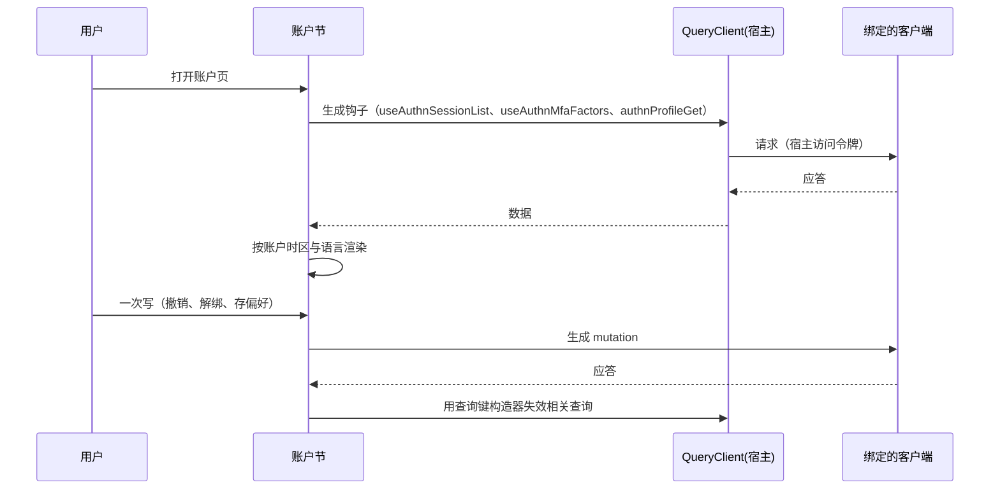

# account-ui

## 职责

`@speed/account-ui` 是一个 speed 前端已登录一方的账户管理组件族：一组节（section）组成宿主的账户页。账户自助写面归本包的理由见 [ADR-web-account-ui-selfservice-2026-10-16](../../../adr/adr-web-account-ui-selfservice-2026-10-16.md)。它交付下列面：

- `ProfileSection`：账户显示名的编辑，读 `GET /auth/me` 取存下的值、写 `PATCH /auth/me` 提交单字段的修改，走账户档案的自写面（[authn-profile](../authn/design-authn-profile.md)）。
- `PasswordSection`：改口令，走登录自助面的 `PUT /auth/password`（[authn 登录](../authn/design-authn-login.md)）。账户 `password_set` 为假（经提供方开户、无口令）时不显示当前口令字段，只给新口令两项；确认口令是客户端自己的校验，不上线。
- `PhoneSection`：添加或更换手机号的两步——`POST /auth/phone` 发送验证码、`POST /auth/phone/verify` 提交它；第二步只带验证码，号码是服务端按会话存下的（[authn 登录](../authn/design-authn-login.md)）。
- `IdentifiersSection`：账户登录标识的列表、逐条删除与自助添加。标识读自 `GET /auth/me` 的 `identifiers` 字段（规格无独立的清单路由），删除走 `DELETE /auth/identifiers/{id}`。添加面走登录自助的 `POST /auth/identifiers`（体 `{kind, value}`，`kind` 取 `username` 或 `email`）：用户名一步写入；邮箱先发验证码、再经 `POST /auth/identifiers/verify` 提交码，通过才写标识（[authn 登录](../authn/design-authn-login.md)）。
- `PreferencesSection`：语言与时区两个下拉，编辑账户存下的偏好，走账户档案的自写面（`PATCH /auth/me`，[authn-profile](../authn/design-authn-profile.md)）。语言的取值集是 i18n 实例自己的受支持集；语言的选取先写账户、确认写入后再落设备（手选槽位），清空偏好只动账户；时区取值集是引擎的 IANA 列表加一个显式的「未选」。
- `SessionsSection`：账户的会话与设备列表，当前会话所属的那条打上当前徽标，逐条撤销与批量撤销「其它会话」。撤销自己的会话是低损失动作（行上不再确认），撤销其余走 ui-kit 危险 `ConfirmDialog` 的单次确认——它是可恢复的动作（被登出的设备再登录即可），不设 `doubleConfirm` 两步守卫，免得比不可逆的删除还重。
- `SocialBindingsSection` 加 `BindingCallbackHandler`：社交绑定面与在宿主回调路由上完成一次绑定的处理器。
- `MfaSection`：经加强认证（step-up）门控的两步验证设置——清单经读发现，登记入口只给本部署装配的因素（TOTP 认证器、通行密钥等）。

这些面是节，不是一个带路由的屏：拥有它们的页面、它们之上的标题、以及本包之外的其它面（通用属性集的编辑、登录历史）都是宿主内容。

### 非职责

- **不做通用属性集的编辑。** 自助档案面（`PATCH /auth/me`）的自写字段集是显示名、通用属性集、语言与时区（[ADR-authn-selfservice-profile-2026-10-15](../../../adr/adr-authn-selfservice-profile-2026-10-15.md)）；本包交付显示名（`ProfileSection`）与语言、时区（`PreferencesSection`），不交付自由键值对的通用属性集编辑——那需要一个不属于账户页固定字段的通用编辑器，属宿主内容。
- **自助添加标识的 `kind` 是封闭集，限于用户名与邮箱。** 手机走它自己的两步面（`PhoneSection`，`POST /auth/phone`）；`IdentifiersSection` 的添加面只给用户名与邮箱两种（[authn 登录](../authn/design-authn-login.md)）。
- **不交付登录历史节。** 登录历史没有自助端点，只有管理员面（[authn-admin](../authn/design-authn-admin.md) 的审计读）；普通账户看不到自己的登录历史，故本包不交付这一节。
- **不交付恢复码。** 认证的因素面不提供恢复码（[authn-mfa](../authn/design-authn-mfa.md)），故本包不交付恢复码的显示或重生成。
- **不拥有查询客户端。** 每次读经 `@speed/api-sdk` 的生成 react-query 钩子，跑在宿主拥有的 QueryClient 上；本包从不自造 QueryClient，也不手写查询键，失效一律用导出的查询键构造器。
- **不读存储、不 attach 会话、不导航、不直接触网。** 会话只在一条生在流程之上、由本包节驱动的会话操作存在时以属性传入——绑定添加区起一条 `purpose: 'link'` 流程（`session.startAuthenticatedFlow`），两步验证挑战与自助写的提权门控各起一条 `purpose: 'step-up'` 流程（同）。没有会话操作要驱动的节不接会话属性（偏好节与会话列表节就不接）。
- **不发明规格没有的操作。** 认证的因素面只提供列出与删除（`GET`/`DELETE /auth/factors`），登记的入口是流程；故 `MfaSection` 的状态经读发现，登记走流程，不声明一个不存在的启用端点。
- **不 import `@speed/auth-ui`。** 同层包互不 import；`SocialProvider`、`SocialProviderConfig` 是本包自己的定义，与 auth-ui 的同名类型逐字一致并保持同步。`SocialProvider` 是部署的登录方法名（字符串，不是名字闭集），`SocialProviderConfig` 带方法自己的品牌标签。
- **不做服务端判定的替代。** 权限、租户隔离与账户归属都由服务端判定；本包只渲染应答。

## 外部接口契约

`web/packages/account-ui/src/index.ts` 是公开面：`ProfileSection`（连同 `ProfileSectionProps`）；`PasswordSection`（连同 `PasswordSectionProps`）；`PhoneSection`（连同 `PhoneSectionProps`）；`IdentifiersSection`（连同 `IdentifiersSectionProps`）；`PreferencesSection`；`SessionsSection`；`SocialBindingsSection`（连同 `SocialBindingsSectionProps`、`SocialProvider`、`SocialProviderConfig`）；`BindingCallbackHandler`（连同 `BindingCallbackHandlerProps`）；`MfaSection`（连同 `MfaSectionProps`）；以及命名为 `ACCOUNT_UI_NAMESPACE`、`accountUiResources` 的资源对。`web/packages/account-ui/src/internal/` 下的错误文案解析器、失败横幅、加强认证流程对话框、自助写的提权门控与翻译钩子是族内管线，不外导。

```tsx
interface ProfileSectionProps {
  readonly session: AuthSession // 提权门控驱动一条 step-up 流程
}

interface PasswordSectionProps {
  readonly session: AuthSession
}

interface PhoneSectionProps {
  readonly session: AuthSession
}

interface IdentifiersSectionProps {
  readonly session: AuthSession
}

interface SocialBindingsSectionProps {
  readonly session: AuthSession
  readonly providers: readonly SocialProviderConfig[]
  readonly onAuthorizeUrl?: (url: string) => void
}

interface MfaSectionProps {
  readonly session: AuthSession // 登记与挑战都驱动流程
}
```

四个自助写节（`ProfileSection`、`PasswordSection`、`PhoneSection`、`IdentifiersSection`）的 `session` 属性只为提权门控的对话框服务：一次写被答 401 `authn.insufficient_user_authentication` 时开一条 `purpose: 'step-up'` 流程（`session.startAuthenticatedFlow`），成功后重跑那次被拒的写恰好一次；它们的读与写本身是走共享访问令牌的生成调用，不经会话操作。

`SocialBindingsSection` 的 `session` 属性为添加区起一条 `purpose: 'link'` 的流程（`session.startAuthenticatedFlow`）；`MfaSection` 的 `session` 属性为登记起一条 `purpose: 'enroll'` 的流程、为挑战起一条 `purpose: 'step-up'` 的流程，并经 `session.listMethods`（`GET /auth/methods`）读本部署装配的因素以决定提供哪些登记入口——读因子清单、删因子与解绑是走共享访问令牌的生成调用，不经会话操作。其余节不接属性：它们显示谁的会话或绑定，来自调用方绑定的客户端与它的访问令牌。

**查询键构造器是公开面。** 失效用本包导出的查询键构造器（如 `getAuthnSessionListQueryKey`），不经手写键。账户自己的标识与绑定读自 `GET /auth/me`（其 `identifiers` 与 `links` 字段），无独立的清单端点，故无对应查询键。

**稳定性承诺。** 公开面是上述导出集；`SocialProvider`（方法名字符串）、`SocialProviderConfig` 的形状与 auth-ui 的一致。文档化的用法由 `web/packages/account-ui/src/usage-example.test.tsx` 端到端编译并运行，故 README 的装配不能与 API 漂移。

## 依赖

| 依赖 | 用途 |
|---|---|
| `@speed/auth-core` | 流程操作与本部署方法发现的 `AuthSession` 类型与操作（`startAuthenticatedFlow`、`answerFlow`、`readFlow`、`listMethods`） |
| `@speed/api-sdk` | 每次读的生成 react-query 钩子、每次写的生成 mutation、查询键构造器，以及档案读取（`authnProfileGet`）与社交回跳读取（`authnLoginCurrent`）的调用 |
| `@speed/ui-kit` | `AsyncSection`、`ConfirmDialog`、`ListSkeleton` 与跨面状态原语（`errorCodeOf`、`InlineError`、`visuallyHiddenSx`） |
| `@speed/i18n` | 命名空间注册与文案的翻译钩子 |
| `@tanstack/react-query` | peer（必需）：宿主供给的 QueryClient 与它上面的钩子 |
| `react`、`react-dom`、`@mui/material`、`@emotion/*` | peer（必需）：宿主拥有的 React／MUI 树 |

`@speed/api-client` 是 devDependency：公开类型不引用它，只有测试夹具绑定真实客户端。方向是 `@speed/account-ui` 比 `@speed/auth-ui` 的层高一档，处于生成钩子这一层之上；`@speed/auth-ui` 从不被 import。

## UML 图

一次读取与一次写入的路径。图里画不到的约束：读经生成的钩子跑在宿主 QueryClient 上，写经同一 `bindRequestFn` 绑定的生成 mutation；两步验证的登记入口另经会话操作 `session.listMethods`（`GET /auth/methods`）读本部署装配的因素，自助写被拒提权时另经会话操作 `session.startAuthenticatedFlow` 起一条 `purpose: 'step-up'` 流程；时间一律以账户的时区链显式格式化，不用 Intl 的进程本地缺省；显示时间之外，服务端词表（登录方式、因素种类、渠道）只在白名单内渲染。



## 核心数据结构

| 概念 | 形状 | 说明 |
|---|---|---|
| 时区链 | `resolveTimeZone` | 存下的偏好，否则设备时区，否则 UTC；每个时间渲染都显式传 `timeZone` |
| 渠道词表 | `SocialProvider`、`SocialProviderConfig` | 本包自己的定义，与 auth-ui 的同名类型同步；`SocialProvider` 是方法名字符串，`SocialProviderConfig` 带方法自己的品牌标签 |
| 加强认证流程 | `StepUpFlow` | 一条 `purpose: 'step-up'` 流程的驱动；成功后重跑被门控的动作 |
| 命名空间 | `accountUiResources` | `zh-CN` 与 `en-US` 两份目录，叶子键集相同 |

## 核心算法与流程

### 自助写的提权门控

改显示名、改口令、改手机、加标识与删标识都要求新鲜认证：一次写被服务端判为未提权时答 401 `authn.insufficient_user_authentication`。节把该次写的输入记在提权门控里（`src/internal/step-up-gate.ts` 的 `useStepUpGate`），打开加强认证流程对话框驱动一条 `purpose: 'step-up'` 流程；流程落定提权后，门控重跑被记住的那次写恰好一次，取消则不重跑。

提权码与登录失败码都在 401 上：改口令的当前口令不匹配是 401 `login-failed`，与提权 401 靠问题码区分——前者进失败横幅，后者开门控。手机的两步各自门控：发码被拒重跑发码、验证被拒重跑验证，不混用。加标识的两步同此：添加被拒重跑添加、验证被拒重跑验证。

写成功后按「改一次就失效」失效相关查询（读档的失效档案读、改口令、加手机与加标识再失效会话列表，因为这些路由会撤销其余会话），让视图收敛到服务端应答。

### 经流程门控的两步验证

`MfaSection` 不声明因子状态，状态经读发现（`GET /auth/factors`）；它提供的登记入口也只取本部署装配的因素（`GET /auth/methods` 的 `mfa.factors`，经 `session.listMethods` 读回）——装配没有通行密钥的部署不显示通行密钥入口，宿主不得提供本部署无法完成的能力。两次入口动作走同一条「先生成流程、再按步答复」的机器：

1. 登记一个因素。一次 `startAuthenticatedFlow({purpose: 'enroll', input: {kind}})` 打开向导，按应答的 `next.kind` 分派：`webauthn` 步把该因素自己的 JSON 对象交给步进渲染器——TOTP 的 `otpauth_uri` 渲染为文本加一个 `code` 字段，通行密钥的创建选项由本包的 `internal/webauthn.ts` 驱动 `navigator.credentials.create` 并把返回的凭据序列化成答复键 `credential`；`enroll` 步给出可登记的种类。答完即因素登记完成，它不改变本次会话的等级。
2. 提权以做安全类动作。一次 `startAuthenticatedFlow({purpose: 'step-up'})` 起一条加强认证流程；账户有可用因素时从 `factor` 步进入（清单在应答里），账户没有因素时退回第一因素。挑战对话框驱动这条流程，成功后重跑被门控的动作。

一次门控动作在被拒时打开加强认证流程，记住被门控的动作；一次成功的流程落定提权，成功路径重试那次被门控的操作恰好一次，取消则不重试。提权只活在那次会话的存续期内，对话框从不承诺不再询问。

### 绑定回调的续接

`BindingCallbackHandler` 挂在宿主的回调路由上，以 `session.readFlow()` 读回那条 `purpose: 'link'` 流程：流程已就绪（`next.kind = complete`）时以 `step: 'complete'` 取走结果，`link` 落地（`state: 'linked'`）后失效身份读取并触发 `onBound`；流程仍停在一步时渲染该步续接；交换失败渲染错误码文本与一个重试按钮。绑定的 `link` 不把任何人签进去。

## 错误与失败语义

**失败面是一个错误码白名单加受守卫的词表。** 每条失败路径解析成一个错误码，渲染在一条 `role="alert"` 横幅里；白名单外的码渲染 `errors.unknown`，永不渲染裸键。因素种类与渠道同样受守卫：令牌只在组件已知的取值表上才经 `t()` 渲染，否则渲染通用的其它标签。

| 情形 | 表现 |
|---|---|
| 一次写被拒（`authn.bad_request`、`authn.throttled`、`authn.unavailable`、`client.*`） | 一条横幅渲染错误码文本，相关查询在选择处失效 |
| 自助写被答 401 `authn.insufficient_user_authentication` | 打开提权对话框，成功后重跑那次被拒的写一次 |
| 改口令的当前口令不匹配（401 `authn.login_failed`） | 一条横幅渲染该码文本；与提权 401 同状态码，靠问题码区分，不误开门控 |
| 加手机时号码已属另一账户（409 `authn.conflict`） | 一条横幅渲染该码文本 |
| 删标识会抽掉最后一个登录方式（409 `authn.conflict`） | 一条横幅渲染该码文本，服务端按自己的登录方式计数判定 |
| 撤销自己的会话命中已死的会话 | 一条横幅渲染该码文本，列表重取以收敛 |
| 解绑会抽掉最后一个登录方式 | 一条横幅渲染该错误码文本，服务端按自己的登录方式计数判定 |
| 两步验证登记被拒（他人的登记抢先、因素消失） | 关掉向导并渲染错误码文本；一次错码是字段级错误、可重试 |
| 加强认证流程的码已被用过 | 清空字段、渲染用过的码文本，绝不用同一码重试 |
| 删除因素时它是账户最后一个 | 一条横幅渲染该错误码文本，服务端判定 |
| 偏好写入被拒（`authn.bad_request`） | 两行失败警报，控件退回存下的值（天然回退，无撤销记账） |

## 并发与事务边界

- **写后失效。** 每次成功的写（撤销、解绑、绑定、改显示名、改口令、加手机、加标识、删标识）都失效相关查询，让视图收敛到服务端应答；改口令、加手机与加标识另失效会话列表，因为这几条路由会撤销账户的其余会话。失效用导出的查询键构造器。
- **提权的存续期随会话。** 一次加强认证流程的完成更新会话的等级与认证时刻；未被提权的安全类动作由服务端判 401 加强认证，本包据此打开挑战流程。
- 本包不打开事务；读与写都是宿主 QueryClient 与绑定客户端上的往返。

## 实现状态

| 能力 | 状态 | 代码 |
|---|---|---|
| 档案显示名节 | 已实现 | `web/packages/account-ui/src/ProfileSection.tsx` `ProfileSection` |
| 口令节 | 已实现 | `web/packages/account-ui/src/PasswordSection.tsx` `PasswordSection` |
| 手机号节 | 已实现 | `web/packages/account-ui/src/PhoneSection.tsx` `PhoneSection` |
| 登录标识节 | 已实现 | `web/packages/account-ui/src/IdentifiersSection.tsx` `IdentifiersSection` |
| 自助写的提权门控 | 已实现 | `web/packages/account-ui/src/internal/step-up-gate.ts` `useStepUpGate` |
| 偏好节 | 已实现 | `web/packages/account-ui/src/PreferencesSection.tsx` `PreferencesSection` |
| 会话列表与撤销 | 已实现 | `web/packages/account-ui/src/SessionsSection.tsx` `SessionsSection` |
| 社交绑定与回调 | 已实现 | `web/packages/account-ui/src/SocialBindingsSection.tsx` `SocialBindingsSection`；`web/packages/account-ui/src/BindingCallbackHandler.tsx` `BindingCallbackHandler` |
| 两步验证设置 | 已实现 | `web/packages/account-ui/src/MfaSection.tsx` `MfaSection` |
| 命名空间资源 | 已实现 | `web/packages/account-ui/src/resources.ts` `ACCOUNT_UI_NAMESPACE`、`accountUiResources` |
