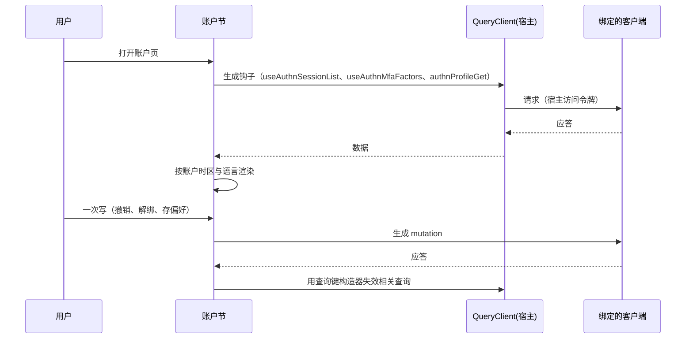

# account-ui

## 职责

`@speed/account-ui` 是一个 speed 前端已登录一方的账户管理组件族：一组节（section）组成宿主的账户页。账户自助写面归本包的理由见 [ADR-web-account-ui-selfservice](../../../adr/adr-web-account-ui-selfservice.md)。它交付下列面：

- `ProfileSection`：账户显示名的编辑，读 `GET /api/v1/auth/me` 取存下的值、写 `PATCH /api/v1/auth/me` 提交单字段的修改，走账户档案的自写面（[authn-profile](../authn/design-authn-profile.md)）。
- `PasswordSection`：改口令，走登录自助面的 `PUT /api/v1/auth/password`（[authn 登录](../authn/design-authn-login.md)）。账户 `password_set` 为假（经提供方开户、无口令）时不显示当前口令字段，只给新口令两项；确认口令是客户端自己的校验，不上线。账户没有可作登录名的标识（没有用户名，也没有已选作登录方式的邮箱）时，`PUT /api/v1/auth/password` 答 409 `login-identifier-required`，口令节渲染这条码的文本，说明账户需要至少一个登录名（REQ-account-012、REQ-signin-006）。
- `PhoneSection`：添加或更换手机号的两步——`POST /api/v1/auth/phone` 发送验证码、`POST /api/v1/auth/phone/verify` 提交它；第二步只带验证码，号码是服务端按会话存下的（[authn 登录](../authn/design-authn-login.md)）。号码经 ui-kit 的共享两段式控件（`PhoneNumberField`：国家/地区选择器加本地号码）录入，提交前组装为 E.164 并按国家/地区本地校验；它与 `SMSSignInForm` 用同一控件与同一套规则，两处不会各自漂移。手机与邮箱同处联系方式与登录方式两条轴：验证只证明账户对该号码的归属，不把它选作登录方式，也不使它成为默认联系地址（REQ-account-062）；被持有人选作登录方式后，该号码才可用于短信登录（REQ-account-064、REQ-signin-011）。它同时是额外安全因素，验证手机不解除注册验证的限制（REQ-signup-026）。
- `IdentifiersSection`：账户的登录方式与联系方式分组呈现、逐条删除、选择与自助添加。邮箱与手机各带归属状态与两条轴上的位置，登录方式与默认联系地址的选择规则见「联系方式与登录方式的呈现与选择」；两条轴都没有位置的已登记值在登录方式组与联系方式组之外的「未用于登录或联系」列表中列出，行上的两个开关把它移入任一轴。标识读自 `GET /api/v1/auth/me` 的 `identifiers` 字段（规格无独立的清单路由），删除走 `DELETE /api/v1/auth/identifiers/{id}`。添加面走登录自助的 `POST /api/v1/auth/identifiers`（体 `{kind, value}`，`kind` 取 `username` 或 `email`）：用户名一步写入；邮箱先发验证码、再经 `POST /api/v1/auth/identifiers/verify` 提交码，通过才写标识（[authn 登录](../authn/design-authn-login.md)）。每行的 `proven` 表示它是否已证明归属：`email-code`、`sms-code`、`invite` 与 `idp:<provider>` 为真，`admin`、`import-unverified` 与 `self` 为假；`verified_at` 不参与这个判断。用户名是登录名、没有归属可验证，故用户名行不渲染归属 chip；邮箱与手机行的 chip 是二值的，只看 `proven`：为真读「已验证」，为假读「未验证」，不按 `verified_via` 细分来源，也没有第三态。经管理员或导入写下的地址就是一条其持有人尚未证明的地址，它与自助注册写下的地址受同一条限制、拦下同一批能力；界面不为「账户可用」另造一个标签。未验证的邮箱行在行尾另给「验证」动作：它把验证码发到该行已经显示的地址，兑现后由账户模块就地证明这一行，重取的列表把 chip 翻成「已验证」；地址在这条流程里不可编辑，换地址走添加面或验证节。该动作在档案的 `verification.state` 为 `pending` 时不渲染——验证节与宿主的横幅已经在同一条待验证记录上发码，两个并发请求会互相覆盖——没有邮件通道的部署也不渲染它。删除动作与验证动作互不牵连：删除可以被「最后登录名」的规则扣下，验证不受这条规则影响。手机行的 chip 同样二值，手机的行级验证走手机回路，不在标识节里。带口令（`password_set`）的账户经用户名或已选作登录方式的邮箱登录：档案里的用户名与选作登录方式的邮箱合计恰好一条时，该行不渲染删除按钮，改为说明「先添加另一个登录名再删除」；选作登录方式的手机与已绑定的外部身份是别的登录方式，不计入这个豁免，也不因此保留删除按钮（REQ-account-044、REQ-security-040）。服务端仍是最后登录方式的判定者。`verification.state` 为 `pending` 时，添加面不提供邮箱一项——未验证的地址由 `ContactVerificationSection` 管理（`pending` 必有目标地址，由该节显示与发码），避免同一账户出现两个待验证目标；用户名与手机选项照常。`emailAvailable` 表示添加面是否提供邮箱一项（缺省提供）；`offerUsername` 表示添加面是否提供用户名一项（缺省提供），与「档案已列出用户名」求交。添加面在 `kind=email` 时先按服务端规则本地校验（去空白、可打印 ASCII、恰好一个 `@` 且两侧非空、不超过 254 字节），不合格在该字段显示 `identifiers.add.invalidEmail` 且不发请求，提交的是去空白后的值；服务端仍答 400 `authn.bad_request` 且 kind 为 email 时同样落在该字段，而不是通用横幅；服务端答 409 `authn.email_taken` 时也落在该字段（`identifiers.add.emailTaken`），预留的插入是原子的，被拒的是地址这一个值。验证码一步在地址于发码之后被别的账户取得时同样答 `authn.email_taken`，添加面退回值字段并显示同一条文案，不停在无法完成的验证码一步。用户名的 400 走通用文案：服务端的用户名规则还拒绝本面不复述的形状（静态凭据前缀、UUID 形状、保留字）。首登开户在建号前取得用户名不改变本面：已经存在而无用户名的账户仍在此补写。取消添加清空失败横幅、字段错误、成功提示与已发码状态。
- `ContactVerificationSection`：账户的邮箱验证节。它读 `GET /api/v1/auth/me` 的 `verification` 字段：`pending` 且 `email` 非空时显示目标邮箱、发送与重发验证码、验证码输入与更换邮箱；`pending` 且 `email` 为空时显示添加邮箱表单（`POST /api/v1/auth/identifiers`）；`verified` 显示完成态；`none` 不渲染。`pending` 的目标地址可能是自助注册写下的未证明预留，也可能是一条经管理员或导入写下的未证明邮箱标识；本节不区分两者，验证路径相同。发送、验证与更换邮箱走标识回路（`POST /api/v1/auth/identifiers` 与 `/identifiers/verify`），手机走手机回路（`POST /api/v1/auth/phone` 与 `/phone/verify`），写入受提权门控。宿主可传 `autoSend`：`pending` 且有目标邮箱、更换表单未展开时，本次挂载自动发送一次验证码，重渲染与写后重读都不重复；自动发送不替用户打开提权对话框，被 401 拒绝时保留手动发送按钮并渲染说明，用户点击后走既有门控。落地即展开更换表单（`initialChangeOpen`）的挂载整次都不自动发送，关闭表单后也不补发——来访者是来更换地址的，旧地址不该在本挂载收到验证码。宿主只在账户页的 `?verify=1` 落地传。验证节与宿主挂在应用栏之下的验证提示都以邮箱为主路径；手机入口标注为额外安全因素，不承诺解除限制——只有邮箱被证明才把验证状态转为已验证。验证只证明归属，不把目标地址选作登录方式；默认联系地址按已证明邮箱中恰好一条的规则成立，验证动作本身不指定它（REQ-account-062、REQ-account-063）。
- `PreferencesSection`：语言与时区两个下拉，编辑账户存下的偏好，走账户档案的自写面（`PATCH /api/v1/auth/me`，[authn-profile](../authn/design-authn-profile.md)）。语言的取值集是 i18n 实例自己的受支持集；语言的选取先写账户、确认写入后再落设备（手选槽位），清空偏好只动账户；时区取值集是引擎的 IANA 列表加一个显式的「未选」。
- `AppearanceSection`：外观主题的选择。它是受控节：预设列表、每个预设的显示名、当前值与选择回调都由宿主给出，本包不 import `@speed/theme-presets`、不读主题 provider，也不持有选择状态。宿主把选择接到主题 provider 后，切换立即生效。
- `SessionsSection`：账户的会话与设备列表，当前会话所属的那条打上当前徽标，逐条撤销与批量撤销「其它会话」。撤销自己的会话是低损失动作（行上不再确认），撤销其余走 ui-kit 危险 `ConfirmDialog` 的单次确认——它是可恢复的动作（被登出的设备再登录即可），不设 `doubleConfirm` 两步守卫，免得比不可逆的删除还重。
- `SocialBindingsSection` 加 `BindingCallbackHandler`：社交绑定面与在宿主回调路由上完成一次绑定的处理器。已绑定的社交与企业身份是登录方式组的一类，不列在联系方式组（REQ-account-067）。外部身份只经本节的显式添加建立；登录不按提供方声明的地址接管账户或并入绑定（REQ-signup-049）。添加区的渠道取自部署的发现文档（`GET /api/v1/auth/methods` 中 `kind=redirect` 的方法）。
- `MfaSection`：经加强认证（step-up）门控的两步验证设置——清单经读发现，登记入口按发现文档的 `mfa.factors` 逐个生成：已知种类（`totp`、`webauthn`、`sms`）用 `mfa.enroll.<kind>` 的文案，未知种类用通用的其它入口、仍以该种类起登记流程。

这些面是节，不是一个带路由的屏：拥有它们的页面、它们之上的标题、以及本包之外的其它面（通用属性集的编辑、登录历史）都是宿主内容。

**账户页把登录方式与联系方式分成两组，并在登录方式组与联系方式组之外单列未落在任一轴上的已登记值。** 登录方式组列出用户名、被持有人选作登录方式的邮箱与手机、通行密钥，以及已绑定的社交与企业身份；联系方式组列出默认联系地址与其余已登记联系方式；两条轴都没有位置的已登记邮箱与手机在「未用于登录或联系」列表中列出。同一个邮箱地址或手机号可以只作联系方式、只作登录方式、两者都是或两者都不是（REQ-account-061）。`IdentifiersSection` 呈现用户名、邮箱与手机在这三份列表中的位置：每个邮箱与手机行带「作联系方式」与「作登录方式」两个独立开关，打开一个即把该值移入对应组，两个都关掉即回到「未用于登录或联系」列表。`SocialBindingsSection` 把已绑定的外部身份列在登录方式组（REQ-account-067）。验证只证明归属，不单独决定一个值是否作联系方式或登录方式（REQ-account-062）；未证明的邮箱或手机不能作登录方式，未证明的邮箱不能作默认联系地址（REQ-account-065、REQ-account-066）。

**特性在场由宿主给出，本包不读特性态**（[ADR-web-feature-state](../../../adr/adr-web-feature-state.md)）。宿主只在特性 `authn.phone` 在场时挂 `PhoneSection`，只在特性 `authn.mfa` 在场时挂 `MfaSection`；`IdentifiersSection` 的邮箱添加可用性经可选属性 `emailAvailable`（缺省为真）传入，宿主取特性 `authn.identifiers.email` 是否在场。`ContactVerificationSection` 不经特性门控：它读本人档案的验证状态，`none` 时不渲染，宿主把它挂在账户页。其余节读写的面由[不经特性门控的后端模块](design-web.md#不经特性门控的后端模块)服务，不受特性门控；`PasswordSection` 依赖的 `PUT /api/v1/auth/password` 随登录引擎恒挂。社交绑定可用的渠道集合只由发现文档发布，不经特性文档（[feature](../design-feature.md) 的「特性文档承载的事实」）。

### 非职责

- **不做通用属性集的编辑。** 自助档案面（`PATCH /api/v1/auth/me`）的自写字段集是显示名、通用属性集、语言与时区（[ADR-authn-selfservice-profile](../../../adr/adr-authn-selfservice-profile.md)）；本包交付显示名（`ProfileSection`）与语言、时区（`PreferencesSection`），不交付自由键值对的通用属性集编辑——那需要一个不属于账户页固定字段的通用编辑器，属宿主内容。
- **自助添加标识的 `kind` 是封闭集，限于用户名与邮箱。** 手机走它自己的两步面（`PhoneSection`，`POST /api/v1/auth/phone`）；`IdentifiersSection` 的添加面只给用户名与邮箱两种（[authn 登录](../authn/design-authn-login.md)）；档案已列出用户名时，添加面不再提供用户名（REQ-account-008）：服务端对第二个用户名与对已被他人占用的用户名答同一个 409 `authn.conflict`，文案无法区分二者，客户端因此不发出第二个用户名。
- **不交付登录历史节。** 登录历史没有自助端点，只有管理员面（[authn-admin](../authn/design-authn-admin.md) 的审计读）；普通账户看不到自己的登录历史，故本包不交付这一节。
- **不交付恢复码。** 认证的因素面不提供恢复码（[authn-mfa](../authn/design-authn-mfa.md)），故本包不交付恢复码的显示或重生成。
- **不拥有查询客户端。** 每次读经 `@speed/api-sdk` 的生成 react-query 钩子，跑在宿主拥有的 QueryClient 上；本包从不自造 QueryClient，也不手写查询键，失效一律用导出的查询键构造器。
- **不读存储、不 attach 会话、不导航、不直接触网。** 会话只在一条生在流程之上、由本包节驱动的会话操作存在时以属性传入——绑定添加区起一条 `purpose: 'link'` 流程（`session.startAuthenticatedFlow`），两步验证挑战与自助写的提权门控各起一条 `purpose: 'step-up'` 流程（同）。`PreferencesSection` 的会话属性是可选的：只有提权门控需要它，不给时被拒的写只渲染失败横幅。没有会话操作要驱动的节不接会话属性（会话列表节就不接）。
- **不发明规格没有的操作。** 认证的因素面只提供列出与删除（`GET`/`DELETE /api/v1/auth/factors`），登记的入口是流程；故 `MfaSection` 的状态经读发现，登记走流程，不声明一个不存在的启用端点。
- **不 import `@speed/auth-ui`。** 同层包互不 import。社交渠道是部署的登录方法名，取自已发现文档；本包不再持有宿主传入的渠道表，也不外导渠道配置类型。已绑定行上的提供方取值按方法描述符的 `binding_providers` 解析：取值等于其中一项或以一项为命名空间前缀即归到该方法，描述符没有该项时按方法名匹配；仍匹配不到时回落到本包自己的封闭词表（五个社交名、企业 SSO 族前缀与通用「其它」）。
- **不做服务端判定的替代。** 权限、租户隔离与账户归属都由服务端判定；本包只渲染应答。
- **不判定注册验证状态，也不自行解除限制。** `verification` 由 `GET /api/v1/auth/me` 读出，哪些能力在未验证期间受限由服务端判定；本包只按读到的状态渲染验证节与完成态。判据与账户来源无关，界面因此不对管理员预置或导入的账户另走一条路径。本包也不判定一条已证明地址是否被选作登录方式或默认联系地址：选择由持有人做出，有效性由服务端判定。
- **地址占用在发码前即被明确拒绝。** 发送与验证两步对已被其他账户预留或持有的地址答 409 `email-taken`，文案点明该地址已被另一个账户使用并让用户换一个；预留的插入是原子的，界面不再用同形应答隐藏占用。
- **不定义主题预设，也不让预设生效。** 预设的集合、显示名与切换后的效果归宿主与主题 provider；`AppearanceSection` 只排布宿主给出的选项并上报选择。

## 外部接口契约

`web/packages/account-ui/src/index.ts` 是公开面：`ProfileSection`（连同 `ProfileSectionProps`）；`PasswordSection`（连同 `PasswordSectionProps`）；`PhoneSection`（连同 `PhoneSectionProps`）；`IdentifiersSection`（连同 `IdentifiersSectionProps`）；`ContactVerificationSection`（连同 `ContactVerificationSectionProps`）；`PreferencesSection`（连同 `PreferencesSectionProps`）；`AppearanceSection`（连同 `AppearanceSectionProps`、`ThemePresetChoice`）；`SessionsSection`；`SocialBindingsSection`（连同 `SocialBindingsSectionProps`）；`BindingCallbackHandler`（连同 `BindingCallbackHandlerProps`）；`MfaSection`（连同 `MfaSectionProps`）；`StepUpDialog`（连同 `StepUpDialogProps`）；以及命名为 `ACCOUNT_UI_NAMESPACE`、`accountUiResources` 的资源对。`web/packages/account-ui/src/internal/` 下的错误文案解析器、失败横幅、流程步渲染器与翻译钩子是族内管线，不外导（`StepUpDialog` 是对内部对话框的有意外导）。提权对话框与门控的归属由 [ADR-web-auth-seams](../../../adr/adr-web-auth-seams.md) 裁定：对话框以 `StepUpDialog` 外导、**只给宿主用**（同层的 `console-ui` 与 `auth-ui` 不得 import 它，那是一条同层边），自助写的提权门控用 `@speed/auth-core` 的 `useStepUpGate`。

```tsx
interface ProfileSectionProps {
  readonly session: AuthSession // 提权门控驱动一条 step-up 流程
}

interface PasswordSectionProps {
  readonly session: AuthSession
  readonly withoutLoginName?: 'form' | 'explain' // 缺省 'form'；'explain' 时无登录名则先说明 409
}

interface PhoneSectionProps {
  readonly session: AuthSession
  readonly humanGate?: AuthnHumanGate // 已读到的发现文档的人机门槛；缺省由本节读方法文档
}

interface IdentifiersSectionProps {
  readonly session: AuthSession
  readonly emailAvailable?: boolean // 添加面是否提供邮箱一项；缺省提供
  readonly offerUsername?: boolean // 添加面是否提供用户名一项；缺省提供
  readonly humanGate?: AuthnHumanGate // 已读到的发现文档的人机门槛；缺省由本节读方法文档
}

interface ContactVerificationSectionProps {
  readonly session: AuthSession // 提权门控驱动一条 step-up 流程
  readonly initialChangeOpen?: boolean // 进页即展开更换邮箱表单；缺省关闭（停在验证码一步）
  readonly autoSend?: boolean // 未验证且有目标邮箱时于本次挂载自动发一次码；缺省 false
  readonly humanGate?: AuthnHumanGate // 已读到的发现文档的人机门槛；缺省由本节读方法文档
}

interface PreferencesSectionProps {
  readonly session?: AuthSession // 可选；只为提权门控的对话框服务，不给时被 401 拒绝的写只渲染失败横幅
}

interface ThemePresetChoice {
  readonly id: string
  readonly label: string // 宿主已翻译
}

interface AppearanceSectionProps {
  readonly presets: readonly ThemePresetChoice[] // 宿主提供的预设，按显示次序
  readonly value: string                          // 当前预设 id
  readonly onChange: (id: string) => void         // 选择回调，收到预设 id
}

interface SocialBindingsSectionProps {
  readonly session: AuthSession
  readonly returnTo: string // 宿主的绑定回调路由；作为 link 流程的顶层 return_to 发出。分离源部署传受信源下的绝对 URL；服务端接受路径或该 URL
  readonly onAuthorizeUrl?: (url: string) => void
  readonly providerIcon?: (provider: string) => ReactNode // 渠道品牌图标，按方法名
}

interface StepUpDialogProps {
  readonly open: boolean
  readonly session: AuthSession
  readonly onSuccess: () => void
  readonly onCancel: () => void
  readonly accountHref?: string // 宿主的账户设置路由；给出时在「先登记两步验证」旁渲染链接
}

interface BindingCallbackHandlerProps {
  readonly session: AuthSession
  readonly onBound?: () => void
  readonly absent?: ReactNode // 读不到流程、且部署没有 redirect 方法时渲染
  readonly initialError?: string // 回跳片段里的问题码；给出时直接渲染它，不读流程
  readonly onDismiss?: () => void // 流程已确定不存在（回跳被拒、流程读不到）时的唯一动作：返回账户面
}

interface MfaSectionProps {
  readonly session: AuthSession // 登记与挑战都驱动流程
}
```

自助写节（`ProfileSection`、`PasswordSection`、`PhoneSection`、`IdentifiersSection`、`ContactVerificationSection`）的 `session` 属性必选，`PreferencesSection` 的可选。`session` 为提权门控的对话框服务：一次写被答 401 `authn.insufficient_user_authentication` 时开一条 `purpose: 'step-up'` 流程（`session.startAuthenticatedFlow`），成功后重跑那次被拒的写恰好一次。替换调用方凭据的写另用同一个会话操作开身份切换窗口、在写后的失效与重读结算之后释放（见「轮换点上的身份切换窗口」）；`ProfileSection` 与 `PreferencesSection` 的写不改凭据，不用这一窗口。它们的读与写本身是走共享访问令牌的生成调用，不经会话操作。

`SocialBindingsSection` 的 `session` 属性经 `session.listMethods`（`GET /api/v1/auth/methods`）读部署的发现文档：添加区只渲染 `kind=redirect` 且未绑定的方法，名称取描述符的 `label`（缺省用方法名），并为点击起一条 `purpose: 'link'` 的流程（`session.startAuthenticatedFlow`），`returnTo` 作为该流程请求的顶层 `return_to` 发出；分离源部署传受信源下的绝对 URL，服务端接受路径或该 URL。方法是否已绑定、以及已绑定行的提供方取值归到哪个方法，都经同一份描述符的 `binding_providers` 解析：取值等于其中一项或以一项为前缀即归到该方法，描述符缺少该项时按方法名匹配；该方法就此与任一已绑定取值匹配上时，添加区不再提供该渠道。`MfaSection` 的 `session` 属性为登记起一条 `purpose: 'enroll'` 的流程、为挑战起一条 `purpose: 'step-up'` 的流程，并经 `session.listMethods`（`GET /api/v1/auth/methods`）读本部署装配的因素以决定提供哪些登记入口——读因子清单、删因子与解绑的读写本身是走共享访问令牌的生成调用；删已启用因素与解绑另用同一属性开身份切换窗口（见「轮换点上的身份切换窗口」）。`SessionsSection` 不接属性：它显示谁的会话，来自调用方绑定的客户端与它的访问令牌。

**`AppearanceSection` 是受控的外观选择。** 它经 `SectionCard` 渲染一节，标题与说明取自本包命名空间；下拉列出宿主传入的全部预设，当前值标记为选中，选择时把该预设的 id 交给 `onChange`。预设列表为空或只有一项时，标题与带标签的控件照常渲染，不塌陷。它不 import `@speed/theme-presets`、不读主题 provider：预设存在与否、叫什么、选中后如何生效都是宿主的事实。

**查询键构造器是公开面。** 失效用本包导出的查询键构造器（如 `getAuthnSessionListQueryKey`），不经手写键。账户自己的标识与绑定读自 `GET /api/v1/auth/me`（其 `identifiers` 与 `links` 字段），无独立的清单端点，故无对应查询键。

**对外接口面。** 公开面是上述导出集；渠道词表不外导，社交渠道与已绑定提供方都由发现文档解析。变更按 TypeScript 的源码语义分类：新增导出、新增可选字段是源码兼容的；删除导出或字段、改既有导出或字段的含义或名、改签名（参数或返回类型），是不兼容变更。把必选与可选互转按位置判：输入位（宿主提供的 prop 或参数）放宽兼容、收紧不兼容；输出位（宿主读取的返回类型或结果字段）相反——放宽为可选使读出的值成为 `T | undefined`，strictNullChecks 下只有在要求 `T` 处使用它的消费者无法编译（对可能为 undefined 的值做成员访问报 TS18048，赋给 `T` 或传入要求 `T` 的形参报 TS2322/TS2345），仅转发或在宽松处使用（模板串、比较、`??`、可选链）的消费者仍编译，故可能破坏消费者、是不兼容变更。文档化的用法由 `web/packages/account-ui/src/usage-example.test.tsx` 端到端编译并运行，故 README 的装配不能与 API 漂移。

## 依赖

| 依赖 | 用途 |
|---|---|
| `@speed/auth-core` | 流程操作与本部署方法发现的 `AuthSession` 类型与操作（`startAuthenticatedFlow`、`answerFlow`、`readFlow`、`listMethods`），步进门的 `useStepUpGate`，以及 `./webauthn` 子路径的通行密钥驱动 |
| `@speed/api-sdk` | 每次读的生成 react-query 钩子、每次写的生成 mutation、查询键构造器，以及档案读取（`authnProfileGet`）与社交回跳读取（`authnLoginCurrent`）的调用 |
| `@speed/ui-kit` | `AsyncSection`、`ConfirmDialog`、`ListSkeleton` 与跨面状态原语（`errorCodeOf`、`InlineError`、`InlineSuccess`、`WriteFeedbackRegion`、`useWriteFeedback`、`visuallyHiddenSx`）；手机号的起始国家上下文（`usePhoneCountryDefault`）与显示时区上下文（`useDisplayTimeZone`） |
| `@speed/i18n` | 命名空间注册与文案的翻译钩子；语言名（`languageDisplayName`）、显示时区纯函数（`resolveTimeZone`、`isSupportedTimeZone`）与时间格式化（`formatInstant`） |
| `@tanstack/react-query` | peer（必需）：宿主供给的 QueryClient 与它上面的钩子 |
| `react`、`react-dom`、`@mui/material`、`@emotion/*` | peer（必需）：宿主拥有的 React／MUI 树 |

`@speed/api-client` 是 devDependency：公开类型不引用它，只有测试夹具绑定真实客户端。方向是 `@speed/account-ui` 比 `@speed/auth-ui` 的层高一档，处于生成钩子这一层之上；`@speed/auth-ui` 从不被 import。

## UML 图

一次读取与一次写入的路径。图里画不到的约束：读经生成的钩子跑在宿主 QueryClient 上，写经同一 `bindRequestFn` 绑定的生成 mutation；两步验证的登记入口另经会话操作 `session.listMethods`（`GET /api/v1/auth/methods`）读本部署装配的因素，绑定添加区经同一操作读本部署的 redirect 方法，自助写被拒提权时另经会话操作 `session.startAuthenticatedFlow` 起一条 `purpose: 'step-up'` 流程；验证节读同一档案读取的 `verification`，它的发送、验证与更换复用标识与手机的自助回路；时间一律以账户的时区链显式格式化，不用 Intl 的进程本地缺省；显示时间之外，服务端词表（登录方式、因素种类、渠道）只在白名单内渲染，白名单外的因素种类在流程步里按原值呈现。



## 核心数据结构

| 概念 | 形状 | 说明 |
|---|---|---|
| 时区链 | `resolveTimeZone` + ui-kit 上下文 | 存下的偏好优先，否则 ui-kit 的显示时区上下文（只替换「设备」一级），否则设备时区，否则 UTC；每个时间渲染都显式传 `timeZone` |
| 渠道词表 | 发现文档的描述符 | 添加区取 `kind=redirect` 的方法名与 `label`，并以描述符的 `binding_providers` 判定方法是否已绑定；已绑定行按同一组 `binding_providers` 匹配（相等或以一项为前缀），缺该项时按方法名，仍匹配不到回落到本包自己的封闭词表 |
| 注册验证状态 | `verification` | `GET /api/v1/auth/me` 的 `{state, email, since}`：`state` 取 `none`（没有邮箱，本规则不适用）、`pending`（有邮箱而没有一条已证明的）、`verified`（已有一条证明），判定与账户来源无关；`email` 是当前状态下的地址——`pending` 时是未证明标识或未证明预留中最早的一条，`none` 时为空；`since` 是首次证明时刻，从未证明过邮箱时为空串。`pending` 的 `email` 可能已经是登录标识（管理员或导入写下的邮箱），也可能只是一条未证明预留；界面只按地址发码，不假设它的来源 |
| 标识的已证明性 | `proven`、`verified_via` | `proven` 对 `email-code`、`sms-code`、`invite` 与 `idp:<provider>` 为真，对 `admin`、`import-unverified` 与 `self` 为假。chip 只看 `proven`，二值：真读「已验证」，假读「未验证」；`verified_via` 不参与 chip 的取值，也不为未证明来源另造标签。用户名行不渲染归属 chip（登录名没有归属可证明）。`proven` 同时是选择的前提：只有已证明的邮箱与手机可以被选作登录方式，只有已证明的邮箱可以被选作默认联系地址（REQ-account-065、REQ-account-066） |
| 联系方式与登录方式 | 档案读出的标识条目上的选择事实 | 每条邮箱与手机各带两条独立轴上的位置：是否作联系方式、是否作登录方式；邮箱另有它与默认联系地址的关系。两条轴都为假、且不是默认联系地址的邮箱与手机在「未用于登录或联系」列表列出。未证明的邮箱或手机不能作登录方式，未证明的邮箱不能作默认联系地址（REQ-account-061、REQ-account-065、REQ-account-066）。验证只写归属，不改两条轴上的位置（REQ-account-062）；默认联系地址在已登记并已证明的邮箱中恰好一条（REQ-account-063） |
| 加强认证流程 | `StepUpFlow` | 一条 `purpose: 'step-up'` 流程的驱动；成功后重跑被门控的动作 |
| 外观选择 | `ThemePresetChoice` | 宿主提供的一个预设：id 与已翻译的显示名；`AppearanceSection` 只渲染与上报 |
| 命名空间 | `accountUiResources` | `zh-CN` 与 `en-US` 两份目录，叶子键集相同 |

## 核心算法与流程

### 自助写的提权门控

改显示名、改口令、改手机、加标识与删标识、把邮箱或手机选作或取消登录方式、改选默认联系地址，以及改偏好（语言、时区，给了 `session` 时），都要求新鲜认证（REQ-security-013）：一次写被服务端判为未提权时答 401 `authn.insufficient_user_authentication`。节把该次写的输入记在 `@speed/auth-core` 的 `useStepUpGate` 里，打开加强认证流程对话框（`StepUpDialog`，宿主亦可用）驱动一条 `purpose: 'step-up'` 流程；流程落定提权后，门控重跑被记住的那次写恰好一次，取消则不重跑。被拒的 401 也可是租户准入层的 `authn.sso_required`：本地的 TOTP、短信与通行密钥都满足不了它，门控因此不开因素流程，对话框点名企业单点登录并只给重新登录出口（`session.logout` 结束会话，宿主会话门收敛到登录面），不读因素清单。

提权码与登录失败码都在 401 上：改口令的当前口令不匹配是 401 `login-failed`，与提权 401 靠问题码区分——前者进失败横幅，后者开门控。手机的两步各自门控：发码被拒重跑发码、验证被拒重跑验证，不混用。加标识的两步同此：添加被拒重跑添加、验证被拒重跑验证。

写成功后按「改一次就失效」失效相关查询（读档的失效档案读、改口令、加手机与加标识再失效会话列表，因为这些路由会撤销其余会话），让视图收敛到服务端应答。

### 联系方式与登录方式的呈现与选择

账户页把账户的联系方式与登录方式按两条相互独立的轴呈现（REQ-account-061）。决策见 [ADR-authn-contact-and-login-ways](../../../adr/adr-authn-contact-and-login-ways.md)。登录方式组列出用户名、被持有人选作登录方式的邮箱与手机、通行密钥，以及已绑定的社交与企业身份；联系方式组列出默认联系地址与其余已登记联系方式。同一个邮箱地址或手机号可以只作联系方式、只作登录方式、两者都是或两者都不是，两条轴互不派生。

**未落在任一轴上的已登记值单列。** 已登记、既未作联系方式也未作登录方式的邮箱与手机，在登录方式组与联系方式组之外以「未用于登录或联系」列表列出，不并入登录方式组与联系方式组（REQ-account-061）。登录方式组、联系方式组与「未用于登录或联系」列表里的每个邮箱与手机行都带「作联系方式」与「作登录方式」两个相互独立的开关，对应 `PUT /api/v1/auth/identifiers/{id}` 的 `contact` 与 `sign_in` 字段（[authn 登录](../authn/design-authn-login.md)）：打开「作联系方式」把该值移入联系方式组，打开「作登录方式」把它移入登录方式组，关掉一个只退出对应组，两个都关掉后该行回到「未用于登录或联系」列表；把值从一条轴换到另一条轴就是关掉前一个开关、打开后一个。同一个值同时出现在登录方式组与联系方式组时，两处渲染的是同一条记录，任一处的开关改的是同一条轴，另一组随之同步。用户名恒在登录方式组，没有联系方式轴，不渲染这两个开关，也不进「未用于登录或联系」列表。未证明的邮箱与手机不渲染「作登录方式」开关（REQ-account-065）；「作联系方式」不因未证明而禁用，未证明的邮箱只是不能成为默认联系地址（REQ-account-066）。默认联系地址是邮箱行上的独立控件，不是这两个开关之一：选作默认的邮箱进入联系方式组并标为默认，不改变它的 `contact` 与 `sign_in`；默认联系地址始终列在联系方式组，关掉它的「作联系方式」只清掉联系方式标记，不把它移出该组。只改「作联系方式」的写不要求新鲜认证，打开或关闭「作登录方式」与改选默认联系地址走提权门控。

1. **登录方式与默认联系地址只从已证明的条目里取。** 验证一条邮箱或手机只证明账户对该值的归属，不把它选作登录方式，也不决定它是否为默认联系地址；默认联系地址按已证明邮箱中恰好一条的规则成立（REQ-account-062、REQ-account-063）。未证明的邮箱或手机不出现在登录方式的候选项里，也不能作默认联系地址；直接请求这样的选择由服务端拒绝（REQ-account-065、REQ-account-066）。
2. **登录方式由持有人选择。** 持有人在本人的已登记并已证明的邮箱与手机中，分别选择哪些可以登录；未被选中的地址或号码即使已登记并已证明，也不能完成对应的登录（REQ-account-064）。取消选中只取消它作为登录方式的资格，不改变归属，也不把它自动设为联系方式；该值仍为已验证，可再次被选中；它若也未作联系方式且不是默认联系地址，就回到「未用于登录或联系」列表（REQ-account-062）。
3. **默认联系地址在已登记并已证明的邮箱中恰好一条。** 账户持有已登记并已证明的邮箱时，其中恰好一条是默认联系地址，用于向该账户发送通知；持有人尚未改选时，最早被证明的那条是默认联系地址，持有人改选后，新地址成为默认联系地址，原地址不再是。账户没有已登记并已证明的邮箱时没有默认联系地址（REQ-account-063）。默认联系地址只从邮箱中取，手机不作默认联系地址。
4. **外部身份与通行密钥是各自一类登录方式。** 已绑定的社交与企业身份列在登录方式组，标明哪些提供方可以登录该账户；联系方式组只有邮箱与手机，没有提供方（REQ-account-067）。通行密钥也列在登录方式组（REQ-signin-024）；它同时可作第二因素，因素清单与登记入口归 `MfaSection`（REQ-security-003）。解绑与删除的最后登录方式判定把已选作登录方式的邮箱、手机与已绑定外部身份一并计入，账户须至少保留一种非通行密钥的登录方式（REQ-security-040）。
5. **新的口令登录只接受用户名与已选作登录方式的邮箱。** 口令登录的标识是用户名，或账户持有并已选作登录方式的邮箱；已登记并已证明但未被选中的邮箱不能完成口令登录。提供方声明的地址从不作口令登录名，口令登录与提供方登录不混用（REQ-signin-006、REQ-signin-038）。
6. **既有数据不迁移。** 既有标识与绑定继续按写入时的方式工作，包括由提供方声明写下的邮箱标识；本包照常列出并使用这些行，不改写、不补写、不删除。本规则只作用于新的登录与新的写入（REQ-account-007、REQ-signin-037、REQ-signup-050）。新经社交或企业首登开立的账户不带提供方声明的地址，账户面因此只显示实际登记的联系方式与登录方式（REQ-signup-048）。

### 轮换点上的身份切换窗口

替换调用方凭据的写在服务端提交时换上新的 cookie 与令牌。以旧凭据发出的读可能在新凭据生效前答匿名：已在飞行中的读，或同一轮里由焦点、重连与 `staleTime` 0 触发的读。会话的静默腿默认把这一匿名应答当作会话结束，监听会话的壳随之清缓存并显示登出视图。因此，发起页在写之前同步调用 `session.beginIdentityTransition()` 打开一个窗口，并在写后的失效与重读结算之后调用它返回的释放函数。窗口打开期间、入口前已打开、或入口后才打开时仍在飞行的读，其匿名应答被丢弃：快照不变，发起该读的请求保留自己的 401，认证成功的应答照常接受。窗口不延迟或暂挂请求，只改变静默腿如何对待显式匿名应答；它只作用于 cookie 会话的静默腿，不影响令牌刷新路径。窗口计数可嵌套，释放幂等，被提权门控重跑的一次写自开自己的窗口。

窗口是否打开以写是否替换调用方凭据为准，与动作名称无关。适用入口：`PasswordSection` 的改口令、`PhoneSection` 的验证手机、`ContactVerificationSection` 的验证邮箱、`IdentifiersSection` 的一步写入用户名与添加面及行内的验证邮箱、`SocialBindingsSection` 的解绑、`MfaSection` 删除已启用因素，以及 `starters/demo` 装配的冒充开始。`MfaSection` 删除待确认或已停用的因素不轮换发起会话（服务端只为已启用因素结清会话并轮换），因而不开窗口；名单里已不存在的因素名按已删除处理、仍会轮换，故仍按开窗处理。窗口的释放点是写后的失效与重读结算之后。发送验证码（邮箱或手机）、删除标识、撤销自己的会话、档案与偏好写入、发起外部身份关联流程这些写不替换调用方凭据，不开窗口。

### 邮箱的验证节

账户持有邮箱而没有一条已证明的邮箱时，档案读作 `pending`，不论这条邮箱由自助注册、管理员预置、导入还是首登开户写下；验证是登录后的账户动作，不建立会话（[ADR-authn-signup](../../../adr/adr-authn-signup.md)）。

1. **读状态。** `ContactVerificationSection` 读 `GET /api/v1/auth/me` 的 `verification`。`none` 不渲染；`verified` 渲染完成态；`pending` 且 `email` 非空时渲染目标邮箱、发送与重发、验证码字段与更换邮箱；`pending` 且 `email` 为空时渲染「添加邮箱」表单，提交 `POST /api/v1/auth/identifiers`（`{kind: 'email', value}`）。`pending` 的目标地址可能是未证明预留，也可能是一条未证明的邮箱标识（管理员或导入写下）；本节一视同仁，验证即证明该地址。**服务端契约下 `pending` 必有目标地址**——未验证的定义就是持有邮箱——所以「`pending` 而无目标」的添加邮箱分支在现行契约下不可达，组件保留它作为防御性兜底。删除最后一个已证明邮箱后，账户若还持有另一条未证明邮箱，本节照常显示那一条；一条也不剩时档案读作 `none`，本节不再渲染，账户也不受限制。
2. **发送与重发。** 发送调 `POST /api/v1/auth/identifiers`（`{kind: 'email', value: <目标邮箱>}`），验证调 `POST /api/v1/auth/identifiers/verify`（只带验证码）。重发是同一个发送动作，发往与展示同源的地址（本次挂载内已发送的地址，否则档案里的未证明预留），不会出现界面显示新地址而重发发往旧地址。发送落地后「验证码已发送」的目的地文字在验证码一步内持续显示，通知用先挂空、再填文本的 `role="status"` 播报一次，焦点落在验证码字段。重发控件在发送应答的 `resend_after` 给出的间隔内禁用并说明原因；被 429 拒绝时按 `Retry-After` 起算。间隔到点后倒计时计时器自行清除，不在页面上留下常驻计时器。
3. **首次进入自动发送。** 宿主在账户页的 `?verify=1` 落地传 `autoSend`；`pending`、目标邮箱非空且更换表单未展开时，本次挂载在档案读到后自动发送一次，挂载内的重渲染与写后重读都不再发送（一次挂载一次）。落地即展开更换表单（`initialChangeOpen`）的挂载整次都不发送，关闭表单后也不补发：来访者要更换地址，旧地址的验证码不是他们要的。自动发送不替用户打开提权对话框：被 401 `authn.insufficient_user_authentication` 拒绝时保留手动「发送验证码」按钮并渲染说明（`verification.autoStepUp`），用户点击后走既有门控；429 仍进入重发倒计时；其它失败走失败横幅。普通访问不传 `autoSend`，其验证节只在用户点击时发送。
4. **更换邮箱。** 以同一发送动作带新地址，服务端向新地址发码，同一会话的旧验证码记录随新记录写入而失效；验证通过后新地址写成标识与已持有预留。注册时写下的旧地址未证明预留不随这次更换删除，仍占用旧地址直到账户被删除。更换只在 `pending` 上提供；`verified` 后改邮箱走标识节的添加入口。宿主可经 `initialChangeOpen` 让本节落地即展开更换表单（提示里的「更换邮箱」就是这样到达的），缺省落地在验证码一步（提示里的「去验证」）。
5. **手机是安全因素。** 手机验证走 `POST /api/v1/auth/phone` 与 `/phone/verify`，与邮箱共用同一套发码与验证语义。手机可作登录方式，也是额外安全因素：验证手机不把它自动选作登录方式，也不解除注册验证的限制（REQ-account-062、REQ-signup-026）；入口标注为安全因素，不承诺解锁；只有邮箱被证明才把 `verification.state` 变成 `verified`。
6. **提权。** 发送、验证与更换都是自助写，被 401 `authn.insufficient_user_authentication` 拒绝时走 `useStepUpGate`，成功后只重跑那次被拒的写一次（自动发送被拒时不进门控，见第 3 条）。
7. **与标识节的边界。** `pending` 时标识节的添加面不提供邮箱一项，未验证的地址（未证明预留或未证明标识）由本节管理；未验证的邮箱行也不渲染行级「验证」动作，两处并发发码会覆盖同一条待验证记录。不在 `pending` 时（`none` 或 `verified`），标识节的未验证邮箱行自带验证动作，与添加面互不影响。标识行上的用户名不渲染归属 chip；邮箱与手机行的 chip 二值（`proven` 真读「已验证」，假读「未验证」）。

失败文案：发送与验证两步对已被其他账户预留或持有的地址都答 409 `email-taken`，文案点明该地址已被另一个账户使用并给出更换邮箱；发送一步在发码之前判定，地址被拒时不发信。验证码错误的统一文案是「验证码无效或已过期，请重试或更换邮箱」。

### 发送验证码的人机证明

部署要求人机验证时，发送验证码的动作都先取一份证明：手机节的发送、验证节的发送与重发、标识节的邮箱添加与行内重发，以及提权对话框的短信发送（选中短信第二因素，或按短信方式复证第一因素时提交手机号）。手机节、验证节与标识节各自经 [auth-core](design-web-auth-core.md) 的 `useHumanVerification` 取得证明；提权对话框的证明由 `useStepUp` 取得并经 `StepUpState.human` 暴露，对话框把门槛与证明渲染成同一个块，会发送的答复自动带 `human_proof`。门槛取自发现文档的 `human`（宿主已经读到时可经 `humanGate` 传入，缺省各节自己读一次），证明的取得、单次使用与重取由 `useHumanVerification` 承担，界面只渲染 ui-kit 的 `HumanVerification` 块并交出 `human_proof`。块位于发送控件上方；证明未就绪时发送控件禁用；每次发送之后消耗当前证明并取一份新的，重发因此带的是新证明。用户名写入、验证码提交、删除与改口令不发验证码，不取证明，也不受块约束；登记多因素不发验证码（短信因素绑定的是账户已证明的手机号），同样不取证明。验证节的自动发送没有用户的点击来取得证明，因此等块持有证明后才发；块没有证明时保留手动发送。

### 经流程门控的两步验证

`MfaSection` 不声明因子状态，状态经读发现（`GET /api/v1/auth/factors`）；它提供的登记入口也只取本部署装配的因素（`GET /api/v1/auth/methods` 的 `mfa.factors`，经 `session.listMethods` 读回）——装配没有通行密钥的部署不显示通行密钥入口，宿主不得提供本部署无法完成的能力。两次入口动作走同一条「先生成流程、再按步答复」的机器：

1. 登记一个因素。一次 `startAuthenticatedFlow({purpose: 'enroll', input: {kind}})` 打开向导，按应答的 `next.kind` 分派：`webauthn` 步把该因素自己的 JSON 对象交给步进渲染器——TOTP 的 `otpauth_uri` 渲染为文本加一个 `code` 字段，通行密钥的创建选项由 `@speed/auth-core` 的 `./webauthn` 子路径驱动 `navigator.credentials.create` 并把返回的凭据序列化成答复键 `credential`；`enroll` 步给出可登记的种类。答完即因素登记完成，它不改变本次会话的等级。
2. 提权以做安全类动作。一次 `startAuthenticatedFlow({purpose: 'step-up'})` 起一条加强认证流程；账户有可用因素时从 `factor` 步进入（清单在应答里）。挑战对话框驱动这条流程，成功后重跑被门控的动作。起手之前，对话框读一次本人已登记的因素（`GET /api/v1/auth/factors`）：没有任何启用因素时，对话框再读一次本人会话（`GET /api/v1/auth/session`），按会话是否已满足新鲜第一因素区分被拒的要求。请求层不暴露 401 的 `WWW-Authenticate` 挑战参数，由会话自身的状态回答同一个问题：会话的保证级别不低于单因素，且最近一次交互认证距今不超过五分钟（服务端 `authn.FreshFirstFactor` 固定的窗口，`account-ui` 内以一个常量镜像这个数值，两处同值）时，新鲜第一因素的要求本已满足，被拒的是多因素的要求；其余情形被拒的是新鲜第一因素。被拒的是新鲜第一因素时（注册后立即改口令撞上五分钟窗口就是这种），对话框以会话的 `methods` 里的 `pwd`（取 `password`）或 `sms`（取 `sms`）为方法起一条带 `method` 的步进流程，当场重新证明后重跑被拒的动作；会话没有这两种方法（社交与企业登录建立的会话），或会话读失败而方法无从得知时，给出重新登录的出口，不起流程。被拒的是多因素的要求而账户没有因素时，对话框提示先在账户设置里登记两步验证，不发起流程；宿主给了 `accountHref` 时在该说明旁渲染一条普通链接（本包自己不导航），不给则不渲染链接。区分在每次打开对话框时判定一次，依据打开之后读到的会话，不取缓存里更早的视图，对话框开着期间不变；会话读未落定时对话框显示起手中的占位。因素读失败不判定为没有因素，照常起手，由服务端的拒绝决定；有因素而服务端以 401 `authn.insufficient_user_authentication` 拒绝起手（有因素但没有能强化本会话的）时，对话框判定本部署无法完成升级，给出重新登录的出口，不渲染任何步骤。答复被拒为 401 `authn.flow_invalid` 时（那条流程记录已不在：过期，或部署的流程存储随进程丢失），任何后续答复都落不上去，对话框因此不保留提交了也只会重复同一拒绝的表单：它只渲染该码的横幅，并以「重新开始验证」作为与取消并列的动作，点它重挂流程驱动、按同一判定起一条新流程。被拒的码是 401 `authn.sso_required` 时，本地因素满足不了它：对话框不读因素、不起流程，渲染点名企业单点登录的说明与重新登录出口。

步进渲染器的通行密钥步把仪式做成可等待、可取消、可重试的一步。断言仪式步到达即进入等待态，没有第二次点击：打开该步的那次点击就是全部交互，界面直接显示等待文案与一个取消控件，不先渲染一个「继续」按钮。登记仪式步（选项带 `user`）仍需一次点击开始，因为创建仪式在部分浏览器要求用户激活。到达按步号与挑战共同辨认：服务端在下一步重发同一挑战时仪式重新开始，普通重渲染不重开。仪式可能在浏览器上停留很久（没有可用认证器时一直等到用户放弃），因此等待通知挂成空的 `role="status"` 区域、下一提交再填文本，焦点移到取消控件（等待态取代了继续/入口控件）。取消不等仪式落定，立即渲染取消文案并给出重试；重试以同一步重跑仪式，取消时只尽力请浏览器放弃原仪式（凭据 API 不保证响应中止）。被放弃仪式的迟到应答按尝试序号丢弃；步在仪式途中卸载时同样放弃仪式。浏览器不支持 WebAuthn、用户放弃提示与仪式失败各渲染自己的文案。

一次门控动作在被拒时打开加强认证流程，记住被门控的动作；一次成功的流程落定提权，成功路径重试那次被门控的操作恰好一次，取消则不重试。提权只活在那次会话的存续期内，对话框从不承诺不再询问。

**只有一个启用因素时就地说明。** 因素读回的行里恰好一行处于启用状态（`status` 为 `active`；待确认与已停用的行不计）时，`MfaSection` 在登记入口上方就地说明本账户只启用了一种两步验证方式，并指向下方的入口再登记一种。计数取自同一份因素读（`GET /api/v1/auth/factors`），不另发请求；登录与登记的应答不带 `warnings`，这条补救提示由本节承担。零个或两个以上启用因素时不渲染该说明；部署没有可登记入口（`mfa.factors` 为空或读失败）时同样不渲染，因为说明要指向的入口不存在。

### 绑定添加区的渠道与回跳

添加区的渠道取自 `session.listMethods()` 读回的发现文档：其中 `kind=redirect` 的每个方法、且账户尚未绑定的，渲染一个按钮，名称取描述符的 `label`，缺省用方法名。被部署关闭的方法不在发现文档里，因而不出现在添加区。点击起一条 `purpose: 'link'` 的流程，请求以顶层 `return_to` 携带 `returnTo`：起流程只读顶层 `return_to`，回跳只用流程记录里的值（[authn 登录](../authn/design-authn-login.md)），提供方的往返因而落回宿主的绑定回调路由，由 `BindingCallbackHandler` 续接。`returnTo` 是宿主的回调路由：同源部署给路径即可，分离源部署给受信源下的绝对 URL（`return_to` 的取值规则见 [authn 登录](../authn/design-authn-login.md)）；服务端接受路径或该 URL。

### 绑定回调的续接

`BindingCallbackHandler` 挂在宿主的回调路由上，以 `session.readFlow()` 读回那条 `purpose: 'link'` 流程：流程已就绪（`next.kind = complete`）时以 `step: 'complete'` 取走结果，`link` 落地（`state: 'linked'`）后失效身份读取并触发 `onBound`；流程仍停在一步时渲染该步续接；交换失败而拒绝不是 `authn.flow_invalid` 时渲染错误码文本与一个重试按钮。**读不到流程是流程已确定不存在，不是可重试的失败。** `session.readFlow()` 答 `null`（流程已过期、已在此前完成或绑定到别的浏览器），或交换被 `authn.flow_invalid` 拒绝时，重读一次只会得到同一个答案：处理器渲染一条终态说明（「这次绑定已失效或已完成。」）与唯一动作 `onDismiss`（「返回账户设置」），由宿主回到能重新起手绑定的一面；宿主没给 `onDismiss` 时退回错误码文本与重读流程的重试。绑定的 `link` 不把任何人签进去。**回跳的拒绝不经过流程读取**：服务端把拒绝以 303 落回这条回调路由，并把问题码放进 URL 片段（`authn_error`，与登录回跳同一格式）；宿主读出后交给 `initialError`，处理器据此渲染该码在本面的文案，不读流程、不给重试按钮——同一次往返再试也不会成功，唯一动作是 `onDismiss` 返回账户面。`authn.conflict` 在本面读作「这个社交账号已关联到另一个账户」，与账户信息变更无关；其余可重试的读取失败才保留重试。

**本部署不提供社交绑定时的落点。** 回调路由在租户框架内，只有已认证者到达。宿主给了 `absent` 时，`readFlow()` 返回 `null` 之后处理器读一次 `session.listMethods()`：发现文档里没有 `kind=redirect` 的方法，即本部署不提供社交绑定，渲染 `absent`，宿主借此给出与未登记路径相同的 404（[ADR-web-route-kit](../../../adr/adr-web-route-kit.md)）；有这类方法或发现读取失败时，照常渲染错误码文本与重试按钮。读到流程时不读发现文档。宿主没给 `absent` 时，处理器不读发现文档，`readFlow()` 返回 `null` 即渲染错误码文本与重试按钮。

### 写入的反馈

每个节按 [ui-kit](design-web-ui-kit.md) 的「写入的反馈」组织反馈：一个控件组是一个反馈作用域，区域紧贴该控件组之下（[ADR-web-write-feedback](../../../adr/adr-web-write-feedback.md)）。偏好节的语言与时区各是一个控件组，各有自己的作用域与区域，一条的落定不清除另一条；档案、口令与手机各一个作用域。

- **成功确认只经区域渲染。** 成功由 `WriteFeedbackRegion` 渲染，间距经区域的 `sx`；本包没有第二种成功区域，调用点不单独渲染 `InlineSuccess`。
- **每个由用户发起、落定且无一失败的动作都有成功文案**，含撤销单个会话、删除标识、两步验证的登记与移除，文案点明被改动的对象。档案的文案点名显示名；偏好节的文案点名语言或时区及其新值，清除时读「未选择」；手机验证的文案点名号码。社交绑定的完成是例外：`onBound` 是宿主离开回调路由的信号，离开的宿主以刷新后的绑定行呈现结果；留在该路由或未给 `onBound` 的宿主得到 `done` 阶段的绑定成功文案，挂在 `role="status"` 区域里。
- **一个节一个失败横幅。** 标识节的失败只经区域渲染一次，添加、验证与移除共用同一个槽；取消添加清空失败横幅、字段错误、成功提示与已发码状态，每次移除都 `reset`，使「已添加」的成功文案不在其后的移除之后停留，取消也不留下失败横幅。口令节的客户端校验失败同样以 `reset` 开头，不让上一次的服务端横幅与新的字段错误并存；口令策略句与当前口令未通过的句子是作用域内的非码失败来源，与区域里的失败共用同一结果位置，二者互斥出现。
- **「验证码已发送」的目的地文字在验证码一步内持续显示。** 它说明验证码发往哪个号码或邮箱，不是槽的结果，验证失败、`reset` 与无关的移除都不清除它；一个先挂空区域、再填文本的 `role="status"` 只在发码落地时播报一次，发码成功后焦点落在验证码字段。标识节与手机节没有重发控件，回退再发码的路径以 `reset` 开头，播报区的文本因此经空到非空；验证节有重发控件，它在服务端给出的重发间隔内禁用并说明原因，间隔内的重复点击不发请求。
- **验证节对地址占用给出明确的 409。** 发送与验证两步都在占用时渲染 `email-taken` 的文案，点明地址已被另一个账户使用并给出更换邮箱；发送一步在发码之前判定，被拒的地址不会收到验证码（见「邮箱的验证节」）。
- **偏好节的写入被 401 `authn.insufficient_user_authentication` 拒绝时走提权门控。** 偏好节接受类型同为 `AuthSession` 的可选 `session`：给了会话，被拒的写由门控记住，成功提权后重放一次；没给会话，失败横幅沿用该码的失败文案（要求重新验证身份），不开对话框，宿主只能在同页其它带会话的节完成提权（提权对整页的会话生效）或重新登录。参考装配把 `session` 传给偏好节。偏好写入失败渲染在该控件自己的区域里，控件退回存下的值；语言写入在 `switchLanguage` 落定之后才落定成功，确认文案按新语言译出并点名所选语言与值。
- **通行密钥仪式的失败与区域里的失败横幅互斥。** 仪式失败是客户端原因，文本取自本包 bundle 的键，不经错误码白名单；一条出现时另一条被清掉。
- **读的失败占位由各节自带，刷新失败由各节标明。** 每个以读为首的节在自己的读失败时渲染占位与重试；会话列表节读档案只为取显示时区，档案读失败时不渲染占位，回落到设备时区。已有数据时的读刷新失败（含写入后的失效再取）经 `AsyncSection` 的 `staleState` 标明：旧内容保留，其上渲染陈旧提示与重试，例如撤销之后重读失败时，旧行留在陈旧提示之下。
- **错误白名单组合 `SESSION_LIFECYCLE_ERROR_CODES`。** 本包的白名单在自己的可达码与 `CLIENT_TRANSPORT_ERROR_CODES` 之外组合该族（[i18n](design-web-i18n.md) 的「扩展点」），每个码在 zh-CN 与 en-US 的 `errors.*` 下各有一条叶子，使会话在途中失效时到达的这类码渲染各自的文案，而不是 `errors.unknown`。

## 错误与失败语义

**失败面是一个错误码白名单加受守卫的词表。** 每条服务端与传输失败解析成一个错误码，渲染在一条 `role="alert"` 横幅里；通行密钥仪式的失败是唯一的客户端来源，文本取自本包 bundle 的键，不经白名单；白名单外的码渲染 `errors.unknown`，永不渲染裸键。白名单含 `authn.contact_required`：未验证账户发起外部身份绑定被拒时渲染该码文案，提示先验证邮箱。因素种类与渠道同样受守卫：列表行只在组件已知的取值表上才经 `t()` 渲染，否则渲染通用的其它标签；流程步渲染器里已知的字段名与因素种类经 `t()` 渲染、未知的按服务端原值呈现，因素选项自带的 `label` 优先。

| 情形 | 表现 |
|---|---|
| 一次写被拒（`authn.bad_request`、`authn.throttled`、`authn.unavailable`、`client.*`） | 一条横幅渲染错误码文本，相关查询在选择处失效 |
| 一次发送缺少、无效、过期或已用的人机证明（403 `human-verification-required`） | 一条横幅渲染 `authn.human_verification_required` 的文本；块取得新证明后发送可重试 |
| 自助写被答 401 `authn.insufficient_user_authentication` | 打开提权对话框，成功后重跑那次被拒的写一次 |
| 自助写被答 401 `authn.sso_required` | 打开企业单点登录对话框：点名该要求并给重新登录出口，不读因素、不起流程、不重跑那次写 |
| 口令写被拒为 400 `authn.bad_request` | 一条横幅渲染口令策略句，覆盖长度不合适（过短或过长）、与账户的用户名、邮箱、手机号相同、与当前口令相同（修改时）；句子不写数字，长度下限是部署的设置 |
| 加用户名被拒为 409 `authn.username_taken`（或该路由仍答的 `authn.conflict`） | 用户名字段渲染 `identifiers.add.usernameTaken`（`aria-invalid`），焦点移到该字段；添加面在账户已有用户名时不提供用户名，该码在此只意味着被他人占用 |
| 加用户名被拒为 400 `authn.username_reserved` | 用户名字段渲染 `identifiers.add.usernameReserved`（`aria-invalid`），焦点移到该字段 |
| 加用户名被拒为 400 `authn.username_invalid` | 用户名字段渲染 `identifiers.add.usernameInvalid`（`aria-invalid`），焦点移到该字段 |
| 加用户名被拒为 400 `authn.bad_request` | 一条横幅渲染该码文本：该路由的 bad-request 不是用户名的形状码（形状不合答 `username-invalid`），它可能描述别的值 |
| 添加邮箱时地址不符合服务端格式 | 邮箱字段渲染 `identifiers.add.invalidEmail`（`aria-invalid`），不发请求；服务端仍答 400 `authn.bad_request` 且 kind 为 email 时同样落在该字段，不出现通用横幅 |
| 添加邮箱被拒为 409 `authn.email_taken` | 邮箱字段渲染 `identifiers.add.emailTaken`（`aria-invalid`），焦点移到该字段；验证码一步收到该码时退回值字段并显示同一条文案，不出现通用横幅 |
| 改口令被拒为 401 `authn.login_failed`（当前口令不符，或账户级退避期内的静默拒绝） | 一条横幅渲染本节自己的句子（`password.currentRejected`），不点名失败成因：账户级退避期内服务端对正确的当前口令也答该码，且该次尝试仍计入失败、延后退避，句子的重试指引因此带上「连续失败后稍候」的条件；不渲染该码在登录面的文本——那句话点名邮箱、手机号与验证码，在这里都不适用。与提权 401 同状态码，靠问题码区分，不误开门控 |
| 加手机时号码已属另一账户（409 `authn.conflict`） | 一条横幅渲染该码文本 |
| 验证码错误或已过期 | 一条横幅渲染统一文案（验证码无效或已过期，请重试或更换邮箱），验证码字段清空，目标地址保留 |
| 发送验证码被 429 `authn.throttled` 拒绝 | 一条横幅渲染该码文本；重发控件按 `Retry-After` 倒计时禁用并说明原因 |
| 发送阶段目标地址已被其他账户预留或持有（409 `authn.email_taken`） | 一条横幅渲染该码文本，点明地址已被另一个账户使用并给出更换邮箱；不发信 |
| 验证阶段目标地址已被其他账户预留或持有（409 `authn.email_taken`） | 一条横幅渲染该码文本，点明地址已被另一个账户使用并给出更换邮箱 |
| 验证节的发送、验证或更换被 401 `authn.insufficient_user_authentication` 拒绝 | 打开提权对话框，成功后重跑那次被拒的写一次 |
| 验证节的自动发送被 401 `authn.insufficient_user_authentication` 拒绝 | 不打开提权对话框；保留手动「发送验证码」按钮并渲染说明（`verification.autoStepUp`），用户点击后走提权门控 |
| 带口令账户的最后一个登录名 | 该行不渲染删除按钮，改渲染说明（`identifiers.lastLoginName`）。「最后一个登录名」只计用户名与选作登录方式的邮箱（REQ-account-044、REQ-security-040）；选作登录方式的手机与已绑定的外部身份是别的登录方式，不计入这条豁免，也不因此保留删除按钮。服务端仍判定最后登录方式 |
| 把未证明的邮箱或手机选作登录方式（直接请求） | 「作登录方式」开关不提供该条目；服务端拒绝时渲染该错误码文本，档案重读后选择不变（REQ-account-065） |
| 把未证明的邮箱设为默认联系地址（直接请求） | 选择控件不提供该条目；服务端拒绝时渲染该错误码文本，默认联系地址不变（REQ-account-066） |
| 删除最后一个登录名被服务端拒绝（409 `login-identifier-required`；客户端守卫因并发删除或陈旧档案未拦住） | 一条横幅渲染 `errors.authn.login_identifier_required` 的文本，说明账户需要至少一个登录名；删除不生效，列表重取以收敛 |
| 撤销自己的会话命中已死的会话 | 一条横幅渲染该码文本，列表重取以收敛 |
| 解绑会抽掉最后一个登录方式 | 一条横幅渲染该错误码文本，服务端按自己的登录方式计数判定 |
| 未验证账户发起外部身份绑定被 403 `authn.contact_required` 拒绝 | 一条横幅渲染该码文本，说明先验证邮箱；绑定动作保持可重试 |
| 两步验证登记被拒（他人的登记抢先、因素消失） | 关掉向导并渲染错误码文本；一次错码是字段级错误、可重试 |
| 加强认证流程的码已被用过 | 清空字段、渲染用过的码文本，绝不用同一码重试 |
| 本人账户没有启用的因素（`GET /api/v1/auth/factors` 读回的行里没有处于启用状态的），会话已满足新鲜第一因素 | 对话框提示先在账户设置里登记两步验证，不发起流程；宿主给了 `accountHref` 时在该说明旁渲染通往账户设置的普通链接，不给则不渲染链接 |
| 本人账户没有启用的因素，会话未满足新鲜第一因素，会话方法为 `pwd` 或 `sms` | 对话框以该方法起带 `method` 的步进流程，重新证明后重跑被拒的写 |
| 本人账户没有启用的因素，会话未满足新鲜第一因素，会话方法不是这两种或会话读失败 | 对话框给出重新登录的出口，不起流程 |
| 读本人因素失败 | 不判定为没有因素，照常发起流程，由服务端的拒绝决定 |
| 加强认证流程的起手被 401 `authn.insufficient_user_authentication` 拒绝（有因素，但没有能强化本会话的） | 对话框判定本部署无法完成升级，给出重新登录的出口，不渲染步骤表单 |
| 加强认证流程的起手因其它的原因失败（400 等） | 一条横幅渲染错误码文本 |
| 删除因素时它是账户最后一个 | 一条横幅渲染该错误码文本，服务端判定 |
| 偏好写入被拒（`authn.bad_request`） | 一条失败横幅，控件退回存下的值（天然回退，无撤销记账） |
| 偏好写入被 401 `authn.insufficient_user_authentication` 拒绝 | 给了 `session` 时打开提权对话框，成功后重放那次写一次；未给时渲染失败横幅 |
| 绑定回调读不到流程，宿主给了 `absent`，且发现文档里没有 `kind=redirect` 的方法 | 渲染 `absent` |
| 绑定回调读不到流程的其余情形（有 `kind=redirect` 的方法、宿主没给 `absent`） | 终态说明「这次绑定已失效或已完成。」与唯一的「返回账户设置」动作（触发 `onDismiss`）；宿主没给 `onDismiss` 时退回错误码文本与一个重试按钮 |
| 绑定回调的 `complete` 交换被 `authn.flow_invalid` 拒绝 | 与读不到流程同形 |
| 绑定回调的 `complete` 交换被其它原因拒绝 | 错误码文本与一个重试按钮 |
| 绑定回调读回流程的请求失败（传输失败、5xx） | 错误码文本与一个重试按钮（重跑一次 `session.readFlow`） |
| 绑定回调读不到流程、宿主给了 `absent`、发现读取本身失败 | 错误码文本与一个重试按钮（重跑一次发现读取） |

## 并发与事务边界

- **写后失效。** 每次成功的写（撤销、解绑、绑定、改显示名、改口令、加手机、加标识、删标识、验证邮箱、更换待验证邮箱、选择或取消登录方式、改选默认联系地址）都失效相关查询，让视图收敛到服务端应答；验证邮箱、更换邮箱与两条轴上的选择另失效档案读，使 `verification`、`identifiers` 与分组同步翻转。改口令、加手机与加标识另失效会话列表，因为这几条路由会撤销账户的其余会话。失效用导出的查询键构造器。
- **提权的存续期随会话。** 一次加强认证流程的完成更新会话的等级与认证时刻；未被提权的安全类动作由服务端判 401 加强认证，本包据此打开挑战流程。
- **新鲜第一因素的判定用客户端时钟，边缘不保证。** 判定把会话的认证时刻（服务端时钟）与客户端当前时间相比；两个时钟有偏差时，落在窗口边缘的判定可能偏向任一侧：客户端时钟偏慢，则窗口刚过的偏差时长内给出登记两步验证的提示；偏快，则多一次重新证明。两种偏向都只持续到偏差时长过去，重新打开对话框即得到正确情形，账户的可进展性不受影响。认证时刻晚于客户端当前时间的会话不判为新鲜。
- 本包不打开事务；读与写都是宿主 QueryClient 与绑定客户端上的往返。

## 实现状态

| 能力 | 状态 | 代码 |
|---|---|---|
| 档案显示名节 | 已实现 | `web/packages/account-ui/src/ProfileSection.tsx` `ProfileSection` |
| 口令节 | 已实现 | `web/packages/account-ui/src/PasswordSection.tsx` `PasswordSection` |
| `login-identifier-required` 的文本覆盖设口令与删除最后一个登录名两种语义 | 已实现 | `web/packages/account-ui/src/locales/en-US.json`、`zh-CN.json` `errors.authn.login_identifier_required` |
| 手机号节 | 已实现 | `web/packages/account-ui/src/PhoneSection.tsx` `PhoneSection` |
| 发送验证码的人机证明（手机节、验证节、标识节邮箱与提权对话框） | 已实现 | `web/packages/account-ui/src/PhoneSection.tsx` `PhoneSection`、`PhoneSectionProps`；`web/packages/account-ui/src/ContactVerificationSection.tsx` `ContactVerificationSection`、`ContactVerificationSectionProps`；`web/packages/account-ui/src/IdentifiersSection.tsx` `IdentifiersSection`、`IdentifiersSectionProps`；`web/packages/account-ui/src/internal/step-up-challenge.tsx` `StepUpChallenge`；`web/packages/ui-kit/src/components/HumanVerification.tsx` `HumanVerification` |
| 登录标识节 | 已实现 | `web/packages/account-ui/src/IdentifiersSection.tsx` `IdentifiersSection` |
| 联系方式与登录方式两条轴的呈现与选择（含「未用于登录或联系」列表）、默认联系地址的改选 | 已实现 | `web/packages/account-ui/src/IdentifiersSection.tsx` `IdentifiersSection`；`web/packages/account-ui/src/PhoneSection.tsx` `PhoneSection`；`web/packages/account-ui/src/SocialBindingsSection.tsx` `SocialBindingsSection` |
| 自助写的提权门控 | 已实现 | 各节使用 `@speed/auth-core` 的 `useStepUpGate` |
| 轮换点上的身份切换窗口 | 已实现 | `web/packages/account-ui/src/internal/identity-transition.ts` `runIdentityTransition` |
| 偏好节 | 已实现 | `web/packages/account-ui/src/PreferencesSection.tsx` `PreferencesSection` |
| 外观节 `AppearanceSection`（受控的主题预设选择） | 已实现 | `web/packages/account-ui/src/AppearanceSection.tsx` `AppearanceSection`、`AppearanceSectionProps`、`ThemePresetChoice` |
| 各节的反馈作用域与成功确认 | 已实现 | `web/packages/account-ui/src/internal/write-feedback.tsx` `WriteFeedbackRegion`；`web/packages/account-ui/src/ProfileSection.tsx` `ProfileSection`；`web/packages/account-ui/src/PreferencesSection.tsx` `PreferencesSection`；`web/packages/account-ui/src/PasswordSection.tsx` `PasswordSection`；`web/packages/account-ui/src/PhoneSection.tsx` `PhoneSection`；`web/packages/account-ui/src/IdentifiersSection.tsx` `IdentifiersSection`；`web/packages/account-ui/src/ContactVerificationSection.tsx` `ContactVerificationSection`；`web/packages/account-ui/src/SessionsSection.tsx` `SessionsSection`；`web/packages/account-ui/src/SocialBindingsSection.tsx` `SocialBindingsSection`；`web/packages/account-ui/src/MfaSection.tsx` `MfaSection`；`web/packages/account-ui/src/BindingCallbackHandler.tsx` `BindingCallbackHandler` |
| 读的刷新失败的陈旧提示 | 已实现 | `web/packages/account-ui/src/internal/async-section.tsx` `AccountAsyncSection`；`web/packages/account-ui/src/ProfileSection.tsx` `ProfileSection`；`web/packages/account-ui/src/PasswordSection.tsx` `PasswordSection`；`web/packages/account-ui/src/IdentifiersSection.tsx` `IdentifiersSection`；`web/packages/account-ui/src/ContactVerificationSection.tsx` `ContactVerificationSection`；`web/packages/account-ui/src/PreferencesSection.tsx` `PreferencesSection`；`web/packages/account-ui/src/SessionsSection.tsx` `SessionsSection`；`web/packages/account-ui/src/SocialBindingsSection.tsx` `SocialBindingsSection`；`web/packages/account-ui/src/MfaSection.tsx` `MfaSection` |
| 错误白名单组合会话生命周期码族及其双语文案 | 已实现 | `web/packages/account-ui/src/internal/error-text.ts` `ERROR_TEXT_CODES`、`useAccountUiErrorText`；`web/packages/account-ui/src/locales/en-US.json`、`zh-CN.json` `errors.authn.session_not_found`、`errors.authn.session_revoked`、`errors.authn.token_expired`、`errors.authn.refresh_token_invalid`、`errors.authn.refresh_token_reused` |
| 偏好节的提权门控（可选 `session`） | 已实现 | `web/packages/account-ui/src/PreferencesSection.tsx` `PreferencesSection`、`PreferencesSectionProps` |
| 提权对话框 `StepUpDialog` 外导（只给宿主用） | 已实现 | `web/packages/account-ui/src/internal/step-up-challenge.tsx`；`web/packages/account-ui/src/index.ts` |
| 「验证码已发送」的 live region 与焦点 | 已实现 | `web/packages/account-ui/src/ContactVerificationSection.tsx` `ContactVerificationSection`；`web/packages/account-ui/src/PhoneSection.tsx` `PhoneSection`；`web/packages/account-ui/src/IdentifiersSection.tsx` `IdentifiersSection` |
| 绑定回调完成阶段的成功文案 | 已实现 | `web/packages/account-ui/src/BindingCallbackHandler.tsx` `BindingCallbackHandler` |
| 会话列表与撤销 | 已实现 | `web/packages/account-ui/src/SessionsSection.tsx` `SessionsSection` |
| 社交绑定与回调 | 已实现 | `web/packages/account-ui/src/SocialBindingsSection.tsx` `SocialBindingsSection`；`web/packages/account-ui/src/BindingCallbackHandler.tsx` `BindingCallbackHandler` |
| 两步验证设置 | 已实现 | `web/packages/account-ui/src/MfaSection.tsx` `MfaSection` |
| 命名空间资源 | 已实现 | `web/packages/account-ui/src/resources.ts` `ACCOUNT_UI_NAMESPACE`、`accountUiResources` |
| 登录标识节的邮箱可用性属性 `emailAvailable` | 已实现 | `web/packages/account-ui/src/IdentifiersSection.tsx` `IdentifiersSection`、`IdentifiersSectionProps` |
| 档案已列出用户名时，添加面不提供用户名 kind | 已实现 | `web/packages/account-ui/src/IdentifiersSection.tsx` `IdentifiersSection` |
| 口令写被拒为 400 `authn.bad_request` 时渲染不含数字的策略句 | 已实现 | `web/packages/account-ui/src/PasswordSection.tsx` `PasswordSection`；`web/packages/account-ui/src/locales/en-US.json`、`zh-CN.json` `password.policyFailure` |
| 改口令被 401 `authn.login_failed` 拒绝时渲染本节自己的句子，不点名失败成因 | 已实现 | `web/packages/account-ui/src/PasswordSection.tsx` `PasswordSection`；`web/packages/account-ui/src/locales/en-US.json`、`zh-CN.json` `password.currentRejected` |
| 标识节的一个失败横幅（添加、验证与移除共用一个槽） | 已实现 | `web/packages/account-ui/src/IdentifiersSection.tsx` `IdentifiersSection` |
| 步进对话框对没有因素的账户以带 `method` 的步进重新证明第一因素 | 已实现 | `web/packages/account-ui/src/internal/step-up-challenge.tsx` `StepUpChallenge`；`web/packages/account-ui/src/internal/queries.ts` `useSessionViewQuery` |
| 社交绑定的 link 流程以顶层 `return_to` 发出回跳地址 | 已实现 | `web/packages/account-ui/src/SocialBindingsSection.tsx` `SocialBindingsSection` |
| 绑定添加区的渠道取自发现文档，`SocialBindingsSectionProps` 不含 `providers` | 已实现 | `web/packages/account-ui/src/SocialBindingsSection.tsx` `SocialBindingsSection` |
| 已绑定行按描述符的 `binding_providers` 归到方法 | 已实现 | `web/packages/account-ui/src/SocialBindingsSection.tsx` `SocialBindingsSection` |
| 两步验证登记入口按 `mfa.factors` 逐个生成（含 `sms` 与未知种类的通用入口） | 已实现 | `web/packages/account-ui/src/MfaSection.tsx` `MfaSection` |
| 只有一个启用因素时在登记入口上方就地说明并指向再登记 | 已实现 | `web/packages/account-ui/src/MfaSection.tsx` `MfaSection`；`web/packages/account-ui/src/locales/en-US.json`、`zh-CN.json` `mfa.singleFactor` |
| 口令节的可选 `withoutLoginName`（`'form'` 缺省、`'explain'` 先说明） | 已实现 | `web/packages/account-ui/src/PasswordSection.tsx` `PasswordSection`、`PasswordSectionProps` |
| 标识节的可选 `offerUsername` | 已实现 | `web/packages/account-ui/src/IdentifiersSection.tsx` `IdentifiersSection`、`IdentifiersSectionProps` |
| `ContactVerificationSection`（未证明预留、发送与重发、验证码、更换邮箱、完成态） | 已实现 | `web/packages/account-ui/src/ContactVerificationSection.tsx` `ContactVerificationSection`、`ContactVerificationSectionProps` |
| 标识 chip 二值：只看 `proven`，真读「已验证」、假读「未验证」；用户名行不渲染归属 chip | 已实现 | `web/packages/account-ui/src/IdentifiersSection.tsx` `IdentifiersSection`；`web/packages/account-ui/src/locales/en-US.json`、`zh-CN.json` `identifiers.verified`、`identifiers.unverified` |
| 未验证邮箱行的行级「验证」动作（发码到该行地址、提交码、成功后行翻转），`pending` 与无邮件通道时不渲染 | 已实现 | `web/packages/account-ui/src/IdentifiersSection.tsx` `IdentifiersSection`（`rowSend`、`rowVerify`）；`web/packages/account-ui/src/locales/en-US.json`、`zh-CN.json` `identifiers.verify`、`identifiers.verifyAria`、`identifiers.verifyCodeInvalid` |
| 带口令账户的唯一用户名/邮箱登录名不渲染删除按钮并说明 | 已实现 | `web/packages/account-ui/src/IdentifiersSection.tsx` `IdentifiersSection`；`web/packages/account-ui/src/locales/en-US.json`、`zh-CN.json` `identifiers.lastLoginName` |
| 标识添加面的邮箱本地校验、提交去空白值与字段级 400 | 已实现 | `web/packages/account-ui/src/IdentifiersSection.tsx` `IdentifiersSection`；`web/packages/ui-kit/src/email-address.ts` `parseEmailAddress`；`web/packages/account-ui/src/locales/en-US.json`、`zh-CN.json` `identifiers.add.invalidEmail` |
| 取消添加清空失败横幅、字段错误、成功提示与已发码状态 | 已实现 | `web/packages/account-ui/src/IdentifiersSection.tsx` `IdentifiersSection`（`closeAdd`） |
| 验证节的首次挂载自动发码 `autoSend`（自动 401 不弹对话框） | 已实现 | `web/packages/account-ui/src/ContactVerificationSection.tsx` `ContactVerificationSection`、`ContactVerificationSectionProps`；`web/packages/account-ui/src/locales/en-US.json`、`zh-CN.json` `verification.autoStepUp` |
| 落地即展开更换表单的挂载不自动发码，关闭表单后也不补发 | 已实现 | `web/packages/account-ui/src/ContactVerificationSection.tsx` `ContactVerificationSection`（`autoSendSuppressed`） |
| `pending` 时标识节的添加面不提供邮箱一项 | 已实现 | `web/packages/account-ui/src/IdentifiersSection.tsx` `IdentifiersSection` |
| `pending` 而无目标地址时验证节提供添加邮箱表单（防御性分支；现行契约下 `pending` 必有目标） | 已实现 | `web/packages/account-ui/src/ContactVerificationSection.tsx` `ContactVerificationSection` |
| 手机入口标注为额外安全因素，不承诺解除验证限制 | 已实现 | `web/packages/account-ui/src/PhoneSection.tsx` `PhoneSection`；`web/packages/account-ui/src/locales/en-US.json`、`zh-CN.json` `phone.securityNote` |
| 验证节的重发倒计时、先空后填的 live region 与不泄露地址占用的失败文案 | 已实现 | `web/packages/account-ui/src/ContactVerificationSection.tsx` `ContactVerificationSection`；`web/packages/account-ui/src/locales/en-US.json`、`zh-CN.json` `verification.*` |
| 验证节与 `authn.contact_required` 的 i18n 键 | 已实现 | `web/packages/account-ui/src/internal/error-text.ts` `ERROR_TEXT_CODES`；`web/packages/account-ui/src/locales/en-US.json`、`zh-CN.json` `errors.authn.contact_required` |
| 时间格式与显示时区链改用 `@speed/i18n` 与 ui-kit 上下文 | 已实现 | `web/packages/account-ui/src/SessionsSection.tsx` `SessionsSection` |
| 绑定回调在本部署不提供社交绑定时渲染 `absent` | 已实现 | `web/packages/account-ui/src/BindingCallbackHandler.tsx` `BindingCallbackHandler` |
