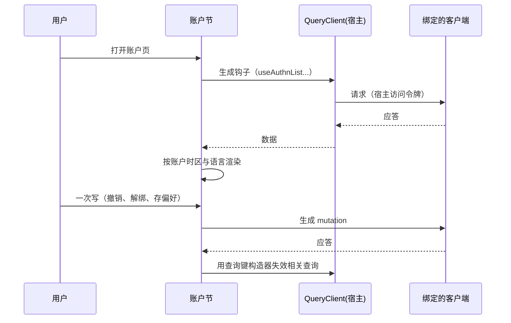

# account-ui

## 职责

`@speed/account-ui` 是一个 speed 前端已登录一方的账户管理组件族：一组节（section）组成宿主的账户页。它交付下列面：

- `PreferencesSection`：语言与时区两个下拉，编辑账户存下的偏好，读写账户自己的偏好路由。语言的取值集是 i18n 实例自己的受支持集；语言的选取先写账户、确认写入后再落设备（手选槽位），清空偏好只动账户；时区取值集是引擎的 IANA 列表加一个显式的「未选」。
- `SessionsSection`：账户的会话与设备列表，当前令牌所属的那条打上当前徽标，逐条撤销与批量撤销「其它设备」。撤销自己的会话是低损失动作（行上不再确认），撤销其余是 ui-kit 危险 `ConfirmDialog` 的两步确认。
- `LoginHistorySection`：登录历史列表，服务端应答的最新一页在前，页大小固定。
- `SocialBindingsSection` 加 `BindingCallbackHandler`：社交绑定面与在宿主回调路由上完成一次绑定的处理器。
- `MfaSection`：经加强认证（step-up）门控的两步验证设置——TOTP 认证器与恢复码。

这些面是节，不是一个带路由的屏：拥有它们的页面、它们之上的标题、以及本包之外的其它面（档案字段、口令设置）都是宿主内容。

### 非职责

- **不做档案与口令的自助写。** 账户的显示名与通用属性由认证的自助档案面承载（[ADR-authn-selfservice-profile-2026-10-15](../../../adr/adr-authn-selfservice-profile-2026-10-15.md)），口令、手机号、删标识与解绑外部身份由登录自助面承载；本包只交付上述账户页的节。
- **不拥有查询客户端。** 每次读经 `@speed/api-sdk` 的生成 react-query 钩子，跑在宿主拥有的 QueryClient 上；本包从不自造 QueryClient，也不手写查询键，失效一律用导出的查询键构造器。
- **不读存储、不 attach 会话、不导航、不直接触网。** 会话只在一条生成面表达不了的会话操作存在时以属性传入——绑定添加区的授权 URL 请求（`session.socialAuthorizeUrl`）与两步验证挑战对话框的校验（`session.verifyStepUp`）。没有会话操作要驱动的节不接会话属性。
- **不发明规格没有的操作。** authn 规格不交付因子状态操作与停用操作，故 `MfaSection` 从不声明启用或停用，状态经动作发现。
- **不 import `@speed/auth-ui`。** 同层包互不 import；`SocialProvider`、`SocialProviderConfig` 是本包自己的定义，与 auth-ui 的同名类型逐字一致并保持同步，渠道集以 authn 规格为共同来源。
- **不做服务端判定的替代。** 权限、租户隔离与账户归属都由服务端判定；本包只渲染应答。

## 外部接口契约

`web/packages/account-ui/src/index.ts` 是公开面：`PreferencesSection`；`SessionsSection`；`LoginHistorySection`；`SocialBindingsSection`（连同 `SocialBindingsSectionProps`、`SocialProvider`、`SocialProviderConfig`）；`BindingCallbackHandler`（连同 `BindingCallbackHandlerProps`）；`MfaSection`（连同 `MfaSectionProps`）；以及命名为 `ACCOUNT_UI_NAMESPACE`、`accountUiResources` 的资源对。`web/packages/account-ui/src/internal/` 下的错误文案解析器、失败横幅、加强认证对话框与翻译钩子是族内管线，不外导。

```tsx
interface SocialBindingsSectionProps {
  readonly session: AuthSession
  readonly providers: readonly SocialProviderConfig[]
  readonly onAuthorizeUrl?: (url: string) => void
}

interface MfaSectionProps {
  readonly session: AuthSession // 只为挑战对话框的校验
}
```

`SocialBindingsSection` 的 `session` 属性只为添加区向会话要授权 URL；`MfaSection` 的 `session` 属性只为挑战对话框驱动 `session.verifyStepUp`——注册、确认与重生成本身是走共享访问令牌的生成调用。其余节不接属性：它们显示谁的会话或历史，来自调用方绑定的客户端与它的访问令牌。

**查询键构造器是公开面。** 失效用本包导出的查询键构造器（如 `getAuthnListIdentitiesQueryKey`），不经手写键。

**稳定性承诺。** 公开面是上述导出集；`SocialProvider`、`SocialProviderConfig` 的形状与 auth-ui 的一致，渠道集以 authn 规格为共同来源。文档化的用法由 `web/packages/account-ui/src/usage-example.test.tsx` 端到端编译并运行，故 README 的装配不能与 API 漂移。

## 依赖

| 依赖 | 用途 |
|---|---|
| `@speed/auth-core` | 两处会话操作的 `AuthSession` 类型与操作（`socialAuthorizeUrl`、`verifyStepUp`） |
| `@speed/api-sdk` | 每次读的生成 react-query 钩子、每次写的生成 mutation、查询键构造器与 `authnSocialCallback` 调用 |
| `@speed/ui-kit` | `ConfirmDialog`、`EmptyState` 与表单原语 |
| `@speed/i18n` | 命名空间注册与文案的翻译钩子 |
| `@tanstack/react-query` | peer（必需）：宿主供给的 QueryClient 与它上面的钩子 |
| `react`、`react-dom`、`@mui/material`、`@emotion/*`、`react-hook-form` | peer（必需）：宿主拥有的 React／MUI 树与表单库 |

`@speed/api-client` 是 devDependency：公开类型不引用它，只有测试夹具绑定真实客户端。方向是 `@speed/account-ui` 比 `@speed/auth-ui` 的层高一档，处于生成钩子这一层之上；`@speed/auth-ui` 从不被 import。

## UML 图

一次读取与一次写入的路径。图里画不到的约束：读经生成的钩子跑在宿主 QueryClient 上，写经同一 `bindRequestFn` 绑定的生成 mutation；时间一律以账户的时区链显式格式化，不用 Intl 的进程本地缺省；显示时间之外，服务端词表（登录方式、失败原因、`amr`、渠道）只在白名单内渲染。



## 核心数据结构

| 概念 | 形状 | 说明 |
|---|---|---|
| 时区链 | `resolveTimeZone` | 存下的偏好，否则设备时区，否则 UTC；每个时间渲染都显式传 `timeZone` |
| 渠道词表 | `SocialProvider`、`SocialProviderConfig` | 本包自己的定义，与 auth-ui 的同名类型同步 |
| 加强认证对话框 | `StepUpChallenge` | 一个六位 TOTP 码或一个恢复码；驱动 `session.verifyStepUp`，成功后重跑被门控的动作 |
| 命名空间 | `accountUiResources` | `zh-CN` 与 `en-US` 两份目录，叶子键集相同 |

## 核心算法与流程

### 经加强认证门控的两步验证

`MfaSection` 不声明因子状态，状态经动作发现。两次入口动作走同一个「先做后知」的机器：

1. 设置认证器。一次 200 打开向导，显示密钥与配置 URI（本包不带二维码依赖与剪贴板，手输是受支持路径）；随后一个六位确认把因子置为激活，确认应答的恢复码打开只显示一次的面板。一次 200 是首次设置还是替换既有因子，由调用方自己的提权决定，不由应答状态码决定——令牌已经携带新鲜的第二因子证明时，替换警告渲染。
2. 重生成恢复码。处理器无条件门控这一步，未提权的调用方拿到 403 而无论因子是否存在；加强认证对话框打开，成功后重跑重生成。

一次门控动作在被拒时打开加强认证对话框，记住被门控的动作；一次成功的校验落定一个带刚验证因子的新访问令牌，成功路径重试那次被门控的操作恰好一次，取消则不重试。提权只活在那一个访问令牌的存续期内，对话框从不承诺不再询问。

### 绑定回调的应答形状分派

`BindingCallbackHandler` 的效果以 `(code, state)` 为键，故 StrictMode 的双次调用只发起一次交换。绑定形状的应答（无令牌）失效身份列表查询并触发 `onBound`；登录形状的应答（带令牌：调用方的登录已死、交换变成一次登录）渲染专门的另行签入面板且不触发回调；交换失败渲染错误码文本与一个重试按钮。

## 错误与失败语义

**失败面是一个错误码白名单加受守卫的词表。** 每条失败路径解析成一个错误码，渲染在一条 `role="alert"` 横幅里；白名单外的码渲染 `errors.unknown`，永不渲染裸键。登录历史的失败原因令牌与登录方式同样受守卫：令牌只在组件已知的取值表上才经 `t()` 渲染，否则渲染通用的其它标签。

| 情形 | 表现 |
|---|---|
| 一次写被拒（会话生命期、`authn.rate_limited`、`client.*`） | 一条横幅渲染错误码文本，相关查询在选择处失效 |
| 撤销自己的会话命中已死的会话 | `authn.session_not_found`，列表重取以收敛 |
| 解绑会抽掉最后一个登录方式 | `authn.last_login_method`，服务端按自己的登录方式计数判定 |
| 两步验证确认被拒（他人的确认抢先、因子消失） | 关掉向导并渲染错误码文本；一次错码是字段级错误、可重试 |
| 步骤校验的码已被用过 | `authn.mfa_code_used`：清空字段、渲染用过的码文本，绝不用同一码重试 |
| 恢复码重生成时无激活因子 | `authn.mfa_not_enrolled`，渲染引导文本并指向设置入口 |
| 偏好写入被拒（`authn.invalid_locale`、`authn.invalid_timezone`） | 两行失败警报，控件退回存下的值（天然回退，无撤销记账） |

**恢复码只出现一次。** 只显示一次的面板是恢复码唯一出现的地方；离开它即重置全部状态，本包不缓存也不重取恢复码，再看只能重生成。

## 并发与事务边界

- **写后失效。** 每次成功的撤销、解绑或绑定都失效相关列表查询，让行收敛到服务端应答；失效用导出的查询键构造器。
- **提权的存续期是一个访问令牌。** 一次加强认证的校验落定一个新访问令牌，其 `amr` 带刚验证的因子；提权只活在那个令牌的存续期内。一次校验输给一场并发操作竞态时，码已被服务端验证因而用过——本包渲染用过的码文本、清空字段，绝不用同一码重试。
- 本包不打开事务；读与写都是宿主 QueryClient 与绑定客户端上的往返。

## 实现状态

| 能力 | 状态 | 代码 |
|---|---|---|
| 偏好节 | 已实现 | `web/packages/account-ui/src/PreferencesSection.tsx` `PreferencesSection` |
| 会话列表与撤销 | 已实现 | `web/packages/account-ui/src/SessionsSection.tsx` `SessionsSection` |
| 登录历史 | 已实现 | `web/packages/account-ui/src/LoginHistorySection.tsx` `LoginHistorySection` |
| 社交绑定与回调 | 已实现 | `web/packages/account-ui/src/SocialBindingsSection.tsx` `SocialBindingsSection`；`web/packages/account-ui/src/BindingCallbackHandler.tsx` `BindingCallbackHandler` |
| 两步验证设置 | 已实现 | `web/packages/account-ui/src/MfaSection.tsx` `MfaSection` |
| 命名空间资源 | 已实现 | `web/packages/account-ui/src/resources.ts` `ACCOUNT_UI_NAMESPACE`、`accountUiResources` |
